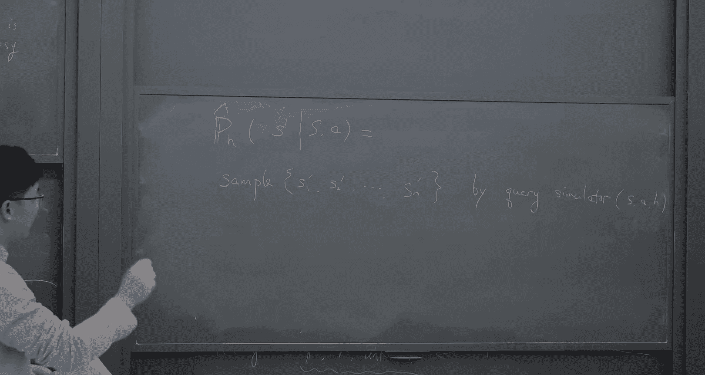
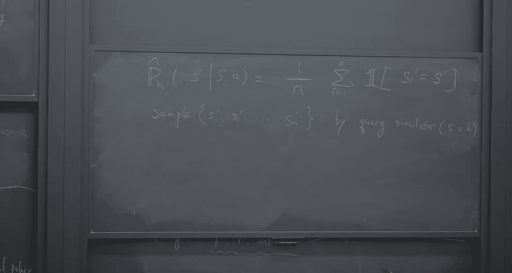

# 强化学习基础：课程5：鞅集中性与模拟器学习

在本节课中，我们将要学习两个核心内容。首先，我们将正式定义鞅差序列，并学习其对应的集中不等式——Azuma-Hoeffding 不等式。其次，我们将把目光转向强化学习中的学习问题，介绍在“模拟器”设定下，如何通过估计转移概率来学习最优策略。

上一讲我们介绍了独立随机变量的集中性，并开始讨论在更弱条件下——即鞅差条件——的集中性。本节中，我们将更严谨地定义鞅，并学习其对应的集中不等式。

## 鞅与鞅差序列的正式定义

首先，我们需要一些术语。假设有一列递增的 σ-代数（或称滤链）F₁, F₂, ..., Fₙ。直观上，Fᵢ 包含了到时间 i 为止的所有随机性信息。

我们说随机变量序列 K₁, K₂, ..., Kₙ 是关于滤链 {Fᵢ} 的一个**鞅差序列**，如果满足以下两个条件：
1.  **可测性**：对于每个 i，Kᵢ 是 Fᵢ-可测的。这意味着 Kᵢ 的值由到时间 i 为止的信息决定。
2.  **条件期望为零**：对于每个 i，有 **E[Kᵢ | Fᵢ₋₁] = 0**。这是核心条件，意味着给定过去的所有信息，下一步变化的期望为零。

常见的滤链选择是 Fᵢ = σ(K₁, ..., Kᵢ)，即由前 i 个随机变量生成的信息。但滤链也可以包含其他随机性，只要满足上述两个条件即可。

基于鞅差序列，我们可以定义**鞅**。序列 S₁, S₂, ..., Sₙ 是一个鞅，当且仅当它可以表示为鞅差序列的部分和：**Sᵢ = Σⱼ₌₁ⁱ Kⱼ**。

直观理解：鞅差条件弱于独立性。它不要求每一步独立，只要求给定历史，下一步的期望变化为零。许多随机过程（如强化学习中的回报估计）天然满足鞅差性质。

## Azuma-Hoeffding 不等式

现在，我们来看鞅差序列的集中不等式。它与 Hoeffding 不等式非常相似，只是前提条件从“独立”放宽为“鞅差”。

**定理 (Azuma-Hoeffding 不等式)**：
假设 K₁, K₂, ..., Kₙ 是关于滤链 {Fᵢ} 的鞅差序列。并且，对于每个 i，Kᵢ 以概率 1 落在某个长度为 Rᵢ 的区间内（即有界）。
那么，对于任意 t ≥ 0，有：
**P( Σᵢ₌₁ⁿ Kᵢ ≥ t ) ≤ exp( -2t² / Σᵢ₌₁ⁿ Rᵢ² )**

这个结论与独立情形的 Hoeffding 不等式形式完全一致。证明思路也类似，主要区别在于处理期望时，需要利用条件期望的性质进行迭代，而不是直接利用独立性将乘积的期望拆开。

类似地，我们也有鞅差版本的 Bernstein 不等式（Azuma-Bernstein），它在方差较小时能提供更紧的界。

总结一下，我们目前学过的四个主要集中不等式：
1.  **Hoeffding 不等式**：针对独立有界随机变量。
2.  **Bernstein 不等式**：针对独立有界随机变量，但利用了方差信息，通常更紧。
3.  **Azuma-Hoeffding 不等式**：针对鞅差有界随机变量。
4.  **Azuma-Bernstein 不等式**：针对鞅差有界随机变量，利用了条件方差信息。

## 并界及其推论

在应用集中不等式时，我们经常需要多个事件同时成立。这时会用到简单的**并界**。

**命题 (并界)**：对于任意事件 A 和 B，有 **P(A ∪ B) ≤ P(A) + P(B)**。

一个常用推论是：如果我们有 n 个事件 A₁, A₂, ..., Aₙ，每个事件以高概率成立，即 **P(Aᵢ) ≥ 1 - δ**。那么所有这些事件同时成立的概率至少为 **1 - nδ**。
证明思路是考虑补事件，并应用并界。

在后续分析中，我们通常会先证明某个单步估计以高概率成立，然后对所有状态-动作对或时间步取交集，通过支付一个 n 的因子（即并界代价）来保证所有估计同时成立。

## 模拟器设定下的强化学习

现在，我们转向强化学习中的学习问题。回忆一下，马尔可夫决策过程（MDP）由状态集、动作集、奖励函数、转移概率和时序长度 H 定义。在规划问题中，我们假设已知所有参数（P, R）。在学习问题中，这些参数是未知的。

我们首先介绍最简单的学习设定——**模拟器**（或称生成模型）设定。

在表格型 MDP（状态和动作空间有限）中，模拟器是一个黑盒。你可以输入任意三元组 (状态 s, 动作 a, 时间步 h)，模拟器会输出：
*   下一个状态 s‘，根据真实的转移概率 Pₕ(s’|s, a) 随机采样得到。
*   即时奖励 r，这里我们假设奖励是确定性的，即 r = Rₕ(s, a)。

**模拟器的能力**：它允许你“传送”到任何你想查询的状态-动作对。例如，在一个迷宫问题中，你可以直接查询“在某个位置向右走会怎样”，而无需从起点一步步走到那个位置。这是一种较强的探索能力，简化了学习问题。后续我们会讨论更现实的在线学习和离线学习设定。

**学习目标**：找到一个策略 π̂，使得其价值函数 V₁^π̂(s₁) 与最优价值 V₁*(s₁) 的差距不超过 ε，即实现 ε-最优策略。我们关心的是**样本复杂度**：需要向模拟器进行多少次查询，才能保证找到这样一个 ε-最优策略。

## 基于模拟器的值迭代算法

一个直观的算法是：先利用模拟器收集的数据估计未知的转移概率 P，然后在估计出的 MDP 上运行规划算法（如值迭代）。

**算法步骤**：
1.  **估计阶段**：对每个 (h, s, a)，向模拟器查询 n 次，获得 n 个独立的下一个状态样本 s‘₁, s’₂, ..., s‘ₙ。然后，用经验频率来估计转移概率：
    **P̂ₕ(s‘|s, a) = (1/n) Σᵢ₌₁ⁿ 1{s‘ᵢ = s’}**
2.  **规划阶段**：将估计的 P̂ 和已知的 R 代入贝尔曼最优方程，进行值迭代：
    **Q̂ₕ*(s, a) = Rₕ(s, a) + Σ_{s‘} P̂ₕ(s‘|s, a) V̂ₕ₊₁*(s‘)**
    **V̂ₕ*(s) = max_a Q̂ₕ*(s, a)**
    最终输出贪心策略：**π̂ₕ(s) = argmax_a Q̂ₕ*(s, a)**

**核心问题**：我们需要为每个 (s, a, h) 收集多少样本 n，才能保证最终策略是 ε-最优的？这关系到算法的样本复杂度。我们将在下一讲中具体分析这个算法的理论保证。

本节课中我们一起学习了鞅差序列的正式定义及其集中不等式 Azuma-Hoeffding，并介绍了强化学习在模拟器设定下的基本学习框架。我们看到了如何将估计与规划结合，并引出了样本复杂度这一核心理论问题。掌握这些工具是分析更复杂学习算法的基础。