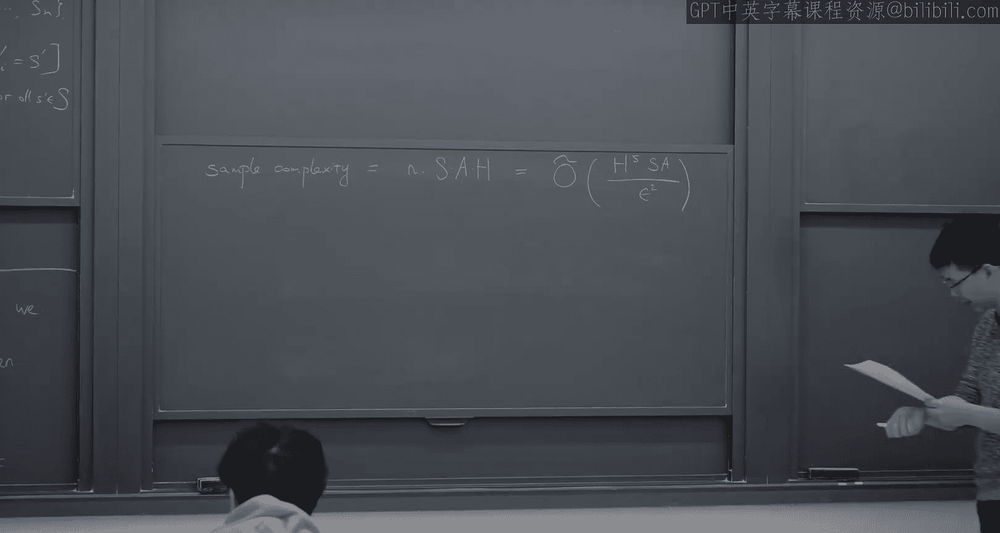
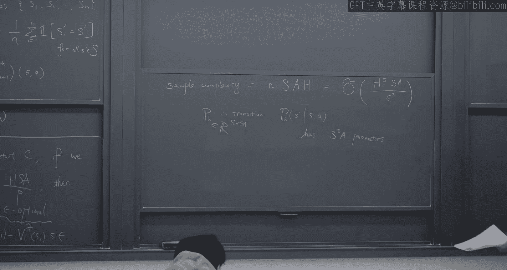
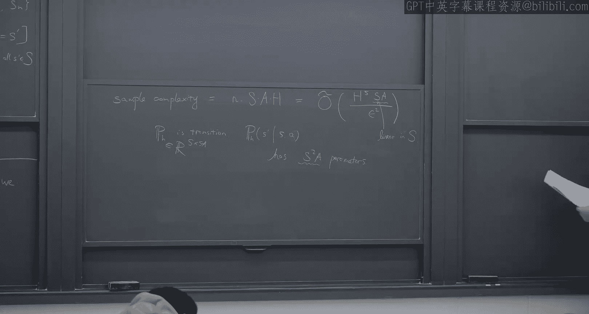
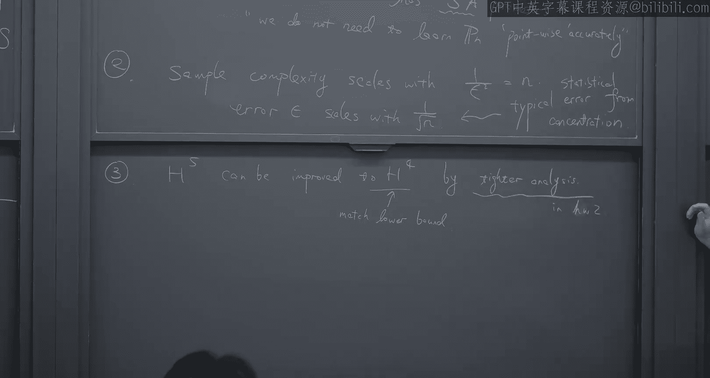
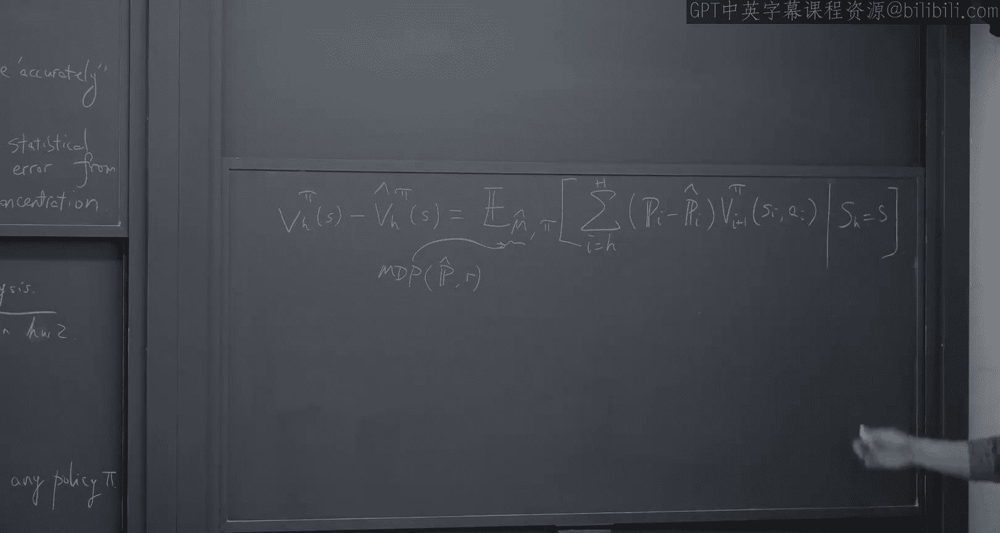
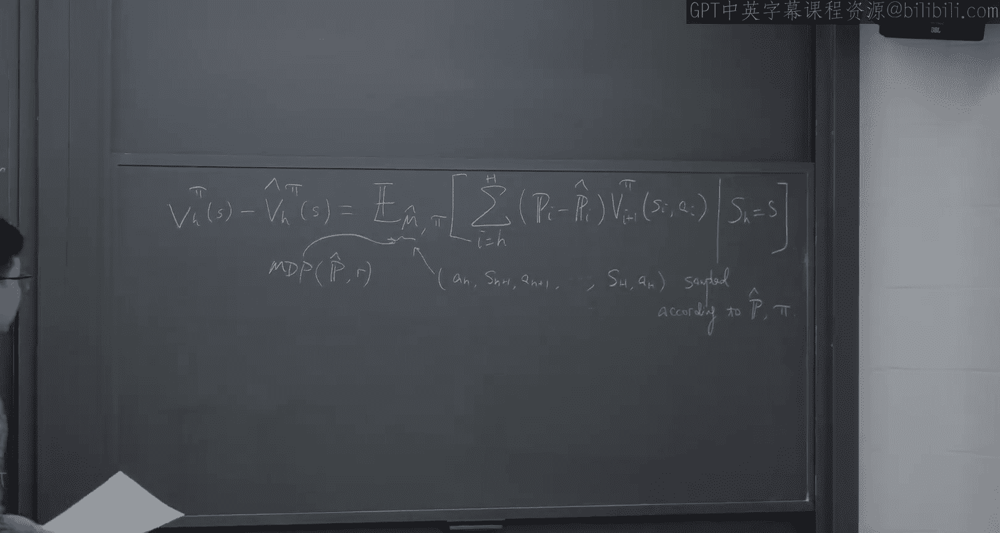
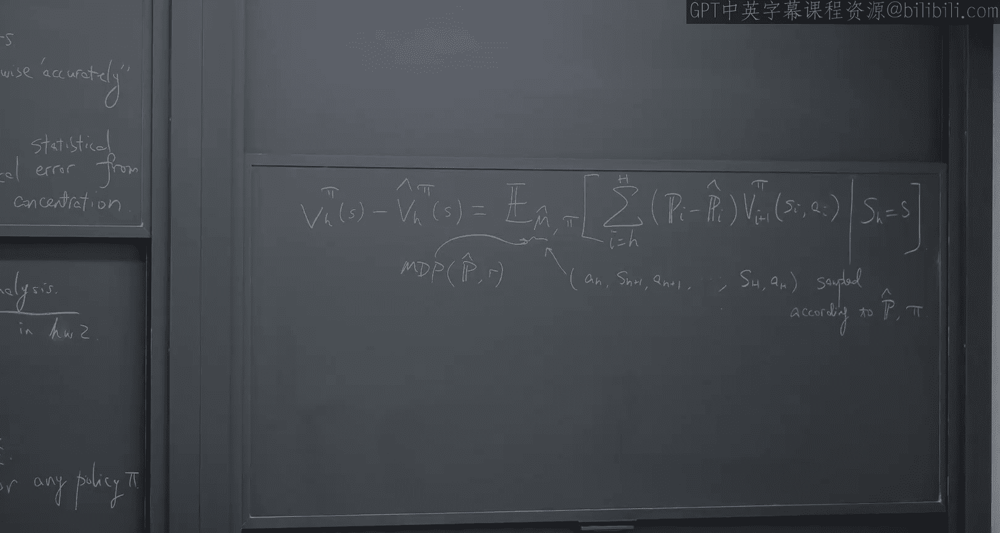
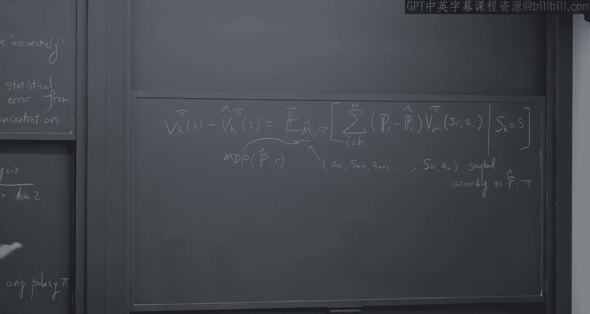

# 普林斯顿大学《强化学习基础｜ECE524 Foundations of Reinforcement Learning Sp24》中英字幕claude-3.7-s p06 Lecture 6_  Generative Models.zh_en -BV1vewWeRE5X_p6-

So in the last Thursday， we talk about we end with like the value tu algorithm in the simulator setting。

 so just recap what is the algorithm is。This is like simulator setting。

 Or we also call this like generator model。So essentially we have already talking about value algorithm in the planning。

In the planning task where we know the transition and reward。

 the only difference here is now in a simulator setting， we don't know the transition。

 So the first step is we need to kind of estimate the transition。

So the way we estimate me a transition is for all。States action horizoniz。Pair， tripleple。

In all state， action。We do the following。We can't like query the simulator。

 Just remember in a simulator， we take a stage action and step as an input。

And we kind of queryd the submitter。And times。So we will collect n samples of next states。

That is suppose we click with S1 prime， S 2 prime till S M prime。

And we will just do a very simple estimation of the transition probability using the empirical frequency of some state。

 Some next state appears。So we'll estimate the transition。By this， P had H。S prime。我的是呢SA。

Its equal to one over n。 That is total samples。 We kind like will query this simulator。And times。

Indicator of how many times I have seen。S I prime to be exactly S prime。Iron 1，2 F。For all S prime。

Yes。And。Essentially， this is the only thing new in a similarulator setting and the remaining setting will be the same as the value in planning。

 that is we just do Belma automatic equation。H equal to y。H from H to1。 Do the following。

Now this we will compute。Kill star hat。H。SA。Equal toH。I say。And plus。She had。V H plus1 at star S A。

This is like the first step of Belma optimal equation where we replace all the QRV star by the hat version that is our estimated version and the only important difference is like because we no longer have access to the transition。

 so we use our estimate of transition to replace the true one in a Belma optimal equation and we will also do the same for the V value。

The storage。Is equal to max a。Al。Q hat。Star essay。So essentially we talk about this in the very end of the last lecture。

 we like the VI algorithm in a similarulator setting composed of two components。

 The first component is essentially we use the first for loop to estimate transition P。

 We essentially we get the P hat is our estimate and the second for loop is just standard bema optimal equation and we use dynamic programming to compute optimal value and finally we just output the policy。

That is the hatas。Equal to the essentially the policy we output is just the greedy policy induced by Q hatat star。

So the second phase， essentially we have already estimated， we have an estimated P hat。

 We know this is not necessarily exactly equal to the P。

 but we we can of consider it to be close to the true transition in some sense。

 So essentially we just do optimal be optimal equation using this P hat treated as a P and also do the output the same。

 like essentially we just do everything treated this P hat as optimal as a true transition。

So this is the algorithm。So we clearly can think this algorithm kind of makes sense。

 especially like let's convince ourselves when n go to infinity。

 we cant like know by law of large number， this Phead will converge to the true transition P okay in that sense。

 we essentially in the first step well learn accurate transition and the second step just do bema optimization equation。

 So this is clearly an algorithm or ayically create correct algorithm when n go to infinity。😊。

But since we have learned a lot of tools in the last week or the week before on like concentration in quality。

 so we actually given a much stronger result， we were not only talking that when angle to infinity we get the correct result。

 but we will also talk about precisely how many samples we need to find some like epsilon optimal policy。

So today we'll like go to talk about our first statistical guarantees。

 like first guarantees for statistical reinforcement learning。So theorem1。We say。Do it exist？

An absolute constant see。If we choose。This sample size N。

 where n is the number of samples we need to query simulator for each S A H pair。

Wehi choose this n to be greater equal to C times H to the power fourth and some Yota over epsilon square。

Where Utah will essentially， throughout this course。

 we use Utahta to just essentially mean some log factor。Yda is equal to the log。HS A over P。Then。

With probability。At least1 minus p。The output。Pai hat。Of V。Will be Epsilon optimal。

So you can think this theorem actually not only says like when n go to infinity， this is accurate。

 we actually give a precise bond， we essentially says when n is greater than some absolute constant times this amount。

Then we are guaranteed this output of the valuetu algorithm is actually epsilon optimal。

 and just record that by definition of Epsilon optimal last time we say we defined this in terms of a V star。

1-1 minus v pi hat。1 S 1。 This is less than。Absolent。That is the Tihat policy。

 when we evaluate the value at the first step and the initial state is very。

 very close to the optimal value。Let me separate out you。你佢好 top。What， why why is constant。Like yeah。

 you can just put it there， but I think we in this course。

 we will always like a separate yieldhouse because a lot of times log term can be complicated。

 but for this course， I think usually we don't really care about a log vector so we can just think this is like some small multiplicative factor。

Or sometimes like when you write some O tuilda， you can just just get rid of this。But like the。

 the result is that it's like。And it to be fortunate to like one of our epsilon squared。Yes， yes。啊。

where does the epsilom came from？Okay， the question is where the epsilon came from。

 Epsilon in the in the guarantee。 That is， if we want to guarantee the epsilon optimal policy。

 we need to choose sample sense that is still with one Epsilon square。 That is if we want。

 we want to be more accurate than we need more samples。So epsilon is yeah can be set set bias。Yes。

咁国笑。Only a Wednesday as one。I think for， for this course， we will just， like we said， for simplicity。

 we always make S1 to be like the fixed initial states。

 So we always assume we have any fixed initial states。

 But if you say your initial states is sample from some distribution。

 you can also say this is an expectation of。That one in sample front a distribution， like。

 this is true。 you can also guarantee the same thing with the same number of samples。

P is the probability， with probability11 minus P。Okay。

 so we will first make some comments about theorem1。

 and then we will spend essentially a lot of time in this lecture to prove the theorem。So first。

 we will talk about what is the sample capacity？They throughem gives us。Some of the material。

 as we discussed last time is essentially we were defined as how many times we need to query the simulator in total to find this eps optimal policy。

So in this case， some is we have M samples。For each state， action H pair。

So that means we need n samples times the number of states times the number of action times the the number of steps。

 So this is the total amount of samples we need to get the eps accurate policy。

And we can essentially just multiply them together and become something like Otla。Otla， as we said。

 essentially we will hide some constant factor and logarithmic factor。

 and it will become some H to the fifth S over epsilon square。

So this is essentially we're claiming that the value will use some polynomial for the horizon and linear in states linear in action and over Epsilon square samples to learn an optimal policy。

 to learn an epsilon optimal policy。

One very important thing I want to claim is let's just remember in P， P is a transition。

And if you remember， like， like what is number of parameter or number of degree of freedom in this transition。

 the transition essentially depends on the next states and the previous states and action。

So essentially you can think this P is a matrix。Or anyP。PH is a matrix that is。In S by essay。

So the transition actually has S square a parameters。

So the transition at each step has S squared parameters， and if you have H transition has a time。

 you kind of multiply the entire thing by H。But let's ignore the H dependence here。

 The important thing is， although the transition actually has S square a dependence。

We actually don't need to pay S square a in the sample complexity。

 It turns out the entire samples we need to learn the。

 the MP or learn accurate policy is only depends on linear in us。So we'll actually talk about。

This fact later。 So it turns out intuitive answer is like， we don't need to。To learn this transition。

 P，Point wise accurately。We will talk about like， in what sense is this wise and that kind of thing later。

This is first comment。The second common is we actually see the sample complexity。Skills with。

One of Epsilon square。 This is another important kind of dependency。 We need to know， like how。

 how it depends on the Epsilon。So this is like in terms of a number of sample scale with one over epsilon。

 So let's just pretend like this is the entire sample episode。 if we make this equal to n。

This essentially says the arrow。Apsilon is going to。Scall with。W a a square event。

And we see this is like a typical error rate we see from concentration。Typical statistical error。

So no matter in Hing or in Bton， the the leading other term in terms of arrow is always like decrease as a one skirt n。

 So this is essentially where it comes from。And so in the first comment。

 we talk about this SA dependence， the second comments talk about the epsilon dependence。

 so the finally I want to also comment a bit about the H dependence。So it turns out to。

So in this class， we will just introduce a slightly simpler proof。

 We will essentially get the H to the fifth sample complexity， but this H to the fifth。

Can actually be improved。To H to the fourth。By using slightly tight by using slightly tighter analysis。

So we will actually introduce the like the course analysis as， as like what we like in this class to。

 to make it simple。 And we will kind of leave this analysis in the homework， too。

And we will kind of talk about what is the key steps to achieve in this。Hyer analysis。

And later we will actually also has lower bound to say。Like， this is essentially information optimal。

 information theoretical optimal。 So you cannot improve。Like two H cube or something。

Like this edge edge force is already sharp。 Like there's no way to get better than H to the force by any algorithm。

 There's just no no way to， like no matter what algorithm you use。

 you cannot get a better than H to the force。 This is infoing theoretical look。

And you might think this H to the force is kind of through some higher parnomial。

 and you don't know like why we have H to the force there， but it turns out to。

I think some of some of the H is actually because of the the our characterization of H epsilon。

Because you can imagine in our MDP， we can essentially assume the reward at every step is only from 0 to1。

 That means the value itself is from 0 to h， so the value itself has H scaling it so you can think epsilon is also something should be in0 to H。

So in essence， although you have edge to the force but。But essentially。

 two of the H has the same scaling as epsilon。 So you can think epsilon kind like cancels with some H s。

 So some intrinsic H dependency here is just H， H squared。So essentially。

 you can decompose this into h square times h square， and this is intrinsic。

This is the essentially scale scaling。Cunancecils with。

So what I mean cancels with Epsilon is instead of assuming this epsilon。

 you can assume this epsilon H， then you just get rid of h square。

 This is just because some scaling we choose。Okay， any questions about the。About the theorem。

 So I think this is our first theorem talking about some sample complexity。

 So it's kind of have a lot of statistical flavor。 And we go to talk about what is exactly state sample complexity。

 And we talk about how。😊，Each dependency， why each dependency makes sense。Okay， if no questions。

 we'll go to prove the theorem one。So in other2， theor one is actually not very hard to prove。嗯。

So I first introduced the first dilemma， we only needed twolemas。Actually， one of them。

 you already did it in a homework one。So the first dilemma。

I think the first lemma is essentially we want to guarantee the value has an ain error。

But all we have is we have some estimate in the transition。 So the first Lama， essentially。

 we want to relate the difference in in terms of value to the difference in terms of transition。

 And so later， we can essentially bound the difference in terms of transition by concentration。

 and then we， we kind of get the result done。So Lamma1 is about relation。A value difference。

And the transition difference。So the Lamma status as follows。That for any policy pie。And any states。

Horizon pair。In S and H。We have the following in the quality。 Oh have following equation holds。

That is the V pi。Yes。Minus V hat Hi H S。E equal to。Expectation。

We'll talk about what's this notation later。 I'm hot。系。And summation of the difference。

 I from H to capital H。PI。Minus P hat。VI。Plus one。系。S I。Conditional S H equal to S。

So we have the following holdss for NHNS。I already says this for an in。Okay。So first。

 we introduce what is this notation of M hat。M hat， I don't remember if if I。

 if I say this in the last lecture， but M hat essentially is our like， essentially。

 you can think this is a new MDP where use the P hat as your transition。 And R is your reward。

 This is the M hat。So taking expectation over M hat means the essentially we're saying here。

 just remember， the random thing here is the future trajectory。

That is， willll have AH。S， H plus one。A H plus one。And lot to S， H， A H。

So all those things are random in this expression。 So taking expectation by M hat and pi means a。

 all of the action A are sampled from pi and all of the next states S H plus one until S capital H is sampled from this P hat。

So those are a sample。According to。P hatt a P皮 hatt and pie。

So this is the lemma1， although the formula is a little bit complicated。

 but essentially we will see very soon that is essentially if you。

 if you just expand the value by Belman equation and you immediately see like why this thing comes in just by calculation。

 and we note this is the value in difference difference in value。

And this is a difference。In transition。So we can of achieve our goal where essentially we want to establish the relation between the value difference and the transition difference。

And we can essentially use this as our bound to say if the transition has no error or thisarrow is very small and you can expect it。

 So this value is small just by looking at。Looking at this formula。So we'll proof thelemma1。

Any question about the firstlemma？You may also wonder why this is like asymmetric。

 like we have M hat here and。AndAnd instead of an。 so actually。

 you can also make a this is like can can be swapped。 You can also make M here。

 But instead of V here， you will have V hat here。 So in some sense， this is symmetric。 You So you。

 you need to have hat here and non head here。 or you have， no， no hat here， but hat here。

 your head need to be appear to one of the place。So we' will talk about proof of Lama1。As we said。

 the proof is essentially just follow the bellman equation。So by bioelma equation。We have following。

That is， we look at the。Q hat。A Q H。That谁。Subtract by Q hat。HHSA。And this is equal to。P，H。

VH plus one拍。I see。Subtracted by。P hat H。Right。H plus one派。I see。I think should also say this V hat。

Notation is defined as the value of this MP。So essentially， we。

 we have this like modified MP and the value of pi on this modified MB is denoted as V hat。

 So this Q hat is also deployed and denoted as the value of。嗯。

 policy pie on this like modified version of MDP。So both just by Bma equation。

 the first is by original MDP， so we expanded by PV， and the second is the modified MDDP。

 so we have a P hatd we hat。This is very standard。And then， we just。Add a term， a subtractor term。

So we essentially have PV subtractor P hatd V hat， and we will add a P hat V。

 sub subtractor P hat V and plus P hatd V back。So this is是 equal to P。Subtracted by P hatt。

Times V H plus one pi S。Plus。She had。H。Times V H plus one。Pi subtracted by V H plus 1。Pi hat。

So all we are doing is we subtract this term， subtract the P had V， and we added back。

 add the P had V back。 So we didn't change anything。 We just。Subtract and add back the same term。

So this essentially give us some structure。 We know this the difference in a Q value can decomposes some difference in a P in the transition times the value of the true MP and plus。

Essentially， the value difference of the next step。 if after。

 after we apply the transition of the modified MDP。

 So you can see this is why we can like we have that kind of formula there。

So all we need to do is just we do one more step。This is like a V Q value。So we can， by be equation。

 we can also do v value。Subtracted by the value。Of this edge。So in terms of v value。

 all we need to do is we just taking the action by like taking the action。

 taking over expectation over this policy pie。So we just write it at a。Expectation。

Taking expectation over action。Through policy派。And P，Subtracted by P， H hat。The h plus  one。牌儿。S。

 H A H。Conditional S， H equal to S。 This is the first term。And we can further write a second term。

It turns out the second term is precisely we can take expectation over m hat and pi so pi is something we need to take expectation because we do the V value and we can essentially absorb this transition P hat into like taking samples according to P hat。

 so sample according to this modified MDP。And we look at the value difference at the next step。Okay。

行と変かです。About a second term，That just let me。别看呃别。This one。With this one， I think we can。

 or can also just quickly write this out， right， by， by notation of。The this notation。

 we know this is equal to。Taking expectation。Over S prime sampled from P hat。到SA。And this is S prime。

 right。So we're essentially just write， write this thing as an M hat。

 And then we take another pie over the action。 So this is all we need。 All we did。

 We didn't do anything else。I think the important thing is observe。

 This is precisely corresponding to we take a next step according to this modified MP。

 So that's why we can write in this compact form。So we didn't do anything complicated。

 And it's just we're writing some compact notation so that we can see things through a recursive fashion So we can think this is essentially we。

We kind of relates the value。Value difference in each step。To the。

This is like the transition difference in each step and the value difference in the next step in H plus one step。

So we can essentially expand the recursion。Expand recursion means for the value in the next step。

 we can again apply the same argument and we can decompose into the transition difference in the next step。

 h plus one step and the value step in value difference in h plus 2 step。

And we can go on and on and eventually we prove this Lama。Any questions so far about this proof？Yes。

 please。The first term has。はい。And that's a nation。Sorry， could you see the question again。

 a second part of your question。Right。First term it only has pi but I think this is also this is only H and this is H plus1 and when you expand this again like VH plus1。

 that will again equal to the first term has this， but then you have M hat outside。

So so this this is where like youre getting in， you can think this。

 this VH plus1 again will be equal to ph plus1 minus ph plus1 hat and then value difference in the h plus two step where the pH plus1 minus pH plus1 hat now is inside this expectation。

 So that's why you have a M hat here。Okay， I would just do a bit more。

What I'm saying is you will have the。Let's say in a high level， you will have like a deelta v。

This is like a value difference。In the first step is equal to expectation。Of pi。

 it's called it D Dta P。Dta P is essentially a lot of things there。And plus。E派 hat一派M hat。

And deelta V in 2。So Dlta v in 2， we will also have a expectation of pi。

Delta P2 and plus expectation of pi and pat。And that V 3。

So what I'm saying is you can plug it in inside here。

 Then the P2 term will actually not only have this expectation in pi。

 that is taking expectation of a2， but you also have this expectation of E pi and hat that is taking expectation of the first the second data and first action。

 So eventually， you will eventually， when you can expand this outside， eventually。

 you will have like Dta V1 is equal to some summation of。E hat。Pi and Dta P，H from one to capital H。

 where this， this expectation is actually like a concatenation of a lot of expectation of like state action at the different steps。

苹果。P1 actually does doesn't have M hat。 You're right， but P1 essentially has no next states。 So。

 so you don't。Yeah， P1 is like first step。 so you don't have M。Okay。

 so we will talk about the second Lama。 So the first Lamma is pretty straightforward just by directly by Belma optimalim equation。

Essentially， we decompose the value difference by the transition difference。 You can expect。

 of course， like if， if transition are very close， then then two value should be very close。

 essentially， we just have the mathematical formula do that kind of decomposition。

And the second step， essentially now we can say we can bound the value difference by transition difference。

 The second step， essentially， we use concentration to say how much value can be different。

So we'll do Lamma 2。Nowumb which is essentially what we have already proved in homework one。

So for fixed。S A H。And fixed value function。V， let's suppose in 0 to the H。除了。Power of S。

 That is an exponentialal vector with value taken from 0 to each。We say it with probability。

Greater equal to 1 minus P over H SA。We have that。Let's see we have。We have that the。This P。

Subtract by P hat， where P hat is our estimate inval algorithm times the this value。At S A。

Is less or equal to。是。😊，Times H。有场 of。Where this uta is equal to。Lg。HSA over P。

So this is actually precisely the very last question of the homework one。With slightly rescalating。

 where in the homework 1， we can exceed the values in -1，12 H to S here we say 0 h to the S。

 So we kind of have additional H factor here just because of scaling。 And also。

 I think there we don't precisely get this like this probability， you can just say one minus deta。

 But you can easily replace this by like entire quantity datata。

 and we choose this specific P over HSA because later we want to do the union bound。

 But in the homework essentially you prove this with probability1 minus deta。

 and you can do everything with the C1 and log1 over deta over n。

And I don't know how many of you have done the homework。

 but essentially this is done by applying Hfing's concentration inequality。

Which is a very good exercise after we learn all the concentration in inality。Okay。So any questions。

 I guess the proof will be left as a homework already said in homework  one。

And I think I want to emphasize something a bit more like I think in the earlier phase we talk about the sample complexity where we think one very nontrial factor of this like tableular MDP is we don't actually require the S squared a number of samples to learn the transition。

 we actually only require SA。So I think the key thing here is we actually only do this for fixed value function。

 or we can extend this。This can be extended to。rananddom value方式。

But the randomness need to be independent。Of P hat。Okay。

So we need to know what is the what is the probability statement here。

 So this is a probability statement that is with the probability of1 minus P over S H。

 So the only thing random in this quantity。Like， this is a fixed value function。

 and this is a original transition。 There's no randomance here。

 The only thing random here is the P hat where the samples we collected。 Remember this P hat。

 we use empirical frequency to estimate this transition。 So the sample we collected S， S 1。

So this is with probability over the sample。 we collected S1 prime do dot to S N prime。

 So those samples will essentially form the P hat。 Okay， so those things are only random thing。

And we are saying we actually this not only works for fixed value function。

 but also works for random value function， as long as this randomness is independent of P hatD or independent of this S1 to SM prime。

So the reason like we can， we can handle this independent thing is in that case。

 we can first just draw this random function and then apply。Thislemma tool。

 because after we draw the random function first and because this P hat is like completely independent of this random photo function so we can。

 we can still basically apply the same thing and we get the same result。And later here。

 it's actually very important we will use this fact。I also want to make some comments that。

Lema 2 essentially says。Essentially， says as long as N。Equal to some Theta polyage。而且个听到跑去。Let's。

 let's say it just some skating。 So let let's not， not care about H。

 So we already have concentration。That's a。At all state action pair or at S8。

So that means the total number of samples， samples。It's like， again， n times HSA。

Which is we be skating as a。S A instead of S square a。

So this Lama2 essentially already kind of contain contain the most important fact。

 We say we don't require S square a number of samples to to learn a value function well。

 we actually only require S to learn a function value well because for each essay pair。

 we actually doesn't need to pay anything in terms of S。 we just pay as this n equal to some polyage。

 we can push this arrow to be something very， very small。

 and we we kind of already in some very good shape。I just want to say this in general。

 very important thing is we actually consider this is a fixed value function and or like an independent value function。

So I just want to say in general， if this is not fixed value function。

 if this is like some adversarial value function， this is not true。 Okay。

 so we don't have these sharp guarantees。So in P at one。We also kind of have another results。

 we ask you to prove this。P hatt。Minus P。SA infinite norm or TV norm。

Like TV distance is less or equal to O tta。Square root to S。Over at。

This has like some logarithmic term。So this is what we traditionally， in a sense。

 we we require like if we really require some TV distance like probability to learn accurately。

 we typically like measuring in terms of total variance。

Distance in this way we actually see we actually require n to be something linearing as this is also equivalent tool。

Saying， we need the max。S。Pha。P， and this is V value。This is less than O tuta。Square root S over。

Well， here only essentially has this is like Otilda。One over a square moving。

If ignoring the H dependency here。So you can see if we use this type of guarantees。

 then this will actually lose by a factor of S because in for every state action。

 we already need to pay some number of S。Samples to push this arrow to be something。

 something very small。 In that case， we will pay a square a samples。

So the major difference between here and there。 this is like for fixed value or for random value。

 independent of this P hat。 Well， this can be for adversarial value。

 This is essentially because we're taking max over P of value。 So this is adversarial。4 P hat。

At least we can first draw some randomness P hat， and then we can essentially pick some V that is like the worst case against the P hat。

 So， of course， this is like a very loose。So the key observation here。Its for reinforcement learning。

If our task is just one to learn some epsilon optimal policy。Now， it's not necessary。To learn P。

To be accurate enough。For all you。Okay。So this is not necessary。And which which I。

e is in like in in TV distance or something。We only need。To make。P minus P hat。To be accurate。

 concentrate。For。Certain these with good， with good property。

Good property in terms of either it's fixed or it's like random。Which saves as sample compress。

As factor。s坡看不了什么。So the key takeaway is essentially， in short for reinforcement。

 All we care the policy to be great。 So in that case， it turns out we don't actually need to learn。

The transition very accurate in terms of in this sense。

 like we don't need to learn transition so accurate so that it works for any V。 this is accurate。

 We only need for some specific type of V like either fixed or like random as long as this expectation is accurate and then we're good。

 So that's why we we can like bypass the number of parameters in the reinforcement learning。

 we don't pay S squarely。 we only pay as。So we will see this in the final proof for the theorem very soon。

Okay， any questions about this part of discussion？If no questions， we will just directly。

To prove the theorem one， we will immediately see where it comes in mathematically about this key observation。

O。So now we're at the final step。 So final step will actually look at the what we want to bond。

 The thing we want to bond is we say the subop of pie hat， which， by definition。

 we need to look at this。V1 of pi star S1， subtract V1 of pi hat。S1。And remember。

 in the like we first， we want to bridge this to。 We want to like link this to the。

To the transition different so that we can use the concentration。However， just remember our Lama one。

 we actually。We actually use something different。 We actually calculate the value difference in terms of the。

Same policy， but different MDP。 So we' are doing v minus v hat， but we need the same policy。

So here we essentially use the dilemma by just add a term and subtract the term。

Where we do V1 high star。S 1， subtract by V 1 hat pi star S1。And plus。V1 hat high stars1。

Subtract by V1 Ha。High hat。S1。And plus。V1 hat。Hi hat。S1。Subtract by V1。High hot tennisauur。

So we subtract term and added back and subtractor term and added back。

 so this is like precisely equal。And now we have three terms， essentially。

 we will group the first two together as a term A。Gro the last two term together as term B。

And afford this term。We know this is always smaller than zero。Because。Hi hat。Is actually optimal。Oh。

For Ms M hat。Just remember how we， how we computed this pie hat in this value traditional algorithm。

 We directly do the Belman automatic equation on this M hat on this like modified MP。

 So that's why on this modified MP Pi hat is actually the optimal policy because it satisfied the Belman optimal equation there。

 Well， pi star， although it's optimal policy of the original MP is suboptimal in this。M hat。

 so that's why this value is actually greater on this value， so this is smaller equal to 0。

So in order to upper bound this value difference， all we need to upper bound is the term A and term B。

 which is precisely goes back to the Lamma 1 case， where we look at the value on different MDDP。

 on different transition， but on same policy。O。So now let's bomb the term one and term A on term B。

t莓。This is equal to。Directly by Lama 1。And hat。系。And summation。H from one to capital H。Wass this a P。

Subtract P hat。V， H plus one star。SSIAI。Conditioner S1。Okay。So this is just directly by Lamma 1。

But the most important thing we observe here is like if we want to use thelema 2。

 we actually need to argue about whether V being fixed or V being like an independent random thing。

But this is the optimal value function of the true MDP， where true MDP is not anything random。

 Tru MDP there exist on underlying P and R。 So it's not a random at all。

 So this is actually a fixed value。So in the， in a sense。

 it doesn't depend on S1 prime S2 prime to S N prime at all。 So where we can safely apply the Lama 2。

We will actually say by Lama 2。With probability 1 minus P， because Lama 2 essentially。

 say for each state action， this event holds with like a probability 1 minus P over H S A。

 And then we can just use a union bound。 So we say for one minus P probability。

 This thing actually holds simultaneously for all S A H pair。 essentially。

 the last last time we talk about the union bound。 So we can just apply the same concentration for all see action。

union bond will apply Lama too。To all S， H。S AH simultaneously。Okay， so we say this is a smaller。

但系 c。Just times。So each term， if we push expectation inside， each term is smaller than c times H。

And Yota over N。 But we have an additional summation there。

 So we just say summation H from one to capital H。And this is equal to C times H square and Yota over n。

And eventually， just remember in our。Like in the theorem， in the theorem one， we actually choose。

N to be greater equal to c prime for some large constant C times H to the fourth Yota over epsilon squared。

So essentially， we will use Utahta to cancel Utahta and H through the force to cancel H square here。

 and we choose constant large enough so that absorb anything constant here and then。

We say this is less equal to Epsilon over 2。Which is constant large enough。

 so it absorb this constant， but also has an additional factor of two here。Yes。

Where does the storage use。嗯。Small H you used。 Oh， so。 So essentially in this， in this concentration。

 we actually， although this is a。Apply for the transition difference for small H。

 And because we all we have any samples。 So the upper bound actually doesn't depend on H。

 Although the transition difference is like at H star， but upper bound doesn't depend on H。

So what we are doing is we， we push the expect summation outside。 And for each， each each staff。

 we apply the Lama2。 and so it's。This bound， the upper bound actually doesn't depend on a small h。

 so that's why when you do the sum， you just simply have a multiple factor of H。Okay。

 so this is one term。We essentially just need to argue the similar thing for the second term。

 and then we done。Second term is slightly more complicated to argue， but we can manage that。

So we look at the feature。Again， bylema 2， Allema 1。We do the decomposition。

 and is equal to expectation over M hat and pi。We again have this summation。H from one to capital H。

PH。Subtract by P hat。VH。Plus1 high hat。I see。I thought yeah。Conditional S1。

This case is like is definitely trickier because this value here in the in the first argument we just argue this value v star is like a fix。

 but here this is clearly random。 This depends on pi hat where Pi hat actually depends on the sample of simulator。

 so this is random。But a key observation here is we note。This value。VH plus one， pie hat。光内的潘张。

Since this is value at H plus one step。 So it only depends on the policy at later stage。 Okay， V H1。

 V H plus one pi hat do da da T O V capital H hat。 It actually doesn't depend on the policy in the earlier step。

 So we didn't really care about what are the policy on the earlier step。

 We can already fully determine what are those value。

And the next thing is we observed the value which is the dynamicy of programming。

Back from back to the front。 So we actually calculate this hat H only use the data that happens like after age。

So that means those policy， the competition of those policy。Only depends on。

The randomness in this pie hat H only depends on the randomness in this P hat H。 O。

 only depends on the randomness in the very last step。 Well。

 the pi hat H plus1 H -1 depends on the randomness in the last two step。

And da da da until the very first policy the this pie head H plus one depends on the randomness in all the step after H plus one。

The important thing is it only depends on data in the later steps， the， the next days。

 in the later step steps。 It doesn't depend on the next days in the previous step。

So this actually creates inency here because remember in this in this value tradition。

 we actually for each state action and for each SH pair， we actually draw samples independently。

 so that means this randomness in this pH is actually independent to out of the later independent and the transition randomness。

Okay， so this is actually the very key step that observed this value only depends on the transition in the later steps。

 which is actually independent of the the transition samples in the later step。

 which is actually independent of the samples you observe at each step。So finally。

 we just applied the same argument again， so this is less or equal to some C m is h squared theta over n。

And whereby choosing and large enough， we can say this is also less equal to eps over 2。

And this essentially finished up proof。Because a is less than epsilon over 2。

 B is less than epsilon 2， and the middle term is less than zero。

 so that everything like the sub prevent is less than epsilon， less or equal to epsilon。

 and we're done。Yes。天才。the question is， what is the factor above the N， This is the Yiota。

 the logarithmic term。Just just whatever the log wisdom term， the log wisdom term here。心配？P。Oh。

 this is like in a theorem。Remember in the theorem1， we kind of like we talk about the sample。

 sample complexity， right In theem1， we say we need to choose an large enough。

 large than some threshold where in theorem one threshold is as exactly some absolute constant times H to the4 zero veral square。

So this is just saying by our choice of a number of samples。And then we can use this H force。

 cancel this H square and Yota cancel Yota。And the epsilon， we kind like we put it here。

 And all we need to do is make this constant large enough so that it's equal to some something like a 4 C square。

Yes。Let can like。Of age Christmas。Even though。assumed。Yeah。

 I I think so I think the way we written this is a little bit in inaccurate。

 And so we just think of well。Like， just consider what。

 what do we mean by like this independent thing。Like just record that so the samples we collected for for this P hat is we have like S AH and we collect a bunch of next days。

 right S1 prime to SN prime。And then for the next half。S A H plus 1。

We also collect a bunch of next set。Yeah yeah。They're not on the theme show。

 they're just a somebody different。The company independent。

So value it is actually a very simple algorithm we will actually study a lot throughout the course on different settings because it's basically just bio animal programming。

And but here in this simulator setting， I also want to introduce one additional algorithm so that like which is also very frequently used in the field that is called cure learning。

Let's just first recap how do we do with the valueson？

Valiceration essentially follows the Belman optimal equation that we do the Q hat。SA。Is equal to。R。

HSA。And plus P hat。V hat。Essentially， this is the key updated equation。

 and where we know this P hat is used to is is we use the empirical frequency to estimate this transition probability。

Where is Pha S prime given conditional S A。Is equal to summation I from one to n。

Indicator of S prime。Equal to S prime。Over按。We essentially we use end data， we collect all the data。

Then， we update。This is kind of like the batch update。

In practice there's another type of algorithm where we don't do the batch update。

 we actually do some incremental update， we do online update and that is we don't like wait till we collect all the data and we do this update。

 but as soon as we observe like a single data we will do some update that is essentially the cure learning algorithm。

So we will do online updates。Which we will only use the。Most recent data。But of course。

 in the statistical setting， like when we draw some random samples。

 if we just use the most recent data， then inevitably there are a lot of noise in it。

 so because data is very noisy。So that means we should not just use the only the recent data。

 but we somehow should have used some previous data to average them the noise out。 So。

 so what we actually will do is some incremental update。So that is。

 we will do some updates based on the previous value we get。

 so it turns out the updated equation is something like this。QHTSA。It's equal to1 minus alpha。

Y minus alpha fraction of a Q T minus1 HSA， and we have some previous Q value and we do the y minus alpha fraction。

 we kind of trust the previous Q value。Well， with R for T fraction。

 we trust the new data and where new data is a single data。

 we look at the reward and the value at the next step。

So you can think this is essentially some learning rates。And this is the T sample。From simulator。

So I think I will stop here in the next lecture， we will continue talking about the skill learning and benefits。

Advantage disadvantage compared to the value。 and we probably won't go into that detailed proof in terms of a sample complexity of pure learning。

 but we will give the results and talk about。Quantitatively qualitatively。

 like what's the difference， What's a similarity。 And then we will move on to the exploration scenario。

 the online scenario， more challenging than the simulator。

