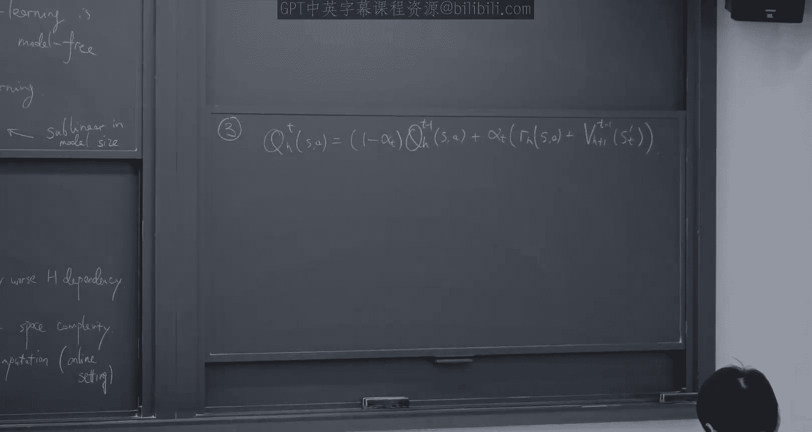

# 普林斯顿大学《强化学习基础｜ECE524 Foundations of Reinforcement Learning Sp24》中英字幕claude-3.7-s p07 Lecture 7_ _ Introduction to Exploration.zh_en -BV1vewWeRE5X_p7-

In the last lecture， we talk about the similar setting or geneative model。

I think the simulator is setting the most important thing is we have a simulator so we can query any state action step H pair and then we get a next date and the reward as a feedback so we talk about we spend the most time focused on the first algorithm called a value equation。

In this course， we was this as a shortage called a VI。 And at the very end of the last lecture。

 we talk about an RIL algorithm called Q learning。The major differences is in the value tradition。

 we kind of like do the batch update。 Well， in the Q learning。

 we kind like we trying to do the online update or Earth or like incremental update。

 This is like we collect all the data and we do one path of update。

 This is like as long as we collect one data， we do a new update to it。

So today we will be a little bit more concrete on the pure learning algorithm and。

And we will talk about the results of what we can get for cur learning。

So we' will talk about the formal algorithm。So Ke algorithm need to input a sequence。As we said。

 last time， it's like the。Which is like the learning rate。Which is a sequence of alpha T。

That is t from1 to infinity。Essentially， alpha T is trade off like how many fractions we trust the previous Q value。

 That is one minus alpha T fraction。 and alpha T times the new update。 So this is。

 you can think this is like sequence of learning rate。

 And we will talk about how we choose this learning rate at the very end。

So in terms of the main algorithm， we first initialize。With a。With Q H。Zero S。

You can initialize to be0， or actually you can initialize to be anything。For any essay。That is。

 I will just initially assign some value to the Q value， Q value function。

Then Q learning algorithm iteratively during the following。That is 4 T from one。2哒哒哒。

And then inside the loop， we say for H。一口 to one。To capital H。For all。State action。In this step。

We will， basically。Quorta simulator。This S AH。And the important thing is now we only get one samples of an X states。

And then we will do the following update。That is。Q H。Qi。Ssay。s equal to1 minus alpha T。

 This is like the same update we said last time that is a1 minus alpha T times the previous Q value。

Plus，阿尔法 T。Time is the new update。Okay， this is for all state action pair。Then we will also say。

 for all state。In this stuff。Just do。B，H T S。Equal to max a of a。Q H T S， S。So the。

 the indent is the same。 Like， so the the this follow is inside the to follow up here。

So what we essentially have is like the four algorithm。

 which the key step is so what we talked about last time where we do the incremental updates that we will basically assign Q value to be 1 minus alpha fraction of the previous Q value plus the alpha fraction of the new update。

And the remaining thing is just after we get in a Q value。

 we will calculate the V value that's equal to the max of the Q value taking over action。

So you can think this algorithm kind of combine this sample next states with the update together。

 well instead of like cur VI value， we have a first phase that is collecting data and then second phase like doing updates。

So I want to make a few comments about the algorithm。

The first important thing is that note in this algorithm。

 we no longer explicitly constructed the transition。So this is some difference。

 I think in the classical literature， it called model based versus model free。

I think this separation is。In some sense， a bit like in the high level。

 is's not like a very mathematical， but basically how like the conceptual ideas like saying this。

 this approach is like you construct a model。My construct model means you construct what is the P hatt。

 What is the reward， Like you directly estimate what is transition， What is the reward。 And this。

 this， this model free means you don't construct the model。So if you're using this definition。

 you can think this value traditional algorithm is actually a model based algorithm because in the first phase we can directly construct what is transition probability。

 Well this Q learning algorithm， we actually we never construct what is transition and the transition like the learning transition part is kind of implicitly in this incremental update here so we don't directly construct model and this is like a model free algorithm。

 so Q learning is model free。So if youre saying like this seems like too artificial like what is the mathematical difference between those two style of algorithm？

We can actually use the， we can actually use the space complexity。

 to differentiate these two kinds of algorithm。So in a space complexity， in terms of super。

 that is how， like how many。They just you need to a store for。P algorithm。

Like the valuation algorithm， because we need to estimate the transition。

 So it's roughly a least order H S square。Because at each step。

 we will estimate a directly construct a transition and use transition to do like this a matrix vector modification。

Well in a cure learning。We only use the H SA space。The reason is。Now。

 all we need to store in the algorithm is just this Q value。 Well， Q value only has the S A H。

Different numbers， different numbers in the table。So you can think this is a sublinear in the model size。

By model size， I mean， like the number of parameters you have。

 this is like precisely the number of parameter， roughly the number of parameter up to some constant。

 Well this is like sublinear in the number of parameters。

 So so that's why it's called like model free。The second point I want to comment it out is I want to say the sample complexity。

Of Q learning and VI。So in terms of value。We already say we like talk about the value semi value in the last lecture。

 which is oldda of。H to the forest S A over epsilon square。In terms of cure learning。

 you can do a similar analysis。 We will give a little bit sketch。Like， like immediately。

 But the result is， you can essentially prove the sampleity is something like this。

It's edge to the fifth。Of S over Epsilon square。So we'll not talk about the formal proof about this result。

 but I just want to say Ki learning can essentially achieve very similar result to value tu。

 but with slightly worse。Yes。H dependency。So sample in terms of sample wise， actually。

 by doing this incremental update， you can， you can more or less imagine this is not as efficient as as like a previous value algorithm。

 which you can of collect all the data and use all the data simultaneously。 Well here you can like。

 you use the data in the beginning and then you throw data out。 And then you collect new data。

 So in that sense， like you don't you don't like utilize the the power of like each sample to its maximum。

So that's why it has a like slightly worse h depend。

 And we' will also talk about the intuition of why it has slightly worse。

But I just want to also say you can think this is as a trade off like I kind of allow slightly worth some publicity。

 but I kind of like have better。Space complexity， where we talk about it。

And we will actually also have better computation in the online setting。

So we haven't talked about online setting yet， but we will talk about it today。

 and so so far we talk about only simulator setting in a simulator setting value kind like collect the data in the very beginning and then only do one path of dynamic programming。

 So this is a computation is fine but in the online setting。

 value need to do multiple paths of bio automatic equation and in that case is' very slow So you can essentially think every time Q learning need to do one incremental updates this VI need to do like whole path of like dynamic programming So that's why in the online setting actually computation of Q learning is also better。

So I guess I will not formally like go to all the proof about the Q why you can also achieve that if somehow I would just point out some key steps to let。

 you know， like。Like how this thing happens。So in order to do analysis for the key learning。

 I think the most important thing is we look at these key steps we have。

 So let's just copy the key key update。Which is a Q TH。I say。Equal to1 minus r for T。Q， H。3-1。S say。

Plus，阿法 T。R H。S A and plus V H -1 average average H plus1。T-1 S S T prime。

So we say this is like a previous Q value。And this is like the new update。S time T。Or at iteration T。

So this direct formula is a little bit difficult to analyze。

 but you can think one very straightforward way to analyze this update is。

You can like recursively expand it out。 This Q value is again equal to 1 minus alpha t -1 fraction of a Q Q T-2。

 And plus this thing times alpha T-1 of the update at a T -1 step。

 So you can recursively expand this Q value out。 and you can actually equivalently have another form of this Q value。

 You can return as something like this。 R H。SA。Plus。Smation of I from one to T。伽mmaT。A。

And V H plus one。I-1。S I prime。Essentially， it's weighted sum of all previous values and like previous value operates on like previous samples。

 So you can imagine like you just expanded everything。

 Exp this entire Q value out from t -1 to t-2 t -2 t t-3。 So eventually。

 everything happens in the first term kind like goes away and all you have is a bunch of summation of the second term。

 And second term。 And because all the all the alpha。 And this this reward is the same。

 So reward sumation together equal to1。 And while this thing is what remains。

 is's like weighted sum of this value。😊，And we will see。 And by calculation。

 you can actually get that。伽maITI。Its equal to alpha I times the product。J equal to iPo one。To tea。

1 minus alpha J。And the summation。I from 0 to T。GmmaTI。Is equal to one。Okay。

So what I'm saying is just starting from this recursive equation。

You can prove you can do some calculation， essentially， by expanding out this previous Q value。

And then eventually， youre getting this is you can be， you can be viewed as a weighted sum of the。

 of all the updates。 And well the weights we can， we can do the calculation of weights in this way and the weights sum to one。

So we will compare this to the value creation。Where we know the value tradition。

 we're doing the following updates on a Belma automatic equation。

That the Q value is equal to R plus T hat， which is our estimate。And V plus one hat。SA。

And you can essentially expand out what is the definition of P hat。

 which is using the empirical frequency to estimate the transition probability。

 which is equal to RHSA。Plus。Smation， I from  one to n。And one over n。V H plus one。Hat。S， I prime。

So this is a better tradition。So we notice if we compare those two update equations。

 they are like two different。So wonder Francis。Now we're doing like a weighted sum。

The first difference were doing， let's say。This is like。

It with equal this is like sum with equal weight。 But here， like。

 we can potentially have like different ways。 We can either favor in the later ones favor in later updates。

 or we can either favor in the previous updates。 Like basically。

 we have the flexibility of choosing our learning rates。

 which can tune like what is the ways we put here。And the second difference is。We actually note here。

Like， this is just using。V hat， which is our estimate of value after we collecting all the data。

 But here is the value at the ice iteration。 So Q learning。Use this value。At。Previous it。

So in that sense， this V hat is basically calculated after you collect all the data。

 So this V hat is reasonably accurate。 Well， here， the value is like used at a previous it。

 So you can think like the V H plus 1，1， for example。

 this is like the value you calculate at the first iterate。 And in that case。

 you only observe one trajectory or one data。 And in that kind of scenario， clearly。

 this is like not very accurate。😊，So V H plus1， I。Is not accurate。For small eye。

So this is where like in terms of Q learning， we have a little bit more。

Complexity we need to deal with。So we'll talk about the next thing is how are were going to choose。

伽马蹄。Like how how to choose our weights。So essentially， we have like two conflicting。Part。

 we want to handle for。For this gamma IT。The first one is we want to。Have gamar T to put more ways。

On values。Of later updates。This is because， as we said。

 the the V VH plus 1 I is not ever very accurate for small I。

 So we essentially want the government to put more weight on the value with like at at laters。

 so to reduce the biasers。So ideally， for example， we just put a probability one or the weights one on the very last it rate。

 and in this way like we have the smallest bias。However。

 we should not do that because the second thing is we want to gamma to be spread out。

We should not like focus all the weight on one single sample。

 because single sample is like a statistical sample， and it has a lot of like a noise。

So we want the gamma T to be uniform in some sense。To reduce reduce the variance。

This is like the variance part。So basically， we can think the ideal choice would be something。

Which we will put a lot of weight on the later， later updates。

 And so the previous iteries have smaller value and later iteries have like higher。

igh higherigher weights。 But on the other hand， we should not just focus on one update because it has a lot of noise。

 So we should still like， make it right spread out。Any question about this。

 like a bias variance trade off principle in this Q value Q learning part。

So now like we have some like intuitive idea of how we choose gamma here and then we talk about some specific value。

So our baseline， we look at alpha T。Equal to one over。

This is one very simple way you can compute and you can actually use our formula for gamma IT。

 and you can compute the weight。Gmma T1 is actually equal to gamma T2到 always equal to gamma T T。

And this is equal to one over t。So this corresponds to the uniform waves。That is。

 if I choose learning rate equal to1 over t。诶。We actually happens to be the uniform ways。

 And this is the part essentially， we are very good at variance。

 but somehow we are not very good at dealing with fires。Actually。

 it did this race does not give good。The sample complexity。Because of。Bs。So as we said。

 we want to tune this a little bit towards favoring the later part of the updates。

And by favoring later parts of the updates， that means。We need to。

 we need to basically increase the learning rate。 by increase the learning rate， that is。

 we kind of put more emphasis on the later updates than the previous Q value。

So it turns out theoretically， you can prove the， the learning rates which achieve this sample complexity。

It是 something like a。阿尔法T is equal to。Like h plus one。Over H plus T。Which you can think is roughly。

In the order of H over T。This is like a better choice。So you can think high level is。

 and this is something like essentially， you put more weights on the later。Later tours。

So this is like roughly similar to like put。Relatively uniform ways。On the latest。

1 over H fraction of data。And because we need to dealing with this bias varianceance trade off。

 so that's why we essentially need to ignore some to some extent ignore the earlier part of the data。

 so that's why we are not that simple efficient。 We essentially pay some additional H factor because we are not doing uniform weighting。

 We're doing some more aggressive weighting towards like a later updates。

This essentially is the reason why we have like slightly worse edge dependence， but just remember。

 we still have like better space complexity and also the competition complexity。

Competition complexity， I think we said in a similar setting， we cannot see it。

 but in the online set setting later， we will actually see it online setting is in the exploration setting。

 I think the reason is because in the simulation setting。

 we essentially just collect all the data and then we do one path of planning that is a bio opt equation。

 Well， in the online setting that is we can no longer sweep over all the data action。

 we actually will talk about immediately about like what is the set setting。

 But but the main takeaway is there when we do the value。

 we actually need to collect one trajectories and then do one path of Bel opt equation and then collect one trajectories。

 we do another pass of bio opt equation。 Well in the cur learning。

 we just collect one tra and do one path of this incremental updates。

 So that's why you can do a lot faster than than that。

So I just want to before we move on to the next setting。

 where we just do a slightly summary of the simulator setting。So specifically。

 we talk about the nons stationationary transition case。Where by non stationary。

 we mean we can like assume P Y is not necessarily equal to P2， Its not necessarily equal to PN。

They can be equal， but we don't really require it to be equal， so it can be like different。

And then we just talk about two algorithm。Essentially， we kind of already summarize there。

 we talk about the model based。That is VI and model free。That is secure learning。

Where the most important guarantees we talk about is a sample complexity。

 which this one is O tilda H to the fourth S A over Epsilon square。And space。This is HS squared。Well。

 in terms of Q learning， our subcom is O tda。H to the fifth。S a over epsilon square， slightly worse。

And while the space we can save some space by doing model free that we no longer suffer as square dependence。

 we only pay as dependency。And we will also talk about later in the。

 in the like lower bound session or fundamental limit， there is a lower bound。Or like information。

 theoretical lower bound。 information， theoretical lower bound basically says because by our assumption of the model。

 we kind of consume each state next states and reward like randomly generated。

 So theres always the statistical signal like noise in it and algorithm in the worst case。

 like cannot already tell which one is the optimal policy because of those noise。 So that is。

 we will see like。In the worst case， like essentially any algorithm in the worst case。

Needs to pay at least this amount of samples。To learn the optimal policy well。

So we'll discuss this topic after we talk about exploration setting or online setting today。

So this essentially says no algorithm。Can do better than this。In the worst case。

So this more or less conclude that。VI H。Almost achieved。We call it mini max optimal sample capacity。

By almost means up to some log factory。Like here we have the Oda here。

 while the lower bounds will prove in the class does not have the lock vector。

But more or less in this class， we don't really care about lock factor。

 So we would just say V I can like already achieve our goal of getting the it is the best algorithm in this setting in terms of sum。

 like you， you cannot beat value in terms of sum in the worst case。Okay。

 so any questions so far about the emit setting？Now we will move on to talk about the next topic。

 which is the online reinforcement learning。Or we also call it exploration setting。So basically。

 we talk about this is like more challenging setting that we no longer assume the simulator。So first。

 what is the online reinforcement setting？So just remember how we're going to interact with the MDP。

The protocol of interacting with MDP is like we have the S1。And we go to。R 1。Sorry。

 we go to the we have A one。The first action。 and both of them simultaneously determines the。

 the reward you receive at the first half。 and both of them determines。

Like what is transition probability go to the next states？Like something like this。Yeah。

So the protocol in the online reinforcement setting。This we will just observe the initial states。

And then， for。H equal to one to capital H。Agents。Takes。Action。A H。And then， the environment。

Transition to the next states。SH plus one。Andended reward。Orange。

And the most important thing here is in a。In the online reinforcement asset setting。

 we only we will just basically reset to initial states。And we only allow。

 like after we play the entire trajectory， then we can go back to the initial states and then we can do everything again。

So， so in the online reinforcement， it's like more challenging in the sense。

 it's like basically we will play the entire trajectory。

So this is like a biggest difference between a simulator。And II。Is that in a simulator。

 you can basically choose。Both state and action。Well， in the online reinforcement learning。

 youre essentially like playing a real game or like you're kind of doing a robot。

 you always like reset to initial states， and essentially all you can do is you just choose the action sequence。

You no longer have the freedom to choose the states。This is like the major difference。

 You can think this is like more or less so iss also how we play the game， like when we die。

 we go back to the initial states and we play the game again。

So this also like mostly like affect how were going to attract the data。

So one very important thing is in a simulator setting。

 we can just basically use a very simple strategy to collect data that is we will sweep。Over。

Or state action pair。Essentially in the value algorithm is we kind of query the simulator for all state action pair and then we get next states and this is basically done and our data collection from there is like a very good。

However， in online reinforcement， we can no longer do that because we can no longer。

Like just for free， set to any states。So in this case， just simply like reach some states。

By yourself。May not be an easy task。For example， imagine you're playing like supermario and some states it in like a last chapter and by region there' is already not very easy like you need to do some complicated strategies so that you can eventually go to the last chapter of the game。

So one important question we will handle in the online reinforcement learning。Is how。To efficiently。

Collect。Data。In a sense， like we want to collect the informative data。

We're basically in a similar setting as long as we sweep through all the state action。

 we're collecting informative data， well in online reinforcement， this is no longer that clear。

And we were actually given an example showing why this is actually a nontrial question。

 or this is like an interesting question。So we're talking about the failure。A random exploration。

EMDP。So what is a random exploration？So the first idea to collect the data is here in a similar setting because we can choose all the state action so we just sweep through all the state action pair Well in the online reinforcement。

 although I cannot choose state， but like by random exploration。

 that means like basically every time I just choose action randomly like every time every time when I take action。

This means like。And have stuff。So this would be some naive idea。

 I would try to see if the data we collected in this way is like a comprehensive。

 like it will give me a lot of information。So it turns out this random exploration strategy in MDP is like highly ineffective。

It may suffer from some like。This is highly effective。This may suffer from some A to the power of H。

 some complexityity。So this thing might suffer something like that is exponential in a horizon。

 So basically， for anything that has a long horizon， like， for example，20 or something， this， this。

 this entire magnet kind like is is really screw。 Like you cannot use this。

 this way to do collect data very effectively。 So we will talk about why this is true。 Like we。

 we basically just to construct some hard instance。So that we show for this hard instance。

This algorithm is like a very bad。So to show this， we construct structure a hard instance。

Har instance in our literature is actually pretty famous。

 A lot of later like hard instances like based on this， it's called compatorial lock。By the way。

 I also want to emphasize this is this is like hard instance only for random exploration。

 So later well actually have better algorithms so that it can basically， this is no longer hard。

 we we can basically solve this problem。 So this is this is like different from this inform theoretical lower bounds。

 This lower bound says like no algorithm can do better than this。

 but this lower bound essentially says this algorithm is not good， but other algorithm can be good。

So we look at this comm lock。Commentter lock is an MDP， It's a two state MDP。

And let's say with A actions。So the MDP is actually a deterministic MDP。

We don't even need randomness to， to like essentially break this random exploration algorithm。

So we look at the MK only has two states。So at every step we have like S0 and S1。

 those are the two statess。Maybe let's就是。Superscript。So that to make it different。 This is not。

 this is not talking about step。 This is like basically the first step。

 I have two days that S 0 and S 1。This is likeT Q图 one。And then the transitions go as follows。

 that is if I'm at S zero states， at first days。Then no matter what I did。 So basically。

 whatever action I take， I'm always gonna lens in S 0 in the second step。 This is like T equal to 2。

Well， in the， if I'm in the S1 states。There's only one particular action that's going to land me into the S1 in the next step。

Let's call it A1 star。And for whatever to action。That's not here。 that That is not a one star。

 So we just write this as an a。Minus a1 star。So that is all the remaining action。

 I'm going to go to the S0。So this is essentially， we're gonna duplicate this structure for T times for H times。

So when we at this states， whatever action I take， I'm going to land in this state as well。

 and if I'm at this S1 states。And there's another action I take， a two star that will land me here。

 and whatever other action I take will goes back to S 0。

So we essentially have this structure again and again。Kill the very last step。T equal equal to 3。

Until at the very end， that is t equal to H。AH-1 star。And this is a subtractor A H -1 star。

So this is like the transition， and then we will set up the reward。Reward is basically everywhere。

 Re is 0。 and only if I reach these states。We will receive a reward of one。S1 at。T quarter H。

So only at the very last step， if I go to S1， I got a reward 1， otherwise I always got a reward0。

This basically can be realized that if you really very strict about the reward has to be a state action function and basically saying that at the very last step。

 whatever action you take you get a rewarded one otherwise。You've got real war zero。

So we can see this transition has a very special structure that is。😊，Only if you take precisely a 1。

 A 1 star， A3， A2 star， a 3 star。So， this is basically the。

The property of this commentary lock that we have optimal policy。So the optimal policy is。H H。S0。

 which can be anything。It doesn't really matter。And the important thing is a P H S1。Must be。AH star。

Okay。And this is the optimal policy。And when we choose this optimal policy。

 you what you will get is the value of pi star。You galaxyax equal to one。

So this is the only case you will get one reward， and if you precisely choose the action sequence that is a1 star。

 A2 star， A3 throw。Till the the very end。For whatever， every other sequence。You've got to reward0。

So in that case， you basically has no signal。So you don't really know what is the optimal trajectory in that case。

So let's talk about a random exploration， what a random exploration will do。

So random exploration essentially try H， as we said by different definition。

 we will try AH uniformly at a random。So basically this algorithm will not be very good until it kind of tried precisely this action sequence。

Try this a  one star， A 2 star。And da da till A H star。And until you feel like basically sampled。

This precise sequence， then you will realize this is like the optimal policy。 And then you。

 you can like， you find the optimal policy。 And like every time before that。

 it doesn't really know what is the optimal policy。

So it's never very difficult to compute that the probability of precisely sample this action sequence is something like a。

1 over a to the h。So this is essentially the whole reason that is， basically， we need。

At least a to the欧omega H。Samples。Or by samples here， we means like trajectories。

To find the optimal policy。Which you can even make an epsilon optimal policy because here is just a difference between 0 and1。

到。Y's not A to the H。呃。I think this is like slightly weaker。 I'm just claiming some weaker statement。

AAA to the omega A to H， youre essentially saying exponent has to be H。

 But here I'm saying exponent can be h over two or something。But basically。

 this is the key idea that is。Like reinforcement because it has temporal correlation。

 So the if you do random exploration， especially for some long horizon， the probability of sample。

 exactly one of the very good policies like very， very low。

 So that's why youre if you just do some random exploration without using any like smart algorithm or like smart information。

 then essentially you will pay something exponential in the horizon， which is like。

People originally consider like a curse of horizon or something like that。

And you can go back to convince yourself this algorithm is this claim is essentially also true。

So we're talking about this is like a purely random exploration。

 but you can also think about you can do like a。Essentially， random exploration。And then。

Vendom exploration first。And then do like value， or like you do something like Epsilon greedy。

Version of v。Like if by Epson greedy means with one minus。With one minus epsilon probability。

 you do value， with epsilon probability， you do some random action。

But the whole idea is the same as long as you don't use any information to do this exploration。

 like you as long as you try to action randomly like Epsilon gradientty。

 essentially with epsilon probability， you try action randomly。 As long as you try action randomly。

 you will suffer from this like。Hard instance， essentially， that will not work。

Or it doesn't matter value or cur learning。So basically this is also one of the very important distinction between theory and I would say like in practice a lot of people just blindly use the epsilon greed algorithm but you can you already see it like epsilon greed is not a principle algorithm that can solve any challenging exploration scenario。

 at least even for Tes I think this is like a bad algorithm。

 this can only deal with those games where。Where like basically。

 it doesn't really require any exploration。 Like it cannot deal with this hard instance。

 They can only deal with probably some easy instance of MP that that does not require much exploration。

So as a side note， it turns out like people did a lot of experiments on Atari games。

 and they actually show that Epsilon greedy seems like a。

Perform reasonably well compared to other sophisticated exploration algorithm。

 but later there are also some analysis basically it says a large set of Atari games does not require like complicated exploration。

 Basically， you can just do random action and that still work。

But what we hear is like we want to solve for all the MDP so that there are some like challenging setting。

 it won't work。I well talk about how to make it work。So essentially。

 we need some like a smarter algorithm to do exploration。Exploration is essentially collect data。

 and whenever we talk about exploration， people also talk about the essentially the exploration versus exploitation tradeoff。

So it turns out the key idea in the reinforcement learning of handling the exploration。

Is called optimism。So actually introduce this most important idea。

We'll introduce this most important idea in this lecture and the next lecture。

So if we really want to talk about the exploration and exploitation trade off。

It's better we started with some like a simpler model so that we can talk about what is the algorithm and what is phenomena there。

So it turns out in the literature， there's a field which kind of started this trade off for a very long time。

 That is the multi arm bandage。Essentially， the first model we introduce in this lecture。

And this entire literature kind of really focus on this trade off。 and optimism is is a key idea。

 which we borrow from。Optimism。The key idea we borrow from this literature。

I still recall what is the multi arm bandit。 case， that is we have like a banded machine with eight different arms。

1，2， kill a。The protocol of like Martin goes follows。That's for tea。From one to capital T。

The learner picks an arm。IT。I T is in。Like basically， the action set。

And then Lner observed the stochastic reward。All right。

We noted this here the reward stocapping stochastic is important because we no longer have the transition。

 The previous argument in MDP， we can study themissive reward is because usually transition is much harder to learn than the stochastic reward。

 but here because we have no transition so we have to like again say the reward is stochastic。

So we say have some normalization condition。Where we say I。Is always in 0 to1。

 That is a stochastic reward is always bounded in some 0 to1。 and we have some expected reward。Of I。

 expectation of I。 That is a。Random reward I'm going to receive for Iar is equal to。Little eye。

This is expected reward。So we'll talk about two slightly different goals。

 but both of them are like like standard goals in this multi arm literature。 First。

 let's first talk what is best arm best arm is just defined as A I star is equal to agon Max。I of I。

Essentially， this is the arm that achieve the highest expected reward。

 and this is the arm we eventually want to find。So there are two kinds of goals。The first goal。

Or sometimes we call it pack or sample company nicely see。Where some some of us it go。

We essentially only want to find the。The Epsilom optimal power， Epsilom optimal arm。I had。So that。

By defining the optimal arm， we see the expected reward of I hat need to be greater approach I star。

The best arm。Subtracted by epsilon。 So we at most tolerate some epsilon difference。

And sometimes we also okay with not only just identify an arm that we can also O with like identify a distribution D。

eppsilon optimal distribution D。So， that。The expectation。Of this reward， I， I sampled from D。

Its great or putable eye star。Subtracted by Epsilon。 This is， we also find。

 Like if even if you don't I identify a single arm。

 but if you can see a distribution and we say in expectation， this is good。 This is。

 I'm also okay withers。And there is a second type of goal。A multi bendit。

Which you can think this is like a stronger。Objective， which we want to achieve low regret。

Where the regret is defined as follows。What are they regrets？Up to iteration T。

 this is the number of iteration T。也是 equal to的。Best rewarder you can of achieve。T times I star。

 This is like the。Best I expect to reward your kind of truth。And subtracted the。

Expect a reward you receive by picking your arm sequence。IT。So this is essentially the。

I expect her rewards。If always playing the optimal arm。And this is the expected reward to receive。

By the learner。And the regret is very intuitive by its name。

 basically it says if regret is very large， youll have a lot of regret。

 if regret is small then then basically you don't regret much of not playing optimally。

So I just want to say this because we have normalization reward is in0 to one。

 So the regret scalingkating is always like in0 to T。So're regret it。Regt is never going to be。

Greater than。 So basically， whatever you， if you achieve some linear regret。

 and that's already like a trivial regret， that that doesn't say anything。 that that's like very bad。

 So in the， the non trivial regret it like we want to say subline or like a square root T or something like that。

So we make， we， we kind of noted that the most important difference between goal 1 and goal 2。

 goal 1 essentially says。Player can play anything。As last。有序。

Eventually identified the epsilom optimalim arm。Don't really care about in the middle like what you are playing。

 you can play poorly， but as long as in the end you identify an optimal arm， this is good。However。

 in a goal2， you can think the second goal is like more difficult because the learner。On the player。

Needs to。Find the good arm。Which is similar to the best on identification phase。But also needs to。

Do the。Play reasonably well。In most steps。So you cannot just play some like a terrible strategy in previous steps。

 And in the end， you realize what is IR。 In that case， you can like pay some order tea regret。

 which is like not what you want。So you can think this is like what we want to do in exploration。

And this is like what we do in exploitation。So the goal of regret actually naturally reflects the tradeoff between exploration versus exploitation。

So in reinforcement learning， although so far we only talk about exploration。

 like we never talk about the regret that we're okay with like the sample capacity。

 but it turns out because thiss like a sequential structure and we already talk about random exploration doesn't work。

So it turns out the idea developed for this balancing exploration， exploitation。

 the optimism actually is very useful in reinforcement learning。So that is in the multi arm Ben。

 We will talk more about how we're gonna balance explorationation。

 exploitation and motivates the optimism。 And then we will talk about how to apply the algorithm。

 the optimism principle to。To reinforcement learning。

