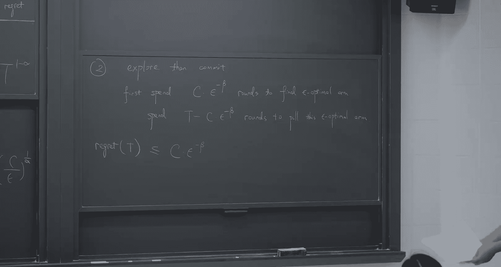

# 普林斯顿大学《强化学习基础｜ECE524 Foundations of Reinforcement Learning Sp24》中英字幕claude-3.7-s p08 Lecture 8_  Exploration in MAB.zh_en -BV1vewWeRE5X_p8-

So in the very end of last lecture， we talk about Monam bandit。

There are two objective and objective one is。Ifs we want to identify epsom。Opttimal arm。

In terms of the like mean reward， we want the arm we identify is at most absolute worse than like the opt arm。

In a second objective。Worre saying we want to achieve low regret。In a sense， we define and regret。

To be。7。Times R star。 That is the total reward if you， if you're gonna receive。

 if you always put the arm， put the optimal arm and subtracted by the expected reward you're gonna receive。

About the algorithm。Where IT is the arm， the agent for extra tease time。

So I think we say the major difference is in the first objective。

 we just eventually want to find an epsilon optimal arm。

 we don't really care about in the middle like during the learning process what do we pull。

 like we can just pull arbitrary bad arms as long as in the end we find an epsilon optimal arm。

 this is good。On the other hand， object 2 seems like a more difficult so it's like a harder objective。

 which not only says you want to eventually find some optimal arm because eventually you want this regret to be small。

 you almost you can't like already make sure like you want this IT to be approximate to be I star。

You not only want to eventually you put the right arm， but also in the middle。

 like during the entire learning process， you want your arm put is also like nearly optimal。

 like even if in the earlier phase， like you don't want to pull some terrible arm。

 like suffer significant regret。So this is like more difficult objective。

And we need to do more work to balance the trade off between exploration versus exploitation。

Explation， in the sense， eventually we want to find epsilnal optimal arm so that ourymptotic performance of the is good and exploitation in the sense。

During the entire place rule， we should not just play some arbitrary bed arm so that I will suffer a lot of regret。

 So that's why it's like a big balance between those two。

So we will first talk about like the conversion between these two objectives。

 So for a lot of times we can do some conversion， but we will see later this conversion actually will suffer。

Some looseness if we do a lot of conversion。This is online two batch covers。So Lama， this is Lama 1。

Although we can't like we say this conversion in the multiam banner setting， but this conversion。

Can also be extended to reinforcement learning access。Very easily。

 it's a very straightforward extension。So we will talk about the relation between the regret。

 guarantee and the sample capacity of identified epsilom based arm。

So the conversion stays in two ways， the first is if algorithm A。Has a regret。

C times t to the1 minus alpha。So we talk about why this we want to regret to be this form。

 essentially because if if the reward is bounded by0 to one， then this regret is always in。Zero to T。

So anything linear in T regret is like trivial is not very interesting。

 So all like we always want some sublinear regret that is a1 minus alpha where alpha is some constant。

In0 to one。So regret bound is always going to be like this sublineering tea。

 this is like nontri regret。If we have an algorithm A that has a regret of specific form like this。

 C times t to the1 minus alpha， we C is some absolute constant。Then。Algothm A。Will finds。

An epsilon optimal distribution of R。In C over Abpsilom。To the1 minus alpha samples。So basically。

 t to the one minus alpha regret will convert to the sample capacityac that is one over epsilon to the。

1 over阿尔法。To to a power of one over阿法。And on the other side， conversely。If algorithm A。

Finds Epsonnal optimal arm。This can also be a distribution。 It' matter。

 It doesn't matter it's a single RM its a distribution。In。C times epsilon to the minus beta samples。

Then。We can use a。We can use algorithm A to achieve regret。Two times。C of1 over one plus beta。

Times T to the beta。1 plus beta。Okay。So we'll talk about the exponent later。

 but the most important thing is if we forget about the constant thing。

 so what we say is any subline regret t to the1 minus alpha can be converted to some sample complexity that is one of epsilon to the power of1 over alpha and on the other hand。

 if we have some sample complexity that is one of epsilon to the beta。

 then we can converted to a regret that is t to the beta over1 plus beta。O。

 the other constant doesn't really matter， you can just switch to some other constants。

So this result kind of holds for any r in the beta so we can convert a regret that is t to the3 fourth or convert a regret at a square root T to something like sample complexityity。

So we will first look at some particular examples。I think a lot of times， we were handling the。

The square root T regret。 So for example， if we have some algorithm that achieve square root t regret。

In that case， alpha is equal to12。And this implies we can achieve something that is one over Epsilon square because r is just12。

So this will imply some sample， sample complexity that is one of Epsilon square。Samples。

And on the other hand， we can use the second rule that is， if we have some algorithm。

That achieves one of Epsilon square samples。We can convert it to the regression guarantee。

 And in this case， it's clear this beta just we just choose beta to be2。

 And now we notice we no longer get back square root T。 What we get is T to the two third。

And we note in the regret that the worst case regret is t。 so in terms of power。

 root square t regret is actually better than t to the2 third， the closer you get to T。

 that the worse you get the regret。 So this is like worse than square t regret。Yeah。

So we can like we note when we do the conversion， we convert regret to some and convert some mess back to the regret。

Like in this black box manner， we don't get back to original result for free。

 I think the most the biggest reason is as we already said， this regret is the harder objective。

So we kind of like when we convert a harder objective which inherently require we to balance the exploration versus exploitation to something。

 we only require exploration and then we kind of convert it back to the original harder objective。

 we kind of like we lose something during this entire process so this conversion is done like not freely。

 like we we lose something during the entire conversion。Okayk。

So I just want to make sure you understand this conversion can like give a connection between two objectives。

 But I， but I， what I also want to say is like when you do this conversion。

 you can like you lose something in terms of like a strength of the objective and all order the rates。

What does it mean to goか。have great。So we will actually talk about proof and that will be much clear so basically if whenever I have some algorithm。

 I already achieve this regret， then this algorithm will immediately we can use this algorithm immediately to achieve this sample complexity。

And conversely it's also the same like if I have algorithm that already achieved this some today。

 I can very easily like modify the algorithm to achieve this regret。Okay。

So this Lama is only talk about the rate commercial。

 and we still need to provide explicit construction。

 like when we have algorithm A achieve this regret。

 why does algorithm already achieve this sample policy like so we need to do the proof。

Any question about the claim and。TheThe like the qualitative results。no problem。

 let's just do the first one。This conversion actually is pretty straightforward。

 so by first claim for the conversion from regret with some complexity。We're first。

Right by precondition。Of regret。We know by the definition of regret， that is equal to。

T times our star， I star。上去。Subtract by T summation T from one to capital T。RIT。

And this is less or equal to because we have the precondition of the regret。

 We know this is less equal to some constants。Times t to the y minus阿尔法。

So this implies that we can divide it both sides by t and rearrange the terms。

 So this implies that one over t。Sation T from one to capital T， I T。It's greater equal to I star。

Subtract by C over T to alpha。So we notice this is more or less what we want。

 So left hand side can be viewed as。expected reward if I pull arm according to some empirical distribution。

 D hat。I， whereas this the hat is uniform。Over。All the arms I have put so far。 So I1。

 I2 do do t O I T。That is like if I uniformly pull an arm， this is like induce a distribution。

 and if I just uniformly pull through this distribution and this is corresponding to the。

Left hand side， we calculate。So this is an epsilon optimal distribution over arms。

So only thing we need to do is we make this thing to be apsil。

So that I would guarantee this Dhad distribution is Epsilon optimal。And then we can just solve this。

Which weve got t is equal to c over epsilon to the y over rpha。

So that's why when we have this many of samples， we can achieve absoluteps optimal。If not option on。

Okay。I think the first part is relatively simple because as we said。

 the regret is just by definition， a harder objective than samples。So whenever we achieve a regret。

 all we need to do is just divided by T like doing the average。

 and we already achieved the Epssonnal optimal arm。Like we already get the optimal。

So we'll do the second claim。Second claim requires slightly more work because like we say。

 the regret is a harder objective， while sample complexity is like an easier objective。

 so we want to convert an easier objective to harder objective。

 so that's why we need to lose something and we need to do a little bit more work the strategy we're going to do is called explore and commit。

Explorore and commitments。Well， first。Spend。C times epsilon to the。Minus beta rounds。

To find epsilom optimal arm。So this is a。Like by precondition。

 we know this is the assembled method of R， so we will first just spend this much round to find an optimal eps optimal arm。

 and then we will spend the remaining rounds。Remaining round。

 that is a t minus c times epsilon to the minuspsilon。To always pull。This Epsilon optimal arm。

So it's very intuitive， explored and committed that is in the first phase I would just do exploration。

 I will do whatever the algorithm do and to find the best arm to find approximate best arm。

 and in the second phase I would just commit to this approximate best arm so Im just always gonna to put this arm。

So we will calculate what is the regret achieved by this algorithm induced by a。So the regret tea。

We can compute that is less or equal to in the first phase， we spend this many rounds。

C times epsilon to the minus beta。And because in the first round we we use in the first phase we kind of treat this algorithm as a black box。

 we don't really know whether this algorithm has done any like exploration versus exploitation trade off。

 So we just assume the worst case where this algorithm probably just do some random exploration or I don't know in the worst case。

 probably the regret is going to be。

One at at each round。 so at each round， maybe at most， I was suffer loss one。And in the second phase。

I have this many wrongs。And because we know every time I'm already commit， I pull arm。

 which is guaranteed to be apsilom optimal。 So that means in the second phase in every round。

 I will at most suffer epsilom regret。Yeah。嗯。So we can just simplify this expression a little bit。

And this is less so equal to c times epsilon to the minus beta。And plus。In a lot of cases。

 this T will be significantly greater than the C to the C times epsilon to the minus beta。

 So we just ignore the second term， ignore the thing we we can like with subtract and provide an upper bound。

 This is plus T times epsilon。And finally， we just pick the apsilon that minimize the regret。

Then minimize this regret， which is this epsilon is equal to C over T。

To the power of1 over one plus beta。And we get the regret that is equal to2 times c to the1 over1 plus beta。

Times t to the power of beta over1 plus beta。And this finished a proof。Yes，again。な。No no no。四。Yeah。

 so， so so the， the explore and commit algorithm contains two phase。 The first phase。

 I just used the algorithm A to find an epinal optimal arm， which takes this many rounds。

By the precondition of algorithm A， and the second phase is I just commit to this optimal arm。

So in a second phase。Every rounds I pay a regret of Absilom。 And in the first phase。

 I don't really know what the algorithm is doing。 So I just assume the worst we know every。

 every round I might regret is at most one。Because regret， you can also。

You can also write this regret in terms of equal to summation。T from one to capital T。

 and which is I star， Subtract I T。So we can talk about calculatedalc regret per round。So each round。

 I always suffer regret at the most one。And in the later face， it regrets most epsil。

Is this clear end up？This one equal to this one。 This summation is is the same。 And this is just T。

 So summation of I star， I star is a fixed thing。 So。

 so all you need to prove is T I star is equal to summation a minus product。Oh product， product。

This is like the total reward that we receive by the optimalim。That's what was that。Was there reason。

This to pick epsilon to minimize this term。YouYou can't think。

So you can think there's regret is basically see beta is something positive， so。

So this is a C over epsilon to the beta and plus t times epsilon。

 so you can think when we increase epsilon， this term go up and this term goes down。

 so there is some epsilon term which minimize this entire thing and you can take derivative to equal to0 and which you will find this is equal to this。

Okay， those are all group questions。If no other questions， I guess we will start to。

Talking about the algorithm for multiam bandit。And the regret had some here for those algorithms。

Those are just， and so far we haven't talked about any algorithm for multiium Ben。

 we just talk about how we're going to convert the two different objectives。And later on。

 we will just purely focus on regret because this is like the standard notion people use for online learning learning。

 and we know regret is stronger than sample complexity， so whenever we want sample complexity。

 we can just use this conversion to convert it back to some。

So the first algorithm we will introduce for the multiian Bened called Epsilon first algorithm。

If so first algorithm essentially is just used to explore and commit a strategy。

Only difference is in this conversion， we will actually say。

Well first spend this one to use algorithm A。To find an absoluteps optimal arm。

 well here we will reverseverse specifically， we just do some random exploration in the first phase。

So the first phase， we will first pull each arm。For n times。And obtain an empirical estimate。I had。

That is equal to summation of J equal to1 of and N I。对。This IJ denoted the random reward we receive。

For arm I。At Jays pool。Okay， so J is the index of like the index of pools we get for armI。

And we use the empirical average that divided by 1 over m。The I app。So essentially。

 that algorithm very simple， I just pull each arm n times and I use the average as my estimate of the mean reward for each arm。

And then in the second phase， I will just play I hat。You quote through Arg Max。I of I hat。That is。

 I will just pull an arm that has the highest estimates in the first phase。For the remaining steps。

So first we'll talk about essentially this algorithm work because essentially we can say when n is large enough。

 our estimate for each arm is like very accurate in the first phase as long as like for example。

 if it's epsilon accurate and when it's epsilon accurate then we can essentially do this explore and commit to get reasonable regret。

So in the theorem， theorem one， we say for n。一括出。C times Yota of epsilon square。

Where are this is Yota？It's equal to。lock A over P。We have with probability。One greater equal to。

1 minus P。The maximum difference across all arm between our estimate。And true名。

This is last time Epsilon。Okay。This more or less implies that we just pay number of samples。

Sample complexityity， that is。N times a， because this is the number of pools we need for each arm。

 so the total number of samples is like n times a。Which is equal to this C yieldda over epsilon square。

 we will find an epsilon optimal arm。Because after these many samples。

 we guarantee every estimate is close to the optimal by Epsilon。

 so whenever I do the maximum over my estimate， I'm guarantee this is Epsinnal optimal。

Any questions about this theorem？Yes， A is the of A is the number of arms， yes。

That's a very good question。There pen is the number of calls4。

And it's a number of poles4 each sharp for every hour I to just put and times here。

So that's why a total number of simple is like n times the number of forms you have。

So the proof is actually very straightforward， given all the mathematical tool we have learned。

 this is essentially by Hing in quality。We know it probability。G or equal to y minus P over a。

For any fixed。RI。We have this R hat。Subtract R， I。Is the less or equal to C。

Prime some other constant times Yota oversd when。 This is by。By hoing in quality。

 because this is like a summation of independent random variable and independent variable。

And finally， because we know by this choice of n， when we plug it in here。

This is guaranteed to be absolute， this is by our choice of。

So the first step is by halfing in quality and the concentration in quality and second step is by our specific choice of N。

 we can of like choose this end to be specifically to make this equal to absoluteps。And then finally。

 we know this is for fixed arm and with probability 1 minus P over a， and we just do a union bound。

Overall arm。We essentially finished the proof that is with property  y minus P we have this。

We have every arm the difference will be less than epsil simultaneously。

 That means the max I is also less than epsil。Yes， is we're able to just like ignore the lower order terms that usually come to Hton？

The question is whether we're able to ignore the lower order term comes with Hfting。

 and I think Bton has a lower order term， Hfting does not have low order terms。

 so there is no lower order term。So what is the condition for Ab。Abspsilon optimal arm again。

The a because I expect it。Sorry sorry， what's the condition？I think this is slightly logic here。

 What I'm saying is once we achieve this。That is my as for every arm is。

Difference of my estimate to the optimal like to the true one is like less than epsilon。

 then if we just pick the best arm， this guarantee to be epsilon optimal。Oh。

I think I can specify a little bit more。So we're saying。Let's say we defined this。I hat。

Will be to Argonmax。I of I hat。 so this is like after we have an estimate we kind like we picked the best arm according to my estimate。

 So what I'm saying is we are going to guarantee that R I hat。

Is greater equal to R I star subtract by Epsilon。So。I going say this。

 once you have this gig guaranteed。You can make sure this is true。

 And the reason do you want me to do a bit more calculation。

 I think we can we can easily calculate this。 So what you can do is。

 so this is equivalent to prove that a star subtractor I hat less or equal to epsilon， right。

So in order to prove this， all we need to do is like we can do I star， Subtract our hat， I star。

 and plus our hat， I star and subtract our hat， I hat and plus our hat。I had subtract R。 I had。

 So all I， all I did is like subtract and editor term subtract editor term。

 And we know this is less than apsilon。This is less than apsilnal。

 probably we suffer some constant too， so we'd have two apsilom。

 and we know this is a less than equal to0。Because。By definition。

 we know I hat is the optimal arm according to our hat。 And so this I sorry is stand。

So that's why basically once we achieve this， we can find the two epsilon optimal arm。

And you can adjust the constant， like make this absolute optimal by doing this a over tour or something。

Okay。So essentially， we have proved this is our sample capacity to find an epsilon optimal arm。

And the second thing is we essentially want to convert this to regret。

So with probability greater equal to y minus P。The Epsilon F algorithm。Has a regret。At most。C。

Times a。To you square。有他。Over total power off1 third。Where this Yota。It's equal to。Log A over P。Okay。

This proof of this requires is basically by just doing the conversion we have because this is exactly the explored and commit algorithm。

So in the first phase， we already know the sample capacity。但是。Is equal to this。That is。C times。

Some other constant C prime times you see times A， Yta over Epsilon square。And。

We can write this in terms of。A yota， epsilon， -2。So we know this beta is equal to2。

And applying the landmark。And we can bundle this entire thing together as this see regret in a previous conversion。

So we know by Lama 2。啊le one。We know the commit like explore and commit。Will give a regret。

That is two times。This entire thing， C， A Yoda。Of to the power of1 over1 plus beta。Times t。Beta over。

1 plus beta。 So we just plug in the beta equal to2 inside。

 and then we kind of really just see to be some constant outside， like to be some other constant and。

This is done。嗯。Okay。So we just introduced a very basic algorithm。

 basic algorithm is we kind of we first do exploration and then we commit to the best arm we find for the exploration。

And。We can think the exploration part that somehow is good is one verilon square。

 but because when we do the computer regret， we're doing this two phase， first explore then commit。

 so our regret is something t to the two third。So you may wonder this type of algorithm seems like a little bit artificial or inefficient in a sense you can divide everything into two phase。

 one is your refer to exploration， and then you commit to the optimal arm。

Like I think the first naive idea is you're thinking maybe I can just merge those two together and this gives another algorithm called Epsilon greed algorithm。

I think for a lot of practitioners nowadays， a lot of times。

 if you don't really know how to do exploration， like you have no idea what is good algorithm。

 I think the first go algorithm still does epsilon gradient， like because this is so simple。

 you can just always plug this epsilon gradienty algorithm with any existing algorithm you have。

So the algorithm， again， we will maintain。An， an empirical estimate。

Of we will use the same empiricalplasm， our hat equal to。Some没。J from one to NJ。RNNNI。啊哎这。Of N I。

 So this is the number of。Number of pools for online。And this is。This is again。

 like the random reward we receive for am I at Jays pool。Okay， so this we just talk about estimate。

 we haven't talked about the algorithm， so algorithm goes as follows。

For t equal1 to the da to capital T。So the major difference is we no longer do this two phase we first like put a random arm and then we commit to the best arm in this epsilom greedy algorithm。

 we can like merge them together with some probability So what we're saying is with probability Epsilom。

Some small epsilon probability， I'm going to pull arm。A random arm。Which samples from uniform。

Over my action set， a， that is like just going to randomly pour arm。

 but this is only with some small probability Abpsilom。Otherwise。

 that is with probability1 minus apsin。I'm gonna pull the greedy arm。I'm going to pull arm IT。

That is equal to。Argam。Of R I hat。哎。Okay。That is so far I have poor a lot of arms and so some of them is pick by this greedy rule。

 some of them is picked by this epsilon like random rule。 And so I have some estimate。

 I'm gonna to use this existing estimate to pull the。Put arm with a higher seism。

And so we can like either pull random arm with some small probability or with some majority。

 probably I'm going to just prove some greedy action。And after I put this action。

 after I put this arm， I'm going to observe。RIT。Which is stochastic reward。

I receive for the ITRI pool。And。I'm going update。My as。This is R IT hat。

So you can think this is like some variant of epsilon first。

 where in the epsilon first is like I first do exploration。 and then I do commit。

 Well here it's kind like， I do them。Like interleave with each other。

 that is sometimes I will do some exploration， sometimes I will exploit it by pulling the frame the optimal arm。

Good。So it turns out this idea is basically just I will swap some order instead of doing exploration in the very beginning I sometimes do exploration in a later phase。

 sometimes do exploration and sometimes take greedity action in the beginning and it turns out thiss like a swap in the o。

Doesn't actually help much in the in the Mon Ben case。So in the theorem。

We will also say with probability greater per equal to y minus p。The Epsilon greeditty algorithm。

I still have the same regret。Has a regret。That is O tuda。

To the A to the one third and T to the two third。So hiding some log factor， this is exactly the same。

As the regret we achieved for Epsil first algorithm。So this proof is essentially also。

 very similar to the Epsilon first algorithm we will leave to homeworkmark 3。

So this raise a very straightforward question like whether can we achieve something？

Parents achieve some regret better than this， we kind of achieve a better tradeoff between exploration and exploitation。

So it turns out。The answer has been long known in this like a bandit field is a key idea called optimism。

So called optimism in face of uncertainty。This is the principle and the algorithm。

 which typically call the UCB algorithm， that is upper confidence bound algorithm。

So we first talk about the high level idea why this algorithm is like a fundamentally different from a previous algorithm。

 and then we talk about the specific algorithm and guarantees。

So we can first summarize the previous algorithm。That is either Epsilon first or Epsilon greedy。

 it basically has the two parts。The previous algorithm。Essentially either you have exploration step。

That's going to pull random arm。And you have an exploitation staff。That is take greedy action。

To maximize our hat。Like could you do Argonmax I I hat？

So the Epsilon first is like you first do a bunch of exploration steps and then do exploitation stuff。

 well epsilon gradient is you sometimes do exploration steps， sometimes do exploitation step。

You think them。The bad part about the algorithm is whenever you do exploration。

 you do some random exploration。 This is like。Inefficient， in the sense。

 it doesn't really leverage a lot of information we have。

And so the key idea is how we're going to combine exploration and exploitation together。

So this algorithm， previous algorithm， just say sometimes I do exploit。 sometimes I do exploitation。

 My combination is like very like naive combination。 just just like sometimes we do this。

 sometimes through that。 So a better strategy is instead I will compute a new thing that I tu。

You can think I tuor is something like eye hat。Which is my asmate？And plus some。

It's it like a meing estimate？Let' me asked。Plus some bonus term。

Which talk about some confidence or randomness。Essentially。

 this bonus reflects our belief of the deviation between the true one。So you can think this R hat。

 our tuor itself contains both exploitation if I just want to。Look how it mean。And then exploration。

 because we will essentially will add more bonus to the。

 to the part of arm or the part of space we haven't visited so far。

 And I will essentially do agonax of this。I tuda。So in terms of multi arm I'm Ben。

 this idea is very straightforward by UCB。 For example， I have a multiple arm like。Okay。

 like F arm one。And arm 2。And arm 3。So for arm1， multiple different arms and I have also pulled different samples。

 for example arm1 has a lot of samples here。This is like many samples。

 I I I put armman for a lot of times and received this reward， this reward， this reward。

 And for arm 2， I only pulled。And like， for example。This amount of time。And for 3， I put。

This many time。Okay， so the way to do this artutda and by this UCB algorithm is specifically like we not only have a M estimate。

 which is this thing。Of each arm。 But we also have a confidence interval as made。

 Or you can think this is like a mean plus or minus like a multiple times standard deviation。

 So in this case， I'm saying my arm  one probably is。The optimal。

 like the true reward gonna lose in gonna gonna fall in the this interval。 Well， for arm 2。

 because I only have two samples， I'm less confident。

 So I'm thinking maybe my interval is lie like this， my。

My true reward is going to lies in this interval and for arm three。

 and I have a little bit more samples I'm seeing the interval。Shorter。And by UCV。

Upper confidence bound。 essentially， we're saying those intervals are my confidence bound。 I'm。

 I'm gonna use the upper confidence bound， which is the upper side of the confidence bound， okay。

This as my art tutor 1， art tutor 2。R two to 3。And this is going to pull according to the upper confidence bound。

By upper confidence bound， we essentially we want to guarantee the property。That。R R I hat。

 R tde is always greater or equal to I with high probability。

So we want to have the property that my upper bound upper confidence bound is with high probability。

 a true upper bound of the true reward， so I don't like make any arrow。

This is like intuitive construction of the algorithm。

 and we will now talk more about the mathematical details of how we construct this art theta and how we prove is high competence law。

Any questions about this high level picture of the algorithm？So we talk about the formal algorithm。

Offer you CV。Ofer comment as well。So the algorithm is actually very simple。

The only different part is we will now， instead of maintain a directly mean estimate。

 we will maintain a so calledled optimistic estimate。That is we call this i tuta。

It's equal to first part is， again， the empirical average J from1 to N I and RI J。Of an eye。

 this is the just empirical average。And then we will add a bonus term。So the Bnos term。

It's going to be depends on and I kind of could give us some confidence level of。

Of like how confident my estimate is so you can imagine if anni is very small that is I only have like two or three samples and have a small amount of samples so I should add a big bonus to reflect I'm not very confident about this estimate。

 but if anI is very very large， then I should think my estimate is relatively accurate。

 so add a small bonus。So in this case， our choice of bonus， in general。

 you can have a lot of different bonus choice， our choice of bonus will make it to be C。Times。

Square root of。Log A over P。Over and。Andi。So the reason we choose this bonus will be much clearer later when we talk about。

Why we want this。I dont think。And once we。Make this choice。The algorithm is right straightforward。

All we do it。Every time we just pull an arm。耳机。Which was equal to arg max。I。All right， kda。

So we take a greedy action regarding to this optimistic estimate。And then we observe a new reward。

An update。啊 two的题。I think another important thing about this algorithm is we see the previous epsilon first Epsilon gradient algorithm we just do some random exploration。

 we truly just put a random arm， but here by choosing different bonus we can put in different prior or different knowledge about how we going estimate the confidence or estimate randomness in this bonus term so we can incorporate use leverage more information than the previous algorithm algorithm just pull random arm now we essentially use we will prove this is essentially some standard deviation。

 were using some standard deviation like to help us better guide exploration。In0，3。

So we can actually prove which probability at least1 minus p。UCB algorithm。Has regret。At most。

Square root of A有的。Where again， this Yoda has some logarithmic term。那个AT。

The most important thing is now we will observe that UCV actually have the square root of regret。

 probably has two。Now it's a square root T instead of T to the two third。

 So this algorithm may actually strike a better balance between exploration and exploitation。

 So it actually has a。Batter regret。So in order to talk about the guarantee of this algorithm。

 we we just denote a few notations so that we're clear what we're talking about。We use this NIT。

To develop我 the。The number of times。Am I。Has been pulled。Before round tea。I think on Ti， let's see。

So they include the number of include if you put the arm at a run tea。And our tutor is asid。Of arm I。

At round tea。 at tea round。Essentially， we just use the same notation。

 Well if we have a T on the superscript， that means the quantity of my estimate the number of times。

 we have pulled this arm at Ts round。So first， Lama， we justify why we want to。

Do this type of specific type of bonus？We can prove with probability。1 greater equal to1 minus P。

That we have。For。哦蹄。Like all the number of all rounds。And。Or arm。That the difference。

Between my eyess。Average over an IT。J equal one。An IT。啊，系。J。Subtract I。This is essentially my。

Ming as or average as at round T for R I。 And this is the true Ming reward。

 We say this difference is less so equal to C times yota over N N9 T。And this is precisely our bonus。

 the choice of our bonus。Where again， this Yota。Is equal to log A T over P。

Very similar to the Epsilon first algorithm， this is essentially also a concentration。

The reason I say essentially not exactly the same is there is only one caveat that is when we apply the hoing in quality。

 we usually just say like for n sum of independent random variable， however， here this NIT。

 the total number of the summation is also random。So because this NIT connect denoted how many times I'm going to pull this arm eye。

Before round T and this actually related to the random draw reward because UCBL wisdom actually depends on if you somehow happens to draw this arm with very。

 very high reward and then I will pull this arm and if you draw it with a roll reward I probably will pull different arm。

 so the NIT is actually a random thing。是。So this seems like has some additional problem。

 but the good thing is we know this NIT。Its it's at most capital T。 So it's from 0 to T。

 So it won't be like something wire or extremely large。 so we can essentially use some。

We can essentially use some marting goal argument。Marical concentration。Plus union bound。

That union over all possible numbers of N IT and to to essentially address this problem。

 And this require a little bit technical subtle。 and we will also leave this。2 homework three。

It's a very good exercise for the Martin O concentration。But for now。

 it's okay if you don't understand how we're going handle this technical subtle。

 but you can just think this is like hofting if an IT is fixed。

 and so clearly this bonus is a solid bonus。So this immediately gives the quarry that。

With probability greater equal to1 minus p。We will have。That R I tilda T。

 This is my upper bound constructed upper bound of arm I at Ts round， is greater equal to I。For all。

T。人气。And I in a。So this is why it is is a called upper confidence bound。

This query is extremely simple。 It's just because we guarantee our main asmate。

AndThe difference between meanestimator and the true reward is like bounded by this term。

 so all we need to do is add this bound to the mean estimation to guarantee we achieve an upper bound。

Okay。So well finally talk about。How we proved the theorem third year why weve got to square tear regret。

So the important property is like we guarantee this our estimate is always with high probability in an upper bound。

 and we will leverage this fact in the theorem。In a proof of the theorem。

So we start with the definition of regret。Which is defined to be T summation of T from one to capital T。

But the reward of the optimal arm， subtracted by the reward of arm I pull at teeth round。

The first step will immediately youle the UCB property。That we know the optimal arm。

The reward of optimal arm is definitely bounded， upper bounded by the。A tuda。

Of optimal arm atiteration T， because were guarantee this is always an upper confidence bound for upper bound with high probability for。

For， for the true reward。And subtractd by R IT。And the next step well actually use。

Use the property of the algorithm。We know at every round。

The algorithm actually chooses greedily respect to this artda T。 That is。

 we will always choose the arm that maximize the artilda I T。 So that's why this is less or equal to。

Our tuta T。And I。Because the way we choose IT is we maximize this art tutor。And subtracted by R IT。啊。

Now we're in a very good shape because we look at our estimate at IT and we like basically both reward are evaluator at IT at the same arm。

So we say this is equal to summation t from 1 to capital t。

 we just plug in how we're going to estimate this art tilda。

 and we know our tilda is equal to the empirical average。I7。提。S Asian J is a little bit complicated。

 but it's basically just empirical average。Up to round tea。And plus bonus。OfN， I T T。

And we subtract IT。And the good thing is I can actually swap those two terms。

Like we first look at this。Emirical average， subtractor IT， and then plus the bonus。

 And by by the previous the by the Lamma 1， we actually know the empirical average subtract I T is again bounded by bonus。

So we actually know this is upper bounded by two times the bonus。Of N IT。

Which is equal to some constant times summation。T from one to capital T。呃，奶器。对。有他。So finally。

 all we need to do is we calculate the。Very last term， and we just do very quickly。

So all we need to do is we calculate the summation T from1 to capital T。

Square root of one over an I T T。The remaining is just some constant factor。So for this summation。

 I can do like， I can change the summation order instead of counting from little T from one to capital T。

 I can first count each arm。 Okay， I first do a summation of each arm。And then for each arm。

 I'm basically just， we know for each arm is just one plus one over square 2 plus one over square T 3。

 So it's a summation from n equal to1 to。N I T。So that is a total number of arm。

 total number of times we're going to pull to your time t， and this is1 over squared of n。

So instead of count from T， I'm counting each arm and how many times I pull for each arm and every time I put each arm。

 I'm just adding one or one over square2 and one over square t3， that kind of thing。And finally。

 we will use the inequality that is a1 1 plus1 over square 2 plus 1 over3 over 3 L r til 1 over squared of n。

It's lesser equal to a2 times square event。So we know this is less equal to2 times summation i from 12 a。

Square root of N I T。And the final step is by Koher Schaz in quality。We get two times square root of。

Sation， I from 1 to a。One time summation， I from one to a。NIT。

Where we know this is two times square root of a summation of y is equal to a sumation of n is equal to T。

 because the total number of arm 10 times we're gonna prove for each arm sum together is equal to T。

And this essentially finished the proof。This essentially wrap up everything we want to talk about for Motiam Bennett in the next lecture we will extend this UCB idea。

 optimism idea to reinforce learning and see how this idea will actually help us avoid the commentary lock。

 the hard instance for exploration we talked about in the last lecture。

