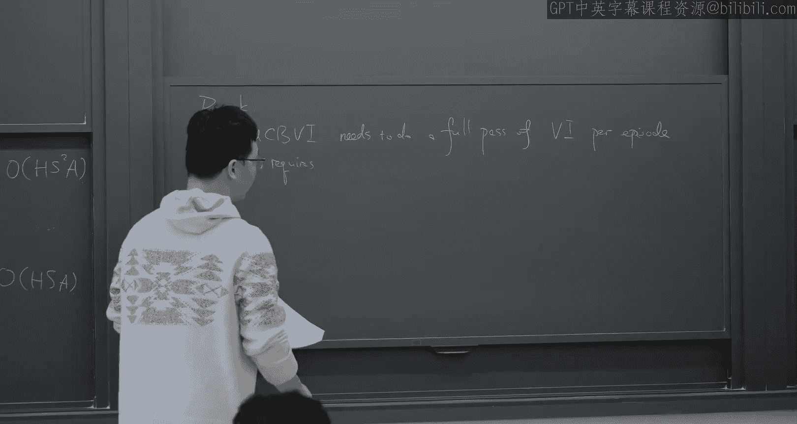
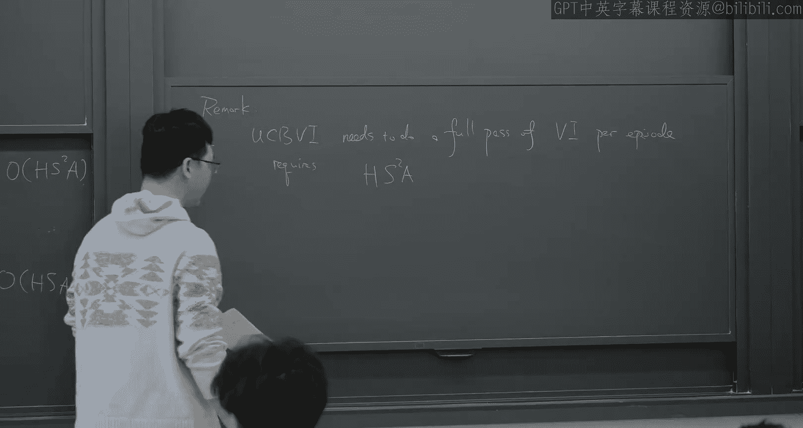
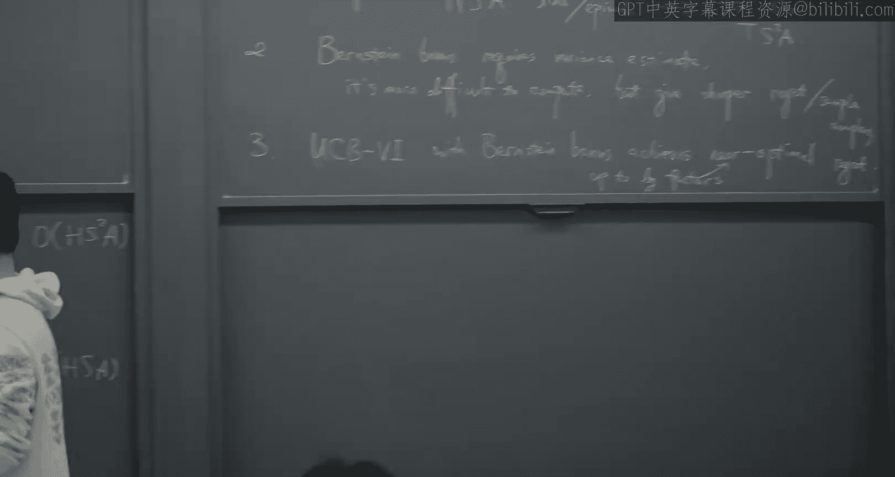

# 普林斯顿大学《强化学习基础｜ECE524 Foundations of Reinforcement Learning Sp24》中英字幕claude-3.7-s p10 Lecture 10__ Lower Bounds for MAB.zh_en -BV1vewWeRE5X_p10-

So I think we have been talking about online reinforcement learning and exploration versus exploitation trade off over the past week。

 so let's just wrap up this。So we have been talking about online reinforcement learning。Essentially。

 we look at a lot of regret， time complexity and space complexity。

 So let's consider like a run algorithm for t duration。R algorithm for T episodes。So we are。

 we are asking， like， what kind of guarantees we can provide。

 So there are a lot of metrics we're looking at。 First。

 we're looking at what kind of different algorithm。 And then we。We look at the regret of algorithm。

And we can look at the time complexity of the algorithm and then also the space complexity of the algorithm。

So historically there are a lot of earlier algorithm where I would say the earliest algorithm that achieved like sublinear regret is so-called E cube or RmX。

 those algorithm we haven't introduced in the class。

 but basically the regret they can achieve is something polynomial in terms of HSA。

And times the t to the1 minus a法， where a is not very good。And later。

 there is some other algorithm called UR。 This algorithm is。

Different from the algorithm we in the class where the algorithm we introduce in the class is like a VIUCB where we put up confidence bound on the value function。

 this put a confidence bound on the transition。transitionranition。And itll require at least。

Square root for S square  H T。 regret。 regret is at least this。So more importantly。

 this will actually pay something S square dependence。

 which which is the reason is like they put confidence bound on the transition。

 We can't like emphasize this this very important difference in the simulator setting where our sum complexity is a scale with S instead of S square。

Well， in a regret， like you're basically putting everything in a square root。

 but basically thiss UCL because it's not doing very tight， so it's still pay a square dependency。

So what we have introduced in this lecture is the first algorithm is UCBVI。And specifically。

 the algorithm we introduce in the class is a hoing version。Cfting version of foot。But bonus。

The regret we receive is O Tda。Square root of H cube SAT T。And the time complexity。

We we will use we can easily count that in every episode。For episodes。

We're gonna basically doing an entire path of value。 So that will take some H S square a time。

 So the total time would be。T S square a， we will actually explain this later。 But basically。

 because due to in every in every episode， we're doing a full path of。

Of like a value tradition and a space complexity is something like H S square to store entire transition。

And in the class， we also mentioned there's a Burnsstone version。Version of bonus。

Which can achieve slightly sharper regret guarantee。Which is O tuda。It's square， I see。

And it would be the same time hum area and a space complexity。So the benefit of using burns bonus。

 as we said in last lectures， the sharper bonus you use， the better regret you will have。Okay。

And the only complication is that burnstein requires some variance estimation。

 so the algorithm is a little bit more complicated。And in the last lecture。

 we also introduced the Q Learn UCB。And a regret guarantee for Q with UCB is O tuda。

Square root of H to the fourth。SAT。Slightly worse than the UCB VI。

But the major benefit of Q learning is in every episode。

 we're just looking at one trajectory and we're only doing update on that trajectory。

So the time is O Oity。 Okay， everything is O。 probably take some log log log factor。This is not。

And space complexity because we no longer need to store the transition， we only store the value。

 so it's an HS， so we save a as factor。 This is like model free algorithm。And finally。

 we can also have the Princeton version。And that will give you a slightly better regret。

In terms of H dependency。So we have been giving a lot of upper bounds and the natural question you would ask is。

Like whether those are optimal or whether we can develop some better algorithm， for example。

 like UCB with some other bonus， like much sharpper bonus。

 can we actually do a lot better than those guarantees？

So it turns out we have been talking a lot about the lower bound like multiple times。

So this is again， inflammation theoretical lower bounds you can actually prove。The best you can do。

It's actually just a square root of H square SAT。So no algorithm can beat this。Okay。So few remarks。

Essentially explain the the table。First is a UCBVI。Ne to do。A full path of value tuition。P episode。

This requires like a。好了。Essentially， the time complexity to do the value is you have H steps and per steps you are doing like a matrix vector multiplication。

 so it takes H S square a time or like a flop compute。

So， this。These to。This per episode。 This leads to total amount of time is。T square and TSA。Okay。

 so that's why we put a T S square a here and why this is like a lot worse than Q learning。

 where essentially in every episodes you're only like doing。

Only look at the trajectories and doing computation based on trajectories。Second one。

 we canak already stated this in the last lecture that Burnsstone bonus。Require variance。

Require variance estimate。So it's more difficult to compute。But give。Shopper regret。

And which will leads to a sharper sample capacity as well。And finally。

 we also notice in terms of regret。The UCB VI with the burn bonus， is already the optimal。

Near we're called near optimal request。Where this near optimal means like up to some log factor。

We will see today， like。

The lower bounds we typically like do with some expectation and we don't have the log factor。

 but the upper bound we do the hyper probability， we have the log factor。

 so eventually if we don't really care about the log factor and this UCBVI with brain instance bonus already match the lower bounds。

Any questions on this summary of online reinforcement learning in the Tular setting so far？Okay。

 so if no questions， I guess we will move to the next chapter of this lecture。

We' were mostly talking about lower bounds。So so far we have been mentioned this lower bound for like multiple times in this class。

 we only very vaguely say this is like some information theoretical lower bound like due to some statistical noise and but。

But we never like give a precise definition or something。

 so we will take more into like what type of lower bounds we want and how we're going to achieve some algorithm。

 independent lower bounds。So for the start， for simplicity we w。First。

 focus on the Mao Tiam Bard case for this lecture。In the next lecture。

 we will talk about how to generalize it to a mark of decision process and reinforcement learning。

 but a lot of key ideas already contained in like establishing this lower bounds for multiam bandit。

So recall what kind of lower bounds we want to achieve in multian Bennett whenever we talk about lower bounds we usually want to say lower bounds will give some guarantees to say some algorithm is already optimal so I think the first thing is we look at what kind of upper bounds we we want to match or we want to perfect guarantee say this upper bound is already tight。

So just to recall。In the Moam bant。We have guarantees， we have following regret guarantee。

For the UB algorithm。So theorem is the following that with probability at least 1 minus p。To regrets。

Of a UCB algorithm。Is at most the following。That。Regret。提。Submissionation from one to capital T。

I star， which is the optimal reward you can achieve achieve by pulling optimal R， Subtract IT。

 the reward you gonna achieve by pulling your arm， we say this is definition of the regret and the UCB algorithm will guarantee the regret will scale with upper bounded by some constants times square root of A Yoda。

Where Yoda is this like log factor。So in the previous lecture。

 we have introduced this regret guarantee。So the reason we introduce Motiam Bennett like UCB algorithm。

 one of the reasons like this field has been studied for a very long time。

 it turns out this algorithm is like the optimal algorithm。

 this is like the best algorithm you can achieve， so today we willll actually prove a lower bound saying no algorithm can shift better than this。

So let's first think what kind of statement will basically say this fact。

 like no algorithm is better than UCB in terms of achieving this regret。Okay。

So the theorem we're going prove today is something like following first we will say no algorithm better than UCB。

 so we do need to say for any algorithm， okay we don't need to restrict to a certain class of algorithm like doing this operation doing that algorithm。

 we just want to have the strongest statement that is for any algorithm。Algothm A， which can be。

Wwhichhich can be even random algorithm。So we want to say even the random algorithm cannot beat our UB。

And this is the algorithm part， but on the other hand， like we have to。

We have to say something about the problem because。For any algorithm。

 like if the problem is easy and。Then we won't have like any lower bounds to say the regret。

 So well actually say there exists a multian problem。Mountain Bened problem。So this algorithm。

 this problem can be very specific to algorithm A， like which is the hardest multiar benefit problem like regarding to algorithm。

 respect to algorithm A So different algorithm may。

 may encounter difficulty in different multiar benefit problem。

 But we just want to find a multiar problem。 That is。Hardest for， for this particular algorithm，8。So。

 that。We have the following that the expectation。In terms of algorithm A。

 because we might be random algorithm， so this is a taking expectation。Over the internal randomness。

Of algorithm make。We see the expected request of T round。Is， at least。Some concept， C。

Pm square root of 8。So we know there is no log vector。But we will do expect her regret。

So yes the A that the algorithm is different than the A。Yes。

 the question is this algorithm a is different from this a， this a is the number of actions。

So we use cur for the algorithm and this standard A to be the number of actions。

So except to slightly mismatch where in the lower bound we do expectation where upper bound we kind of prove the high probability results so typically this mismatch will be resolved if we say for upper bound we can also do some expected regret and turns out for UCB you can also do expected regret we will like omit this details but rather than this like slightly mismatch basically other stuff are like match with each other so we would say in a high level。

What we're seeing is upper bound。Or theorem one。It's more less saying the there exists some algorithm。

Wwhichch should we kind of explicitly construct， which is a UCB algorithm so that for any problem。

We have the regret。Le time， blah， blah， blah。And in terms of lower bounds。

We're more or less doing the opposite of it。What we're seeing is for any algorithm。

There exists some problem。So they regret。It's greater than blah， blah， blah。

 And if those two are matched， then we say this algorithm is the mini max optimal algorithm。

So we can observe a few things from the type of statement。The first thing is in terms of lower bound。

 we need to talk about there exists some problem， so a lot of techniques of proving lower bound is basically based on constructing a hard instance。

So those are like the most important part of。Of the lower bound。 So different from upper bounds。

 which is the most important part in the algorithm design。 or the lower bound。

 most important part is in the construction in the hard instance。

And also the reason is the second point we want to mention this is like algorithm independent。

Lower bounds。I just want to emphasize this point again。

 the lower bound we're trying to prove is not saying like UCBVI cannot achieve blah blah， blah。

 or cure learning cannot achieve blah bh， we are saying like no algorithm can achieve this。

So this is like the strongest type of lower bound you can imagine。

 and we're using the information theoretical limit。This is like due to some inform theoretical limit。

Or statistical limit。差。Yes， what's the？What did this one， Oh sorry， construct hard instance。

 What does that mean Hard instance means like for specific algorithm， you basically， you want to say。

This algorithm there exists multiam Bennet so that the regret is high。

 so that means like for a specific algorithm you will have a problem which is like very difficult for the algorithm so that algorithm will suffer very high regret so hard instance means like you will construct some hard multiam Ben problem which is hard for the algorithm you're talking about。

啊，O。So for the lower bound is saying for any algorithm。You will be able to find some problem。

 which is very hard to algorithm so that the， the regret on this problem is like very。Large。So。

Whatster meeting of part in this cup。Hard to me so I regret as high， this is basically what I mean。

Yes。诶ok。Should we consider construct a set of hard expenses？エス。But I always think once one that。Yes。

 we will talk more about like how were gonna construct the hardware instance。

 I think this is a very good point。 I think typically and later we will talk about the techniques because right now on the basic formula。

 it seems like for any algorithm， we need to construct a hard instance like which is。

Hard for that algorithm then which is like not very feasible because they are like infinite many algorithms and we cannot just construct infinite many problems。

 so we'll talk about the techniques， how we're going to construct some hard instance generically for a lot of algorithm。

Okay。So before we talk about the formal techniques of how to construct harding instance。

 which can be a little bit technical， I first want to intuitively argue why like intuitively convince you y square root T makes sense。

So let's first do some entry level that is do some warm math。Which we will say intuitive arguments。嗯。

Why square rooting makes sense。Why this is like a fundamental limit where like we cannot actually bypass this limit。

So the algorithm， the hard sense we can consider in this kind of problem is also quite simple this is like intuitive argument。

 so this is not a formal argument， so let's consider two arm bandage。Where we have arm one。An arm 2。

So both arm， we have the random reward is draw according to some Bnoli distribution。Well。

 the first arm is drawn with sub Bruial distribution that reward is like a one half plus epsilon。

Well， the second arm is the reward is completely drawn from Brunoi1 half。So， we consider the case。

Epsilon is extremely small。So you can see if you have a Bnoli。

 which is 1 half versus 15 plus something extremely small， typically by just looking at some samples。

 it's very difficult to tell which arm is better， which arm is the 15 plus epsilon one。

So the key thing is hard to tell。From samples。So let's do some like a brief computation on。

Like how many samples do we actually need？To tell the difference between arm 1 and arm2。

So because we are considered a case where epsilon is extremely small。

 where we can essentially talk about some aytotic regime where we again， in the very beginning。

 we say we have something similar to like concentration。

 where concentration only providing upper bounds where but the central limit theorem。

 basically providing the entire behavior。So by Ct。By COT essentially we can look at the behavior of R1 bar。

Which was the empirical average of pulling first arm。That is。

 I pull first arm for like a lot of n times， and then I compute the empirical average。

 that is a summation of all the reward and divided by n。And we know ourbar is。

Roughly will be equal to。One half plus epsilon， which was the expectation and plus。A Gausian noise。

 Okay， this is like a bicentual limit theorem where the standard deviation the mean is 0 and the standard deviation is 1 over 4 n。

Well， the a two bar。If we also observe like n samples from the second arm。Its expectation is a one2。

And plus。Gauusian distribution with  zero，1 over 4 n。

This is assuming like we always estimating the empirical average and use this as as my criterion to say which arm is better？

So assuming we're using an algorithm which look at the empirical average and we say like we wish empirical average is higher and then we just will pick that arm as my optimal arm。

Or something like that。 So we know。Win standard deviation？

Of this is like a random Gaussian that is a one over two squared van。

Is actually roughly equal to epsilon or or up to some constant。

 That is this is like our signal level。 That is epsilon。 And this is our noise。

 So when noise is roughly up to the signal level。Then， we essentially know。

We have constant probability。That R1 bar is less than equal to R2 bar。

So that is when this standard deviation is like basically on the same order or even larger than the signal。

 then although the average， the mean of arm1 is higher than arm 2。

 we still have like constant probability if we just look at the empirical average。

 this one will be smaller than the R1 bar will be smaller than U bar。Yeah。So intuitively。

 in this antenna scenario， we have a constant probability we will actually identify the wrong arm to be the optimal arm。

So basically， we cant tell。Which harm is better。With high probability。

That is the Wisconsincon problem if you will connect Mc Carolol。So this essentially indicates that。

Therefore。We just pick a。Epsilon equal to like one over squared of n。Which。

 would you aware this N is like N is just T。 Okay， let's just say one over current square T。

Probably up up to some constant factor of two， because we can like we pull an arm on like bow n times on both arm。

So we say if we pick epsilon is equal to roughly something like that。One hour square two。Then we say。

 through the entire。Interaction。With maram bands。For Qirronang。We're not sure which time is better。

There are four。We're more or less doing some random guesssing。And in this case。

 because we're really not sure like which arm is better。

 like whatever arm I put there with some constant， but it's a wrong。 So in that case。

 the expected regret would be roughly something。Like T。

 T is a number free tradition times each round we're going to suffer probably like other epsilonarrow。

Because we're really not sure which arm is good， so once we pull the wrong arm。

 we actually suffer some absolutepsil regret。So in that case。

The total regret is something like square root T。So this is like a bit of intuitive argument why this square root t kind of makes sense。

 like why this is something happening， why you should not expect something like t to the1 third or something even faster than that。

why is it true when it's deation？In order。Signal， and that means say。Like we said。

 when standard deviation is roughly the same motor signal then with constant probability。

 R1 bars less than r2 bars。That。That means like a probability。

 like if you just do some random draw from from arm1 and arm 2。

 like you put arm 1 for n times put arm 2 for n times， then with one third probability， arm 1。

 although has higher mean will actually have a lower。Like like empirical average。

So if you just look at imp average， you can already tell which arm is better because it can be wrong。

 the other can be wrong。Yes， sorry， where does that T omega epsilon come？Oh， the regret。

 you still remember， the regret is computed as a summation of T from1 to capital T。

There are a star subjecttract to I T。Right this is like a definition like basically you look at the optimal arm you can optimal reward you can achieve for t rounds and subtracted by expected reward you receive by pulling your arm So what I'm saying is。

Essentially because you' are not very sure which which arm is correct。

 so on average in average direction you're print some apsilom  error。

 like this is like a bit informal argument。like in that expression I agree。

 are those like expected values of the word for each arm like so the exactly one half plus epsillon and one half or are those also random there？

嗯。I think this is a bit informal argument。 So we'll talk about a formal one later。

 but here is we just saying， I think the reason it's informal because you cannot make it very rigorous。

 but basically what I'm saying is once youre。Once you're not very sure about which arm is the optimal arm。

 then you're like with one high probability or certain probability， like you may make it wrong。

 so that's why you suffer omega epsilon type regret like pertuation。Yes。

 is it possible to for a regret to have a negative value， is that possible？

Regret for this definition， we cannot because whatever we have， the front is like I star。

R stars is like the optimal so I think the regret definition we have here is for stochastic multi- arm bandage where you can actually define an optimal arm and whatever your achieve will not be better than optimal arm。

 but theres some other scenario where if you kind you have some adversarial reward so this is like completely different setting if you have some adversarial opponent and your beating with like a best fixed arm in hisight in that kind of scenario regret can be negative。

 but basically in this class is positive。The optimalim arm is。啊。value of yeah，Yeah。

 in this case it's just putting on1， M1 has a higher expected reward。For every piece。Yeah。

 for everything。Okay。So as this very， you ask a lot of good questions。

 I guess the reason you have a lot of questions is also because， as I said。

 this is like informal arguments。 So we will actually talk about two critical。

Parts that is missing this argument。I think this gives a very intuitive understanding because of COT and like why the square T can make sense。

 serve as a sanity check， but on other hand there are some problems。The first one is。

 this is like a purely。So problem of the select intuitive argument。The first one。

 this is like a purely asymptootic。The reason is selected where in a CLT。

 CT requires angle go to infinity。So this does not give any meaningful result when T is finite or so in that case it's not very satisfactory。

So the second problem of this argument is this argument somehow。Assume。Using the algorithm。

That's going to。Check。Emirical average。Check check and comparing purple average。Well。

 this is also somehow a like very unsatisfactory assumption。 Like， for example。

 the real algorithm may not look at the empiricalure average。

 just look at some other like wild stuff， or like maybe I just always guess some。Some number。

 so in that kind of scenario I heard。It doesn't really like a rule out of some like a very wild or maybe some potentially very smart algorithm。

 so what we want is a truly algorithm independence。

So hope this warm up example give you like enough motivation to now formally consider like how we're going to approve some lower bounds like that。

Like helps you like getting some intuition Y square tea like crack otter。

 but we also need a more rigorous mathematical tools to prove some lower bounds like that。

So we kind of already noticed the formal argument of this is like the key of doing lower bound is always going to be creating heart problems。

So the first strategy of creating hard problem is like this， we just create a fixed heart problem。

Well actually know notice this is like。A very bad strategy。This is always an incorrect incorrect way。

 The reason is that if I create some problem like this。

 I would just have like a cheating algorithm which always output arm one。

 like always put arm one like blindly。This algorithm doesn't look at any mean or at all。

 but its just always poor1 and because I have a fixed fixed heart heart like fixed heart instance。

 so there' is always one arm that is the best arm so for that problem like if I just always put that best arm and that will always give you like a zero regret that cannot be hard for that algorithm so this is not very good I think the reason not very good of doing like fixed problem is because in the lower bounds were actually saying for any algorithm。

There exists some hard instance， there exists some hard problem。

 which kind of when the algorithm operates on this hard problem。You actually suffer a lot of regret。

 So this existence of heart problem actually comes after the algorithm。

 We already said we may want to。Create。Algothm specific heart instance。So this is a second approach。

 which is like basically what we stated in the lower bound statement。

 and that is like the most extreme case you can do。

 but we already said this also is like a very challenging。This is like a very challenging。The math。

Like we know there are like tons of different algorithms。

 like usually it's very difficult to say like what a specific algorithm and describe the algorithm and do the hard instance for that so typically we will do like a third way。

Which kind of code。Will be more expressive than just a fixed heart problem。But also。

 we won we want to do the difficulty of constructing some algorithms specific hard instance。

 which is like too complicated。 So what we will do is we will。Usually， consider。

A distribution over a heart problem。That is we will not just consider one hard problem。

 so we will consider like a multiple hard problem and then the true hard instance we construct is basically taking an average or taking some distribution over those specific hard instances。

 so we're seeing on average this setup of problems is like very difficult for our algorithm。

So we'll actually do this approach。So another thing that is difficult to handle is。

Is we actually have the random algorithm。It's very flexible。Okay。

 so this random algorithm can do some arbitrary stuff。

 which is like a very difficult tool to describe and usually too bound。

So it turns out when we adapt the formal argument， because we can of lose some power when when we no longer do this algorithm specific hard instance。

 now we're doing a distribution of a hard problem， when we like sacrifice some power off here。

 we can actually no longer need to look at the random algorithm， we basically can do some reduction。

Argument， so we say it's sufficient to look at the deterministic algorithm。

On distribution of hard instances。Yeah。Okay so we will actually do this reduction argument right now。

 so the reduction will basically reduce randomized surface like reduce the power so we can like lose some power when we no longer construct algorithm specific hard sense now we're doing just the distribution or a hard problem。

 but when doing that we can actually for free， no longer need to consider the randomized algorithm we only need to consider deteracy algorithm。

So the formal argument is basically looking at like follows。

 this is a basically a very standard way to do the lower bound。

So we start with the lower bound we're trying to prove。

So the lower bound we're trying to prove is we look at minimize over all the possible algorithm。

Let's say in some random randomized algorithm。This algorithm A is a randomized algorithm。

And we will take a max over。 let's call this P， P is the problem like the multi uned problem。

And we look at this expected regret。Let's use a regret in terms of regret actually depends on P。

 so regret actually depends on what kind of multi arm Ben your problem you're looking at。

And also depends on the algorithm and the total number of iterations you have。

So this is the quantity we're looking at for the lower bounds that is for any algorithm。

 we can construct the hardest multi embeddeded problem， so we look at expected regret。

So the first step we already mentioned that formally we'll replace this algorithm specific hard instance。

 that is we're taking max of problem after we choosing the algorithm to be some distribution of hard instance。

So we say this is greater equal to when we again taking the minimum over algorithm in randomized algorithm。

But now， instead of doing maximization over the problem， we're taking problem according to some fix。

Distribution， we will choose later to be the hard distribution。

And then we just copy the remaining thing。是。AT。So this is essentially doing the first step we' were talking about。

 we kind of we lose some power but no longer consider the algorithm specific hard instance were now considered a distribution of a heart problem。

Now we will do the second step that will like。Reduce the randomized algorithm to determine our algorithm。

So first benefit we observe by doing this expectation now instead of doing the max is we can actually change the expectation order because it doesn't matter if we're doing like expectation。

 we can first take an expectation like internal randomness in algorithm A and then take over the problem P。

 So this is a precisely equal to we're doing minimization of algorithm A。Random algorithm。

And we first take over internal randomness inside the algorithm A。

 And then we take an expectation over this problem P。Sample from distribution D。The regret。

This is a distribution。Of harder problems。Okay。So the final step involve a bit of argument of the randomized algorithm。

So what is the randomized algorithm？Randomized algorithm， essentially， is。

You can viewed as like a collection of deterministic algorithms。

 so basically you can view a randomized algorithm。那 isA。

And take some input of of some internal randomness， internal random coin， okay。

So you can think this random algorithm can be always simulated in the following way that is I have an algorithm and this algorithm depends on some internal randomness random bits。

 so if you're given some internal like this random bits， you already sample this random bits。

 this random bit can be like infinite lens， if you already sample this random bits。

 then the algorithm just become deterministic and the algorithm is random because the random bits is random。

So in that case， if I'm minimizing over some random algorithm。

 then I'm taking expectation over random algorithm， essentially I'm like。I'm doing minimization。

Of some。Alm of random bits。And then I'm taking expectation over R， according to some。

D distributionribution， some D D detaililor or something like that。

And whatever the remaining thing here。We know the minimizers always achieve at one particular R。

 because if you're doing。R， according to some。Distribution and youre doing the minimizer over the random action so a random algorithm。

 so the minimizer is actually achieved at one particular R。

 so that is basically saying the minimizer is achieved at a deteral algorithm。

So we can without lots of generalities， say this is actually equal to minimizer。

Over algorithm and deter algorithm。O。So any questions about this yes？い。

If you take a random algorithm and then you set the R that。Right， I was wondering。

Should that not be like a greater than or equal to instead of an equal。

 I feel like the middle of the expectationation should be。It's。Yeah， overall it's greater equal。

 but now the question is like now because this is like an expectation。

 you're seeing like we say we're doing the minimizer of R so it's like greater equal。

 but because on the outside you're actually minimizing over random action。

 or random random algorithm， so if it's greater equal。

 then that means your random algorithm is not the best algorithm。

So the best randomized algorithm basically will just focus on this particular R。

 so that's why it's exactly equal。I think what are your status？Correct， in a sense， like。

let's just be a bit more。B out。 So we're saying this is like greater equal to minimum。Of algorithm A。

 random， algorithm A， And then we also do the minimum of R。Of this everything。

 and this is equal to a minimum of deterministic algorithm。Yes。

So this is in general a correct argument， but basically what I'm saying is。

They because you are also doing a minimization over the random random algorithm。

 so basically the best algorithm you will do is basically focusing on R one particular R。

That will actually give you a better algorithm in terms of if you have an algorithm that I will spend some time on some worse R。

 then that's not an optimal algorithm， so in terms of minimizing over the random algorithm。

 this is actually equal。This is actually equal instead of a greater equal， but if you're not happy。

 you just say greater equal， that's also fine。我。Soir is just。Copy this thing。Yes。What is P here？

Is the P is the hard instance is the MAB problem is a multi problem。

Those are hard instance over distribution。Yes，LikeThe deterministic algorithm that just like put's probably one on the maximum R or whatever。

Is the minimum right， right， exactly。ProfesorYes。デ快。We consider the expectation， that so。Yes。

How do we count the shape of the disk？How do we con it？

The of the distribution the shape of the distribution？the shape of distribution。

 you're talking about the reward distribution， I think we don't care about the reward distribution。

 but when we talk about this multiar band problem it's not just the reward distribution。

 it can also be like which arm has a higher mean and what is the value of those mean those are different For example。

 I can have one problem that the first arm the mean is like one second arm is mean is0。

 then I have another multi arm band problem， the first arm mean is0。

 the second arm mean is1 so don't care about。We can include that in this multi unmbed problem。

 but it turns out in the proof of that doesn't matter much。

What we are car about is the microoscopic picture， like how we set up the mean and how we set up up how we set up which arm is the best arm。

 that kind of stuff。Okay。So basically， the reduction says now we can。In conclusion。

So all we need to do is we construct。A distribution。Of problem。That is hard。

To deterministic algorithm。Okay， so this is what we achieved by this reduction。

 basically we start with from the very beginning from the definition of the lower bounds we have now we only need to look at the determin algorithm and we are looking at a distribution over hard instance。

Okay。So once we know that， we will now be able to construct the hard instance。

So our construction is basically very similar to this tube bended problem。

 it's just a slightly trick of this problem。It's our construction。Is that we have a different arm。

Da to your arm eight。So again， the reward of each arm is a beno distribution。So every arm is。

 is one half。Only one particular armA。This like a particular special army is one half plus epsilon。

 where everyone else is like one half。So this is like a special arm。But we already mentioned this。

 we cannot construct one particular hard instance because there will be a cheating algorithm that always blindly pull armA and that will essentially beat this problem so this problem will not be hard for this algorithm。

 so we need to build a distribution over hard instance。

So the idea to build a distribution over hardin is very simple， essentially。

We will sample the special arm。So every problem will only have one special arm。

 but we will sample this special arm。Uniformly。From AR。So what do we essentially mean as。

Were doing a uniform distribution， so the hard distribution is a uniform distribution。Over。M maybe。

With different the special arm。We have a。Such problem， we have like A。Such problems。Okay。

Now this I have a multi embeddeded problem with the first arm as my special arm。

 and that is one problem， and then I have a second arm as my special arm that have a second problem。

🎼In total， I have a such a problem and eventually this solution is just uniform over such problems。

So in doing this way essentially we can of hide a special arm because this special arm is uniformly sampled from all different possible arms。

 I actually have no idea which arm it is I can no longer have some cheating algorithm just blindly put some arm and like in expectation that kind of cheating algorithm will actually perform very bad。

Okay。So any problem about this construction， construction is quite simple。

So before we talk a little bit more about how we're going to use this construction to prove the formal theorem。

 let's introduce a bit of notation。We say。Expectation star， we use this notation。

As we take an expectation， respect to the random draw of special arm。Essentially。

 this is like expectation over some meta problem， okay。

 we're taking expectation over some like this special arm， which one it is。

And then we will use this EA notation and E0 notation。So EA notation is a risk。

Is the expectation regarding to the reward。If arm A。Is the special arm。

That is if I'm a special armedmed then what is the reward sequences probably look like。

 I'm taking expectation over that。And finally， well do E0 as a reference to is again。

 also an expectation regarding to all the reward sequence。If there is no special arm。That is。

 every arm has a one half。what I have as a mean reward。And we will use a short notation。

 we call it R12 T。R12 T is actually a collection of all the important information up to Ts round。

 basically whatever everything environment provides you。

 that is the stochastic reward you receive at first round by pulling arm A1。This is like。Let's see。

2K。Okay。啊铁梯。Until。This is the stochastic reward。Received。At tea round。For。Arm A。Which is the arm。

The learn the arm learner pulled at teeth round。Essentially， this is the entire feedback environment。

 Give you that is the learner will pull a 1 A2 till A T。

 and then they got a slocastic reward that is R 1 R2 until RRT。

So in short you just是 denote everything as R1 to RRT。When we write this notation of R 12 R T。

 we really mean this R1， A1 R T8。 they are， theyre taking on different arms。Okay。So given this。

 we can now。Basically start by looking at。How are we going to formally prove this theorem too？

So we look at it you start off with bread。This is like the first we also need to take an expectation over the over the like meta problem。

 we even need to take a random draw of special arm then in each special arm we need to take an expectation over the reward we receive。

And this is equal to。One hack，1 over a。Sumation a in one2 A， E A。

So essentially we're saying e star is equal to。This sir。

This this is one over a year because we essentially define this you start to be an average。

Average distribution over multi ambe with one special arm。And then we can expand the regret。

In terms of first， the total reward going achieved by the optimal arm。

 so no matter which problem in is the optimal arm， the main reward of optimal arm is always1 half plus epsilon。

So this is a total award， total total values so we can achieve by the putting the optim on。

And then the。The value agent is going to receive is the following。Subtracted by summation T。

So the agent we're going to receive is always first we have one half。

And then sometimes we're gonna achieve Epsilon。 Sometimes we will not achieve Epsilon by the learner。

 So the only times that we will achieve Epsilon is we actually pull the right arm where we have the indicator function that if the A T。

 the arm we pull at the time T is actually equal to a， which in this case is the optimal arm。

So we can do some simplification over this formula。

That we have one a summation a from one to capital A E A。What do we have insight？First。

 we have like T over2， T over2 cancel out。Okay， so ti or2 is gone。

 what do we have is that we always going at times epsil。And the first term time epssonon is T。

And the second term times in flow is the summation over T where indicator A is equal to a。

 and that will be equal to NA。Where NA is the number of times we pull on， action A is poor。Okay。

So finally we can do some rear arrangement because we know the first term epsilon t actually doesn't really depends on this a average over a doesn't really matter。

 and this thing only affect a second term， so we can pull it inside and we actually equal this equal to epsilon times t subtracted by1 over a。

萨梅是。A from one to capital a。EA。Andlei。So we know the key quantity now in order to lower down the regret。

 we need to look at this EANA。That is， if this arm A is a special arm。

 how many times I'm going to pull this A arm？So we're running out of time in the next lecture。

 our key idea is we will actually compare this。With a。E0 NA。That is in the case of no special arm。

 how many times I'm gonna pull arm A。 So because this epsilon， like the whole idea is， again。

 this epsilon is chosen to be very， very small。 So if we only observe like t rounds of reward。

 it's very difficult to distinguish this problem versus like the zero problem。 So in that case。

 we will actually say those two are like pretty close。 And when these two are pretty close。

 then basically well actually through some lower bounds。

That's the end of this lecture Si on Thursday。