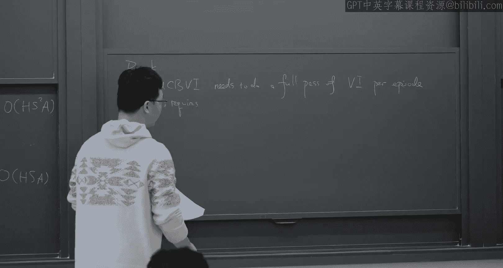
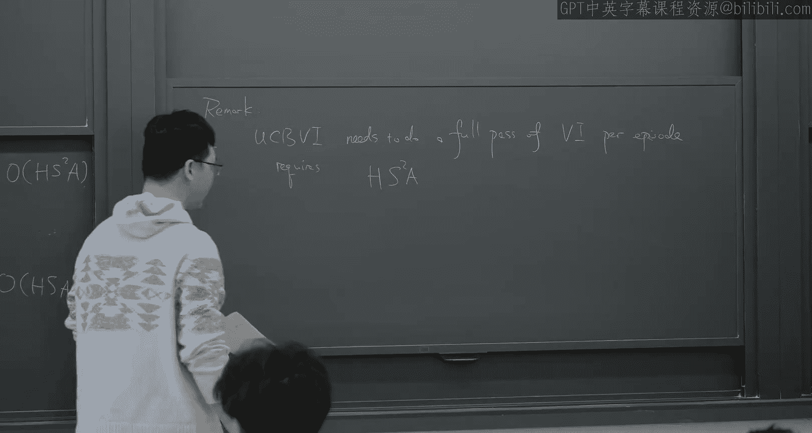

# 强化学习基础：第10讲：多臂老虎机问题的下界 🎯

在本节课中，我们将要学习如何证明多臂老虎机（MAB）问题中遗憾（Regret）的下界。我们将看到，任何算法都无法获得比 **O(√AT)** 更好的期望遗憾，这证明了UCB等算法的紧致性（最优性）。

## 概述

在之前的课程中，我们介绍了多种在线强化学习算法及其遗憾上界。一个自然的问题是：这些上界是否已经是最优的？是否存在更好的算法？本节课我们将通过证明一个信息理论下界来回答这个问题。我们将首先聚焦于更简单的多臂老虎机问题，其核心思想和方法可以推广到马尔可夫决策过程。

## 从直觉理解下界

上一节我们回顾了在线强化学习的上界，本节中我们来看看为什么 **√T** 的遗憾是不可避免的。

考虑一个简单的两臂老虎机问题：
*   臂1：奖励服从伯努利分布，期望为 **1/2 + ε**。
*   臂2：奖励服从伯努利分布，期望为 **1/2**。

其中 **ε** 是一个非常小的正数。

**核心难点**：从样本中区分哪个臂更好非常困难。根据中心极限定理（CLT），当我们对每个臂进行 **n** 次拉动后，其经验平均奖励 **R̄** 近似服从高斯分布：
*   **R̄₁ ≈ (1/2 + ε) + N(0, 1/(4n))**
*   **R̄₂ ≈ 1/2 + N(0, 1/(4n))**

**关键观察**：当噪声的标准差 **1/(2√n)** 与信号强度 **ε** 处于同一量级时，我们有常数概率会错误地判断臂2优于臂1。即，当 **ε ≈ 1/√n** 时，我们无法以高概率区分两个臂。

**对遗憾的影响**：如果我们设置 **ε ≈ 1/√T**，那么在 **T** 轮交互中，算法本质上是在随机猜测。每次拉动非最优臂，我们都会损失大约 **ε** 的期望奖励。因此，总期望遗憾至少为 **Ω(T * ε) = Ω(√T)**。

这个直觉论证虽然不严格，但它揭示了 **√T** 下界背后的统计本质：区分微小均值差异所需的最小样本数。

## 构建严格下界的挑战与方法

上一节的直觉论证存在两个问题：1）它依赖于渐近的中心极限定理；2）它假设算法只比较经验均值。为了证明一个**算法无关**的、非渐近的下界，我们需要更严格的数学工具。

证明下界的核心策略是构造一个“困难”的问题实例，使得任何算法在其上都会遭受高遗憾。然而，直接构造一个固定的困难实例是无效的，因为可能存在一个“作弊”算法，它恰好知道最优臂并始终选择它，从而获得零遗憾。

因此，我们需要更巧妙的构造方法：

1.  **从固定实例到分布**：我们不再构造单一的困难问题，而是构造一个**困难问题上的分布**。算法需要在这个分布的平均意义上表现良好。
2.  **从随机算法到确定算法**：通过一个标准的归约论证，我们可以证明，只需针对**确定性算法**证明下界就足够了。因为任何随机算法都可以看作是以某种概率选择确定性算法，其最优表现不会优于最好的那个确定性算法。

**结论**：我们只需要为**确定性算法**构造一个**困难问题的分布**，并证明其期望遗憾的下界。

## 困难实例分布的构造

基于之前的直觉，我们构造如下困难分布：

考虑一个有 **A** 个臂的老虎机。对于每个问题实例：
*   存在一个特殊的“好”臂 **a***，其奖励期望为 **1/2 + ε**。
*   其他所有臂的奖励期望均为 **1/2**。

**关键**：我们不固定哪个臂是特殊的。相反，我们定义一个**分布**：特殊臂 **a*** 从 **{1, 2, ..., A}** 中**均匀随机**选取。这样就得到了 **A** 个不同的老虎机问题，每个问题对应一个不同的特殊臂，算法事先并不知道是哪一个。

这个构造使得那些试图“猜测”或固定选择某个臂的“作弊”算法在期望意义上会表现得很差。

## 下界定理的形式化证明框架

我们引入一些记号来辅助证明：
*   **E***：关于特殊臂均匀随机选取这一“元分布”的期望。
*   **Eₐ**：在特殊臂固定为 **a** 的条件下，关于奖励序列的期望。
*   **E₀**：在所有臂的期望都是 **1/2**（即没有特殊臂）的条件下，关于奖励序列的期望。
*   **R₁:ᴛ**：表示智能体在前 **T** 轮中观察到的所有奖励序列 **(R₁, R₂, ..., Rᴛ)**，其中 **Rₜ** 是在第 **t** 轮选择动作 **Aₜ** 后获得的随机奖励。

**证明思路**：
1.  计算在分布 **E*** 下的期望遗憾。
2.  将遗憾表达式化简，核心项变为 **ε * (T - E*[Nₐ*])**，其中 **Nₐ*** 是拉动特殊臂的次数。
3.  证明由于 **ε** 很小，算法很难从数据中判断出哪个是特殊臂。因此，在真实问题（有特殊臂）和零假设问题（没有特殊臂，即 **E₀**）下，算法拉动任一臂 **a** 的次数期望 **Eₐ[Nₐ]** 和 **E₀[Nₐ]** 非常接近。
4.  利用信息论工具（如KL散度）量化这种“接近”的程度，并推导出 **E*[Nₐ*]** 的上界。
5.  将这个上界代入遗憾公式，通过选择最优的 **ε** 值（约为 **1/√(AT)**），最终得到期望遗憾的下界为 **Ω(√(AT))**。

本节课我们建立了完整的证明框架并完成了部分推导。在下一讲中，我们将深入最后也是最关键的一步：使用KL散度和信息论引理来严格比较 **Eₐ[Nₐ]** 和 **E₀[Nₐ]**，从而完成整个下界定理的证明。

## 总结

本节课中我们一起学习了多臂老虎机问题遗憾下界的证明动机与核心框架。我们首先通过一个两臂老虎机的例子直观理解了 **√T** 下界的来源。然后，我们探讨了构建严格下界所面临的挑战，并提出了解决方案：针对确定性算法，构造一个困难实例的均匀分布。最后，我们形式化地定义了证明所需的记号，并概述了通过比较不同假设下的期望拉动次数来完成下界证明的路线图。这个证明展示了信息论在分析学习算法 fundamental limit 中的强大作用。