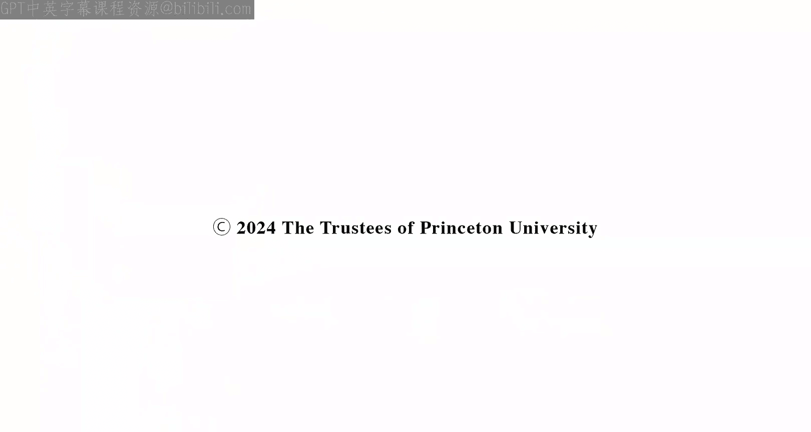

# 普林斯顿大学《强化学习基础｜ECE524 Foundations of Reinforcement Learning Sp24》中英字幕claude-3.7-s p11 Lecture 11_  Lower Bounds for MDP.zh_en -BV1vewWeRE5X_p11-

Okay， so maybe let's start。So today， we will continue talking about the lower bound for reinforcement learning。

 So in the last lecture。Well let's just first recap a bit what we have been talking about in the last lecture。

 In the last lecture， we talk about the general strategy to develop a lower bound is we can perform this reduction。

Where we will reduce the algorithm。The lower bounds for any randomized algorithm。

And we need to construct。Hard instance， which is specific to this algorithm。And expect a request。

 this is the original target of lower bounds。 We're trying to prove this is like small。

This is a lower bounded by something。 And we say by reduction， we can actually reduce it by some。

Lower bound， which is to say we no longer need to look at the randomized algorithm。

 We only need to look at the trimistic algorithm。And we can take expectation。

And we are no longer look at problem specific like algorithm specific hard instance。

 But were like taking expectation of a problem instance over some distribution。And we look at it。

So the important thing is now we only need to deal with a deterministic algorithm。

 and we deal with a distribution over a hard instance。And in the last lecture， where in the。

Middle of trying to prove the lower bound for the multi unbandit case。

 which was a simpler problem for reinforcement learning。So the theorem look like follows。

For any algorithm。For any algorithm A。There exists a multigaed problem。So that the regret。

Upt to time T is lower bounded by some constantson times square root of A T。Okay。

 so this is the lower bundle we're trying to improve。 And we talk about some construction。

In the last lecture。Where our construction is also very simple， it's a multiumb problem。

 So we have eight different arms。We have arm1。I2 till arm A and to capital。Arm capital。

So we see the average reward or mean reward for each arm are all peruli。

 The distribution are all pnooli。1 half， for the most of the arm。

 where there's only one special arm that is one half plus epsilon。

 And this special arm is sampled uniformly random from all possible arm。

So this gives the construction of the our。Distribution of heart problems。

 which essentially is a multi unventending problem with one special arm。 And it's， if， if。

 if the special arm is fixed， this is like one multi arm problem， one hard instance。

 But we need to construct distribution。 So basically， we。

 we make the special arm randomized through all possible arms。

And I just want to recall in the last lecture。 we introduce a bunch of notation。

 We will continue use it。 We say it expectation。 E star is basically taking expectation。

Over all randomness。Including the random draw of special arm。So including a random draw of special。

And we have E A and E 0 in the last lecture。 We defined it to be E A， is' defined to be。

The expectation taken over like random reward。 If a is a special arm and E 0 is taking expectation over reward in a special case。

 If there is no special arm。 Okay， so it's like completely。No下。And we also defined a notation。

 which are 1 to T。That is a collection of all the information we will receive from Malam Bennet up to tea round。

 which is essentially the stochastic reward we're gonna to receive in the first iteration when we pull arm 1。

And the stochastic reward that we're gonna to receive in a second intueration when we put when we put a second arm。

those are like the arm we pull at the first time。 arm we to pull at the second time。

And then until time T， the stochastic reward will receive。When we pull arm A。

Just briefly recap on the notation。And recall， this is like basically the full information we receive。

 we interact with a multi problem because at each each time， each iteration in the multi embedded。

 we only pull one single arm， only observed the stochastic reward we get for that arm。

 So this is like everything we receive from the environment up to time T。Okay。

And in the very end of last lecture， we have been talking about the first step where we computed the regret。

We say this is equal to。We have been calculating this regret。

 and this regret is equal to epsilon times T minus。1 over a summation。Little a from one to capital a。

Where we taking an expectation of a。Ting expectation where we， we。

 when arm A is a special arm and how many times the algorithm is gonna pull arm A。So， when。No， yeah。

 yes。Yes。T to one hour of。Do we what， Sir。So， we should。不说法。呃， sample a， choose this arm。This would。

R 1，2 T Oh， this is， I think you can think this is like stochastic draw。 So。

 so in in the first round， we choose arm A A 1。And we get a stochastic。

 stochastic draw of the random reward。 So this is just indicating like this is like a stochastic thing we。

 we got in the round one。So at each each different round。 So even if， let's just imagine。

 even if I always put the same arm。 So my algorithm is stupid。 I always put the same same arm。

 I still get T random reward。C independent random reward。

 So this is indicating like basically round or the number of episodes。或一起 round we randomly去所啊。

We don't randomly choose each arm。 So this arm is likes chosen by algorithm。 So algorithm。

 for example， algorithm can be U B or can be epsilon greedy。

 So they will look at the previous feedback， which like algorithm will in the first it。

 pick a one and got reward one。 And then the algorithm will process the feedback and choose arm。

 choose the second second arm。 and then you get a second feedback。

So you can think this can be a reward sequence you observe from UB algorithm or from Epsilon greed algorithm or。

For any algorithm。A is chosen chosen by the algorithm。 arm is chosen by the algorithm。 Yes。

 so this is what I'm， what I'm saying is like for whatever algorithm。

 this is like completely history。Like you observe from the environment。

Yeah that's a very good question。Okay， so well actually immediately use the fact。

So we said the when we look at the expression of the regret。

 the only thing kind of non trivial is this expectation。

That is under the scenario where arm A is a special arm。

 How many times this algorithm is gonna pull arm A。

So we say we will actually kind of bonding this term by comparing to E 0， by comparing to the。

Like the the， the， the， the case， vanilla case where there' is no special arm。

So we look at this difference， E A and A。Minus E0 ending。So our whole idea is basically。

 when epsilon is very small， then whether a is a special arm or whether zero special arm。

 like it's it's whether theres no special arm， this is like very dis difficult to distinguish。

 So we expect for any algorithm like you won't be able to spend a significant amount of time pulling an a。

So we can actually do the expression that this difference。Is actually equal to。

With summation over all the possible histories we're gonna to observe for the， for the algorithm。

And because algorithm is fixed。So whenever I fix the history。From R1 to T。Then。

We will completely decided how many times I'm gonna to pull arm A。So we say the number of times。

For pulling arm。This is for fixed algorithm。The number of time so putting arm a is。

Completely decided。 And this is a determin algorithm。There a。By the history。Okay。So basically。

 by looking at the history and now because we have a fixed missing algorithm。

 So we were always able to read front history how many times we have poor R。And once we know this。

 then the remaining thing， we just need to look at the probability of observing this history。

 So the difference between。Under the。The case where a is a special arm。

 What is the probability I'm gonna to observe this kind of history， R1 to R T。And subtracted by P0。

1 to Rt。O。And remember， this R 12 R T is just a t dimensional scar， t dimensional vector， which。

 which is coordinate with a scar。So any questions about this？So basically。

 if the algorithm is fixed by looking at just the reward， we can like。

 know what algorithm we gonna pull next。 And this is gonna be the reward of the next arm we pull。

 and we can basically recover the entire history of how， how this algorithm is。Pul in different arms。

 And what is a reward they're gonna receive。So if no questions， I'm gonna do another。Bound。

 another thing is now we have， when we have this expression。

 we can basically just upper bound this N A。 that is whatever the traject is。

 I'm gonna number of time we're gonna put arm A by T。So I'm just upper bounding this NA by T。

And then we write the remaining thing， are 1，2 T。And we see the upper button。Which isPA。Of1，2。

Subtract P 0， R 1，2， T。And for those of you who， who learn like the probability。

 you will notice this is essentially the TV distance。

 total variation distance between this probability and this probability。So， it's two times t。

Times the TV distance。Between P0。PA A and P 0。TV is essentially just defined as one half of this summation of the absolute difference on each。

 each part each mat。Yes。I'm pretty confused。What's the reason。So why do we choose special homes。

It's problem。Why， why does it。我思。Why， why， why what？ we choose special arm。

 So we want to make this problem hard。 So we're essentially saying essentially。

 we want to prove some regret， right， regret lower bound。 That is were saying for any algorithm。

 we need to suffer from some regret。😔，And if we don't have any special arm， every arm is a one half。

Then we just， we can just pull any arm and we won't suffer any regret。

And only because there is one special arm that is greater than the remaining arm。

 So the best strategy is always putting the special arm。

 But because I don't really know which arm is special arm， this epsilon is very small。 And also。

 it's a random arm。 this special arm is hiding among all arms。

So that's why it's very difficult for me to figure out which is， which one is the best arm。

 And if I don't put this best arm， I put some other arm， I will suffer regret epsilom to。

So Im just want to say this is actually hard that I will suffer absilent for a very long time until I figure out。

 So we don't know which chance to test。他去。Find some program。

The algorithm is trying to find out what is the special one。You can see any multi arm benefits， but。

 but imp， they， they should， they should figure out what is special arm。 Like which。

 which one is the best arm。Yeah any questions about this part or if feel confused， yes。選十ね。

I that that just like comes from？Let's just like did that initially。This one。The this one。 Yeah。

 this is， this is just come from the definition， yeah。O。So if you are happy with this。

 now we do the next step。So next step， we will just directly invoke someone。

 some inequ from the probability theory。 It's called pinks cursing inquiry。

So the important thing is this P A and P 0 is， is a probability over R1 to R T。

 which is as a sequence。 And we hope we can do some decomposition。

 And the TV distance is not very easy to decomposition。

 While K L and cable divergence is much easier to do the。To do the this factorization。

 So for pin screen equality， we know for any two probability， P and Q。

We can actually say the TV distance between P and Q。Is upper bounded by。Square root。

One half of the k divergence。Between Q P and Q。So that means this is less or equal to。Square root of。

来首 equal to。T times square root of2 k。P 0。Over a PA。So now we only need to look at this k divergence。

So we continue with the k averages。First， by definition of K divergence， K L is， again。

 a summation of all the。Possible R1 T to T sequence and the definition of care divergence is。P 0。1。

2 T。Times the log。Of P0， R12 T。Over。PA A R1，2 T。Yes。ちなかた。Yeah。

This is this is basically the general definition。 It's， it's like just。sumummation of a P。

 X log P X over Q X。Smation over for O X。 This is like definition of K。

 and which we just replace x by R 1 to T here。Okay。So now we will use some structure for it。

The first step。We don't do anything for outside。But inside。For the， for each probability of R12 T。

 P 0 R to T and P R12 T， we， we can like we， we factorize it。 We， we say this is。

 this probability of a joint probability of everything is equal to the product product of conditional probability。

 So this is equal to product over T T from one to capital T。The probability。Under this zero instance。

Of the observing R T。Condition we observe previous R 12 T-1。

This is like a very standard probability equality。 And for the denominator is also saying it's a product from T from little。

 little from one to capital T。And P。R tea。Givenive our 1 to T T-1。And for the next step。

 we notice we can move the product within the log outside to make it a summation。

So the next step is just equal to summation over little T from 1 to capital T。An summation。Of our 1。

 to 3。P 0， R 1，2 T。Log。P 0。Our little tube condition on the previous thing。Divided by P。

A little tea given by the previous。So all， all I did is just to make the product outside the log。

 So that becomes the summation。So another thing we notice is we can essentially divide this summation to be two parts。

 One is I first summation from。嗯。From cheap plus one。2 T， and then I sum from R1 to R T。Okay。

 so I can essentially sum over all possible like in different order。And we notice the。

 the remaining part actually does not depend on this T plus one to capital T。

So we can essentially also decompose this。To be p 0。Or。2 plus one。To capital  T。Conditional， R 1，2 T。

Times probability of R 12 T。And we say this summation we take those into two part。

That is with sumation from R 1 to T。And the sumation from。R2 plus one。To capital。

And we notice this part， actually sum to one。So we kind of simplified this expression。

Which was equal to。Sumation little T from one for capital T and summation。R from one to little T。P 0。

I'm friend。 why I amm too little to。Log of the probability。Achi。G R1 to t minus1。NPA。27。1，2，3，-1。

And another thing I note， we notice from this fact is。Because we say our 1。

2 T-1 is the complete history we observe from the environment for this algorithm。

 So that means for fixed algorithm， A T， the action the algorithm chooses at a time T is completely determined。

By the history that R 1，2， T-1， O， so。Once we fix the history， we know what。

 what this algorithm is gonna make for what， what action is gonna take at times that T。And also。

 we know if。If somehow， A T is not equal to a。It's not equal to a special arm。

 This is like special arm。Then we have。P 0。RRT。Given R 1 to T -1。Its equal to P A RRT。R 1，2， T-1。

The reason is， essentially， when we condition our previous history。

 we kind determine what is the arm。 And when arm is not equal to a。

 we know this is not a special arm。 If it's non special arm in the vanilla case P 0。 and in the case。

 a is special arm。 It doesn't really matter because I'm putting a non special arm。

 And the the reward is always gonna be sampled from Bno distribution with one half as a parameter。

 So in that case， this， this probability is exactly equal because I'm putting a non special arm。

 And in this case， we know。咳。This， this thing will cancel because theyre equal， They equal to one。

So that means when we look at this expression。We only need to count。

Those history submission from one to capital T。We only need to summation over those history are one to little T。

Sod。AT T is precisely equal to a。So we only need to summation over those history that my algorithm will。

At the time， T will pick pick the special arm。 Otherwise， this log log， this log term will just be 0。

 and we won't， we will't need to count those terms。And this is a P 0， R 12 T。Log。P0。AT given。1，2 t。

And P。All given our answer。Okay， yes。So why？W， why is what， Why is equal， Why。

 why why those two are equal， Oh， Because if A T is not a special arm。It's not a special arm。

 Then everything is benouli1 half， right， This is the probability of this and these are also benoi one2。

Yeah， both you could no， both you could。Bnoi want to have。Yeah， I think。

 I think when you take R T equal to1， R equal to 0， both equal to1。 That's true。Okay。

So next step is more less a quite straightforward。We copyied the first thing。1 to capital T。

 And we again， decompose this summation。For to， to be like the first we sum over R T from1 to T -1。

And we notice the， the this， the selection where this condition where A T is equal to a is already completely determined by history up to t -1。

So that we sum over all the possible historytor so that A T is equal to a。

And then we can pull the P 0 outside our 1，2 T-1。So we notice this is T， and this is t -1。

 So we also need to take a summation over the last step。That is， we need to summation over R T。

And because R T is a beno distribution。 So we know R T essentially only has two value。

 That is 0 or  one。And we look at the P0。啊T。Givenive R 1，2， T-1， and log。P 0， R T。Givenive R 2，1 T-1。

And。PA R。From1 to 2-1。So although we write a very complicated like conditional dependency on this R12 T-1。

 But the most important thing is it already tells you I'm putting a special arm。 So in that case。

 under P0， this is， this is like beno1 half where under P A because I'm putting special arm。

 This is like beno1 half plus epsilon。 So essentially。

 this is a K L divergence between Bno1 half andno1 half plus epsilon。

So the next app is basically just T。From 0 to capital T。And we can。Essentially。

 first group this thing together。This is just equal to probability。Under 0。

 we take A T is equal to a。And whatever remaining here。Is actually equal to。The k。

Between Bernnoi1 half。Versus like a Bnoi1 half plus epsilom。And you can plug in the value。

 And with the definition of K divergence， you can compute。 what is this scale。And， eventually。

This is equal2。So this part， the summation T from one to capital T and p 0。

8080 equal to a is actually equal to expectation under the 0。0ero case。

 What is the number of time we gonna pull arm A。And the k divergence is equal to one2。Log。

1 over 1-4 epsilon squared。I'm just doing the calculation for you。

 but you can go back to check the computation。 This is exactly the K evidence。

 And this is what we have。How would just raised this as well。Yes。SoIn the last test。

 will redine E and D。Deure for the expectation if there is no is for if action A is the special arms spectrum。

Yes。Does it also can it be also apply for P 0 and Yeah， P0 is exactly the same same definition。

 P 0 is the probability under the case theres no special arm Well P is a special arm and。

There is a spectrum。Yeah， Pi is a special arm。 And this is a probability， because we， we。We actually。

Pull a special arm。This is the like condition on the history so that I will ex I will always put special arm A at at run run T。

 So I can select those history。 So in that case， like because I'm putting a special arm。

 So that's why the， the P is only 10 plus episode in case then like P means。One of the arm。Yeah。

 P A means A is special arm。 The arm A is special arm。O。So we just recall how we get this like why。

 where we use this k diveence， Like we， we essentially bound the k diveence by this。So recall。

 we used the K diveence because originally， we look at this difference。E A and A Subtract E0， N。

And we say this is upper bounded by T times square root of 2 K， L。Of a P0 over PA。

So the other thing we can note， we notice is we also have this summation of a from one from one to capital A。

 That is a summation over all action。We have E0 and。Is equal to T。

This is basically saying the expected number， expected number of times we're gonna put arm A under the same environment。

 that is no， no arm special arm is always equal to。 That is eventually。Algorithm in the tea rounds。

 can only pool。T times in total。 So the number of time we pull each arms some together is always equal to T for any algorithm。

So this including some cheating algorithm， which we just always put some fixed arm。 In that case。

 my arm， the number numbers like heavily favored for some special for， for some arms。 But。

 but the other arm essentially， I I never put them。 So sum is also equal to T。

This indicates we can essentially summation。The above equation for， for all a。

So what we have is summation over a。From one to capital A， B， A N A。Is less or equal to。

The summation of a from one to capital a is 0 and a。Plus， T times。Smation over。A again。Capital A。

Square root of2 K， L。P0 over PA。And finally， I know， we notice the first term is just equal to T。

 we already said。 And the second term， we applied the previous bond we developed。

 and this is equal to。Ti。Times summation。A from little one1 to capital a。Square root。Of。Yi。0ro。😔，Eei。

Log。1 over。1-4 epsilon squared。So right hand side， we still have this0 N here。

 and we want to get rid of that。AndThe way to do it is by K Schwartz。Essentially。

 we can say the fast T。And then T。Ands the square root。

We can think this is a summation of a square root of this0 N A times1。So we， by applying k shores。

 we， we move the summation inside， and we have the summation a from one to capital a。This E0 and。

Times summation a from1 to capital A。Wan。And eventually， have the log。1 over 1-4 epsilon square。

So eventually， this is just equal to T plus。T times square root of A T。Log。1 over 1-4 epsilon square。

So we're very close to the final answer。So once we get this an bound， we。

 we now can look at our regret。Still recall that regret is we already calculated is equal to epsilon times T subtracted by one over a。

Smation a from one to capital A。TheEANA。And now we directly applied the bound。

So we can move the T outside。 So we know this is greater equal to。Epsilon T。Times 1。

Subtracted by one over a， because we also have a T here for this bound and a subtracted by square root of T over a。

Loug。1 over 1-4 epsilon squared。So we're already there。 we say this is more less roughly。

 if we look at the other， we essentially have4 two terms。

 This one over a usually is like much smaller。 It's like even smaller than1 half。

 So when you well compare one over a to one， it doesn't really matter。 It's just some constant。

 So the first term is actually absolute T。Roughly order of epsilon T up to some constant。

And then the important thing is the second term。 So the hope hope is we can use a second term to like contribute to the a big portion of the 1-1 over a and to make everything simple。

So for the second term， we notice this is actually something extremely close to one。

This is extremely close one。 And the log， when log extremely close one is we can like。

 we can take it out So this is roughly something like Epsilon square。

 some constant times Epsilon square。And up to some constant， when epsilon is very small。

 so we can pull it outside and it becomes something epsilon times T over a。S体。So， up to I constant。

This is what we have for， for two terms。 The first term is this。

 this two term together because this one't doesn't matter much。 And the second term is this term。Yes。

Because this is a wine， right。Like one away is less than one half。So in the end。

 we just pick Epsilon to maximize this lower bound。In which case， essentially Epsilon。

 we need to pick epsilon to be some C times squared A T。For small up， for small seat。

And in that case， we can， for some small prime。In that case， we can see this again。

 become some constant， like epsilon square is squared A over T and times squared T over a and some constant。

 So as as， we pick it prime to be something small， then this is like something constant but positive。

 Well， the word remains is epsilon times T， which is just become square A T。So， this finished proof。

So the probability calculation is a little bit involved。 But the whole idea is， we look at this。

Difference between the。The like a vanilla case where there's no special arm versus we have a special arm。

 And we essentially do an upper bound on this scale divergence。

 We say this probability to distribution are two probability distribution are very close。 So， so。

 so so that because we choose epsilom to be very small。 so that。So that essentially。

 because the probability is very close， then， then there's not much information is leaking。

 even in this。In this case， where we do have some special off， do have some signal。

 So that is why it's difficult for any algorithm， yes。ば我。I that that real return show is like three。

Yeah。We already said this is like a squared this is squared of A over T。

 So that means this thing is con constant， right， when we， when you plug it in here。

 this is a small constant。 we can， we can choose see prime to be some small。

 small constant so that this is one minus some small constant。 This is again some small constant。

And so the whatever remains is outside where Epsilon T， Epsilon T is just square root T。

So any questions up about the this one。Yes。The sort of confusedfuse how like。Oh， it's。It's， it's。

 again， like a quadratic thing， right， This is like a linear term。 This is a quadratic term。

So I think you can， you can make it write it out。 Epsilon T Subtract C times Epsilon square。嗯。

Squiled Chi away。Something like like that。 And a photo quadratic thing， I think the。

The optimal is is chosen at2 B over a。Right。I think optimal one is just chosen as。

like the coefficient， which， which often one is just just this。Roughly some concern of it。You can。

 you can just do this square。That's。What the harder。Yeah， essentially like。

 what is the right skating of epsilon。 Like where the right skating of the noise make it very difficult for。

 for the problem to tell for any algorithm to tell if。

 if you can only interact with the problem with t iterations。

LikeYou should basically scale it as a square root of A over T。Okay。

So finally， I think we will also mention that with similar techniques。So this is a regret bound。

We can also essentially ask if we don't care about regret。 We only care about the pack。

 That is a symbol capacity to identify the best arm。What is the， what is the lower bound。

 We can essentially use a similar proof。So were similar techniques。We can also prove a lower bound。

On the sample capacity to identify the ba arm。So the theorems look like follows。Basically。

 we say for any algorithm。That can。Addaptively， pool。4 two times。And output。A possibly random。

So this is like restricting the protocol of algorithm A。

 This is not restricting the power of algorithm， but it basically says algorithm A can only pull arm for t times and need to output a single arm because we output a possibly random single arm。

 but because we're doing like this best arm identification。And then。There exists。

And multi here uned problem。So， that。We will have star。Which was a reward of the optimal arm。

Subtracted by expectation over internal randomness in the algorithm A psi， essentially。

 is the expected reward of we're gonna receive by pulling the arm outputted by the algorithm。

Were saying this is a lower bound。Baaii。Time squared A over T。So this is a theorem。

 This essentially implies。If we want to achieve， if we want to achieve， make this epsilon。

Then that means we need a sample complexity that is T is greater equal to some constant。

Times a over Ebsinnal squared。So we have to use this number of samples to identify the epsilon optimum arm。

Essentially， you can think this is a。Something similar to the grab lower bound。

 This is like aem lower bound。I think in in the class。

 we can mention regret is harder than sample capacityac because regret need to balance the exploit versus exploitation。

 Well， well in some capacity， you don't need to don't care about the exploitation。

 like you can just do pure exploration， eventually find the optimal arm。

 Well the lower bound is like on the reverse order。

 lower bound is basically we want to prove some problem is hard。

 And we say the sample capacity is easier problem。 Well regret is a harder problem。

 So that means in in the lower bound， proving regret is a lower bound is easier than proving the sample lower bound。

 So so that means the the previous regret lower bound would not imply this lower bound。

 Well this lower bound somehow can imply the previous regret lower bound。And so how to prove this。

 we will actually leave it as a homework。So essentially， the argument is roughly very similar。

 It's a very good practice。 You can just leverage a lot of k computation weve already done。

But make a slightly trick on the outside argument， like we don't。 we， we。

 we not look at the request or we look at some slightly different thing。So finally。

 after we're talking about the lower bound for the multiium bandit。

 now we will move to the Mar opposition process。The reason we talk about Loban for Maram Bennett。

 because it's a special case。 It's an easier case for， for Maram Bennett。

For for for market prediction process。 So now we will actually extend it how。

 how we extend it to the MP。And if you still remember that in the M DP literature， we can like we。

 we look at a bunch of algorithm like U B V I。Coughing。UB V I， Princeton。And in terms of regret。

The U B V I is roughly order of。HQ of SAT。Well， the brainton is。H square SAT。So essentially。

 this is a lower bound that we're trying to prove。 at that time。

 we say UB V I Princeton is is optimal。So we say the lower bound。Is。Square root of H SAT T。

So up to lock factor， it will exactly match the UB V I。So this lower bound is slightly more involved。

 and we will probably not talk about in this class。 and we'll talk about alternative。

whichhich kind of capture some of the essential idea of how we do the extension。So this。

 this type of result is so called in a non stationary setting。

Not setting名是P one can may not be equal to P two， not necessarily equal to P two and not necessarily equal toPT。

So they can completely different。That is， the transition at each step is different。

So we can look at a simpler case， which is stationary case。Where P1 need to be equal to P2。

Need to equal to P，So it turns out in the stationary case。

 because the transition is easier and we can essentially shave off everything by a square of H factor。

So we can have some modified algorithm achieve this square SAT。And this Otda， H SAT。

And the lower bound is also。Squared of h SAT。So we'll talk about this lower bound。

This is gonna be the lower bound we talk about。So， the theorem。

We're going to do this for any algorithm， A。There exists。A And DP。With initialization。S 1，2， k。

Ca from little one to capital， O。So， that。The expectation。Over a regret。Okay。

Let is define as sum Asian K from little one to capital K。The value。Optal value at S 1 K。

Subtracted the value。Of the algorithm take at itration K。At was one K。This is lower bound。

By sea times square root of a HSA。So everything is very standard like we for any algorithm and there exists MP。

 So this is like a standard of lower bound， the kind of statement。

 The only thing like slightly different from what we have been previously talking about is this initialization。

 we saying there exists some initialization and we remember in the upper bound for first simplicity and throughout this class we talked about for some fixed first fixed initialization。

So it turns out upper bound also works for adversarial initialization。That's。

s actually a very easy adaptation。 I haven't talked in a class， but。

But you can easily essentially use the same proof to say a bound。Works for。

Adversarial initialization。That is suppose I have a adversary。

 which just tell me what is the initial state at every app， at each episode。

So to make our life slightly easier， we essentially say the lower bound。

 We also make it we also stay the lower bound for adversarial initialization。As I said。

 this is just make our lower bound is a bit easier to prove。 I think for， for fixed initialization。

 the lower bound construction need to be。A bit more complicated。I think the reason we can do this is。

 as I said， because in the upper bound， we can actually allow key different initializations。

So lower bound as long as we match the upper bound， ass fine。是Y整Y整。Because for lower bound。

 the harder the problem， the easier we prove the lower bound。

 Lower bound is trying to say the problem is harder。It's one different missile。Yeah， you can。

 you can just pick whatever the initialization advers。Egypt starts。Yeah。Okay。

So with Martin Bennett already did all the hard work to proving this specialized setup。

 lower bound is actually very straightforward now。So let's again， consider the following。

D of heart problem。Yeah， but yeah， this is station。Sorry， this is stationary MP。A part MP。

We start with the case where we have three states。 and then it is's very easy to extend to S states。

Let's first consider three states。So construction is also very straightforward。

 So this is a three state M DP。 We have a zero state。One state。And two states。Wherere in zero state。

I have one special arm。That will transition to state1 with probability 1，1 half plus epsilon。

And all outer action。Will transition to。State one with probability one half。And similarly。

 starting from state 0， transition to state 2， If I take the special action that a star。

 we will have one half minus epsilon probability to transition to the next state。Where。

 on the other hand， if we take any other actions。Well do one half。

And no reward associated with with with in this， in this transition。Norura what here。So the part。

 once we go to the state 1 and state 2， that's very straightforward。 So state 1 is absorbing state。

 So whatever action you do， you always go back to state 1 and state 2 is， again， is also absorbing。

 So whatever the action you take。You also go back there。

And the only difference is when you go to state 1， every time you got a reward one。

And when you go to stay 2， all all times， you get a reward equal to 0。

And this is stationary because this is a three state MP where the transition is basically I give you here。

 And it's this transition is the same for all steps。嗯。Any questions？Whats meeting of hard。

Hard means this is the MP。 We can prove lower bound。 essentially， the will confuse algorithm。Like。

 like essentially， we can prove this lower bound。Or essentially this this is like a construction of MP。

 We can achieve this lower bound， you can think。And now we。

 we need to look at the distribution of hard MP。 This is like a single MP。 So distribution is， again。

 very simple。 I just sample a star this。The special arm。Its also uniformly from all actions。

So because I can choose whatever the initial states is like adversarial picking initial states。

 So in this case， I would just make initial states to be 0。And let's。

 let's see what happens in the first half。So what happens in the first step is。

If we pick the special arm A。The transition。We're gonna say is we're gonna transition to state 1。

With probability 12 plus epsilon。And stay 0。St 2 with probably one half minus epsilon。

And the cumulative reward we're gonna get。Is actually just H -1 in a state one case。

 because for the other the remaining step steps， I was gonna， I gonna just circle around the state 1。

 And it's a absorbing state。 So I will never go out。 This is like cumulative reward。And this is zero。

And if we choose all other arms。We also， again， have the problem with stage 1。Stay2。1 half，1 half。

And h -1 is0。So for those of you who kind of already observed a pattern。

 this is precisely what we have for the hard instance for the multiium Bennet with the only difference that in the multiam Ben。

 the special arm is like 01 is benoulli1 have plus epsilon。 Now， instead of benoulli， like we。

 we get the reward that is h-1 instead of one。 So just all the reward is scaling up by h-1。

So basically， the same hard instance as M may。Acept。The still word。U。H minus-1 factor。

So in that sense， we can immediately prove the regret。Which is， again。

 directly affected by the scalingkating of reward is also scaled up by H -1 factor。

So we know in the multi embedded case， we know the regret is some constant times a K。 Okay。

 K T is like the multiumb in this case， like his number of episode， which is k and times the skating。

 which is H-1。And this is equal to。Supprime。Times H A T。

Because we observe observe one of the H inside the like we make T is equal to K， K H。And essentially。

 proved the case for。For the number of states， it small。And finally， for multiple state case。

 it's also relatively straightforward。That we just。For estate。We can like a construct。Ss over3。Oh。

 because I can adversarily choose the initial state this。

 So I just may fixed the initial state with 0， in that case。Sorry。

 or would the other ones have lower。O has a low has no no regrettor， right， because you cannot do it。

So for S states， we can essentially construct a S over 3。Coopies。Of hard instance。Of the H instance。

 we just previously constructed。Was different special arm。

Different means like those special arm are independently draw from uniform。Distribution。

 like independent。So if S is not more multiple of three。

 like you can just ignore the last one or two states。 that that's also fine。Like。

 just make it trivial。 And you don't incur any regret there。 That's， that's also okay。

 So let's say if we have a three S over three harder instances， that essentially we have。

Something like this。Like，4。And。7。Like this。So what we will do is we will。Initialize。At those states。

At each， we call it each branch。 Okay， this， this we call it branch。Precisely K。

Over S over three times。Essentially， we will just uniformly put all our episodes into。

 into different branches。So we know each branch we occur the same regret so we can easily compute the regret。

O。It's greater equal to。 I have S over three branches。And for each branch， I am incurring a regret。

That is H， A。And because at each regret， it it should branch， I no longer pull it for T steps。

 I only pull it for T over S over three steps。And you can prove this is a roughly something。

 C double prime。Of the square root of H SAT T。And finished it。

So it seems the MP construction is really straightforward。 It's just the basically banded problem。

 I think this is a reason this is because we kind of essentially dealing with the easier case of the stationary setting。

 Where the non stationary setting， is's a little bit more complicated than that。 We， we。

 we can no longer just construct a bandit case。 We need to construct something。

Slightly non trivial than that one。也是吧这。There's a regret based on that。

Re is the summation of of each round， right， summation of every round。

But because each branch is completely independent。 So so you can essentially think regret as a summation of the regret occur。

 in in each branch。I think the whole idea is you can think， you can use the intuitive idea we， we。

 we talk about the in the last lecture。 and this lecture， the K computation in the， in the。

 in the first part of the lecture is basically for rigorous inform theoretical argument on how we proved that kind of lower bounds。

And， but essentially， we， we developed this lower bound to match the upper bound to say the upper bound we developed is like sharp。

 We should not look at any other algorithm can have better performance in the worst case。

And starting from our next lecture， we will talk about the very last part of the tableular MP。

 that is the offline scenario where we， we， we no longer have like online access or simulator。

 instead of we have some other people collect a bunch of data for for me。

 And Im gonna reason what is optimal policy based on those offline data。

 which is another setting and which is also frequently used in practice。

 And then we will go to the more advanced the function approximation like in the large space scenario where we no longer have like this finite number of states。

 and we will talk about how we're gonna handle those kind of settings。So we made like a hard problem。

And then。We couldn't make a significantly harder problem that has a higher。The exist Aba， yes。

 exactly。That's a good。Yeah， thank you。 I guess we'll see you the week after。Also。

 happyapp Springbri。

