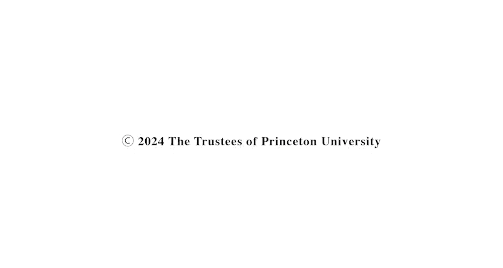

# 普林斯顿大学《强化学习基础｜ECE524 Foundations of Reinforcement Learning Sp24》中英字幕claude-3.7-s p12 Lecture 12_ Offline RL.zh_en -BV1vewWeRE5X_p12-

so系。So today， we will talk about offline reinforcement learning。So so far。

 we have been talking about reinforcement on a lot of several different settings。

 So let's first review on what we have been talking about。 So the first setting。

 or most simpler setting is like the planning setting。

 which we already know the transition and reward in that kind of scenario。

 there is not much learning it is。 It's just planning like I want to find a policy， optimal policy。

And in terms of learning， there are three settings， the very first setting we talk about。

 The learning is the generative model。Generative model， essentially。

 the interaction protocol is like we have access to this。Simulator。Where in for the simulator。

 we can basically query any state and action， and the simulator will output the next state and reward。

So we also has been talk about online setting。Or online reinforcement learning。

We essentially by online setting， we mean we we will this similarulator require you like allows you to just query any state action。

 Well， in the online setting， you have to start from the very beginning。

 like must start from the initial states。And we're doing learning through online interaction with MDP。

Basically， we are an agent and we we can basically collect whatever the data we want。

 but we need to like interact with MP to collect the data。 So we collect it by ourselves。And finally。

 we will talk about today is the offline setting。Well， in the online setting。

 we collect data by ourselves。 So we need to do exploration， exploitation。

 trade off in the offline setting。 we actually learn from existing data。Collected by others。

So such a kind of scenario is like， for example， we want to do some ads like advertisement recommendation。

 like for Google。 And in that kind of scenario， maybe this like involves a lot of money。

 Google may not want to let you to test whatever the strategy。Directly online， because if you like。

If you try some like terrible strategy， lose Google kind lose billions of dollars a day。

 So in that kind scenario， maybe more safe or like the company's approach is more like they they will you will collect the。

 the recommendation data by some other strategy， some existing strategy。

 they they believe they can be performed reasonably well。

 And you hope you can learn from those existing data and to figure out what is the better policy。

 What is the optimal policy in that kind of scenario。

 So this is what we gonna talk about today in the offline。So how we formulate the offline setting。

 So typically is we say we have some behavior policy。

So this is like essentially what doing by others。 like essentially。

 someone has already used some behavior policy pie。

 or this pie can be non microrovvian can be some other policy and to collect a lot of trajectories。

Like hopefully， this pie policy pie is also some collection。 So it can be like a lot of policy。

 That's also fine。 I think most important thing is we collect a bunch of structures。 that is S 1， I。

 S 2， I， sorry， A1， I。As to I。A two eye。TOSHI。And we have I from1 to n。So in that case。

 H I correspond to one trajectory， S 1， A，1， S 2 A2， S H H。

 and we have like 10 different trajectories。 So this is what we mean by data character by others。

So this is like one of the setting。 we can consider offline reinforcement learning。

And hope is hope this policy is diverse enough。 And if we have like。

 see the trajectory for a large amount of trajectory。 So we can like， we can learn the transition。

 can learn the reward from the。From the， from， from this data。 and for simplicity for today， we kind。

 we always assume reward is known。 So we all only need to learn a transition here。

And sometimes we will also consider even more challenging set setting where the data is given by the twoos。

In， in sense of transition to pose。For example， we don't see the entire trajectories。

 All we see is like collected pieces of the trajectories。 That is like， for example。

 I see a lot of collection of the tu status in the form of S， H I， A H I。And S， H plus 1， I。

I from one to n。So for each step， I have， I kind like see a lot of this transition tus。

 and those are like independent。 And this S I plus one is。

 is kind of sampled from the transition distribution of S S A。

And we have like those kind of tus for each step。 So we want to learn the transition and eventually figure out the optimal policy from those data。

So this is like the full trajectory。 This is like， I don't even have the full trajectory。

 I only have just two posts at each steps。 And I want to learn the optimal policy from this。

And it's clear like the second setting is definitely slightly harder than the first setting。

 if we allow some augmentation of H sub complexity， because in if we have given the trajectory data。

 we can just generate the second version。Like by truncating it， like by。

 by looking at this tuple as a first step and this tuple as second step。 Okay。

 we can do some data splitting to get the second version。 So this one is like cool。Her。O。

So intuitively， if we want to， if we can do some offline reinforcement learning。

 that is you want to learn optimal policy from those like either trajectory data or like this transition twos。

 we need to essentially say this data need to be somehow diverse。

 It should not like just specifically focused on one specific state and action。

 The data only has like one data and action。 Then we we only able to learn transition for that specific data and action for other data action I have no idea what it is。

 So we somehow need to have a notion of like this data is representative so that it kind of cover a lot of different scenarios。

 and we can learn from it。You can also do that。 We can let， let's do some definition， okay。So。

 let this。Mu H SA。Essentially， be the。Probability。Offfer visiting。State action pair。SA。At a stepage。

So in our in， in here， like， for example， let's look at the twople scenario。

We can basically say our this mealo H S A is roughly equal to。The number of counts。

 how many times I observe S A at H step basically happens in this data。Like how many。

 how many tus actually start with S。I'm divided by n。The total number of tus in this data set。

This is like， a number of。S A X， X means like it can be any next state in D H。

So this can be like a true probability。 And this is like more or less an empirical version。

 empiricalm version is roughly this。And。This differ by some like small concentration in this class for simplicity。

 Let's say this is equal。 let's just pretend this is equal。 So for is for， for simplicity for late。

 later reservationvation。 But I think general， general。

 let's say this is like a probability of visiting state action pair essay。So， we say intuitively。

We want this。对的。To be a representative。So， that。It covers。Most。Like important essays。So basically。

 we you should not just cover some particular like one S A pair。

 It should like basically span over a lot of different S A pair。

 as long as those S A pair can be visited by some policy。So typically。

 one very naive assumption we can think of is this called all policy conability。

So assumption 1 is called our policy。Concentability。So the name is a little bit counterintuitive。

 I kind of always feel the the， this is like a bad name。

 I don't know why it's called it like consability is， is' basically for some historical reason。

 But the more this this assumption is about some coverage over a meal， Like how， how。

 how spread out like this meal is。So we say the all policy con assumption basically says data distribution。

Mu needs to satisfy the following assumption。Satisfies that。Max。Over H in H。S A in S。

So basically max over all steps and all state action pair。And then， max over policy pi。

We have the probability of。If we follow the policy pie to visit state S A。

 state actionction pair S A at step H。Divided by this data distribution mu H。Is upper bounded by sea。

This is the。Probability。Of visiting。This S A H， that is means visiting the state action pair S A at Staff H。

If。Follows policy pie。So this is called all con all policy con。

 because it basically say whatever the policy， like I need to max over all the policy。

 And so whatever the policy， I'm guarantee this ratio is upper bounded。

So that is if I have some policy that will visit some like state action for like big probability。

 then I need to have like a reasonable amount of data in， in my data to。

 to like essentially support that。 So the meal would not be too small。

So this essentially is when P is not this P pie there exist on pie。 P pie is not small。

 Then this mu which should not be small。And although we wrote some C here， but remember。

 this is like some problem dependent parameter。 So you should not consider this C as some constant。

 In fact， it usually it's not a constant。So let's consider like， in a simulator setting。

Like smiterters are like easier said offline。 So in that kind of scenario。

 we can essentially collect data。uniformly。By like， querying essay uniformly。

suppose this is like how we collected data。This just suppose。

 this is like how we collect offline data。In that kind of scenario。

 it's not very hard to show that theres a muage。Essentially。

 the probability of visiting some S A at each step in this data set is just because we are querying them uniformly。

 So this is just one over essay。So we know the consability coefficient they see。

This implies C is less than an essay。So we already in C like here， the C is not a constant。

 It is actually something skating with a number of states， and number of action。

So only in some like very special MP， you can see C as a constant。 otherwise。

 like C is usually something。Not as small。So this is definitely a very strong assumption。

 but basically， this is like the first assumption we can think of。 So that's why like。

 we kind of consider this assumption first。So I think this is also usually how we approach a problem。

 We can like first come up with the simplest or strongest assumption。

 And we can see like then we will see like how。What we can see in that kind of what we can see in that kind of scenario。

So after we get the some reasonably， like strong assumption。

 and the next question is what is the algorithm were gonna do this offline reinforcement learning。

So one of the very naive algorithm is just doing value with this empirical transition。

So we also just considered the naiveF algorithm first。So we will do value tourism。

Using empirical transition。And recall that evaluation is essentially just doing Belman equation。

 like doing the wellman update and using dynamic programming fashion from the last step to the first step。

And in that kind of scenario， in the Bellman equation， we need to know reward and transition。

 And we hear for semester。 we just assume reward is already know。 So what。

 what we don't know is just transition。 So for here。

 we just use the empirical transition to replace the transition in the beman update equation where empirical transition is we cannot have seen this for a lot of time。

 It' just by。Countain frequency。We visited some。Next it as prime。Withins in the data set。

So it's like the ratio between a number of times。 we see this S S prime tripleal over the number of times we see the S tripleal in the data set。

Okay。So the first question we may wonder in this offline scenario is， okay。

 I give a very strong assumption， and I have some naive algorithm。

Is this algorithm guaranteed to find some optimal policy like oh is， is this gonna work。

Turns out yes。 So we will prove the theorem。For this。Suppose。Data distribution meal。

Satisfies assumption 1。等。With probability。At least。1 minus deta。

The v tourism algorithm we talk about here， this is the vetatorism。Output。A policy。Pie hat。That is。

입psil on optimal。With the。If we have enough， like number of datas per step， that is with n equal to。

Oilda。H4。S， C over Epsilon square。T post per step。Just recall by Epsilon optimal is like the standard definition where we see the difference in terms of value compared to the optimal policy。

Is less than obpsilon。So any questions about the theorem so far。

So this is essentially just saying under the very strong assumption。

 that is all policy con and also using the vanilla algorithm， that is value。

 we will be able to find e optimal policy。As long as we have a reasonable number of data where the data is like given this complexity that H to the force S and this con coefficient C over Epsilon square2。

うさしたい。What？你边系拣个所。 is it that such that？あパせて。Roughly equal， you can also say that yeah。

I think I think this number is like roughly the number required to make a。

 to make sure this transition in this estimation is like a well approximate true transition。

 So we actually see that in the proof。So if youll notice。

 this is like this sometimes is very similar to what we have in the。In like a simulator setting。

 but only difference is there is like H4 is S A or something over Epsil square， H 5 or something。

 But here we don't have a dependence， but we have C。But be note like this is nothing like this is。

 this sometimes is actually better because usually C is much larger than than a。

 So this complexity is typically like worse than the simulator complexity。Like， for example。

 in this example， this C is actually S。 So this is like S squared is even worse than a standard。

But you can essentially prove this is like relatively sharp for this。Like like an naive algorithm。

So let's talk about how we're going prove the search theorem or like why this is true。

So the overall proof structure is relatively similar to what we have in a simulator setting where in a sulator setting we we do the uniform。

嗯。We， we kind of record that action uniformly。 like we said this is like specific muage。 Well。

 here you can essentially think our proof need to generalize from this specific muage to。

 to more general any muage that satisfied this con assumption something。

So let's just briefly recall how we proved the similar setting。 It has been a few weeks。So。

So we just quickly recall that by doing the。The in the similar setting。

 I think the most important thing is we need to prove two Lamas。 And essentially。

 the final results is just the combination of the two Lamas。So， the first Lamma。Essentially。

 decomose the value difference。To the transition difference。嗯。

Those dima has been proved in the previous lecture。 So I will no longer talk about the proof again。

 but you can look at the previous lecture notes to see how it works。

We say for any policy pi and any state state state and step combination S H。We have the following。

I think in that lecture， we kind of see the value difference。BH拍。S， subjecttracted by V。Hat pious。

Remember， this is like some。Imaginary value。On the created MP。

which using transition problem like empirical trend， like this P hat as a transition。And R。 O。

 so this M does not exist， but we can pretend there exists in MP where the transition probability is actually using P hat。

 So we write the value in this way。And we say this two difference is equal to。Expectation。

Taking over M hat， where we say this is M hat。 This is the fake M DP。

If the trajectory is follow the am hat pie。And we look at the。Difference between transition。Given S。

 H equal to us。So this is what we have been proved。 We have already proved in the simulator lecture。

If you'll still remember that kind of decompose the values。

Difference in values for the same policy pi。To the difference in。

 in the transition and essentially transition， we can use some concentration in quality to。

 to prove these are close。And by symmetrymetry。We can also prove a similar thing。So we noted this。

 the left hand side is symmetric that we have a V and V hat。

 Well on the right hand side is a little bit un non symmetric because we have M hat here。 Well。

 this is V。 This is not V hat。 And this is M hat。 This is not M。 So by symmetry。

 we can actually get another expression， which。Which is by taking expectation of M pie。 Okay。

 this is taking expectation over the true MP。 Follow the policy pie。And we have sum Asian。

 I from H to capital H。PI minus P h。V， I plus one hat。系。SIAI。Give an message equal to us。Yeah。

So essentially， by symmetry， what we do is with， we， we can replace this M hat with M。 But in turn。

 we need to replace this V with V hat。 And you can check this， this equation also holds。

So both version works。And particular in this proof， we will use the second version。呃。

I think the second version is better is is better for second version to use the concentability assumption。

 Like this assumption essentially says you follow the policy pi。

 What is the probability of follow the policy pi to visit S。

 So this implicitly says you need to run on the real MDP。

 So this is like the probability generated by on the by follow policy pi running real MP。 So yeah。

 so in order to do this， this is like more suitable。 And if you use the first version。

 then it it's unclear what is the probability。And the second Lamma。

We use in a similar setting as the concentration in quality。

Ill just write the version after the uniform concentration。So， for any fixed。Value functions。

Where theres a value assisting。0，2， H。To the power of S。 So in this case。

 we kind of view value as as some like as dimensional vector。And I think in the。

 if youll still remember， we say this is either fixed or， or basically can be random。

But V H plus one。Is independent。Of P hat。So as long as it's either fixed or is there some independence in it。

 it's fine。So let's say if we have such a set of value function， then with probability。

Greatter equal to 1 minus p。For any。S， A H T。In this S。H。We have the following concentration。

That is a P， minus P hat。Opers on V H plus one， S say。

This thing is upper bounded by some absolute constant。 let's call it C0。

 so that is make a different from the capital C。Which is a concentration co cons coefficient coefficients。

 This is like some absolute constant。Times H。Times。Yoda over。NH IA。Where this yoda is。

Some log factor。So second Lama， I think you actually did it in the homework， so。

So I think you kind of I can remember what it is。So， those two Lamas are actually。

Has already been improved in a simulation setting。 When we talk about generative model。

 So now we talk about how we're gonna use those twolemmas to。

To help like getting the new guarantees for this offline scenario。So we'll do the proof of thermal。

So the first step is very similar to how we did it in a simulator setting。

That we decomose the value difference。To three terms。The first term is the V1 pi star。S1。And then。

 subtractor。V1 hat， high star。S万。And then we add this term back。

And then we subtract the V1 hat pi hat S1。And finally， we also add this term back。

And with substructure， whatever that is truly there。 That is be one pie head as。

So in the previous lecture， we kind of argued because pi hat， when we do the evaluationtu。

 essentially， we finally， you output pi hat。 that is optimal policy for this modify MP。

 So this pi hat is the optimal policy for V hat。 So in that case， this is like less or equal to 0。

 And so we， we are left with two terms。 the term a。And it's term B。

So we're mostly dealing with term A， term B is you can actually deal with it with similar trick。

What be greater than0 No， this is less equal to 0。 we will actually do。Well we actually do low。

 lower So essentially， we say this is low upper bounded by a plus B。Because this is like negative。

So we can remove it bit。You， you， you okay。 You agree with this is in。Yes。关的。

But in the homework we show that had to do。やた。I think in the homework， we kind of we， we。

We say for a particular S A， and this is like an upper bounded by the number of by basically N。

 N is a number of S A。We， we see in that kind of scenario。 So this is like just make it more。

 more general。 So it allows different essay。 But， but basically proof is the same。 It's just。

And this is not random。 This is like some。Given a number。O。So essentially。

 to dealing with a is we just leverage the Lamma 1 and Lamma 2。 So first， by Lamma 1。

We know A is in the A term and B term are in perfect shape of using the lemma 1。

That is the difference between value of V and V hat for the same policy。

 the A term is policy pi star and the B term is policy pi hat。So we know Lama 1 by Lama1。

 a is actually equal to expectation over pi star。 Okay， so we hide the dependence of M。

 This is like M pi star。And let's just say directly to write it as an E pi star。

Of summation H from one to capital H。And we look at the。P H subjecttractor P， hat。

And the important thing is now we need to look at a V hat as pass one。Pi star。S， H， H。

So the next thing is we note we already decompose the value difference to the transition difference。

 and hopefully， we can directly use this concentration in quality so that we can directly bound the transition magnitude transition difference。

And the only conditions which require this either to be fixed or the value either to be fixed or like independent of this pH。

So we can look at what is this dependence。This value actually is only depends on the later transition。

 It doesn't depends on the prior transition because the value is kind of a the cumulative reward for the remaining steps。

So it only depends on。嗯，PH。Plus， one hat。P， H plus 2 hat。W do your P， H hat。Which， in turn。

 depends on the data。Of which basically data set the two in DH plus1， DH plus 2。T D， H。

And on the other hand， this P hat only depends on tupo in DH。

So as long as we make the assumption that those tus are collect independently。We can， essentially。

Pently，We can essentially leverage the Lamma 2 to give the the bound。

 So we will actually later talk about。 So here， let's say they collected independently later we'll talk about if we have trajectory data。

 essentially， we can just do data splitting like for each structure。

 we either put it in DH or put it DH plus one。 And then we get some independent two。

So once we have the dependency， we come directly by Lama 2。We say， this is upper bonded。

By taking expectation of pi star。Sation H equal to1 to capital H。And we plug in this bound here。

 and this bound is C 0。Time search。Times square root of Yoda。And。N， H， S。

It was a matter that in Lama2， you have like V。Right， the the Lamma 2 V， like in the， in the Lamma 2。

 this V value function is basically arbitrary value function。 It doesn't matter how how it generates。

第一位。Yeah， so we will actually say you can， you can do data splitting。

 data splitting in terms of like。So we actually plan to talk about a lay later。 But， but basically。

 the very simple thing is you， you can click， for example， N H trajectories。Hject phrase。

 and basically。And assign。Only。And trajectories。To H D H。So essentially。

 you can like divided the inter risk by each part。 And for the first part。

 you only use the first tuple for the second part， you only use the tu at the second step in that kind of data spliting scheme。

 you get， you guarantee this independenceency。 But you can like lose some efficiency。

 but this is like how you get guaranteed independence。I said this a data spring to。

Ensure independence。And。Use the piece。So let's continue talking about how we're gonna derive the。

 the bound。So we're already very close towards the end because we already used leverage。

 a lot of property of MP and the concentration。 So eventually。

 what we haven't used is this like all policy conability。

 So we need to finally apply that kind of condition there。So， we say this star。The star is equal to。

We can rearrange the term a little bit to make it look a little bit nicer。

 so we move the C0 h outside。And we say the summation。From H equal to one to capital H。

 And we move the expectation inside。This is expectation over pi star。And finally。

 well have the square of Yotta over NH assay。And by definition。

 we can expand out what is the expectation of a pi pi star that is C0 h。

Samation H from one to capital H。And then we do our summation over all possible SA。At each staff。

Okay래。And by expectation， that means with sumation over all the possibilities and times the probability of that。

 That is a probability if we follow in a policy pi star to visit S A at H step。Times Yoda of NH S A。

 We just copy this。So we talk about so many things。 and essentially， only the last few steps are new。

 and last steps require a little bit treatment because it is related to con。

So what we can do here is。We， again， just。We can also write this out this N， H， essay。

Its actually equal to。And that is number of tus we have in the H steps times mu H S。

Like the probability， we， we visit essay at each step。So this is equal to C0 H。

Square root of Yota over n。Like we just move some constant thing that irrelevant to essay outside。

And then， summation over H equal。To little1，2 capital H， and sum S A。And we have a square root of。

P pie star。HSA。Times。P pie star。H，SA。Over。Mowh essay。

So I just split this probability into the square root time square root。

 and this of the downside this mu。And we remove anything relevant to S outside。

So in terms of this form， we know it's very good。 in a sense。

 this is precisely how we assume the all all policy con。 This is upper bounded by C。

So we are doing a terms。 This is like pi star in the B term in the B term that is pie hat。

 But because it's all policy con。 So this is， again， also upper bounded by C。Byy Samung a1。

 by Samsung1。So we got another thing out。 Eventually， we only have this sum。

So this is less or equal to C 0 times H times the concentrability coefficient， C， Yota。Over n。

And summation H equal to one capital H， summation S A。Square root of P pi star， H， SA。

So the final non trivialal thing is we just need to upper bound this term。

So this term is actually also not very hard， it's just by cl rewards。So we say this summation S。

Square root of。P high star， HSA。To make it sharper。

 we notice this is pi stars is a deterministic policy。 like in the MDP。

 the opt policy is always deterministic。 and in the valuation the the B term。

 like when we do the pi hat， Pi hat is the optimal policy for， for the modified MP M hat。

 So it's also determinative policy。 And because it's determinative policy。

 So we know this is also equal to。Samation over S。Square root。Of P，Ti star。S A。Times indicator。

Of a equal to pi star S。So only one action is actually。1 is is is following this policy。

 and the remaining actions are， are like a sign which probability is 0。

 This is because this determines a policy。So this gives a very good form。

 We can use your kosher shore as in your quality。Whereby cr inequ quality。

 we just have the summation A B is less so equal to AI B。Sumation AI， B。

 I is less so equal to summation I AI square。Times summation， I B， I square， square root。

So in this case， we can treat this square root of this。

 this as AI and the square root of this indicator as as a B I。

So what we have is this is less equal to the overall square root of the sum S A。

And when we do the square for the square root。 So this this we kind of go。We make it outside。

 so just directly assumptionm mentioned over PSA。And times summation essay。Indicator。

Of a equal to pi star。And we note because this is a probability。 So this is equal to one。

And this is equal to。When we sum over S， this is just a single action that make it active。

 So this is a one。 So all we need is sum over S。 So this is equal to the square root of S。

So this is equal to S。So the entire thing is equal to a squared of s。So finally。

 we just plug in this upper bounds。 So we know this。

The special term is actually less equal to squared of s。So we know this is a less equal to C0。

H square。Square rootta for S， C， Yoda over n。And just finally recall our choice of the number of two postss。

We choose n。Equals to Otla。H  fourth。A sea over Eson Square。This basically cancel out the Yoda term。

 and basically， we kinda make this precisely something level epsilon。

 so we can make this less than epsilon over 2。And so this is a treatment4 a term。And then similarly。

 we can do the same treatment for the B term， which we can also prove B is less or equal to epsilon over 2。

And that essentially finished the proof。So， we have proved。A terms smaller than epsil over 2。

 And with similar treatment。We can prove。B term， also smaller than epsilon。Over two。

And this essentially finished the proof。Okay， so。This is essentially in the offline setting use the most basic guarantees we can think of。

 like we have a。Recad that our， our our assumption is like all policy con。

This is essentially like a very strong assumption。It requires your data to cover arbitrary policy。

 usually it's like very difficult to achieve。And also， the algorithm。We run as a bit naive。

 like we better it didn't modify our rhythm at all。 We just ran a vanilla VI。

The algorithm is a little bit naive。 And we are wondering for if we already know this is offline setting。

 Can we actually do some better algorithm， like instead of just run this。

Very basic algorithm can we like leverage a structure and to do more。

So the answer is turns out to be， yes， we actually have something smarter and something we can do better。

And in order to explain the intuitivetuition， we should look at the。

 I think how we explain intuitivetuition in a better in like a simpler set， setting。

So can we do better？The answer is， yes。So， we look at the。We first considered a simple M P。

Simple multi arm benefit setting to gain some interest。So in the simple MAB setting。

This is our policy con。Basically， say， so。Max over pi for any policy。

 pi for any fixed A is a P pi A over。Mo H A， okay in the in the multi advantage。

 we don't have any states， and we don't have transition。 So the only thing is we just put an arm。

 Okay， so this and we don't have like step。 So this is it becomes the all con equivalent in the multi advantage。

 And we're saying this needs to be less than C。And because in the multi arm manager。

 if we maximize arm policy for， for some arm A， we always there always exist in a policy that basically just always put this arm A。

 So this can be make one。 Basically， we can。Basically， therere always， for any  arbitrary action arm。

 There always exist a policy that just always put that arm。 So in that kind of scenario。

 there's equivalent to see。For arbitrary action， A， we need the meal H A。To be greater。

 equal to oneacy。That is more or the same we essentially need to have reasonable probability to pull any action。

So this all cons， all partial con essentially， say we need to pull。All as。 All arms。

Relatively frequently。This is a strong assumption。 But we will actually also say if we just do this vanilla algorithm。

 like a run vanilla Val。 And in the multi am band case， vanilla value kind of corresponding to。

 I just look at the empirical average。 And we just put arm with highest empirical average。

 and this is essentially unavoidable。 So we cannot avoid this kind of ourcon all policy for this like naive algorithm。

So we considered small embedded。 for example， we have like two arm。And the。

 the first arm is the better arm。 that this is like the Chuming。Well。

 the second arm is the worst' arm。 The， this is like the trueing of the second arm。However。

 for example， if we。Collect a lot of samples for the optimal arm。And this is our confidence sets。

But for the second arm， I don't put that that dialect frequently。 I don't put it for many times。

 only put it like for for two times。 And we're getting something like here。

It just happens to be very， very good。And so we have a confidence set because I only put it two times。

 So I confident that it's like something like this。我的嗅子。And in this scenario。

 if we just naively do this select valuetu， or we just pull according to the empirical mean。We were。

 actually。Think the second arm is better just because empirical average。

 this is higher than empirical average here。So， as last。1an arm。It's really put。This is VI。

Or the vanilla V or just like basically。Pick the highest。Picked arm。With highest empirical mean。

May choose the wrong。So somehow， this kind of illustrates why this。

 this algorithm actually require this kind of strong notion of coverage or accountability。

But then we can ask a question whether this is， whether this is like the fault of the algorithm。

 whether we're doing too naive algorithm or， or the problem itself is like that difficult。 Like。

 we have to pull all the arm for many times so that we can figure out what is the best arm。

It turns out it's， it's a problem of algorithm。 There is a better algorithm， which can。

Which requires something much weaker than all possible con。So it turns out the algorithm is also。

Something similar to what we have been talking about in the multi setting in the exploration scenario。

 we have talked about algorithm that called upper confidence bound。

 which we want to do the optimism and so that we can do exploration。

So the algorithm in the offline setting is actually interestingly。That is the opposite of that。

So the better our wisdom。It turns out the better algorithm is actually doing the pessimism。

So it's called the lower confidence Bo。Or called LCB。So this lower confidence bond means I will。

Picked the arm。With hire。LCB。So what does that mean is essentially similar to the UB case。

 We will always just consider con construct a confidence set for， for each arm。 So in this case。

 this is a confident set。 This is a confidence set。

And for the lower confidence at lower confidence bound at at U B， we look at upper confidence bound。

 This is upper confidence bound。 But lower confidence bound is like here。 This is like the。

Lower bound。O。So we will actually pick always pick the arm with higher the lower confidence bound。

So it's actually not very hard to observe。In this case， it actually magically works。Like。

 if we look at the lower confidence bound， the optimal arm actually is much higher than the the wrong arm。

 So we actually pick the right， right one。So in general， you can intuitively see LCB。Only。Requis。

Opt arm。To be put。For many times。Okay。So it no longer requires you to pull all the arms。

 like for a lot of times， like very frequently。 It only requires you somehow pull optimal arm enough times。

 because whenever you pull the optimal arm for enough time enough times， you will have a very sharp。

Confidence。Bound for， for the optimal arm。 So whatever arm you pull。

 even if you put a suboptimal arm， you are guaranteed the suboptimal arm is within this range。

 So it is like very good okay。So this is like the intuition。So in general。

 we can compare a little bit about online with offline。So we know in an online setting。

We want to have the optimism。Because we want to do explore exploration， we want to explore anything。

That's。Can be possibly good。So that's why we want to try。 want to be optimistic。

 where in the offline setting， we're given the data。 we can no longer try anything new。

 So we just need to make a decision based on the existing data。

 So that's why we need to do pessimism。Pssimism is essentially saying I want to be very conservative。

Essentially， that is we want to pick the action。Or make the decision。That is guaranteed。

To be not bad。That I， I'm okay with like this lower confidence set， but I。

 I am guarantee whatever the action I pick is gonna be higher than than than this。 So this。

 this is in a sense like I'm going to pick the arm。 that is not very bad。So formally， I will。

 I will write out the result for。For reinforcement and setting and formal statement and formal assumption and skip the proof for this one。

So the whole intuition is now we should not require all policy con。 We should only require the。

For the optimal arm or optimal policy， we， we can visit it very frequently。

So this is the second assumption， which like a weaker assumption。In the reinforcement of learning。

That is called single policy consability。Here， we say。Data distribution有。Satisfies。That。Max。H in H。

SA。And I say。Have the P。Hi star S。Over。Mo H。Say。Less or equal to a C star。

So the major difference is we no longer need to。Say this need to cover any policy。

 We no longer need to take a max over policy pie。 But here we only need to cover the。

This is like we only need it for the optimal policy。Cover a single policy。

 That is the optimal policy。So that's why this assumption is a lot weaker than the previous one。

 My previous one need to hold for any policy。 This is only for pi star。Cover it for the trajectory。呃。

know that the policy is optimistic， but the transition can be still random。

 So it's not covering like one trajectory。It still can be a distribution over state action。

So nowll just the algorithm。So we can't like know the， in the balance setting。

 were saying we just do the lower confidence bound。 So in the in the reinforcement learning。

 what we can do is also V I with lower confidence bound，Essential。

 a modification of V I with upper confidence bound。So more we again doingve。

 that is we're doing the Belelma updates。The only thing is that we can like instead of adding a bonus。

 we subtract a bonus。So what we are doing is this is a QHS。Is equal to R A。Plus。P hat。 V hat。H。

Plus1 S。And this is like the normal Bel update with a transition replaced by the empirical transition。

 And the difference is now is we subtract a bonus here。We subtract a B，HSA。

Where we can choose the this bonus to be the。Same thing as we previously choose for the upper confidence bound。

 we say this is equal to some c0。Times h squared Yoda。Over NHSA。

Like how many times have we visited the essay in our data set？And then VH。Patch， pass。

Its equal to the。Max a。Q hat， H SA。So we can prove very similar theorem as the theorem 1， we prove。

 But there's new algorithm and under weaker assumption。So the theorem 2 essentially says， suppose。

Their distribution没有。Satisfiies。The new assumption， assumption， too。And then。With probability。

Greatter equal to1 minus delta。VI with a lower competence bound。Or pessimistic VI outputs our policy。

Paihat。That is Epsilnal optimal。With a。And。Little N equal to everything is the same that H to the fourth。

S， only difference is now cons coefficient is required to be weaker。

 That is a a single con single policy con efficiency over Epsilon square。T post per step。

So I would no longer go to the proof for， for the theorem。 But basically。

 you can think it's a very similar proof。 Only thing is we have a weaker assumption。

 and our sample complexity depends on something。 C star is usually considered much smaller than C because C is a lot stronger requirement。

So this is actually better。 And we only allow the coverage over the opt policy。

 As long as we collect a lot of trajectories thats related to opt policy。 and we' are in good shape。

 We don't really care about some subopti policy。 You can， You can just not visit them at all。

 that's fine。So finally， I want to mention a little bit about the complexity notions we complexity we we kind of talk about here。

 So we talk about we require， this is the proof requires。

Requires like this D H and the H prime to be independent。So typically。

 we to achieve this independence， we already said we use data dis splitting。

And this require us to collect。Not just ans， but we need to collect N H trajectories。Okay。

 so that we can split the trajectories into。Like each different。

 like each different parts and each parts contribute to one， one of the。嗯。

give it the triple for one steps。So， this implies。Vai。LCB。It actually requires。

O tta of H to the fifth。S C over S C star over Eppsilon Square trajectories。Okay， we basically。

 we multiply the this complexity by additional factor of H。So it turns out the optimal policy。

The optimal optimal complexity。You can push for this setting is O tuda。H cube。

S C star over Epsinnal square。So there are two edge factor off。So one edge factor。Its due to the。

The use of bonus we essentially use a hoing bonus。 and we already see the homework We can actually。

 we can fix by using brain brain。Using brain that have a bonus。

AndAnother action improvement is indeed， because we're doing this naive data splitting scheme to ensure this independence。

 This is actually a little bit of waste of the time waste of the data。Essentially。

 we can we split the data into H pieces and only use the。

Only use the like although we collect the entire trajectory。

 but we only use the transition information in one step。

 So there is a better way to leverage this information by using some like a so called reference advantage decomposition。

I won't go into the details about。What is this techniques。

 but basically you should know there are techniques so that you no longer need to do this very ways for data splitting and you can actually shave up another edge factor and this is optimal one。

Uten one is S cube S C star over Epson Square。Okay。

And this essentially finish everything we want to talk about for the tableular setting。

 Tular reinforcement learning。 We talk about the generated model， talk about online setting。

 And now finally， we talk about offline setting。So in the next lecture。

 we will start talking about the function approximation where we。

 if we have like infinite number of states states。 So in reality， like a lot of application states。

 number of states is like huge or number of fact is huge。

 and how are we gonna do reinforcement in that kind of scenario。

