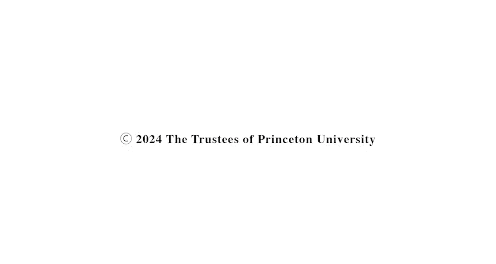

# 强化学习基础：第12讲：离线强化学习 📚

在本节课中，我们将要学习离线强化学习。与之前讨论的规划、生成模型和在线学习等设置不同，离线强化学习是从他人收集的现有数据中学习最优策略，而不是通过与环境的在线交互来收集数据。这种设置在实际应用中非常常见，例如在广告推荐系统中，公司不希望直接在线测试可能带来巨大损失的新策略，而是希望从历史数据中学习改进。

## 强化学习设置回顾 🔄

上一节我们回顾了强化学习的几种主要设置，本节中我们来看看离线强化学习的独特之处。

首先，我们简要回顾一下之前讨论过的几种设置：
*   **规划**：已知环境的转移概率和奖励函数，目标是直接寻找最优策略。
*   **生成模型**：可以访问一个模拟器，能够查询任意状态-动作对并获得下一个状态和奖励。
*   **在线强化学习**：智能体必须从初始状态开始，通过与马尔可夫决策过程的在线交互来收集数据，并在此过程中进行探索与利用的权衡。

**离线强化学习** 则不同。我们从一个已有的数据集中学习，这个数据集是由某个或某些行为策略收集的。我们无法与环境进行新的交互来收集更多数据。

## 离线强化学习问题定义 📊

在离线强化学习中，我们通常假设存在一个行为策略 π_b。该策略收集了大量轨迹数据。数据可以有两种形式：

1.  **完整轨迹数据**：包含 n 条从初始状态开始的完整轨迹。
    *   每条轨迹 i 的形式为：`(s_1^i, a_1^i, s_2^i, a_2^i, ..., s_H^i, a_H^i)`
2.  **转移元组数据**：包含 n 个独立的转移元组。
    *   每个元组的形式为：`(s_h^i, a_h^i, s_{h+1}^i)`

第二种设置通常比第一种更具挑战性，因为数据点之间可能缺乏连续性。为了简化分析，我们通常假设奖励函数是已知的，未知的只有状态转移概率。

## 覆盖性假设：可集中性 📈

为了能够从离线数据中学习，数据必须足够“多样化”，能够覆盖到重要状态-动作对。我们引入一个关键概念：**可集中性系数**。

定义 μ_h(s,a) 为在数据集中，在步骤 h 访问状态-动作对 (s,a) 的概率。

一个非常强但直观的假设是 **全策略可集中性**。

**假设 1（全策略可集中性）**：数据分布 μ 满足，对于所有步骤 h 和所有状态-动作对 (s,a)，有：
`max_{π} (P_π^h(s,a) / μ_h(s,a)) ≤ C`
其中 `P_π^h(s,a)` 表示遵循策略 π 时，在步骤 h 访问 (s,a) 的概率。

这个假设意味着，对于任何策略可能以一定概率访问到的状态-动作对，我们的数据分布 μ 也必须以足够大的概率（不小于 `P_π^h(s,a)/C`）覆盖到它。系数 C 衡量了数据覆盖的完备程度，C 越小表示覆盖越好。注意，C 通常不是常数，而是与状态/动作空间大小相关。

## 基础算法：基于经验转移的价值迭代 🧮

在离线设置下，一个最基础的算法是直接使用经验估计的转移概率来运行价值迭代算法。

**算法描述**：
1.  从数据中估计经验转移概率 `\hat{P}`。对于每个 (s,a,s‘)，其估计值为数据中观察到 (s,a,s') 的次数除以观察到 (s,a) 的总次数。
2.  假设奖励 R 已知，在构建的“经验MDP”（使用 `\hat{P}` 和 R）上运行标准价值迭代算法，求解最优策略 `\hat{π}`。

一个自然的问题是：在这个强假设下，这个朴素算法能保证找到近似最优策略吗？答案是肯定的。

**定理 1**：假设数据分布 μ 满足全策略可集中性假设（假设1），且每个步骤 h 有 `n = Õ( H^4 * S * C / ε^2 )` 个转移元组。那么，以至少 `1-δ` 的概率，基于经验转移的价值迭代算法输出的策略 `\hat{π}` 是 ε-最优的。

这个样本复杂度与生成模型设置下的结果类似，但多了一个可集中性系数 C。由于 C 通常很大（例如，在均匀收集数据时 C ≈ S），这导致离线学习的样本需求可能远大于模拟器设置。

## 定理证明思路 🧠

证明结构与生成模型（模拟器）设置中的证明非常相似，主要依赖两个引理：

**引理 1（价值差分解）**：对于任意策略 π 和状态步骤对 (s,h)，其真实价值函数 `V_h^π(s)` 与在经验MDP上的价值函数 `\hat{V}_h^π(s)` 之差，可以表示为沿真实轨迹的期望，其中求和项是真实转移与经验转移对后续价值函数的差异。

**引理 2（浓度不等式）**：对于任意（与经验转移估计独立的）价值函数 `V_{h+1}`，经验转移 `\hat{P}` 对其的期望与真实转移 P 对其期望的差异，以高概率有界，上界为 `O( H * sqrt( log(1/δ) / N_h(s,a) ) )`。

证明的核心步骤是：
1.  将最优策略 `π*` 与算法输出策略 `\hat{π}` 的价值差，分解为关于 `π*` 和 `\hat{π}` 的两个引理1形式的项（A 和 B）。
2.  对每一项应用引理1，将其转化为期望求和形式。
3.  在每一项中应用引理2，将转移差异替换为浓度界。这里需要确保价值函数与当前步骤的经验转移估计独立，可以通过**数据分割**技术实现（例如，将轨迹数据分割，用不同子集估计不同步骤的转移概率）。
4.  利用全策略可集中性假设处理求和项中的概率比 `P_π^h(s,a) / μ_h(s,a)`，将其 bounded by C。
5.  最后通过柯西-施瓦茨不等式等技巧，将求和项 bounded by `O( sqrt(S) )`，代入样本数量 n 的条件，即得每一项均小于 `ε/2`，从而总差小于 ε。

## 改进算法：从乐观到悲观 🎯

全策略可集中性假设非常强，要求数据覆盖所有可能策略访问到的区域。这在实际中很难满足。我们能否设计更聪明的算法，在更弱的假设下工作？答案是肯定的，关键在于从**乐观**转向**悲观**。

考虑一个多臂老虎机例子：
*   有两个臂，臂1（最优）真实均值高，臂2（次优）真实均值低。
*   我们收集的数据中，臂1被拉了多次，置信区间很窄；臂2只被拉了很少几次，但样本均值偶然很高，导致其置信区间很宽且整体偏高。
*   **朴素算法**（选择经验均值最高的臂）会错误地选择臂2。
*   **悲观算法**（Lower Confidence Bound, LCB）：为每个臂计算一个置信区间的**下界**，然后选择下界最高的臂。在这个例子中，臂1的LCB仍然很高，而臂2的LCB很低，因此算法能正确选择臂1。

**直觉**：在线学习需要**乐观**（UCB）以鼓励探索未知但可能好的区域；而离线学习需要**悲观**（LCB），因为无法探索，只能在已有数据的基础上做出**保守**的保证，即选择最坏情况下表现也不差的动作。

## 更弱的假设与悲观价值迭代 🤔

对应于悲观思想，我们可以提出一个弱得多的假设。

**假设 2（单策略可集中性）**：数据分布 μ 满足，对于所有步骤 h 和所有状态-动作对 (s,a)，有：
`( P_{π*}^h(s,a) / μ_h(s,a) ) ≤ C*`
这里只要求数据覆盖**最优策略 π*** 访问到的状态-动作对，而不是所有策略。

显然，`C*` 通常远小于全策略可集中性系数 `C`。

相应的算法是**悲观价值迭代**。

**算法描述（悲观VI）**：
在标准价值迭代的贝尔曼更新中，我们减去一个“惩罚项”或“悲观奖励” `b_h(s,a)`。
`\hat{Q}_h(s,a) = R(s,a) + \hat{P}_h \hat{V}_{h+1}(s,a) - b_h(s,a)`
`\hat{V}_h(s) = max_a \hat{Q}_h(s,a)`
其中，`b_h(s,a)` 可以设置为类似置信区间的宽度，例如 `b_h(s,a) = O( H * sqrt( log(1/δ) / N_h(s,a) ) )`。

**定理 2**：假设数据分布 μ 满足单策略可集中性假设（假设2），且每个步骤 h 有 `n = Õ( H^4 * S * C* / ε^2 )` 个转移元组。那么，以至少 `1-δ` 的概率，悲观价值迭代算法输出的策略 `\hat{π}` 是 ε-最优的。

与定理1相比，样本复杂度的可集中性系数从强假设的 C 降低为弱假设的 C*，这是一个显著的改进。

## 关于最优样本复杂度的讨论 ⚙️

在定理2的证明中，为了满足不同步骤价值函数与转移估计的独立性要求，我们采用了数据分割技术。这导致我们需要收集 `O(H * n)` 条轨迹（每条轨迹提供H个元组，但每个元组只用于一个步骤），使得总样本复杂度变为 `Õ( H^5 * S * C* / ε^2 )`。

然而，理论上存在更精细的分析方法（例如，使用**方差感知**的置信区间和**参考优势分解**技术），可以避免这种数据分割带来的效率损失，将 H 的指数降至 3，达到近乎最优的样本复杂度：
`Õ( H^3 * S * C* / ε^2 )`

## 总结 📝

本节课中我们一起学习了离线强化学习的基础知识：
1.  **问题定义**：从固定的、由行为策略收集的历史数据集中学习最优策略，无法进行在线交互。
2.  **核心挑战**：数据覆盖性。如果数据没有覆盖到重要区域，则无法学习好的策略。
3.  **覆盖性假设**：
    *   **全策略可集中性**：要求数据覆盖所有可能策略访问的区域。这是一个强假设。
    *   **单策略可集中性**：只要求数据覆盖最优策略访问的区域。这是一个更弱、更实用的假设。
4.  **算法思想**：
    *   **朴素算法**（基于经验转移的VI）：在全策略可集中性假设下有效。
    *   **改进算法**（悲观VI）：利用**悲观原则**，在单策略可集中性假设下有效。这是离线学习的核心思想——在无法探索时进行保守估计。
5.  **样本复杂度**：依赖于 horizon H、状态空间大小 S、可集中性系数 C 或 C* 以及精度 ε。

离线强化学习平衡了实际应用中的安全性与数据利用效率。从下一讲开始，我们将进入**函数近似**领域，探讨当状态空间巨大甚至连续时，如何利用函数（如神经网络）来逼近价值函数或策略，这是将强化学习应用于复杂现实问题的关键。