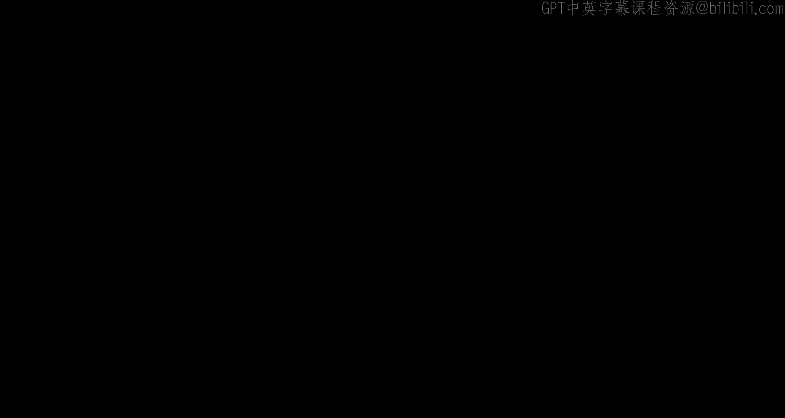
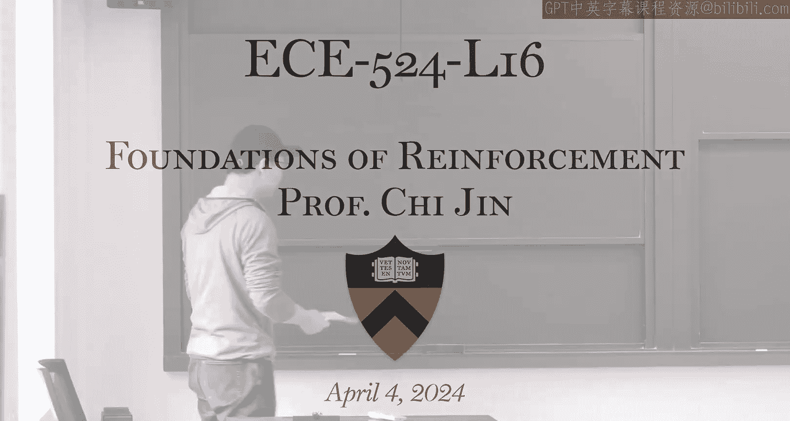
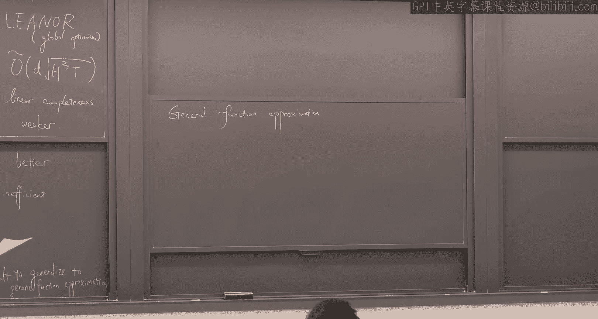
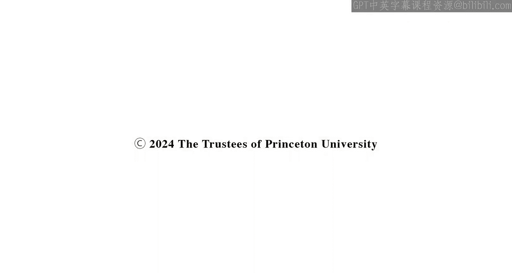

# 普林斯顿大学《强化学习基础｜ECE524 Foundations of Reinforcement Learning Sp24》中英字幕claude-3.7-s p16 Lecture 16  General Function Approximation.zh_en -BV1vewWeRE5X_p16-

So in the last lecture， we talk about the exploration for linear function approximation。

In our last lecture， we talk about exploration。With linear function parts。And in particular。

 we talk about two algorithm。 One is the standard least square value equation with upper confidence bound。

The other one is Eina。Essentially， we talk about this is like using local optimism。

 and this is using global optimism。So， we only talk about the。The algorithm in the last lecture， but。

But we can essentially also talk about the guarantees。So in terms of regret。

We mentioned U B V I L S V I U B the regret is like O tta square root of。D cube， H cube。切。

And we didn't get time to talk about the guarantees。 But for Elena， we can similarly get a regret。

 but a request is slightly better。Its D square root of H Q。So instead of square root D cube。

 which is like out of square root， is like D to the 1。5。 This is like just just the linear indeed。

So in this case， Elina's regret is actually better。 The reason we also kind of said in the last time。

 local optimism give require a strong。Condition which kind of require at every states， your。

 your value is like an upper bound。 So this inevitably make the bonus quite large and eventually make the regret also large。

 On the other hand， for global optimism， you don't have like this artificial constraints。

 So you can make the bonus very tight。 And in the end， your regret is also better。

So we can do the following comparison。So essentially。

 we first talk about assumptions where in the LVI， we require linear MDP assumption。

Which is stronger。Well in the Elna， we only require a linear completes。

We say the linear MDP is a special case of linear completeness。So in the sense。

 the assumption is weaker。Also， in terms of sample complexity or regret。We already mentioned earlier。

This low opportunity is a bit loose in terms of bonus。 So this is， this is like。Worse。

 And Elina is actually much sharper in the bonus。 So this both some home and regret is better。

And finally， in the very last very very end of the last lecture。

 we also talk about the drawback of alien is， essentially the computational complexity。In which case。

 the local optimism is actually better because we have some specific form of a bonus。

 and we can add to each states。 Well in Elina， because we， we。

 we have the tighter bonus or tighter this regret。 So we need to solve a very complicated optimization problem and optimize over policies within a very complicated constraint set。

 Comp set。 So this is like a。Very difficult。 So this， in fact， it's like inefficient， inefficient。

 in a sense， thereers no we don't really know any polynomial time algorithm solving for this scenario。

So finally， I， I also want to comment that there is another drawback of local optimism is this we require a specific design。

Of bonus function。In a sense， if you still remember in the linear function class。

 we kind like said in the last lecture， the regret the bonus is in the form of this like Lada phi transpose Lada inverse phi where Phi is a gra matrix。

 this Lada is gra matrix。 phi is the feature vector。

 and this type of bonus is very specific to linear structure。 And this is actually very difficult to。

Difficult to general to。To generic function approximation， beyond linear case。And this is why today。

 when we talk about the general function approximation。

 we will actually prefer the global optimism because there。

 if you remember the construction of the confidence that is basically just saying my premier need to be close to the empirical average。

 And that's it， we don't really design what is the bonus function。

 And we will see there's a generic way of designing that kind of a global。And confidence that， okay。

So this is actually a drawback。 You need like very particular design， like a tune to the。

 the structure function。So this is just a brief recap of what we have been talking about in the last lecture。

So today， we will move beyond the linear setting。 and we talk about the generic function approximation。

Of course， when， when we use like reinforcement learning practical applications， for example。

 we saw video games like a like Starcraft， or we want to do some robotics task。

 like doing some simulation， local motion or like manipulation。

Linear function approximation in general is not sufficient。

 Like we usually use a neural networks to approximate value or a policy。 like neural networks。

 So you all know it' like highly nonlinear。 It's a very complex function。

 So that's why we always need to move beyond the linear function approximation and talk about generic setting and understand in generic what is like principle algorithm and what is the condition that required to solve this general function approximation。

So let's talk about some formulation。 So to talk about general function transmission。

 we first need a function class。Like in the linear function， approximation。

 we have the linear function。 So here we just generically assume we have a function class。

 Let's call it F H。Where H is from one to capital H。So this is。

 let's say this is our classes of Q functions。So F， F H is a class of Q functions。

 and we use a little h to download the so that the function class at a different step can be different In the linear function class case。

 all the F H is just equal to the linear function。Okay。

 so this is a set of functions that we want to。 we essentially we're assuming we're given this function class F maybe。

 maybe you can say it's a linear function。 You can say it's like quadratic function。

 You can also say it's a class of all the possible functions represented by two layer neural network or something like that。

And then we essentially want to pick out one function out of this function class。

 which which is the true optimal Q Q function。So we again， consider the scenario。

 We have infinite number of states。But let's say we have。 we again。

 let's assume we have finite a number of action。Or are similar to this square valid tradition。

 linear setting。 We don't actually require this action to be finite。

 But all we requires like when we do the maximization of action， this is like solvable。

And one very important quantity we're going to use a lot is， again， this Belllman operator。

I think we have been talking about this for quite a few times。

Where we use this TH as a Belelma operator。T H is a function。

is is a function that maps any value function。 Val function can be generated as a function in the essay space。

This is like a state set， can be infinite。To。So essentially。

 filmma operator is a map from value function to value function。Q vector function to Q by function。

So， that。We know this TH。I谁。Its equal to RHSA。Plus， the expectation。

Of S prime sample from the transition。And max a prime。F as prime a prime。

So this is essentially the basic setup for the general function approximation。

 All we replace is that we just have now have a general function class。

So the first main question is what kind of structure？Allow sample efficient。Reinforcement learning。

That is， we kind of we want to identify some particular structure so that we can actually。

Make a do reinforcement learning this like a general function pro scenario。

So remember in the linear setting， we have this set of result for VI， which require the linear MDP。

 and linear MP is kind like quite a strong assumption。

 which require both reward and and the transition to be linear。

 which it's a little bit unclear for general function approximation。

 What does it mean like we require like reward and transition in some generic function class。

 but how related to this。But we have another candidate that is Elena。

 which this set of result linear complete is very easy to generate to the general function approximation。

 So we will use this approach。And essentially， we will general。 try to generate E。

So the first assumption， if you have to remember the linear companies part。

The first assumption we have is the reliabilityizability。It basically just says the optimal Q value。

Show star。It's inside my general function class。Remember in the linear companies says Q star is linear。

 But here， the reliability for general function function is just I'm。

 if I'm given two layer neural networks， then I require optimal Q value inside this two linear is is actually can be represented by two linear neural networks。

 If I'm giving some function class， I require my Q star is inside function class。

So thiss just like the realability so that I don't have like any misspecation error。

So the assumption 2 is also a direct generalization。Of。Lar closeness。

So this is like a generic closeness。 So generic closeness kind of requires for any F。

So for any value function。Yingmai。Function class。F H。I actually require。

After after applying Belmon operator。On this app。I need to be within the sorry， F H plus1。

 After my applying Bel operator on this F， I needed to be inside the function class at each step。

So this is， again， also a direct generalization of linear companies， just removing the linear part。

 But essentially， the completes part is still remains。 Whatever in the function class。

 apply after applying the Bel operator is still within the function class。Okay。So， those are。

2 abstract assumptions， we directly。Gt fri Lena。So the answer， the other question is now。

Does those two。Like， are those two enough to guarantee some simple efficient reinforcement。

 like can we design some algorithm just， just like based on those two assumptions and provide some guarantees。

So we will think about this problem again from the perspective of。

Like a standard approach where we consider a easier case like geneative model first and then talk about like online offline scenario。

So in a simulator case。It's always the easiest case。 But unfortunately。

 for the general function approximation， the simulator become a little bit hard because。

Remember in the simulator case， in the taber。What we do is we sweep over our state action。

Which we can no longer do here because we have infinite number of states and infinite number of action。

And in the linear case。Were sweeping over。Some corsets。Okay。Cet is， again。

 something a bit unclear in the general function approximation because this is kind like say。

 so we its kind of very adapted to the linear structure because corst definition is essentially says first is full rank。

 And the second thing is everything this linear span can be efficiently represented by those spaces。

 So if I have a general function approximation is's unclear whether it's linear structure。

 So there is like not， we don't really talk about what is spaces。

 what is like linear span or that kind of stuff。 So this is again， very difficult。

 So it turns out for sulator setting， it's a bit unclear what is。How are we gonna do this scenario。

So what we do instead is we directly resort to the offline and online set。2元30 to。Make sense。

So let's first talk about offline setting。We talk about offline setting。

 because in the offline setting。Remember， we can't have some easy algorithm。

Remember in the offline setting， in the tableular。We mentioned there is a certain condition called all policy conensability。

Which essentially says the， the data we collected will cover all the po。

 the the visitation measure of all the policies。 Okay， we will talk about the mathematical。

 record the mathematical details。La， later。 But the very good thing about in the table setting。

 if we with our policy con， we can actually just do value tour。And that's gonna solve the problem。

 Okay， that is a valuetu without any modification。 And that's gonna solve a problem。

 So let's first figure out what is the value it equivalent in the general function approximation。

 given this kind of a condition。And remember， in the tableular setting。

 we also have like one policy cons。 And so that we can do VI with pessimism。

 That's a little bit more complicated。 So we will focus on this simpler set setting first。

 with our policy con and how we're gonna develop something about equivalent of V I to solve the problem。

So let's do a third assumption。If you still remember in the offline setting。

 we can like make this assumption as well。 This is our policy。Concent triability。

We're saying given the data。This offline data that is in the form of Tple。Of SH I。HI。S， H plus 1， I。

I from 1 to M。Where we see this S H AH。Is sampled from distribution that induced by。

Some behavior policy。 Okay， so S S， H A H sample from this mu H distribution where mu distribution essentially is distribution induced by the policy we use to collect the data。

So our policy con， if you still remember， kind basic essay for any policy， pi。And any state has。

And action 8， say action pair， I say。We have。The probability。

If following policy pie to visit S A at each step。Divided by the visitation measure。

Of how we collect the data， MuA。We say this is always upper bounded by C。So again。

 the meaning of our policy con is for whatever state action that as long as there exist some policy that can visit those state action pair frequently。

 then I'm guaranteed my behavior policy will collect those state action pair relatively frequently。

 Okay， the ratio is upper bound by C。So basically， what we want is after under assumption 123。

 can we develop some algorithm similar to value duration that is gonna solve the generic function approximation。

So， it turns out to。To general valueition， we can essentially。

 we want to general we know value tuition will be general to least square value tuition in the linear setting。

And in a general function approximation setting， this least square ver can be further generalized to what we call a fitted cur。

So this is what we're going to introduce now。Which is called F Q I。

If you still remember when we do the least square all， were essentially minimizing some。

Squaquire loss。In， in fact， in the general function approximation。

 we can still define this square loss。Okay， so this square loss is a function of a data D。

 and also step H。And is a function of both F， H and F H plus1。Here， you can understand this F。

 F is like Q value function。 We always talk about Q value function approximation。

 So both F H and F H plus1 are Q values。 They are just Q values at different steps。

So we can see those are square arrows。So that's one divided by n。

 N is the number of samples we collected。Let's see little N here。And we have S A， S prime。

 Those are the twos in this data set。Okay。And we look at the square loss of FHSA。Subtract by RHSA。

And the max。Of a prime。F H plus1。S prime A prime。Square。Okay。

We can say when we doing least square ver， we're essentially minimizing this objective where we just replace this f by linear function because there we're doing linear function approximation。

 So we say this f is equal to some weight times the fissure vector here。And。

 but this is essentially some empirical Belman residue stuff where， were like optimizing。

 I think you can， you can imagine like the reason of this is somehow related to the。

 we're trying to minimize the Belman error。 And we will talk about。

What is the main reason behind this later？So once we have this square loss。

 the algorithm become very simple。 F Q I is we just trying to minimize the do dynamic programming and minimize this loss at every step。

 This is basically how we do the least square value tourism。

 So we're gonna just do the same thing for， for general function approximation。

So the algorithm of the cur。Is the following。That we will first initialize。I've had h plus 1。

 equal equal to 0。 Okay， so this is like I will initialize my estimate。At h plus one step。

 that is a Q value at H plus one step。 This is always0 because there is no future reward after H plus one step。

And then for we're essentially just doing dynamic programming。 remember。

 very is always dynamic programming from the last step to the first step。

So for the step from capital H to one。What were doing is we will assign the Q value。

To be the minimizer。Of the square loss。In this average。And we look at the loss。L D and F。

And FH plus 1。So it's dynamic programming because we start with the value at H plus one step。

 And once we have that value and we can plug it in here。

 and we can compute the value at capital H step。And then we plug it here。 And again， like we。

 we'll plug a value at capital H step here。 and we compute value at H plus1 H minus1 step。

 So we can like compute all value backwards by minimizing this loss。And it's easy to verify， like。

 as I said， least squares L S VI is a special case of FQI。Okay。So after telling you the algorithm。

 you may wonder， like， what is the relation between those this like algorithm。

 like we're essentially minimizing this LD。And。Why does the algorithm work， Okay。

 So this is like a basic， what do you mean， wonder。So let's first look at the aymptotic analysis。

 like we look at the when and go in front of you what what will happen。

And which will give us some like insights on why this algorithm makes sense。So when N go to infinity。

 one of the very good things we can use a lot of large number where。Where we know this。Loss。

 which depends on the empirical data。Will converge to。Some expectation version of this LD H。F， H， F。

 H plus1。His expectation is taking over the randomness of the data。Because in the offline data。

 we only have a finite number of samples。 But here。

 but but we connect know those samples are collected from some behavior policy muage。

 So when we take an expectation， we can take an expectation over this S A sample from all the possible behavior policy so that we get out of get rid of this all the randomness within the data collection part。

Then we can look at this expectation。This is the expectation of S sample from mu and S prime sample from P。

Any question up to this point？Okay， so we look at the derivation of。This expectation。

So we know when we replace， we won't do this expectation。

 we can essentially replace this one over n summation by just one expectation。

So we say this is equal to expectation over S A S prime。

 where S A sample from meal and S prime sample from this transition probability。So inside。

 we should just copy the the square arrow。But what we do instead is we will kind like subtract a term and add a term。

And plus P，VH。Plus one。I say。And subtract by。V F。H plus one。As crime。Where we denoted as V value。

 V H。We V H F plus one is just equal to。It's essentially the V value inducedd by this FQ value。

 So we're taking maxization over action。F H plus1 S。This is just a notation So for simplicity。

 so that we don't need to write the maxization multiple times。

So we kind essentially say this VH is what we have here。Where we're taking maximization over a prime。

 which is essentially just V V F。As prime。 So what we're doing is we just subtract a term and add a term。

And when we do this， this makes things a lot more comfortable。Because。This。Is actually the。Tch。F。

 H plus 1。This is the， this part is the Belmon operator operates on the value at next step。

And this part is purely。The randomness of S prime。So you can。

 you can essentially think this is like some bias variance decomposition。

 The first part is F H minus T H， F H plus  one。 So first part is beman arrow。 The second one is the。

 the sampling variance due to the sample of the next states。So if you do the math correctly。

You can actually realize those two part are， those two randomness are independent。

And you can essentially decompose this square loss to be the two term。That essentially。

 the first term is just the first term square。And the second term is the second term square。

 So the cross term will actually equal to 0 because it's independent。

So when we do the four decomposition， we actually have the first term square。

 second term square and also two times the first term， time second term。

 But because the random is independent， that is。Condition on this thing， we also。

 we still have like this as prime random。 And this is this expectation of this thing。

 So that's why the cross term were actually equal to 0。

 So that's why we only have the first term square and the second term square。

So we note the first thing。It's essentially some distance， some beman arrow。 Okay。

 we can deote this something like F， H subtracted by T， H， F H plus 1。

Under some2 mi distance square okay。So this is like a two norm of the bellman arrow。

 but under distribution mu。So this is a Bmanarrow。And for the second term。It's also not hard to say。

 as I said， this is like the random variable， and this is an expectation of the random variable。

 So this thing is a variance term。 This is an expectation of S A sample from mu。The variance。Of。

V F H plus Y S prime。看的itional SA。So the whole random is due to the sampling of the next states as prime。

So the environment is taking over the re variable off as print。

I think the most important thing is to notice this variance term is actually only a function of the value at the next step。

 This is not a function of the current step。 So this term is actually independent of F， H。O。Yes。

 can split up that。value again。Oh， why， why can't we do that in general。

 like you have a plus B square。Expectation of a plus B square is like equal to expectation of a square plus expectation of B square and plus two times the expectation of A and B A A times B。

 right， This is a generically true。 So what I'm claiming is this term is equal to 0， because。

Essentially， when you condition on a， A is A is a is like irrelevant to S prime。

 S prime is a new states， right？ So whenever you condition on the， on the first term， the second。

Terms still have expectation， equal to 0。So you can think in this case， you can。

 what you can do is that is expectation of B conditional a。Something like like that Time。

8 times this， right， And this term is actually equal to 0。

Just because the expectation of S prime a term is 1 to S prime。

 And this is just purely about the randomness in the S prime and actually has mean 0。

 So the cross term actually cancel out。So hopefully。

 I convince you the reason we look at this square loss。

 the similar like the this loss we kind of use in FQ I。

 and also in the least squareveeration is because inherently。

 it is just equal to the bema arrow and some variance term。 Okay。

 variance term actually irrelevant to F H。You can think it's basically just about an arrow。

 plus some constant。Because this， this term is independent of F H。

So now we can understand why FQI actually works。So， FQ I。When N goes to infinity。

What we're essentially doing is we're saying， we will。We will do F， H。Aish， we say it' her argument。

Of F。And。L DH。F。And F H plus one hat。When N go to infinity。

 we say this has a concentration or like a strong law of large number。 So this loss becomes。

Something in expectation。 this is roughly equal to arguing of taking expectation of this loss。

And we also know this is like a minimization over the first argument。 And the second argument。

 the variance is actually independent of the first argument， independent of F H。

 So when we do that minimization over F， second term doesn't contribute to the minimization。

 So we're essentially just minimizing the first term。Which essentially says were also doing Aring。

Of F， H。F H。us T， H F，H plus one。This is the Belman arrow。Now。

 you can' like know this when we look at the square loss up to some like variance。

 we're essentially just minimizing the。Balmanarrow。

And this is why we're doing this algorithm is like very straightforward in a tableular setting where're seeing beman  error is 0。

 and in the function approximation， we're just trying to minimize this beel  error。the hat。

So this is all when n goes to infinity。 When n is not infinity， then we cannot do this okay。So。

So the next thing is now we're， we're minimizing the bellman arrow。

 But why minimizing beelman arrow still makes sense in this genetic function approximation is because we assume the completeness。

We know things。We already know this F H plus 1。Hat。

We solve this F H plus one had by this equation is essentially。

 we find a function within this function class。 So we know this F H plus 1。

Like by doing this dynamic programming， it's also in the function class in the next step。And then。

 by completeliness。A closeness。This is assumption 2。 So we know this T， H。A H plus one hat。

Because this F H plus one hat is in the function class in the next step。

 So after applying a Bel operator， it should be a function in the function class of previous step。

Since this by itself is a function in this function class。 So we know。The minimum value。

Of this square loss。Is exactly equal to 0 because this thing is inside this function class。

 So when we do the minimization of this square loss。

 we can essentially just take the F equal to precisely this function and to make this square loss exactly equal to 0。

With minimizer。So essentially， this is saying when angle to infinity。

When we minimize the bellmanarrow， we're essentially just。

Solving for some function that satisfyfi the， satisfies the Belman equation， Belman upgrade。So。

 therefore。Since we know the F H。Plus one in the very last step。

It's always equal to 0 and equal to the Q value。 Opim Q value。

And then optimal Q value satisfied the bel equation。 F hat also satisfied the equation。

 the be operator equation。 So this kind implies F H hat is just equal to Q star。For any age。

So this is the intuitive reason why FQ I works if we have infinite number of samples。

Any questions about this so far？Everything we talk about so far although a little bit mathematical spec。

 but it's relatively simple。 We're just minimizing the square loss。

 And we can We understand that square loss can be composed to the beman arrow plus some fixed term。

So everything boil down to， we just minimize the bemon arrow。 And when angle to infinity。

 we're essentially just solving the be equation。So now the question is。

 if we don't have infinite number of samples， then everything has an arrow。

 We are no longer just exactly solving a Bman equation。

 Were only solving like approximately solving a be equation。In that case，How many samples。Do we need。

For FQ I。To find absolute optimal policy。So I would directly give the result for this。

Since this is a offline scenario with all policy con。

 you can imagine the analysis like roughly follows from the analysis of all con Val。

 But with the modification to do this like general function approximation with this kind of decomposition。

So the theorem one is。Suppose。My value function class is bounded。

That is a F H S is always bonded by B for any。H， S A S A H。Any average in average。Then。

This fitted cure cure a reason。Confined。Ifs an optimal policy。Within， with probability， at least。

1 minus Dta。Within following number of samples。O tu O of。Polyo。Again， on pamm horizon。And。B square。

si。L。Maxage。FH。Over deta。Over Eppsilson Square。Samples。Okay， let's look。

 let's look at the what kind of quantity this sample complexity depends on。So B is the。

 the bounds on the function value。 You can think this is also again， something H or something。

 So this is just some upper bounds。 So the important thing is this C。

Which shows the conscentability coefficients。This is when we assume the offline setting。

 we always have this dependence。 Even in the offline evaluation scenario。

 we also depends on this con coefficients。And what's more important is instead of having some like state action number dependence or like dimensionality。

 what we have now is something like log。Like log F。Where after the。Function class。And for here。

 we are assuming， for simplicityly， assume the function class is the is finite function class。

 So this is the coronality of function class。So the most important thing you realize is in addition to this con con cons coefficients。

 we only depends on the log carality of the function class。 This is actually a standard thing。

 statistical learning。 And especially when we do the union bound。

 You can't like realize the union bound has this。Exponential thing。

 When we have concentration and we have some union over thing， then then we kind。

 we always pay this a lot， large kindary stuff。こな。方。Yeah， this is a very good question。

 so we will we actually not talk about it。 So this log graph。

Its essentially the new complexity measure for。For function class。So a lot of times you may。

 you may think， okay， this seems like not very useful because for a lot of function。

 for a lot of value function class kind like infinite function class。 For example。

 even when we consider capitalular setting， we， we kind of look at the all the Q value。

 Q value for all the possible Q value for all the state action pair。 And in that case。

 like Q value can take any real value from like 0 to H。 So in that sense。

 we have infinite number of functions and this is going to infinity。

 But in terms of reality is we can always do some disctization for the， for the function class。

So the reason is eventually， we only care about Epsilon optimal policy。

 So we don't really care about getting Q value to be infinite precision。 We。

 we kind probably just only care about approximate Q value up epsilon accuracy or something。

 So in that sense， if we can。Like， dis discretize。Q value class。It's up to some。Ipssonnal accuracy。

Usually it's enough so that we don't need to consider the infinite class。

 We only need to consider some finite class that is e accurate。

 So we can consider something like a table setting。First。In a temporary setting。

 we know for each state action。We know for each state action， we can probably like pick a。

H over epsilon possible values。 essentially， is for each state action pair。

 we're discretizing the value from 0 to h by epsilon by epsilon accuracy。 do epsilon grade。

 So the total number of grid is like H over epsilon。 And we know we have S a different possible。

State action pair。 So the total number of state action total number of function。

Carne function class is like H H over epsilon to the essay。

And we know if we take the logarithmic over this carronality。This is something like Oda S。

So up to some logarithmic factor is just essay。 So this is something totally acceptable。

And we can also show， in the linear case。You can also do some similar discretization for the linear function up to some epsilon。

 and where。We will， you can also show the linear case the log F is roughly something O tuilda dimensionality。

So this is， this is like a very reasonable complexity measure for function class。

I guess I will omit the details on how to prove such a。Thing is true。 andm the。Yeah。

 any questions about this offline part。Can't just。Even if you digsitized by。所。

You cannot take an arbitrary arbitrary function。 Yeah， but， but。

 but the point is you don't need to take an arbitrary function。Yeah you just。

 you just need to take the function over the grid over the。The discretization grade you have。

And that's enough to get。You mean the value is negativefin to infinity。 states is negative infinity。

Its， it doesn't matter for， for linear function。 for tableular case first。

 for tablet cases only you have only have S S different states。 So there is like no interface。

 But for linear case， it only matters if you like this could as the fee feature space。

 And we know like in the linear linear MP， for example。

 the feature space is always like simplex or some like hyperplan。 So you cannot。Go like a very wild。

I think then it's essentially， you don't discretize the states。 You discretize the function。So。

So I think the whole point here is the function itself has some bounded complexity。

 So you can think if my function is a linear function or my function is like this table on with only S A entries。

 So the log F is always bounded。 So in， in your case， like， for example。

 if state is negative infinity to the infinity。 But if youre saying。After the states， like。

 you can map the states to some like linear fee fee feature in the。

 in a some feature certain feature space。 And I'm only care about learning the weights。

 Then I can still apply something like that。So for more general， beyond the linear setting。

 you can also say for something like。Like neuraler networks or some like more complex function。

 The like a formal notion is called covering that number。Essential。

 you just want to dis this continuous space with some certain grid。

 And so that the grid is able to cover the whole space with some epsilon neighborhood ball。

 And this is enough。 And this is like well used notation in the learning theory。Yeah there。でかさ研究して。

Yeah， this is like one way to do that。 Or if if your function has like a small covering number。

 as I said， you can。Essentially， a function function class can be re represented by some small number of representative fun functions so that they're epsilon close to each other。

 And then then you're good。Any other questions about this。Okay。

 so this is we're talking about the very basic thing for all policy con and F Q I。 So by analog。

 you can also imagine there will be some equivalent version of doing pesimistic。And also。

 one policy conability。It turns out this thing is。Not that straightforward compared to the to tableular setting。

 but it's doable with a little bit more complicated algorithm。 So we will。

 we will like skip this part here。 But just let you know， you can also kind of deploy some similar。

Similar strategy of pessimacy also due to one policy。So we'll talk about online scenario for now。

So I think online scenario is more exciting， because。

This offline thing and online thing is quite different。So we know offline FQI。Requires access to。

Representative data。Essentially， this representative data is we mean by like。

 we are credit this all policy con like a condition。

So whether such data exists by itself is also a very challenging problem。 Like usually。

 we don't really know whether all policy， like if our policy contribution is gonna satisfy with some small C。

 If C is very large， then this， this whole guarantee like becomes a。Very vacuous。 And it'。

 it's not very good。And also， the other thing is， this is like completely about offline scenario。

 When we do the online scenario， can we。Like under what kind of condition can we do exploration。

Can we do exploration。In general， function approximation。To assess start， we， we just remember。

 we have assumption 1 that is。About a realizability。And we also have assumption2。

That is the completeness。And also， were， we're more saying the eventually。

 we have the log F is small。Log F caride is small。So that were saying the come function classes has some like bounded complexity。

 It's not like。It's now like a completely wild function class。

 So like with infinite complexity so that we cannot do anything about it。So the question is。

 whether those three conditions are， already enough for us to do like online reinforcement learning or do exploration so that we can completely ignore all policy con thing for offline and achieve some like。

Guarantees。It turns out though， the answer is no。 So this is not enough。

 Those assumptions are not enough。To establish。Sample efficient guarantee。

 sample efficient guarantee in terms of， we want to have some guarantee of polyormal samples。

Under general function approximation。So it turns out what we need is we further need some complexity measure to。

To essentially like， measure the complexity of doing exploration。So， we need。Something。

To replace all policy accountability。And to。So there has been a lot of study。

 turns out there have been a lot of study to talk about what kind of complexity measure we should use。

For， for like this exploration， like even in the bandit scenario。

 like people have some elude dimension or or some something like that。 so today。

 we will talk about some。Ratively simple， but， but I think it's very insight for it。

 It kind of carries out the major。Thing in the reinforcement learning of how to adapt the。

Addapt the complexity measure of bandits to like reinforce marine parts。 So what we will introduce。

 this complexity measure for exploration is called the Belllman rank。

And this is introduced in the previous paper with title called contextual。This is from process。

With low be my rank。Up。Pack learnable。Okay， so to introduce this notion。

We first denote a few notations。That we denote the function class。F，这是 big F。

To be the carteian product of F1 and F2， the do your F H。So we're still in a set for every step。

 we have a。We have a function class for， for the Q value function。 But this capital F。

 this big F is just a collagen product of all， all function， Q value function choice for every step。

And we also use the value function。F inF。Where， where F is a。Just denoted as F1 the your F capital H。

With a。Each F H is inside the courtier F H。Is this the， the tu。Notation of F。

 whenever I do some function function Q value Q value without the index of the step。

 just means it include every steps。And similarly， we can also define the greedy policy。

Inded the bio value。Essentially， because we for simplicity。

 we assume that number of actions is finite。 So what we're doing is when we look at some function value for。

 for for each states， we can do agon max over the action for that states。

 So this define the greedy policy pi F。And when we say this pie F is actually， again。

 a tuple of greedy function， a greedy policy at every step。So with this notation， now。

 we can introduce。The bellman racking。So first， we need to define the average beman arrow。

With a rolling policy pie。So for any F。For any value function in this like a cartesian product of the function class。

And。Any policy high。We can define the following quantity， which is average beel and arrow。

Which is a function of first the， the value function F and also the row policy pi。

So this is defined as the following。That that would take expectation。

And we look at the following quantity。It is the。Bll an arrow。

 So we will look at the value function at S step， H step。

Divide subtract by applying Belman operator on the value function of the next step。And the。SH。

So this is the Belman arrow。And the most important thing is about what is distribution。 So far。

 this F are both coming from this app。Those are just。Some coordinate of this F function。

 But where is this pi coming from。So this expectation is taking expectation over the state action at an H step。

So we need to specify what is the policy we use to reach this edge step。

So it turns out what are we gonna use is use this pie policy。For the first step till H -1 step。

And in the H step， we will use the greedy par of F。

So this is indicating that we will use the this pi policy， rolling policy pi for the first H -1 step。

 And then in the last step， we will use F。So you can think this whole thing。

Well first roll in with this policy， with this policy for for the first H-1 step。 And then suddenly。

 everything will switch to F。 Okay， we'll use a greedy policy of F。

 and we will evaluate the be arrow on this F function。Since in the first H -1 step。

 were using the time。 So we can basically conclude that。S， H。This generated。Using policy pi。

So this is why we seen tie the rolling in policy。But because at H step。

 we are acting according to pi F。 So A H is the first action that we， we use different policy。

 is chosen。According。To派。So once we have this notation of the average beman arrow。

 it's easy to define a beman rank。Essentially， we can consider Epsilonage。O백 gets。Be a matrix。

In our F by F。That is a big， very big matrix where each row is corresponding to one function。

 one Q value function。房师。And wherere。So this big matrix is indexed by two function in the function class。

And we see this F， F prime entry。Of this big matrix。Is， it precisely the average Belelmon narrow。

Defined by。Evaluating， essentially it a Belman arrow evaluating on this F。

But with rolling policy of that isative policy of pay of prime。So we define a big matrix。

 Look like this。对。The bellman run。Of this M P。We call M。With function class app。Is defined。啊是的。

Maximum rank。Of this matrix。Over all steps。So the bellman rank essentially says this matrix defined by this average beman arrow。

 which kind of decouples a rolling policy with the。

The beman arrow we evaluated with the beman arrow function we evaluated on need to be low rank。

And typically， we will use some equivalent in characterization。So， equivalently。嗯。还是。Belman rank D。

Means the following， but。Man there exist。Some map。Phi and precise。Both maps function F。

To some D dimensional space。So， that。For any S。And F prime。The average bemonararrow。Evaluated on F。

 with row in policy pi F prime。Can be decomposed as。Fre of prime。And Poi F。And this is like。

 the dimensional thing。So this notation is a little bit abstract， but we will。In the next lecture。

 will illustrate like why this rank， like notion of rank is actually something very key in govern the。

 the， the complexity of exploration in the。In the like in this reinforcement MP scenario and the why in the all the previous examples we we did so far。

 like， for example， in the tableular setting and a linear function approximation。

 we never talk about the this Belmon rank。 and we will show actually， because for those scenario。

 the Bel rank is actually already guarantee to be small with those structure。

 like with linear structure where tableular structure， you can already show the rank is small。

 and and we will also talk about what kind of algorithm we can deal with。

All the problems with lowbel my rank。

