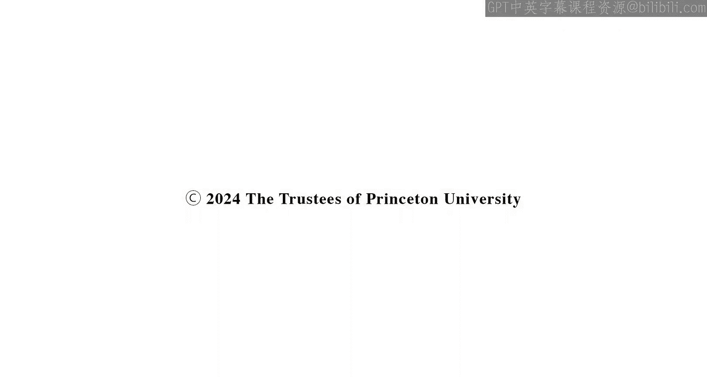

# 强化学习基础：16：通用函数近似 🧠

在本节课中，我们将要学习如何将强化学习算法从线性函数近似推广到通用的函数近似设置。我们将探讨在这种更一般的情况下，需要哪些假设才能保证算法的样本效率，并介绍一个衡量探索复杂度的新概念——贝尔曼秩。

## 课程回顾与引入

上一节我们介绍了线性函数近似下的探索算法。我们讨论了两种主要算法：带有置信上界的最小二乘值迭代（LSVI-UCB）和 Eluder 算法。前者使用局部乐观主义，后者使用全局乐观主义。

在遗憾界方面，LSVI-UCB 的遗憾为 O(√(d³H³T))，而 Eluder 算法的遗憾为 O(d√(H³T))，后者更优。局部乐观主义需要在每个状态都满足上界条件，这导致奖励加成项较大，进而使得遗憾也较大。而全局乐观主义没有这种人为约束，因此奖励加成可以更紧，遗憾也更优。

以下是两种方法的比较：
*   **假设**：LSVI-UCB 需要更强的线性 MDP 假设，而 Eluder 算法只需要线性完备性假设（线性 MDP 是线性完备性的特例）。
*   **样本复杂度/遗憾**：局部乐观主义的奖励加成较宽松，因此遗憾界较差；Eluder 算法的奖励加成更紧，遗憾界更优。
*   **计算复杂度**：局部乐观主义有特定形式的奖励加成，计算效率高。Eluder 算法需要在一个复杂的约束集内优化策略，计算上非常困难，没有已知的多项式时间算法。
*   **可推广性**：局部乐观主义需要针对特定函数结构（如线性）设计奖励加成函数，难以推广到通用函数近似。而全局乐观主义构建置信集的方式更通用。

因此，当我们讨论通用函数近似时，将更倾向于使用全局乐观主义的方法。

## 通用函数近似的设定

现在，我们正式进入通用函数近似的设定。在强化学习的实际应用中（如视频游戏、机器人任务），线性函数近似通常不够用，我们常使用神经网络等高度非线性的复杂函数。

首先，我们需要一个函数类。我们假设有一个 Q 函数类 **F_h**，其中 h 从 1 到 H。每个 **F_h** 是第 h 步的 Q 函数集合。在线性函数类中，所有 **F_h** 都等于同一个线性函数类。在通用情况下，**F_h** 可以是线性函数、二次函数，或由两层神经网络表示的所有可能函数等。

我们的目标是从这个函数类中挑选出真实的、最优的 Q 函数 **Q***。我们仍然考虑状态空间无限但动作空间有限（或最大化动作可解）的情况。

一个非常重要的量是贝尔曼算子 **T_h**。它是一个映射，将任何 Q 值函数映射到另一个 Q 值函数。其定义为：
**T_h f(s, a) = r_h(s, a) + E_{s' ~ p_h(.|s,a)}[ max_{a'} f(s', a') ]**

通用函数近似的核心问题是：什么样的结构能保证样本高效的强化学习？我们需要识别出特定的结构，以便在通用函数近似下设计算法并提供保证。

回忆在线性设定中，我们有 LSVI（需要线性 MDP）和 Eluder（需要线性完备性）的结果。线性完备性假设更容易推广到通用函数近似。因此，我们将尝试推广 Eluder 算法的思路。

## 核心假设

第一个假设是**可实现性**。它要求最优 Q 值函数 **Q*** 位于我们给定的通用函数类 **F** 内部。例如，如果给定的是两层神经网络函数类，则要求 **Q*** 可以被某个两层神经网络表示。这确保了没有模型设定错误。

第二个假设是**完备性**。这是对线性完备性的直接推广。它要求对于函数类 **F_h** 中的任何函数 **f**，在对其应用贝尔曼算子 **T_h** 后，得到的新函数仍然位于前一步的函数类 **F_{h-1}** 中。用公式表示就是：对于任意 **f ∈ F_h**，有 **T_h f ∈ F_{h-1}**。

这两个假设直接推广自 Eluder 算法。接下来的问题是：仅凭这两个假设，是否足以保证样本高效的强化学习？我们能否基于它们设计出有理论保证的算法？

我们将再次从生成模型（模拟器）这个较简单的情况开始思考，然后再讨论在线和离线场景。

## 离线强化学习与拟合 Q 迭代

在通用函数近似下，模拟器场景变得困难，因为我们无法像表格法那样遍历所有状态-动作对，其“核心集”概念也依赖于线性结构。因此，我们转而直接讨论离线和在线设定。

首先讨论离线设定。回忆在表格法中，如果数据满足“全策略可集中性”条件，那么直接运行值迭代就能解决问题。我们需要找出在通用函数近似下，与值迭代等价的算法是什么。

在线性设定中，最小二乘值迭代可以推广为**拟合 Q 迭代**。在通用函数近似下，我们同样可以定义平方损失函数。

给定离线数据集 **D**，包含 n 个样本 **(s_h^i, a_h^i, r_h^i, s_{h+1}^i)**，我们定义在步骤 h 的平方损失 **L_D,h(f_h, f_{h+1})** 为：
**L_D,h(f_h, f_{h+1}) = (1/n) Σ_i [ f_h(s_h^i, a_h^i) - (r_h^i + max_{a'} f_{h+1}(s_{h+1}^i, a') ) ]²**

拟合 Q 迭代算法如下：
1.  初始化 **\hat{f}_{H+1} = 0**。
2.  对于步骤 h 从 H 递减到 1：
    *   令 **\hat{f}_h = argmin_{f ∈ F_h} L_D,h(f, \hat{f}_{h+1})**

可以验证，最小二乘值迭代是 FQI 在线性函数类下的一个特例。

## 算法原理与渐近分析

你可能会问，这个最小化损失 **L_D** 的算法为什么有效？它与贝尔曼方程有什么关系？让我们先进行渐近分析（即样本数 n → ∞），这能帮助我们理解算法背后的原理。

当 n → ∞ 时，根据大数定律，经验损失 **L_D,h** 会收敛到其期望形式 **L_h**：
**L_h(f_h, f_{h+1}) = E_{(s,a)~μ_h, s'~p_h(.|s,a)} [ ( f_h(s,a) - (r_h(s,a) + max_{a'} f_{h+1}(s', a') ) )² ]**

我们可以对这个期望进行分解。通过加减一项 **E[V_{f_{h+1}}(s') | s,a]**，其中 **V_f(s) = max_a f(s, a)**，可以将平方损失分解为两部分：
**L_h(f_h, f_{h+1}) = E[ (f_h - T_h f_{h+1})² ] + E[ Var( V_{f_{h+1}}(s') | s,a ) ]**

第一项是**贝尔曼误差**的平方，在分布 μ_h 下的 2-范数。第二项是**方差项**，它只依赖于下一步的值函数 **f_{h+1}**，而与当前的 **f_h** 无关。交叉项由于条件独立性而为零。

因此，当 n → ∞ 时，最小化损失 **L_h** 本质上等价于最小化贝尔曼误差，因为方差项是常数。这就是我们使用这个算法的原因：在表格法中，我们要求贝尔曼误差为 0；在函数近似中，我们试图最小化它。

那么，为什么最小化贝尔曼误差在通用函数近似下仍然合理呢？这是因为我们假设了完备性。我们知道，通过动态规划得到的 **\hat{f}_{h+1}** 位于函数类 **F_{h+1}** 中。根据完备性假设，对其应用贝尔曼算子得到的 **T_h \hat{f}_{h+1}** 位于函数类 **F_h** 中。因此，平方损失的最小值恰好为 0（只需取 **f_h = T_h \hat{f}_{h+1}** 即可）。

从最后一步 **H+1** 开始，**\hat{f}_{H+1} = 0 = Q***。由于最优 Q 函数满足贝尔曼方程，而 **\hat{f}_h** 也满足贝尔曼方程，这可以推导出 **\hat{f}_h = Q*** 对所有 h 成立。这就是 FQI 在拥有无限样本时能够工作的直观原因。

## 有限样本复杂度

现在的问题是，如果我们没有无限样本，就无法精确求解贝尔曼方程，只能近似求解。那么，FQI 需要多少样本才能找到一个 ε-最优策略？

**定理 1**：假设值函数类是有界的（即对所有 h, s, a，有 **|f_h(s,a)| ≤ B**），并且离线数据满足全策略可集中性系数 C。那么，拟合 Q 迭代算法能够以至少 1-δ 的概率，在 **O( poly(H, B², C, log(|F|/δ) ) / ε² )** 个样本内，找到一个 ε-最优策略。

样本复杂度依赖于几个量：B 是值函数界，C 是可集中性系数。最重要的是 **log |F|**，即函数类 **F** 的**对数势**。这里我们为简化起见，假设函数类是有限的。

对数势本质上是函数类复杂度的度量。对于无限函数类（如表格法中的所有可能 Q 值），我们可以通过 ε-网格对其进行离散化。在表格法中，离散化后的对数势约为 **O(S A log(H/ε))**。在线性情况下，对数势约为 **O(d log(1/ε))**。这是一个非常合理的复杂度度量。

通过类比，你也可以想象在单策略可集中性下，存在悲观版本的类似算法，尽管会更复杂一些。我们现在转向讨论更令人兴奋的在线场景。

## 在线探索与贝尔曼秩

离线 FQI 需要具有代表性的数据（即满足全策略可集中性）。这样的数据是否存在本身就是一个挑战。在线场景则完全不同。

我们已有的假设是：1) 可实现性，2) 完备性，3) 函数类复杂度有限（log |F| 小）。问题是，仅这三个假设是否足以让我们进行在线探索并获得多项式样本复杂度的保证？

答案是**否定的**。这些假设并不足够。我们需要额外的复杂度度量来替代离线中的全策略可集中性，以衡量探索的难度。我们将介绍一个称为**贝尔曼秩**的复杂度度量。

首先定义一些符号。令大 **F** 为所有步骤函数类 **F_h** 的笛卡尔积。一个函数 **f ∈ F** 是一个元组 **(f_1, ..., f_H)**。类似地，我们可以定义由 **f** 产生的贪婪策略 **π_f**。

接下来，定义关于滚动策略 **π** 的**平均贝尔曼误差**。对于任何值函数 **f ∈ F** 和任何策略 **π**，定义：
**ξ_h(f, π) = E_{(s_h, a_h) ~ (π, π_f)} [ f_h(s_h, a_h) - (r_h(s_h, a_h) + E[max_{a'} f_{h+1}(s_{h+1}, a') | s_h, a_h] ) ]**
其中，期望中的状态-动作对 **(s_h, a_h)** 是这样生成的：前 h-1 步遵循策略 **π**，第 h 步的动作遵循 **f** 的贪婪策略 **π_f**。

有了平均贝尔曼误差的概念，我们可以定义贝尔曼秩。考虑一个巨大的矩阵 **M_h ∈ R^{F × F}**，其行和列都由函数类 **F** 中的函数索引。矩阵在 **(f, f')** 位置上的元素是 **ξ_h(f, π_{f'})**，即用 **f'** 的贪婪策略作为滚动策略时，评估 **f** 得到的平均贝尔曼误差。

**贝尔曼秩** **d** 定义为所有步骤 h 上矩阵 **M_h** 的秩的最大值。贝尔曼秩要求这个由平均贝尔曼误差定义的矩阵是低秩的。

等价地，贝尔曼秩为 d 意味着存在映射 **Φ** 和 **Ψ**，将函数 **f** 映射到 d 维空间，使得对于任何 h, f, f‘，平均贝尔曼误差可以分解为：
**ξ_h(f, π_{f'}) = ⟨ Ψ_h(f'), Φ_h(f) ⟩**
这是一个低秩分解。

贝尔曼秩是控制强化学习中探索复杂度的关键概念。在下一讲中，我们将说明为什么在表格法和线性函数近似等我们之前讨论过的例子中，贝尔曼秩天然就是小的，并且介绍如何处理低贝尔曼秩问题的算法。

## 总结

本节课中，我们一起学习了通用函数近似下的强化学习。我们从回顾线性函数近似的探索算法出发，引入了通用函数近似的设定和两个核心假设：可实现性与完备性。我们探讨了离线设定下的拟合 Q 迭代算法，分析了其渐近原理和有限样本复杂度，并指出其依赖数据可集中性和函数类复杂度。最后，我们认识到仅靠可实现性、完备性和有限函数类复杂度不足以实现高效的在线探索，从而引入了衡量探索难度的新概念——贝尔曼秩，为下一讲深入探讨基于低贝尔曼秩的在线学习算法奠定了基础。