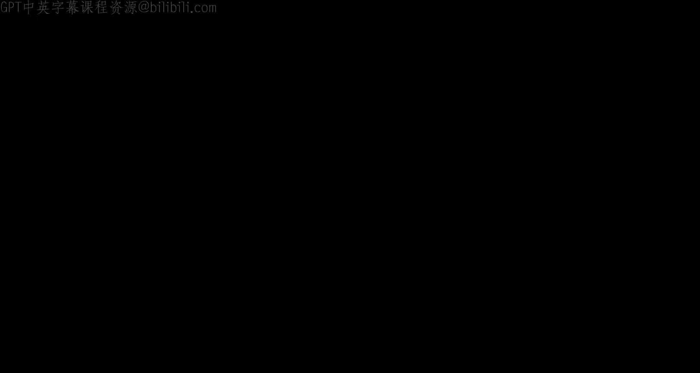
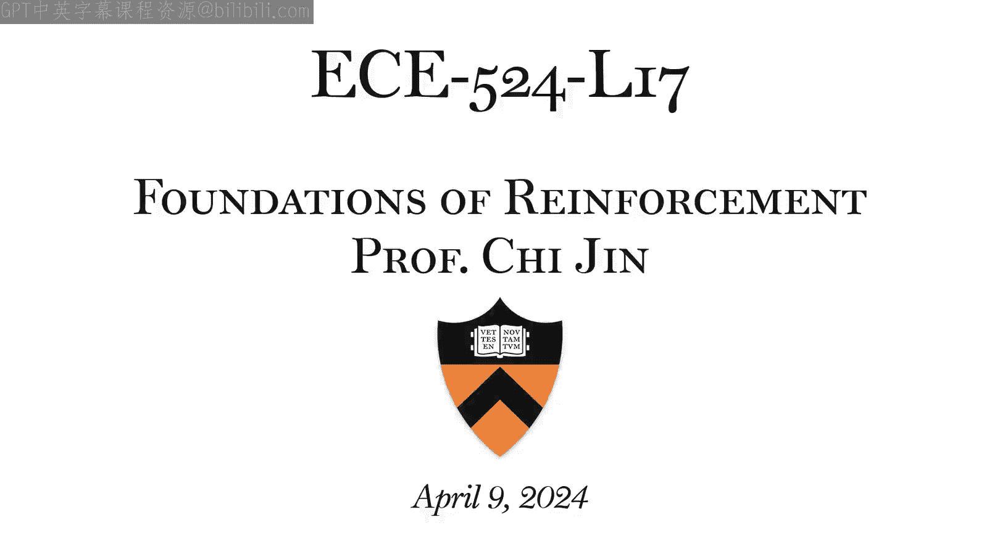
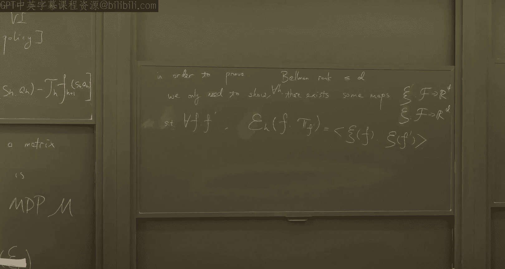
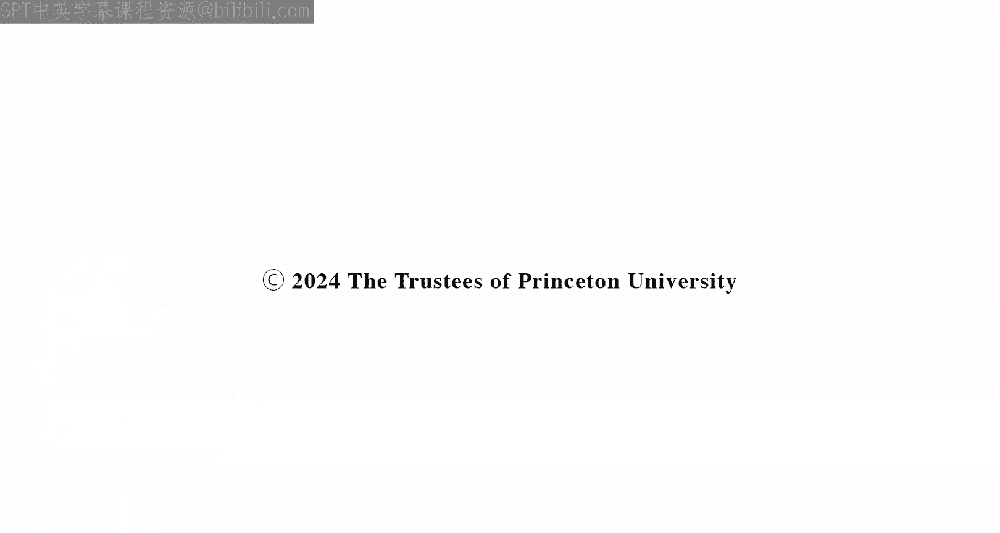

# 普林斯顿大学《强化学习基础｜ECE524 Foundations of Reinforcement Learning Sp24》中英字幕claude-3.7-s p17 Lecture 17  Exploration in General Function Approximation.zh_en -BV1vewWeRE5X_p17-

A lecture today in the last lecture， we talk about general function approximation。

Well， we're at to the most difficult contents of， of the reinforcement of this class。

 So we have talking about the basic algorithm fit consideration iteration。

Which is something like a functional approximation version of value tour。

And we have talk about the offline guarantees where if we have the all policy con。

 what kind of guarantees we can have for fi cur duration。

 which is similar to the in the offline setting， what kind of guarantee we can have for the value duration。

Then we switch to talk about the online setting。 within the offline setting， one thing we requires。

 we need to look at the log， log coality of the function class。

 which kind like describe the complexity of the。After。

 after this like offline reinforcement learning， like how complex it is to learn from generic function class。

 But in the online learning， online reinforcement learning。

 we actually require one more complexity measure。 Were introduced in the end。

 that's called Bellman rank。 So we first recap what is the Bellman rank。

In order to introduce the Belllman rank， we first need to define the average beman arrow。

Whats the role in policy。So the definition is quite straightforward。 It says for any function。

 value function in this function class F。And for any policy，We can define this。Average be andarrow。

Using at step H。Looking at value function F and rolling policy pi is defined as we take expectation where in the first H -1 step。

 we， we use policy pi1 to H -1。 And in the very last step， at H step， we use the policy F。

So in the pre， in the earlier， like in a 1，1，2 h-1 step， we use this policy row policy pi。 Well。

 in the H step， we use the greedy policy of this F to take the action。

And then we look at the Belmonro as a name。So Belmara， look at the value。Of the current step。

And look at the difference of this value to if we like apply the Belmon operator and the value of the next step。

Okay。And we say this is a key quantity of the Bellelman rank。 Bellman rank essentially。

 is just look at this average bellman arrow and say how complex this bellman arrow can be。Let this。

Epsilon H， be the matrix。In our。F by F。Essentially， it would look at the。

A matrix span by this average average bellman arrow quantity， in a sense。We look at the following。

Husi。F， F prime entries。So this is a matrix of like you have a co of F rows and co of F columns。

And where each entry is indexed by a function and this FF prime entry。

It's just this average bow and arrow。With evaluator on this value function F with row policy pi F prime。

So you can think it's essentially just expanding this beman arrow。

 but apply it to all the all the values in my function class and all the greedy policies in my function class。

 Okay， so I'm spend to get an entire matrix。So this matrix connect describes how complex your function value can be。

So we defined the Bellman rank。Of an MDPM。With function class F。Its define。As essentially。

 the rank of this matrix。Let's say about my rank。Okay。

So we look at the rank of this matrix at every step。 And then we。

 we essentially take the max over this rank。 And this is defined as a bellman rank。

So you can think as again， like we look at a very natural quantity that is Belman average beman arrow。

 which have a rolling policy and also the value， which we look at the arrow。

 And then beman rank is essentially just the rank。If， if we look at the matrix。

 whose entry is this spellelman arrow。So one very important thing we notice is this is like rank defineance in terms of like this matrix。

 But in order to prove。For example， Belman rank is less than D。All we need to show is。

There exists some map。Which maps function to D dimensionsal space。So that for any。F F prime。And N H。

You can essentially define this for a different edge。Sp for。For any H。

 there exist some maps so that for any FF prime， what we have is thisman， average beman arrow。

Define on this F and a pi F prime。Can be decomposed as the inner product of a。可 see啊。Andzeta F prime。

Once we can show this， you can essentially think we're is decomposing this in this Ca matrix。

 this Epsilon matrix， Epsilon H to be。Like a lot of row column and row vectors and column vectors。

 which are denoted by this casia and Z Zta。 So this is one of the sufficient condition to show the beelman rank is less than D。

 because what you're seeing is if this entire emission can be factorized by in a product of 2D dimensional vector。

 this essentially says the rank is at most d。And we will actually use this characteristic to prove a lot of MP or a lot of reinforcement problem we have considered so far。

 is actually。

Ha has has like beman， low Belman rank so that we're not like。

 We're not like inventing some new things and。And actually。

 a lot of her previous staff come following this generic framework。Okay。

 so any questions about the definition of the Bmer rank。

 I guess we have talked about most of them in the last lecture。 And this is mostly just a recap。

If no questions， we will talk about some examples。So proposition one says we look at the tabular M DP。

With tableular MP following this class that has a low rank， a low low be rank。

So we say let function class。Be all the。Possible value functions。 So in the tableular case。

 we don't need to do any function approximation。 So this F just the。The entire file function class。

For， for the tableular MP， then we can show the Belman rank。Is less or equal to S。

 where S is the number of states。And because in a tableular setting， we know S is finite and small。

 So this is completely fine。So we'll show why this is true。So basically。

 we just use these characteristics to this way to show this。Sure。

 and we look at this average bellman arrow。Where we evaluated her function F by the function F with the rolling policy pi of prime。

So we know， by definition， this is。The expected value of Belmonarrow。Which be arrow take this form？

So what we can do is we can explicitly write out the。The Belmanarrow。

's basically right out the expectation part。So we will take expectation over the state S， H。

Like with someation over the state， S H。So the first part is we have the probability。Until h steps。

 we know we row policy， we follow the policy pi F prime。

 So we look at what is the probability we're gonna visit S H。

 If I use the policy pie F prime till h step。Then we need to take expectation。

 So this expectation need to take expectation over both S， H and A H。

 So we have written the S H part for the A H part。 We say A H is sampled from。Pia。到SH。Okay。

 so this is A H sample from the greedy policy and condition on S H。

And then we just copyied the B arrow part。F，H， S， H， A H。Subtract to the Belmon operator。

Opers on the next value。So what's important， This is a pretty straightforward。 This essentially is a。

Is in our product form。So inner product is， we collect summation over index。

 This is a summation over the index。 indexex is like the state。 What is the status index。

 And you can think this thing is。It a coordinate of exponential of that vector。This thing， again。

 is also an a coordinate of exponentialal vector as well。

And this is essentially summation over the coordinate。

 So we know this essentially already following the form of this。可 C F。Andzeta F prime。

Where you can return out the map where this K C H is defined by this probability of this F prime of this F。

This is Zeta is defined in terms of this probability， where we're only taking。

With a rolling in policy pie F prime。 And the second part is only about F。 Yeah。

 and I think the most important thing is the first component。Only depends on F F prime。

And a second component only depends on math。So this decomposition already achieve what we want in a Belman rank and。

This essentially says the dimensionality is S。This inner product is as dimensional。

Any questions about this part so far。So if you are cool with this tableular MP being like has a low be my rank。

 we can also look at the second example where we look at one example beyond the tableular case。

 that is a linear band， a a linear MP。We can also say this class is a special case where it has a low be and rank。

So， we say。The bellman rank。Of linear MDP。Is less or equal to dimensionality。

Where we again do the similar decomposition。We look at the average Belmonarrow。M pi x prime。

And we look at， the， we expand out the ex expectation in the definition。 So what do we have here is。

Again， we look at the expectation of S H。Some poll from T F prime， which was a ro policy。

And action H。Sampled from the greedy policy pi F condition on S， H。This is Bmonro。

And for the bearrow， we just， for simplicity， deoteed as a datata H。F， S， H， H。This is a simple。

 It is just about my arrow。Okay I kind like this is just exactly the notation as F minus T H F。

 F H plus 1。 I just， do you know theres a data to avoid like repeatedly written a lot of like a Bellllman。

 a Bellllman operator and a bunch of things。So now what we need to do is we need to expand out what is this expectation。

So what we can do is。We understand for the linear MP。

 one thing we can leverage is the transition is linear。So we can look at one step earlier。 That is S。

 H-1， A H-1。We know this thing is again。Sampled from a policy pi F prime。

 This is like a ruling policy。And we look at the very last step。S， H。We understand the probability。

 transition probability follows the linear structure。 So this is something like a phi F H -1， A H -1。

An inner product。With the probability measure on S H。And this measure need to in our product。

With this expectation。Its expectation of A H。Sampled from Paf。F H。And deta H。F， S， H， A。Okay。

 I'm just copying whatever on the top。So this is， by definition of were using the linear transition。

 So the transition looks at the feature vector of H -1。 step that is H -1， H H-1。

 and in our product with the。Like a vector version of measure。

The meal and the meal need to product whatever is。Laft there。

So the important thing here is we notice this expectation is only on S H -1 A is a H -1。

 but the right expression actually， everything depends only on the S。

 H is independent of S H-1 and A H -1。 So that means we can move this expectation inside to only a。

Ara on the left。So this is equal to the expectation of S， H -1， A H -1 sample from pi F prime。

And Phi S H-1， A H-1。On right hand side， we just， we just still copy everything。The start H。S， H。

 A H。Give an message。Now， we again goes to this form where this left side of the inner product only depends on。

F prime。Where on the right hand side of the inner product only depends on life。So we again。

 achieve this kind of decomposition between this two thing。So this is是 just是一口屠伤。

P see of F inner product with Zeta F prime。Where this Caanzeta is defined here and here。

This specific construction and where the dimensionality is this is like a D dimension in the product。

So finally， I also want to say now we see like Belman rank kind like sub the both tableular case and linear case。

 but it also includes a bunch of like a new setting that is not。

 not in either like tableular or linear。 For example。

 we can also look at one example called block MP。So block MP is should be considered as like a easy case of partially observable MP or something。

I think it should not be partially absorb。 But， but。

 but I think it following a partially absorbable MP。Model， so we should look at the。

So underlying it's an MP， for example， S 1， S 2。To add 3。And we also have an action。A one。And2。

At a time。 and where a 2 S1 will jointly effect S 2 and A 2 S 2 will jointly effect S 3。

 So everything at the bottom layer is very is basically the same as MDP。

So what's different is this is like unobserved。The state is unobserved。

But we have observed some observation that is generated from S1。That's true。A 3。This is observed。

So this is like a general model of a point， partially obable MP。

 where we don't observe the underlying states， but we observe some observation that is generated from the states。

 So what is special about this block MP is a block MP will assume。Your exists decoder。So， that。

Let's call decoder Phi storage。 So we have a one decoder at every step。

So that this underlying states。Can be decoded。As the function of the observation at each step。

For average。So you should consider this as more or less some like a rich observation scenario where we still have an underlying MDP。

 but we observe probably is like image representation of this underlying MP。

 So that like the observation is like in the some very rich space。 for example。

 I'm just doing a robotics manipulation or like some car driving on the road where the underlying representation states It like very small。

 It only like is a position and velocity of the car。 but my observation can be very rich。

 I'm I'm observing the entire image， which has background has lightning has a lot of every other effects。

 So the decoder essentially is removing all the redundant information and only look at the states。

So this block MP has a very important thing that is essentially all observation。 It should not。

 I'm saying it's following a partially observable MP like framework。

 but it should not be considered partially observable because this observation can like have the complete information about the states and actually have some actual information about the states。

 We want to get rid of。 So the good thing about this is we it sufficient to consider the function class。

😊，The value function costs。That F。Basically， only look at the current observation and action。

And maps to the。To a real value。 So you can think this observation as will serve as。

As there more complex states， okay。So this car of O can be infinite。Well， this S is small。

This is like the basic assumption we make。So we're saying underlying possible states。

 underlying degree of freedom of movement is like small。 Well， because we're observing image。

 So the complexity of this observation is like very， very large。

So if we're naively applying some tabular results， basically we're going to pay the card of observation。

 which is like curveb。Not acceptable。 So this is why we need to use this generic function。

 general function approximation framework and look at the bellme rank。So it turns out for Baman rank。

 you can also do the similar decomposition。Where we look at the average arrow for this F。

And a pie of crime。Despite definition， it again equal to we roll in policy with a pi of prime。

At 1 to H -1 step and pi F at H step。And we look at the Belmonarrow。Well。

 now the Belman arrow will be a function of O H and H。

Because we're essentially using all to serve us our states。

And subtracted by the Belman operator on the function of H plus1 step and O， H H。Okay。

Although now the entire function is on O， it doesn't hurt us to essentially take an expectation first over S。

 H。 And then we take expectation conditional S H on O H and A H。

So what are we gonna do here is we first look we can essentially express this ex expectation。

 a summation over S H。And the probability of taking a row policy pie of prime。Of visiting S H step。

And the remaining stuff actually not only depends on age， but also depends on O。

 where O H generated from the S。So the remaining thing now is the expectation。Of a H。

Sample from this policy。Of course， it's OH。Generator from S H。This is like emission probability。

 It's a probability conditional S H。 What is the probability gonna generate some observation。

And then， the A H。It's gonna generate from some policy that depends on O， H。O， finally。

 copyied the Belman arrow。So now we again see this becomes an inner product between something like S dimension and S dimension。

 Well， the first part only depend on F prime and second part only on the F。 So this again。

 is equal to。可 see啊。And Zeta F prime。Where this is like a。A estimational。

So what we have achieved here。 So we look at the block MP。

 essentially is an augmented version of original MP。 But now we have like a more complex。

 very rich observation。 It a very complex observation。

 And if we just use the original tableular guarantees we're gonna pay this connectivity of all。

 which is huge。 is like very， very large， tremendous。But。But basically， we're using a。

 if we're using a Belllman rank framework， we actually can look at the complexity measure of this function class measured by Bellman rank。

 And we actually say the Belllman rank is actually not that large。

 Belman rank is just the underlying number of states。 instead of the total coernality of observation。

 So this gives a significant improvement。So there are a lot other more examples。

 You can show the Belman rank is small。So the next question you may have is， okay。

 now I know for a lot of examples， the Bellllman rank is small。嗯。

Then what are we gonna do with this Bellman rank is small。 Like。

 what is the algorithm that can leverage the small beman rank to still give the efficient guarantees。

It turns out the algorithm is。It's actually also a very natural algorithm。

So we're gonna introduce the next thing is we're gonna have an algorithm that can leverage this small beman rank and to provide an efficient guarantee to find an optimal policy。

 So the algorithm is called glor algorithm。Gorith stands for Global。Optimism。Based on local fitting。

So by the name you can， you can actually know we actually exploit the the the man mechanism called global optimism。

 So it is in our language of this class。 So basically an algorithm which combine both fit curation。

 which is the algorithm we use for the generic function approximation with the global optimism。😊。

So the algorithm was introduced in the paper of a Belman run。 Belman eluded the。New rich。Classes。Of。

Our problems， reinforcement problems and sample efficient guarantees。Some have algorithms， sorry。

Okay， so we're gonna introduce the。Algothm for this off。

So you can also think this graph is like a general function approximation version of Elna algorithm。

 which is for the linear function approximation， but with。Global optimism。So， for episodes。

We first initialize。All the data set。D one not to D， H。To be empath set。 So we have。

 we don't have any data。And we have a confidence set， which is similar to Elena。

This is the initial confidence set。Of the value function。To be F， that is the entire function class。

So for episodes。Okay。From  one to capital K。We do the following。That we will choose a policy。排 k。

This is the policy we're gonna use to collect data。 And this is the greedy policy。Of the F K。

 where F K will specify how we choose it。 F K is， is， is a function that。valueue function式。

Where this FK。Is chosen to be the Arg max。Essentially， the value function。Iningde。

In this confidence set at the K-1 step。And maximize。F。S1。Pile F。S1。This is the Q value。

 Look at the first days。 And if the first step taking the greedy deposit of F。

 and we know this is essentially just the V1 S1。Essentially。

 the V value function and look at the initial value。 So this is very similar to Elina。

 Basically the same as Elina。 The first step is we're doing optimistic planning。

 That is we only look at the initial value。 Okay， this is like global optimism。 and we choose the。

The value function that maximize the initial value within the this confidence set。

 And we set our policy to be the greedy policy of that value function。And then， we collect。

A trajectory。S 1， A 1， or1。A do S， H， H。S， H plus  one。By following。Pai。And augment data。B H。

Is equal to the original data set。And union with one new data set。

So the first three step is basically the same as Elna algorithm， where we do the optimistic planning。

 We look at our confidence set， and we pick the。The value function that has highest the value on the initial initial value。

 which is the principle of global optimism。 And then we just execute the greedy policy induced by that value。

 and we collect the data。This is has a。Theres nothing new here。

And the new part of this golf algorithm is in the confidence set where we notice in the Elina algorithm。

 the confidence set typically like at tune tuneuns very specially to this linear structure。 look at。

 look at the least square weights。 and we say， like we weight need to be close to our estimate。

So here how were gonna construct a confidence set。So we're gonna construct a confidence set as the follows。

We look at our confidence set will be all the value functions within the function class。

So that the Belman residue。Adi。H。F， H。F plus one。Is less or equal to。The smallest。Loss。F in F H。L地。

FH跑算啊。Plus， beta。4 or。Where this LD is exactly the same definition as in the fitted cur。

 the Belman residual definition。 Well， I will just roll again here。This LD。Plus  one。It's defined。

As with summation over all the data。A prime F， H plus one。S prime， A prime。Profeor， yes。

 what's the meaning of。OfIn minimum。 You can think this。Yeah it， is just the minimum。 If， if F S5，5。

59， you can replace by the minimum in in in female。Okay。So。I think the。

 the reason we construct this kind of confidence set will be very clear if you still recall how we do the。

A fit cure reason。Recall in theic cur。Basically， we choose the value function。F H hat。

To be the arc mean。F enough。Of this L D H。Look at this Belman rare Re Square loss。嗯F。

An FH plus one hat。This is precisely how we do the fitted cur。

So you can think if we don't have this plus beta or whatever the confidence set。

 if we only look at this inf F and this LD part， this is。Basically。

 what do we do for further curation。Through the cur， only look at the minimizer of this F。

Of this Val value function， you want look at the value function that minimize the this abelman residue。

Well， in a fit， well， in this like graph or whatever the optimistic algorithm。

 we not only want a point as meter， which is like this fit creation。

 We only look at the one value function。 We want them a confidence interval。

 a kind of a confidence set。So this confidence set is construction in this way so that we say we not only want the fit cur F Q Iest meter。

 which is the minimizer of this loss。 We also will be okay with any function。

 value function so that the loss。Is can be have can be slightly greater than the minimum loss。

 So you can think this is a slightly relaxation of FQ I so that Id like FQ I is a minimizer。 that's。

 that's great。 But because there is some statistical error， My true value。

 my true value may not be the minimizer。 maybe minimizer plus some like statistical slackness。

 So this is y plus beta is some slackness。 And this is essentially a relaxation of F Q I。😊。

So that's why this algorithm is， you can think this a con combination of FQ I plus global optimism。

 because in the construction of the confidence set， it's core as FQ I。 But we do some relaxation。

 And then we use the global optimism framework where we do the optimism planning。

 to look at the optimal to look at the best value function that optimize over。😊。

There's like initial value within this confidence set。Okay， so this is the basic algorithm。

 Any questions about this confidence set or。Or like why we want to do this algorithm？

So here beta is some statistical slackness。So I think the construction of the confidence that basically。

 we want to guarantee that。F star that is the true value， true optimal value。

Will always be in on my confidence set。Bi。K for any K。With high probability。

So this is the reason why we want to do this like global optimism， essentially。

 for whatever the optimistic algorithm， we always want the optimal value to be within my confidence set。

So in order to do this， we we were clear like we cannot choose beta to be very very small because if beta is0。

 then we're essentially reduced to FQI， and although we're doing FQI。

 but the optimal value may no longer be in this confidence set。So typically the choice of the beta。

It's roughly something like a constant。Times log。The carron of F。And times like K， H over deelta。

 where K is the total episode H the length of a。It's just the length of the MP。

 and the dirtta is the probability。 So something like that。

It needs to scale with a log carality of the。Function class of。Okay， so finally。

 we will just introduce the guarantees for golf。Under a bunch of assumptions。

 under all the assumptions we have been talking about so far， the first is reliabilityizability。

The second one iscompness。Those are two assumptions we talk in the last class。

 Comp is basically says after applying the Bel operator， it still remains in my function class F。

So we only have just two assumptions。Then。There exists constant， see。Such that。If we choose。

As we said， we choose this a beta。In this confident set。To be some constants， M log coity of F。

Times K。It edge over Dta。Then with probability。At least one minus startta。We have。

The following regret bound。That is the regret。Up to capital K it。Which is a summation。

Of T from one to capital K。We look at the optimal value。

Showning from S1 and subtracted the value of policy pi K at S 1。This is upper bounded by O。

IPropounded by all。H。Square root of a D K beta。Where the see is the。Belman R coffeefe。Okay。

So this guarantee essentially says。2 things。 I think it's first generic， very generic。

 It no longer depends on any states or actions。 So this is the same as whatever the guarantee we want for a generic function approximation or like even linear function approximation。

And most importantly， other than like this H horizon or some like small log factor， this。

 this guarantee essentially to regret only depends on two important quantity。One is the Belmon rank。

We all this already set。 Second one is this log graph。Law coality of the function class。

So we already mentioned in the offline， we require two things。 One log F to be small。 The other one。

 we have like concentability coefficients like all policy concentration or single policy concentration。

 Well， in the online setting， the single policy concentration essentially replaced by the Belman rank。

 This guarantee essentially says the natural algorithm。

 which this graph algorithm just combined the FQ I with global optimism。

 will'll be able to find the optimal policy for any reinforcement learning。

 as long as this reinforcement problem has small Belman rank。😊，So this kind of is also Belmarancus。

Is， is kind of like a natural notion because this natural algorithm is able to just solve any problem with small Belmer rank。

Any questions so far？I guess if no questions to this essentially wrap up the what we want to talk about the general function approximation。

 I guess if you have any questions about function approximation， it's also a good time to ask now。

And。We will then proceeded to the next topic of。Of this course about the multiageian reinforcement learning。

So we roughly have three weeks left or three weeks so。So。

 and we will spend the remaining of the semester two weeks talking about multi reinforcement learning and one week talk about like a partially obable reinforcement learning。

 I think both topics are very exciting to me。 And both topics are kind more advanced than so far。

 we have been only focusing on like a single agent fully observable scenario that is we use the model of markov decision process。

 And in both multiian scenario and and partially obable scenario will use like more advanced models will introduce in this class。

😊，Okay。Sos multihusion reinforcement learning。So in the multiage reinforcement learning， we were。

 we were specifically talking about。A bit over。 Like we， we'。

 we're especially talking about two models。 That is normal form games。

Which you can essentially think this is like a counterpart of bandits in the multigenous scenario。

 Like bandits is a more simple version of MP without any state and transition。

 So normal form game is more like like a basic version of the game we're gonna study in this class without any states and transition。

 So this is like the the basic form of games。 And then the counterpart of an arch process would be markov game。

So this is the final thing we're gonna study in this class。

 That is essentially extending the MP has this markov structure to the gaming scenario。

So the reason we want to like understand multiage reinforcement learning is in in many applications in the real world。

Involves more than one agent。Like可。Like， for example。

 if you play some video games or in some robotic scenario， there are multiple robots。

 They either want to like collaborate or compete with each other。

 and also like a lot of like military applications。And you can imagine， like， for example。

 a lot of battleships。 and they they， they form they form like they。

 they want to like cooperate with each other and they have some strategy。

So what is the major difference between like。So I think one naive view of this multi reinforcement learning is saying why not we just directly reduce it to the single agent reinforcement problem。

 Because I just treat all other agents as a as an environment。 Then that seems like we're。

 we're going back to the single scenario。 Unfortunately。

 the answer is not that simple because the major difference between。

We like the other agents and all we treat as the environment is like in so far in a single reinforcement learning problem。

 we always like look at the static environment。 that is we assume environment always has the same transition probability。

 So we， we can like we develop model based algorithm learned transition or we develop a value based algorithm。

 which imp assume the environment is fixed environment will never change。

 and environment follow the same transition probability or same dynamics。 Well， in the multi agents。

 one of very important thing is this is。The auto agent is adaptive。

So those agents can actually change their strategy across the game。

 And so they are no longer considered fixed。 And so that's why you cannot just apply。

 blind apply whatever we learn from single reinforcement learning and treat it as a fixed environment。

So that's why we require a little bit more special treatment。Well they said。

 there are a lot of examples， including。Goal， Starcraft。Which are the famous Deepman examples。

That already beat the world champion， and also some。More robotics。And et cea。

 a lot of other applications。And we also mentioned there are multiple different settings for multiage reinforce learning learning。

 They are cooperative settings。We're all the agents trying to achieve the same goal。

 but there are also some competitive settings。Where essentially， like Starcraft。

 where two players just want to compete and to win the game， like go Starcraft， all like competitive。

Gams。So in this lecture。We will first focus on the。Purely competitive。Setting。

The reason is a corporateoperative setting is more like a distributed setting of single reinforcement learning。

 So if we can， you can like collectively， like you have a centralized player。

 which can like essentially tell everyone what to do， it becomes more similar to a single problem。

 Well in a competitive。PGs like this opponent adapt being adaptive is like push to the extreme。

 There are a lot of interesting game。 The phenomena will happen in a competitive setting。

 So we'll first focus on the purely competitive setting。 That is we will focus on the。

The basic setting of purely competitive game。 That is the zero sum game， two players，0 sum games。

And later。We will generalize it to like multiplayer general sum games and how we gonna develop some concepts for that。

 So for this class， we let's just。F on the two player，0 sum games。So as we said， we first considered。

The basic form of games， normal form game， essentially games。Without state and transition。

Which is the normal form， okay。So normal form games is is quite simple if we consider normal form and two player 0 sum game。

 essentially to define a normal form game， All we need is just a utility function。

 So we assume each player has a action set。Let's say A and B。

So the first player may have may choose an action in A and second player choose an action in B or。

 or like a mean player max player。 So well talk about the the the two player and the entire game。

Aspec by a utility matrix。R。In this。A real number。ItsA times B。Where a is the number of action。

 B is number of A And B is the number of action for each player。Where。The entry。RA B。Gives the。

 essentially， this is a May matrix。 And we can look at one entry that is when。

 when the first player take action A and the second player take action B。Just the。Reward。

Of lesss call first player， the max player。Because you want to maximize this。And。

Because it's a zero sum game。 the reward of one player is。It's the loss of the other player。And。So。

 we just have a。One single matrix。 And this matrix essentially specify。

 What's the gain of the max player and。And because it's zero sum。 So it's simultaneously。

 also iss the loss of the other player。By the way， I should also emphasize in the。

 in the this normal form game， where assume both player play simultaneously。Okay。

 so maybe I should not use the language like first player。 second player should be like one player。

 the other player or the max player， the mean main player。

So I think this abstract concept will be illustrated by， one very simple example。

 Like we can look at the game， rock papers， scissors。

So this is a perfect example of this normal form game， because we can。First。

 like every player has an the both player has the same action， action space， action set。

Where action said essentially， we have three actions。That we will either choose rock。I choose paper。

 I choose scissor。And then the reward utility matrix。Can be written as the following。

Because my action set has a three action。 So the reward utility matrix is like three by three matrix。

Where each row and a column corresponding to one action。 So， for example， the first action is a rock。

The second action is a paper。The third option is scissor。Then we just write down the utility。

 Let's say the， the role player， the max player。 So we will just write down the utility for the role player。

So when a role player plays rock and column player play rock。

 we know this zero reward because it's a draw and the same thing here。

And if the role player play paper and the column player play rock and we know the role player wins。

 So it got one utility， one reward。And otherwise， in this case of scissar and rock， it lose。

 So you get -1。So we can similarly fill out the entire reward matrix to be1-1，-1，1，1。

 So this specifies the game of rock paper scissor。Okay。Since were running out of time。

 I guess I will stop here and we just basically introduce the form of normal form games In the next lecture。

 we'll continue talking about the what is solution concepts for the normal form games and how we're gonna find it。

 And then we we're gonna move to the more general case of a mark of games and develop solution concepts and planning and algorithms in economic。

Thank you。Thank you。

