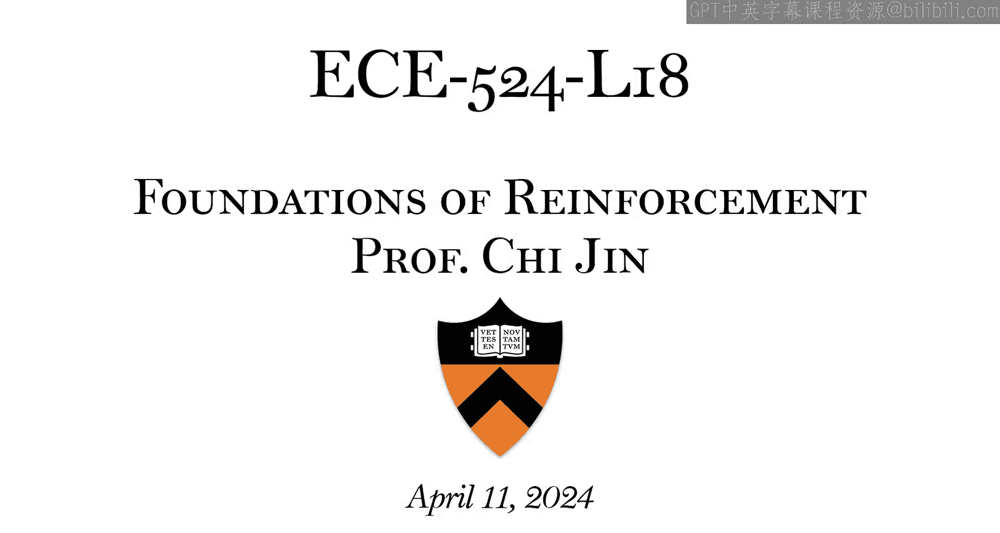
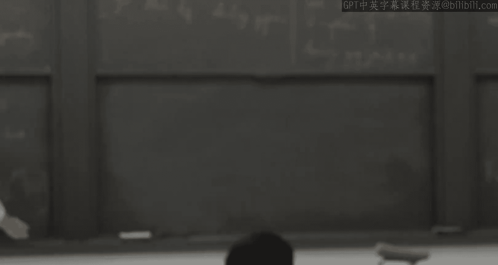
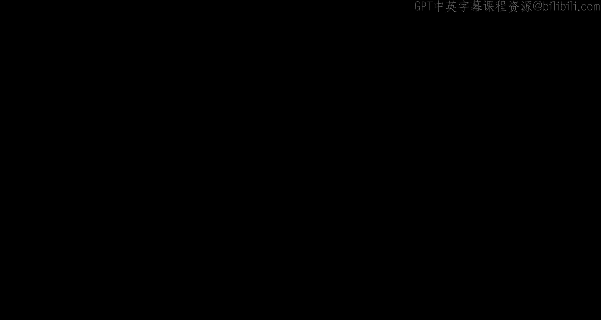

# 普林斯顿大学《强化学习基础｜ECE524 Foundations of Reinforcement Learning Sp24》中英字幕claude-3.7-s p18 Lecture 18 Multiagent Reinforcement Learning.zh_en -BV1vewWeRE5X_p18-

Can I start an lecture？So in the last lecture， we very started on the multiage reinforcement learning and we talk about first talk about a basic model called the normal form。

我が。As we mentioned earlier in the last lecture， we say we will always start from the very basic setting。

 which is the games without any states or any transition。 So this is what。

So were easily know from games can specified by a YouTube。哦， a m d。Action of the next。

is the action of the main。And this。Are kind of in the utility。

Essentialtenally why we call it a foot there， one is master， the other on two。That's I are。

 that' nice of reward， and a mean are always won。Minimize the loss， Well there's just like zeros。

 zero sum。essentially the the gain of one pair is actually the loss of the other pair。好。佢食放嘅。

你出过哋啱我放嘅。It's very simple just you have a one utility。

Matrix where the rows are actions of the max and the columns are the actions of。

So this is basically where we stop in the architecture。

 we just talk about the basic formulation of the normal formal game。

So today we'll talk more about the solution concepts and。And'm like。

 how are we going to solve those games？And the move beyond this select status transition games to like the mark of。

我保系。So first， for this normal home game， the first thing we wonder is what is the optimal strategy for this？

No problem like what is the final object。The goal we want to try。So in games。

 it's very different among single Asian reinforcement learning or like patent did。

Inbe scenario we just want to find the best R and a single error we just find the optimal policy Well here we say the most important feature of the game is that the opponent opponent is no longer fix it not like the environment that is fixed。

 the opponent opponent is actually adaptive so we're not just finding some single policy that achieve a maximum value or anything we're actually aim to achieve some equilibrium between the players。

So one very famous notion of the optimal strategy or。

Or like what is the concepts we're trying to find for the multiplay game is called matches？

Ofposed by John Nsh。So conceptually the master equilibrium is talking about some strategies。

 new and new。Which satisfied the following like animal intuition， which basically says。no one。

anything for。By changing only one's own strategy。So basically it means， for example。

 if mealal new is a matching equilibrium， that means if we reach this strategy。

 equilibrium new and new， and if my opponent is always playing new。

 it is already fixed and I decided to change my strategy。

 I can no longer play meal strategy I to play on other strategy。I won't gain anything。And similarly。

 for my opponent， if I always stick with playing with meal policy and if my opponent decided at some point you no longer want to play meal。

 you want to play on other strategy。基本権。So in this case。

 it means we reach a naturally figure condition on how to bear or doctor。

Commissioners are not out of their fix， they won't change。

There's no incentive for me to change my strategy。So this is like the English definition。

 so we'll discuss whether those things always exist and how to reach such kind。

So in order to talk about national program， there are a lot of things we need to talk about。

 I think the first most important thing is that we need to talk about this is strategy。

What do we mean by strategy？So classically one very easy thing you would think of mobile strategy is the pure strategy。

Pural strategy is the very basic strategy that each player。

Essentially this is the most easier strategy like you just commit to an action and you always pay that action。

 This is your strategy。So， let's say。Po。Suppose we have some。That is a pure。And by definition。

They start。Which by the definition of national program。方 and a。A star。

And like choosing V star won't actually。We't actually decrease the reward't actually we't actually decrease the art because the second person。

Baically here can say this is even last time of。产品都想区。And on the other hand， by definition。

 if my opponent is fixed he's fixing。We start。No matter what I change。I won't increase the reward。

 so this is actually even greater than RD。And of course， you can also see。This is蓝 equal two。

Because I just added a max over。In the front this is always post。

seminar later we can also said this is great point to。嗯。Nextax。So basically， this part always works。

Because in't matter whether pure or early。like。あ。But what we can conclude from the strategy master agreement is that we can look at the。

The the the example of game。In the last lecture。Which was Sir Rock paper scissor。

We say the wrong paper scissor can be specified by the following game matrix。Thank Mr。 Rock。没分。

This is zero。就。マナ1。关我。系酸我。So if we look at this game。

Iro paper scisar would have sold for the maximum of RAD。

Max meaning is we first pick a role and then we pick a column that will minimize this view。

So in that case， realized no matter which role I pick。It's the second player， in the main player。

 trying to play the worst case in error， that he can always pick the minus whatever。So in this case。

 the max meaning is actually equal to minus one。And on other hand， we can also find the big Mac。

The max means we first play a column and then we played a role according to which column and so that we can。

Maximize this reward So in this case we can see no matter which column I pick the role player can always take certain action so that to maximize the utility to be one。

So first first column， you can take be would be one， second column， you can take c to be one。

So in this case， this is actually equal to one。So we actually now see we reach a contradiction that we say minus line is greater equal to a bunch of things and eventually greater equal to。

This some contradict。So basically means something is wrong when we the preconition is wrong。

 the preconition is like we assume there exists on pro strategy attached equilibrium。

But clearly for Walk River Caisessar， there is no such trustor na approval。

So what we've conclude here is sta。Te Stvation and master program may not August。

So this is why in the game period， a lot of times we not only focus on the pure strategy。

 we actually also focus on a more general class strategy， so called mixed strategy。

So the next strategy， essentially we're no longer committed to determining single deter like action。

 and the player actually commit to play a randomized strategy that is a distribution over action。没有。

Res。So in this case， we can specify both pair strategy by some。Distribution， for example。

 I can specify the meal。同埋呢条星pa诶。And new。In probilities。そう。

Those are like probability distribution over action set A and probability distribution over action set B。

So the utility。次は尿。If the max player plays strategy meal and then the mean Ming player plays a strategy meal。

あ、むし。We can write us。你は没。呃是。Sation。Which is meal is a probability of。Action A。And the utility。

Time still我。来准备。放埋可能。What make。And we can also written this in the matrix form。

Where we say this is a meal vector。Thanks。Our matrix， our matrix is two the main matrix。Okay。

 and times the new vector。Where meal vector is a dimensional simplex。

 and meal is seeing a B dimensional Sx。This is a bindder。

Where in terms of a bitiding your function in the sense that。

Like when fixed mu is a linear function in mu and when fixed meal is a linear function in new。

So it turns out when we expand the strategy space to the。To this mixed strategy。

 we can actually improve。 in that case， the national equilibrium always exists。

 This is due to the famousman mini。It is the following that that。U and毕。T的 conx。白身。You。And the。

In R to R， which maps the prediction product of the UND into a real number。Is a Comax function。他さけ話。

So by Comx computer function， we actually means that。When we fix mu， we fix one of the。

Agument of the function， and we only look at the function of the other argument is actually a campaign function。

And if we fix the outer input。It's actually a complex function in the first class。

So Com Comp just means that fixing one is compaving the other and fix the other is competitive。

So that basically the only two pre that is first set is compact compact。

 and second the function isx compact。Then we have the miniac thehold。Minim theorem pose。

 in a sense that。Next。Ming。It's equal to。Meanwhile max。So we can see from the purestr part here。

 the very important thing that there's contradiction and so that we say the pure attributetro may not hold is exactly because it's max actually not equal to mean max。

 max is actually less equal to mean max in this kind of scenario。So。

So this MIma basically says when we expand it to the mixed strategy。Like basically here， this app。

 in a mixed strategy case， app is a bien function， so it is satisfy the complexax computation。

Condition， and then we do have this mean max equal to max mean。And furthermore。There exists。Strate。

那个 star有。Essentially， achieve the midnight value。你上次 that是。一 to。ま。あいこと。So basically。

 the onement theorem says first mean max equal toaxine and also there exist some strategy un starting startup is it achieve both mean max and max。

拜。And we see by the definition， this basically says this mean new argument star is a match。

So the whole mix mini theorem basically guarantees that。Always exists。Or the non home game。

So a lot of times when we're look at the game here in the whole literature is basically trying to find this so called mixed strategy action program。

 this is one of our goals。And you know rock paper scissors。Like in this case。

 you'll be wondering what is the next strategy put？We big strategy Ma equilibrium。So in that case。

We said a next job。Actually， later when we talk about the natural community。

 we always talk about mixed structure and natural for a lot of compact it just even more this like mixed structure。

You can check。 It's just to play。AllThe reactions uniformly。

That is I will play rock and paper and scissor third condition with a third one one and pro。

And you can check if I play all the you action with uniformly and you play action with。

You formulainate， then this is like master equipment。Basically。

 if you keep playing this uniform strategy and no matter how I change my own strategy。

 I won't increase any utility for me like I will always achieve a zero utility。

 which is like by the definition， this is like the match degree。

So we start talking about this optimal strategy， starting from one of motivation from a game theory where it seems like we want to achieve kind of equilibrium。

There are also some other notions in the game theory。

 which will be rather very important to our kids， that is called master responses。So best response。

 you can easily understand what this solution concept is is basically just the back strategy to comfort the opponent。

This is basically assuming if my opponent is playing some fixed strategy or at least for a long time like playing some same strategy。

 and I want to come my opponent and what is the best strategy I should play？

So in our two pair zero sum games， basically。For。First， the best response of the math player。

 better response format。Next个。Maxsplayer will play the new part。

If you talk about the best response for max， we need to talk about it is better response of some mean strategy。

 so better response in that case should be a function of the mean strategy that is a new。

In that case， essentially it's just R max。I will pick this strategy for the next player so that I will maximize you too。

And similarly， you can also say the。The best's response of some next strategy meal。嗯是。So how is this。

嗯。B's response related to the national program。It seems like the problem first class is like very unrelated because this is assuming an opponent is like putting on fixed strategy but not necessarily actually programme。

 well， the underlying lineness seems like，Talking about both their adventure that shes and。

被搬出了去上离库的边。But we actually know。Thanks。For match。We have the mini your pointss。

You know the following is true。That is so。It's equal to。都时。Me maxax。And also， the vaccine。

On the iPad， we can also look at the like second part， this part here。

This is basically same assuming the massers playing meal strategy。HowWhat is the。Essentially。

 the best response of the mean he can do to minimize the utility function。 So this is also equal to。

Max mu。The utility of mu， and if my opponent is always playing the best response。So similar。

 you can also say here。For the second part。You can think it as I first choose the mean pair strategy to be new。

 and then the max pair just do whatever to maximize the utility according to this new strategy。

So this is also put。メインあ요。啊。Of the vast response。嗯。So by this equation。

 we know the second interpretation of the Nsh。So first， improved interpretation of National Vi。

 that is if a boss player committed to me a star and new star and one player won't gain anything by only changing his own strategy。

second nature of patient is here。N。そが。Is actually。The optimal strategy。

If always facing the next response。So this is second motivation of why in two players zero some game we might want to find a match equivalent。

 because in this case， this essentially says if my opponent just knows me very well and somehow。

 no matter what strategy I play， no just always magically play my best response。

 you just play the strategy that come me the most。In that case。

 if I still want to maximize the utility， what is the optimal strategy I can do and this is saying you should just do new a stop。

Any questions so far。So once we clear with this like normal form game， we can move to the。呃Marel。So。

Because this cut is about reinforcement learning， so we were always dealing with things that。

Like a temporal correlation in it， so we will introduce the stake and transition。ああ。

Margo pain is essentially a normal form。With stage。

I also think it is an extension of MDP to2 website。Fcus on two pair but in general。

 youre can to extend the mark gaming to a multi pair scenario。So similar to MDP。

 we can also just specify the mark paint by the following number of components。The first is S。俾陈。あそ。

We're familiar with some many of the stuff。At first is this。I again， set up。

AndA is the set of action for the max。AndB is a set of action for in there。And finally。

 we also have the transition and the reward and heart。就1月这款呢应该是批。あで。很不是。

Which we originallyized the probability of the next states。Condition on current states and action。

 and the only difference here is because there's a multi agent problem。

 so it's not only commissioned on action of the one agent， but also commission on of the other agent。

So basically， this depends on。Both action A。And we also have。嗯。

You get a reward that also depends on A the most actionable。And finally， it is the land。

So similar to the reinforcement learning， after introducing the formulation and we were talking about the value of policy and those basic concepts。

So here the policy。We have a policy for both there。We againt know that that's a new idea。

New for the next and view for the main。So the meal。It again。

 can be decompposed as a policy at every step。Because to one and two caps。Its the strategy of the。

Where here， it's very important， we should always consider the randomized policy。W。Yes。

I ask for a distribution of day。The reason we should always consider the randomized policy is that basically we already normal form game that you can think is an easier case。

 special case of Mark fame without any state and without any transition。There。

 if we're interested in finding a master the， we already proved like pure a master。

That means essentially。If we research our attention tool determines a policy。

 then we be no longer able to find any national group。

So that's why here we always want to find like look at the remance policy。And similarly。そせですにを。有关。Mr。

 Po。系第。3。あて。I don't think we kind of read from this。The notion of this policy is a reization post。

We'll take action。Only被上。Not。The action of the opponents。

So this essentially is modeling some simultaneous game。Essentially means that every step。

Every step H， both players are taking action simultaneously。

 basically with this game will after player taking some previous actions and transition into some new states and at news states you can see the indicator because you can see the state in X and then most players will take some action according into the states and they cannot。

 for example wait until my opponent doing some action and then I take some action。

It's not the same thing。As a game with some。Finally， we have been the values。但是。Yeah。

The value is just always a Q value or revalue and no matter Q value re value。

 the value will always depends on。The the policy of the。So。完。

And the value definition is basically the same。It's the expectation。If both there。

According to new and neot。And sum of。Starting front pitch。我。Con。Similarly， we council the financial。

You。Sation of the。Reward。就是。Commissioner on current state is S。Theこ taken。

I assume we don't very from there with this。Basically。

 no difference on the definition of value power for the multi month between a multiage version and a single version。

So once we define the value， we kind of ease。The next half。

 in the single we you're going to selected， we write out the be main question。And this actually。

 for fixed policy part， fixed policy the neo is awesome。なて。然。Which were orange actually A。Thanks。

The better of the next time。VH。嗯嗯。我错。Svation。The only difference is amount the value of the policy has to。

Like both player has different policy， so we say this。This is。The probability over the。

Action of the max。And we also take integral integral over awesome over the property。Of the second。

So so far for the face policy。There's really not much difference。2。So the part we need to。

Pay more attention is the。Aftermost。それとか。Because。We says we no longer just want to optimize it to one direction。

 we just no longer just want to maximize it we want find equilibrium。

 We have the best response concepts so we will slowly develop all those concepts and then how we gonna have。

Equivalent opt。To those concept。So the first concept we will in ways is that。

Because this is just slightly easier that as we assume my opponent is fixed。

 and I just want to find the strategy that took counter that。So we can actually prove。Any。For any。

Rathergy over that。There exists。And that's response。个是。New gather。没有。

So that we are actually following。For any。And the stop page。Following the shoot is value。New。

And this special response strategy in back。And statements。一口猪。咁其得问。Newu。VH。には？

So if it only has like one single state having a one single step but there isn't anything to claim。

 or you're just saying there exists to some strategy that minimize it。It exists。

 but what it claims here is because this is for MDP and we can actually have one single best response。

 which is one single policy， which would be this notion that it can achieve，The minimum value。

 like essentially the counter simultaneously counter the opponent strategy wheel on any states。

 S and any step。So this is the important part that it can shift simultaneously。

And the reason is' actually not that hard to see。The reason is because of what knew is。

That is if the max strategy is fixed。The to the main player。Its Mark King。感さがあ元気。

So we can integrate out the Madm Max clear part。And then because it always play a fixed strategy so we can whatever do a transition。

 we can integrate out the probability of the max player and reward also the same。

 so from a meanfire perspective，ze is's just a MDP because my opponent is no longer adaptive。

 it's just fixed。So whatever the result holds for MDP holds here， and in this case， we know for MDP。

We can optimal policy so that achieve the optimal value。Simultaneously our state and step。

 and this is essentially the same thing as when my opponent fixed。

 I can with that respond better achieve。Like minimum value question to awesome。That's some cases。

In this case， we'll also do some。Notation， we always can note。That's the。み用だ。As a shortage。或者。没有。

It's a little bit complicated in this notation， but basically this value is the same。

If one player is fixed， we play new and the other players will play the best response and what is the value to catch achieve？

And so similarly， you can also define some strategy new and new star， a new star that is optimal。

Against the best response。And it G say VH。ostarris，ostar Dacker。This thing is equal to the。

Maximization of meal。嗯。Neo dagger。Yes。So essentially a mu star is the best policy if always facing the best response。

That is in this case， whatever deposit that always makes anybody vice response。

 know start achieve the maximum value。And we also know this is。On max。Yeah。有有没有。And similarly。

 we can also define the best response for our opponents or for the main player。是。嗯。

You are not basically equal to the mean。没有。Yeah Jennifer。Yes。こ。嗯。Max。没有。So in the normal form game。

 we kind of notice the second interpretation of national equilibrium is actually natural equilibrium is exactly the optimal strategy。

 if always against the best response。So here we can， in fact， also prove。This is the match program。

 this Ne star Nele star is also the natural equivalent for the Mar。So， basically， here。

We can show minimumac。あそ。Although this is selected beyond the reason of the original Wooi man。I mean。

 I like thereor， but you can check for the。Or just like micro games。

 by I't know programming is actually true。Bao function is no longer。

Comax Comp in the original mini max1 mini max theorem。

 they were required to be Comax Comp so that the mini max important。ch。By animal programming。

 this is true。So the claim is basically says there exists。

Which is actually also the optimal against the gas response。So that we have the V。我 told的没 max。

The next writer。And also， include to the mask。Theax。我案没事情。And they are also the targets。어 왜냐。Right对啊。

So this is like a。You right， if the positive meal is changing。

 then their special response is also changing。 So what do we say here is。

No matter what strategy this max player is doing， assuming opponent is always playing the max response doing。

So in that case， there is。APolic that kind maximize。大概る。

It's kind of the best policy against that response。And this is defining this。

So it's like mini max strategy some， also the other is a max mini strategy。

 and national present is basically just the meeting。It's both theAC strategy and also the tax。

And this is why we're using。Any other questions？So now we're clear with what is our objective like solution concepts we start from the best response and then we also have this match equipment。

 so basically almost everything is the same， all we justify is like we can very easily extend the normal form notion。

Like in terms of both best response and the attributetri to the market games in。

But now the next question is how are we going to measure the subop。

 like we know our objective is body this matched。For example， if I find the policy。So for example。

 if I find a pair of policy。New and new， and we know the match pilgrim is what we want to find。

 but in reality we never be able to find the infinite closest to this new and new。

 we always have some support。把这个。应该是为人可以回他面哋四三。So in this case。

 how are we going to measure an closeness between this newil and the national？

So we will use the metric of a metric algorithm is actually the mean Max policy or the max mean policy in a sense like it's the best policy against the best response。

 we will use this metric to measure about。Use this measure to measure。So naturally。

 we should first look at the sub opportunity in new。In the main player part。

And what we can do is we kind of look at。If my opponent。Exping if the taxpayers are exploiting me。So。

 this is the utility。Max fair account received and also the loss of them。In pair by。

And how far it is。To the truly optimal policy of always facing an opponent。Thatash policy。C。one。

We know this is the best mean pair strategy if always facing the best response。

 and this is one of my current strategy。When facing the mask response？

So I look at this difference as one part of the。And by symmetrytry。

 we can also look at the mass there subopti in this way。So， which is。What can be achieved？

By the optimal policy against best response。上tract。

What can be achieved by playing my policy mu against best response in asL。

So it seems like this is some alternative of the second player the mean player。

 and this is some sub of the master player。So one very easy thing is we kind of actually just。

Svation them together。And we also notice one very important thing that because for this Mark of pain。

 na improvement exists。This means strategy is actually achieved as Nash and this max strategy is also achieved at NH。

 and we further have a N max equal to max mean so those two parts are actually。

So we're subtracting a subject at a plus equal。So eventually。

 this leads to a measure of small country by dual。So this metric eventually just equal to。one。但是。New。

S one。十七。Dgger。That is， if the mean pair pay plus meal。

 what is the best response can exploit if you get in the utility versus if the max pair pay meal and what is the very best response of the mean pair？

And we look at this it's all called duality gap， and it is not。And we notice for the matchsh b。

 if new and new are truly match equilibrium room， this geometry gap would be equal to zero。

We notice to what you can？It'sAll。就是。And foreign I。now。ィこいす。

So this is why we are considering this object。就回 say。New news iss not。The following as the you got。

So those are like。Abstracts and concepts about the solutions and what is best about public measure it's not about。

And then next， we will talk about the algorithms help applying the best response and the natural agreement。

So similar to reinforcement learning， the single G saying， we will consider the easiest case first。大。

不是。系没。Just recall， timing is the same。If we know the tradition。Also the reward。

So in a single version reinforce scenario， basically what we're doing is just using battery duration。

 battery so that one version of the equation。So the key part here is that we will establish something similar to build automatic revision for the multi agency that。

So dividediding into full part， first one is if we're just one finding the best response。

Of some fixed policy。そ我。Here is。We can essentially write out the Brama of tri equation for this one。

 and we notice as we mentioned earlier， if one player is fixed to play something new and in the perspective of other player it's just an MVP。

 so we can essentially usually write out this real equation。It's justして。P。あす。And similarly。

 we also have the value。校ち？个 knew。Sation。う。And you。Q。嗯。knew我去。

So the only difference is now we the longer have a poly needle and instead of we kind of replace needle back and minimizing over。

 so it similars with。MDPK so we're doing the maximization over a Q value here because we're at the version of MK。

I mean it kind of similar like the similar version for the max pair is just what just mean by the max。

So this is essentially the same as the MVP。So the second is the one combined action。

This is like more interesting one。For mark of thing。It turns out for finding national equilibrium。

We can。But you see it right out opt to Australia， become optimal equation in a similar fashion。

As use secure Q star， we developedote the value of the match equilibrium。

And we can write out that to the start。the Q value updates will always be the same， but。まスか？

So the only different part is， again， how v value is up according to Q value。

And now we'll be the honor to have any Sergeant you on you。我 turns out。that就是 value。但是。

S equal equal to。Min Max。You can also replace it by an announcement because they mean。Oh。

 so basically those value right。Does doesn't matter which part you're doing。And summation。没有我去。そ说。

And don know we have to new。So now， we see。Basically for the markov being。

 the only different part when we replace the Belmont to my equation is we replace the max originally in the single scenario。

 vitamin Max。This is the。But it once you have the Qstar and V star， then， how do you go back？Yeah。

 you basically。The same thingな。In the single setting we're doing a grid deposit。

 that is we're doing the max over the cube， so here again we can also just whenever I have cube。

 I can solve this in Max again。To find a master， whenever I have this queue。

 this is like for each state this become a mobile phone game？

So I can find a master equilibrium and put an normal on， this becomes the strategy。真是。さおし。

It's not an algorithmtics。Is it minister。こ？I guess I will stop you here for this week where we finished talking about the formulation of mark and objectives and also the planning algorithm。

 so starting from the next lecture we'll talk about the learning algorithm from both。

Heuristic perspective， like what is the current lot of the empirical algorithms doing and also from the principle first perspective。

 like starting from this dominant optmatic equation， how should we design the algorithm？This motion。

