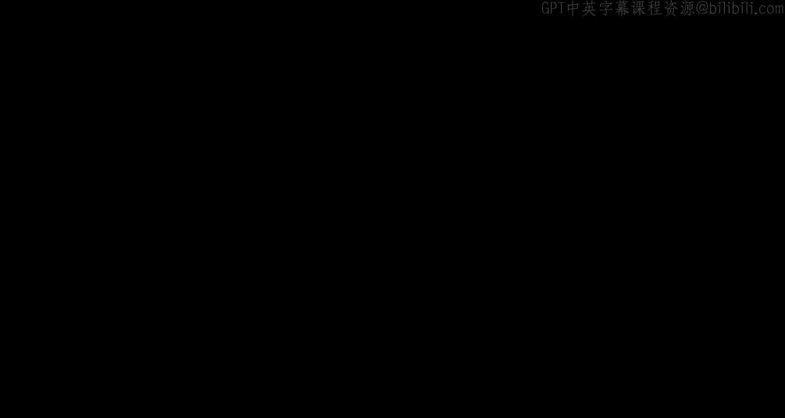
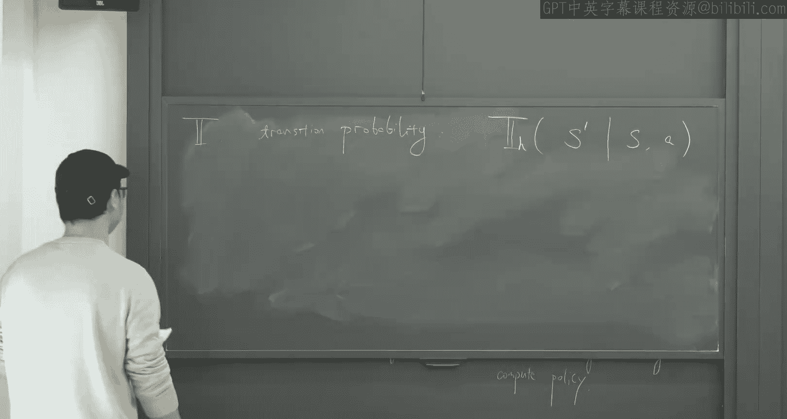
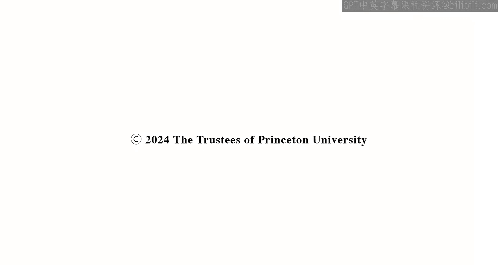

# 普林斯顿大学《强化学习基础｜ECE524 Foundations of Reinforcement Learning Sp24》中英字幕claude-3.7-s p21 Lecture 21 Partially Observable Reinforcement Learning I.zh_en -BV1vewWeRE5X_p21-

Can I start a lecture today？So let's first wrap up the。

 the remaining things in multiageent reinforcement learning。 And then today。

 we'll talk about partially observable reinforcement learning。So in the last lecture。

 we talk about multi asian reinforcement learning and。Especially we talk about two unique challenges。

The first one is a curse of multi agencyency。That is typically。

 if we just design like a prior algorithm like， and the sample complexity or computationut is gonna grow exponentially with the number of agency。

 which is definitely a problem。 If we have like reasonable number of agents， for example。

 who have 10 agents or 20 agents and then exponentially in 10 or 20 is like a very difficult to accept。

And the second one is we want to design a decentralized algorithm。When we have a lot of in agents。

 it's better to have a decentralized algorithm。 So everyone just play on their own instead of having a centralized player and coordinating everybody。

 And that's like a pretty difficult。So we kind of ask the question whether we can design some algorithm。

 decentralize algorithm that breaks cur of multi agencyency。So we start from the normal form game。

Where we essentially say the answer to do this is just the no regret learning algorithm。For example。

 in the last lecture， we introduced the algorithm called E XP 3。

 essentially just doing exponential weights， which able to achieve no regret。

 even given adversarial opponents。 And this guarantee to convertverge to CC， E。

In the general sound setting and the Nash in the two player setting。2 player，0 sum。

 And this is multiple player。So in the end， we also talk about this is only about normal form game。

 which has no states or transition。 So in this class。

 we care a lot about the the model or the problem that have temporal structure in it。

 which we look at the markov games。And in Markov game， unfortunately， there's no regret learning。

 like there isn't any like pernomial efficient no regret learning algorithm。

So we can like say anything suffer like subline gra would pay something exponential in air or horizon。

 which is definitely unacceptable。 But the good thing is we still have this is like only a sufficient condition to find a national or CC。

E。 We still can leverage the idea of nowhere learning to design the algorithm for finding C national or CCE。

So this is still doable， although no grade learning is no longer possible。

 No grade learning in terms of entire entire Markov game is no longer possible。

 but finding niche R C of the Markov game is still doable。

 So the algorithm we studied in the last lecture is called a V learningar algorithm。

It's very similar to cure learning algorithm。With only like two major changes。

 The first one is this is similar to Q Q learning。The first change is， essentially。

 we estimate V value。Instead of Q value。We still do incremental updates like one minus alpha fraction of the previous v value plus alpha fraction of the new updates。

 But the only difference is now we estimate made V instead of Q。

So what we lose by the good thing about estimating V is like like a V is like Q in the multigen setting in in general should be like depends on the joint action。

 which is exponentially large。 Well V is only depends on states。 So still have reasonable size。

 But on the other hand， the best thing about only having the V is we no longer have the policy。

 So that's why we need the second step， we essentially， we have a statewise no learning algorithm。

That is we no longer pursue a nograd learning for the entire game。

 but we pursue no gra learning for each state。We use the EXP algorithm for each states to。

 to compute the policy。So those two combined together function as a Q。 Okay。

 so Q Q has both value and policy。 Well， here we estimate V and then use no grade learning as a good policy。

I think good thing is now we can like embed this no gra idea into the algorithm so that the algorithm has some ability against like a certain adversarro。

 It's not like a aversar player of a markov game， but like certain state wise adversarial thing so that eventually we're able to find Nsh and CC。

😊，So basically， we start here in a last lecture。So when we are now。

 we're formally talking about the guarantees。So essentially， algorithm is very simple。

 We that V learning is is a single agent algorithm。 We can similar to cure learning。

 So there's a single agent。In a multi Asianian setting， the algorithm is very simple。

 It's just everybody ran the learning simultaneously。So the algorithm is all agents。Rund B learning。

Simultaneous。Independly。So as if the other player not exist other players just environment。

 we say typically if we just run standard single reinforcement learning algorithm。

 that won't work because that usually assume this environment is stationary。

 So the V learning has the power of no grad learning like has certain way of dealing with adversarity。

 So this algorithm actually will work in the multiian game multiian scenario。 So the theorem follows。

 So we have two them here。 It's kind of similar to the no gra learning algorithm in in the normal form game。

So first， first theorem is in the 2，0，2 pair 0 sum game。Marov games。V learnings。Will find。If so， not。

In this old tuda。Of H to the fifth S。Max。A 1， A 2。Over Epsilon Square episodes。

If you to remember in the last lecture， we say the sample complexity guarantee for the standard like Nsh value and the sample complexity would be some poly H times S and times a1 times a2。

 the product of of the action。 Now here we can of we improve it to the max a 1， A2。

 So this already achieved the。Essentially， achieve the lower bounds in this A1 A2。So的。So basically。

Here， the E1 A2 dependency。We say in the last lecture， we also say that for two00 sum game。

 theres a lower bound information lower bound。 You can prove it's like max a1 A2。

 So this essentially already achieved a lower bound except for some like paranomial dependence on H here。

 The V learning is not very sharp。 and there are some better ways like have in some better no algorithm and which youre able to improve the H dependence。

So similarly， we will also have a guarantee。For CE in the multiplayer general sound scenario。So。

In general， some。Marcro games。Be learning。F。Ifon approximate C， CE。And again。有tu的。It to the fifth。S。

And max， I。AI。Over Epil Square。So interestingly， this dependence actually doesn't doesn't。

 doesn't like explicitly depend on M。 if every every player's actions。

 the amount of the number of actions for every player is the same。 Okay， this just will just be A。

Okay。So the conclusion is basically by just tweaking Q learning in this way。

 we are actually able to design a decentralized algorithm that breaks the curse of multi agencyency。

 So essentially solve the two challenges we talk about。😊，Finally。

 I just want to comment that in the last lecture， we also mentioned there are three different equilibrium。

 One is the Nsh， the other one is。CE， but in correlated equilibrium。

 they are like one is like vanilla correlated equilibrium。

 and this is like coarse correlated equilibrium。So the only difference。

 like when you betray other player， whether you can still observe the like the， the。

 the random coin that given to you。So it turns out if we want to solve for God， so for C E， sorry。3e。

Or we just say for Epsilon CE， if we don't really care about the CCE。

 we want to find the quarterly equilibrium， we can also do that。

And the trick is just slightly different。 I will replace。No regret algorithm。

Within this V V learning， we run statewide no red algorithm。

 like for each state we maintain no red algorithm， we replace this by so called no swapper gra algorithm。

OkayIts a little bit more involved。 I don't want to like go into details what is no swap and no swap regret that that's like a little bit more involved。

 But basically， you can think it， it's kind of very modular as long as you change this algorithm component by some。

 some like algorithm with a slightly stronger guarantee。

 and you're able to find a C C E instead of C，Okay。

 and this roughly wrap up the everything we want to talk about for multi agent reinforcement learning。

Any， if you have any questions， feel free to ask。Otherwise。

 we will proceed to the final topic of this course。 that's partial observability。So so far。

 we are focus。 We are focus on the。The fully observable problem。Essentially， for so many lecturers。

 we're basically just focusing on two mathematical models。

 that first one is a Markov decision process， the other one is Markov games。But for both model。

 we assume like the learning agents or the player are directly able to just observe the underlying states。

 which like states who go through some markov transition。And， but in practice。

 there are a lot of scenario， which is partially observable。

We can think of some examples like when we play like a poker car game。

The state can be basically described by the cards in my hands。

 the cards on the table and the cards in my opponent's hands。However， when we play the game。

 we only able to see the cards in my hand and cards on the table。

 but we're not able to see the cards on the opponent hand。 So in that case， we。

 we don't fully observe the underlying states that going to markov transition。

 We only partially observed the information。 So in that kind of scenario。

 this is like called partially observable。Similar kind of。Application， like， for example。

 when we play some video games， like when we play Starcraft。

There are some like war fog or fog fog of war。 Basically， we。

 we don't like if unless we have some like scouting unitss go to the other players base。

 we don't really see like what other players doing。And finally， like if you want to do some robotics。

A lot of times involves like sensing and how， how the robots gonna know the environment and typically one。

1 very top one very like popular way of doing sensing is like you have the first person camera of the robots。

 And in that case， robots only observe what's in front of the。The robots。 and for whatever。

 like on the side or behind the robots， they have no idea。 So in that kind of scenario。

 the entire states is described by everything in the environment。

 but the robots only be able to see something in front of it。

 It doesn't really able to perceive what's behind it or something change behind it。

 So this is like partially observable environment。So basically。

 many applications are partially observable。So when we partial ob Z， we are seeing the latent states。

So for those games or those applications， whatever going to a Markov transition is the states。

 but because we only observe part of it， so it's kind of latent states。Okay。

So as a foundation of reinforcement learning， the first question is always now we。

 we know this in need of like practical applications， then how are we gonna model those applications。

 Like we know this kind like definitely fall beyond our existing model like MP and Microsoft Game。

 We're not able to solve this， those applications by those mathematical models。

So the first question is how are we going to have a new model which able to describe the partially observable？

Information。So first thing is we talk about the new model。

Which was called partially obsable market decision process。烤炮MDP。So to specify upon NP。

 we only need to specify the following elements。 So it's very similar to MP。

 It's kind of some set of states set of action。 So we， we have the following elements。We have S。Ai。

And now we have a new set， O。We use the tea。And O。And R and H。So we have a bunch of things like this。

 So we will specify one by one。 What are those things。The first thing court us is， again。

 the set of states。 We kind I very familiar with this。In MDP。

 the only difference is now this states is hidden。 So to be clear。

 we say it's hidden states or latent states。So， set of a。A is a set of actions。Again。

 it's a control problem。 It's a decision making problem。

 So agents always have a set of available actions and the agents can take at every time。

So the new thing here is we have this OS set。That is a set of observations。So basically。

 we know states are hidden。 We are no longer able to observe the states。

 We only observe some partially things reflected some， some part of the states。

 So this is our observations。 So those are three sets。So the remaining things T。

It's actually just the transition probability。So this is something similar to MDP or basically the same as MDP。

 So we have a probability transition。That condition on the previous state in action。

 what is probably transition to the next state。 So for underlying states。

 its still a mark of transition。So this is elections into the next states。And for episodic setting。

 we also have a T H here。

And the reason now we no longer use P。 we use T is because in pole and DP。

 we have another probability。 So this T is one probability that is transition。

The O here is another probability that I call emission probability。So this is the new thing。

And sometimes it's just caught emission。So emission is a probability。That assume at H step。

 if we star from some state S， what is the probability I'm going to observe some observation。Okay。

 so this is， again， an stochastic process。So finally， we have R that is a reward function。

And the slide tricky thing is if we assume R is is like underlying。

 is a function of underlying states and action。 then it seems like the reward information might also leak some information about the states。

So here for the partial absorb environment for simplicityity。

 we just assume all the information is already。In this observation， like， in， in a sense。

 like you can think reward is also part of the observation。

 So we just now make R to be a function of O so that to avoid some information leakage。So basically。

 we're saying reward part the state is a part of the observation。Finally， it's just the horizon。

The lens of episode。Okay。When summarize the new model point N D P。

 the only difference is now we have a new set that is observation and observation will generated by some probability is specified by the emission that is a basic condition on the current states。

 what is the observation I gonna generate generate。 And to avoid information leakage。

 we can we can specify reward as a part of the observation。 So whenever I'm given the observation。

 I can immediately read what is a reward。So it might be better to understand this like abstract pull N DP definition in terms of the flow graph。

 like how， how each state and observation are generated。

I kind like also admitit there might be also initial state distribution， meal one。

But the things we kind also emit this for MDP， so this is fine。So there are three things。

 the first is the hidden states。We start with some state one。Sit at a first stop。Okay。

 we have some initial distribution over a state。So what we will do first is we take the emission probability。

 This S1 is going to generate an01。 This is observe observable。And then at the first step。

 the agent is able to take some action， a 1。So similar to MP， basically。

 the state 1 and action 1 jointly decide what is the distribution of the second state。

So this part is the same as MDP。And a different part is now S 2 is， again， hidden。

 S 2 is no longer observed。So actualtro will also emit an O2。And then we take an action A2。

That goes to the third states。So you can think this hidden markov model is， sorry。

 Hi the Po and D P model is is actually a hybrid of two models in some sense。

 So one thing is if we can like ignore observation。

 like we only focus on the lower parts and if we ignore observation。

 like we say the state is observed， then this part is just become MP。Its essentially MP。

 The only difference is now the states are hidden。 so we don't observe the states。

And on the other hand， we can also look at the upper part。

 if we ignore the action or or basically saying this entire sequence is not， not。

 iss not controllable。So， the upper part。For those of you who have taken a statistical course or like a standard like machine learning course。

 you will probably notice， this is actually a hidden markov model。HMM。Even nowadays。

 this is like still some like research topic， a lot of staisticians。

 like still like working on this HMM， like the the E M。

 like the maximum likely algorithm is no longer that trivial。

 like you need to run some E M algorithm。 And even like now。

 when people study some foundations of language model， people are kind of seeing language model。

 Some people assume language model satisfy some like HMM。Okay。But seems but basically。

 you can observe from this observation that pull NP is a model that is definitely more difficult than both HMM and MP。

 Okay， because only part of them is like MP。 part of them is HMM。

So this relation will be a lot clear by looking at this table。So basically， we have a field trade。

1 is， like， fully observable。And the other is partially observable。

The other traits is whether it's uncontrollable or。Or like controllable。

So this is an uncontrolled process， and this is a controlled process。So in the fully obable setting。

 we basically focus on the fully observable and can something can be controlled。 Now thiss MP。

So we know if for MP， we removed the action， This just become a very simple markov chain。 Okay。

 state just follow the。Microch。 this is a micro。So in the partially of scenario。

If we kind of adding a layer， one emission matrix， and emission like probability to a markov Chen。

 this becomes a hidden markov model。And here for partial absorb control sequence。

 now this become point N P。So those are the relations of those four models。

Any questions about the basic models？If no question similar to like。MDP or M of game。

 The next thing we will do is like， define the policy and。And value。

So one of the most complicated part about the point if appears is we。

 we kind of we need to recall that the important thing is first states are hidden。

So we no longer observe the states。 So although underlying the state change is a mark of。

 the new thing we observe is that observations。Are no longer mark。That you can easily see， like。

 if we just condition on this observation of two， whatever happened in the in the in like before that and whatever happened after it is actually like correlated。

 They are no longer independent， so they don't satisfy the mark of property。

So that's basically one of the biggest reason in MDP A lot upon MP。

 a lot of things are very complicated， just because this based on the observation， like。

 if we just high this O2 and whatever happened in the。

 in the like past is no longer independent of the future。So essentially。

 for a lot of partially observed applications， we can like we noticed this biggest difference between this observation。

 like the mark of property is in MP。Basically， we can't make decision。Based on。

Based on current states。Well， in general， for point E P， you can prove。 I won't show it in a class。

 but basically， you can prove。In general， we need decision。To be made。Based on entire history。

So the intuitive reason is just because the observations is no longer Markov。

 So looking at the current observations is no longer sufficient statistics for the past。

 So that means if youre just making the decisions based on the current observation at the observation of the current step。

 then youre losing some information about history and youre making suboptimal decisions。

 So the best decisions always like depends on the entire history。So that essentially。

 you can remember in the poker， whenever you make some decisions。

 you will always consider like in the entire place rule like whether my opponent like race first or like or like or like pass like fold or or something like that。

 So basically， you need to inspect the entire history and also for starcraft or some robotics also like that。

 You need to remember the history and use the entire pass information to infer what might be current states。

So in this case， the policy， we no longer have the luxury of only considered a policy that depends on the current observation。

 We need to consider the policy that depends on the entire history。

So we will denote the history by this。I say， Tch。Tius denoted as all the。

 all the observable quantities up to step H。So basically， that is O1， A 1， O2， A2， thet O O H。

So this is everything basically we observe up to step H， where at the point we。

 we need to make decision。So this ta history is in the set of where we have this square O times square A to the power of H -1。

Cardi product with O。And we denote this as。AndTH。So we said now it's。

 we need to consider the policy that depends on the entire history。

 So now the policy just becomes the map。Its again， pie is a set of pie。H from one to capital H。

 where。Each page。Is a map。From this TH。So it's the set of all possible histories。

To a distribution of racks。This is like a randomized policy， but for poorP。

 because a single agent problem is still sufficient to consider determinative policy。

So most important thing is now we need to make decisions based on the entire history。

So because we said observations is no longer sufficient statistics。

 and the policy will depend on the entire history。 So similarly。

 if we want to develop a similar theory， like for， for poor and DP。

 we should also look at the value function。 And now value function is also no longer just depend on the current observation because it's not sufficient statistics。

 The value function in general， need to depend on the entire history。So basically。

 we have the value function。So in general， it's， it's quite difficult to define like a value function for the intermediate step。

 So it's usually we just care about the value function at the very first step。Sorry， we。

 we can also define the in the intermediatemedia step that depends on the college。

 depends on the history town。This would be defined as an expectation。If we taking in action。

 future action following the policy pi， the pi will depend on the history。

Of summation of h prime equal to h plus1 to capital H。Arge prime。Or H prime。Conditioner。

The past history is college。So the definition is very similar。

 It's just the summation of the all the future reward。

 The only difference is now we need to condition on the history so that will make it well defined。

Because the policy or in general， depends on the history。So similarly。

 we can also define the Q value。Q H piei。Toch。That's equal to expectation。

If all the action is taken according in policy， pi。An estimation of the future reward。

Condition on the past history is T， and in the current step， I'm taking action A。Yes。

Dos still why these things depend on the。If you knew it like。あスニュー。

Do you know the hidden Markov model when making this or？でいう。Stay home。If you know the state S。

 it's Markov， but if you know the state O is not Markov。So basically， state S， S2 is like。

 for example， here， S 2 is a sufficient statistics， basically summarize whatever happens in the。

Summarize everything matters happens in the past that will be in effective the future。

 But the problem is O2， for example， is only part of S 2。 So S 2 will generate O2。

 So O2 only consider partial information about S 2。

 Well O1 and previous actions may also con contain other parts of the。As two。 So basically。

 in order to get to the sufficient statistics you need to look at in her history。Pro。Please go back。

base rule back would not work like base rule， you only have a like a gas on2。 It's。

 it's not like you， you don't know as to。 if it's deterministic。Like if， like if。

 if this S 2 to O2 is like1，1 on one map mapping， then this is good。 But you in general， for example。

I might have like S 2 is like something like I have4，4，4 different states。 and 1，2 state， state 1。

2 will go to first observation。 say 3，4 will go to second observation。

Then if you just observe the first observation， you have no idea whether I not stay  one or state 2。

 then you might need some other information to decide what it this。

I think this is a like intuitive argument。 but like just too mathematically。

 you can just prove conditional there is no conditional independence。 So it's not Markov。Okay。

So following the same methodology principle of like reinforcement learning。

 the next step will do the Belman equation。The vanilla B equation is is not about Op。

 It's just about the the policy pi。 And this is， we will derive this by just looking at the definition of value function。

You can do some transformation and like essentially figure out the relation between V H and VH plus1 Q H and Q H plus one。

 So for simplicity， I would just directly write the answer， but you can check offline。So。

There are two equations， one is Vh2 QH， and the other one is  QH2 Vh。So Viwi will be， again。

 like summation over Ah。P of a in the， in the set of a。And it's a pie。A， given a history toch。Q。

 H pie。Touch age。And the other thing is this QH pain。Toch。H。It's equal to。The expectation。Of。

 we have O h plus one。Sample from the emission。The probability of。To H A H。So I'm just writing。

It's a probability， but you can basically。Infer， what is this probability by doing the base rule。

And by plugging the T NO。And then， R plus1。O，H plus 1。And then plus V H plus1。Hai。T H。A H。O， H plus1。

So this is the next step value。 Next value depends on the entire history。

 That is a previous history append with the current action and the next observation。

So other than you can like， you need to compute what is the probability you gonna sample the next observation。

 according to this transition and transition emission and base rule。

 and everything else is like basically the same other than like。

 you just replace the states by the history to。And similarly。

 we can also write out the optimal policy and Bel opt quiz。So very similar to the MP setting。

 Basically the opt equation is just replace this。The equation。

To get V from Q like replace this integration over the policy by maximization over the action。

Sos just something like this， Vh star。How much。That given a history touch， the。

The value of optimal policy is equal to max a。K I star。Coish。

And the second equation basically is just a copy of what we have。The standard of Belmon cruise。

Or H plus one。Sampled from probability。T H， A H。Orange plus one。Ou。Which plus one。And plus。

V H plus  one star。HowHH。Oh， which possible。And finally。

 optimal policy is just taking greedy policy over。Is the squy policy of the Q star。So at a toage。

 the best action you take is just the a max。Q， H star。How H a H。So basically。

 following the same way we study MP， this would be the first line of things we can possibly get that we define a value。

 and we look at the Belelman equation， and we kind of set it through the Belman opt equation that is basically give us the optimal value。

So。What is not very good here？So typically， when we have the Belman equation or B opt equation。

 we can like compute the in the MP case， we can compute the Q star and V star by the。

By by like dynamicyna programming， which is one very important thing。

 because dynamicyna programming and the computation。

 we kind of say the computation and the sample computation is basically limited by the， by the。

 by the number of states in action。But here， we kind of can replace the states by the history。And。

We can basically， very easily calculate what is the possibility of history。So in general。

 some history to。Has a。O， A， O is a number of observation。

 A is number of action to roughly power of H。Possibilities。

So this is very different from in MDP case， where if we look at V value。

 V value only depends on states and the equivalent only depends on state action。

 whereas state action only has S A possibilities。 Well。

 here we have O A to the power of H possibilities。So this basically says even in a tableular setting。

Which you can think is a very basic point in p setting， we just assume number of observation。

 number of states， number of action are all finite。In this case， just representing。V or Q Char table。

Require exponential space。So this is more the same even in a tableular setting。

 although we can write how the Belman equation or Bel optimal equation。

 we can like theoretically compute those value based on this equation， but it won't be efficient。

 Like the entire history has too much， too many possibilities。

 And we also require exponential space to store it。

 And this entire thing basically cannot be computed in in in a computer。

This is also why PDP is somehow challenging。So I will first talk about some alternative view for point and D P。

 which you might think they can solve the problem， but we will say later， actually cannot。 And later。

 we talk about how we gonna。Poly solve some of the problem。So basically。

 this view point DP is we kind of expand everything that depends on the entire history。

Therere historically also another very popular view that basically called belief states。

So the idea is called leafesis。So what is that？let's first recall in a poly D problem。

 we have this S1。Oan。And that will generate S2 together with a2， A1。And then they generate O2。

So at this point， we need to make decision a2。And now我选择先 to the S3。So basically。

 we can look at the at this step where we need to make this decision。

At this time step where we need to make decision A2。

So we're saying the entire complexity about why we need to look at the entire history is because。

If we just look at O2， that's not sufficient statistics about the past what happening。

 like basically， it only contains partial information of S 2。

 So this O2 is not enough to make a better decision。 We need to basically look at O2，01 and a1。

But to be honest， like this S2 is the。Its， its the sufficientist is。

 It's the only thing is we don't know。So a better idea about the belief states is kind of saying。

How about。Let's just compute the distribution of rest2。So basically， we can use history。To compute。

A distribution。Over us，2。And the observation is that S 2 is。Sufficient statistics。 Now。

 we don't observe S 2， but we can compute the distribution of S 2。

 And this is basically everything we can conclude from history。

 And it turns out this distribution will be a sufficient statistics about the past。 Basically。

 once you know the distribution of S 2， like although， although you cannot。

 you're not fully certain about S 2。 But once you know distribution of rest2。

 whatever happens in the past is no longer relevant to predict the future。

So this is Sir called the belief states。So basically， I no longer knows whether my。Second state。

 like stay second step whether it's in like instead state 1 or state 2 or 3，3。

 But I can basically have a distribution that with one0 probability in state1。

10 probability in state 2 or1 third，1 third，1 third， something like that。

 And this distribution is called belief states。And this is a sufficient statistics。Of the history。

To predict the future。So basically， by sufficient statistics， were talking about， for example。

 there might be two different histories。 And as long as the two different histories gives the same distribution over S 2。

 the distribution of what happens in in the future will be the same。

 So that means like once the sufficient statistics that distribution of S 2 is the same。

Like although might be history might be slightly different， but it doesn't matter。

 like in terms of the future distribution will always be the same。So， formally。

We say this belief states。Well know this belief states has a pH。That's in a simplex of S。 Okay。

 so it's a distribution over states。So informally， we will basically show that。

Po and DP has an alternative view。The alternative view for P DP is basically。

Seeing we can this viewpoint P as a MDP in belief states。

So now once we in this view of belief states， basically we can define a policy。

That now operates on the belief states。That piech。Will now become a map。From belief states space。

 that is a simplex over us。Tt impacts already。It's a lot cleaner because we no longer look at entire history。

 but we just look at some probability distribution over the states。This only needs to。Right now。

 sufficient is statistics。So the first thing is about。Like。

 were just talking about very abstract about what is belief states。 First。

 how to compute belief states。So。We need two updates。

The belief states based on the new observation and the new action。So basically。

 belief states is a vector。B， H plus one， we can look at the each coordinate of the vector。

That is what is the probability of， of， of the process will be at the state S plus as plus S H plus1 is equal to。

 we can do the。Baian rule。 that is a probability。Of S H plus one。We are at this state S H plus one。

 and also observe observation O H plus1。Given。The prior belief states B H and taking action， A H。

Divide is。Baipi。Probability of only observation， O H plus one。And conditional B， H， A H。

And this probability can be computed by TNO。By plugging the transition probability and the emission probability。

So what does this give， This is basically just byian rule and how to compute the probability of the next belief states in the next day next。

 next step based on the belief states are in the prior steps and the new observation。

 new action we take a new observation we see。 So in general， this is like of the form。That B。

 H plus one。Its equal to some function。F， where F is defining this way。Of previous belief states。

And the new action I take and the new observation I see。

So you can this use this recursive equation to just compute the belief state step by step。

So in the very beginning， we don't have any like we probably the belief states in a zero step is just initial distribution。

 And then we look at the， and this is like basic initial states， initial observation。

 initial belief states。 And then at the first step， I take action a1。

 second step observe observer O2。 And then I can update the belief states for S 2。

 And then you can go on on。So once we have this， once we know how to compute the belief states。

 we can now write down the value function and again， be equation for that。So， value function。

Good thing now is this V H pi。We no longer need to write it in terms of their entire history。Bch。

然 then自己哭出。Yipi。I plus one。H prime summation of the order future reward， R H prime， O， H prime。

And now condition on the belief states， B H。So you can think this BH is a serve as S H。

The only difference now is not at a single state。 It's at like a distribution over states。

And we also have a QH pi that a BH。H。This is an expectation。

Offer summation H prime from H plus one to capital H。R H prime， O。

 H prime is basically the same thing。 submission of all the future reward。

 and given current belief states with B， H。 And at the current step， I'm taking action， A H。

Belman equation is also essentially the same。That's a VH， high。Bch。Equal to summation。Aiingei。Haaich。

H given V H。Q H。嗯。B， H， H。And， similarly。We have a Q H， high。B， H。H。That's equal to。

The same thing we're taking expectation over the next step of observation that are gonna generate from now condition the belief data at H stop and action at H step。

RH plus 1。O， H plus one。Plus。So the only difference is now this value will only take in the belief states。

And so different from the previous film equation， the value taking the entire history and for the history。

 we just append the new O H A A O plus one and A H to it。

 And now the value only taking the next states。 But the good thing is， fortunately。

 we have this update so we can compute the belief states for the next step。

So the input for the value at the next step is basically just the update。Of current belief states。

 and we take action A H， and we observe a new observation of OH+ one。

So I just directly write the answer because everything is not very hard。Do you about a definition？

And very similarly， we also have a Belelman automatic equation。 I will just。Amit the details。

 you can imagine。This be automatic equation is。Basically， just。Replace this。With Max。

With maximization over8。And this will give our V star。Q star， and also pi star。So mathematically。

 this looks a lot cleaner because now we no longer depends on the history entire history。

 We only depends on the。Current belief states， and presumably belief states is just augmenting original like state。

 which is a table now become a function over distribution。 And this might be make it a lot easier。

To learn。And this is also like a belief for a lot of people。But。In general， whether this is true。

Like whether in general， by looking at point D P as in the view point of belief states。

 whether it reduce a lot of computation or or。Or like like efficiency， like space， space complexity。

So our intuition is probably no， because were not doing anything like a very。

Special or very significant。 And we're just basically reformulating the problem in terms of like using Bayesian rule and using the belief state。

 So we're not。We're not like a significantly simplified problem or like like we're saying like we some pro specific property where in the previous formulation we haven't used。

 No， here， we don't， we don't have like newer property we discovered or anything。 So intuitively。

 this should not be helpful in terms of reducing the computation。

So what would be the missing part here， Why this is a。You helpful。

So our intuition of this helpful will depends on one condition that V star is a simple function。

 Like， for example， is a linear function。So this basically says this this would reduce computation。

Yeah。V star。Or Q star。Is a。Simple function。On毕。Because belief states now is a continuous space。

 so it can be everything in a simplex。 So if the Q star or V star is simple function。 like。

 for example， it's a linear function or projecttic function。

 So we don't have like limited number parameters， then this， of course。

 will reduce a lot of computation because previously。

 everything is exponential now well need to fit what is V star or what is Q star。But the problem is。

This is actually a strong requirement。For now， I think in the literature it's quite unclear what kind of pull DP would generate a simple function。

So like we don't， we're lack of understanding of what kind of sufficient conditional problem structure that will generate this a simple function on Q star or V star。

 And in general， if we don't assume any assumption。So in general。

 if we don't like making any assumption on the point NP。

 it just can be generic upon tableular point NDP。V star B。Is actually not linear。Yingbi。

So it's not a linear function in， in a。In， in， in a like belief space。 So， so basically。

 it's slightly counter intuitive。 But you think， if you're thinking more。

 it actually make a lot of sense。 So for， for V star， for example， if you know。The value。

 like for the value， if you know the state in first in the state 1 or if you know the state in as state 2。

 and this average of those two value will not be equal to。Like， for example。

 if you know that currently the belief states is one half， one half in in post states。

 because the middle， like the， the， the last scenario that you。

 if you're uncertain about the states is actually much harder。 So in general。

 this is definitely not a linear function。So you can actually even prove that in general。

 if you don't have any structure， that will be。Actually， it is。To be piecewise linear function。

So if the function is piece by linear， one of the complexity， and measure this function。

 how complex this function is， is the number of different pieces of this function has。

And unfortunately， you can actually prove the number of pieces。In general。Can be exponential in it。

So basically， this is still competition intractable。Okay， so basically， as we said。

 there is no free lunch because although we can't write everything in the belief states。

 but belief states has a。Is a kind of continuous variable。 So it has a a lot of possibilities。

 And the value is actually not a simple function of B is an。

 is like a piecewise linear function where do you have exponential number of pieces。

 So just to specify the V star specified this piece linear function as an exponential pieces that already require some exponential space。

 which basically make everything like intractable。Okay。So basically。

 when we do this Bel optimal equation， we're imp talking about planning。

 So we so far have been talking about two planning algorithm。

 which is using Belman opt equation on the entire history or using Belman opt equation。

 like on the belief states。 But both of them are computational intractable in general。

So you may wonder whether theres a better algorithm。

So it turns out it's not a fault of like belief states or like a history。 It。

 it is just the entire problem is difficult。 So there is some computationally harness result。

So this is for planning。Basically， we， even if we already know what is transition and what is emission。

 we already know T NO。 and when we want to compute optimal policy。So in general， you can。

 you can say if we want to compute the optimal policy。The truly optimal policy。

 that is history dependent。So this actually is a supercomp complicated。

 So you can actually prove no algorithm is able to。Like， find this optimal policy in paramal time。

 And， in fact， this is like P space complete。For those of you who have no idea what is P space complete。

 I hope you have heard of what is MP hard。 So basically。

 P space Compte is something even harder than MP hard。 So it's。Like more complicated。

So definitely we have no idea what is the point on algorithm for it。

And people also kind of have investigated some subclass。 For example。

 this is about truly optimal policy。So what if I don't care about the truly optimal policy。

 because it can depends on the entire history。 What if I only care about the subclass of policy thats like a so called memoryless。

We kind like say for a point P， we can no longer just make the if we want to make the optimal decision。

 we can no longer just look at the current observation。 But this is saying， okay。

 I like this general policy is like too hard。 I only want to look at the memory policy。

 that is I basically make a decision only depends on the current observation。

So I know this policy may not be very good。 This policy may not achieve the global optimal。

 but this is like my easier version of objective。 I just want to basically compete with all the memory policy。

 I just want to do the best within the subclass。So it turns out even if you just want to find an optimal memory policy。

The complexity is actually also MP hard。So it's slightly better than P space complete， but， but not。

 much bad better。 Basically， it's not even in P。And to make it worse。

 there are also some statistical harness result。That is even if we allow infinite computation。

So basically， this part is saying even if I ignore a piece space complete MP hard。

 I have like some supercomputer， which able to compute everything extremely fast。

Then like the learning problem is still difficult。 So these are completely two perspective。

 This is basically say thinking thing like learning is solved。 like。

 like I already know the transition and emission and then competition is hard。

 And this is saying if I have infinite computation。 but， but I don't know the model。

 I don't know T IO。And statistically is hard。 It's basically it says to require。Learning point P。

欧米伽 A2的 H samples。In the worst case。Even if I have infinite computation。So so far。

 it seems we have introduced a very elegant model for P Observable。

 And we are kind of convinced it's a very important problem。

 And we have derived some like basic foundations。 But in terms of reality。

 like if we want to do computation and if we want to do statistics。

Everything seems like very difficult。 And this has been like this for。In the field， like for。

 for decades。And even till today， I would say computational efficiency is not well solved。

 So basically， this is， this is already a harness result。 So the， so， so。

 so the way to circumvent this is basically by looking at some subclass of problem。

 we're saying in practice。The problem is now like worst case point N DP is only a subclass sub subclass of problem which we we interested in practice。

And even for that， computationally， we can basically improve for some subclass or point D P。

 We can improve this kind of very bad complexity to something quasi polynomial， still polynomial。

 but still not polynomial， but polynomial to something like a log factor。Well， in the next lecture。

 we'll introduce some very recent results about how to circumvent the statistical harnessness by looking at some like a subclass of problem。

 So basically， we will look at why there are some statistical hardness。

 We look at what is the hard instance。 like what is the pointP that prevent us from efficient learning。

 And then basically， we will notice those point DP are not very interesting point D。

 There are like a trivial point P， which we know is definitely hard。

 So the way we solve this problem is we can rule out this certain part of point D P to make it like more efficient sovable and we will develop algorithm to address the statistical problem in the next lecture。

Okay。And just to be clear， next Tuesday， we won't have lecture and we will have very last lecture on next Thursday。

 as in the email。

