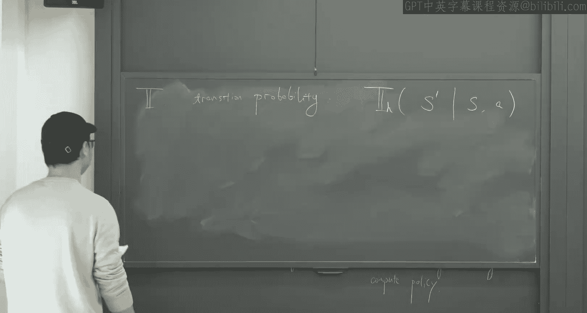
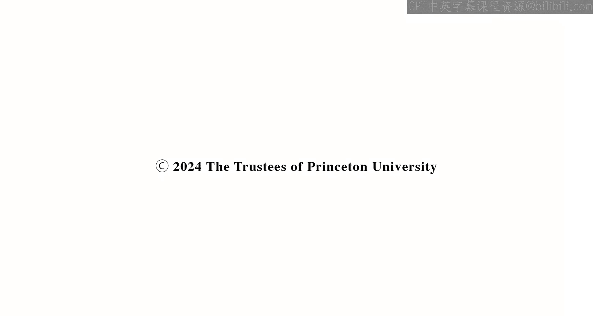

# 强化学习基础：21：部分可观测强化学习 I

在本节课中，我们将要学习部分可观测强化学习。首先，我们会总结多智能体强化学习的剩余内容，然后正式进入本课程最后一个主题——部分可观测性。

上一节我们介绍了多智能体强化学习，本节中我们来看看如何收尾。

## 多智能体强化学习回顾

在上一讲中，我们讨论了多智能体强化学习及其两个独特挑战。

第一个挑战是**多智能体诅咒**。如果直接应用单智能体算法，样本复杂度或计算复杂度通常会随智能体数量呈指数级增长。当智能体数量较多时，例如10个或20个，指数级的增长是难以接受的。

第二个挑战是设计**去中心化算法**。当智能体数量众多时，最好能有一个去中心化算法，让每个智能体独立运行，而不是由一个中心玩家来协调所有人，这相当困难。

因此，我们提出的问题是：能否设计一种去中心化算法来打破多智能体诅咒？

我们从**标准形式博弈**开始。解决这个问题的答案就是**无悔学习算法**。例如，上一讲介绍的 **EXP3** 算法，它本质上执行指数加权，即使在面对对抗性对手时也能实现无悔，并保证收敛到**粗相关均衡**。在两人零和博弈中，这对应纳什均衡；在多玩家一般和博弈中，则对应粗相关均衡。

然而，我们讨论的仅限于没有状态或转移的标准形式博弈。在本课程中，我们更关心具有时间结构的模型或问题，即**马尔可夫博弈**。

在马尔可夫博弈中，不幸的是，不存在多项式时间高效的无悔学习算法。任何算法都可能遭受指数级的后悔或需要指数级的样本，这显然是不可接受的。但好的一面是，无悔学习仍然是寻找纳什均衡或粗相关均衡的充分条件。我们仍然可以借鉴无悔学习的思想来设计寻找纳什均衡或粗相关均衡的算法。

上一讲我们研究的算法叫做 **V-学习** 算法。它非常类似于 Q-学习算法，只有两个主要变化。

第一个变化是，我们估计 **V 值** 而非 Q 值。我们仍然进行增量更新，但 V 值仅依赖于状态，而 Q 值在多智能体设置中通常依赖于联合动作，其维度是指数级的。因此，估计 V 值可以保持合理的规模。

第二个变化是，我们使用**状态层面的无悔学习算法**。我们不再追求整个博弈的无悔学习，而是为每个状态进行无悔学习，使用 EXP 算法为每个状态计算策略。

这两个部分结合起来，功能上相当于 Q 值。Q 值同时包含价值和策略，而这里我们估计 V 值，并使用无悔学习作为策略。这样，算法就具备了应对某种对抗性的能力，最终能够找到纳什均衡或粗相关均衡。

## V-学习的理论保证

现在，我们正式讨论 V-学习的理论保证。算法本身很简单：它是一个单智能体算法，类似于 Q-学习。在多智能体设置中，算法就是所有智能体**同时、独立地**运行 V-学习，就好像其他玩家不存在一样。

标准的单智能体强化学习算法通常假设环境是平稳的，因此在多智能体场景中可能失效。但 V-学习具备无悔学习的能力，能够处理一定的对抗性，因此这个算法在多智能体场景中确实有效。

以下是两个定理，类似于标准形式博弈中的无悔学习算法保证。

**定理 1：两人零和马尔可夫博弈**
在两人零和马尔可夫博弈中，V-学习算法能够找到 ε-近似纳什均衡。所需的样本复杂度为 **O( H⁵ * S * max(A₁, A₂) / ε² )** 个回合。

在上一讲中我们提到，标准纳什均衡的样本复杂度保证是 H 的多项式乘以 S 再乘以 A₁ 和 A₂ 的乘积。而这里我们改进为 **max(A₁, A₂)**，这基本上达到了关于 A₁ 和 A₂ 的下界。除了对 H 的依赖不够紧致外，V-学习本质上已经达到了下界。存在一些更好的无悔算法可以改进对 H 的依赖。

**定理 2：多玩家一般和马尔可夫博弈**
在多玩家一般和马尔可夫博弈中，V-学习算法能够找到 ε-近似粗相关均衡。所需的样本复杂度为 **O( H⁵ * S * maxᵢ Aᵢ / ε² )** 个回合。

有趣的是，这个依赖关系并不显式地依赖于玩家数量 M。如果每个玩家的动作数量相同，那么这个复杂度就只是 A。

结论是，通过这样调整 Q-学习，我们实际上能够设计出一种打破多智能体诅咒的去中心化算法，从而解决了我们提到的两个挑战。

## 关于均衡的补充说明

在上一讲中，我们还提到了三种不同的均衡：纳什均衡、相关均衡和粗相关均衡。它们之间的主要区别在于，当背叛其他玩家时，是否还能观察到分配给自己的随机信号。

如果我们想求解**相关均衡**，而不仅仅是粗相关均衡，我们也可以做到。技巧是在 V-学习中，将状态层面的无悔学习算法替换为所谓的**无交换后悔算法**。这稍微复杂一些，但基本思想是模块化的：只要将这个算法组件替换为具有更强保证的算法，就能找到相关均衡而非粗相关均衡。

这大致总结了我们关于多智能体强化学习要讨论的所有内容。

接下来，我们将进入本课程的最后一个主题：**部分可观测性**。

## 部分可观测性介绍

到目前为止，我们专注于**完全可观测**的问题。在这么多讲中，我们基本上只关注两个数学模型：马尔可夫决策过程和马尔可夫博弈。但在这两个模型中，我们都假设学习智能体或玩家能够直接观察底层状态，这些状态遵循马尔可夫转移。

然而在实践中，存在很多**部分可观测**的场景。

例如，玩扑克牌游戏时，状态可以由我手中的牌、桌上的牌和对手手中的牌来描述。但在玩游戏时，我们只能看到自己手中的牌和桌上的牌，看不到对手手中的牌。在这种情况下，我们无法完全观察到进行马尔可夫转移的底层状态，只能部分观测信息。这就是部分可观测。

类似的应用程序还包括玩《星际争霸》等视频游戏时存在战争迷雾，除非派出侦察单位，否则我们看不到其他玩家在做什么。在机器人学中，一个非常流行的感知方式是机器人拥有第一人称摄像头。在这种情况下，机器人只能看到它前方的环境，对于侧面或后方的情况一无所知。这也是部分可观测环境。

因此，许多应用程序都是部分可观测的。在部分可观测中，我们看到的是潜在状态。对于这些游戏或应用，进行马尔可夫转移的是状态，但由于我们只观察到其中一部分，所以状态是潜在的。

作为强化学习的基础，第一个问题总是：既然我们知道这类实际应用的需求，那么如何建模这些应用？我们知道这肯定超出了我们现有的 MDP 和马尔可夫博弈模型。因此，第一个问题是如何建立一个能够描述部分可观测信息的新模型。

## 部分可观测马尔可夫决策过程

我们首先讨论的新模型叫做**部分可观测马尔可夫决策过程**。

要指定一个 POMDP，我们需要指定以下元素，这与 MDP 非常相似。

*   **S**：状态集合。与 MDP 的唯一区别是，现在这些状态是**隐藏的**或**潜在的**。
*   **A**：动作集合。这是一个决策问题，智能体在每个时间步都有一组可用的动作。
*   **O**：**观测**集合。我们知道状态是隐藏的，无法再观察到状态，只能观察到反映状态部分信息的内容，这就是我们的观测。
*   **T**：转移概率。这与 MDP 相同，是基于前一状态和动作，转移到下一状态的概率。
*   **O**：**发射概率**。这是一个新的概率，假设在第 h 步，从某个状态 s 出发，观察到某个观测 o 的概率。
*   **R**：奖励函数。一个微妙之处是，如果我们假设奖励是底层状态和动作的函数，那么奖励信息也可能泄露一些关于状态的信息。为了简单起见，在部分可观测环境中，我们假设所有信息都已经包含在观测中。你可以认为奖励也是观测的一部分。因此，我们将 R 设为 O 的函数，以避免信息泄露。
*   **H**：回合的长度。

总结一下，POMDP 新模型与 MDP 的唯一区别是，现在我们有了一个新的观测集合，观测由发射概率根据当前状态生成。为了避免信息泄露，我们可以将奖励指定为观测的一部分。因此，每当给定观测时，我可以立即读取奖励。

为了更好地理解这个抽象的 POMDP 定义，我们可以通过流程图来看状态和观测是如何生成的。

我们从某个初始状态 s₁ 开始。首先，我们根据发射概率，由 s₁ 生成一个可观测的 o₁。然后，在第一步，智能体可以采取某个动作 a₁。与 MDP 类似，状态 s₁ 和动作 a₁ 共同决定了第二个状态 s₂ 的分布。不同之处在于，s₂ 也是隐藏的，不再被观察到。智能体也会发射一个 o₂。然后我们采取动作 a₂，转移到第三个状态，依此类推。

你可以认为 POMDP 模型实际上是两个模型的混合体。一方面，如果我们忽略观测，只关注底层的状态转移（假设状态是可观测的），那么这部分就变成了 MDP。唯一的区别是现在状态是隐藏的，我们观察不到。另一方面，如果我们忽略动作，或者基本上说整个序列是不可控的，那么上层部分（状态生成观测）实际上就是一个**隐马尔可夫模型**。

因此，POMDP 是一个比 HMM 和 MDP 都更困难的模型。

这种关系通过下表可以更清楚地看到：

| | 完全可观测 | 部分可观测 |
| :--- | :--- | :--- |
| **不可控** | 马尔可夫链 | 隐马尔可夫模型 |
| **可控** | 马尔可夫决策过程 | **部分可观测 MDP** |

在完全可观测设置中，我们关注的是完全可观测且可控的情况，这就是 MDP。如果从 MDP 中移除动作，它就变成了一个简单的马尔可夫链。在部分可观测场景中，如果我们为马尔可夫链添加一层发射概率，它就变成了隐马尔可夫模型。而对于部分可观测的可控序列，这就变成了 POMDP。

## 策略与价值函数

与 MDP 或马尔可夫博弈类似，下一步是定义策略和价值函数。

关于 POMDP 最复杂的部分之一是，我们需要记住状态是隐藏的。我们不再观察状态。虽然底层的状态变化是马尔可夫的，但我们观察到的新观测**不再是马尔可夫的**。你可以很容易地看到，如果我们只以观测 o₂ 为条件，那么在此之前和之后发生的事情实际上是相关的，它们不再独立，因此不满足马尔可夫性质。

这基本上是 POMDP 中许多事情变得非常复杂的主要原因。仅仅基于观测，过去和未来不再独立。

因此，对于许多部分可观测应用，我们注意到观测与 MDP 中的最大区别在于：在 MDP 中，我们可以基于**当前状态**做出决策。而在 POMDP 中，一般来说，决策需要基于**整个历史**。

直观原因是观测不再是马尔可夫的，因此查看当前观测不再是过去的充分统计量。这意味着，如果你仅基于当前时间步的观测做出决策，就会丢失一些关于历史的信息，从而做出次优决策。因此，最佳决策通常依赖于整个历史。

在扑克游戏中，每当你做出决策时，总会考虑整个游戏过程，比如对手是否先加注、过牌或弃牌。在《星际争霸》或机器人学中也是如此，你需要记住历史，并使用所有过去的信息来推断当前可能的状态。

在这种情况下，策略不再享有仅依赖于当前观测的便利。我们需要考虑依赖于整个历史的策略。

我们用 **τₕ** 表示历史，它包含了到第 h 步为止所有可观测的量：o₁, a₁, o₂, a₂, ..., oₕ。这是我们在需要做出决策时观察到的一切。这个历史 τ 属于集合 (O × A)^{h-1} × O，我们将其记为 Τₕ。

现在，策略变成了一个映射。同样，π 是一组从 1 到 H 的 πₕ，其中每个 πₕ 是一个从所有可能历史集合 Τₕ 到动作分布集合的映射。这是一个随机策略，但对于 POMDP 这个单智能体问题，考虑确定性策略仍然是充分的。

最重要的是，现在我们需要基于整个历史做出决策。

同样地，如果我们想发展类似于 POMDP 的理论，我们也应该关注价值函数。现在，价值函数也不再仅仅依赖于当前观测，因为它不是充分统计量。价值函数通常需要依赖于整个历史。

一般来说，定义中间步骤的价值函数相当困难。通常我们只关心第一步的价值函数。当然，我们也可以定义依赖于历史 τ 的中间步骤价值函数。

**历史依赖的价值函数**定义为：在给定历史 τ 的条件下，遵循策略 π（该策略依赖于历史）采取未来动作，从 h+1 到 H 的奖励 r_{h'} 的期望之和。

类似地，我们也可以定义 Q 值：Qʰ_π(τ, a)，它等于在给定历史 τ 且当前步骤采取动作 a 的条件下，遵循策略 π 采取所有动作的未来奖励期望。

这些函数之所以依赖于历史，是因为策略通常依赖于历史。

## 贝尔曼方程

遵循强化学习的相同方法学原则，下一步是推导贝尔曼方程。

原始的贝尔曼方程是关于策略 π 的。我们可以通过查看价值函数的定义进行一些变换，本质上找出 Vʰ 与 Vʰ⁺¹、Qʰ 与 Qʰ⁺¹ 之间的关系。为简单起见，我直接写出答案，你可以离线验证。

有两个方程：一个是从 Vʰ 到 Qʰ，另一个是从 Qʰ 到 Vʰ。

*   Vʰ_π(τ) = Σ_{a ∈ A} π(a | τ) * Qʰ_π(τ, a)
*   Qʰ_π(τ, a) = E_{o_{h+1} ~ P(· | τ, a)} [ r_{h+1}(o_{h+1}) + Vʰ⁺¹_π( (τ, a, o_{h+1}) ) ]

在第二个方程中，我们需要计算在给定历史 τ 和动作 a 的条件下，采样到下一个观测 o_{h+1} 的概率。这个概率可以通过贝叶斯规则，结合转移概率 T 和发射概率 O 来计算。除此之外，其他部分与 MDP 基本相同，只是将状态替换为历史 τ。

类似地，我们也可以写出最优策略和贝尔曼最优方程。与 MDP 设置非常相似，最优方程只是将策略的积分替换为对动作的最大化。

*   Vʰ*(τ) = max_a Qʰ*(τ, a)
*   Qʰ*(τ, a) = E_{o_{h+1} ~ P(· | τ, a)} [ r_{h+1}(o_{h+1}) + Vʰ⁺¹*( (τ, a, o_{h+1}) ) ]
*   最优策略 π* 就是关于 Q* 的贪婪策略：在历史 τ 下，最佳动作是 argmax_a Qʰ*(τ, a)。

基本上，沿着我们研究 MDP 的相同路径，这是我们可能得到的第一条线索：我们定义了价值函数，查看了贝尔曼方程，并通过贝尔曼最优方程得到了最优价值。

## 计算挑战与信念状态

这里有什么不太好的地方呢？通常，当我们有贝尔曼方程或贝尔曼最优方程时，在 MDP 情况下，我们可以通过动态规划计算 Q* 和 V*。动态规划和样本复杂度的计算基本上受状态和动作数量的限制。

但在这里，我们用历史替换了状态。我们可以很容易地计算历史的可能性。一般来说，一个历史 τ 有 (O * A)^{H} 种可能性。这与 MDP 情况非常不同，在 MDP 中，V 值仅依赖于状态，Q 值仅依赖于状态-动作对，而状态-动作对只有 S * A 种可能性。

这里，我们有 (O * A)^{H} 种可能性。这基本上意味着，即使在**表格型设置**中（我们假设观测、状态、动作的数量都是有限的），仅仅用表格表示 V* 或 Q* 就需要指数级空间。

因此，即使在表格型设置中，虽然我们可以写出贝尔曼方程或贝尔曼最优方程，并理论上基于这些方程计算这些价值，但这不会高效。整个历史有太多可能性，我们需要指数级空间来存储它，整个计算无法在计算机上完成。

这也是 POMDP 具有挑战性的原因之一。

我将首先讨论 POMDP 的一些替代观点，你可能会认为它们可以解决问题，但我们稍后会说明实际上不能。然后，我们将讨论如何多项式地解决部分问题。

## 信念状态观点

这种 POMDP 的观点是我们将所有依赖于整个历史的东西都展开了。历史上还有另一个非常流行的观点，基本上称为**信念状态**。

其思想如下：回顾在 POMDP 问题中，我们有 s₁ 生成 o₁，然后与 a₁ 一起生成 s₂，s₂ 再生成 o₂。在需要做出决策 a₂ 的时间点，我们说整个复杂性在于为什么需要查看整个历史，是因为如果只看 o₂，它并不是过去发生事情的充分统计量，它只包含 s₂ 的部分信息。因此，o₂ 不足以做出更好的决策，我们需要查看 o₂、o₁ 和 a₁。

但说实话，s₂ 才是充分统计量，只是我们不知道它。信念状态的一个更好想法是：我们何不直接计算 s₂ 的分布？我们可以使用历史来计算 s₂ 的分布。并且观察到，s₂ 是充分统计量。虽然我们观察不到 s₂，但我们可以计算 s₂ 的分布，这基本上是我们能从历史中得出的所有结论。事实证明，这个分布将是关于过去的充分统计量。一旦你知道 s₂ 的分布，无论过去发生了什么，对于预测未来都不再相关。

这就是所谓的信念状态。基本上，我不再确切知道第二步是处于状态1、状态2还是状态3，但我可以有一个分布，例如在状态1的概率为0.5，在状态2的概率为0.5。这个分布被称为信念状态，它是历史的充分统计量，用于预测未来。

形式上，我们说这个信念状态 bₕ 属于状态集 S 的单纯形，即状态上的一个分布。

非正式地，我们将展示 POMDP 有一个替代观点：我们可以将 POMDP 视为**信念状态上的 MDP**。

一旦我们有了信念状态的观点，我们就可以定义一个在信念状态上操作的策略。现在，πₕ 变成了从信念状态空间（S 的单纯形）到动作分布的映射。这看起来更简洁，因为我们不再查看整个历史，而只查看状态上的某个概率分布。现在，充分统计量是信念状态。

首先要讨论的是如何计算信念状态。我们需要根据新的观测和新的动作来更新信念状态。

信念状态是一个向量 b_{h+1}。我们可以查看向量的每个坐标，即过程处于状态 s_{h+1} 的概率。我们可以使用贝叶斯规则来计算，结合先验信念状态 bₕ、采取的动作 aₕ 和新观测到的 o_{h+1}，以及转移概率 T 和发射概率 O。

一般来说，这具有以下形式：b_{h+1} = F(bₕ, aₕ, o_{h+1})，其中 F 是由贝叶斯规则定义的这个函数。

你可以使用这个递归方程来逐步计算信念状态。一开始，第0步的信念状态就是初始分布。然后第一步采取动作 a₁，第二步观测到 o₂，然后可以更新 s₂ 的信念状态，依此类推。

一旦我们知道如何计算信念状态，我们现在就可以写下价值函数以及相应的贝尔曼方程。

好处是，现在价值函数 Vʰ_π(b) 不再需要用整个历史来表示。你可以认为 bₕ 充当了 sₕ 的角色，唯一的区别是现在它不是单个状态，而是状态上的分布。

我们也有 Qʰ_π(b, a)，定义类似。

贝尔曼方程本质上也是相同的。

*   Vʰ_π(b) = Σ_{a ∈ A} π(a | b) * Qʰ_π(b, a)
*   Qʰ_π(b, a) = E_{o_{h+1} ~ P(· | b, a)} [ r_{h+1}(o_{h+1}) + Vʰ⁺¹_π( b_{h+1} ) ]

与之前的贝尔曼方程不同，之前价值函数接收整个历史，对于历史我们只是追加新的 o_{h+1} 和 aₕ。而现在价值函数只接收下一个信念状态。幸运的是，我们有这个更新公式，所以我们可以计算下一步的信念状态。

因此，下一步价值函数的输入基本上就是当前信念状态 b、采取的动作 aₕ 和观察到的新观测 o_{h+1} 的更新结果。

类似地，我们也有贝尔曼最优方程，你可以想象，基本上就是将第一个方程中的求和替换为最大化，从而得到 V*、Q* 和 π*。

在数学上，这看起来简洁得多，因为我们不再依赖于整个历史，只依赖于当前的信念状态。从表面上看，信念状态只是对原始状态的扩充，现在变成了分布上的函数，这可能使学习变得更容易。这也是许多人的信念。

## 信念状态观点的局限性

但一般来说，这是否成立？通过将 POMDP 视为信念状态的观点，是否真的减少了很多计算或空间复杂度？

我们的直觉可能是否定的，因为我们并没有做任何非常特殊或非常重大的事情。我们只是使用贝叶斯规则和信念状态重新表述了问题。我们并没有显著简化问题，也没有发现先前表述中未使用的任何新属性。因此，直觉上，这对于减少计算量应该没有帮助。

那么，在什么情况下这会有所帮助呢？我们的直觉是，这种帮助取决于一个条件：**V* 是一个简单函数**，例如，是一个线性函数。如果 Q* 或 V* 是简单函数，例如线性函数或二次函数，那么我们不需要太多参数，这当然会减少大量计算，因为之前的一切都是指数级的，而现在我们只需要拟合 V* 或 Q* 是什么。

但问题是，这实际上是一个很强的要求。目前，在文献中，什么样的 POMDP 会产生简单函数还很不清楚。我们缺乏对何种问题结构足以产生 Q* 或 V* 简单函数的理解。

一般来说，如果我们不做任何假设，对于通用的表格型 POMDP，V*(b) 实际上并不是 b 的线性函数。这有点违反直觉，但仔细想想，实际上很有道理。例如，如果你知道处于状态1或状态2的价值，那么对这两个价值的平均值通常不等于当你当前信念状态是 (0.5, 0.5) 时的价值，因为不确定状态的情况实际上更困难。所以一般来说，这肯定不是线性函数。

你甚至可以证明，一般来说，如果没有任何结构，V* 实际上是一个**分段线性函数**。衡量这个函数复杂性的一个指标是它有多少个不同的分段。不幸的是，你可以证明分段的数量**一般是指数级的**。

因此，基本上，天下没有免费的午餐。虽然我们可以用信念状态来表述一切，但信念状态是一种连续变量，有很多可能性。而价值函数实际上并不是 b 的简单函数，它是一个具有指数数量分段的分段线性函数。仅仅指定这个具有指数分段的分段线性函数 V* 就需要指数级空间，这基本上使得一切难以处理。

## 计算与统计硬度

当我们进行贝尔曼最优方程求解时，我们讨论的是**规划**。到目前为止，我们讨论了两种规划算法：一种是在整个历史上使用贝尔曼最优方程，另一种是在信念状态上使用贝尔曼最优方程。但两者在计算上通常都是难以处理的。

你可能想知道是否有更好的算法。事实证明，这不是信念状态或历史的错，而是整个问题本身就很难。存在一些计算硬度结果。

这是关于规划的。基本上，即使我们已经知道转移概率和发射概率，想要计算最优策略，在一般情况下，你可以证明没有算法能够在多项式时间内找到这种依赖于整个历史的真正最优策略。事实上，这个问题是 **PSPACE 完备的**。对于不知道 PSPACE 完备是什么的人，我希望你听说过 NP 难。PSPACE 完备是比 NP 难更复杂的问题。

我们肯定不知道有什么多项式算法来解决它。

人们也研究了一些子类。例如，这是关于真正的最优策略。如果我不关心真正的最优策略，因为它可能依赖于整个历史，而只关心所谓的**无记忆策略**子类呢？在 POMDP 中，我们不能再仅仅根据当前观测做出最优决策。但这是说，好吧，一般策略太难了，我只想看无记忆策略，即我的决策仅依赖于当前观测。

我知道这个策略可能不是很好，可能无法达到全局最优，但这是我更容易实现的目标。我只想在这个子类中做到最好。事实证明，即使你只想找到一个最优的无记忆策略，其复杂度实际上也是 **NP 难的**。这比 PSPACE 完备稍好一些，但也好不了多少，基本上它甚至不在 P 中。

更糟糕的是，还存在一些**统计硬度结果**。也就是说，即使我们允许无限计算，学习问题仍然很困难。这部分是说，即使我忽略 PSPACE 完备或 NP 难，我有一台超级计算机，能够极快地计算一切，学习问题仍然困难。这是两个完全不同的视角：前者是说即使模型已知，计算也很难；后者是说即使计算无限，但模型未知，统计上仍然很难。

统计硬度结果表明，学习 POMDP 在最坏情况下需要 **Ω(A²ᴴ)** 个样本，即使我有无限的计算能力。

到目前为止，我们似乎引入了一个非常优雅的模型来描述部分可观测性，并且我们确信这是一个非常重要的问题。我们也推导出了一些基础理论。但就现实而言，如果我们想进行计算和统计学习，一切似乎都非常困难。这个领域几十年来一直如此。即使到今天，计算效率问题也没有得到很好的解决。

因此，规避这些硬度结果的途径基本上是研究某些问题子类。在实践中，我们感兴趣的问题只是最坏情况 POMDP 的一个子类。即使对于那个子类，我们也可以将这种非常糟糕的复杂度改进为某种拟多项式复杂度，或者甚至是多项式复杂度。

在下一讲中，我们将介绍一些最新的结果，关于如何通过研究某些问题子类来规避统计硬度。我们将研究为什么存在统计硬度，看看是什么困难实例阻止了我们进行高效学习。然后，我们会注意到那些 POMDP 并不是非常有趣的 POMDP，它们是一些我们知道肯定困难的平凡 POMDP。我们解决这个问题的方法是通过排除某些 POMDP 部分，使其更易于高效求解，并开发算法来解决下一讲中的统计问题。

---

本节课中我们一起学习了部分可观测强化学习的入门知识。我们首先总结了多智能体强化学习的 V-学习算法及其理论保证。然后，我们引入了部分可观测马尔可夫决策过程作为建模部分可观测环境的标准框架，定义了基于历史的策略和价值函数，并推导了相应的贝尔曼方程。接着，我们探讨了信念状态这一重要概念，它将 POMDP 转化为信念状态空间上的 MDP，但同时也指出了其在计算和统计上面临的指数级硬度挑战。最后，我们提到可以通过研究具有特殊结构的 POMDP 子类来寻求高效算法，这将是下一讲的重点。