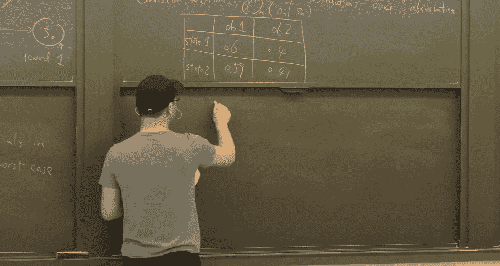
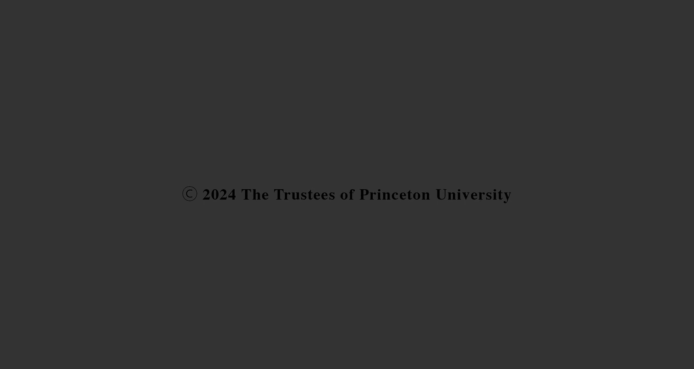

# 普林斯顿大学《强化学习基础｜ECE524 Foundations of Reinforcement Learning Sp24》中英字幕claude-3.7-s p22 Lecture 22 Partially Observable Reinforcement Learning II.zh_en -BV1vewWeRE5X_p22-

Okay， so let's start the lecture today。 So today， we will continue talking about partially obable reinforcement learning。

 And this is the last lecture of this semester。 So it will be slightly short。

So in the last lecture， we kind like we started talking about the mathematical models。

 we studied partial observability， which is the partially observable Markov decision process。

 is the pole NP。So just a quick recap。 point D P has a three。Ma important elements。

 That is observation。States。And the action。So similar to MDP， we start from some initial states。

The only different thing is now the states are hidden。

So the learning agents no longer directly observe the states。 So this part are often them。

So the state will generate an observation at the first step。And then。

The learner or agent can basically make decisions based on the first observation and the observation and underlying states will jointly decide what's the next states in the second step。

 And then again， the state will generation observation by emission matrix。

 And then we again have the action a2。做案呢。So we talk about the major challenges in this particular Ob reinforced marine setting。

Or the most important thing that makes it different from the fully observable scenario is we need to reason。

About the distribution of states。So this is very different from MDP。

 where we say the importance of states is like the important everything about MDP and pointP。

 the most important thing is we have this markov structure。

 Well the states is what is a markov transition， of division does not have the markov transition。

 So that's why it's very important we eventually still reason about states。

 but different from the fully observer scenario in MP。

 we can directly observe what is current states here， we， we have to like guess。

 or we have to infer reason about what is the distribution over the states。And because of this。

 basically， the optimal decision。And depends on。The entire history。So that's why in the last lecture。

 we basically emphasize a lot。 We， we， when we look at the policy， we need to look at the history。

 dependent policy。So the history and the most difficult part about the like action depends on history instead of current states is like their exponential possibility of history。

You have like two omega H possibilities。So basically， in this case。

 we talk about in the last lecture that although we have the。

 we have we can write write out the be opt equation using the entire history or using the belief states。

 But if you look at the computation， they are all like exponential in the horizon。

 exponential in the lens of point and D P。 So they are all non。

 if they are all like non efficient algorithms。So we briefly mentioned in the very end of last lecture。

 there are a lot of existing known harnessness without 4 point D P。So we say for computation。That is。

 we talk about planning。With no model。This is just talking about we want to find a policy。

 even if we already know the transition and emission of the pull NP。

So we say if we want to find an optimal policy。Just the optimal history， dependent policy。

 It is a piece space complete。Which was even harder than MP hard。

And if we just want to find a subclass of the optimal policy， that is optimal memoryless policy。

Which memoryless policy basically only look at the policy that is no longer depends on the entire history。

 but only depends on the current observation。 So this clearly is not the optimal policy。

 but let's just discuss the best policy within this class。

 Even finding the best memoryless policy is MP hard。

And we see the computation of point P like really， like competition problem is really severe。

 Even nowadays， like there isn't any like a very good solution So to tell you about like polynomial time algorithm or what is like subclass we can do poly algorithm。

 It's still like not very clear。So the second class of problem is like statistical problem。

Statistical hard。So ones perspective is like no model。 No model is essentially， for example。

 I give you infinite number of samples so you can estimate the model like infinite accurately based on those samples。

 And you just do planning。 So the other end is if I have infinite computation。

 but I want to like learn the model， which is like a learning perspective。 Okay。

 statistical perspective。That is even。With infinite computation power。

So it turns out it's easy to construct some hard instance。So， that。In the worst case。

Learning pull NDP。Requires。欧米伽A to the power of H。Sampos。

So this is basically say not only computation is difficult。

 even if I give you infinite computation power。 that is I have like a supercomputer。

 then the learning is still very difficult as we need to essentially collect infinite。

 like exponential number of， of samples， which is。Which is like a very。

 very like you cannot really do it in practice。So today。

 we will dig more into the statistical harness。And we will actually see how we gonna。

Like what is this a to the H counter example is like why in the worst case。

 we actually require some exponential number of samples and how could we possibly fix this problem。

 or how could we like， for example， in practice， we do like study a lot of reinforcement problem or like sequential decision making problem that waste partial observability。

 So why in practice， we are able to address or solve some partial obable problem。

 So this is the topic today。So those are like a very all the hard result。

 which basically is very negative， saying like in the worst case， for like this entire class。

We cannot do too much positive things。 So in order to develop some like meaningful or like。

 which is something useful for practice， we would divide， divide like。

 address this question into two， two sub questions。The first question is about the problem structure。

O。So the structure is， we will ask questions。 can we。Identify。A rich subclass。

This rich is very important。Of point DT pointDP。That is statistically tractable。

So the idea is very simple， like because we already have the mathematical results See in the worst case。

 if we want just want to learn any arbitrary point N D P， that is not possible。 So the fix。

 the way to easily fix it is we just say。Possibly the。

 the hard instance in those kind of scenario are like some scenario， which is not very practical。

 or in practice， we should not hope those kind of problem is solvable。 But in practice。

 there are some other class of problem， which is only a subclass of point P。 And we we。

 as as we solve those kind of。Problem related to practice。 So we're， were， we're good enough。

 So this is why we want to identify some rich subclass。 Hopefully。

 this subclass is rich enough to cover a lot of practical， useful problems。 And then as answer， we。

 we're able to dealing with that subclass。 and we're， we're in a good shape。😊。

And a second problem is about algorithm。So once we identify a subclass a problem that is statistical tracttractable。

 of course， the next question is just we want to design the algorithm to learn this subclass。

Can we So the question， we ask there。 can we design。Simple algorithm。That efficiently。

Learn this rich class。So today， well， we will talk about both perspective about problem structure and the algorithm。

 So we'll focus on the problem structure first。So in order to talk about the problem structure。

 like how we identify a subclass， we need to basically reex the harness result。 like what is the。

Difficult point D P， that would require a to the power of H samples。

So it turns out that if we look at the original proof， this sample， these examples are。

 are not very hard to construct。 It turns out it's some like a。

Poin D piece that actually with completely uninformative observations。So in the high level。

 uninformative， essentially， it just it doesn't really carry any information。 So we。

 when we talk about the name partially ob in MDP， we kind like somehow encoded in the message that we're saying the observation is like partially obable。

 So we kind like， we hope observation。Somehow reveal some part of the underlying states。

 But it turns out the hard instance is basically saying those point of people will be hard if opposition doesn't carry any information about the states。

 So you can think it's like an unobservable scenario。 So we'll talk about how to realize that。

So basically， the， the point appears is that。We can。

 We can basically realize this uninformed observation by saying like， no matter。So basically。

 we can choose the emission。So， that。The observation is the same。

No matter what the underlying state is。So， this is like some。

Dummy case or like a dummy observation or like a very special case of point DP。 Basically。

 the you can think emission matrix is something like that。 It doesn't matter whether Im state 1。

 state 2 or three straight。 I always will generate the same observation。😊，Okay。

 and so this opposition basically doesn't tell you anything about whether you're in state 1。

 stage 2 or three3， it's。It basically is a useless observation。 It's like a dummy observation。

So once you have such kind of observation。Then。It's， it become a lot easier to construct something。

That is very difficult to learn。So in order to construct harness for poor and DP， we know we。

 we we need to construct both emission and transition。

 So emissions like that basically like a like trivial emission is like a。No interesting emission。

 And then the underlying transition。We can use the。Previous construction， that is a Cambri Hlock。

Comory lock re remember， ca lock is like a two state MP。That underlying。

 we have a star from some S 0 states。And we first have some first special action。

 and this will lead to， again， as 0。 and for whatever。Other actions that is in the action set。

Acept this A1 star。That will lead to an absorbing states。 And once you are in absorbing states。

 no matter what you do， you're staying absorbing states。And then for the， for the correct states。

 every time you have a different action。Only one accurate different one correct different action that will leave。

 like make you make the agent remain in the correct states。 Otherwise。

 it's always go through absorbing states。And eventually， we have a0。And S1。So basically。

 only if youre taking the correct action sequence。You're gonna end up in this S 0 states in the very last step。

 Otherwise， you' always gonna end up in S1。And this special transition is saying， like。

 I will only get a reward here。If reaching these final states and everything else。

 we don't get any reward。And we note this commercial lock。

 we previously uses a hard instance for like random exploration。

 but it is not hard for MP because in the MDP， you can actually see what is underlying states。

 You can notice like when it transition to S1 or when when when it states at as 0。 So basically。

 you can use some value with upper confidence VU B algorithm to solve this kind of problem with paranormal samples。

But what， what is different here。 Here is we are now doing the pull NP。 So in the Po NP。

 this is still the underlying MDP transition。 But in addition to that。

 now we have like this trivial emission。 That is no matter what， no matter what， what states。

You generate essentially the same observation， so you have no idea which state it is。So essentially。

 you can think when I'm underlying running a computational lock。

 but I have this like a trivial emission。 then in that sense。

 I have no idea what underlying state is。 All my observation is when I enter the correct action sequence。

 I got。Anything else， I got reward 0， but I have no idea which action is wrong。 So essentially。

 you can think this is equivalent。To like entering password or something。Like， you have did。

Digital pad， like， for example， you have daily wish like 9 actions。 And no matter what you press。

 you don't have any observation until the very end。

 you know whether your password is correct or wrong。So in this case， we。

 we clearly know there there' is no hope we can solve this problem with polynomial samples。 This。

 there is like no good way to solve this problem other than exhaustive research and all the possible action combination。

 and its all the action sequence， which is essentially exhausting search all the password。

So in this case， it would require。A2 the omega is try。In the worst case。O。

So what do we learn from this hard instance。It actually。

 we notice a very important thing about this harding instance。

 like we know this pointP actually has a completely uninformative observation。That is。Essentially。

 we can conclude that。Pll and piece。Are hard to learn。When observations。Are completely。Uninformative。

Maybe we don't need completely uninformative。 as long as the observations are uninformative about the two states。

We can essentially embed this commentary lock into these two states。

 which make this point bit difficult。So we'll talk a little bit more about how we're gonna use mathematics to quantify what do we mean by uninformative and how we' gonna get rid of this。

So intuitive intuitively， we say observation is intuitive informative。

 That essentially means different states would have different observations or different distribution over observations so that when we observe some observation like we can。

Essentially， infer likes higher probability in this states or higher probability in that states。Okay。

 so some。Being formative。Intuitively， we're saying like。Two different states。Should it generates。

Different distribution。Of over， over observations。So that this is essentially some minimum condition。

 We can see these two states are distinguishable。 Otherwise。

 if two states just always generate the same distribution over observation。

 then they they look like when you， when you only look at the observation and without looking at the states。

 they， they look essentially the same。 And you cannot really distinguish what。

 what are those two different states。So the table， essentially， we。

 we should look at the emission matrix。Remember， emission matrix is is a probability of。

Of seeing observation O， H， given state S H at H7。So this is essentially talking about when we at some states。

 what is the distribution of observation where。Generating。So， we can look at some simple case。Well。

 we， for example， we have two states。And two observations。

So this denotes this is like emission matrix with only two observation and two states。

And what is uninformative like emission，Essential， for example， when we at a state 1， we have like 0。

6 probability to get first observation，0。4 probably to get a second observation。 And if at state 2。

 we also have the essentially the same distribution。 And then this just become uninformative。

 This essentially says I by looking at observation。

 I cannot really tell even with infinite number of observations。

 I cannot really tell whether I'm a state 1 or state 2。So what is informative。

 In essentially says we should not have the same distribution。 So as long as they can be different。

 it's fine。 So， for example， wes like 0。590。341。As long they differ a little bit with enough number of samples like like enough sample related to how different they are。

 we can essentially tell whether I'm more likely in state  one or state 2 or with infinite number of samples。

 we can essentially tell like with with high probability I state 1 or state 2 or something like that。

' it's， it's more like identifiable。And this is like one of the sufficient condition we can hold for。

 like basically getting rid of this type of examples。 and we identify some rich subclass of problem。

So it turns out we， we not only need to like get rid of the problem that two two different distribution will generate the same distribution。

 We will also need to slightly strengthen this to be not only just the two different states。

 but also two different mixtures of states。So it turns out if you have one mixture of states and the other mixture of space generate the same distribution of observation。

 then you can still embed this comm lock and generate the hard instance。

 So we need to get rid of that。 We're seeing for any two different mixtures of states。

 the observation they induce should be different。So it turns out that this mathematical this informative condition mathematically。

 is equivalent。To so called， we define the new alpha weekly revealing condition。

I would just say。So what I wrote here， the informative condition is is equivalent to saying the O H。

This emission matrix。Needs to have run cash。So remember， this is。In the O by S。Or S by O。

 whatever it is。 Like it's a S by O matrix。So whenever we say like two mixture of states that will will will generate different distribution relation。

 This is essentially some like linear independent condition over this emission matrix， which this。

 this， this statement is equivalent to saying this emission matrix need to have run has。

And when we want to have some learning guarantees， of course。

 we need to have some measure of this difference。 We cannot just say it's rank as because rank has matrix can be infinitely close to rank S minus-1 matrix by just like changing some extremely small。

 epsilon entries。 So we need to have some robust version of being rank as。

So we will use the alpha weekly revealveting condition。Essential。

 it's a robust condition of a rankcast matrix。So we say poll NP is alpha weeklyly revealing if the S singular value。

Of this emission matrix。Its greater equal to some alpha That is strictly greater than 0。

This is as single value you。So as single to value greater。Every single value is non0。 It's。

 it's basically saying it's a rank has。 Now， we're not only saying it's greater than0。

 but it's greater than some greater than some threshold。So that's why it's like a robust version。

Ofrancas。So it turns out this alpha weekly， weekly revealing point NP is the rich subclass。

 we will eventually， we， we eventually we will see this is actually already defined a subclass or point NP that is statistically tractable。

So the first question to here is actually， just the。阿尔法。Weekly revealing point of you。But， of course。

 so far， we haven't proof it statistically tractable。

 So we will use the algorithm to say we can actually learn them in paraormal samples。

 So that's why it's statistically tractable。So。So basically。

 now we have a candidatedid answer for the first question。

 We will essentially now design an algorithm to answer a second question and also answer the first question。

And the second part of the first question， that is statistically tractable。

So this is all about the problem structure or what is the problem structure that we identify pull and DP that is。

So the next part is about algorithm。So in this class。

 we have talked a lot about the value based algorithm like value duration， C learning， a lot of。

 basically a lot of previous。Algothms， we studied。In MDP。For example， like a value or cure learning。

Or like least square ver or like a golf for orders like fit cur。 They are all essentially。

Value based。Like， the key part is learning the Q value or like even in the multi multi agentent reinforcement setting is like learning the V value。

However， we kind of mentioned the most difficult part about learning value here is。

Lt and value has exponential size in pole N P。This depends on history。Okay， so。

Whenever we want to extend a lot of like value based algorithm。

 we always run into this problem that eventually depends on like when we do the function approximation。

 It depends on the size of value functions or like complexity of value functions。

 And if the value function actually has exponential size。

 like it depends on the entire history and history as exponential size。

 So this value also have like like extremely large amount of like complexity in the value function class。

 which is make it very difficult to design some efficient algorithm。

So what are the alternative algorithms we can possibly do in Po N DP。

It turns out we can possibly do another old old idea that is we do the model based algorithm。

So it seems like the， this model base versus model free thing has been talk a lot in the。

 like in the。In the standard MP scenario。 But why here like like it seems like a model base。

 both model base are model free， like a value base are like something feasible in the MP setting。

 But in why in the pointP， when value base are no longer good。

 why model base are still possibly good。Because we say the value is very complex。

 because value depends on history。 But if you look at the model size。Very important thing we note is。

 although the。The policy depends on entire history。

 The model is just the transition and the emission。Those are the model parameters。

Those has like no history in it。 And those model parameters has essentially has a finite number of pre。

A small number of parameters。Essentialten， nothing in the like number of parameters in model is like exponential。

 This is just the S， S square a size。 This is the O S size。So model is actually very small。

 that essentially means once we can design some algorithm that can efficiently estimate the PMO very accurately。

 we have a hope we can design some efficient。 we can have like a near optimal policies for solving point P。

Okay， so how are were going to design the model based algorithm。So when we。

 we talk about the learning algorithm in the previous S scenario。

 we always talk about generative model setting， like exploration setting of offline setting。

Here in the point D P， the sulator setting become a little bit unclear。 It's kind like whether。

 whether you observe the online states or you observe the online states。 It's a little bit tricky。

 Like there isn't like any well defined similar setting。

 So we're directly looking at the exploration setting。OkayIt's。

 it's a lot easier to identify that we just have a point N D P。

 We will directly interact with the point N DP， as a standard learning agent will do。

 and we will learn the optimal policy by doing exploration at the same time。

And we know when we do the exploration setting， we always will need to use some optimism。

Like whether it's upper confidence bonds or it's like global optimism and something like that。

So the question is how we， what is the base algorithm。

 What is the base like a model based algorithm that we're gonna use here。

It turns out we would just use a very simple classical algorithm in statistics that is able to。

To do the model based learning， that is called maximum likelihood estimation， M， L E。

Basically called maximum。So we just use a very simple algorithm like that。

So let's first recap what is， what is actually M E in statistics。

So so M O E is a very basic algorithm in like classical statistical class。 Like it's。

 it's also an textbook algorithm。 Basically any， if you learn any like statistical course。

 the first algorithm， maybe second algorithm， you will learn is this M O E。

 So it basically says we have like a lot of。D distribution， like， for example。

 we have a P X that is a parameter by， by Cta。 Or let's say we have some seeta。

This is my observation is X， and my model parameter Cta。 and I have a lot of distribution。So。

 for example， this can be a Gaussian distribution。Where。Essentially， I have。

Like this see in the Gaussian distribution cases like the mean。And the variance。 So in this case。

 this seat up will describe a lot of different curves of Gaussian distribution。 For example。

 the PF can be look at something like that。 This is like PC 1。 This is PC 2。

And we will observe a lot of data X。 So， for example， axis is something like here， here。

 And then we have a lot of x here。So how we should， And the problem is once we observe the data。

 we want to essentially estimate what is the parameter of this distribution。 For example。

 if we already know this data come from Gaussian distribution。

 we want to estimate what is the mean parameter and what is the variance parameter。

So MLE is a very simple principle， essentially it just says I will choose the parameter。

That maximize the socal likelihood。Cta is my primary set。So that I'm。

 I'm will maximize the likelihood。The likelihood function essentially is that will if the true parameter seeta。

 what is the probability of observing this X data， I will just essentially find the parameter that maximize this。

So， so now the question is， how were going to use this principle in designing reinforcementment learning algorithm。

Especially combine with optimism。So it turns out once we look at the Gar for algorithm。

 like how we're gonna combine the optimism with like the fit innovation。

 the combination integration is in high level is kind of similar。 So we talk about algorithm that is。

Optimistic。按照。So the algorithm is， again， an iterative algorithm。 You look at a lot of episodes。

 episode K from one。To capital， K。And then the algorithm in each episode will split it into three steps。

The first step we do optimistic planning。So it' is very similar to Garf。We will compute the policy。

And the model parameter。This is a model parameter。Essentially， in the pull API case。

 this model primary just the P PM the T N O， sorry， the， the transition and emission。Arur Max。Ceding。

B。Pi。可拍。So the only difference is， I think you remember， recall in the graph。

 we have a confidence set over the the value here。 We have a confidence set over model。

So we just maintain a set of models that more model parameter that is in our confidence set。

 And we'll later talk about how we're gonna update this confidence set。

And so in the optimistic planning is， once we have given the company set。

 we will just find the the model and the policy， which will maximize the initial value。This is。

 again， the global optimism。The second step is doing the data collection。We will execute policy P K。

To collect trajectory。tao。Equal to。O one a one哒哒哒。T O， age。

And the third most important step is we will update the confidence session after we collect a sample。

Upd the confidence at B。So if you look at the high level algorithm。

 this is essentially the same archetype of a graph for algorithm we talk about in the general function approximation。

 and we will do opt planning。 The only difference is now we have a company set over model instead of overvalue in in a golf。

 and we directly compute the best model and。And policy within the confidence set。

 And we execute that policy to collect data。 And eventually。

 we use this data to update the confidence set。So the most important thing that makes this algorithm different from like the go algorithm in the。

In the general function， approximation is how were gonna。

 how we design this confidence set and how we're gonna update the confidence set。

 And this is also where we will use the maximum likelihood estimation。

So it turns out the competent setup we will use is。Something like the following。That's。

We look at the other cedar。Its all the model parameter where in the point P， this C is just T NO。

So we essentially look at all the collection of the model parameters。

 which satisfy the following condition。That is。Smation of look at all the policy and trajectory。

In my data。And did I correct it。Essentially， I look at the log likelihood。So this is the。

 this is a probability given by model T。 that is given by some point。

 A P model model specify by the T And O in calculating if I'm following policy pi。

 what is the probability。 I'm gonna observe some trajectory that is ta。

And so this is essentially the expansion of what we have in the likelihood here。

So this confidence that essentially， so this likelihood will be greater than the maximum likelihood。

C the prime in。什么意思？Haaiitao。In the。Log。Pi。😔，系。See the prime。Minus beta。

So how are we going to understand this complete assess。Essentially， this is just the。

 the maximum likelihood。Assimation。So here we with a maximum likelihood。

 We can also maximize the log likelihood。 It doesn't matter。 It'， it's the same thing。

 And this is essentially finding the parameter that will maximize the likelihood。

 This is just expand how we sum over the data。 So the a max is the ME estimation。

 So ME will give you a point estimation。 So this confidence that is essentially。

 I will not only just include one single point。 is ME and maximum estimation。 Well。

 I will actually include all the models so that the likelihood may not be as good as ME。

 but can be slightly worse than ME by some statistical tolerance data。

So this is very similar to the in the Gulf where we look at some values so that the beman arrow is can be slightly greater than the smallest the Belman arrow plus some relaxation beta。

 We're here like because it's maximization。 So it's minus beta。 So this is again， some relaxation。

And this is essentially all the algorithms。So the guarantee is we can't save for this always a miss。

For hours for week you' reading pull into piece。This optimistic ML E algorithm or ML E algorithm。

Where outputs。And。Order epsilon， optimal。Policy。Within。Pamial。F H S。A oh。

 that is horizon number of states， number of action， number of observation and Epsilon inverse。

 which is accuracy inverse。 and finally the alpha inverse。

 which is this alpha weekly reading parameter。Episodes。

So the important thing is now everything is in polynomial。

 Its no longer something exponential in the horizon。

 So we have an efficient like simple efficient algorithm for learning very rich class of point and P now。

I guess this also concludes what I want to talk about about partially obable reinforcement learning and。

Essentially everything in this class this semester。Any questions I， I will be happy to answer。

If no questions， that will be the end of this semester。 Thank you。

