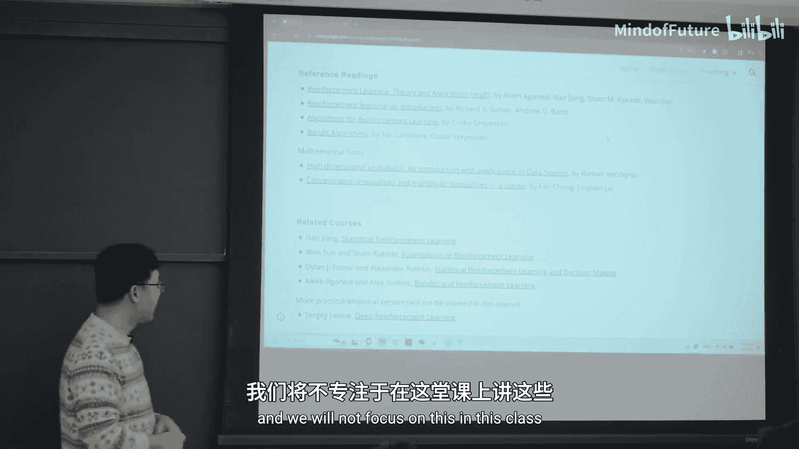

# 001：课程介绍与MDP基础 🎯

在本节课中，我们将学习强化学习的基本概念及其数学基础，特别是马尔可夫决策过程。课程将从应用实例出发，逐步深入到数学模型、核心挑战以及本学期的学习计划。

## 课程概述与目标

大家好，我是来自电子与计算机工程系的 Chi J。本学期我们将共同学习一门名为“强化学习基础”的课程。这门课程虽然名为“基础”，但实际上是强化学习的数学基础。

本课程将被录像，主要面向公开讲座和校外学生。如果你有任何不清楚的地方，欢迎随时提问，所有问题都非常有价值。

我们将首先对课程进行简要介绍。由于课程侧重于数学基础，大部分时间我们将进行黑板推导和概念讲解。但第一节课，我们会使用幻灯片进行概述。

## 强化学习的应用领域

在深入探讨数学基础之前，我们首先应该了解强化学习的目标和应用领域。现代强化学习已被广泛应用于众多领域，并取得了部分成功。

以下是几个著名且成功的应用实例：
*   **机器人学与操作**：例如，谷歌和伯克利等机构发布的 RT-2 模型，利用强化学习和其他方法训练机器人操作各种物体，并适用于不同类型的机器人。机器人学是强化学习最主要的应用领域之一。
*   **策略性视频游戏**：例如《星际争霸》。你可能听说过 AlphaStar，它是由谷歌 DeepMind 训练出的超人类人工智能，能够击败世界冠军。这类场景涉及大量策略。
*   **自动驾驶**：这是另一个广为人知的应用。
*   **大型语言模型**：例如去年非常热门的 ChatGPT。他们声称在最后阶段使用了基于人类反馈的强化学习技术来微调模型。

观察所有这些应用，它们的共同点是都涉及决策制定，并且不仅仅是单一决策，而是一系列的决策，即**序列决策问题**。因此，强化学习本质上是一个为处理这类序列决策问题而设计的框架。

## 本课程的核心内容

以上是令人兴奋的应用实例，但本学期我们将更深入地探讨其背后的数学基础。我们将研究支撑这些应用的数学原理。

为了讨论强化学习，所有这些应用都可以抽象为以下图示：我们有一个**智能体**和一个**环境**。智能体是我们想要构建的学习者或人工智能，它会采取**动作**。这个动作会影响环境如何变化或**转移**到下一个**状态**。我们用状态来描述环境。除了状态，环境还会给我们**奖励**。

以国际象棋为例，环境是棋盘，智能体是执白棋的一方。我们采取的动作是将特定棋子移动到某个位置。环境将转移到下一个状态，即棋盘的新配置。奖励可以理解为：最终赢得游戏获得奖励 1，输掉游戏获得奖励 0。

通常，强化学习可以被表述为：找到一个好的**策略**，以最大化**累积奖励**。

以上是从应用和基础模型角度对强化学习的简要介绍。

接下来，我们将简要介绍本课程将涵盖和不会涵盖的内容。

### 涵盖内容

首先，我们将涵盖强化学习背后的数学模型。本课程很大一部分将致力于所谓的**马尔可夫决策过程**。我们将在本节课稍后介绍这个模型，它将严谨地描述这个序列过程是如何进行的，以及哪些量控制着环境状态的演进。

我们还将考虑许多不同的设置，例如模拟器设置、需要探索的设置以及需要函数近似的设置。我们将识别其中的挑战，并讨论解决这些挑战的策略。挑战包括处理序列决策中的时间相关性，以及如何平衡**探索与利用**，这一点非常重要。

我们还将讨论**在线决策**或**在线强化学习**中的主题，即我们需要自己收集样本或数据。我们也会探讨如何处理**大规模状态空间**的问题。经典的强化学习通常讨论有限状态，但像视频游戏这样的实际应用通常有数百万个状态。我们将学习如何使用**函数近似**来处理这些挑战。

最后，我们将在学期的最后部分讨论**多智能体强化学习**，涉及智能体间的协作与竞争，以及如何处理**部分可观测性**，即某些状态可能无法完全观测，我们需要从有限的观测中推断潜在状态。

我们将讨论模型、挑战以及如何解决这些挑战。课程中非常重要的一部分将致力于设计算法，或讨论哪些算法能够解决这些挑战。这些算法包括经典且重要的算法，如**价值迭代**和**Q学习**，以及函数近似算法，如**拟合Q迭代**。基本上，所有重要的强化学习算法都会涉及。

我们还将讨论一些额外的算法组件，这些组件不仅仅是像规划或Q学习这样的核心强化学习算法，而是帮助这些核心算法取得成功。例如，我们讨论探索与利用。除了评估、Q学习等经典强化学习算法外，我们还需要进行探索。我们将探讨进行探索的原则性方法。在本课程中，我们将利用所谓的**乐观原则**，设计一些如上置信界算法，并将其与标准强化学习算法结合，展示这些算法的性能。

我们还将讨论**离线**场景，即我们已经拥有大量可用数据，可以使用**悲观主义**而非乐观主义。这些是算法和算法设计部分。

最后，除了模型和算法，课程最重要的部分将是**理论保证**。这真正体现了本课程与其他更偏重实证的机器学习或强化学习课程的区别。我们关心使用数学为算法提供保证，说明它总能以高概率找到我们想要的最优策略或量，适用于广泛的应用类别。

我们将讨论两种主要的理论保证：
*   **样本效率**：本质上是一个统计问题，即我们需要多少样本来学习最优策略。例如，对于自动驾驶或机器人学，需要玩多少局游戏（以《星际争霸》为例）或需要收集多少条轨迹（以机器人为例）。现有算法通常需要海量样本，动辄数百万甚至数亿。对于许多应用（如驾驶），收集样本可能非常昂贵或耗时。因此，如何降低样本复杂度是本课程理论部分的重要议题。
*   **计算效率**：通常，机器学习是统计学和计算机科学的结合。统计学对应样本复杂度，计算机科学则更对应计算效率。最先进的模型通常需要训练数周甚至一个月。如何降低计算需求，使其更易于管理或更易于日常计算，是理论部分的另一个重要议题。

以上是本课程将讨论的内容。更重要的是，我们将使用数学和证明，非常严谨地处理所有内容。

### 不涵盖内容

由于我们专注于数学和证明，本课程将不涉及任何编码项目或实际算法的实现。我们不会讨论为某些基准测试编写真实算法，本课程也不会有任何编程作业。

### 课程总结与先修要求

总结来说，这是一门关于强化学习数学基础的高级研究生课程。它不适合作为你的第一门机器学习课程。我们将涵盖数学模型、不同设置和挑战、算法和算法设计，最重要的是，我们将讨论关于样本复杂度和计算复杂度的理论分析和理论保证。我们将全程使用数学。最后，没有编码或实现部分。我们会简要讨论一些深度算法，但主要是从算法公式和其工作原理的角度，不会实现这些深度算法。如果你真的想学习实现，这可能不是适合你的课程。

最后，我想谈谈先修要求。由于我们建立的是数学基础，我们肯定需要一些数学背景。本课程大部分内容本质上是自包含的，只需要本科入门级的数学知识。基础的微积分和线性代数非常重要，本课程会大量使用梯度和积分等概念。概率论和统计学也非常重要，本科水平即可。你至少需要了解概率、条件概率、边缘概率、期望等概念。接触过随机过程（如马尔可夫链）的知识会有所帮助，但非必需，我们会在课程中涵盖相关内容。

最后，如果你上过一些机器学习入门课程，这将是推荐的，但不是硬性要求。我个人认为，因为我们在做基础研究，心中有一个目标应用通常是非常好的。除了数学推导，对应用类型和数学在其中的作用有一些直觉是有益的。因此，入门课程是推荐的。如果你将本课程作为第一门机器学习课程，可能会有些挑战。

## 课程后勤信息

以上是关于课程的简要概述。如果没有问题，我们将讨论一些课程的后勤信息。

你已经知道了课程的时间和地点。我是讲师，Wen Hao 是助教。我们的办公时间将在本周公布。

如前所述，本课程的内容确实是强化学习的数学基础，我们主要处理定理和证明。

关于课程评分，本课程将有五次作业和一次期末考试，构成全部成绩。五次作业占总成绩的 60%，期末考试占 40%。我们的政策是希望没有迟交的作业。如果真的有紧急情况，请至少在截止日期前几天给我发邮件，请不要在最后一刻发邮件要求延期。

如前所述，我们将录制讲座，并更新 2020 年版本的初步讲义。你可以访问课程网站查看。本学期的课程将主要基于这些讲义，我们也会发布更新后的讲义，修正一些错误并使内容更清晰。

我们将在课后几天内发布录像。

我想简要谈谈本学期的教学大纲。这与往年大致相似，但在某些主题上略有变化。首先，我们有五次作业。从作业 2 开始，每两周一次作业，共五次。课程将分为两部分。

第一部分是强化学习的真正基础。我希望在一些非常清晰的设置中讨论强化学习的各个方面，以便我们能非常清晰、明确地理解每个方面。因此，学期的前半部分将专注于**表格型 MDP**。表格型 MDP 指的是具有有限状态和有限动作的马尔可夫决策过程。

第一周，我们将讨论一些介绍、基础知识和**规划算法**，即如何基于转移和奖励找到最优策略。

从第二周开始，我们将更多地讨论**学习**视角，即我们需要从数据中学习 MDP 或学习转移和奖励。每当我们谈论学习时，都需要一些统计和概率工具。因此，从第二周开始，我们将首先讨论进行分析所需的数学工具，即集中不等式和一些如并界之类的工具。

然后，我们将直接进入最重要、最不同的设置，以及如何建立保证。第一个设置称为**生成模型**或**模拟器**，这是强化学习中从学习角度来看较简单的设置。

接着，我们将讨论两个部分：**在线学习**和**离线强化学习**。在线强化学习中，我们将讨论探索与利用之间的权衡，并讨论**乐观原则**如何真正有帮助。离线强化学习则相反，采用**悲观主义**。

在中间，我们还将讨论**极小极大下界**。如前所述，一个非常重要的问题是样本复杂度，我们将为特定算法提供需要多少样本才能学习的保证。但同样重要的是，我们也想知道我们设计的算法是否已经是最优的，是否存在更好的算法可以实现更低的样本复杂度或更高的计算效率。下界本质上是为了回答这些问题。我们将看到，对于某些算法类别，确实没有算法能够绕过那种样本复杂度。这表明某些算法是紧的、最优的。

讲座的第二部分，在春假之后，将讨论更高级的主题。包括**策略优化**，这更类似于实践中的 PPO 算法，以及我们如何为这类策略优化算法建立一些保证。

然后，我们将讨论处理**大规模状态空间**的挑战，这超出了经典的表格型设置（我们假设状态有限）。在这种大规模状态设置中，我们将讨论例如如果我们有无限多个状态，如何处理这种情况。这其中的关键概念是所谓的**函数近似**，我们将使用一些平滑函数来近似价值或策略。我们将讨论线性函数近似和一般函数近似。这些是抽象概念，只是让你对我们将要讨论的内容有一个大致的了解。如果你不知道这些概念，没关系，我们会在讲到时详细讨论。

课程的最后三周将致力于强化学习中的其他额外挑战。其中两周，我们将从博弈论的角度讨论**多智能体强化学习**，研究多智能体强化学习的数学模型、算法和保证。最后一周将致力于**部分可观测**场景，讨论部分可观测 MDP 及其算法和保证。

期末考试是**开卷考试**，通常会有几天时间完成，你可以花费任意多的时间。

最后，我想简要谈谈一些参考读物。除了我们提供的讲座，我认为第一份草稿是最相关的补充读物。它可能没有太多关于多智能体和部分可观测的内容，但之前的部分都有类似的章节讨论相似内容。尽管表述可能略有不同，但它为你提供了关于大致相似内容的另一种视角。因此，如果你真的想阅读其他材料，这将是最相关的读物。但就讲座的大部分内容而言，将是自包含的，我们真的不需要很多额外的阅读。

还有其他一些非常好的教科书推荐，例如 Richard Sutton 和 Barto 的《强化学习导论》。这确实是强化学习入门书籍。这本书有很多关于应用、公式和算法的内容，但没有过多讨论分析或保证。作为入门教科书，这真的很棒。另外还有 Csaba 的两本额外书籍，其中包含大量赌博机技术，我也推荐。如果你真的想在强化学习领域进行研究生水平的研究，赌博机是一个非常重要的基础部分。这本赌博机算法书籍对不同设置、如何设计算法以及不同场景下能获得何种保证进行了非常全面的介绍。

最后两份是第二周关于集中不等式材料的补充读物。当我们介绍一些新的概率工具来研究 MDP 和学习 MDP 问题时，如果你觉得想多了解一些集中不等式，可以阅读这两份调查或教科书。

已经有一些相关的课程。这是我第三次讲授这门课程。最初我们在 2020 年设计了这门课程，自那时起，不同大学已经开设了许多强化学习课程，包括 UIUC、康奈尔、MIT 等。不同的课程有不同的风格。我相信前两门课程主要是关于第一份草稿，而 Dylan 和 Alexandra Rackling 的课程在统计风格上更深入，会介绍更高级的工具。我个人觉得有点太复杂了，我会在本课程中简要提及，但不会深入。最后，Alexa Gro 和 Alex Scvins 也开设了关于赌博机和强化学习的课程。

还有一些更偏重实证或实践版本的课程，例如 Sergey 在 UC Berkeley 开设的深度强化学习课程。我相信本学期普林斯顿也会有强化学习入门课程，面向高年级本科生和研究生，会讨论很多实证案例研究和实际应用。如果这些是你感兴趣的，你也可以查看这些材料。

以上就是所有的后勤信息。我们使用 Canvas 平台。我们会在 Canvas 上上传所有作业，你的解决方案也应该上传到 Canvas。

如果没有其他问题，我们将直接开始讲座。

## 马尔可夫决策过程基础

现在，让我们直接进入数学基础。首先讨论 MDP 公式。

MDP 代表马尔可夫决策过程。我们在介绍中提到，这本质上是强化学习一切研究的数学模型。本学期大部分时间，我们将专注于学习 MDP 的不同视角和不同设置。

我们将分步骤最终引入这个 MDP。首先，如前所述，强化学习通常是这样的图示：我们有学习者，有智能体，也有环境。智能体本质上是学习者或决策者，将采取一些动作来影响环境。环境将向智能体发送一些反馈。在介绍幻灯片中，我们说这种反馈包括状态和奖励，我们稍后会讨论这些。但总的来说，我们有这种交互循环。

为了引入 MDP 公式，我想先讨论一些更简单的模型，这些模型基本上是 MDP 的特殊情况。我们将从那里开始，一点一点地添加，最终得到 MDP，并了解它是什么。

### 从简单模型到 MDP

我想讨论的第一个基本模型叫做**多臂赌博机问题**。

多臂赌博机问题本质上是：想象你去赌场，面对所谓的 K 臂赌博机。你面前有 K 个摇臂。每次你需要拉动其中一个摇臂，并获得一些奖励，本质上你会从这台赌博机中得到一些硬币。

假设我们在这个模型下，当我拉动第一个摇臂时，我会得到一个随机奖励，我得到的硬币数量是从某个高斯分布中采样的。这个高斯分布的均值是 r1，方差是 σ²。如果我拉动第二个摇臂，我会得到一个随机奖励，它从均值为 r2、方差为 σ² 的高斯分布中采样。类似地，如果我拉动最后一个摇臂 K，我会得到一个随机奖励，它从均值为 rK、方差为 σ² 的高斯分布中采样。

在这种情况下，你可以想象每次我拉动一个摇臂，我都会得到一个随机奖励。多臂赌博机的目标之一是**识别最佳摇臂**。本质上，我们知道因为每个奖励都是从高斯分布中采样的，最佳摇臂可以定义为具有最高均值奖励的摇臂。

对于这类问题，我们可以称之为多臂赌博机问题。我们可以通过两个元素来指定多臂赌博机问题：一个是**动作集 A**（在我们的例子中本质上是 {1, 2, ..., K}），另一个是**奖励分布 R**。这两个元素确定了什么是多臂赌博机问题。

我们从非常基础的设置开始，为了让下一个设置稍微复杂一点，我们将讨论所谓的**上下文多臂赌博机**，或者人们直接称之为上下文赌博机。

上下文多臂赌博机说的是：我有一台 K 臂赌博机。假设上下文多臂赌博机告诉你，不是只有一台机器，而是有多台这样的 K 臂赌博机。例如，我有第一台机器，比如蓝色的赌博机。我还有一台红色的赌博机，也是 K 臂赌博机。我还有一台黄色的赌博机。

上下文多臂赌博机具有以下交互协议：我们与这个上下文多臂赌博机交互 K 轮。在每一轮 k 中，环境首先选择一个**上下文 s**（在我们的例子中，这个上下文 s 就像是蓝色、红色或黄色）。然后智能体采取一个动作。最后，环境揭示随机奖励。

本质上，我有一个环境在和我玩，它会先告诉我：“你应该先玩蓝色的赌博机”，然后我拉动一个摇臂。接着它告诉我：“你现在只能玩红色的赌博机”，然后我从红色的赌博机拉动另一个摇臂。

这种情况下的目标当然是**识别每个上下文的最佳摇臂**。有时在 MDP 中，我们会使用状态这个术语。本质上，我想学习的是：如果你告诉我玩蓝色赌博机，我想知道哪个摇臂对蓝色赌博机最好。另一方面，我也想知道哪个摇臂对红色最好，哪个对黄色最好。

在这种情况下，我们本质上可以从数学上描述识别每个上下文最佳摇臂的目标，我们可以称之为**最优策略**。本质上，这等价于一个最优策略 π。

我们如何定义策略？策略定义为一个映射 π，它将每个上下文（上下文集合是 S）映射到动作集 A。这是一个**确定性策略**。有时，在讲座的最后部分（例如在一些多智能体场景中），考虑**随机化策略**也是有益的，即它不仅将状态映射到动作集，而且将状态映射到动作上的概率单纯形。本质上，你将状态映射到一个概率，例如，我有 0.5 的概率采取动作 1，0.5 的概率采取动作 2。这是动作上的概率单纯形。这是随机策略。

上下文多臂赌博机本质上可以通过相同的东西来指定：我们有动作集和奖励分布。我们额外有的是**上下文集**，或者叫状态。

你可以认为第二个模型，上下文多臂赌博机，是多臂赌博机的有状态版本。它不仅仅是一台单一的赌博机，而是其中有不同的赌博机，不同的赌博机由这个状态或上下文描述。

到目前为止，关于这个模型有什么问题吗？我想介绍这个模型，因为在课程后期，当我们为强化学习开发一些非常复杂或相当复杂的解决方案时，始终记住这些是特殊情况总是好的。如果你觉得理解 MDP 或强化学习的某些概念非常困难，回到简单案例首先理解它如何工作将非常有益，例如多臂赌博机和上下文多臂赌博机，然后思考它如何适用于 MDP，这样你对一切都会有更深入的理解。

### 马尔可夫决策过程

最后，我们将讨论**马尔可夫决策过程**。我们将使用很多符号来表示它。它有上下文集或状态集 S，动作集 A，奖励 R。此外，它还有一些转移 P 和 H。我们稍后会讨论这些是什么。

我认为 MDP 试图建模的最重要的事情，除了上下文多臂赌博机之外，是一些**时间相关性**。本质上，我们想说动作会对未来状态产生影响。本质上，我们不再只是重复玩相同的上下文赌博机，而是状态将以某种特定方式转移，这实际上取决于你采取何种动作。

我们首先讨论协议。交互协议有点类似。我们有不同的**回合**。通常，如果我们能想到一些目标应用会很好。我有时想到的目标应用是，例如，我们正在玩超级玛丽或国际象棋。本质上，每个回合就像是游戏的一次通关。你可以认为一个回合是从初始状态开始，直到最终（例如超级玛丽中玩家死亡）。然后我们开始另一局游戏，那就是一个回合。

想想超级玛丽是如何进行的。首先是环境揭示初始状态 s1。从初始状态开始，我们需要做出一系列决策，然后环境状态将转移到未来的一系列状态。因此，我们内部有另一个循环。这是针对步骤 h，从 1 到 H。

想象我们玩超级玛丽 H 步。在每一步，智能体选择某个动作 a_h（h 步的动作）。然后环境将转移到下一个状态 s_{h+1}，并给出奖励 r_h。

本质上，在我们采取某个动作后，我们可以立即看到动作的效果。例如，在超级玛丽中，如果我们吃了蘑菇，玩家会变大；如果我们跳进某个深坑，玩家就会死亡。所以我们会看到环境如何转移到下一个状态，环境也会给出一些即时奖励。这个奖励是在步骤 h 即时给出的。有时也称为即时奖励。

如果我们能用图表说明事情如何运作，会更清楚。环境首先从某个状态 s1 开始（初始状态）。有时是固定的，有时是从某个分布中随机采样的。玩家将采取 a1 作为第一个动作。s1 和 a1 共同决定环境将进入的下一个状态是什么。s1 和 a1 也共同决定我将收集到的即时奖励是什么。

然后游戏过程继续。在第二步，我知道游戏转移到了 s2，我将采取另一个动作 a2。s2 和 a2 共同决定第三步的状态，以及第二步我们将获得的即时奖励。

我们会说这个过程继续下去，直到我们到达最终状态。在这种情况下，我们考虑的是**回合制设置**。为简单起见，我们考虑每个游戏只有 H 步。H 是游戏的最终**范围**。游戏在达到 s_{H+1} 后停止。

MDP 在直觉层面上，真的只是上下文多臂赌博机的一个稍微复杂的版本。上下文多臂赌博机已经有状态、动作和奖励。现在 MDP 的不同之处在于，我们有了额外的**转移**，本质上描述了状态如何从第一步的 s1 变化到第二步、第三步，以及动作如何影响这些转移。这个 P 是 MDP 中的新东西。我们将更具体地讨论这些东西是什么。

### MDP 的形式化定义

我们将正式定义 MDP 的元素。

首先，S 是我们所说的**状态集合**。这个集合可以是任何东西，可以是 {1, 2, 3, 4, ...} 等状态。或者你可以说它是蓝色、黄色等。这并不重要，它只是你拥有的任何状态。这是一个状态集合。

A 是**动作集合**。你在每个不同状态下可以采取的动作类型。

为简单起见，我们说 R 只是一个**奖励函数**。本质上，R 被定义为各个 R_h（h 从 1 到 H）。其中 R_h 是一个从状态-动作对映射到 [0, 1] 之间某个实数的映射。本质上，这个数字 R_h(s, a) 是如果当前处于状态 s 并采取动作 a 时将获得的奖励。为简单起见，我们在这里考虑**确定性奖励**。这就像一个函数。所以我们不再有奖励分布。奖励真的只是一个单一函数。这与我们的多臂赌博机和上下文多臂赌博机略有不同。我认为我们通常可以这样做的原因是，因为我们将看到转移中有一些随机性，通常转移中的随机性比奖励中的随机性更难处理。因此，通常我们后来开发的适用于随机转移和确定性奖励的任何结果或理论分析，都可以很容易地扩展到随机转移和随机奖励的情况。这只是为了简单起见。我们当然可以处理随机奖励，只是符号稍微复杂一些，我们不想让一切变得更复杂。

我认为关键重要的部分是 P，即**转移矩阵**。同样，P 是... 因为这是回合制设置，我们可能有每个不同的部分。所以每一步都会有一个不同的转移矩阵。其中 P 本质上是概率 P_h(s' | s, a)。这真的是在给定当前处于状态 s 并采取动作 a 的条件下，转移到下一个状态 s' 的概率。

最后，我们有最后一个元素 H，它只是回合的长度。

为什么它被称为马尔可夫决策过程？马尔可夫部分是什么？一个非常简单的原因是，让我们考虑固定动作序列的情况。那么如果你看这个图，如果 a1, a2, ..., aH 是固定的，那么我们基本上就去掉了这个部分，因为它不再起作用，因为我们已经预设了这些动作。我们看剩下的链，这就像 s1 到 s2，s2 到 s3，本质上剩下的状态形成了一个**马尔可夫链**。那么状态序列 s1 到 s_{H+1} 就是一个马尔可夫链。

对于那些不熟悉随机过程的人，我认为马尔可夫链是你在那门课中学到的非常重要的基本随机过程之一。我认为马尔可夫链最重要的属性是**依赖性**。依赖性本质上说，例如，如果这只是一个链，那么以当前步骤发生的情况为条件（例如，以 s2 为条件），之前发生的和之后发生的是独立的。这本质上说明，以 s_h 为条件，s1 到 s_{h-1} 之前发生的一切和 s_{h+1} 到最后状态 s_{H+1} 之后发生的一切，这两件事的概率分布是独立的。这是一个非常重要的属性，本质上当前状态已经是过去的充分统计量，如果你想对未来做出一些预测。我们有时会在 MDP 中利用这个属性，这个马尔可夫属性已经内置于这个假设中，即转移被假定为这种方式。本质上，下一个状态只是以当前状态和动作为条件的某个分布，与之前的状态无关。这种属性已经假设这是一个马尔可夫链。所以我们这里已经有了马尔可夫属性。

状态数量必须是有限的吗？在这个基本公式中，为了便于理解，你可以认为它是一个有限集合，但你也可以在这个公式中使有限集合变成可数无限或不可数无限，甚至无限大。后来，我们实际上会处理无限大的情况，例如函数近似主题。我们处理的是具有无限多状态的 MDP。所以答案是，在这个公式中，你不一定要求状态数量有限，它可以是无限大的。

### MDP 的核心概念

在我们介绍了基本公式之后，我们将讨论几个非常重要的概念，这些概念我们将在整个课程中讨论。

我们将讨论三个最重要的概念：**环境**、**价值**和**策略**。

首先，当我们谈论学习环境或理解探索某个未知环境时，在 MDP 场景中，我们通常所说的环境指的是 MDP 中的两个属性，即这个转移 P 和奖励 R。后来许多不同的设置将根据我们如何了解环境以及如何与环境交互来划分。有很多不同的设置。一种是已知环境，我们只做规划，这是一个较简单的设置。未知环境也可以进一步划分为一些模拟器场景，我们有一些非常强大的东西，虽然我们不知道转移和奖励，但我们可以很容易地从中学到它们；或者像更具挑战性的设置，我们可以处理这种在线场景，我们必须进行在线交互；或者我们有离线场景，我们不能再与 MDP 交互，但我们可以访问一些预先收集的数据。基本上，许多不同的设置都围绕着我们如何假设访问这个环境。我们稍后会更具体地讨论这些设置。这是从交互中学习，这是从预先收集的数据中学习。

接下来，我们将讨论**策略**。如果你还记得，我们已经在上下文赌博机中遇到了策略的概念，其中策略只是一个映射，从状态映射到动作或动作的分布。本质上，策略告诉你在每个状态下你将采取什么样的动作。这里的 MDP 真的只是这种上下文多臂赌博机的序列版本，所以策略大致具有类似的结构。策略也是一个映射。它不仅将状态作为输入，还将你采取动作的步骤作为输入。它从状态空间和 H（H 本质上是集合 {1, 2, ..., H}）映射到动作集 A。这是针对确定性策略。你也可以说对于随机或随机策略，你将其映射到 A 的概率单纯形。

等价地，如果你不习惯这种符号，我们也可以使用其他符号。我们将在课程中互换使用这些符号。相应地，我们也可以说这个 π 是 H 个不同策略的集合。本质上，我们对于不同的步骤有不同的策略。每个 π_h 是一个从状态到动作或动作概率单纯形的映射，取决于确定性策略还是随机策略。这本质上是等价的公式。你可以将 π 视为从 S × H 的映射，或者你可以说有 H 个不同的函数，每个函数只是从状态到动作的映射。

我想强调一点，这种谈论策略的方式实际上就是所谓的**马尔可夫策略**，或者我称之为马尔可夫策略，因为每一步的策略 π_h 只依赖于当前状态，本质上在这里使用了一些马尔可夫属性。但我们也可以有**一般策略**。一般策略可能更复杂。本质上，在步骤 h，当我想做出一些决策采取动作 a 时，我有更多的信息。我不仅有当前状态，还可以访问所有之前的状态和所有之前的动作。所以一般策略本质上是我想要跳出框框思考。为什么不利用所有关于历史的先前信息来做出决策呢？所以一般策略也可以定义为 π = {π_h}_{h=1}^{H}。一般策略的唯一区别是，每个策略将不再是从状态到动作的映射，而是从整个历史到动作的映射。整个历史本质上是 s1, a1, s2, a2, ..., 直到最后 s_h。所以它本质上是这个集合中的元素。

我想在这里讨论一般策略，因为我不想给人留下策略必须是某种形式的初步印象，特别是在后期阶段，例如当我们讨论多智能体强化学习或部分可观测强化学习时。事实上，这种马尔可夫策略并不总是好的。在很多场景中，我们需要讨论这种一般策略。我们需要依赖于历史。但对于 MDP，有一个非常好的属性，我们不再需要讨论这种一般策略。我想我们将在下一讲中介绍，本质上当我们想要讨论某个最优策略（即最佳策略）时，你实际上可以证明最优策略总是马尔可夫的。所以我们将在下一讲正式讨论这一点。这就是为什么在不失一般性的情况下，我们总是可以只讨论马尔可夫策略，并且对于课程的很大一部分，我们可以忽略一般策略。

### 价值函数

最后，我们可以讨论**价值**。

我们将首先介绍策略 π 的价值。我们介绍两种类型的价值，一种叫做 **V 价值**，另一种叫做 **Q 价值**。

我们将表示 V 价值 V_h^π 在每个值上定义，对应于每个不同的步骤。它只对应于一个特定的策略 π。V 价值定义在一个状态上，而 Q 价值定义在一个状态-动作对上。

这个 V 价值的定义本质上是**累积奖励**，如果我**从状态 s 在步骤 h 开始**，并**遵循策略 π**。你可以想象这类似于这样的概念：例如，如果你在下国际象棋，并且你真的知道你所遵循的策略是什么。那么，例如，你固定一个策略，你大致会有一个估计。目前，我处于棋盘的这种配置，每个棋子在不同的位置。我想知道，从当前配置开始，我赢得这场比赛的概率是多少。这本质上是价值的概念：如果你从当前状态 s 开始并持续遵循策略 π，你将获得的所有未来奖励的总和。

类似地，Q 价值基本上是相同的想法。唯一不同的是，你不是从某个状态 s 开始，而是从状态-动作对 (s, a) 开始，也在步骤 h，并遵循策略 π。唯一的区别是，这是从 s 开始。所以在步骤 h，我们从状态 s 开始。而这是在步骤 h，我们从状态 s 开始并立即采取动作 a。在这里，我将立即采取的动作是遵循策略 π。这是唯一的区别。其他一切都相同。

V 价值是否总是等于 Q 价值乘以 π 的求和？我们将讨论这个关系。a 是否总是等于 π(s)？这个 a 不一定是。这个 a 可以是任何任意的 a。这就是为什么我说，是的。在这个定义中，在步骤 h，a 总是从 π 中采样。但这个 a 可以是任何东西。所以 V(s) 等于 Q... 是的，这是正确的。我们将在下一讲讨论这个。

最后，我只想非常快速地谈谈这两者的数学定义。这是文字定义。数学定义本质上是：V_h^π(s) 等于所有未来奖励总和的期望，即从步骤 h 到最终步骤我将收集的奖励 r_{h'}，条件是目前 s_h = s。这是 V 价值的定义。Q 价值非常相似，它是取所有未来奖励总和的期望，条件是目前 s_h = s 且 a_h = a，并遵循策略 π。

我想稍微解释一下这个符号。我们实际上在期望中取什么？为了理解这一点，我们首先需要从这个符号中理解，什么是随机的东西。我们知道 s_h, a_h 在每一步都已经固定。所以除此之外的一切，未来的所有东西实际上都是随机的，可能是随机的。我们需要对其取期望。所以这包括 s_{h+1} 可以是随机的，a_{h+1} 可以是随机的，s_{h+2}，一直到 s_{H+1}。本质上，我们可以将这个期望展开。这个期望也将等于我们一个一个地对每个随机变量取期望。在最外面，我们首先对 s_{h+1} 取期望，其中这个状态是从给定 s_h 和 a_h 的转移概率中采样的。然后我们将采样 a_{h+1}，它来自 π_{h+1}，给定 s_{h+1}。然后我们将有下一个状态 s_{h+2}，再次从转移中采样，给定 s_{h+1}, a_{h+1}。然后我们将有 a_{h+2}，依此类推，直到最后。这本质上是这个期望的展开。

### 强化学习的目标

有了 MDP 的所有这些定义，我们最终可以得出强化学习的目标或目的。

想象强化学习 MDP 就像国际象棋游戏。我们真正想要的是有一个策略，一种下棋的方式，以便我们可以最大化我们的胜率。用数学术语来说，我们本质上可以说我们想找到某个**最优策略 π***，以最大化**初始状态的价值**。本质上，我们想找到最优的 π，以实现这个价值的最大值。这是第一步的价值，这是初始状态。

通常有几种情况：我们可以首先考虑一个固定的初始状态。或者有时，如果你不满意固定的初始状态，你想讨论一些随机初始状态。那么你本质上想最大化类似这样的东西：s1 从某个初始分布 μ 中采样的期望，以及 V_1^π(s1)。但为简单起见，在本课程的许多情况下，我们只考虑一个简单的设置，即我们有一个固定的初始状态。这真的是我们想要实现的目标。我们想找到一个策略，以便从一开始就能实现最大价值。

## 总结

本节课中，我们一起学习了强化学习的基本介绍及其数学基础的核心——马尔可夫决策过程。我们从广泛的应用领域（如机器人、游戏、自动驾驶和大型语言模型）出发，理解了强化学习解决序列决策问题的本质。课程将深入探讨MDP的数学模型、不同学习设置（如规划、在线/离线学习）、核心挑战（如探索与利用、大规模状态空间）以及算法设计与理论保证（样本效率与计算效率）。

我们正式定义了MDP的五个核心元素：状态集 `S`、动作集 `A`、奖励函数 `R`、转移概率 `P` 和回合长度 `H`。通过对比更简单的多臂赌博机和上下文赌博机模型，我们理解了MDP引入了状态转移的时间相关性。此外，我们介绍了策略（确定性/随机性、马尔可夫/一般策略）和价值函数（状态价值函数 `V` 和动作价值函数 `Q`）这两个关键概念，它们量化了在特定策略下从某状态（或状态-动作对）出发的长期期望回报。

最终，强化学习的目标被形式化为：找到一个最优策略 `π*`，以最大化从初始状态开始的累积奖励。在下一讲中，我们将探讨如何计算这些价值函数以及如何寻找最优策略。