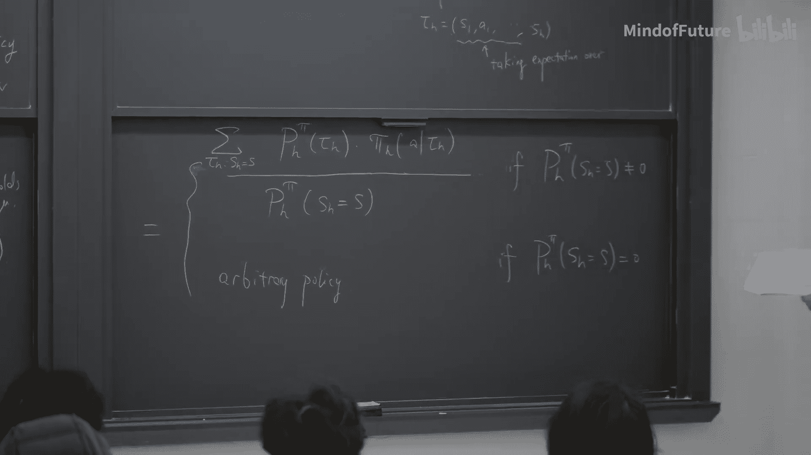

# 002：贝尔曼方程 🧠

在本节课中，我们将要学习强化学习的核心数学工具——贝尔曼方程。我们将首先回顾马尔可夫决策过程的基本概念，然后证明一个关键命题，即在不失一般性的情况下，我们可以只关注马尔可夫策略。接着，我们将深入探讨如何利用贝尔曼方程进行策略评估，并最终推导出用于寻找最优策略的贝尔曼最优方程。

## 回顾与预备知识

上一节我们介绍了马尔可夫决策过程的基本公式。本节中，我们来简要回顾一下。

一个MDP包含以下元素：
*   **状态集合** (S)
*   **动作集合** (A)
*   **奖励函数** (R)
*   **转移概率/矩阵** (P)
*   **最终时间步长** (H) - 在本课程中，我们主要讨论分幕式设定。

我们还讨论了环境和策略。
*   **环境** 通常指代元素 (P, R)。今天我们首先讨论环境已知的情况。
*   **策略** 有两种类型：
    *   **马尔可夫策略**：策略 π 由 H 个函数组成。每个函数 π_h 将当前状态 s 映射到动作集 A（确定性策略）或动作集上的概率单纯形（随机性策略）。其形式为：`π = (π_1, π_2, ..., π_H)`。
    *   **一般策略**：策略 π_h 的映射依赖于整个历史 `τ_h = (s_1, a_1, ..., s_h)`，而不仅仅是当前状态 s_h。

最后，我们定义了价值函数。
*   **状态价值函数 V^π_h(s)** 定义为：从第 h 步状态 s 开始，遵循策略 π 所能获得的期望累积奖励。公式为：`V^π_h(s) = E_π[ Σ_{h'=h}^{H} R_{h'}(s_{h'}, a_{h'}) | s_h = s ]`。
*   **动作价值函数 Q^π_h(s, a)** 定义为：从第 h 步状态 s 并执行动作 a 开始，然后遵循策略 π 所能获得的期望累积奖励。公式为：`Q^π_h(s, a) = E_π[ Σ_{h'=h}^{H} R_{h'}(s_{h'}, a_{h'}) | s_h = s, a_h = a ]`。

需要强调的是，`V^π_h(s)` 的定义明确适用于马尔可夫策略。对于一般策略，未来的累积奖励可能依赖于整个历史，因此价值函数通常需要定义为 `V^π_h(τ_h)`。然而，在第一步 (h=1)，由于没有更早的历史，`V^π_1(s_1)` 的定义对两种策略都适用。

我们的目标是找到一个最优策略 π*，以最大化初始状态的价值 `V^π_1(s_1)`。

## 命题一：马尔可夫策略的充分性 🔄

上一节我们提到了策略的复杂性。本节中，我们将证明一个关键命题，它表明在MDP中，我们可以只关注马尔可夫策略。

**命题一**：对于任何一般策略 π，都存在一个马尔可夫策略 μ，使得在初始状态 s_1 下的价值相等，即 `V^π_1(s_1) = V^μ_1(s_1)`。

这个命题的直接推论是：**至少存在一个最优策略是马尔可夫策略**。因此，在后续关于MDP的讨论中，我们将只关注马尔可夫策略。

### 证明

我们通过构造法来证明。目标是构造一个马尔可夫策略 μ，使其与给定的一般策略 π 具有相同的“访问度量”。

**访问度量**：定义 `P^π_h(s, a)` 为从初始状态 s_1 开始，遵循策略 π，在第 h 步访问到状态-动作对 (s, a) 的概率。价值函数可以重写为：
`V^π_1(s_1) = Σ_{h=1}^{H} Σ_{s,a} P^π_h(s, a) * R_h(s, a)`
因此，如果两个策略在所有 (s, a, h) 上的访问度量 `P_h(s, a)` 都相同，那么它们的初始价值就相同。

**构造马尔可夫策略 μ**：
对于每个步数 h 和状态 s，我们如下定义 μ_h(a|s)：
`μ_h(a|s) = [ Σ_{τ_{h-1}: s_h=s} P^π(τ_{h-1}) * π_h(a | τ_{h-1}) ] / P^π_h(s)`
其中，分母 `P^π_h(s)` 是遵循 π 在第 h 步访问到状态 s 的概率。如果 `P^π_h(s) = 0`（即 π 永远不会访问该状态），则 μ_h(·|s) 可以任意定义（例如均匀分布）。
直观上，这个构造是对所有能以状态 s 结束的历史轨迹，按其概率对 π 在该历史下的动作选择进行加权平均。

**证明 μ 与 π 具有相同的访问度量**：
我们通过对步数 h 进行归纳法来证明 `P^μ_h(s) = P^π_h(s)` 且 `P^μ_h(s, a) = P^π_h(s, a)`。

*   **基例 (h=1)**：由于初始状态 s_1 固定，显然有 `P^μ_1(s_1) = P^π_1(s_1) = 1`。根据 μ 的构造，`P^μ_1(s_1, a) = μ_1(a|s_1) = π_1(a|s_1) = P^π_1(s_1, a)`。
*   **归纳步骤**：假设对于步数 h，有 `P^μ_h(s) = P^π_h(s)` 和 `P^μ_h(s, a) = P^π_h(s, a)` 对所有 s, a 成立。
    1.  首先证明 `P^μ_h(s, a) = P^π_h(s, a)` 对 h 成立（这实际上是归纳假设的一部分，但我们可以验证构造的一致性）：
        *   左边：`P^μ_h(s, a) = P^μ_h(s) * μ_h(a|s)`。
        *   右边：`P^π_h(s, a) = Σ_{τ_{h-1}: s_h=s} P^π(τ_{h-1}) * π_h(a | τ_{h-1})`。
        根据 μ_h 的构造，两者相等。
    2.  然后证明 `P^μ_{h+1}(s') = P^π_{h+1}(s')`：
        `P^μ_{h+1}(s') = Σ_{s,a} P^μ_h(s, a) * P(s' | s, a)` （利用MDP的马尔可夫性）
        `= Σ_{s,a} P^π_h(s, a) * P(s' | s, a)` （根据归纳假设）
        `= P^π_{h+1}(s')`。
        由此，结合 μ 的构造，也可推出 `P^μ_{h+1}(s', a') = P^π_{h+1}(s', a')`。

归纳完成，因此构造的马尔可夫策略 μ 与一般策略 π 在所有步数上具有相同的状态-动作访问概率，从而 `V^π_1(s_1) = V^μ_1(s_1)`。证毕。

## 贝尔曼方程与策略评估 ⚙️

既然我们可以专注于马尔可夫策略，接下来的问题就是：给定一个固定的马尔可夫策略 π，如何高效计算其价值 `V^π_1(s_1)`？这就是**策略评估**问题。

一种朴素的方法是直接根据定义，对所有可能的轨迹进行求和。但轨迹数量是 `(S*A)^H` 量级的，计算成本是指数级的，不可行。

高效计算的关键在于利用MDP的马尔可夫结构，通过**动态规划**实现。其核心是**贝尔曼方程**。

### 贝尔曼方程

贝尔曼方程建立了相邻步数价值函数之间的关系：

1.  **状态价值与动作价值的关系**：
    `V^π_h(s) = Σ_{a ∈ A} π_h(a|s) * Q^π_h(s, a)`
    这个方程说明，一个状态的价值是其所有可能动作价值的概率加权平均。

2.  **动作价值的递归关系**：
    `Q^π_h(s, a) = R_h(s, a) + Σ_{s' ∈ S} P_h(s' | s, a) * V^π_{h+1}(s')`
    这个方程说明，一个状态-动作对的价值等于即时奖励加上下一状态期望价值的折扣（此处折扣因子为1）。
    我们引入简洁记号：`[P_h V^π_{h+1}](s, a) = E_{s'∼P_h(·|s,a)}[ V^π_{h+1}(s') ]`。因此上式可写为：
    `Q^π_h(s, a) = R_h(s, a) + [P_h V^π_{h+1}](s, a)`

### 动态规划进行策略评估

利用贝尔曼方程，我们可以通过反向递归（动态规划）高效计算 `V^π_1(s_1)`：

1.  **初始化**：设置终端后一步的价值为零，`V^π_{H+1}(s) = 0`（对于所有状态 s）。
2.  **反向递归**：对于步数 h = H, H-1, ..., 1：
    a.  对于所有状态-动作对 (s, a)，计算：
        `Q^π_h(s, a) = R_h(s, a) + [P_h V^π_{h+1}](s, a)`
    b.  对于所有状态 s，计算：
        `V^π_h(s) = Σ_{a ∈ A} π_h(a|s) * Q^π_h(s, a)`
3.  **得到结果**：递归完成后，即得到 `V^π_1(s_1)`。

这个动态规划算法的复杂度是多项式级别的，与步数 H 呈线性关系，远优于指数级的朴素方法。

## 贝尔曼最优方程与最优策略 🏆

策略评估是第一步，我们的最终目标是找到**最优策略** π*，使得初始价值最大化：`π* = argmax_π V^π_1(s_1)`。

受贝尔曼方程的启发，我们猜想最优策略应该满足一个类似的方程，但将“平均”操作替换为“最大化”操作。

### 贝尔曼最优方程

我们定义最优价值函数 `V*_h(s)` 和 `Q*_h(s, a)`，它们满足以下**贝尔曼最优方程**：

1.  `V*_h(s) = max_{a ∈ A} Q*_h(s, a)`
2.  `Q*_h(s, a) = R_h(s, a) + [P_h V*_{h+1}](s, a)`

与策略评估的贝尔曼方程相比，第一个方程中的求和 `Σ π(a|s)[·]` 被替换为了最大化 `max_a[·]`。

### 从最优方程到最优策略

根据贝尔曼最优方程，我们可以自然地导出一个确定性策略 π*：
`π*_h(a|s) = 1, 如果 a = argmax_{a' ∈ A} Q*_h(s, a')；否则为 0。`
（若最大值对应多个动作，可任意选择其一）。

可以验证，这个策略 π* 的贝尔曼方程与贝尔曼最优方程完全相同，因此有：
`V*_h(s) = V^{π*}_h(s)`，`Q*_h(s, a) = Q^{π*}_h(s, a)`。
即，贝尔曼最优方程的解正是这个特定策略 π* 的价值函数。

### 命题二：最优性证明

我们现在证明一个更强的命题：上述策略 π* 是**一致最优的**，即对于所有步数 h 和所有状态 s，都有：
`V^{π*}_h(s) = max_{π ∈ (马尔可夫策略)} V^π_h(s)`
当 h=1, s=s_1 时，这就是我们最初的最优策略定义。

**证明**（反向归纳法）：
*   **基例**：在 h = H+1 步，`V^{π*}_{H+1}(s) = 0 = max_π V^π_{H+1}(s)`。
*   **归纳假设**：假设对于 h+1 步，`V^{π*}_{h+1}(s) = max_π V^π_{h+1}(s)` 对所有 s 成立。
*   **归纳步骤**：
    1.  **证明 Q^{π*}_h(s, a) 是最优的**：
        `max_π Q^π_h(s, a) = R_h(s, a) + max_π [P_h V^π_{h+1}](s, a)`
        根据归纳假设，`V^{π*}_{h+1}` 在所有状态上都达到了最大价值。因此，最大化策略 π 在所有下一个状态 s‘ 上都能同时达到最大值（即都是 π*）。这使得我们可以交换 max 和期望算子：
        `max_π [P_h V^π_{h+1}](s, a) = [P_h (max_π V^π_{h+1})](s, a) = [P_h V^{π*}_{h+1}](s, a)`
        所以，`max_π Q^π_h(s, a) = R_h(s, a) + [P_h V^{π*}_{h+1}](s, a) = Q^{π*}_h(s, a)`。
    2.  **证明 V^{π*}_h(s) 是最优的**：
        `max_π V^π_h(s) = max_π Σ_a π_h(a|s) Q^π_h(s, a)`
        由于 Q^π_h(s, a) 只依赖于未来策略（步数 > h），我们可以将最大化分解。利用上一步结论，最优未来策略是 π*，且最优动作是最大化 `Q^{π*}_h(s, a)` 的动作：
        `max_π V^π_h(s) = max_{π_h} Σ_a π_h(a|s) * (max_{π_{>h}} Q^π_h(s, a)) = max_{π_h} Σ_a π_h(a|s) * Q^{π*}_h(s, a)`
        这个最大化在确定性策略（将全部概率质量赋予使 `Q^{π*}_h(s, a)` 最大的动作 a）时取得。这正是 π*_h 的定义。因此：
        `max_π V^π_h(s) = max_a Q^{π*}_h(s, a) = V^{π*}_h(s)`。
*   归纳完成，证毕。

## 总结 📚

本节课中我们一起学习了强化学习的理论基础：
1.  **马尔可夫策略的充分性**：在马尔可夫决策过程中，寻找最优策略时，只需考虑马尔可夫策略，因为任何一般策略的性能都可以被某个马尔可夫策略匹配。
2.  **策略评估与贝尔曼方程**：给定一个固定策略，可以通过贝尔曼方程进行动态规划，高效计算其价值函数，避免了直接枚举轨迹的指数复杂度。
3.  **最优策略与贝尔曼最优方程**：最优价值函数满足贝尔曼最优方程，该方程将均值操作替换为最大化操作。通过求解贝尔曼最优方程（或等价地，进行最优策略的动态规划），我们可以得到一个确定性马尔可夫策略，该策略在所有状态和所有步数上都是一致最优的。

这些概念和方程构成了解决已知环境MDP问题的规划算法的核心。在接下来的课程中，我们将探讨如何计算最优策略的具体规划算法，并开始讨论更具挑战性的场景——当环境未知时，如何利用数据来学习并做出决策。