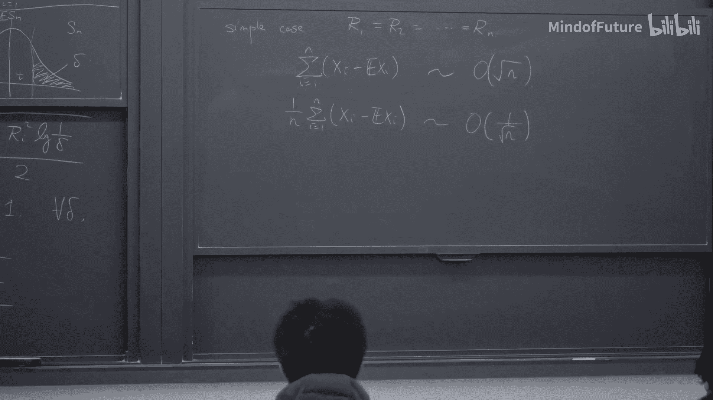
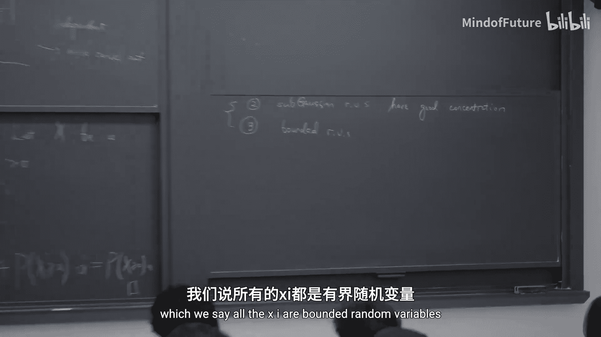
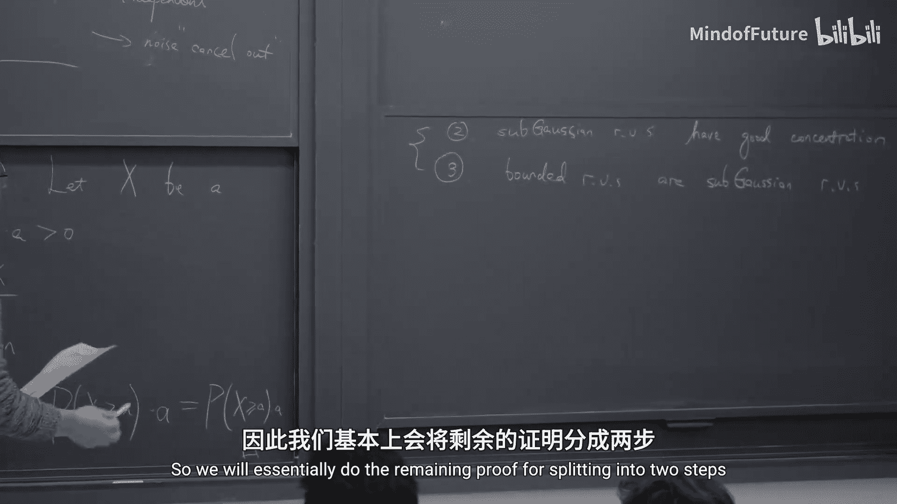
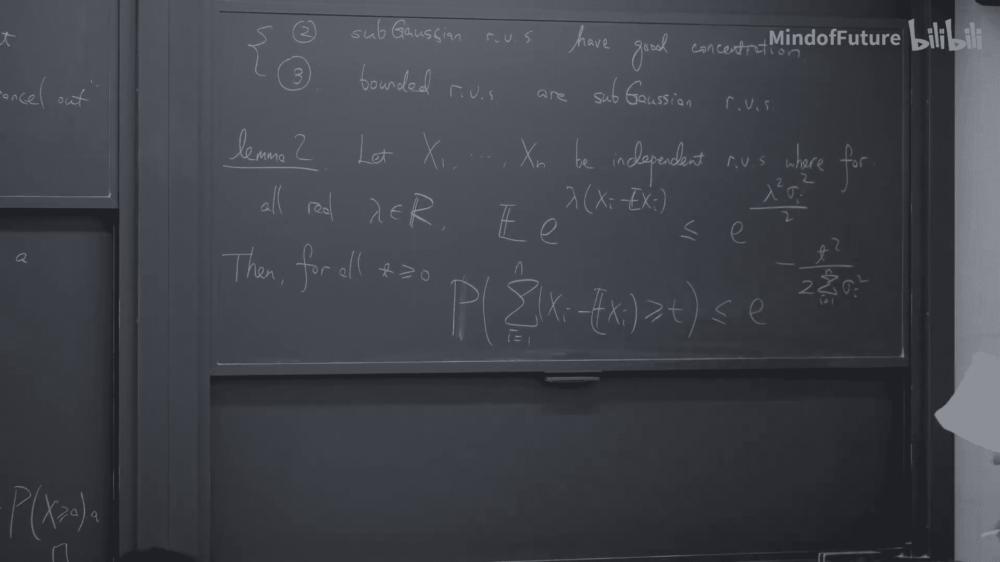

# 004：集中不等式

在本节课中，我们将要学习集中不等式，特别是霍夫丁不等式和伯恩斯坦不等式。这些不等式描述了独立随机变量之和与其期望值之间的偏差概率，是理解随机过程收敛性和后续强化学习算法理论保证的基础。

## 霍夫丁不等式

上一节我们介绍了集中不等式的概念，本节中我们来看看一个核心的不等式：霍夫丁不等式。



霍夫丁不等式指出：令 `X1, X2, ..., Xn` 为独立的随机变量。以概率1保证，每个 `Xi` 被限制在区间 `[ai, bi]` 内。定义 `Ri = bi - ai` 为每个区间的长度。

那么，对于任意 `t ≥ 0`，我们有：
```
P( Σ_{i=1}^{n} (Xi - E[Xi]) ≥ t ) ≤ exp( -2t² / Σ_{i=1}^{n} Ri² )
```
这个不等式本质上是一个尾界。如果我们把随机变量之和 `Sn = Σ_{i=1}^{n} Xi` 看作一个分布，那么这个不等式表明，`Sn` 偏离其期望值超过 `t` 的概率非常小，呈指数级衰减。正因为概率质量都集中在期望值附近，所以它被称为“集中”不等式。

我们可以通过变量替换，将这个不等式写成另一种常用形式。令 `δ = exp( -2t² / Σ_{i=1}^{n} Ri² )`，我们可以解出 `t`。





在相同条件下，对于任意 `δ > 0`，以至少 `1 - δ` 的概率，我们有：
```
| Σ_{i=1}^{n} (Xi - E[Xi]) | ≤ √( ( Σ_{i=1}^{n} Ri² ) * log(2/δ) / 2 )
```
这个形式更直接地告诉我们，在很高的概率下，总波动量不会超过一个由 `Ri` 和 `δ` 决定的阈值。



为了理解这个结论的意义，我们可以考虑一个简单情况：假设所有 `Ri` 都相等，即 `R1 = R2 = ... = Rn = R`。那么总波动的上界大致为 `O(√n)`。如果我们考虑平均值，其波动上界则为 `O(1/√n)`。

这个结论是非平凡的。考虑一个随机游走过程，每一步的波动是独立的。如果没有独立性（例如完全正相关），总波动可能以 `O(n)` 的速度增长。但正是因为这些波动是独立且随机的，它们会相互抵消，使得总和的增长被限制在 `O(√n)` 的量级。这也意味着，随着样本数 `n` 的增加，样本平均值将以 `1/√n` 的速度收敛到期望值，这在一定意义上恢复了（弱）大数定律。

## 霍夫丁不等式的证明思路

接下来，我们来看看如何证明霍夫丁不等式。证明过程分为三个引理，这是整个集中不等式理论的核心。

**第一步：马尔可夫不等式**
这是一个基础的不等式。令 `X` 为一个非负随机变量，那么对于任意标量 `a > 0`，有：
```
P(X ≥ a) ≤ E[X] / a
```
这个证明很直接，通过将期望积分在 `X ≥ a` 的区域进行下界放缩即可得到。虽然它也是一个尾界，但比霍夫丁不等式要宽松得多（衰减速度是 `1/a` 而非指数衰减）。我们将用它作为起点。

**第二步：次高斯随机变量的性质**
我们引入一个抽象条件来定义一类具有良好集中性质的随机变量，称为次高斯随机变量。

令 `X1, X2, ..., Xn` 为独立随机变量。如果对于任意实数 `λ`，满足以下矩生成函数条件：
```
E[ exp( λ (Xi - E[Xi]) ) ] ≤ exp( λ² σi² / 2 )
```
那么，对于任意 `t ≥ 0`，我们有集中不等式：
```
P( Σ_{i=1}^{n} (Xi - E[Xi]) ≥ t ) ≤ exp( -t² / (2 Σ_{i=1}^{n} σi²) )
```
这个引理是证明的关键。它表明，只要随机变量满足这个“次高斯”条件，其和就有指数级的集中性。之所以称为“次高斯”，是因为满足此条件的随机变量，其分布尾部的衰减速度至少和正态分布一样快。正态分布和有界随机变量都属于次高斯族。

证明的核心技巧是利用指数函数和独立性。我们想估计 `P( Σ (Xi - E[Xi]) ≥ t )`。对于任意 `λ > 0`，利用指数函数的单调性，该概率等于 `P( exp(λ Σ (Xi - E[Xi])) ≥ exp(λt) )`。然后对其应用马尔可夫不等式。接着，利用独立性，将和的期望转化为乘积的期望：`E[ Π exp(λ (Xi - E[Xi])) ] = Π E[ exp(λ (Xi - E[Xi])) ]`。这时，我们可以代入次高斯条件给出的上界。最后，通过优化选择参数 `λ` 来得到最紧的界，完成证明。

**第三步：有界随机变量是次高斯的**
最后一步是搭建桥梁，证明霍夫丁不等式前提下的有界随机变量满足次高斯条件。

如果随机变量 `X` 以概率1落在区间 `[a, b]` 内，定义 `R = b - a`。那么，对于任意实数 `λ`，有：
```
E[ exp( λ (X - E[X]) ) ] ≤ exp( λ² R² / 8 )
```
这表明，有界随机变量是次高斯的，且对应的参数 `σ² = R²/4`。证明主要通过计算其对数矩生成函数 `ψ(λ) = log E[ exp(λ (X - E[X])) ]`，并利用泰勒展开进行分析。可以证明 `ψ(0)=0`，`ψ'(0)=0`，且 `ψ''(λ)` 有上界 `R²/4`，从而得到结论。

结合引理二和引理三，我们就完成了霍夫丁不等式的证明：有界随机变量是次高斯的（引理三），次高斯随机变量之和有良好的集中性（引理二），因此有界独立随机变量之和满足霍夫丁不等式。

## 伯恩斯坦不等式

霍夫丁不等式虽然强大，但有时可能不是最紧的界。下面我们介绍另一个常用的集中不等式：伯恩斯坦不等式。它在方差较小时能提供更精确的估计。

令 `Xi` 为独立随机变量，以概率1满足 `|Xi - E[Xi]| ≤ R`。此外，我们增加一个更强的条件：每个 `Xi` 的方差有界，即 `Var(Xi) ≤ σ²`。

那么，对于任意 `t ≥ 0`，有：
```
P( Σ_{i=1}^{n} (Xi - E[Xi]) ≥ t ) ≤ exp( -t² / (2 Σ σ² + (2/3) R t) )
```
同样，我们可以将其转化为高概率形式：以至少 `1 - δ` 的概率，
```
| Σ_{i=1}^{n} (Xi - E[Xi]) | ≤ C * ( √( Σ σ² * log(1/δ) ) + R * log(1/δ) )
```
其中 `C` 是某个绝对常数。

与霍夫丁不等式 `O( √( Σ R² log(1/δ) ) )` 的界相比，伯恩斯坦不等式的主要项 `√( Σ σ² log(1/δ) )` 依赖于方差而非区间长度 `R`。当方差 `σ²` 远小于 `R²` 时，伯恩斯坦不等式给出的界更紧。

**例子：不公平硬币**
假设每个 `Xi` 服从伯努利分布 `Bernoulli(p)`，即 `P(Xi=1)=p`, `P(Xi=0)=1-p`。那么有：
*   范围 `R = 1`
*   方差 `Var(Xi) = p(1-p) ≤ p`

应用霍夫丁不等式到样本均值，得到的主要项为 `O( √( log(1/δ) / n ) )`。
应用伯恩斯坦不等式，得到的主要项为 `O( √( p * log(1/δ) / n ) )`。
当 `p` 很小时（例如一个很稀有的事件），伯恩斯坦不等式给出的界要比霍夫丁不等式好得多。

## 鞅差序列的集中不等式

到目前为止，我们讨论的都要求随机变量相互独立。但在序列决策和强化学习中，独立性往往是一个过强的假设。我们需要将集中性推广到更弱的条件上，这就是鞅差序列。

直观上，鞅差序列放松了独立性的要求。我们不再要求 `ξ1, ξ2, ...` 相互独立，而是要求一个条件期望为零的条件：对于任意 `i`，有
```
E[ ξi | ξ1, ξ2, ..., ξ_{i-1} ] = 0
```
这意味着，尽管下一步的噪声 `ξi` 的分布可能依赖于过去的历史（即不独立），但在给定所有过去信息的情况下，它的期望值始终为零。

**例子**
考虑一个长度为2的序列 `ξ1, ξ2`。
*   `ξ1` 以等概率取 `-1` 或 `1`。
*   `ξ2` 的分布依赖于 `ξ1`：
    *   若 `ξ1 = 1`，则 `ξ2` 以0.5概率取 `-1`，0.5概率取 `1`。
    *   若 `ξ1 = -1`，则 `ξ2` 以概率1取 `0`。
显然，`ξ1` 和 `ξ2` 不独立，因为 `ξ2` 的分布随 `ξ1` 变化。
但是，我们可以验证：`E[ξ2 | ξ1=1] = 0`，且 `E[ξ2 | ξ1=-1] = 0`。因此，这个序列满足鞅差条件。

对于鞅差序列，只要每个 `ξi` 是有界的（或满足次高斯等条件），我们仍然可以推导出与独立情形类似的集中不等式，其和的波动同样被 `O(√n)` 所控制。这为分析强化学习中的时序差分误差等非独立随机过程提供了理论基础。我们将在后续课程中看到它的应用。

本节课中我们一起学习了集中不等式的核心内容。我们首先深入探讨了霍夫丁不等式及其证明思路，理解了有界独立随机变量之和的波动如何被有效控制。接着，我们介绍了在方差信息已知时可能更紧的伯恩斯坦不等式。最后，我们将视野扩展到独立性之外，引入了鞅差序列的概念，为处理强化学习中常见的依序相关随机过程做好了准备。这些不等式是分析随机算法收敛性和性能保证的基石。