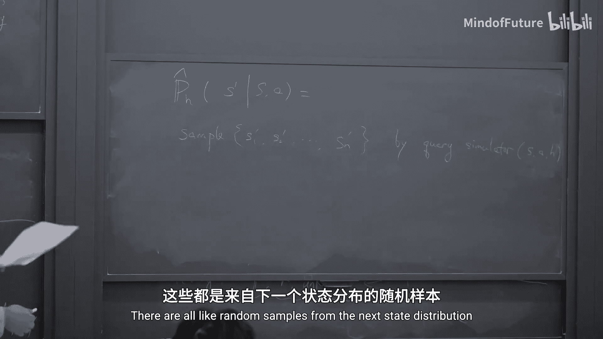

# 005：鞅与集中不等式

在本节课中，我们将学习一种比独立随机变量更弱的条件——鞅差序列，并探讨在此条件下随机变量和依然具有的集中性质。我们首先会回顾并正式定义鞅差序列与鞅，然后介绍并证明适用于鞅差序列的集中不等式（Azuma-Hoeffding 和 Azuma-Bernstein 不等式）。最后，我们将简要讨论这些理论工具在强化学习学习问题中的应用场景。

## 回顾与直观理解


上一节我们介绍了独立随机变量的集中不等式，本节中我们来看看在更弱条件下——即随机变量不再独立，但满足所谓的“鞅差”条件时，集中现象是否依然存在。

首先，我们回顾一下鞅差的非正式定义。我们观察一系列随机变量 `K_i` 的和（从 `i=1` 到 `N`）。在鞅差序列中，`K_i` 不再要求是独立同分布的，它只要求一个条件：给定过去发生的所有事情（即 `K_1` 到 `K_{i-1}`），当前随机变量 `K_i` 的条件期望为零。用公式表示这个关键思想：
```
E[ K_i | 过去 ] = 0
```
我们称满足此条件的序列 `{K_i}` 为鞅差序列。

在上一讲的例子中，我们有两个不独立的随机变量 `Ca1` 和 `Ca2`，但通过验证，我们确认它们满足 `E[Ca2 | Ca1] = 0`，因此构成了一个鞅差序列。


鞅差序列的和（称为鞅）同样展现出集中现象。虽然每一步的分布可能依赖于过去的路径（导致不同的实现轨迹），但由于每一步在给定过去后的期望为零，大量的“正负抵消”仍然会发生，最终和的增长幅度会受到控制，类似于独立情形的平方根级别增长。

## 鞅的正式定义

为了更严谨地讨论，我们需要引入一些数学定义。直观上，“过去”可以用到当前时刻为止的所有随机性来刻画。数学上，这通过“滤子”（Filtration）来实现。

假设有一列递增的 σ-代数（或称滤子）`F_1 ⊆ F_2 ⊆ ... ⊆ F_n`。你可以将 `F_i` 理解为包含了到时间 `i` 为止所有可能观测到的随机事件的信息。

我们称随机变量序列 `{C_i}, i=1 to n` 是关于滤子 `{F_i}` 的**鞅差序列**，如果满足以下两个条件：
1.  **可测性**：`C_i` 是 `F_i` 可测的（即 `C_i` 的值由到时间 `i` 的信息决定）。
2.  **条件期望为零**：对于所有 `i`，有 `E[ C_i | F_{i-1} ] = 0`。

常见的滤子选择是 `F_i = σ(C_1, ..., C_i)`，即由前 `i` 个随机变量生成的 σ-代数。这直观地对应了“所有过去的随机性”。滤子也可以包含其他外部随机变量，只要满足上述两个条件即可。

基于鞅差序列，我们可以定义**鞅**：序列 `{S_i}, i=1 to n` 是一个鞅，当且仅当它可以表示为鞅差序列的部分和，即 `S_i = Σ_{j=1}^{i} C_j`，其中 `{C_j}` 是鞅差序列。

## Azuma-Hoeffding 不等式

有了鞅差序列的定义，我们现在可以陈述其集中不等式。结果表明，对于鞅差序列，我们可以得到与 Hoeffding 不等式非常相似的结果，只是前提条件从“独立”放松为“鞅差”。

**定理 (Azuma-Hoeffding 不等式)**：
假设 `{C_i}, i=1 to n` 是关于滤子 `{F_i}` 的鞅差序列。并且，对于所有 `i`，`C_i` 以概率 1 被限制在某个长度为 `R_i` 的区间内（即 `|C_i| ≤ R_i/2`）。
那么，对于任意 `t > 0`，有：
```
P( Σ_{i=1}^{n} C_i ≥ t ) ≤ exp( - (2 t^2) / (Σ_{i=1}^{n} R_i^2) )
```
这个界限在形式上与 Hoeffding 不等式完全相同。注意，由于鞅差序列已隐含均值为零，所以不等式直接针对和本身。

### 证明思路

Azuma-Hoeffding 不等式的证明框架与独立情形的 Hoeffding 不等式证明类似，都依赖于三个引理：
1.  **马尔可夫不等式**：无需修改。
2.  **次高斯变量和的性质**：这是需要加强的关键部分。我们需要证明，对于鞅差序列，其和的矩母函数依然能被类似地控制。
3.  **有界随机变量是次高斯的**：这个引理只涉及单个随机变量，与独立性无关，因此可以直接沿用。

证明的核心在于加强第二个引理。我们利用鞅差序列的条件期望性质，通过“从后往前”逐层取条件期望的技巧，将 `E[exp(λ Σ C_i)]` 的界化为 `exp(λ^2 Σ σ_i^2 / 2)` 的形式，其中 `σ_i^2` 与 `R_i` 有关。具体地，对于有界鞅差，可以取 `σ_i^2 = (R_i^2)/4`。最终代入优化后，即得到 Azuma-Hoeffding 不等式。

## Azuma-Bernstein 不等式

类似地，我们也有适用于鞅差序列的 Bernstein 型不等式，它在方差较小时能提供比 Hoeffding 型更紧的界。

**定理 (Azuma-Bernstein 不等式)**：
假设 `{C_i}, i=1 to n` 是关于滤子 `{F_i}` 的鞅差序列，并且：
1.  以概率 1 有 `|C_i| ≤ R`。
2.  条件方差有界：`Var( C_i | F_{i-1} ) ≤ σ_i^2`。
那么，对于任意 `t > 0`，有：
```
P( Σ_{i=1}^{n} C_i ≥ t ) ≤ exp( - t^2 / (2 Σ_{i=1}^{n} σ_i^2 + (2/3) R t) )
```
这与标准的 Bernstein 不等式形式一致，主要优势在于当方差之和 `Σ σ_i^2` 远小于 `nR^2` 时，能给出更尖锐的衰减率。

## 集中不等式总结

到目前为止，我们已经学习了四种重要的集中不等式：
1.  **Hoeffding 不等式**：适用于独立且有界的随机变量。
2.  **Bernstein 不等式**：适用于独立、有界且方差已知的随机变量，当方差较小时更优。
3.  **Azuma-Hoeffding 不等式**：将 Hoeffding 的前提条件放松为鞅差序列。
4.  **Azuma-Bernstein 不等式**：将 Bernstein 的前提条件放松为鞅差序列。

这些工具将在后续的统计估计和强化学习算法分析中发挥重要作用。

## 并界 (Union Bound)

在进入强化学习应用之前，我们介绍一个简单但使用频繁的概率工具——并界。

**命题 (并界)**：
对于任意事件 `A` 和 `B`，有：
```
P(A ∪ B) ≤ P(A) + P(B)
```
直观上，事件 `A` 或 `B` 发生的概率，不超过它们各自发生概率之和。

一个常用的推论是：如果我们有 `n` 个事件 `A_1, ..., A_n`，且每个事件都以高概率成立，即 `P(A_i) ≥ 1 - δ`，那么所有这些事件**同时成立**的概率下界为：
```
P( ∩_{i=1}^{n} A_i ) ≥ 1 - nδ
```
**证明**：考虑补集事件。所有 `A_i` 同时成立的补集是至少有一个 `A_i` 不成立。利用并界：
```
P( ∪_{i=1}^{n} A_i^c ) ≤ Σ_{i=1}^{n} P(A_i^c) ≤ Σ_{i=1}^{n} δ = nδ
```
因此，所有事件同时成立的概率 `P(∩ A_i) = 1 - P(∪ A_i^c) ≥ 1 - nδ`。

在后续分析中，我们通常会先用集中不等式证明某个单步或单个估计以高概率成立，然后利用并界来保证所有步骤或所有状态-动作对上的估计同时以高概率成立，只需付出一个 `n` 倍的因子代价。

## 通向强化学习学习问题

我们之所以深入研究集中不等式，是因为我们不仅对 MDP 的规划感兴趣，更对其**学习**问题感兴趣。接下来，我们将从最简单的学习设置开始——生成模型或模拟器设置。

回忆一个 MDP 由 `(S, A, P, R, H)` 构成。在规划中，我们假设 `P` 和 `R` 已知。在学习中，它们未知，我们需要通过收集样本来学习。

在**表格化设置**中，我们假设状态空间 `S` 和动作空间 `A` 是有限的。

**模拟器设置**是一种数据收集协议。你可以将模拟器视为一个黑箱：
*   **输入**：状态 `s`，动作 `a`，步数 `h`。
*   **输出**：下一个状态 `s‘`（从 `P_h(·|s,a)` 中随机抽取）和奖励 `r = R_h(s,a)`（为简化，假设奖励是确定性的）。

直观上，模拟器允许你“传送”到任何状态-动作对进行查询。这与更困难的**在线设置**（必须从初始状态重新开始）和**离线设置**（只给定固定数据集）形成对比。

强化学习学习问题的目标是找到一个策略 `π_hat`，使其在初始状态 `s1` 上的价值接近最优价值：
```
V_1^{π_hat}(s1) ≥ V_1^*(s1) - ε
```
一个重要的问题是**样本复杂度**：为了以高概率找到 `ε-最优` 策略，我们需要向模拟器进行多少次查询？

一个直接的算法策略是：
1.  **估计模型**：对每个 `(s,a,h)`，查询模拟器 `n` 次，用经验频率估计转移概率 `P_h(·|s,a)`。
    ```
    P_hat(s‘|s,a,h) = (1/n) Σ_{i=1}^{n} I( s_i‘ = s‘ )
    ```
2.  **规划**：将估计的 `P_hat` 和已知的 `R` 代入贝尔曼最优方程，进行值迭代或策略迭代，得到贪婪策略 `π_hat`。



这个算法被称为**基于模型的强化学习**或**经验模型值迭代**。在下一讲中，我们将利用本节课学习的集中不等式和并界，来分析这个算法的样本复杂度，即需要多少样本 `n` 才能保证输出策略是 `ε-最优` 的。

## 总结

本节课中我们一起学习了：
1.  **鞅差序列与鞅**的正式定义，其核心是给定过去后，下一步增量的条件期望为零。
2.  **Azuma-Hoeffding 不等式**和**Azuma-Bernstein 不等式**，它们将经典的集中不等式推广到了鞅差序列的情形。
3.  简单而强大的**并界**及其推论，用于联合控制多个高概率事件。
4.  强化学习**学习问题**的起点——**模拟器设置**，以及一个最简单的基于模型估计的学习算法框架。

这些数学工具为我们分析强化学习算法的样本复杂度和性能保证奠定了坚实的基础。从下一讲开始，我们将具体分析上述算法的理论性质。