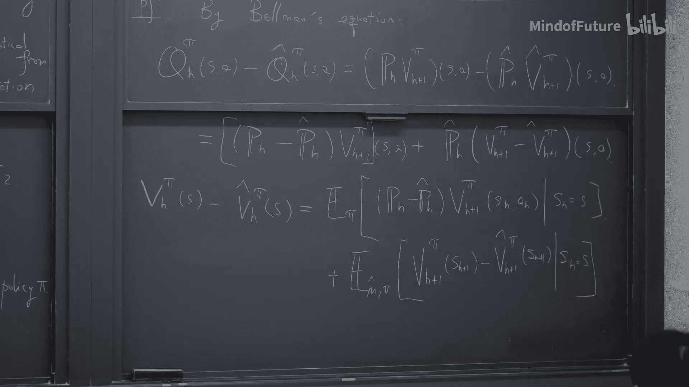

# 006：生成模型

在本节课中，我们将学习在模拟器（生成模型）设置下的价值迭代算法，并深入探讨其首个统计性能保证定理。我们将理解该算法如何工作，以及需要多少样本才能确保学习到一个接近最优的策略。

---

## 算法回顾：模拟器中的价值迭代

上一节我们介绍了在规划任务（已知转移和奖励）中的价值迭代算法。本节中，我们来看看在模拟器设置下的情况。关键区别在于，我们现在不知道真实的转移概率。

因此，算法分为两个主要阶段：
1.  **估计转移模型**：通过查询模拟器来估计转移概率。
2.  **执行价值迭代**：基于估计的转移模型，使用贝尔曼最优方程计算最优价值函数和策略。

以下是算法的具体步骤：

### 第一阶段：估计转移概率

对于每个状态-动作-步数三元组 `(s, a, h)`，我们查询模拟器 `N` 次，收集 `N` 个下一状态样本 `s’_1, s’_2, …, s’_N`。

我们使用经验频率来估计转移概率：

**公式**：
`P_hat_h(s’ | s, a) = (1/N) * Σ_{i=1 to N} 1[s’_i = s’]`

其中 `1[·]` 是指示函数。这为我们提供了对真实转移概率 `P_h` 的估计 `P_hat_h`。

### 第二阶段：基于估计模型进行价值迭代

有了估计的转移模型 `P_hat` 后，我们将其视为真实模型，并执行标准的基于贝尔曼最优方程的价值迭代。

对于步数 `h = H, H-1, …, 1`，我们进行以下更新：

**公式**：
`Q_hat*_h(s, a) = R_h(s, a) + Σ_{s’} P_hat_h(s’ | s, a) * V_hat*_{h+1}(s’)`
`V_hat*_h(s) = max_a Q_hat*_h(s, a)`

最终，我们输出由 `Q_hat*` 诱导的贪婪策略：

**公式**：
`π_hat(s, h) = argmax_a Q_hat*_h(s, a)`

直观上，当样本数 `N` 趋于无穷时，根据大数定律，`P_hat` 会收敛到真实的 `P`。此时，第二阶段就是在真实模型上进行规划，因此算法是渐近正确的。

---

## 理论保证：样本复杂度

我们不仅关心算法的渐近行为，更希望知道需要多少样本才能以高概率获得一个 `ε`-最优策略。以下是我们的第一个统计保证定理。

**定理 1**：
存在一个绝对常数 `C`，使得如果我们为每个 `(s, a, h)` 对选择的样本数 `N` 满足：
`N ≥ C * (H^4 * ζ) / ε^2`
其中 `ζ = log(HSA / p)`（一个对数因子），那么，以至少 `1 - p` 的概率，价值迭代算法输出的策略 `π_hat` 是 `ε`-最优的。

**定义**（ε-最优策略）：
一个策略 `π_hat` 是 ε-最优的，如果其初始状态价值与最优策略价值的差距小于 ε：
`V*_1(s1) - V^{π_hat}_1(s1) ≤ ε`

### 对定理的解读

以下是关于该定理样本复杂度的几个关键点：

1.  **总样本复杂度**：由于我们需要对每个 `(s, a, h)` 收集 `N` 个样本，总查询次数为 `N * S * A * H`。代入 `N` 的界限，总样本复杂度为 `Õ( H^5 * S * A / ε^2 )`。这里的 `Õ` 符号隐藏了对数因子。

2.  **与模型参数的关系**：转移模型 `P` 本身有 `S^2 * A * H` 个参数（每个 `(s,a)` 对应一个在 `S` 上的分布）。但我们的样本复杂度仅线性依赖于状态数 `S`，而不是平方项 `S^2`。这揭示了一个深刻见解：**为了学习一个好的策略，我们不需要精确估计整个转移矩阵，只需保证对某些特定值函数（后续证明中会出现）的估计足够准确即可**。这是强化学习样本效率高于简单模型学习的关键。

3.  **ε 依赖**：误差 `ε` 以 `1/ε^2` 的形式缩放。这是统计学中由集中不等式导出的典型速率。若要精度提高10倍，则需要约100倍的样本。

4.  **H 依赖**：当前分析得到 `H^5` 的依赖，但通过更精细的分析可以改进到 `H^4`，并且存在下界证明 `H^4` 的依赖在信息论意义下是最优的，无法进一步降低。部分 `H` 的幂次来源于价值函数本身的量级（范围是 `0` 到 `H`）。

---

## 定理证明概览

定理的证明基于两个核心引理。我们将看到第一个引理如何将价值误差与转移误差联系起来，第二个引理如何利用集中不等式来约束转移误差。

### 引理 1：价值差分解

对于任意策略 `π` 和任意状态-步数对 `(s, h)`，以下等式成立：
`V^π_h(s) - V_hat^π_h(s) = E_{M_hat, π} [ Σ_{i=h}^{H} (P_i - P_hat_i) V^π_{i+1} (s_i, a_i) | s_h = s ]`

**解释**：
*   `V^π` 是在真实 MDP `M` 下的价值。
*   `V_hat^π` 是在估计的 MDP `M_hat`（使用 `P_hat` 作为转移）下的价值。
*   期望 `E_{M_hat, π}` 表示在策略 `π` 和转移模型 `P_hat` 下，对未来轨迹（状态和动作）求期望。
*   等式右边是沿着 `M_hat` 生成的轨迹，对各步的转移误差 `(P_i - P_hat_i)` 与真实价值函数 `V^π_{i+1}` 的乘积进行累加。

这个引理的证明直接通过对贝尔曼方程进行展开和代数重组即可得到。它精确地将两个 MDP 中同一策略的价值差异，表达为各步转移模型差异的加权和。

### 引理 2：转移估计的集中性

对于固定的 `(s, a, h)` 和一个值域在 `[0, H]` 的**固定**值函数 `V`，我们有如下概率保证：
以至少 `1 - p/(HSA)` 的概率，以下不等式成立：
`| (P_h(·|s,a) - P_hat_h(·|s,a)) · V | ≤ C * H * sqrt(ζ / N)`
其中 `ζ = log(HSA / p)`，`·` 表示点积（即 `Σ_{s’} P(s’) * V(s’)`）。

**解释**：
*   这个引理衡量了使用经验估计 `P_hat` 来计算值函数 `V` 的期望时，与使用真实 `P` 计算时的差异。
*   它来源于霍夫丁不等式等集中性工具的应用（在作业1中已证明）。
*   **关键点**：此界限适用于**固定的**或与样本 `P_hat` **独立的**随机值函数 `V`。如果 `V` 可以依赖于 `P_hat`（对抗性的），则界限会变差，需要 `sqrt(S)` 倍的样本。强化学习的效率增益正源于我们只需要对一类“好”的（独立或固定的）值函数保证估计准确，而非对所有可能的值函数。

### 定理证明的主要步骤

1.  **分解目标**：我们想证明 `V*_1(s1) - V^{π_hat}_1(s1) ≤ ε`。通过加减 `V_hat*_1(s1)` 和 `V_hat^{π_hat}_1(s1)`，将其分解为三部分：
    *   `A = V*_1(s1) - V_hat*_1(s1)`
    *   `B = V_hat^{π_hat}_1(s1) - V^{π_hat}_1(s1)`
    *   `C = V_hat*_1(s1) - V_hat^{π_hat}_1(s1)`

2.  **处理 C**：由于 `π_hat` 是 MDP `M_hat` 中的最优策略，而 `π*` 是 `M` 中的最优策略，在 `M_hat` 中 `π_hat` 至少和 `π*` 一样好，因此 `C ≤ 0`。

3.  **利用引理1 bound A 和 B**：
    *   对于 `A`，直接应用引理1，其中策略 `π = π*`。此时 `V^π*` 是真实 MDP 的最优价值函数，是固定的，与样本无关。因此我们可以对每个 `(s,a,h)` 应用引理2，并通过联合界保证所有 `(s,a,h)` 同时成立。最终得到 `A ≤ O(H² * sqrt(ζ / N))`。
    *   对于 `B`，同样应用引理1，其中策略 `π = π_hat`。这里的挑战在于 `V^{π_hat}` 依赖于策略 `π_hat`，而 `π_hat` 又依赖于所有样本 `P_hat`，看似不满足引理2的独立性条件。但关键观察是：`V^{π_hat}_{h+1}` 这个值函数只依赖于 `π_hat` 在步数 `h+1` 及之后的决策，而这些决策又只依赖于用于估计 `P_hat_{h+1}, …, P_hat_H` 的样本。由于不同步数的样本是独立采集的，用于估计 `P_hat_h` 的样本与用于计算 `V^{π_hat}_{h+1}` 的样本是独立的。因此，在每一步 `h`，我们可以将 `V^{π_hat}_{h+1}` 视为一个与当前步的估计样本 `P_hat_h` 独立的值函数，从而仍然可以应用引理2。最终得到 `B ≤ O(H² * sqrt(ζ / N))`。

4.  **综合结果**：将 `A` 和 `B` 的界限相加，并代入定理中对 `N` 的要求 `N ≥ C * H^4 * ζ / ε^2`，可以推出 `A + B ≤ ε`。结合 `C ≤ 0`，即得 `V*_1 - V^{π_hat}_1 ≤ ε`，定理得证。

---

## 扩展：Q-learning 算法简介

价值迭代是一种“批处理”算法：先收集所有数据估计模型，再进行规划。在实践中，另一种非常流行的算法是 **Q-learning**，它采用在线、增量式更新。

Q-learning 的核心更新公式如下：

**公式**：
`Q_{t+1}(s, a) = (1 - α_t) * Q_t(s, a) + α_t * [r + max_{a’} Q_t(s’, a’)]`

**解释**：
*   `α_t` 是学习率。
*   算法不显式估计转移模型 `P`。
*   每得到一个转移样本 `(s, a, r, s’)`，就立即用该样本产生的 TD 目标 `r + max_{a’} Q_t(s’, a’)` 来更新当前的 Q 值估计。
*   通过精心设计的学习率衰减（如 `α_t = 1/t`），可以平均掉噪声，使 Q 值收敛到最优 Q 函数。

与价值迭代相比，Q-learning 的优点是无模型、更易于在线部署。但其样本复杂度分析通常更为复杂。在接下来的课程中，我们将进一步探讨 Q-learning 及其在更具挑战性的在线探索场景中的应用。

---

## 总结

本节课中我们一起学习了：
1.  **模拟器设置下的价值迭代算法**：通过先估计转移模型，再基于估计模型进行规划来求解最优策略。
2.  **首个样本复杂度定理**：证明了该算法只需 `Õ( H^5 * S * A / ε^2 )` 总样本即可以高概率找到 `ε`-最优策略，并详细解读了其与模型参数、精度和步数的依赖关系。
3.  **定理证明的核心思想**：
    *   使用引理1将策略价值误差分解为各步转移误差的累积。
    *   使用引理2（集中不等式）控制转移误差对特定值函数的影响。
    *   巧妙利用不同步数样本的独立性来处理最优策略 `π_hat` 的随机性。
4.  **关键洞见**：强化学习之所以比全模型估计更样本高效，是因为学习一个好策略不需要在任意值函数下都精确估计转移模型，只需保证对（独立或固定的）最优或相关值函数的估计足够准确即可。
5.  **Q-learning 简介**：作为另一种基础算法，它通过增量式在线更新来学习最优 Q 函数，为后续学习无模型和在线探索方法奠定了基础。