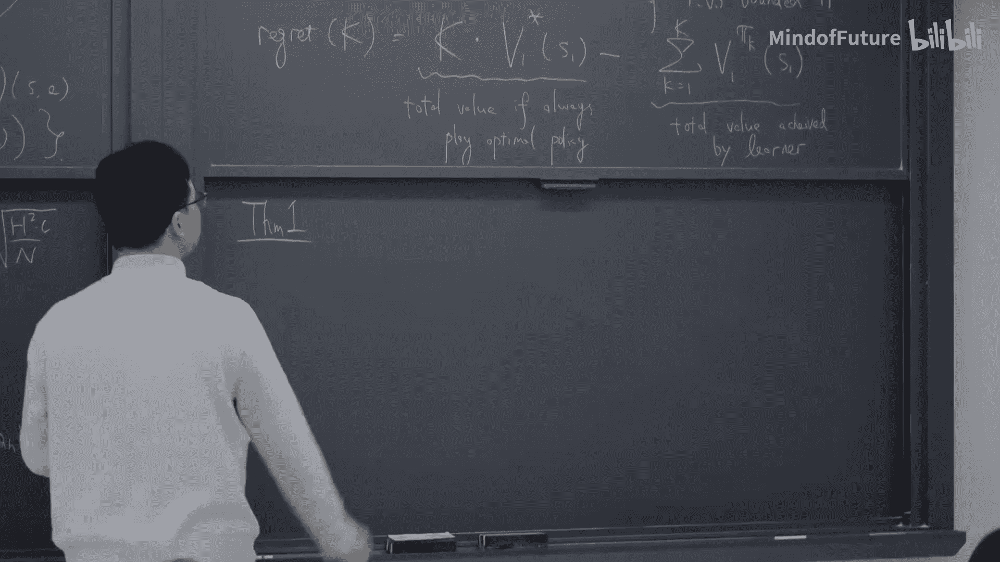

# 009：探索策略

在本节课中，我们将要学习如何在强化学习环境中进行有效的探索。上一节我们介绍了在多臂老虎机问题中的探索策略，本节中我们来看看如何将这些思想应用到更复杂的强化学习场景中。

## 概述

在上一讲中，我们讨论了多臂老虎机中的探索问题。具体来说，我们介绍了两种算法：ε-贪心（或ε-first）算法和上置信界算法。我们看到，ε-贪心算法只是简单地以ε的概率随机尝试动作，而上置信界算法通过计算一个上置信界（即均值加上一个奖励项）来更好地平衡探索与利用。事实证明，在多臂老虎机设置中，ε-贪心算法的遗憾度约为 T^(3/4)，而UCB算法则能获得更好的性能。

今天，我们将讨论强化学习场景下的探索问题。在强化学习场景中，我们注意到探索比多臂老虎机更具挑战性。具体来说，我们讨论了一个反例——组合锁问题。在这个问题中，如果我们进行随机探索或使用ε-贪心算法，我们至少需要付出指数级于时间范围 H 的代价才能首次识别出最优策略。在这种情况下，可以很容易地证明遗憾度将是线性的，直到 T 大于 A^H 的量级。这是非常糟糕的结果。

因此，本讲将讨论如何将更好的探索思想融入到强化学习中。基本思路是将UCB思想与强化学习算法相结合。通过结合我们用于强化学习的值迭代算法和UCB，我们将再次获得类似 √T 且关于 H 是多项式的遗憾度。这就是我们将要讨论的算法。

## UCB-VI 算法

整个思路与多臂老虎机中的UCB算法非常相似，我们不只是看均值，还会添加一个奖励项。这个算法被称为UCB-VI算法，即上置信界值迭代算法。

算法首先初始化一个数据集 D，我们称之为数据集。假设它是空的，因为当我们开始算法时，我们没有任何数据，没有观察到任何轨迹。我们初始化 Q_H(s, a) = H。这很重要，因为我们总是希望保持对最优值函数的上界，所以我们将其初始化为 H。回想一下我们的归一化条件，我们假设每一步的奖励在0到1之间，因此可以实现的最大值是 H。

我们还将初始化 V_{H+1}(s) = 0。这是在第 H+1 步的值，我们知道在第 H+1 步之后没有奖励，所以它总是等于0。

主算法由以下两个部分组成。

在探索设置中，我们需要运行 K 个回合。

在每个回合中，我们做两件主要的事情。第一步是计算每一步值的上置信界。思路基本上是做贝尔曼更新加上奖励项。

所以我们再次进行值迭代，从最后一步开始到第一步。我们从 H 到 H-1，一直到1。

我们首先检查这个状态-动作对 (s, a, h) 是否已经在数据集 D 中。如果在数据集中，我们可以计算经验估计，我们再次使用经验平均值作为我们的估计。

我们使用在数据集中观察到 (s, a, s‘) 的次数除以在步骤 h 观察到 (s, a) 的次数。这些都是计数。

唯一的区别是，在模拟器设置或生成模型设置中，我们遍历所有状态-动作对，所以我们可以保证这是一个固定的数字。现在因为我们在进行探索，有时我们可能永远无法访问某些状态-动作对，所以那个计数可能为零，我们将以其他方式处理。

所以只要这个计数不为零，我们就可以使用经验平均值来估计转移概率。

然后我们所做的就是进行值更新，并进行一些截断，以保证我们得到的值永远不会大于 H，这是我们的上界。

然后我们使用贝尔曼更新，并用经验估计的 P_hat 替换转移概率 P。这是一个标准的值更新。

我们的修改是，除了做这个，我们还添加了一个奖励项。这个奖励项只是 N_h(s, a) 的函数，即我们在每一步观察到 (s, a) 的次数。

基本上，这一步我们只是进行值迭代，但用经验估计替换转移概率，并添加一些奖励项，同时进行一些截断。

在另一种情况下，如果我们没有在数据集中观察到 (s, a, h)，我们就不进行这个更新步骤。Q 值将保持为初始化的 Q 值，即 H。所以它仍然是定义良好的。Q 值是定义良好的，只是不是根据这个更新规则，它只是 H。

所以这是 Q 值的贝尔曼更新。接下来我们将进行 V 值的贝尔曼更新。

V_h(s) = max_{a in A} Q_h(s, a)。同样，对于任何已经观察到的 (s, a)，Q 值在这里定义。如果 (s, a) 还没有被观察到，Q 值将是初始化的 Q 值。所以这个 V 值也是一个定义良好的量。

基本上，这整个部分就是我们如何计算值的上置信界。核心思想很简单，我们只是在 Q 值更新中添加一个奖励项。

还有其他变体。我们稍后会看到，这个奖励项类似于 c * H^2 * sqrt(log项 / n)。在某些情况下，例如当 n 不是很大时，比如我们只观察到一两个值，我们可能会添加很多奖励项。在这种情况下，我的 Q 值会变得非常大。当我们讨论如何构造这个奖励项时，它会累积并影响到下一步。我认为我们构造这个奖励项的主要原因是希望它是一个上界。如果中间的 Q 值变得非常大，那么它会损害整个关于它如何成为上界的证明，因为本质上我们想要做一些构造。我们稍后会看到原因，但主要是为了确保这个 Q 值得到很好的控制，不会变得极端大，并且在集中性和统计误差方面一切表现良好。

我认为如果我们不添加这个奖励项，这种情况就不会发生，只有这个奖励项才能使这个 Q 值变得非常大。这就是为什么在早期的模拟器设置中，我们不进行这种截断。

好的，这是关于我们如何计算UCB的部分。但在多臂老虎机中，计算UCB后的另一步是，我们将根据上置信界采取贪心动作。在多臂老虎机设置中，我们基本上计算每个臂的上置信界，然后选择具有最高上置信界的臂。这里本质上是相同的，我们将根据这个 Q 值采取贪心动作。

所以对于 h 从 1 到 H，我们将采取动作 a_h = argmax_{a in A} Q_h(s_h, a)。我们将观察下一个状态 s_{h+1} 和奖励 r_h。

然后我们只需将这个元组添加到数据集中。D = D ∪ { (s_h, a_h, r_h, s_{h+1}) }。

所以第二部分本质上是执行贪心策略。

你可以认为这只是UCB算法的强化学习MDP版本。你不是给每个臂的值添加奖励项，而是在贝尔曼更新中添加奖励项，从而计算 Q 值的上界，然后你根据这个 Q 值的上界采取贪心策略。

D 是用于计算计数的数据集。N_h(s, a) 基本上就是我在数据集中观察到 (s, a) 在步骤 h 的次数。

奖励项 b(n) 是我们的选择。我们稍后会讨论。

基本上，我们已经在这里提到了我们对奖励项的选择。奖励项只是计数的函数，即我们在步骤 h 观察到这个 (s, a) 对的次数。

这个选择将等于某个常数 c 乘以 sqrt( H^2 * υ / n )，其中 υ 是一些对数因子，比如 log(SAT / δ)。

我们实际上将展示为什么这种奖励项的构造是有效的，你会看到为什么会出现这样的东西。

本质上，这个奖励项反映了我们在观察了 n 次后对这个值的置信度。它某种程度上反映了随机变量的波动，其边界为 H，因为最终，这是根据值而定的随机变量。

在我们介绍了算法之后，我们现在将讨论我们可以为这个算法提供什么样的保证。

## 遗憾度分析

因为这是一个探索设置，我们还将讨论MDP中的遗憾度。在上一讲中，我们已经说过，一旦我们得到了遗憾度，我们可以很容易地将其转换为样本复杂度。所以遗憾度是更强的概念。

在MDP中，遗憾度可以定义为：截至第 K 轮的遗憾度 R(K) = Σ_{k=1}^{K} [ V_1^*(s_1^k) - V_1^{π_k}(s_1^k) ]。

这与多臂老虎机的定义相同，唯一的区别是用MDP的值替换了每个臂的奖励。

我们将要说的最重要的定理实际上是，我们可以以至少 1 - δ 的概率证明，UCB-VI 算法的遗憾度 R(K) 有上界：R(K) ≤ C * [ √(H^3 S A T υ) + H^3 S^2 A υ^2 ]，其中 T = K * H。

有时人们用 T 来写，因为 T 是你观察到的总步数。υ 再次是对数项。通常我们不关心它，它只是 log(SAT/δ)。我们可以把 H 也放进去，这并不重要。

所以请注意，这就像形式定理。但基本上，如果我们想知道主导项，这就像 √T 项，而这是与 T 无关的项。我们知道遗憾度在最坏情况下将是 K 的线性函数，所以 √K 已经是一些非平凡的结果。这是与 K 无关的常数项，所以这是低阶项。

我们真正完成的是我们可以实现这个保证。但最重要的是，我们不会像在随机探索或 ε-贪心中那样付出指数级于 H 的代价，在最坏情况下我们只付出关于 H 的多项式代价。

T 项是 K * H 的量级。T 正好等于 K * H。我说我们关心遗憾度是什么，所以这个项很重要。这是主导项，因为它是 √K 项。

现在我们将更多地讨论为什么这个算法会起作用。我们直观地说这只是类似于UCB的添加奖励项，实际上我们需要更具体一些并证明定理1。

为了做到这一点，我们将引入稍微多一点的符号，这样我们就不会混淆这些量。

我认为最重要的符号是添加一个上标 K。原因是，在这里我们基于新数据反复更新 Q 值，如果我们只说某个 Q 值，会有点混乱，因为在每个不同的回合，Q 值实际上是不同的。所以我们只是添加一个上标 K 来表示在第 K 回合计算出的量。

例如，我们有 N_{h,k}(s, a, s‘)。本质上，在算法中，我们有这个 N_h(s, a)。但在这里，为了非常具体地说明哪个回合出现了哪个数字，我们将在这里添加上标。这将表示为截至第 k 回合观察到的 (h, s, a, s’) 的次数。

类似地，我们还将使用 P_{h,k}(s‘| s, a) 表示在第 k 回合计算的经验转移矩阵。

以及第 k 回合的 Q 值，第 k 回合的 V 值。本质上，你只需要知道这些符号。这些是值。

最后，我们将说 s_{h,k}, a_{h,k}。我会说 s_{1,k}, a_{1,k}, ..., s_{H,k}, a_{H,k}。这是在第 k 回合收集的轨迹。

顺便说一下，我忘了提到我们需要小心一件事。在值迭代中，事实证明在回合制设置中，我们只进行一次值迭代扫描。但在这里的探索设置中，我们注意到在每个回合，我们收集一条新的轨迹，在收集一条新轨迹后，我们进行完整的值迭代扫描。这本质上就像我们在每个回合重新计算值迭代。

这最终可能成本很高，因为我们每个回合只观察一条轨迹，然而我们更新所有的值。我们更新所有的值，因为它可能与后面步骤的值相关。所以我们需要重新计算所有东西。这是非常耗时的。是的，每次完整的 VI 扫描的计算成本。

有了这个新符号，本质上我们证明定理1的方式与多臂老虎机中的UCB非常相似，我们基本上有两个步骤。

第一步，我们将证明 Q_{h,k}(s, a) 是 Q_h^*(s, a) 的上界。顾名思义UCB，本质上我们设计这个奖励项的方式，我们希望确保这是真的。

第二步，我们进行遗憾度分析。通过UCB，我们最终能够证明遗憾度小于所有奖励项的总和，再加上一些小项。

第二步对于这个讲座来说有点繁琐，涉及很多计算，所以我们将第二步留给讲义，如果你感兴趣，可以查看关于如何推导遗憾度界限的具体计算。所以在课堂上，我们将主要关注第一步，展示为什么我们的构造证明这是一个上界。

我们今天将在课堂上做这个。第二步将推迟到讲义中。

形式上，对于第一步，我们需要证明引理。本质上，我们只是让这个陈述更严谨。

我们说以至少 1 - δ 的概率，对于任何 s, a, h，在状态集、动作集内，且时间范围不超过 H，回合数不超过 K，我们有 Q_{h,k}(s, a) ≥ Q_h^*(s, a) 且 V_{h,k}(s) ≥ V_h^*(s)。

基本上，在所有步骤和所有回合中，我们总是以高概率保持我们计算的 Q 值始终是最优策略值的上界。

在我们继续证明之前，对这个陈述有什么问题吗？

本质上，强化学习的很多证明基本上都是通过归纳法进行的。所以在这里，我们再次使用归纳法。我们将从 H 到 1 进行归纳。

基本情况是第 H+1 步，因为在算法中，我们从不更新第 H+1 步的值。所以这意味着在每个回合，我在第 H+1 步的值将始终等于我们设置的初始值，即等于 0，也等于最优值。

所以基本情况非常简单直接。

现在，我们假设对于所有后面的步骤，我们已经保证 V_{h+1,k} 已经是 V_{h+1}^* 的上界。

现在，我们想通过归纳法证明对于每个步骤，我们仍然有这个值也是上界。我们分为两种情况。

第一种情况是，如果状态-动作对 (s, a, h) 不在 D_k 中。也就是说，这个 (s, a, h) 对在截至时间 k 的数据集中没有被观察到。在这种情况下，我们没有更新 Q_{h,k}，因为如果我们没有观察到它，我们基本上跳过了更新。

所以它将仍然保持为初始值，因此这个 Q_{h,k}(s, a) 将等于 H，即初始值。这显然是 Q_h^*(s, a) 的上界。

另一方面，如果我们观察到了这个对，那么我们将其分为两种情况。

如果我们已经知道截断后的值小于等于 H，那么 Q 值将等于 H，因为记得我们取两者中的最小值。它再次大于 Q_h^*(s, a)。

唯一非平凡的情况是另一种情况，即截断后的值实际上更小。所以最后一种情况我们需要做一点计算，这基本上是我们选择这个特定奖励项的原因。

我们看 Q_{h,k}(s, a) - Q_h^*(s, a)。根据更新方程，我们立即知道这个 Q_k 根据定义等于 r_h(s, a) + P_{h,k} V_{h+1,k}(s, a) + 奖励项 b(N_{h,k}(s, a))。

减去第二部分，根据贝尔曼方程，即 r_h(s, a) + P_h V_{h+1}^*(s, a)。

本质上，我们只是使用更新方程展开这个，使用贝尔曼方程展开那个，然后我们消去奖励项。

我们可以稍微重新排列项。我们说这等于 (P_{h,k} V_{h+1,k} - P_{h,k} V_{h+1}^*)(s, a) + (P_{h,k} - P_h) V_{h+1}^*(s, a) + 奖励项 b(N_{h,k}(s, a))。

我所做的只是减去这个 P_h V^* 并加回 P_h V^*。所以我没做任何事。我们只是将差值分解为两部分。

我们将这些项分解为两部分的最重要原因是，我们可以通过归纳法断定第一项大于等于 0。通过归纳法，我们知道这大于等于 0，因为我们知道对于未来的任何步骤，比如 h+1，我们已经假设这已经是一个上界。所以一旦这个 V_k 是 V^* 的上界，如果你只是对某个正的东西应用一些转移，这再次是一个正的东西。所以这将立即大于等于 0，这没问题。

所以为了使这个 Q_k 成为上界，我们需要确保的是第二项。我们希望确保第二项大于等于 0。

现在我们对这个项变得非常熟悉，因为本质上，我们想做的就是用奖励项来覆盖一些随机项，结果证明这就像独立随机变量的和，可能不是独立的，但像鞅差的和，最终我们可以说只要我们使用一些集中不等式。

更具体地说，我们可以说以至少 1 - δ 的概率，对于所有 k, h, s, a，我们有以下不等式： (P_{h,k} - P_h) V_{h+1}^*(s, a) ≤ C * √( H^2 υ / N_{h,k}(s, a) )，其中 H^2 本质上是 V 的尺度。我们知道它的边界是 H。

这只是由集中不等式得出的，本质上我们有许多项加在一起，我们取平均值，我们知道收敛速度类似于 1/√n，这就是为什么我们在这里放一个 1/√n。我们特意选择奖励项使其等于这个，或者可能大于这个某个常数因子。

我的意思是，所以这就像我们使用的霍夫丁不等式吗？我认为这本质上与我们在UCB场景中讨论的相同，如果你还记得，在UCB场景中，我们还需要做这种类型的集中性，我们说这本质上是一个霍夫丁不等式，唯一的区别是这里的 N_{h,k} 就像你拉动那个臂的次数在这里也是你访问 (s, a) 的次数是随机的。

这就是为什么你需要做一些更高级的技术，除了霍夫丁不等式，你还需要做 union bound，这与 UCB 中的类似论证相同，以处理计数 N_{h,k}(s, a) 中的随机性。

这本质上证明了我们对奖励项的选择，我们可以基本上把奖励项放在这里。并且我们说，以高概率，这将覆盖这个集中性项中发生的任何情况。

所以我们可以保证这大于等于 0。当然，证明中实际上还有一步。

最后一步非常快。一旦我们证明了对所有 s, a，有 Q_{h,k}(s, a) ≥ Q_h^*(s, a)，我们就说 V 值也是相同的。这意味着 V_{h,k}(s) = max_a Q_{h,k}(s, a) ≥ max_a Q_h^*(s, a) = V_h^*(s)。

本质上，我们可以用这个来完成归纳，一切就都完成了。

好的，正如我们所说，最终定理1的证明将只是一些遗憾度分析，因为我们已经证明了上界。然后我们可以利用这个事实来证明遗憾度 R(K) 小于等于奖励项的总和。

具体来说，是类似于从 1 到 K 对奖励项 b(N_{h,k}(s_{h,k}, a_{h,k})) 求和，我们只计算在第 k 回合访问的状态-动作的奖励项，再加上一些小项。我们将把这个留给讲义。

但我想强调，这通常是我们证明上界算法的方式，比如UCB算法，首先我们证明它是上界，然后我们说遗憾度以奖励项为上界。

所以我们可以从这里看到，如果我们只关心第一部分是上界，我们可以让奖励项变得非常大。例如，我总是选择 Q 值为 H。这显然是一个上界。

但问题是，最终遗憾度将以奖励项的某个常数为上界。所以在这种情况下，如果我们让上界非常宽松，这个奖励项也非常宽松，整个遗憾度就会受到很大影响。所以本质上，这里的关键点是我们希望使这个上界尽可能尖锐。所以在这种情况下，我们本质上使用集中不等式来做上界。

然后最终，我们可以基于此进行遗憾度分析。

## 奖励函数的设计

我想讨论的另一件事是奖励函数的设计。事实证明，这个UCB-VI算法中奖励函数的设计实际上很重要，因为这个奖励函数不仅影响分析，还影响算法，因为在算法中，我们明确需要将奖励项添加到值中，然后我们根据这个值的上界计算的贪心策略收集数据。

所以奖励函数的设计实际上影响算法和我们收集的数据或轨迹。这就是为什么它回到了前一点，我说我们本质上希望使用我们想要的最尖锐的奖励函数，但另一方面，它仍然应该是可计算的，不依赖于某些不可计算的量。

我们在讲座中介绍的方式，比如 b(n) = c * H * √(υ / n)，这基本上是我们之前做的。这本质上是由霍夫丁集中不等式设计的。

正如我们从集中不等式中学到的，我们实际上知道霍夫丁不等式不是最尖锐的集中不等式。很多时候，我们实际上可以做伯恩斯坦不等式，这实际上给出了更尖锐的界。事实证明，你也可以设计一个可证明的更尖锐的奖励项。

大概这会有所帮助，这里唯一的复杂性是因为伯恩斯坦不等式实际上取决于方差，而方差与霍夫丁不等式不同，霍夫丁不等式本质上是一个有界随机变量，我们知道它的边界是 H，所以我们直接把 H 放在这里。而这里我们本质上需要估计方差。

是的。所以这造成了更多的一些步骤，因为我们本质上不知道方差，所以我们需要估计方差，并将估计的方差用于我们的奖励项设计，分析也变得更加复杂。但最终，如果我们让一切正常工作，你实际上可以改进遗憾度中的 √H 因子。

我的意思是，实际上做一个更尖锐的奖励项确实有助于遗憾度。最初，我们得到类似 √(H^3 S A T) 的东西，现在我们得到 √(H^2 S A T)。

好的，到目前为止有什么问题吗？

## 回顾组合锁问题

在我们介绍了整个UCB-VI算法之后，我们想重新讨论一下我们谈到的困难实例，即组合锁问题，它对于探索来说非常困难。

如果你还记得，组合锁是一个两状态的MDP，本质上只有一个特定的动作序列最终会到达结束状态 S_0。其他所有动作都会导致吸收状态 S_1，并且永远不会返回。

所以我们说，如果我们只是做一些随机探索，这个问题实际上非常困难，因为我们采样到精确动作序列 a_1^*, a_2^*, a_3^*, ..., a_H^* 的机会是指数级小的，仅仅通过一些随机探索找到最优策略是极其困难的。

然而，我们可以看到，通过使用UCB，它实际上表现得更好，在某种意义上，它非常快地消除了不正确的动作。我们本质上将从所有值开始，比如 H 或 Q 值为 H。在我们观察了一些多个轨迹之后，例如，在这个步骤，如果我们观察到许多其他不同的动作，比如除了 a_3^* 之外的其他动作，我们注意到其他不是 a_3^* 的动作的 Q 值会非常快地下降。所以它会很快降到 0。这样，我们最终会非常快地消除不正确的动作。我们将逐步进行，最终我们将能够找到这个最优值。

所以，本质上，整个思路是，我们将再次使用动态规划类型的方法来找到最优策略。

这也说明组合锁问题实际上只对特定算法来说是困难的，比如对于随机探索，但对于精心设计的算法，例如UCB-VI，我们实际上可以保证不会遭受指数级 H 的代价，实际上我们可以在多项式时间内找到最优策略。

## Q-Learning with UCB

好的，所以这是关于我们如何将上置信界思想与值迭代相结合。

记住，在模拟器设置中，我们不仅讨论了值迭代，还讨论了 Q-学习算法，它进行增量更新。

我们也注意到在UCB-VI设置中，我们注意到有一个非常大的计算问题，比如在每个回合，我们需要进行完整的值迭代扫描，尽管我们只观察一条轨迹，但我们需要进行整个扫描。

所以本质上，我们将看到实际上我们也可以将 Q-学习与 UCB 结合起来，这个算法实际上将解决那个计算问题，成为真正的在线学习算法。

算法如下。这在我们 2018 年（或 2020 年）的论文中。

再次，我们初始化所有 Q 值为 H。N_h(s, a) = 0，即计数。对于所有 h, s, a。

我们进行完整的循环。即对于回合 k 从 1 到 K。我们首先接收第一个状态，初始状态 s_1。

然后，对于步骤 h 从 1 到 H。

我们不再将整个事情分解成两个大块，比如 VI 或收集数据。Q-学习的好处是，我们进行增量更新。所以每次我们收集一个新数据，我们会立即进行更新。

所以我们可以将采取轨迹与这个值更新结合起来。所以我们采取动作 a_h = argmax_a 我们当前维护的值。观察下一个状态。

我们将设置某个 t = N_h(s_h, a_h) 的计数，它将增加 1，因为我们观察到了这个 (s_h, a_h)。所以这个 N_h(s_h, a_h) 始终是计数，即我们在步骤 h 观察到这个 (s_h, a_h) 的次数。

最重要的部分是我们进行 Q 值更新。所以 Q_h(s_h, a_h) 更新为 (1 - α_t) * Q_h(s_h, a_h) + α_t * [ r_h + V_{h+1}(s_{h+1}) + 奖励项 b(t) ]，其中 b(t) 只依赖于这个 t。

同样，我们只是添加了这个奖励项，我们选择这个奖励项 b(t) = c * √( H^3 υ / t )，对 H 的依赖稍差一些。

然后我们只是将 V 值设为 Q 值的最大值，但截断为 H。就这样。

所以我们看到这里不需要计算 P_hat，即转移概率的估计。在整个 Q-学习中，我们实际上并不计算 P_hat。所以这通常被认为是一种无模型算法。

而且，我们只更新我们访问过的轨迹上的值。

因此，与进行完整的值迭代扫描（这需要重新计算所有状态、动作和 h 的值）不同，在这里我们只更新我们访问过的状态和动作的值。所以在计算上，这比 UCB-VI 快得多。

而且，请记住，我们具有这种选择性记忆的优势。

再次，这里的关键是。我们需要本质上放置更多的权重在后面的更新上，以减少方差。如果你还记得在类似设置中，这相当于选择学习率 α_t 为 O(1/t)。

我们注意到，如果选择为 1/t，这正好等于均匀平均。现在我把它设置得大于 1/t。这意味着我比之前的更新更重视后面的更新。

一旦我们这样做，一切就绪，我们将基本上能够证明下一个定理。

以至少 1 - δ 的概率，Q-学习 UCB 的遗憾度 R(K) 最多为 C * √( H^4 S A T υ )，其中 υ 再次是对数项。

我们还注意到，这个遗憾度比 UCB-VI 差一个 √H 因子。这是由于同样的原因，就像这是增量更新，类似于在模拟器、生成模型设置中，我们也观察到稍微更差的样本复杂度，因为我们本质上需要偏向后面的更新，所以我们知道我们处理噪声的效果不如 UCB-VI，UCB-VI 基本上记住所有数据并使用最小的方差。这里是在线更新，我们某种程度上在滚动丢弃数据。所以在样本复杂度方面，我们比 UCB-VI 效率低。

我想我们今天就在这里结束，所以从下一讲开始，我们将总结这个探索设置，然后开始讨论一些问题。

你说后面的权重更小？是的，α_t 总是需要递减，因为你拥有越来越多的样本。所以即使你进行均匀加权，你也应该期望 α_t 递减，因为如果你有 t 个数据，每个数据只获得 1/t 的权重；如果你有 2t 个数据，每个数据应该只有 1/(2t) 的权重，这就是均匀的。我认为在上一讲中，我们提到如果这是 1/t，通过做 (1 - α_t) 乘以前一个值加上 α_t 乘以新更新，你得到精确的均匀平均。无论你使它大于 1/t，那么它就像更重视后面的更新而不是前面的更新。

Q-学习比 UCB-VI 计算更快，但样本效率更低。所以，就每次更新的计算而言，它计算更快。但样本效率更低意味着它可能需要更多的回合。但总体而言，Q-学习不会，因为这只是在样本方面差一个 √H 因子。所以这意味着你本质上需要多 H 倍的回合，但每个回合你只计算一条轨迹，更新一条轨迹。而在 UCB-VI 中，你本质上进行完整的值迭代评估，你需要查看所有状态和所有动作。所以那里你本质上在计算上多了一个 S * A 因子。

所以那里有一个权衡，在下一讲中，我们将实际讨论这种权衡。

## 总结

本节课中我们一起学习了如何在强化学习中应用上置信界进行有效探索。我们首先回顾了多臂老虎机中的探索策略，然后将其思想扩展到更复杂的MDP环境中，介绍了UCB-VI算法。我们讨论了算法的步骤、奖励项的设计原理以及如何通过归纳法证明算法能提供值函数的上界。我们还分析了算法的遗憾度上界，并指出其避免了指数级代价。最后，我们探讨了组合锁例子，并简要介绍了结合Q-学习和UCB的在线算法及其权衡。