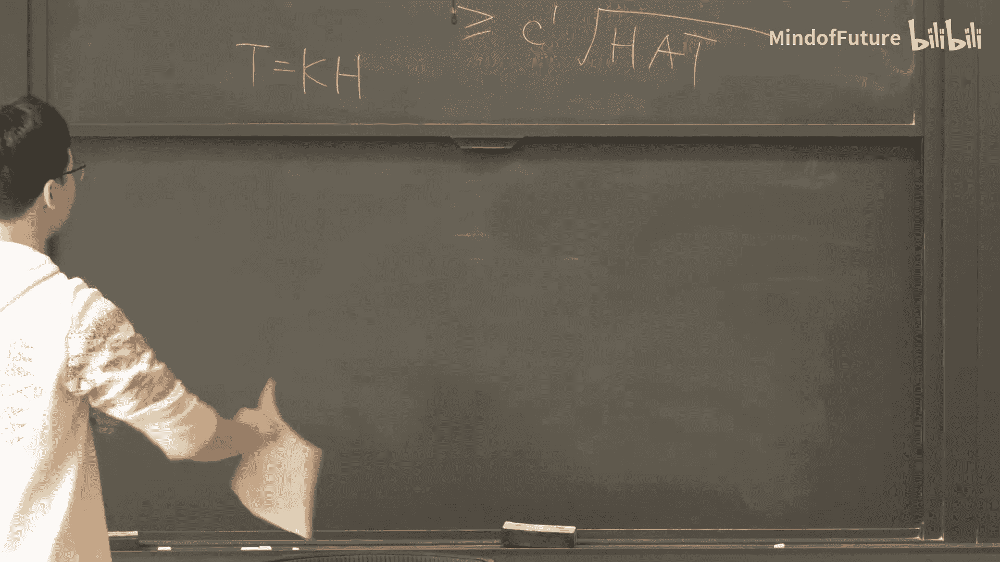
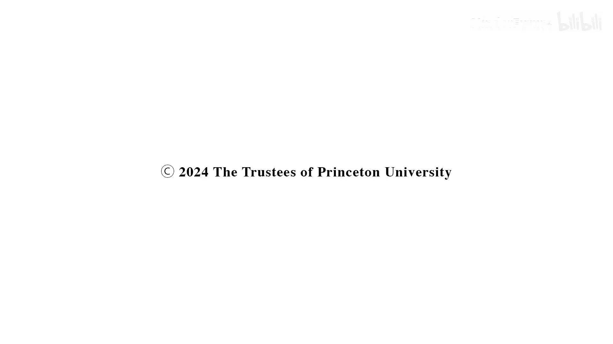

# 011：MDP的下界

## 概述
在本节课中，我们将继续探讨强化学习的下界问题。我们将首先回顾上一讲中为多臂老虎机问题建立下界的通用策略，然后将其思想扩展到马尔可夫决策过程，证明在平稳MDP设置下的遗憾下界。

## 上节回顾：多臂老虎机下界策略
上一节我们介绍了为任何随机算法建立下界的通用策略。其核心思想是通过“约简”，将针对随机算法的下界问题，转化为针对确定性算法在某个困难问题分布上的期望表现问题。我们不再需要为特定算法构造特定的困难实例，而是可以处理一个确定性算法在一个困难实例分布上的期望表现。

我们试图证明的定理如下：对于任何算法 **A**，都存在一个多臂老虎机问题，使得其在时间 **T** 内的遗憾下界为 **Ω(√(A T))**。

我们构造的困难实例是一个有 **A** 个臂的多臂老虎机问题。其中，大多数臂的奖励服从参数为 **1/2** 的伯努利分布，只有一个特殊的“好臂”其奖励服从参数为 **1/2 + ε** 的伯努利分布。这个好臂是从所有臂中均匀随机选取的。这就构成了我们的困难问题分布。

我们定义了以下符号：
*   **E***：对所有随机性（包括好臂的随机选取）取期望。
*   **E_a**：在臂 **a** 是好臂的条件下，对随机奖励取期望。
*   **E_0**：在没有好臂（即所有臂奖励均为 **1/2**）的条件下，对随机奖励取期望。
*   **R_1:T**：算法在前 **T** 轮中与环境交互所观察到的全部奖励序列。

## 遗憾计算与关键步骤
我们计算了算法在特定问题实例下的期望遗憾，其表达式为：
**Regret = εT - (1/A) Σ_{a=1}^{A} E_a[N_a]**
其中 **N_a** 是算法拉动臂 **a** 的次数。

我们的核心思路是比较 **E_a[N_a]** 和 **E_0[N_a]**。当 **ε** 很小时，算法很难区分是否存在好臂，因此我们期望 **E_a[N_a]** 不会比 **E_0[N_a]** 大很多。我们推导出以下关键不等式：
**E_a[N_a] - E_0[N_a] ≤ T * √(2 * KL(P_0 || P_a))**
这里 **KL(P_0 || P_a)** 是两种情形下观测历史分布之间的KL散度。

接下来，我们计算了这个KL散度。通过利用历史序列的条件独立性以及算法在给定历史下动作确定的事实，我们将其化简为：
**KL(P_0 || P_a) = E_0[N_a] * KL(Bernoulli(1/2) || Bernoulli(1/2+ε))**
其中 **KL(Bernoulli(1/2) || Bernoulli(1/2+ε)) ≈ 2ε²**（当 **ε** 很小时）。

## 完成下界证明
我们对所有臂 **a** 求和，并利用柯西-施瓦茨不等式，最终得到：
**Σ_{a=1}^{A} E_a[N_a] ≤ T + T * √(A * 2ε²)**

将这个上界代入遗憾表达式，我们得到：
**Regret ≥ εT * (1 - 1/A) - √(T/A) * √(2ε²AT)**

通过选择 **ε = c * √(A/T)**（其中 **c** 是一个小的常数），我们最终证明了遗憾的下界为 **Ω(√(A T))**。

## 扩展到马尔可夫决策过程
在证明了多臂老虎机的下界后，我们现在将其思想扩展到马尔可夫决策过程。我们关注的是**平稳MDP**（即转移概率不随时间步变化）的遗憾下界。目标是证明对于任何算法，都存在一个MDP，使得其经过 **K** 幕、每幕 **H** 步的期望遗憾下界为 **Ω(√(H S A K))**，这与一些算法（如UBE-VI）的上界相匹配。

### MDP困难实例构造
我们首先构造一个简单的三状态MDP困难实例，然后将其扩展到多状态情况。

考虑一个具有三个状态的MDP：状态 **0**，状态 **1**，状态 **2**。
*   在状态 **0**，有 **A** 个可选动作。其中一个特殊动作 **a*** 会以概率 **1/2 + ε** 转移到状态 **1**，以概率 **1/2 - ε** 转移到状态 **2**。所有其他动作都以概率 **1/2** 转移到状态 **1** 或 **2**。
*   状态 **1** 和状态 **2** 都是吸收状态（一旦进入，永远停留）。在状态 **1**，每一步获得奖励 **1**；在状态 **2**，每一步获得奖励 **0**。
*   初始状态固定为 **0**（通过对抗性初始化实现）。
*   特殊动作 **a*** 是从所有动作中均匀随机选取的。

### 与多臂老虎机的类比
观察这个MDP的第一幕：从状态 **0** 出发，选择一个动作。
*   如果选择了特殊动作 **a***，我们以概率 **1/2 + ε** 进入状态 **1**，并在剩余的 **H-1** 步中获得累计奖励 **H-1**；以概率 **1/2 - ε** 进入状态 **2**，获得累计奖励 **0**。
*   如果选择了其他动作，我们以概率 **1/2** 进入状态 **1**，获得 **H-1** 奖励；以概率 **1/2** 进入状态 **2**，获得 **0** 奖励。

这**本质上等同于一个多臂老虎机问题**，其中每个臂的“奖励”是 **0** 或 **H-1**，好臂产生高奖励的概率是 **1/2 + ε**，其他臂是 **1/2**。因此，每幕的期望遗憾缩放因子是 **H**（而不是多臂老虎机中的 **1**）。

### 扩展到多状态和总遗憾
对于具有 **S** 个状态的MDP，我们可以构造大约 **S/3** 个相互独立的上述三状态困难实例“分支”。通过对抗性初始化，我们可以将总共 **K** 幕均匀地分配到这些分支上（每个分支大约分配到 **K / (S/3)** 幕）。

每个分支本身会产生类似多臂老虎机的遗憾，缩放因子为 **H**。因此，总遗憾的下界约为：
**(S/3) * √(H * A * (K / (S/3))) = Ω(√(H S A K))**

这就完成了平稳MDP遗憾下界的证明概要。严格的证明需要像多臂老虎机案例中一样，进行详细的信息论（KL散度）计算，但核心的构造思想和缩放关系是清晰直观的。

## 总结
本节课我们一起学习了如何为强化学习问题建立下界。
1.  我们首先回顾了为多臂老虎机构造困难分布并利用信息论工具证明遗憾下界 **Ω(√(A T))** 的方法。
2.  接着，我们将这一框架扩展到平稳马尔可夫决策过程。通过构造一个简单的三状态MDP，我们展示了其第一幕的决策问题等价于一个奖励缩放 **H** 倍的多臂老虎机。
3.  通过将多个这样的独立实例组合，并利用对抗性初始化，我们最终论证了平稳MDP的遗憾下界为 **Ω(√(H S A K))**，这表明现有的一些算法在最坏情况下已经是最优的。

下节课，我们将进入表格型MDP的最后一个主题：离线强化学习，即如何仅利用已收集的数据来学习最优策略，而不再与环境进行在线交互。