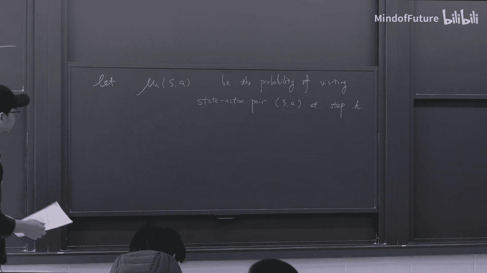
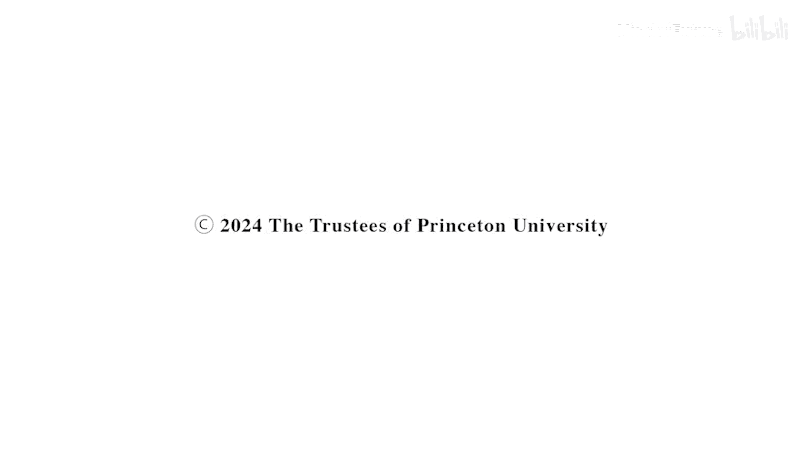

# 012：离线强化学习


在本节课中，我们将要学习离线强化学习。与之前讨论的在线交互学习不同，离线强化学习是从已有的、由其他策略收集的数据中学习最优策略。这种设置在实际应用中非常常见，例如在广告推荐系统中，公司不希望直接在线测试可能带来巨大损失的新策略，而是希望从历史数据中学习改进。

## 回顾强化学习的不同设置

首先，我们来回顾一下我们已经讨论过的几种强化学习设置。

以下是几种主要的设置：

1.  **规划**：在这种设置中，我们已经完全知晓环境的转移概率和奖励函数。这更像是一个纯粹的规划问题，目标是找到最优策略，而非学习。
2.  **生成模型**：在这种交互协议下，我们拥有一个模拟器。我们可以查询任何状态-动作对 `(s, a)`，模拟器会输出下一个状态 `s'` 和奖励 `r`。
3.  **在线强化学习**：在这种设置中，智能体必须从初始状态开始，通过与马尔可夫决策过程在线交互来收集数据。这涉及到探索与利用的权衡。
4.  **离线强化学习**：这是我们本节课的重点。在这种设置中，我们从一个已有的、由其他策略（称为行为策略）收集的数据集中学习，而不再与环境进行新的交互。



## 离线强化学习的设定

在离线强化学习中，我们假设存在一个行为策略 `π_b`，它被用来收集数据。这个策略可以是确定性的，也可以是随机的，甚至可以是由多个策略混合而成。我们得到的数据有两种常见形式：

1.  **完整轨迹数据**：我们拥有 `n` 条完整的轨迹 `τ_i`，每条轨迹的形式为 `(s_1^i, a_1^i, s_2^i, a_2^i, ..., s_H^i, a_H^i)`。
2.  **转移三元组数据**：我们拥有 `n` 个独立的三元组 `(s_h^i, a_h^i, s_{h+1}^i)`，它们代表了在某个时间步 `h` 发生的状态转移。

第二种设定比第一种更具挑战性，因为数据点之间可能缺乏连续性。为了简化，我们通常假设奖励函数 `R` 是已知的，因此学习的核心是估计状态转移概率 `P`。

## 数据覆盖性与可集中性

为了能够从离线数据中学习到一个好的策略，数据集必须具有足够的“覆盖性”，即它需要包含足够多不同类型的状态-动作对。一个直观的想法是，数据分布应该能够覆盖到最优策略可能访问到的状态-动作对。

为了形式化这个概念，我们引入**可集中性系数**。首先，定义数据分布 `μ_h(s, a)` 为在数据集中，在时间步 `h` 观察到状态-动作对 `(s, a)` 的（经验）概率。

一个非常强的假设是**全策略可集中性**。

**假设 1（全策略可集中性）**：存在一个常数 `C`，使得对于所有时间步 `h`、所有状态-动作对 `(s, a)` 以及**所有可能的策略** `π`，都有：
```
max_{h, s, a, π} [ P_π^h(s, a) / μ_h(s, a) ] ≤ C
```
其中 `P_π^h(s, a)` 表示遵循策略 `π` 时，在时间步 `h` 访问到 `(s, a)` 的概率。

这个假设要求数据分布 `μ` 必须覆盖**任何策略**可能访问到的所有状态-动作对，且概率不能太小。常数 `C` 衡量了覆盖的充分程度，`C` 越小表示覆盖越好。通常 `C` 不是绝对常数，而是与状态/动作空间大小相关。

## 朴素算法：基于经验转移的价值迭代

一个最直接的想法是使用经验转移概率 `\hat{P}` 来代替真实转移概率 `P`，然后运行标准的**价值迭代**算法。

**经验转移概率** `\hat{P}_h(s‘ | s, a)` 定义为在数据集中，观察到 `(s, a, s’)` 三元组的次数除以观察到 `(s, a)` 对的次数。

然后，我们通过以下贝尔曼更新方程来计算动作价值函数：
```
\hat{Q}_h(s, a) = R_h(s, a) + \sum_{s'} \hat{P}_h(s‘ | s, a) * \hat{V}_{h+1}(s’)
\hat{V}_h(s) = max_a \hat{Q}_h(s, a)
```
最终输出的策略 `\hat{π}` 是相对于 `\hat{Q}` 的贪婪策略。

## 理论保证

在强假设（全策略可集中性）下，这个朴素的算法是有效的。

**定理 1**：假设数据分布 `μ` 满足全策略可集中性假设（系数为 `C`）。那么，以至少 `1 - δ` 的概率，基于经验转移的价值迭代算法输出的策略 `\hat{π}` 是 `ε-最优` 的，只要每个时间步的转移三元组数量 `n` 满足：
```
n = O( (H^4 * S * C * log(1/δ)) / ε^2 )
```
其中 `H` 是时间步长度，`S` 是状态空间大小。

**证明思路**：证明结构与生成模型（模拟器）设置中的证明类似，主要分为两步：
1.  **价值差分解**：将最优策略在真实MDP和价值在估计MDP上的值函数差异，分解为各时间步转移概率差异的期望和。
2.  **浓度不等式**：利用霍夫丁不等式等工具， bound 经验转移与真实转移之间的差异。关键点在于，由于离线数据是预先收集的，我们需要通过**数据分割**的技术来确保用于估计 `\hat{P}_h` 的数据与用于计算 `\hat{V}_{h+1}` 的数据相互独立，从而应用浓度不等式。
3.  **应用可集中性假设**：将分解后的期望项中的访问概率 `P_π^h(s, a)` 用 `C * μ_h(s, a)` 替换，从而将 bound 与数据分布 `μ` 和经验计数 `n_h(s, a) ≈ n * μ_h(s, a)` 联系起来。
4.  **最终计算**：通过柯西-施瓦茨不等式等技巧，最终得到样本复杂度的上界。

这个定理表明，在足够强的数据覆盖假设下，即使使用非常朴素的算法，离线强化学习也是可行的。然而，全策略可集中性假设过于强烈，在现实中很难满足。

## 改进算法：悲观主义与单策略可集中性

上一节我们介绍了在全策略可集中性假设下朴素的VI算法。本节中我们来看看如何通过改进算法来放宽这个强假设。直觉来源于多臂老虎机问题。

在多臂老虎机中，全策略可集中性要求我们必须以一定频率拉动**每一个**摇臂。如果我们采用朴素算法（选择经验平均奖励最高的摇臂），那么这个假设是必要的。否则，如果一个次优摇臂被拉动的次数很少，其经验平均可能偶然很高，导致算法错误地选择它。

然而，存在一个更好的算法：**悲观主义**。具体来说，我们为每个摇臂计算一个**置信下界**，然后选择具有最高置信下界的摇臂。这个算法被称为**下界置信度算法**。

**直觉**：LCB算法只要求最优摇臂被拉动足够多次，使其置信区间足够窄、下界足够高。对于次优摇臂，即使其经验平均偶然很高，由于其数据量少导致置信区间很宽，其置信下界也会很低，因此不会被选中。这大大降低了对数据覆盖的要求。

将这种思想推广到一般的强化学习，我们得到**基于悲观价值迭代**的算法。

**算法：悲观价值迭代**
与朴素VI类似，但在贝尔曼更新中**减去**一个奖励加成项：
```
\hat{Q}_h(s, a) = R_h(s, a) + \sum_{s'} \hat{P}_h(s‘ | s, a) * \hat{V}_{h+1}(s’) - b_h(s, a)
\hat{V}_h(s) = max_a \hat{Q}_h(s, a)
```
其中奖励加成项 `b_h(s, a)` 可以设置为：
```
b_h(s, a) = c * H * sqrt( log(1/δ) / n_h(s, a) )
```
这里 `n_h(s, a)` 是数据中 `(s, a)` 对在步数 `h` 出现的次数。

与LCB对应，这个加成项是“悲观”的，因为它降低了那些数据支持不足的 `(s, a)` 对的Q值估计。

对应于这个更智能的算法，我们可以使用一个弱得多的假设：**单策略可集中性**。

**假设 2（单策略可集中性）**：存在一个常数 `C*`，使得对于所有时间步 `h` 和所有状态-动作对 `(s, a)`，有：
```
max_{h, s, a} [ P_{π*}^h(s, a) / μ_h(s, a) ] ≤ C*
```
其中 `P_{π*}^h(s, a)` 是**最优策略** `π*` 在时间步 `h` 访问 `(s, a)` 的概率。

这个假设只要求数据覆盖**最优策略**可能访问到的状态-动作对，这比覆盖所有策略要容易得多。

在这个弱假设和改进的算法下，我们得到了一个更优的理论保证。

**定理 2**：假设数据分布 `μ` 满足单策略可集中性假设（系数为 `C*`）。那么，以至少 `1 - δ` 的概率，悲观价值迭代算法输出的策略 `\hat{π}` 是 `ε-最优` 的，只要每个时间步的转移三元组数量 `n` 满足：
```
n = O( (H^4 * S * C* * log(1/δ)) / ε^2 )
```
由于 `C*` 通常远小于 `C`，因此样本复杂度显著降低。

## 关于复杂度的进一步讨论

在证明中，为了应用浓度不等式，我们需要确保用于估计 `\hat{P}_h` 的数据与用于计算 `\hat{V}_{h+1}` 的价值函数估计是独立的。这通常通过**数据分割**来实现：将收集到的 `n` 条完整轨迹分割成 `H` 份，每份只用于估计一个特定时间步的转移概率。这种方法的代价是，我们需要总共 `O(n * H)` 条轨迹数据，使得轨迹级别的样本复杂度变为 `O(H^5 * S * C* / ε^2)`。

然而，通过更精细的分析（例如使用**参考优势分解**技术）和设计更紧的加成项，可以避免这种数据浪费，将轨迹复杂度降低到理论最优的 `O(H^3 * S * C* / ε^2)`。

## 总结

本节课中我们一起学习了离线强化学习的基础知识。

我们首先回顾了强化学习的多种设置，并明确了离线学习的特点：从固定的、由行为策略收集的历史数据中学习，不与环境进行新的交互。

接着，我们认识到数据覆盖性是离线学习的核心挑战，并形式化地引入了**可集中性系数**来衡量覆盖程度。我们首先在一个非常强的**全策略可集中性**假设下，分析了朴素的**基于经验转移的价值迭代**算法，并给出了其理论保证。

然后，我们指出强假设不切实际，并借鉴在线学习中“乐观探索”的思想，提出了离线学习中对应的**悲观主义**原则。基于此，我们介绍了**悲观价值迭代**算法，它通过减去一个与不确定性相关的加成项来保守地估计Q值。相应地，理论假设可以大幅放宽为**单策略可集中性**，即只要求数据覆盖最优策略的轨迹，从而使得离线学习在实际中更可行。



最后，我们讨论了算法实现中关于数据独立性的技术细节以及样本复杂度的优化空间。离线强化学习是处理现实世界历史数据、实现安全策略改进的重要框架。从下一讲开始，我们将进入函数逼近的领域，探讨当状态空间巨大甚至连续时，如何利用函数近似来进行强化学习。