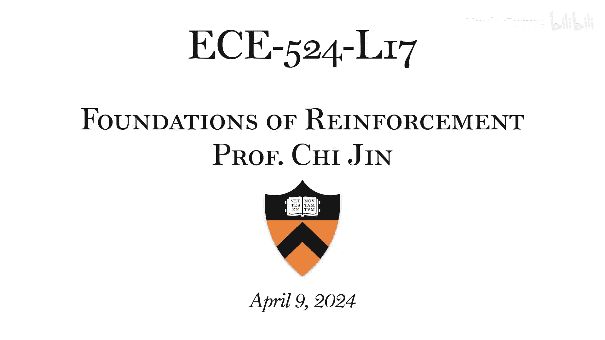
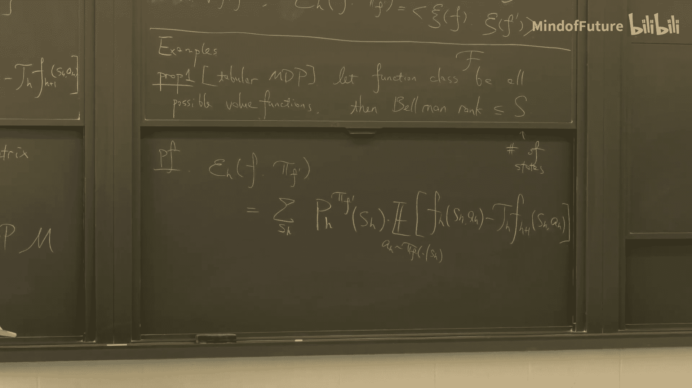
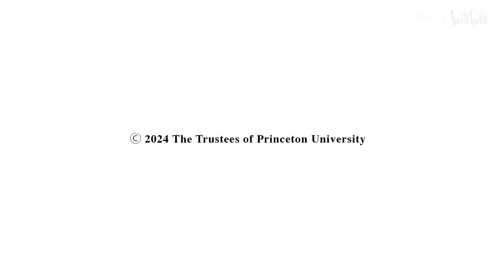

# 017：一般函数逼近中的探索 🧭

在本节课中，我们将学习一般函数逼近框架下的探索问题，特别是贝尔曼秩这一核心概念。我们将回顾其定义，通过几个重要例子理解其内涵，并介绍一个能利用低贝尔曼秩实现高效学习的算法——GOLF算法。最后，我们将开启课程新篇章，简要介绍多智能体强化学习的基本模型。

## 贝尔曼秩回顾 📚

上一讲我们讨论了函数逼近。现在，我们进入本课程最困难的内容之一。我们已经介绍了基本算法——拟合Q迭代，它是值迭代的函数逼近版本。我们讨论了离线保证，即在给定策略集的情况下，拟合Q迭代能获得何种保证，这与离线设置中值迭代的保证类似。

随后，我们转向在线设置。在离线设置中，我们需要关注函数类的对数复杂度，它描述了从一般函数类学习的复杂性。但在在线强化学习中，我们实际上需要另一个复杂度度量。我们在上一讲末尾引入了称为贝尔曼秩的概念。

首先，我们回顾什么是贝尔曼秩。为了引入贝尔曼秩，我们需要先定义平均贝尔曼误差。

定义相当直接。对于函数类 **F** 中的任何值函数 **f**，以及任何策略 **π**，我们可以定义这个平均贝尔曼误差。在步骤 **h**，观察值函数 **f** 并遵循策略 **π** 的平均贝尔曼误差定义为：我们取期望，其中在前 **h-1** 步，我们使用策略 **π**，而在最后第 **h** 步，我们使用函数 **f** 的贪婪策略来采取行动。然后，我们观察贝尔曼误差，即当前步骤的值与对该值应用贝尔曼算子后下一状态值的差异。

贝尔曼秩本质上就是观察这个平均贝尔曼误差，并衡量其复杂性。令 **ε_h** 为一个矩阵，其行和列由函数类 **F** 索引。这个矩阵的每个条目 **(f, f‘)** 就是上述平均贝尔曼误差，其中评估函数为 **f**，遵循的策略是 **f‘** 的贪婪策略 **π_f‘**。

因此，我们定义MDP关于函数类 **F** 的贝尔曼秩，本质上就是这个矩阵的秩。我们观察每个步骤 **h** 的矩阵秩，并取这些秩的最大值，将其定义为贝尔曼秩。

一个非常重要的观察是：这是基于矩阵的秩定义。但为了证明贝尔曼秩小于某个维度 **d**，我们只需要证明存在一个映射，将函数映射到 **d** 维空间，使得对于任何 **f, f‘** 和任何步骤 **h**，平均贝尔曼误差可以分解为两个 **d** 维向量的内积。一旦我们能证明这一点，就相当于将 **ε_h** 矩阵分解为行向量和列向量，这表明其秩最多为 **d**。我们将利用这个特性来证明许多我们已考虑的MDP或强化学习问题实际上具有低贝尔曼秩。

## 贝尔曼秩示例 🔍

现在，我们来看一些例子。

### 表格型MDP 📊

**命题1**：对于表格型MDP，其函数类 **F** 包含所有可能的值函数。我们可以证明其贝尔曼秩小于或等于状态数 **S**。

我们利用上述分解特性来证明。观察平均贝尔曼误差，根据定义，它是贝尔曼误差的期望。我们可以将其显式写出，对状态 **s_h** 和动作 **a_h** 取期望。最终，这个表达式可以写成一个内积形式：一个向量只依赖于 **f‘**（与遵循策略 **π_f‘** 访问状态 **s_h** 的概率有关），另一个向量只依赖于 **f**（与贝尔曼误差项有关）。这个内积是 **S** 维的，因此贝尔曼秩至多为 **S**。

### 线性MDP 📈

**命题2**：对于线性MDP，其贝尔曼秩小于或等于特征维度 **d**。

我们进行类似的分解。展开平均贝尔曼误差的期望表达式。利用线性MDP的转移特性，我们可以将期望追溯到前一步 **s_{h-1}, a_{h-1}**。关键的观察是，表达式的一部分只依赖于 **f‘**（与特征向量 **φ(s_{h-1}, a_{h-1})** 的期望有关），另一部分只依赖于 **f**（与后续的期望有关）。这再次形成了一个 **d** 维的内积分解，因此贝尔曼秩至多为 **d**。

### 区块MDP 🧱

区块MDP可以看作是部分可观测MDP的一个简单特例。其底层是一个MDP，但我们观测到的是从状态生成的、可能非常丰富的观测值（如图像）。我们假设存在一个解码器，可以从每个步骤的观测值中解码出底层状态。

在这种情况下，如果我们天真地应用表格型结果，复杂度将取决于巨大的观测空间。但在贝尔曼秩框架下，我们可以证明其贝尔曼秩仅取决于底层状态数 **S**，而不是观测空间的复杂度。我们再次对平均贝尔曼误差进行分解，通过首先对底层状态 **s_h** 取期望，然后对给定状态生成的观测和动作取期望，最终得到一个内积形式，其中一个因子只依赖于 **f‘**，另一个只依赖于 **f**，维度为 **S**。

这表明，对于具有丰富观测但底层状态简单的MDP，贝尔曼秩框架能提供更紧的复杂度度量。

## GOLF算法 ⛳

既然我们知道许多问题的贝尔曼秩很小，那么如何利用这一点设计高效算法呢？答案是一个非常自然的算法——GOLF算法（基于局部拟合的全局乐观算法）。

你可以将其视为线性函数逼近中Elnor算法的一般函数逼近版本，但结合了全局乐观思想。

以下是算法步骤：

1.  **初始化**：对于所有步骤 **h=1,...,H**，初始化数据集 **D_h** 为空集。初始化置信集 **B_0** 为整个函数类 **F**。
2.  **循环**：对于回合 **k = 1 到 K**：
    *   **乐观规划**：选择函数 **f_k**，使其在置信集 **B_{k-1}** 中最大化初始状态 **s_1** 下的值函数 **V_1^{f_k}(s_1)**。将策略 **π_k** 设置为 **f_k** 的贪婪策略。
    *   **收集数据**：遵循策略 **π_k** 收集一条轨迹数据，并将其添加到各步骤的数据集 **D_h** 中。
    *   **更新置信集**：构造新的置信集 **B_k**。置信集包含所有满足以下条件的值函数 **f**：其贝尔曼残差平方损失 **L_{D_h}(f_h, f_{h+1})** 不超过所有函数中的最小损失加上一个松弛项 **β**。即：
        `L_{D_h}(f_h, f_{h+1}) ≤ inf_{f‘∈F} L_{D_h}(f‘_h, f_{h+1}) + β`

**算法理解**：置信集的构造是核心。它本质上是拟合Q迭代（FQI）的松弛版本。FQI寻找最小化贝尔曼残差损失的点估计，而GOLF的置信集则包含了所有损失不超过最小损失加 **β** 的函数。**β** 是一个统计松弛项，通常选择为 `O(log(|F|) * KH / δ)` 的形式，以确保真实的最优值函数以高概率始终位于置信集内。这样，算法结合了FQI的局部拟合思想和基于置信集的全局乐观规划。

## 理论保证 ✅

在满足两个假设——**可实现性**（真实值函数在 **F** 中）和**完备性**（对 **F** 应用贝尔曼算子后结果仍在 **F** 中）——的前提下，存在常数 **C**，使得如果我们按上述方式选择 **β**，则以至少 `1-δ` 的概率，算法在 **K** 回合内的累积遗憾上界为：
`Regret(K) ≤ O( H * √(D * K * β) )`
其中 **D** 是贝尔曼秩。

这个保证非常通用，不依赖于状态或动作的数量。除了水平长度 **H** 和对数因子，遗憾主要取决于两个关键量：贝尔曼秩 **D** 和函数类的对数复杂度 `log|F|`。在离线设置中，我们需要 `log|F|` 小和集中性系数；在在线设置中，集中性系数被贝尔曼秩所取代。GOLF算法能够有效解决任何具有小贝尔曼秩的强化学习问题。

## 迈向多智能体强化学习 🤝

接下来，我们将进入课程的新主题——多智能体强化学习。在剩余时间里，我们将用两周讨论多智能体强化学习，一周讨论部分可观测强化学习。

多智能体强化学习研究涉及多个智能体的应用，例如视频游戏、多机器人协作或竞争、军事应用等。一个天真的想法是将其简化为单智能体问题，将其他智能体视为环境的一部分。然而，这并不简单，因为其他智能体是**自适应的**，它们的策略会在游戏中改变，这与单智能体中静态环境的假设不同。

我们将首先关注**纯竞争环境**，因为合作环境更类似于分布式单智能体问题，而竞争环境将对手的自适应性推向了极致，会产生许多有趣的现象。我们将从最基本的竞争形式——**两人零和博弈**开始。

首先考虑博弈的基本形式：**正规形式博弈**（无状态和转移）。对于两人零和正规形式博弈，我们只需要一个效用矩阵 **R ∈ R^{|A|×|B|}**，其中行对应最大化玩家（行玩家）的动作，列对应最小化玩家（列玩家）的动作。矩阵条目 **R(a,b)** 表示行玩家采取动作 **a**、列玩家采取动作 **b** 时，行玩家获得的奖励。由于是零和，列玩家的奖励就是 **-R(a,b)**。我们假设玩家同时行动。

一个简单的例子是“石头剪刀布”游戏。双方动作集相同：{石头， 布， 剪刀}。效用矩阵（从行玩家角度）可以写为：平局得0分，赢的得1分，输的得-1分。

在下一讲中，我们将继续讨论正规形式博弈的解概念（如纳什均衡）及其求解方法，然后推广到更一般的马尔可夫博弈。

## 总结 📝

本节课我们一起学习了一般函数逼近中的探索。我们回顾并深入理解了**贝尔曼秩**这一关键复杂度度量，它通过衡量平均贝尔曼误差矩阵的秩来刻画问题的内在难度。我们通过表格型MDP、线性MDP和区块MDP的例子，看到许多重要问题都具有低贝尔曼秩。

接着，我们介绍了**GOLF算法**，它巧妙地将拟合Q迭代的局部拟合思想与基于置信集的全局乐观规划相结合。该算法能够利用低贝尔曼秩的特性，在仅依赖贝尔曼秩 **D** 和函数类复杂度 `log|F|` 的情况下，获得次线性遗憾保证，为一般函数逼近下的在线学习提供了强大工具。

最后，我们开启了课程新篇章，引入了**多智能体强化学习**，并简要介绍了其基本模型——正规形式博弈，为后续学习博弈论解概念和马尔可夫博弈奠定了基础。