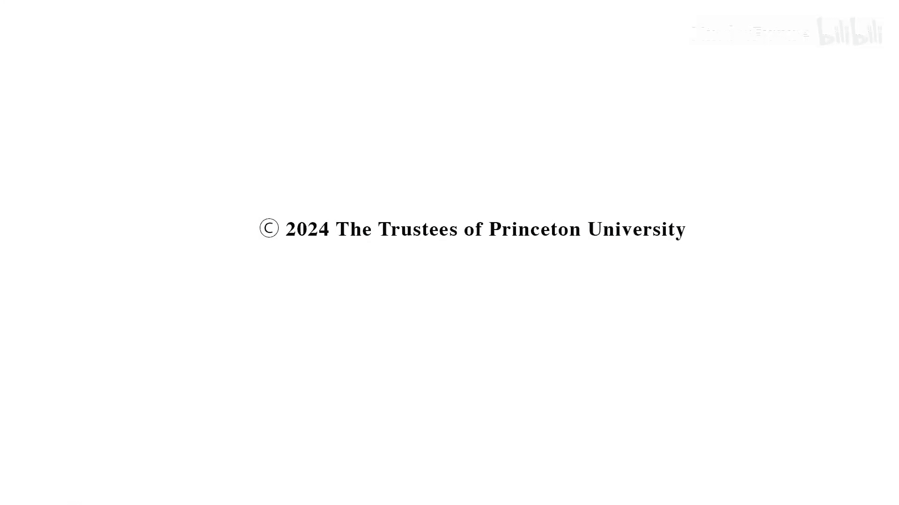

# 019：双人零和博弈

在本节课中，我们将继续学习多智能体强化学习，重点探讨双人零和博弈的求解算法。我们将从基于“最佳响应”的经典方法入手，分析其优缺点，然后介绍更高效、更具理论保证的动态规划方法。

## 基于最佳响应的算法

上一节我们介绍了马尔可夫博弈的公式和贝尔曼最优方程。本节中，我们来看看一类经典的求解思路：基于最佳响应的算法。其核心思想是，当固定对手的策略时，求解我方的最佳响应就变成了一个（类）单智能体问题。

以下是这类算法的两个关键组成部分：

1.  **纳什均衡求解算法（正规形式博弈）**：这是一个在无状态转移的“正规形式”博弈中寻找纳什均衡的算法，它只需要能够调用一个“最佳响应计算器”。
2.  **单智能体强化学习算法**：我们将使用标准的单智能体RL算法（如值迭代、Q学习、PPO等）来近似计算针对某个固定对手策略的“最佳响应”。

将这两部分结合，就构成了求解马尔可夫博弈的一种启发式方法。然而，这种方法存在根本性缺陷。

### 虚拟对局算法

一个简单的想法是让智能体轮流针对对方当前策略计算最佳响应，即“自我对局”。但这种方法即使在“石头剪刀布”这样的简单博弈中也会陷入循环，无法收敛。

为了解决这个问题，我们引入**虚拟对局**算法。与自我对局不同，虚拟对局中，每个智能体计算的是针对对手**历史平均策略**的最佳响应。

*   **算法描述**：在第 `K` 轮迭代中，玩家1的策略 `π1^(K+1)` 是针对玩家2前 `K` 轮策略的平均值的最佳响应。玩家2的更新同理。

虚拟对局在理论上能保证收敛到纳什均衡，但其收敛速度可能极慢，在最坏情况下需要 `O((1/ε)^{|A|})` 轮迭代才能找到 `ε-近似` 纳什均衡，其中 `|A|` 是动作数量。这意味着对于动作空间稍大的博弈，该算法并不实用。

### 双重预言算法

为了提升效率，我们引入**双重预言**算法。该算法维护一个由历史策略两两对抗构成的收益矩阵 `M_K`，并在每轮迭代中计算该矩阵的纳什均衡，得到一个元策略（即对历史策略的权重分布），然后针对该元策略的混合策略计算最佳响应。

*   **算法核心**：使用元策略 `p` 和 `q`（由子博弈 `M_K` 的纳什均衡给出）来混合历史策略，并计算针对该混合策略的最佳响应。

双重预言算法最多在 `|A|` 轮迭代内就能找到纳什均衡，这比虚拟对局有了显著改进。基于此思想的一系列算法（如策略空间响应预言）在实践中被广泛应用。

### 方法的局限性

尽管基于最佳响应的算法直观且被广泛尝试，但将其用于马尔可夫博弈时存在两个主要问题：

1.  **效率低下**：将马尔可夫博弈视为正规形式博弈时，其“动作”对应的是所有可能的策略，数量极其庞大（约为 `(1/ε)^{H*S*|A|}`），导致算法复杂度爆炸。
2.  **原理冲突**：在双重预言等算法中，需要计算针对**一组策略的混合**（而非单一策略）的最佳响应。这不再是一个标准的马尔可夫决策过程，因此使用为MDP设计的单智能体RL算法作为最佳响应计算器缺乏理论保证。

综上所述，基于最佳响应的算法未能充分利用马尔可夫博弈的结构，难以设计出具有高效理论保证的算法。

## 基于动态规划的算法

为了获得更原理性的算法，我们需要回归到利用马尔可夫博弈本身的结构，即基于贝尔曼最优方程的动态规划方法。

### 生成模型下的纳什值迭代

首先考虑**生成模型**（模拟器）设定。与单智能体情况类似，我们可以通过采样估计经验转移模型 `P̂`，然后执行**纳什值迭代**。

*   **值更新公式**：
    `Q_h(s, a, b) = R_h(s, a, b) + E_{s'∼P̂(·|s,a,b)}[V_{h+1}(s')]`
*   **策略与状态值更新公式**：
    `(μ_h(·|s), ν_h(·|s)) = Nash(Q_h(s, ·, ·))`
    `V_h(s) = E_{a∼μ_h(·|s), b∼ν_h(·|s)}[Q_h(s, a, b)]`

其中，`Nash(Q_h(s, ·, ·))` 表示求解以矩阵 `Q_h(s, ·, ·)` 为收益的双人零和博弈的纳什均衡。该算法可以看作是单智能体值迭代在零和博弈下的自然推广，其样本复杂度分析也类似。

### 探索设定下的乐观纳什值迭代

在需要主动探索的设定下，我们结合纳什值迭代与乐观原则，得到**乐观纳什值迭代**算法。关键在于，在零和博弈中，最大化玩家需要乐观的上界，而最小化玩家需要乐观的下界。

1.  **构造乐观Q值**：
    *   上界：`Q̅_h(s,a,b) = R_h(s,a,b) + E_{s'∼P̂}[V̅_{h+1}(s')] + bonus`
    *   下界：`Q_h(s,a,b) = R_h(s,a,b) + E_{s'∼P̂}[V_{h+1}(s')] - bonus`
2.  **策略求解的挑战**：一个朴素的想法是求解一个**广义和博弈**，其收益矩阵分别为 `Q̅_h(s)` 和 `Q_h(s)`。然而，计算广义和博弈的纳什均衡是 **PPAD-Complete** 难题，没有已知的多项式时间算法。
3.  **解决方案：粗相关均衡**：为了避免计算难题，我们用计算**粗相关均衡** 来代替求解纳什均衡。CCE是一种联合策略分布 `π(a,b|s)`，它满足：任何玩家单方面偏离并采取一个固定动作（而非遵循相关协议）都无法获益。
    *   **关键性质**：对于零和博弈（即当 `Q̅ = Q = Q` 时），一个CCE策略 `π` 的边际分布 `(μ, ν)` 就构成了原博弈的一个纳什均衡。
    *   **计算效率**：CCE可以通过线性规划高效求解。

因此，修改后的算法步骤如下：在每一步，我们计算 `(Q̅_h(s), Q_h(s))` 的一个CCE策略 `π_h(·|s)`，然后将其边际分布作为执行策略，并用于计算乐观值 `V̅_h(s)` 和 `V_h(s)`。这样就得到了一个计算高效且具有理论保证的探索算法。

## 总结

本节课我们一起学习了双人零和博弈的两种求解思路。基于最佳响应的算法（如虚拟对局、双重预言）虽然直观，但在应用于马尔可夫博弈时存在效率和原理上的局限。而基于动态规划的算法（如纳什值迭代及其乐观变体）则更好地利用了博弈结构。通过引入粗相关均衡作为计算子程序，我们能够设计出既计算高效又具有理论样本复杂度保证的强化学习算法，用于解决带探索的零和马尔可夫博弈。下一讲我们将深入探讨这些算法的形式化理论保证。