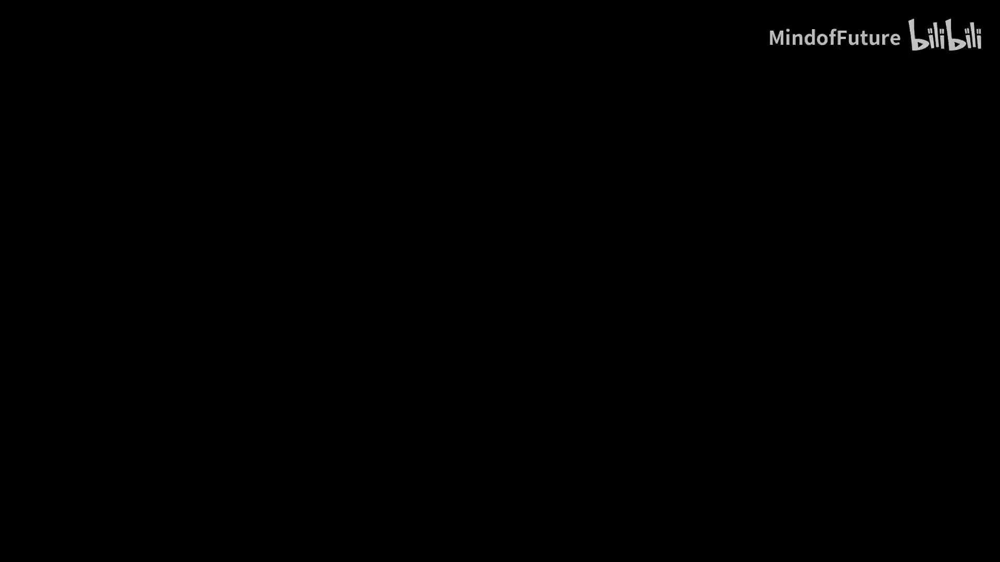
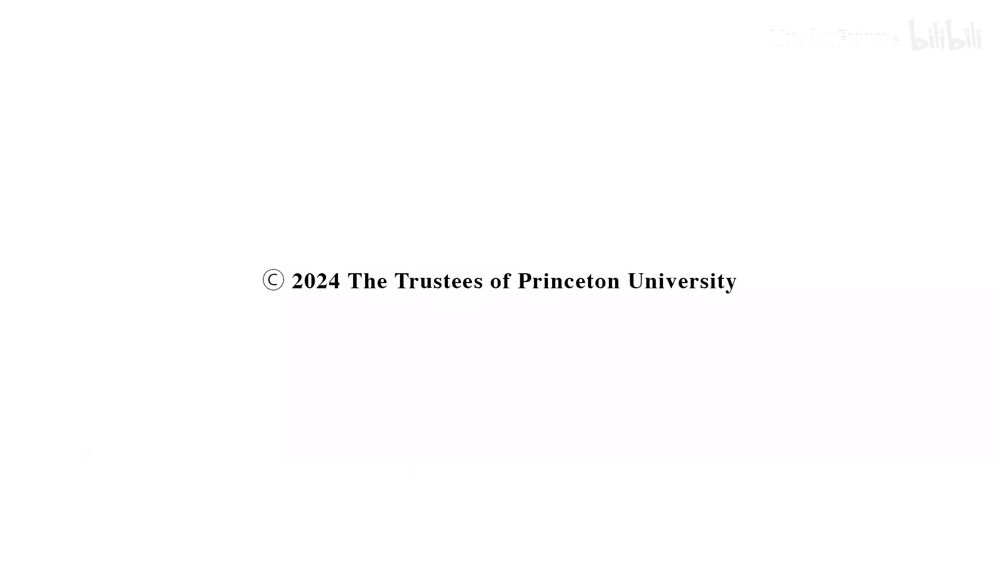

# 020：多人一般和博弈

在本节课中，我们将学习多人一般和马尔可夫博弈，探讨其与双人零和博弈的区别，并介绍应对多智能体强化学习独特挑战（如“多智能体诅咒”和去中心化算法设计）的核心思想。

## 博弈形式化

上一节我们介绍了双人零和博弈的求解方法。本节中，我们来看看更一般的**多人一般和马尔可夫博弈**的形式化定义。

一个多人一般和马尔可夫博弈由以下元素定义：
*   **状态集合**：`S`
*   **智能体集合**：`M` 个智能体
*   **动作集合**：对于第 `i` 个智能体，其动作集为 `A_i`
*   **转移函数**：`P(s_{h+1} | s_h, a_h)`，其中 `a_h` 是所有智能体的联合动作向量 `(a_h^1, ..., a_h^M)`
*   **奖励函数**：对于第 `i` 个智能体，其奖励为 `R_h^i(s_h, a_h)`
*   **时间步长**：`H`

每个智能体 `i` 的策略 `π^i` 是其自身状态到自身动作分布的一个映射。联合策略 `π` 是所有智能体策略的集合。智能体 `i` 在联合策略 `π` 下的价值函数 `V_1^i,π(s)` 是其期望累积奖励。

## 均衡概念与挑战

在博弈设定中，我们的目标是找到某种均衡策略。纳什均衡要求每个智能体在给定其他智能体策略不变的情况下，没有动机偏离自己的策略。然而，在一般和博弈中，寻找纳什均衡是PPAD难的，没有已知的多项式时间算法。

因此，我们常使用替代的均衡概念，例如**相关均衡** 或**粗糙相关均衡** 。这些均衡允许智能体之间存在相关性（通过一个“协调者”或共享随机性），并且可以在多项式时间内通过线性规划求解。纳什均衡是CE的子集，而CE又是CCE的子集。

多智能体强化学习面临两个主要挑战：
1.  **多智能体诅咒**：基于联合Q值的方法，其样本复杂度会随智能体数量 `M` 呈指数增长（`∏ A_i`）。
2.  **去中心化算法设计**：我们希望每个智能体能像单智能体一样，仅基于自身观察独立运行算法，且不依赖中心化协调。

核心问题是：能否设计一种**去中心化的多智能体强化学习算法**来**打破多智能体诅咒**？

## 无悔算法：从矩阵博弈出发

为了设计去中心化算法，一个关键思路是让每个智能体运行能对抗**对抗性对手**的算法，即**无悔算法**。

在矩阵博弈（单步博弈）中，一个著名的无悔算法是**EXP3**（用于对抗性多臂老虎机）。以下是其步骤：

对于每一轮 `t`：
1.  根据权重计算动作概率分布：`p_t(a) = w_t(a) / Σ_{a'} w_t(a')`
2.  根据 `p_t` 随机选择动作 `a_t`
3.  观察到损失 `l_t(a_t)`
4.  构造无偏估计量：`\hat{l}_t(a) = l_t(a) / p_t(a) * 1{a = a_t}`
5.  更新权重：`w_{t+1}(a) = w_t(a) * exp(-η * \hat{l}_t(a))`

EXP3算法能保证，对于任意对抗性选择的损失序列，其**遗憾值**是次线性的：
`Regret_T = Σ_{t=1}^T p_t · l_t - min_{a} Σ_{t=1}^T l_t(a) ≤ O(√(|A| T))`

在博弈中应用时，如果每个智能体都运行某种无悔算法：
*   在**双人零和博弈**中，时间平均策略会收敛到纳什均衡。
*   在**多人一般和博弈**中，时间平均的**联合策略**（注意，平均过程会引入相关性）会收敛到一个粗糙相关均衡。

重要的是，其样本复杂度仅依赖于单个智能体的最大动作数 `max_i |A_i|`，而非所有动作的乘积，从而打破了“诅咒”。

## 从矩阵博弈到马尔可夫博弈：V-学习算法

然而，直接将无悔算法扩展到多步的马尔可夫博弈是困难的。为对抗性对手设计一个具有多项式遗憾保证的马尔可夫博弈无悔算法被证明是不可能的。

但我们的目标（找到均衡）比设计无悔算法更容易实现。关键思想是将无悔算法的思想与动态规划结合，设计新的算法。这就是**V-学习算法**。

V-学习与Q学习类似，但有一个核心区别：
*   **Q学习**：维护Q值 `Q(s, a)`，策略通常是对Q值的贪心策略。
*   **V学习**：只维护状态值 `V(s)`。由于没有Q值，无法直接贪心。因此，它为**每个状态维护一个独立的无悔算法实例**（如EXP3）来生成策略。

V-学习算法的伪代码如下：

对于回合 `k = 1 to K`：
1.  初始化状态 `s_1`
2.  对于时间步 `h = 1 to H`：
    *   根据当前状态 `s_h` 对应的无悔算法实例给出的策略 `π_h` 选择动作 `a_h`
    *   执行 `a_h`，观察到奖励 `r_h` 和下一个状态 `s_{h+1}`
    *   更新访问计数 `N(s_h) += 1`
    *   **更新V值**：`V_h(s_h) ← (1 - α_t) * V_h(s_h) + α_t * [r_h + V_{h+1}(s_{h+1}) + β_t]` （其中 `α_t` 是学习率，`β_t` 是探索奖励）
    *   **更新策略（无悔算法）**：向状态 `s_h` 对应的无悔算法实例反馈“效用” `r_h + V_{h+1}(s_{h+1})`，该实例据此更新其内部权重，从而更新策略 `π_h`。

## 总结

本节课我们一起学习了多人一般和马尔可夫博弈的基础。我们首先了解了其形式化定义及纳什均衡的计算困难，从而引入了相关均衡等替代概念。接着，我们探讨了多智能体强化学习的两个核心挑战：“多智能体诅咒”和去中心化算法设计。

我们从简单的矩阵博弈出发，介绍了**无悔算法**（以EXP3为例）如何通过让每个智能体独立运行对抗性算法，最终收敛到均衡，并有效避免了动作空间的指数爆炸。

最后，我们将视角扩展到更复杂的马尔可夫博弈，指出了直接设计无悔算法的局限性，并引入了**V-学习算法**作为一种解决方案。V-学习通过结合值函数更新和基于状态的、分布式的无悔算法来生成策略，为实现去中心化且高效的多人博弈学习提供了新的思路。在下一讲中，我们将深入探讨V-学习的理论保证。