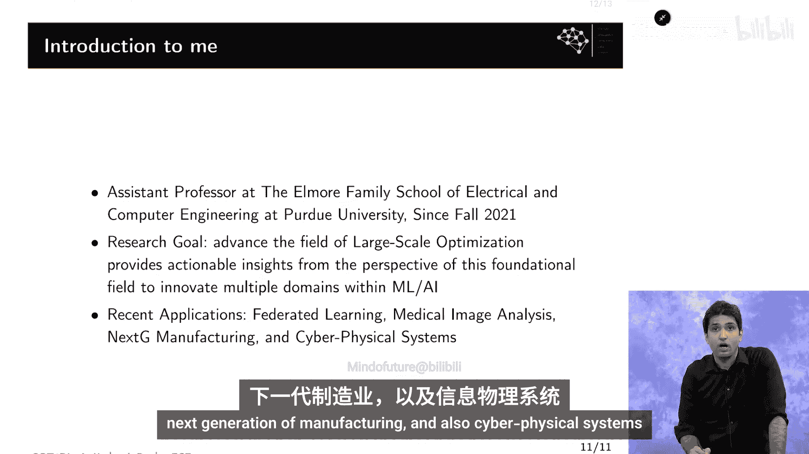

# 001：课程简介 🎯

在本节课中，我们将介绍《深度学习中的优化》这门课程的核心目标与动机。我们将探讨优化理论与深度学习之间的紧密联系，并解释为何优化是理解和设计深度模型的关键工具。

## 概述

本课程的主要目标是利用优化理论和算法来理解深度学习。具体而言，我们希望理解如何部署模型以从数据中学习、为何深度模型能成功完成其设计任务，以及我们如何在性能和其他可能考虑的标准下提供形式化的保证。

## 优化简介

首先，我们来谈谈优化。优化，特指数学优化，其高层次目标是：根据某个标准，从一组备选方案中识别或选择最佳元素。在许多优化问题中，目标是**最小化**某个成本或损失函数。

**公式**：`minimize f(w) subject to w ∈ X`

其中，`f` 是损失函数，`w` 是决策变量，`X` 是可行解集（即约束条件）。在许多情况下，我们处理的是无约束问题，即 `X` 是整个欧几里得空间 `R^d`。

同样，我们也可以讨论**最大化**问题，例如最大化奖励函数或效用函数 `U`，这本质上与最小化其负值 `-U` 等价。

优化主要关注三个方面：
1.  **建模**：将实际问题表述为可高效求解的优化问题。
2.  **算法设计**：寻找解决给定优化问题的最有效算法。
3.  **评估**：为算法找到的解的质量提供形式化保证。

在本课程中，我们将主要讨论算法及其评估。

## 深度学习简介

接下来，我们看看深度学习。这里提供两个定义：

1.  **通用定义**：深度学习是一类基于人工神经网络的机器学习方法。人工神经网络是受生物神经网络启发而设计的模型，它使计算机能够从数据中学习或识别有用模式，并将这些模式应用于新数据。
2.  **技术性定义**（由该领域先驱提出）：深度学习是构建**过参数化**模块网络，并使用**基于梯度的优化**方法通过示例对其进行训练。

第二个定义突出了优化在确保深度模型工作并理解其工作原理方面的关键作用。

## 为何需要“深度学习中的优化”？

主要有两个原因：

**第一，学习与优化的内在联系。**
训练深度模型本质上就是解决一个优化问题。更具体地说，我们通常要最小化一个具有特定形式的损失函数：

**公式**：`minimize F(w) = (1/n) * Σ f_i(w)`

其中，`n` 是训练数据量（通常极大，可达百万甚至亿级），`f_i(w)` 衡量模型参数 `w` 对第 `i` 个数据样本的拟合程度。`d` 是模型参数的数量（同样巨大，且常处于**过参数化**状态，即 `d > n`）。此外，损失函数 `F` 通常是**非凸**的，其优化地形充满山峰和山谷，存在许多局部最优解，这增加了找到全局最优解的难度。

**第二，深度模型训练中的未解之谜。**
训练深度模型存在许多谜团和挑战，优化理论有助于我们理解它们。以下是两个例子：
*   **Adam 优化器之谜**：Adam 在训练复杂深度模型时非常成功，但其理论保证存在缺陷，有时甚至在简单凸问题上会失败。为何如此？
*   **过参数化的核心作用**：传统机器学习理论认为，参数过多（`d > n`）会导致过拟合。然而在实践中，过参数化不仅有助于更好地拟合训练数据，甚至能带来更好的**泛化**性能（即在新数据上表现更好）。在众多可能的解中，深度模型似乎总能找到泛化能力强的那个，原因何在？

## 为何理解这些至关重要？

深度学习已成为并将继续成为科学与工程各领域的有力工具。我们需要理解这个工具，以便：
*   针对新任务或新数据集，合理预期并解释模型的性能。
*   应对深度学习训练成本高昂、依赖昂贵硬件和高能耗的问题，从而寻找更高效、环保的训练方法。
*   研究并缓解深度学习带来的社会影响与关切。

## 本课程目标

基于以上讨论，本课程的目标包括：
*   学习深度学习的训练算法与优化技术。
*   讨论优化理论、方法及启发式技巧，并分析现有算法。
*   探究“为什么”的问题：为何某些方法在特定场景有效，而在其他场景无效？
*   探讨如何利用这些工具实现资源高效的深度学习训练。
*   讨论相关的实际与社会关切，并思考如何将其与我们的优化方法相结合。

## 总结

本节课我们一起探讨了优化与深度学习的紧密联系。我们了解到，训练深度模型本质上是解决大规模、非凸的优化问题，而优化理论是理解模型工作原理、破解训练谜团（如 Adam 的工作机制和过参数化的益处）以及设计更高效算法的重要工具。在接下来的课程中，我们将首先简要回顾优化和机器学习的基础知识，然后逐步深入其他相关主题。