# 002：优化基础

在本节课中，我们将学习深度学习优化所需的一些基础概念。我们将从**驻点**的定义开始，然后讨论**凸性**及其重要性，接着介绍**收敛性**的不同衡量标准，最后将优化问题与**不动点迭代**联系起来，引出**梯度下降**这一核心算法。

## 驻点与最优性

上一节我们介绍了课程概述，本节中我们来看看优化问题的基础概念。首先考虑一个无约束优化问题：最小化损失函数 `f(w)`，其中决策变量 `w` 是一个 `d` 维向量。

解决此问题意味着找到一个使函数值最低的最优解。然而，对于复杂的机器学习问题，这通常难以实现。因此，我们引入一个更宽泛且更容易达成的概念：**驻点**。

我们称 `w*` 为一个**一阶驻点**，如果函数在该点的梯度为零。其数学表示为：
```
∇f(w*) = 0
```
梯度为零意味着函数在该点的切线斜率为零。

但驻点并不等同于最优解。一个函数可能有多个驻点，它们的质量各不相同。以下是几种不同类型的驻点：
*   **局部最大值**：例如，函数图像上的波峰点。
*   **局部最小值**：例如，函数图像上的波谷点。
*   **鞍点**：例如，函数图像上的拐点。

为了区分驻点的质量，我们需要二阶信息，即**海森矩阵** `∇²f(w)`。如果海森矩阵在 `w*` 处**正定**，则该点是**局部最小值**；如果**负定**，则是**局部最大值**。这个条件有时被称为**二阶驻点**条件。

需要注意的是，即使是局部最小值，也可能不是全局最优解。这引出了我们对函数本身性质的探讨。

## 凸集与凸函数

上一节我们了解了驻点，本节中我们来看看一类特殊的函数——凸函数，它能使优化问题变得简单。首先，我们需要定义凸集。

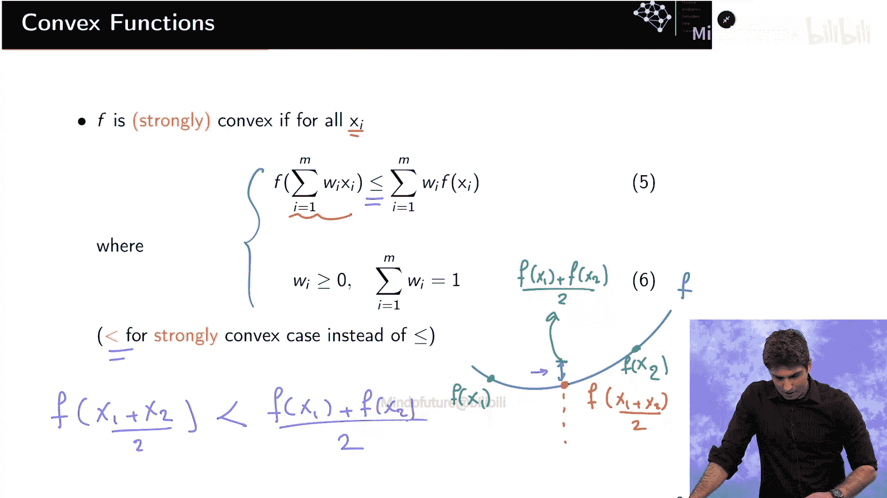

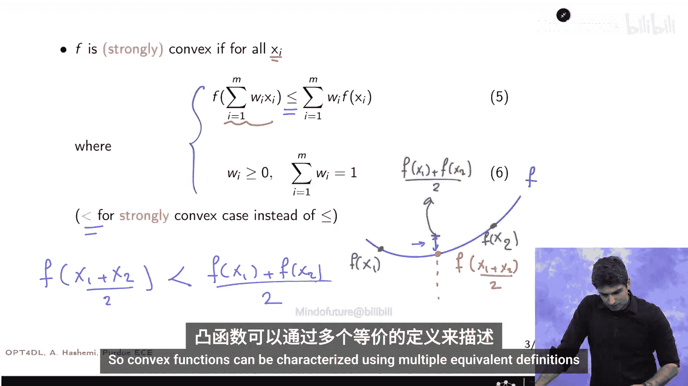

一个集合 `X` 是**凸集**，如果对于集合内任意两点 `x1` 和 `x2`，它们的**凸组合**（即连接两点的线段上的所有点）仍然属于该集合。凸组合的数学定义为：对于任意权重 `λ ∈ [0, 1]`，有 `λx1 + (1-λ)x2 ∈ X`。

接下来，我们定义凸函数。一个函数 `f` 是**凸函数**，如果对于定义域内任意两点 `x1` 和 `x2`，以及任意 `λ ∈ [0, 1]`，满足以下**琴生不等式**：
```
f(λx1 + (1-λ)x2) ≤ λf(x1) + (1-λ)f(x2)
```
直观上，这意味着函数图像上任意两点之间的线段位于函数图像的上方（或重合）。

凸函数还有两个等价的定义，通常更便于理论分析：
1.  **一阶条件**（要求函数可微）：对于所有 `x, y`，有 `f(y) ≥ f(x) + ∇f(x)^T (y - x)`。这意味着函数始终在其任意一点的切线上方。
2.  **二阶条件**（要求函数二阶可微）：对于所有 `x`，其海森矩阵 `∇²f(x)` **半正定**。这意味着函数的曲率始终向上（或为零）。

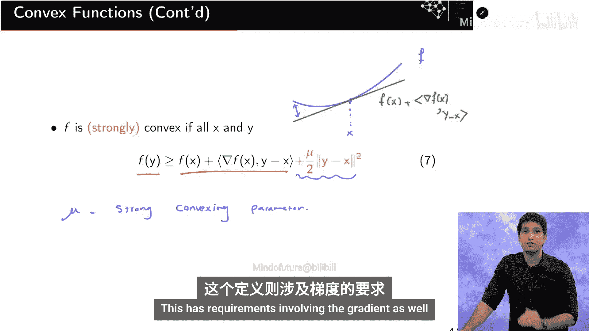

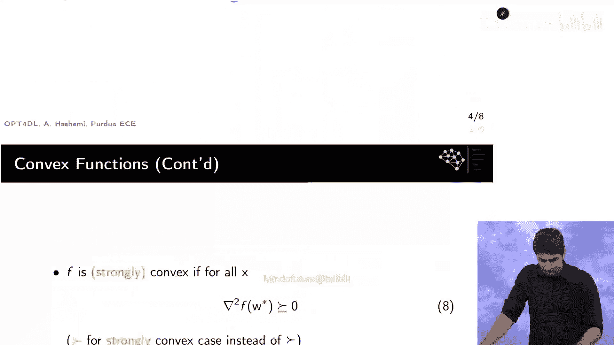

此外，还有性质更好的**强凸函数**。强凸函数在一阶条件中增加了一个正的二次项：
```
f(y) ≥ f(x) + ∇f(x)^T (y - x) + (μ/2) ||y - x||²
```
其中 `μ > 0` 是强凸系数。在二阶条件下，强凸要求海森矩阵**正定**。

凸函数的重要性在于其局部性质蕴含了全局信息。对于一个凸函数，任何**一阶驻点**（梯度为零的点）必然是**全局最小值点**。对于强凸函数，这个全局最小值点还是**唯一**的。

然而，在深度学习中，我们面对的损失函数通常是**非凸**的。因此，我们需要发展适用于非凸优化的理论和方法。

## 收敛性与收敛速率

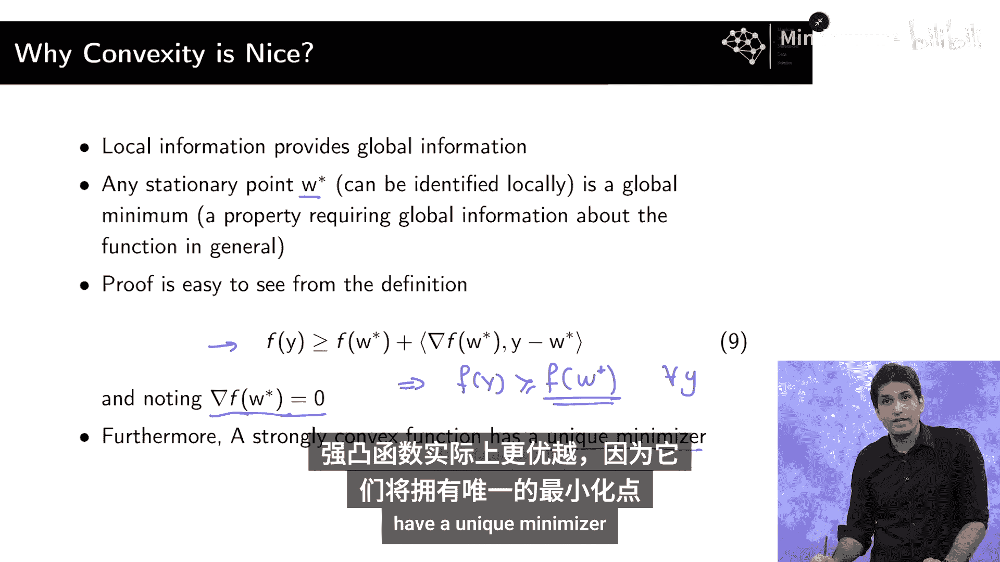

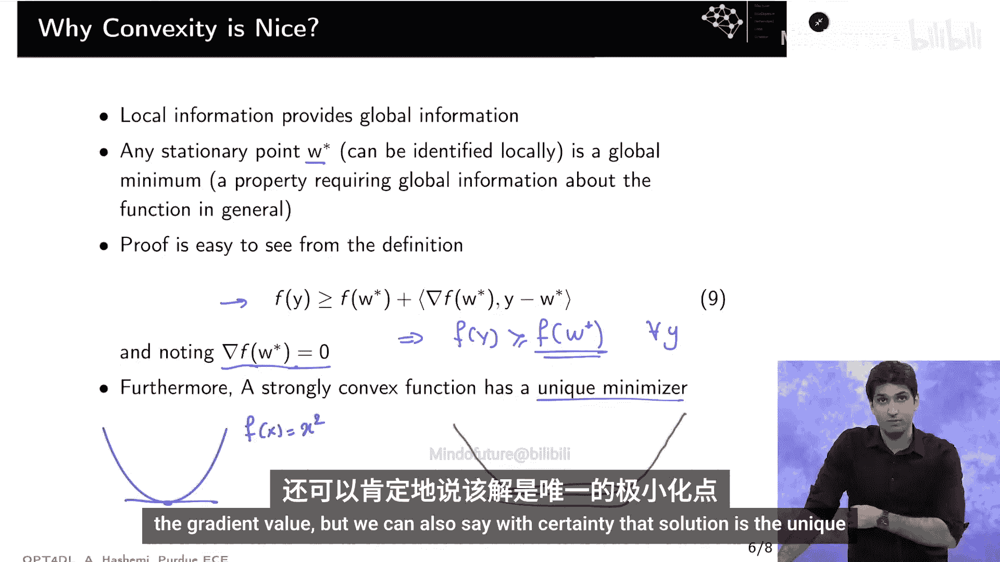

上一节我们讨论了凸函数，本节中我们来看看如何衡量优化算法的好坏。我们通常关注算法能否找到一个近似解 `w̃`，使得某个**误差函数**或**收敛准则**小于预设的精度 `ε`。

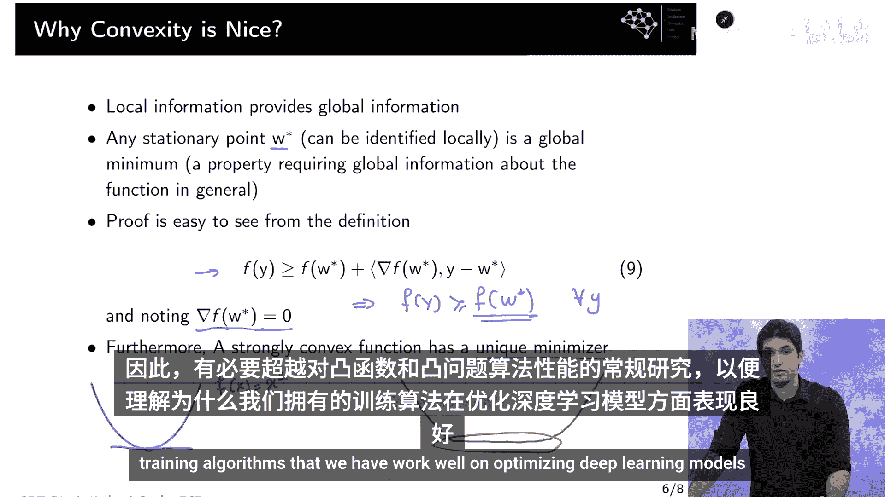

优化算法通常是**迭代式**的：从一个初始点开始，通过多次迭代逐步改进解的质量。迭代次数 `T` 与目标精度 `ε` 之间的关系称为算法的**收敛速率**。

以下是两种主要的收敛速率：
*   **次线性收敛**：迭代次数 `T` 与 `1/ε` 或 `1/ε^2` 等成比例关系。例如，`T ∝ 1/ε`。
*   **线性收敛**（或几何收敛）：迭代次数 `T` 与 `log(1/ε)` 成比例关系。线性收敛比次线性收敛快得多。

在深度学习的非凸优化中，我们更常遇到次线性收敛。

根据问题的性质，我们关心不同的收敛准则：
*   **梯度范数**：`||∇f(w̃)|| ≤ ε`。这表示找到了一个近似一阶驻点。这对于一般的非凸函数是常用的准则。
*   **函数值间隙**：`f(w̃) - f* ≤ ε`，其中 `f*` 是最优函数值。这在函数具有凸性或某些特殊结构时更相关。
*   **解的距离**：`||w̃ - w*|| ≤ ε`，其中 `w*` 是某个特定最优解。这在强凸问题或局部区域内更常用。

在深度学习的非凸优化背景下，我们将重点关注**梯度范数**这一收敛准则。

## 优化与不动点迭代

上一节我们介绍了收敛性的概念，本节中我们来看看如何将优化问题转化为一种可迭代求解的形式。考虑无约束最小化问题 `min f(w)`。

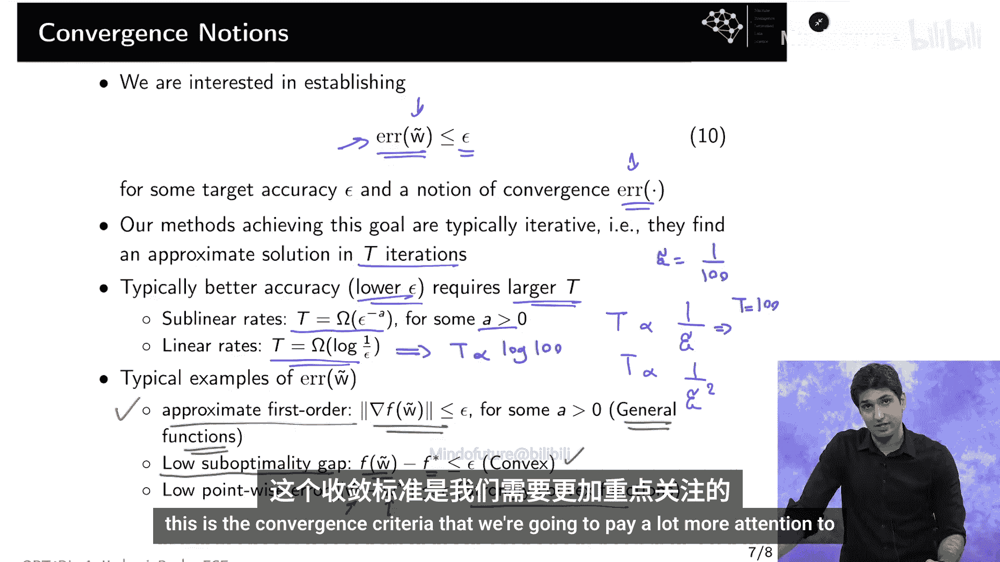

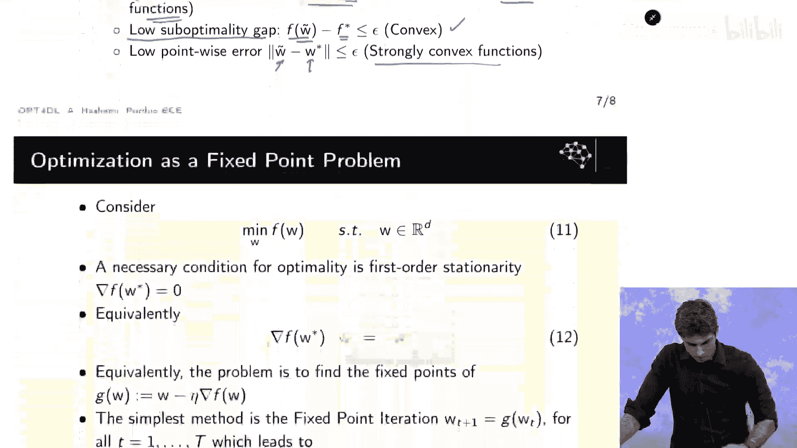

我们知道，最优解 `w*` 的一个必要条件是梯度为零：`∇f(w*) = 0`。我们可以对这个等式进行一个简单的变换：两边同时乘以一个正的常数 `η`（称为**步长**或**学习率**），然后同时减去 `w*`，得到：
```
w* = w* - η ∇f(w*)
```
这个形式揭示了一个关键点：寻找驻点 `w*` 等价于寻找某个函数 `G(w) = w - η ∇f(w)` 的**不动点**，即满足 `w = G(w)` 的点。

求解不动点的一个基本方法是**不动点迭代**：从一个初始猜测 `w1` 开始，反复应用函数 `G`：
```
w_{k+1} = G(w_k)
```
将 `G` 的具体形式代入，我们就得到了深度学习中最基础的优化算法：
```
w_{k+1} = w_k - η ∇f(w_k)
```
这个算法被称为**梯度下降法**。它构成了几乎所有深度学习训练算法的基础。在后续课程中，我们将对梯度下降及其变种进行更深入的分析。

## 总结

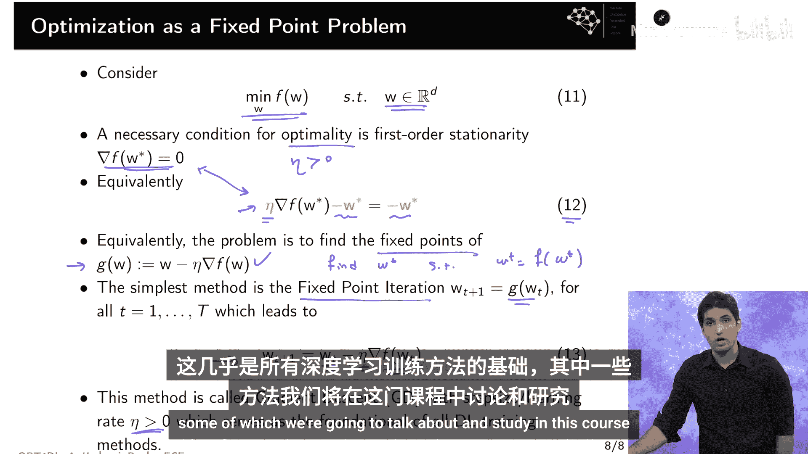

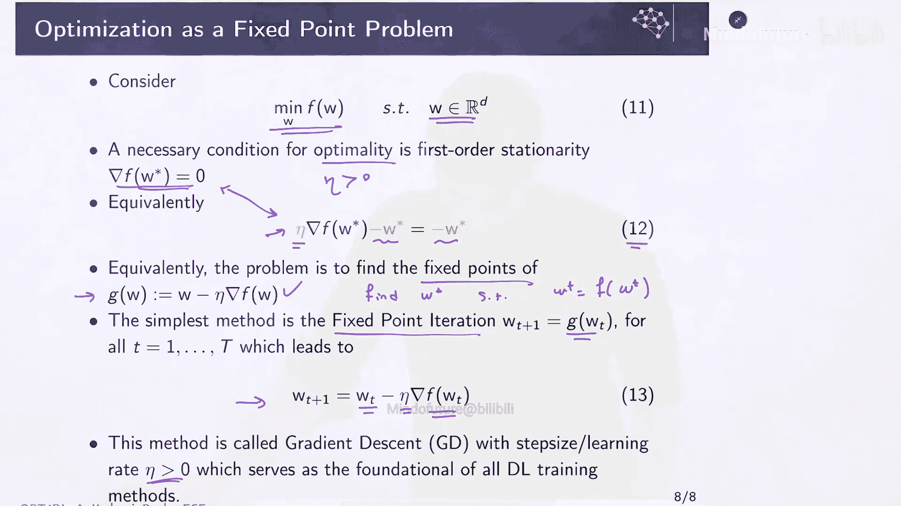

本节课中我们一起学习了深度学习优化的基础概念。我们首先定义了**驻点**，并指出它是最优性的必要条件而非充分条件。接着，我们介绍了**凸集**和**凸函数**，理解了凸函数能使局部驻点成为全局最优解这一优良性质，但也认识到深度学习问题通常是非凸的。然后，我们探讨了衡量算法性能的**收敛性准则**（如梯度范数、函数值间隙）和**收敛速率**（次线性与线性）。最后，我们将优化问题转化为**不动点迭代**问题，并由此引出了最核心的**梯度下降**算法框架，为后续深入学习奠定了基础。