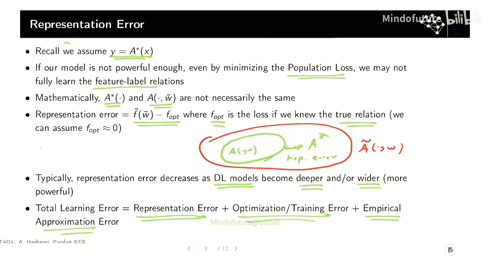

# 004：机器学习基础2

## 概述

在本节课中，我们将深入探讨机器学习模型性能评估的核心框架。我们将学习如何量化模型在训练后的表现，并理解影响其在新数据上泛化能力的三个关键误差来源。

---

上一节我们介绍了机器学习的整体框架，包括训练问题（经验风险最小化）和衡量模型真实性能的总体损失。本节中，我们来看看如何评估“训练”这一过程的好坏，即我们学到的模型在新数据上的表现如何。

### 评估学习效果：误差分解

一个挑战在于，经验风险最小化问题本身在许多情况下无法精确求解，尤其是在优化深度学习模型时。因此，我们需要讨论几种决定学习效果的误差。

首先，我们定义一些符号：
*   令 **ŵ** 为经验风险最小化问题的一个近似或次优解。这基本上就是你优化深度学习模型后期望得到的模型参数。
*   令 **w̄** 和 **w*** 分别为总体损失（我们无法访问）和经验损失（我们可以访问）的最小化解。

为了评估学习效果是否良好，我们需要界定以下量：
`F̄(ŵ) - F̄(w̄)`
这本质上是**我们学到的模型的总体损失**与**如果我们能访问总体损失所能学到的最佳模型的性能**之间的差距。你可以将其视为一个我们希望界定的“学习差距”。

为了将这个感兴趣的“差距”与一些更具体的概念联系起来，我们通常采用加减项的技巧。具体来说，我们加入并减去以下三项：
1.  经验损失 `F(ŵ)`
2.  经验损失 `F(w*)`
3.  经验损失 `F(w̄)`

经过代数运算后，我们发现这个“估计误差”可以被几个项所界定。

以下是分解后得到的主要误差项：

**1. 优化误差**
这个项衡量的是你的次优解 **ŵ** 与经验损失的最优解 **w*** 之间的差距。它反映了你的优化算法在解决训练问题（即最小化经验损失）时的效果。
`F(ŵ) - F(w*)`

**2. 经验近似误差**
这个项比较了在固定解 **ŵ** 处，经验损失 `F` 与总体损失 `F̄` 的差异。它本质上说明了你的训练数据能在多大程度上代表整个数据宇宙。
`F̄(ŵ) - F(ŵ)`

**3. 另一项经验近似误差**
类似地，这个项比较了在另一个模型 **w*** 处，经验损失与总体损失的差异。
`F(w*) - F̄(w*)`

此外，还有一个项 `F(w*) - F(w̄)`。由于 **w*** 是 `F` 的最小化解，`F(w*)` 必然小于等于 `F(w̄)`，因此这个项是非正的，有时可以安全地忽略。

### 核心误差来源总结

因此，上述分析表明，我们学到的模型的性能（估计误差）主要受两个因素制约：
*   **优化误差**：你解决训练问题（优化过程）的能力。
*   **经验近似误差**：你的训练数据代表整个数据分布的能力。

这两个误差项可以通过设计更好的训练算法（以减少优化误差）和获取更多、更好的数据（以减少经验近似误差）来控制。

然而，所有这些都依赖于我们所使用的参数化模型。模型本身的能力是另一个关键因素。

### 表征误差

如果我们的模型容量很高、非常强大，它应该能够表示特征和标签之间非常复杂的关系。相反，如果模型非常简单、能力不足，即使拥有先进的算法和大量数据，也可能无法学习到复杂的模式。这就引出了**表征误差**。

让我们回顾一下，**w̄** 是总体损失的最小化解。我们假设存在一个真实的、未知的特征-标签关系 **a***。如果我们的模型不够强大，那么即使最小化了总体损失，我们学到的关系 `A(w̄)` 也可能与真实关系 **a*** 相去甚远。

数学上，这导致了**表征误差**，定义为：
`F̄(w̄) - F_opt`
其中 `F_opt` 可以理解为如果我们知道真实关系 **a*** 所能达到的最小损失（通常假设为0或接近0）。

这个概念可以通过下图来演示。假设我们想学习的真实关系是 **a***，而我们训练时使用的函数族是 `A(w)`。那么，`A(w̄)` 与 **a*** 之间的距离就是表征误差。如果模型族 `A(w)` 不够强大，根本不包含 **a***，那么这个误差就无法通过优化或更多数据来减少。

相反，如果我们使用一个更强大的模型族 `Ã`，它包含了 **a***，那么表征误差理论上可以为零。结合良好的优化算法和充足的数据，学习就会非常成功。

在实践中，我们观察到，随着深度学习模型变得更深、更宽，它们的能力增强，表征误差往往会下降。

---

## 总结

本节课中，我们一起学习了评估机器学习模型性能的框架，并识别了影响学习效果的三个重要误差来源：

1.  **表征误差**：源于模型本身的能力限制，无法充分捕捉真实的特征-标签关系。可以通过使用更强大（如更深、更宽）的模型来控制。
2.  **优化误差**：源于训练算法无法找到经验损失的最优解。可以通过设计更先进的优化算法来控制。
3.  **经验近似误差**：源于有限的训练数据无法完美代表整个数据分布。可以通过收集更多、更高质量的数据来控制。

总的学习误差大致是这三类误差的总和。在接下来的课程中，我们将通过一些简单的机器学习问题实例来巩固这些概念。