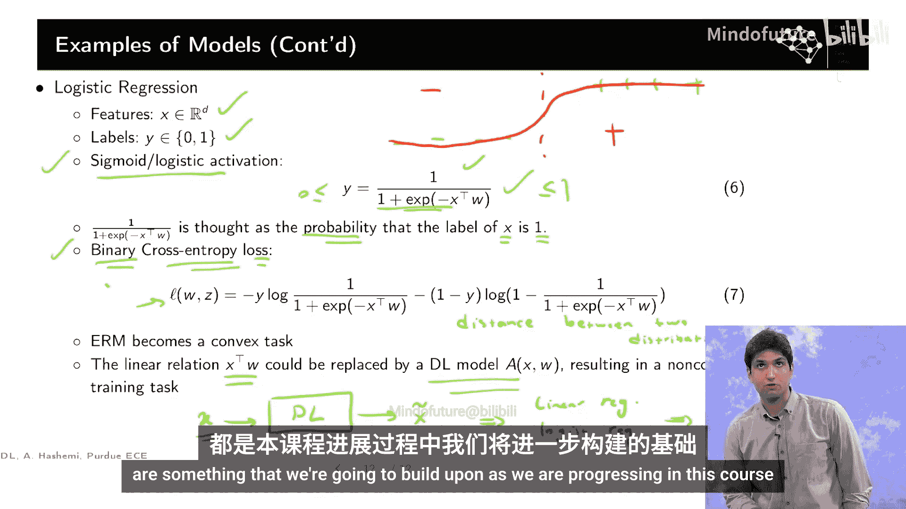

# 005：机器学习基础3 🧠

在本节课中，我们将通过几个基础的机器学习示例来巩固之前介绍的机器学习框架。我们将重点讨论监督学习中的三个经典问题：二元分类、线性回归和逻辑回归。这些例子虽然简单，但它们是理解更复杂深度学习模型的重要基石。

上一节我们讨论了机器学习框架中的训练系统、性能评估以及不同类型的误差。本节中，我们来看看几个具体的例子，以加深对这些概念的理解。

以下是三个基础的监督学习示例，它们都涉及特征和标签的集合。

## 二元分类 🎯

二元分类是一个简单的分类问题，其中只有两个类别。例如，可以将图像分为“汽车”（正类）和“非汽车”（负类）。该问题的目标是学习一个分类器（在本例中是一个超平面），以将正类与负类分开。

该问题的要素如下：
*   **特征向量 X**：例如，图像的像素集合。
*   **标签**：+1 和 -1，代表两个类别。
*   **核心假设**：数据是**线性可分**的，即存在一个线性超平面可以完美分隔两类数据。

因此，一个自然的模型类别形式如下：
`f(x) = sign(<x, w>)`
其中 `w` 是超平面的法向量。如果内积为正，则预测为正类；如果为负，则预测为负类。

接下来需要讨论用于训练模型的损失函数。在这个例子中，我们通常处理两种损失函数。

以下是两种关键的损失函数：
1.  **0-1损失**：如果模型错误分类了第 `i` 个数据点，则损失为 1；如果分类正确，则损失为 0。其公式为：
    `L_{0-1}(z) = 1_{y * f(x) <= 0}`
    其中 `1_{condition}` 是指示函数，当条件为真时返回1，否则返回0。该损失的期望值就是模型的**误分类概率**。虽然直观，但0-1损失会导致非凸优化问题，使得训练困难。
2.  **合页损失**：这是0-1损失的一个凸近似，形式为：
    `L_{hinge}(z) = max(0, 1 - y * <x, w>)`
    使用合页损失能使经验风险最小化问题变成一个**凸优化**任务，从而可以高效求解。

这个学习任务能否成功转化为凸优化问题，取决于两个关键属性：一是使用了**合页损失**，二是采用了**线性超平面模型**。

然而，线性模型仅在数据线性可分时有效。如果数据非线性可分（例如正类被负类包围），线性模型将不是一个好的分类器。

此时，我们可以将简单的线性关系替换为更复杂的模型，例如一个高度非线性的**深度模型**，以增加模型的表示能力。但代价是，这通常会导致一个**非凸**的训练任务。

## 线性回归 📈

第二个例子是线性回归。想象我们有一系列数据点，它们大致遵循一个线性模型。我们的目标是利用这些数据点来学习这个线性关系。

该问题的要素如下：
*   **特征 X**：一组特征，属于 R^d 空间。
*   **标签 y**：通常是实数值，而不仅仅是+1/-1。
*   **核心假设**：特征和标签之间的关系基本遵循一个**线性模型**，即 `y ≈ <x, w>`，其中 `w` 是我们希望学习的未知参数。有时我们还会加入一个小的、可管理的噪声项。

在线性回归中，我们通常使用**平方损失**函数来衡量模型对单个样本 `(x_i, y_i)` 的拟合程度：
`L_{square}(z) = (y - <x, w>)^2`

这个问题的优点是，如果我们使用线性模型和平方损失，经验风险最小化问题将再次变成一个**凸优化**任务，意味着我们可以非常高效地求解它。

但同样，一个缺点是特征与标签之间的关系可能并非如我们所描绘的那样是线性的。它们之间可能存在高度**非线性**的关系。显然，线性模型将无法很好地拟合。

在实践中，我们可以通过将这个简单的线性关系替换为一个更复杂、非线性的模型（例如使用深度学习架构）来解决这个问题。但同样，这通常会导致一个**非凸**的训练任务。

## 逻辑回归 🔮

第三个例子虽然名为“回归”，但本质上是一个**二元分类**问题，即逻辑回归。我们假设可以使用一个S形模型来对正类和负类进行分类。目标是学习这个S形模型的具体参数。

该问题的要素如下：
*   **特征 X**：例如图像的像素集合。
*   **标签 y**：可以使用0和1来表示两个不同的类别。
*   **核心假设**：特征与标签之间的关系可以通过一个**Sigmoid函数**（或称逻辑函数）来表征。该函数形式为：
    `σ(z) = 1 / (1 + exp(-z))`
    我们可以将 `σ(<x, w>)` 的值解释为样本 `x` 的标签为1的**概率**。如果该值接近1，则 `x` 很可能属于正类；如果接近0，则很可能属于负类。

一个自然的、用于此处优化的损失函数是**二元交叉熵损失**：
`L_{bce}(z) = -[y * log(σ(<x, w>)) + (1-y) * log(1 - σ(<x, w>))]`
这个损失在某种程度上衡量了两个分布之间的差异。通过优化这个损失，我们可以学习一个模型，使其对训练数据中属于第一类的样本输出值接近1，对属于另一类的样本输出值接近0。

与前面两个例子类似，只要使用特定的Sigmoid函数来表示特征与标签的关系，并利用二元交叉熵损失，训练问题就会是一个**凸优化**问题，可以高效求解。

同样，在实践中，这种线性关系可能不足以表示复杂的特征-标签关系。我们倾向于将这种线性关系替换为更复杂、非线性的模型（如深度学习模型），但这将导致**非凸**的训练任务。

## 总结与联系 🧩

现在你可能会问，这些例子如此简单，在实践中可能无法直接应用，那我们为什么要讨论它们呢？

原因在于，它们为我们提供了一种理解如何部署（深度）模型的思路。具体来说，你可以将**深度学习**视为对原始训练数据寻找一种**更好表示**的过程。原始特征 `X` 本身可能无法直接解决学习任务。但如果有一个强大的深度模型，我们可以将输入（如图像）输入该模型，从而提取出更有用的特征表示。然后，将这些提取出的有用特征输入到我们讨论过的这些简单模型（如线性回归或逻辑回归，具体取决于问题是回归还是分类）中，我们就能取得非常好的性能。

因此，尽管这些模型简单，但它们所引入的**损失函数**（如合页损失、平方损失、交叉熵损失）和**关系模型**（如Sigmoid激活函数）等核心概念，在我们后续讨论深度学习中的学习问题时，将被不断借鉴和构建。

本节课中，我们一起学习了三个基础的机器学习示例：二元分类、线性回归和逻辑回归。我们探讨了它们的问题设定、模型假设、常用损失函数，以及从简单线性模型过渡到复杂非线性模型（如深度学习）所带来的挑战与机遇。这些概念是理解后续更高级优化算法和深度学习模型的基础。

在下一讲中，我们将开始讨论一些训练算法， notably，我们将详细介绍**梯度下降算法**。