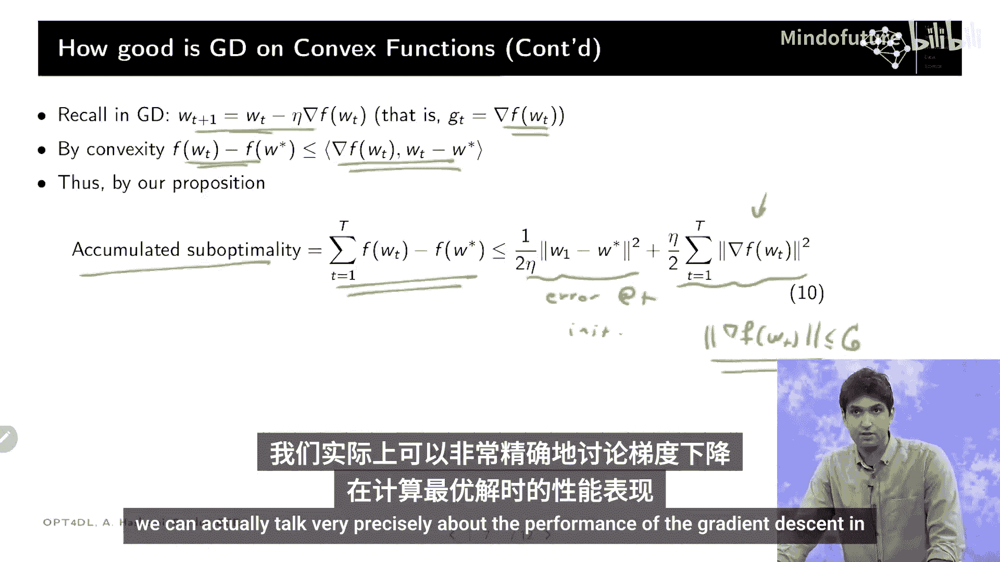

# 006：凸性条件下的梯度下降性能1

在本节课中，我们将学习最基础的优化算法之一——梯度下降法。我们将分析它在凸优化问题上的性能表现。虽然本课程主要处理非凸问题，但理解梯度下降在凸问题上的行为，能为我们后续学习更高级的训练算法提供重要的理论基础和洞察。

## 梯度下降法简介

上一节我们介绍了机器学习和优化的基本概念。本节中，我们来看看梯度下降法。这是一种迭代算法，意味着我们需要从一个初始点开始，然后反复应用一个特定的更新规则来逐步改进解。

以下是梯度下降法的基本步骤：
1.  初始化一个解 **w₁**。
2.  设定一个学习率（或步长）**η**。这个参数控制着每次更新的幅度。
3.  对于 **T** 次迭代，应用以下更新规则来找到下一个解 **w_{t+1}**：
    **w_{t+1} = w_t - η * g_t**
    其中，更新向量 **g_t** 是损失函数 **f** 在当前点 **w_t** 处的梯度：
    **g_t = ∇f(w_t)**

## 梯度下降的直观理解

为什么沿着负梯度方向更新是合理的？其直觉在于，通过这种更新方式，我们是在沿着函数值下降最快的方向移动。

我们可以借助泰勒定理更形式化地理解这一点。泰勒定理表明，函数可以在局部用一个线性函数近似。考虑两个点 **x** 和 **y**，且 **f(y) < f(x)**。根据泰勒展开，有：
**f(y) ≈ f(x) + ⟨y - x, ∇f(x)⟩**
重新整理可得：
**f(y) - f(x) ≈ ⟨y - x, ∇f(x)⟩ ≤ 0**
这意味着内积 **⟨y - x, ∇f(x)⟩** 是负的。因此，从 **x** 到函数值更低的点 **y** 的方向 (**y - x**) 与梯度方向 **∇f(x)** 是负相关的。梯度指向了函数值局部增长最快的方向。所以，为了最小化函数，我们应该朝梯度的反方向移动。

需要记住，这只提供了**局部**的下降方向。例如，在一个存在多个极小值的非凸函数中，梯度下降可能收敛到一个局部最优解而非全局最优解，这是局部方法固有的局限性。

## 分析梯度下降的性能

一个自然的问题是：梯度下降的性能如何？我们希望这个方法表现良好，因为它是许多现代深度学习训练算法的基础。

为了评估梯度下降的性能，我们首先在凸函数上检验它。凸性的一个好处是，我们可以对任意解的最优性差距（次优性）给出一个上界。

根据凸函数的定义，函数值总是位于其切线上方。这引出了以下不等式：
**f(w_t) - f(w*) ≤ ⟨w_t - w*, ∇f(w_t)⟩**
其中 **w*** 是最优解。这个不等式表明，解 **w_t** 的次优性 **f(w_t) - f(w*)** 被这个内积所界定。

因此，我们的策略是找到这个内积的一个上界，进而得到对梯度下降所得解 **w_t** 的次优性的上界。

## 一个关键的命题

为了达成上述目标，我们引入以下命题。该命题对于分析梯度下降（以及更一般的更新规则）至关重要。

**命题**：对于任意更新向量序列 **g₁, …, g_T** 和任意向量 **w***，如果我们使用更新规则 **w_{t+1} = w_t - η g_t** 生成解序列 **w₁, …, w_T**，那么以下不等式成立：
**∑_{t=1}^{T} ⟨w_t - w*, g_t⟩ ≤ (1/(2η)) ||w₁ - w*||² + (η/2) ∑_{t=1}^{T} ||g_t||²**

关于这个命题有两点重要说明：
1.  这个不等式对**任意**更新向量 **g_t** 都成立，不一定是梯度。
2.  这个不等式对**任意**向量 **w*** 都成立，不一定是最优解。

这个命题表明，这些内积的累积和受两项约束：第一项取决于初始点离 **w*** 有多远；第二项取决于更新向量的大小。

**证明概要**：证明非常简单，主要依赖于二次型的展开。我们考虑误差项 **||w_t - w*||²** 的演化。利用更新规则将其展开，经过重新整理并对时间步求和，我们会发现一个“伸缩和”。消去中间项后，再丢弃一个非负项，即可得到命题中的不等式。

## 应用于梯度下降

现在，我们将这个强大的命题应用于梯度下降分析。在梯度下降中，更新向量就是梯度：**g_t = ∇f(w_t)**。

利用该命题，我们得到了内积累积和的上界。再结合之前由凸性得到的不等式 **f(w_t) - f(w*) ≤ ⟨w_t - w*, ∇f(w_t)⟩**，我们可以推导出：
**∑_{t=1}^{T} [f(w_t) - f(w*)] ≤ (1/(2η)) ||w₁ - w*||² + (η/2) ∑_{t=1}^{T} ||∇f(w_t)||²**

这个结果说明，累积的次优性受两项约束：第一项是初始误差，第二项是算法运行过程中遇到的梯度大小的平方和。

我们希望随着迭代次数 **T** 的增加，这个累积次优性的增长是平缓的（即平均每次迭代的次优性在下降）。这很大程度上取决于第二项。如果运行梯度下降时遇到的梯度是有界的（即其范数平方不太大），那么我们就能期望获得良好的收敛性能。

为了进一步分析，我们需要对函数 **f** 施加一些正则性假设，特别是要刻画梯度的大小。在下一讲中，我们将介绍**利普希茨连续**函数类，这类函数能保证梯度是有界的。我们将看到，对于利普希茨连续函数，我们可以更精确地讨论梯度下降收敛到最优解的性能。

## 总结

本节课中，我们一起学习了梯度下降法的基本原理和直观解释。我们了解到它通过沿负梯度方向更新来局部最小化函数。为了分析其理论性能，我们引入了一个关键命题，该命题为任意更新规则的内积累积和提供了上界。通过将此命题与凸函数的性质结合，我们得到了梯度下降在凸问题上累积次优性的上界，该上界依赖于初始距离和梯度范数。这为下一讲引入利普希茨连续性以进一步分析收敛速率奠定了基础。