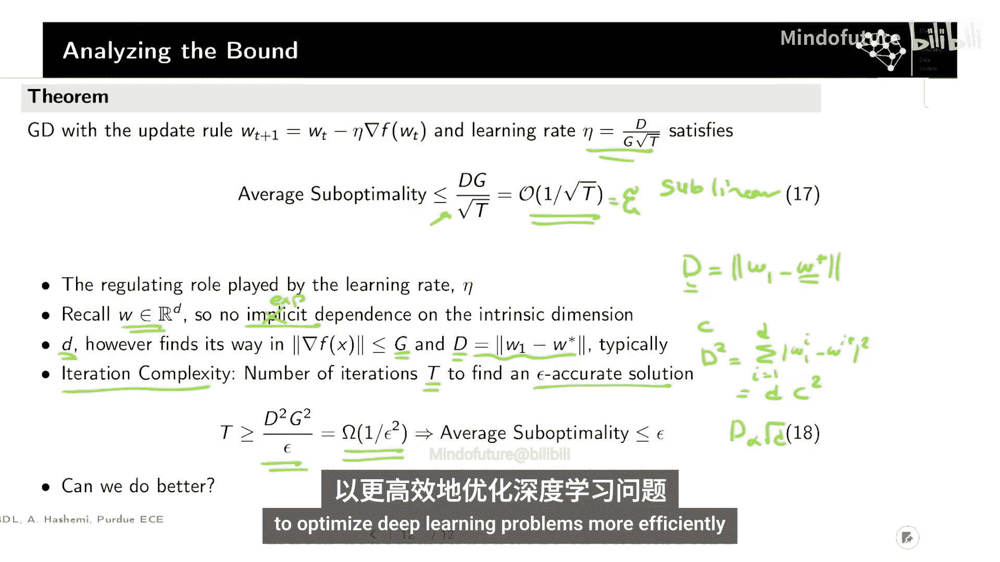

# 007：凸性与利普希茨条件下的梯度下降性能2 🎯

在本节课中，我们将要学习梯度下降算法在凸函数和利普希茨连续函数条件下的性能保证。我们将深入探讨利普希茨连续性的定义、直观理解，并分析其对梯度下降收敛性的影响。

## 概述 📋

上一节我们介绍了梯度下降算法及其性能分析的主要命题。我们证明了累积次优性可以被一个表达式所界定。我们希望这个界能够随着迭代次数T的增加而优雅地增长，这要求我们能够控制梯度范数的大小。

为了使分析更正式，我们将专注于一类特定的函数。对于这类函数，我们可以保证其梯度范数被某个常数G一致地界定。这类函数就是利普希茨连续函数。它们可以被视为具有某种连续性程度的连续函数。

## 利普希茨连续性定义 📖

首先，让我们回顾一下定义，并尝试建立一些直观理解。

一个函数 **f** 是 **G-利普希茨连续** 的，当且仅当对于某个常数G和所有向量 **x** 和 **y**，满足以下不等式：

**|f(x) - f(y)| ≤ G * ||x - y||**

这里的直观理解是，我们界定了函数值因输入变化而可能发生的变化程度。本质上，我们控制了函数的**敏感度**，或者说控制了函数的连续性程度。

常数G被称为利普希茨常数。G越大，意味着输入发生微小变化时，函数值的变化可能越大。在极端情况下，如果G等于0，那么无论输入如何变化，输出都不会有显著改变。例如，考虑常数函数 **f(x) = 3**，对于任何不同的x和y，其函数值之差为0。从某种意义上说，这是一个对输入变化高度鲁棒的函数。

另一种理解这个定义的方式是，它界定了函数的**斜率**。通过重新排列不等式，我们可以将其视为斜率：

**|f(x) - f(y)| / ||x - y|| ≤ G**

如果你回忆微积分课程，函数在某点的斜率可以定义为该点切线与x轴夹角的正切值。利普希茨连续性为这个斜率提供了一个上界。G越小，斜率的上界越小，函数对输入变化的敏感度就越低。

将梯度视为高维空间中的斜率也是有用的。梯度范数本质上就是斜率。因此，如果一个函数是利普希茨连续的，我们就是在说其斜率（或梯度范数）被常数G一致地界定。这一定义将有助于我们利用之前的结果，证明梯度下降算法的累积次优性能够随着迭代次数T的增加而优雅地增长。

对于可微函数，我们可以说它是利普希茨连续的，如果存在一个对梯度范数的一致上界：

**||∇f(x)|| ≤ G**

## 利普希茨连续性示例 📊

在回到梯度下降的讨论之前，让我们通过一些函数示例来看看它们是否是利普希茨连续的。

以下是几个函数示例及其利普希茨连续性分析：

1.  **平方根函数 f(x) = √x**
    *   **定义域 x ∈ [0, 1]**：当x趋近于0时，导数（梯度）1/(2√x) 趋近于无穷大。因此，在此区间上，函数**不是**利普希茨连续的。
    *   **定义域 x ∈ [0.5, 5]**：在此区间内，导数是一个有界值（最大为 1/(2√0.5)）。因此，在此区间上，函数**是**利普希茨连续的。

2.  **绝对值函数 f(x) = |x|**
    *   该函数在x=0处不可微，但几乎在所有点其“斜率”的绝对值都为1，是有界的。根据定义，**| |x| - |y| | ≤ 1 * |x - y|** 成立。因此，该函数是利普希茨连续的，常数为1。

3.  **指数函数 f(x) = e^x**
    *   **无定义域限制**：导数 f'(x) = e^x 随着x趋于无穷大而趋于无穷大。因此，全局来看，函数**不是**利普希茨连续的。
    *   **定义域 x ∈ [a, b]**：在紧致区间上，导数有上界 e^b。因此，在局部区间上，函数**是**利普希茨连续的。

4.  **平方函数 f(x) = x²**
    *   **无定义域限制**：导数 f'(x) = 2x 无界。因此，全局来看，函数**不是**利普希茨连续的。
    *   **定义域 x ∈ [a, b]**：在紧致区间上，导数有上界 2*max(|a|, |b|)。因此，在局部区间上，函数**是**利普希茨连续的。

希望这些例子能让你了解哪些函数是利普希茨连续的，哪些不是。核心思想是：**梯度范数（斜率）有界的函数是利普希茨连续的**。这为我们提供了一种量化函数对其输入变化敏感度的方法。

很多时候，即使某些函数全局不满足利普希茨条件，但如果我们把注意力集中在某个闭的、紧致的区间上，我们可以假设函数在局部是利普希茨连续的。

## 对梯度下降算法的影响 ⚙️

有了以上基础，让我们看看利普希茨条件对梯度下降算法意味着什么。

现在，除了凸性，我们还假设目标函数是 **G-利普希茨连续** 的。主要思想仍然是希望控制算法运行过程中观测到的梯度大小。

同时，我们定义一个简写符号 **D**，它衡量了初始化点 **w₁** 与某个最优解 **w\*** 之间的距离，本质上反映了初始化的误差：

**D = ||w₁ - w\*||**

根据我们之前的命题，我们建立了梯度下降累积次优性的界。现在，利用利普希茨连续性，以下定理的证明将变得几乎显而易见。

**定理**：如果函数 **f** 是凸的且 **G-利普希茨连续**，那么梯度下降算法（更新规则为 **w_{t+1} = w_t - η ∇f(w_t)**）将满足以下次优性界，只要我们将步长（学习率）η 设置为：

**η = D / (G √T)**

那么，得到的界是：

** (1/T) * Σ_{t=1}^{T} [f(w_t) - f(w\*)] ≤ (D G) / √T **

这个界表明，**平均次优性** 以 **D G / √T** 的速率衰减。

让我们解读一下这个界：
*   它表明，随着迭代次数T的增加，你找到的解平均而言会越来越接近最优解。
*   如果初始化点离最优解较远（D较大），界会更大，意味着可能需要更多迭代。
*   如果优化的函数更敏感（G较大，利普希茨常数大），收敛可能会更慢。反之，函数条件更好（敏感度低，G小），优化起来应该更容易。

你可能会问如何计算这个步长，或者为什么选择这个步长。本质上，误差被一个界所限制，而这个界是步长η的函数。我们所做的是**最小化这个界关于η的函数**，从而找到最佳的常数步长。这是一个简单的优化问题（最小化一个二次函数），通过求导即可得到上述最优η。

## 如何输出最终解 💡

接下来，我们讨论如何输出最终解，因为上述结果只告诉了我们平均次优性间隙。主要有三种方法：

1.  **输出最后一次迭代的解 (Last Iterate)**
    这是实践中最常用的方法。运行算法一定次数（如100或1000次迭代），然后将最后一次迭代得到的点作为最终解。直觉上，后面的迭代点性能应该更好。但需要指出的是，我们目前的分析**无法保证**最后一次迭代的解一定享有最佳性能。要证明这一点需要更复杂的分析（涉及步长的精细调整），这超出了本课程范围，我们将在后续讨论学习率调优时提及。

2.  **输出所有迭代点的平均 (Average of Iterates)**
    这种方法输出所有迭代点的平均值：**w_avg = (1/T) Σ_{t=1}^{T} w_t**。
    为什么这是个好主意？因为我们假设函数是凸的，可以利用凸性定义证明这个平均解享有可证明的性能保证。根据凸函数的定义（Jensen不等式），函数在平均点的值不大于函数值的平均：**f(w_avg) ≤ (1/T) Σ_{t=1}^{T} f(w_t)**。因此，平均解的次优性不会超过我们已证明的平均次优性界。
    **重要提示**：取平均**仅当函数是凸函数时才有意义**。对于非凸函数（如深度模型），取平均可能导致糟糕的结果（例如，两个全局最优点的平均可能是一个局部极大值点）。

3.  **随机均匀抽取一个迭代点 (Random Selection)**
    这种方法在运行梯度下降后，从所有迭代点中**均匀随机地**抽取一个点作为输出。例如，运行了100次迭代，则以1/100的概率选择其中任何一个点。
    在期望意义上，这个随机解满足我们之前找到的相同界，因为期望值正好等于平均次优性。这种方法的背后思想是，随着T增加，后面的迭代点会非常相似，因此我们更可能抽到类似于后面迭代点的解，从而在期望上模拟“最后一次迭代”的性能。这种方法在为非凸函数陈述理论保证时是更可取的。

## 关于收敛界的进一步讨论 🔍

让我们再深入讨论一下我们找到的界：**平均次优性 ≤ D G / √T**。

*   **收敛速率与大O记号**：有时隐藏常数D和G，只关注误差随迭代次数T趋于零的速率是很有用的。我们使用**大O记号**来表示：**O(1 / √T)**。我们称此为**次线性收敛速率**。

*   **学习率的调节作用**：最优步长 **η = D / (G √T)** 与D成正比，与G成反比。可以这样理解：
    *   如果初始化离最优点越远（D越大），步长需要更大以确保更快收敛。
    *   如果函数越“陡峭”、越敏感（G越大），我们必须更加小心，采取更小的步长以确保收敛。

*   **实践中的挑战**：这个步长的一个缺点是它依赖于D（初始误差）和G（利普希茨常数）。在实践中，这两个常数通常是未知的（例如，我们不知道最优解w\*在哪里，因此不知道D）。这就是为什么近年来出现了许多**自适应算法**的研究，它们能够在算法运行过程中在线估计这些对收敛至关重要的量。我们将在课程后续部分讨论。

*   **维数无关性**：值得注意的是，这个界中没有**显式地**出现维数依赖。假设w是d维向量（例如神经网络有1亿个参数，d=1亿），在这个界中，d并没有直接出现。这是梯度下降算法一个非常理想的特性，我们称此类结果为**维数无关**的结果。这也是为什么一些经典优化算法（如椭球法）因其维数依赖性强而不适用于大规模机器学习问题。
    *   **隐式维数依赖**：然而，维数可能通过常数D和G**隐式地**影响界。例如，初始误差D的平方是各坐标差值的平方和。如果每个坐标差是常数c，那么D²就与维数d成正比。

*   **迭代复杂度**：从**迭代复杂度**的角度来理解这个界也很有用。即，为了找到一个ε-精度的解（即平均次优性 ≤ ε），需要运行多少次迭代？通过设置 **D G / √T = ε** 并重新排列，我们得到所需的最小迭代次数为：
    **T ≥ (D G / ε)²**
    用大O记号表示为：**O(1 / ε²)**。

*   **界的紧致性**：我们提供的是一个误差的**上界**。你可能会问这个界是否紧致，即是否存在算法能达到更快的速率？对于凸且利普希茨连续的这类函数，在最坏情况下，梯度下降的速率是**最优**的，没有其他仅使用梯度信息的算法能做得更好（在阶的意义上）。然而，在实践中，问题通常具有更好的结构，因此我们可以设计出比标准梯度下降收敛更快的算法，这也激励着我们为深度学习问题设计更高效的训练算法。

## 总结 📝

本节课中，我们一起学习了利普希茨连续性的概念及其对梯度下降算法收敛性的影响。我们了解到：

1.  利普希茨连续性量化了函数对输入变化的敏感度，并保证了梯度范数的一致有界性。
2.  在凸且利普希茨连续的条件下，梯度下降以 **O(1 / √T)** 的次线性速率收敛。
3.  我们分析了最优常数步长的选择及其与初始误差D、利普希茨常数G的关系。
4.  我们探讨了输出最终解的几种策略（最后一次迭代、平均迭代、随机选择）及其适用场景。
5.  我们讨论了收敛界的维数无关性、迭代复杂度以及理论上的最优性。

在下一讲中，我们将讨论梯度下降的一个变体，它更适用于大规模问题：**随机梯度下降**。我们下次再见。