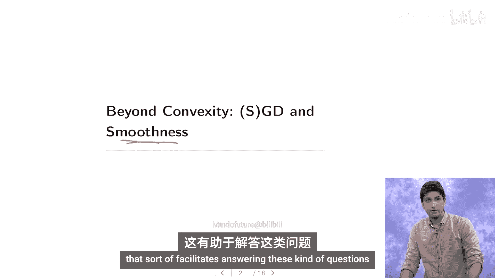
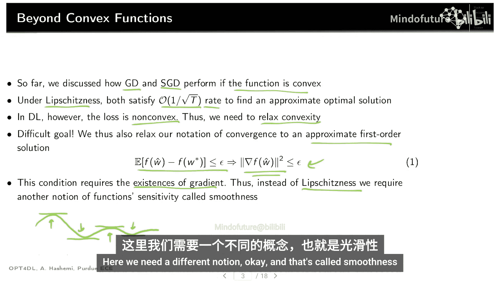
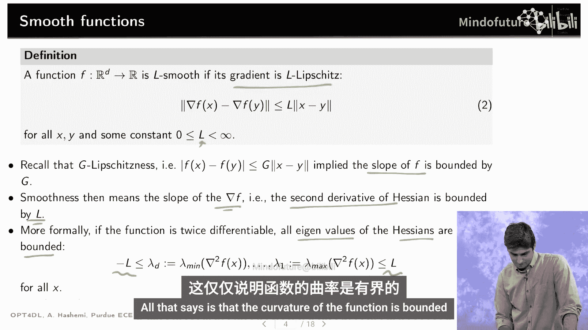
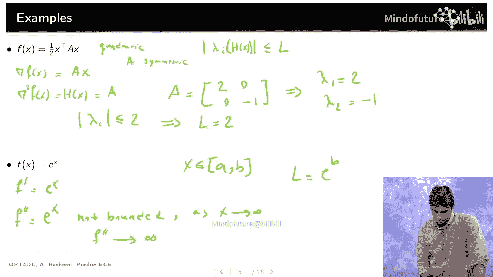
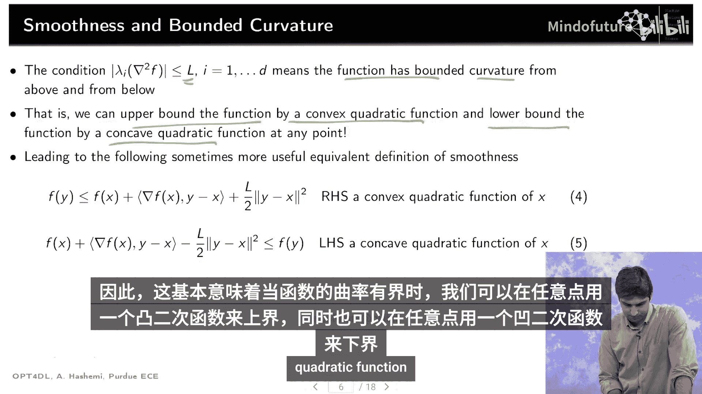
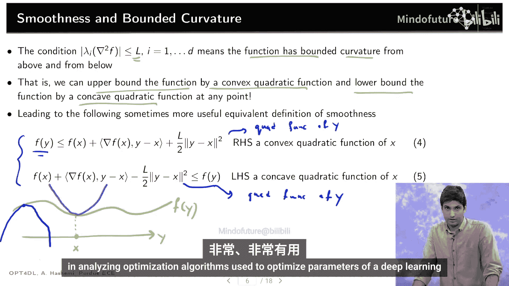
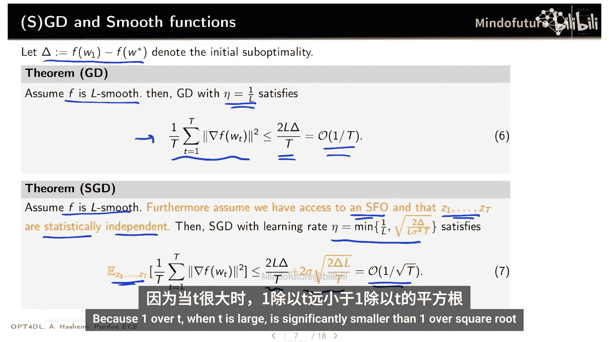
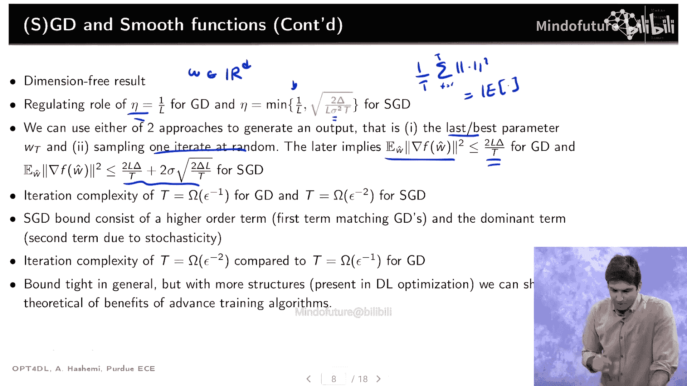
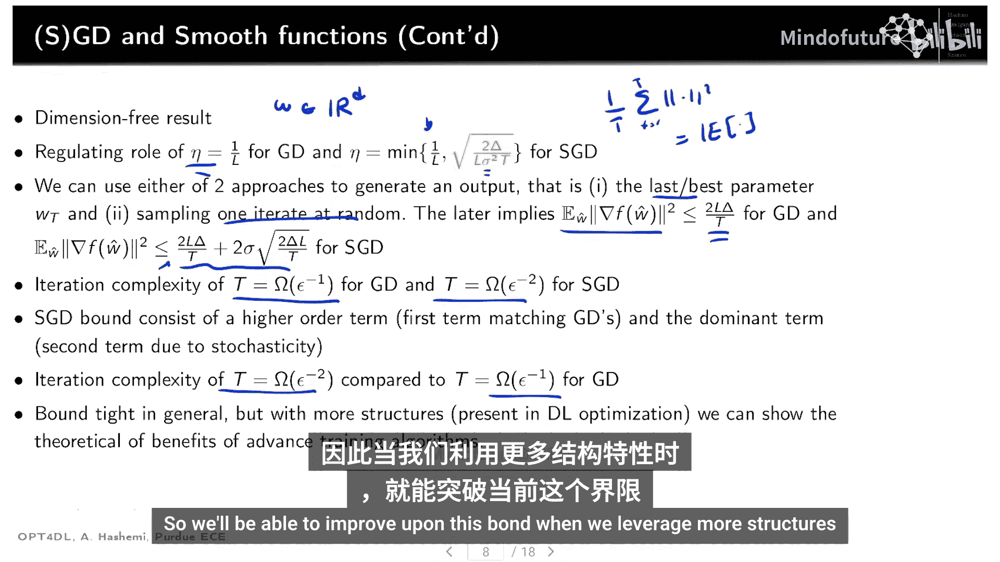

# 008：突破凸性约束 - 光滑性条件下的随机梯度下降法 1

## 概述
在本节课中，我们将学习如何突破凸性假设，分析梯度下降法和随机梯度下降法在非凸优化问题中的性能。我们将引入“光滑性”这一关键性质，并探讨它如何帮助我们理解算法在寻找平稳点（梯度接近零的点）时的收敛行为。

## 从凸性到非凸性
上一节我们介绍了梯度下降法和随机梯度下降法在凸函数下的性能。然而，在优化深度学习模型参数时，损失函数通常是非凸的。因此，我们的目标是放宽凸性假设。

这是一个非常困难且雄心勃勃的目标。我们的方法如下：首先，我们将从更简单的收敛概念开始，即评估一个解是否是平稳解（梯度为零或接近零），而不是关注其最优性差距。随着课程的深入，我们将识别深度学习优化问题中存在的特定结构，并利用这些结构来加强收敛性概念，从而为算法提供更强的保证。

首先，我们将从基本假设开始，这需要基本的收敛概念。我们的目标是关注近似平稳性，即评估一个解的梯度是否很小。

理想情况下，我们希望找到梯度为零的解。虽然这个条件也可能意味着该解是局部极大值点，但直观上，梯度下降法等遵循下降方向的算法不会收敛到这种高度不稳定的解。

## 光滑性：一个新的敏感性度量
这个收敛概念要求梯度有良好定义，即要求梯度的存在。这反过来要求我们使用不同的概念来描述函数的敏感性。之前我们讨论的是利普希茨连续性，它意味着参数值轻微变化时，函数值变化不大。这里我们需要一个不同的概念，即“光滑性”。

形式上，我们称一个函数是 **L-光滑** 的，如果它的梯度是利普希茨连续的。这意味着，如果我稍微改变参数值，梯度值的变化不会太大。常数 **L** 决定了敏感性的程度。

如果 **L** 很大，意味着梯度对输入的变化更敏感，因此函数在某种意义上也更敏感。另一方面，如果 **L** 非常小（极端情况下等于0），那么改变输入时梯度变化不大，因此我的函数也具有较低的敏感性。

你也可以将此条件视为梯度切线斜率的一种形式。利普希茨连续性意味着函数切线（一阶导数）的斜率有界。而光滑性则意味着梯度切线（即二阶导数或海森矩阵）的斜率有界。更正式地说，如果函数是二阶可微的，那么所有海森矩阵的特征值都以 **L** 为界。

这意味着特征值都很好地位于 **-L** 和 **L** 之间。注意，这并不要求函数是凸的，因为特征值确实可以是负的。它只说明有界函数的曲率是有界的。

## 光滑性示例
让我们先看一些例子，然后再深入讨论光滑性。

**示例 1：二次函数**
假设函数为 **f(x) = (1/2) x^T A x**，其中 **A** 是对称矩阵。我们需要证明海森矩阵的特征值以 **L** 为界。该函数的梯度是 **Ax**，海森矩阵就是 **A**。因此，只要矩阵 **A** 的特征值有界，该函数就是光滑的。

例如，假设 **A** 是一个对角矩阵 **diag(2, -1)**。根据线性代数，特征值就是对角线上的元素，即 2 和 -1。这个函数是非凸的，但特征值的绝对值以 2 为界。这意味着光滑常数 **L = 2**。

**示例 2：指数函数**
考虑标量函数 **f(x) = e^x**。其一阶导数和二阶导数都是 **e^x**。当 **x** 趋于无穷大时，二阶导数也趋于无穷大，因此该函数不是（全局）光滑的。这符合直觉，因为它对输入变化高度敏感。

然而，如果我将定义域限制在某个区间 **[a, b]** 内，那么我可以界定光滑性参数。在这种情况下，最大的光滑参数就是 **e^b**。因此，任何定义域受限的、良好可微的函数都可以被认为是光滑的，但光滑常数可能非常大。这也意味着我们将建立的性能保证有时可能非常宽松和保守。

## 光滑性的另一种视角
将光滑性视为所有特征值有界，意味着函数具有有界的曲率。具体来说，我们可以在任意点用一个凸二次函数全局上界该函数，同时也可以用一个凹二次函数全局下界该函数。

更数学化地，这两个条件可以用以下两个不等式表示。你可以将它们视为光滑函数的等价定义。这两个不等式在分析用于优化深度学习模型的算法时非常有用。

*   **全局上界**：**f(y) ≤ f(x) + ∇f(x)^T (y - x) + (L/2) ||y - x||^2**
*   **全局下界**：**f(y) ≥ f(x) + ∇f(x)^T (y - x) - (L/2) ||y - x||^2**

## 梯度下降法与随机梯度下降法的性能
我们将利用光滑性来分析本课程中见过的两种算法的性能：梯度下降法和随机梯度下降法。

首先定义符号：令 **Δ = f(x_1) - f^*** 表示初始最优性差距。

**梯度下降法理论**
如果我们的函数是 **L-光滑** 的，那么以步长 **η = 1/L** 运行梯度下降法将满足以下界限：

**min_{1≤k≤T} ||∇f(x_k)||^2 ≤ (2LΔ) / T**

这个界限说明：
*   它与 **L** 成正比：函数越敏感，界限越大。
*   它与初始最优性差距 **Δ** 成正比：初始化时离最优解越远，界限越大。
*   它与迭代次数 **T** 成反比：算法运行越久，越接近平稳点。

用大O表示法，其依赖关系是 **O(1/T)**，这是一个次线性速率。

**随机梯度下降法理论**
同样假设函数是 **L-光滑** 的。此外，我们还需要一些假设：我们能够访问一个随机一阶预言机，它能在每次迭代中返回梯度的无偏估计，并且估计值方差有界。同时，我们假设每次迭代使用的样本在统计上独立。

如果以步长 **η = min(1/L, (Δ/(Lσ^2 T))^{1/2})** 运行SGD，将满足以下界限：

**E[ (1/T) ∑_{k=1}^T ||∇f(x_k)||^2 ] ≤ (4LΔ)/T + 4σ √( (LΔ)/(T) )**

期望中的平均梯度范数以两项为界：
1.  第一项与梯度下降法的性能相同。
2.  第二项依赖于我们预言机的方差 **σ^2**。如果预言机完美（方差为0），此项消失。否则，方差越高，SGD性能中的第二项就越大。

用大O表示法，这是 **O(1/√T)**。这与我们在凸函数下比较GD和SGD时看到的情况不同。之前，在凸且利普希茨连续的条件下，两者本质上达到了相同的 **T** 依赖速率。然而在这里，梯度下降法的误差下降得更快，因为当 **T** 很大时，**1/T** 明显小于 **1/√T**。

## 结果讨论
以下是关于这些定理及其陈述的简短讨论：

*   **维度无关性**：结果同样是维度无关的。参数大小 **d** 没有直接出现在界限中，但会通过相关参数（如方差、光滑常数等）隐式影响。
*   **步长（学习率）的作用**：步长再次起到调节作用。函数越敏感（**L** 越大），我们必须使用越小的步长以确保仍能接近平稳点。对于SGD，步长选择还依赖于方差。如果预言机的方差很大，**η** 的选取需要考虑这一点，意味着我们将更谨慎地选择步长，因此会采用更小的学习率。
*   **输出解的方式**：定理陈述的是迭代过程中遇到的梯度范数的平均值。在实践中，我们通常输出最后一个解或最佳解，但定理并未为这种方法提供性能保证。另一种方法是随机均匀地选取一个迭代点作为输出解。此时，期望梯度范数的界限就对应于定理中的平均界限。
*   **迭代复杂度**：另一种解释结果是讨论迭代复杂度。若希望误差小于 **ε**，需要运行多少次迭代？对于梯度下降法，迭代复杂度为 **O(1/ε)**；对于SGD，则为 **O(1/ε^2)**。这意味着要达到相同的精度 **ε**，可能需要运行SGD更多次迭代。
*   **SGD界限中的项**：SGD的界限有两项。第一项与GD性能匹配，称为高阶项。第二项依赖于方差 **σ**，并且主导了整个界限（因为对 **T** 的依赖更大），因此称为主导项。正是这个主导项使得SGD的迭代复杂度比梯度下降法更差。
*   **界限的紧致性**：一个自然的问题是这些界限是否紧致（即是否可能达到）。我们陈述的是最坏情况下的性能。在实践中，我们通常远离最坏情况场景，这意味着这些算法的收敛速度可能比这里陈述的速率更快。然而，在最坏情况下，你无法做得比这更好。不过，随着课程的深入，当我们讨论更先进的训练算法时，我们将能够利用深度学习模型优化中存在的结构，证明某些训练算法确实比SGD更好，从而改进这个界限。

## 总结
本节课中，我们一起学习了如何突破凸性约束来分析优化算法。我们引入了**光滑性**这一关键性质，它描述了梯度变化的界限。基于此，我们分析了梯度下降法和随机梯度下降法在非凸光滑函数下的性能，得到了它们收敛到平稳点的理论保证及其迭代复杂度。我们发现，在此设定下，梯度下降法通常比随机梯度下降法具有更快的理论收敛速率。这为我们后续研究更高效的优化算法奠定了基础。下一节，我们将探讨光滑性的另一个好处，并看看如何利用它来设计更通用、更优秀的算法。