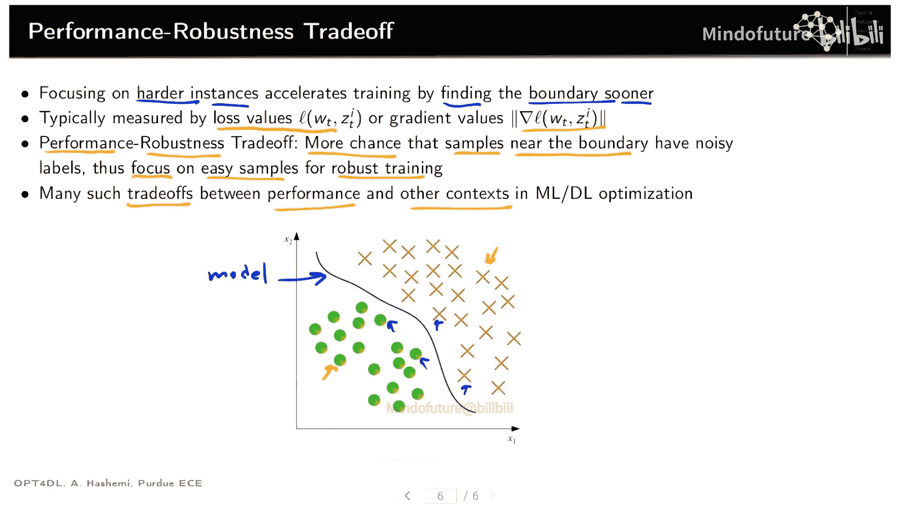

# 011：随机梯度下降实例分析 🧪

在本节课中，我们将通过两个具体的例子，来观察随机梯度下降（SGD）算法在实际问题中的表现。我们将分析线性回归和非线性回归场景下SGD的行为，并探讨不同采样策略对收敛速度的影响。

## 线性回归示例

上一节我们介绍了SGD的基本原理，本节中我们来看看它在经典线性回归问题上的应用。

在线性回归中，我们假设特征向量 **x** 与标量标签 **y** 之间存在线性关系，并带有观测噪声。模型可以表示为：
`y = w^T * x + ε`
其中 **w** 是待学习的参数，**ε** 是噪声。

我们通常使用平方损失（均方误差）来衡量模型拟合的好坏，优化目标是：
`min_w (1/n) * Σ (y_i - w^T * x_i)^2`

以下是使用SGD训练线性回归模型的核心代码步骤：

1.  **数据生成**：随机生成特征向量 **x**、真实模型参数 **w_true** 和噪声 **ε**，然后合成观测标签 **y**。
2.  **损失计算**：在每次迭代中计算当前损失，用于监控算法进展。
3.  **小批量采样**：从数据集中均匀随机采样（有放回）一个小批量（mini-batch）的数据。
4.  **梯度计算**：对于线性模型，我们可以直接写出损失函数关于参数 **w** 的梯度（或随机梯度）的解析形式：`∇L(w) = (1/|B|) * Σ (w^T * x_i - y_i) * x_i`，其中 **B** 是小批量。
5.  **参数更新**：按照SGD更新规则调整参数：`w_new = w_old - η * ∇L(w)`，其中 **η** 是学习率。

我们通过实验观察了两种不同参数规模下的SGD表现：

*   **欠参数化模型（d=10， n=100）**：参数维度小于数据量。SGD成功收敛，经验风险降至接近零。迭代过程中损失曲线存在微小波动，这是使用随机梯度（噪声估计）而非真实梯度的正常表现。
*   **过参数化模型（d=200， n=100）**：参数维度大于数据量，这是深度学习中更常见的情况。尽管优化问题更复杂，SGD依然能够收敛到一个使经验损失最小化的解。这引出了后续课程中将要讨论的“插值”和“过参数化”现象。

## 非线性回归与采样策略对比

现在，让我们将问题扩展到非线性回归，并比较SGD的不同变体。

非线性回归模型可以看作一个简单的神经网络，例如使用ReLU激活函数：`y = σ(w^T * x)`，其中 **σ** 是非线性函数。我们比较了四种SGD变体的性能：

以下是四种不同采样策略的SGD变体性能对比：

1.  **SGD（有放回采样）**：即理论分析中常用的基础版本，性能相对最慢。
2.  **SGD（无放回采样 / 基于轮次的SGD）**：在每个训练轮次（epoch）内，数据被无放回地遍历一遍。其收敛速度快于有放回版本，因为每个小批量都能提供新的、未被重复使用的信息。
3.  **基于损失的排序SGD**：根据每个样本的当前损失值来优先选择样本组成小批量，倾向于选择“更难”的样本（损失值高的样本）。
4.  **基于梯度范数的排序SGD**：根据每个样本对应梯度的范数大小来优先选择样本，同样倾向于选择“更难”的样本（梯度大的样本）。

实验结果表明，两种“排序SGD”变体的收敛速度显著快于两种基础SGD。原因在于，通过关注那些当前模型拟合得不好（损失大或梯度大）的“困难”样本，算法能更有效地学习到决策边界。

## 性能与鲁棒性的权衡

聚焦于困难样本的策略虽然能加速训练，但也可能引入新的考量。

在分类问题中，“困难”样本通常靠近决策边界。如果数据集中存在标签噪声，那么这些边界附近的样本被错误标注的概率也更高。如果算法过于关注这些可能被误标的困难样本，学到的模型可能会“记住”噪声，从而导致在未见数据上的泛化能力变差，即鲁棒性降低。

因此，在实践中存在一个**性能（收敛速度）与鲁棒性（泛化能力）的权衡**：
*   如果确信数据非常干净，聚焦困难样本是高效策略。
*   如果预期数据存在噪声，那么关注“简单”样本或采用更温和的采样策略，可能有助于获得更鲁棒的模型，尽管收敛速度可能稍慢。

类似的权衡（如性能与公平性、性能与隐私）在深度学习优化中广泛存在，我们将在后续课程中进一步探讨。

## 总结

本节课中我们一起学习了SGD在两个具体优化问题上的应用。我们看到，即使在过参数化的线性回归模型中，SGD也能有效工作。通过对比不同采样策略，我们发现关注“困难”样本可以显著提升收敛速度，但这需要与模型的鲁棒性需求进行权衡。这些实例为我们理解SGD在更复杂的深度神经网络中的行为奠定了基础。在未来的课程中，我们将介绍旨在增强SGD性能的各类变体算法。