# 012：高置信度保证 🎯

在本节课中，我们将探讨随机梯度下降（SGD）算法的高置信度性能保证。我们将了解在何种条件下SGD能提供可靠的性能，以及当这些条件不满足时，如何通过改进算法来获得高置信度保证。

---

## 回顾与动机

上一节我们介绍了SGD的期望误差界。对于凸且光滑的函数，期望次优性间隙（即 `E[f(w_T) - f*]`）的界为 `O(1/√T)`。对于一般的非凸光滑函数，期望梯度范数（即 `E[||∇f(w_T)||]`）的界为 `O(1/√T)`。

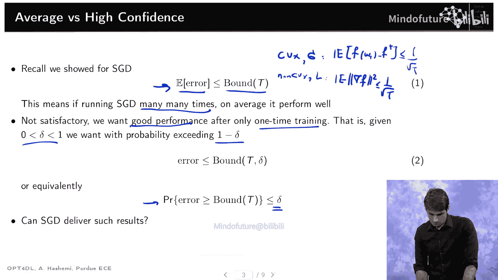

这意味着，如果我们多次运行SGD，其平均性能是良好的。然而，这并不完全令人满意，因为我们通常只训练模型一次，并希望这一次训练就能获得非常好的性能。

数学上，我们可以将这种期望表达为：给定一个很小的置信度参数 `δ`（例如0.1或0.01），我们希望以超过 `1 - δ` 的概率，算法的误差是有界的。换句话说，每次运行SGD时，我们以高概率期望获得良好性能。等价地，性能不佳的概率被一个很小的数 `δ` 所限制。

核心问题是：SGD能否提供这样的高置信度保证？

---

## 方法一：更强的噪声假设

我们之前的主要假设是能够访问一个随机梯度估计器 `g_t`，它是真实梯度的有噪声版本，且噪声的条件均值为零，方差有界。

如果我们加强这个假设，例如假设噪声是**轻尾**或**次高斯**的，那么我们就可以证明SGD能以高概率表现良好。

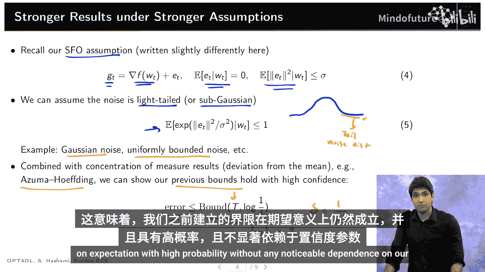

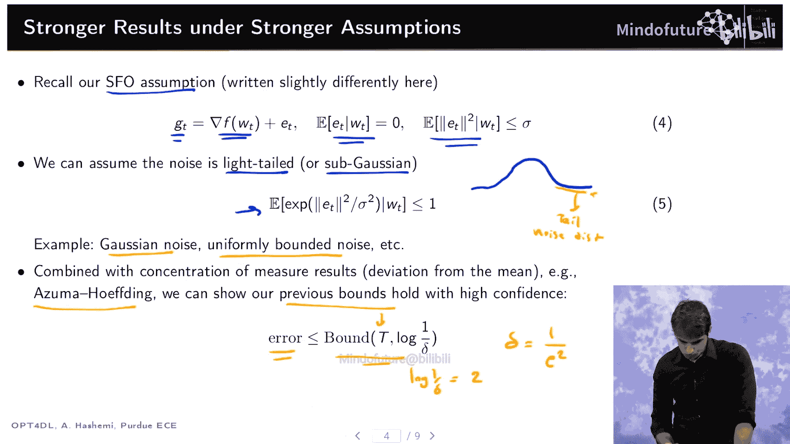

以下是次高斯噪声的定义：
*   噪声分布的尾部被一个高斯随机变量的尾部所上界。
*   例如，高斯噪声或均匀有界噪声都满足此条件。

在此假设下，我们可以借助**集中不等式**（如Azuma-Hoeffding不等式）来分析随机变量和与其均值的偏差。利用这类结果，我们确实可以证明SGD的误差（对于凸函数是次优性间隙，对于非凸函数是梯度范数）以高概率被一个依赖于 `T` 和 `log(1/δ)` 的量所界定。

由于 `log(1/δ)` 可以视为常数，这意味着我们可以在不显著影响收敛速率的情况下，获得高概率保证。

### 关键工具：鞅差序列

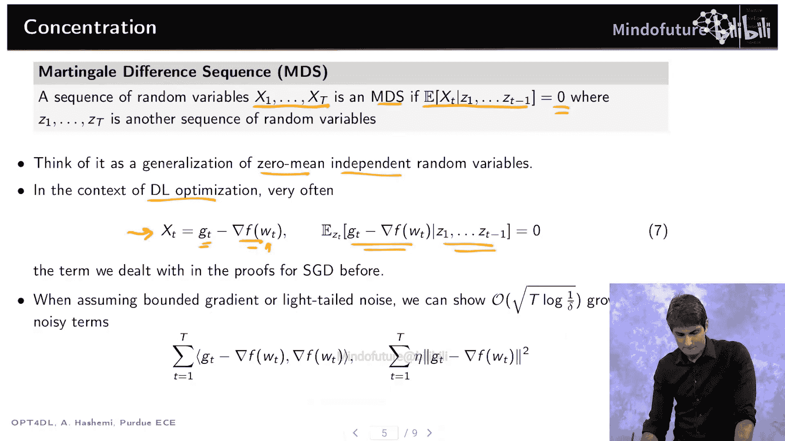

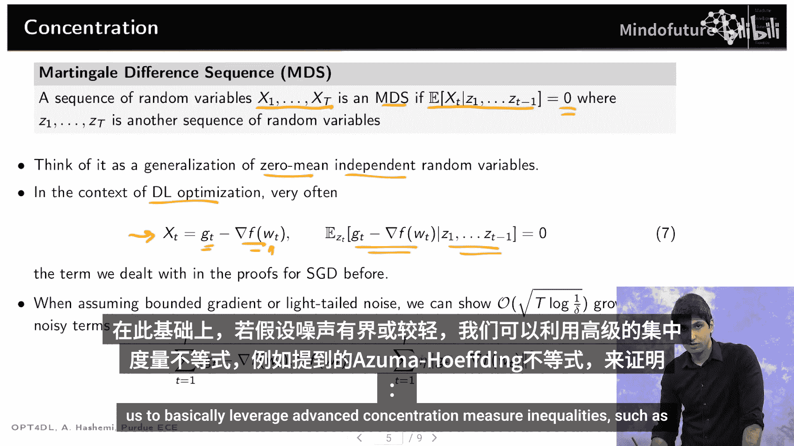

为了将上述思想与理论分析结合，需要一个有用的概念：**鞅差序列**。

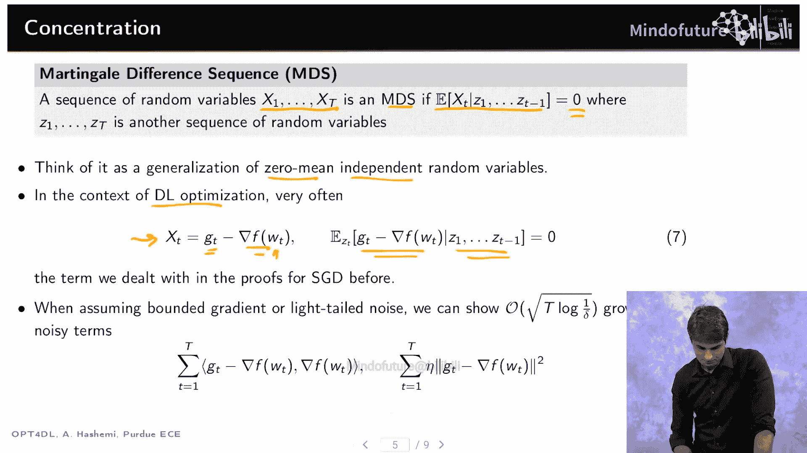

一个随机变量序列 `{X_t}` 是关于另一个序列 `{Y_t}` 的鞅差序列，如果 `E[X_t | Y_1, ..., Y_{t-1}] = 0`。

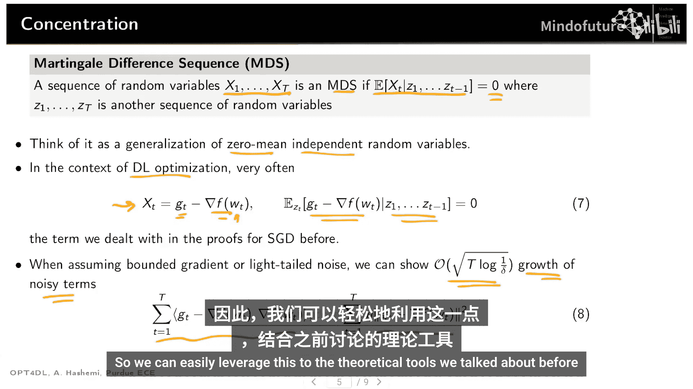

直观上，这可以看作是零均值独立随机变量序列的推广。在我们的上下文中，`X_t` 通常是随机梯度与真实梯度之间的差 `g_t - ∇f(w_t)`。虽然这些 `X_t` 不是独立的（因为 `w_t` 依赖于历史），但在给定过去信息的条件下，其期望为零。

结合有界或轻尾噪声的假设，我们可以利用Azuma-Hoeffding这类高级集中不等式来证明，在SGD分析中出现的噪声累积项随 `T` 的增长是平缓的，从而获得对迭代次数 `T` 的良好依赖，以及对置信参数 `δ` 的 `log(1/δ)` 依赖。

---

## 方法二：改进SGD算法

然而，上述更强的噪声假设在实践中可能不成立。在深度学习的优化中，噪声通常不是轻尾的。

一个直观的改进方法是进行**梯度裁剪**或**归一化**。

*   **裁剪**：确保梯度（或更新向量）的每个坐标不超过某个常数 `C`，也不小于 `-C`。公式表示为：`g_t_clipped = clip(g_t, -C, C)`。
*   **归一化**：将梯度除以其范数，确保更新向量的范数有界。

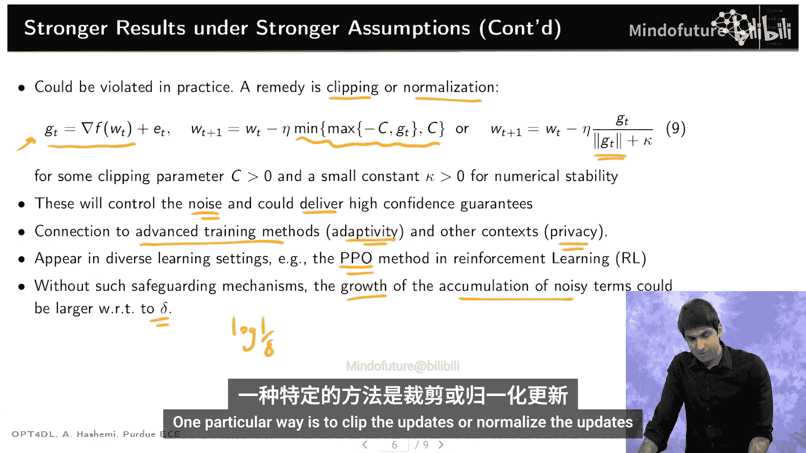

这两种操作都能确保更新向量不会过大，从而控制噪声。通过更复杂的理论分析，可以证明改进后的算法能够提供高置信度保证。主要的理论挑战在于处理裁剪或归一化引入的**偏差**，因为经过处理的梯度不再是真实梯度的无偏估计。

这种方法也与课程后续将讨论的**自适应优化算法**（如Adam）以及**隐私保护机器学习**中的技术有密切联系。在强化学习的PPO方法中，也能看到裁剪思想的应用。

---

## 方法三：通过集成（Boosting）改进SGD

如果我们不施加更强的噪声假设，就无法使用高级集中不等式。此时，我们只能使用基本的马尔可夫不等式。

马尔可夫不等式指出，对于任何正随机变量 `X` 和正常数 `λ`，有：`P(X ≥ λ) ≤ E[X] / λ`。

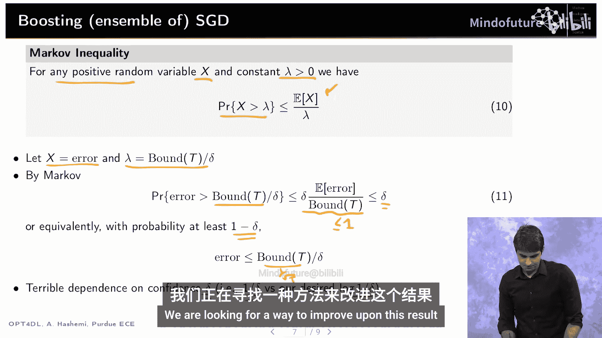

将其应用于SGD：令 `X` 为误差，`λ` 为之前得到的期望误差界除以 `δ`。根据马尔可夫不等式，误差超过 `Bound/δ` 的概率最多为 `δ`。因此，我们确实可以为SGD建立一个高置信度保证，但其形式为：以高概率，误差 ≤ `O(1/(δ√T))`。

这个保证的缺点是，它对置信参数 `δ` 的依赖是 `1/δ`，而不是更理想的 `log(1/δ)`。当 `δ` 很小时，`1/δ` 会很大。

为了改进这一点，我们可以采用**集成（Boosting）** 的思想。将SGD视为一个“弱学习器”，通过组合多个SGD的运行结果来得到一个“强学习器”。

### 集成SGD算法

算法步骤如下：
1.  并行运行 `S` 个独立的SGD实例，每个运行 `T` 次迭代。
2.  在后续优化步骤中，使用额外的 `N` 个数据点来近似计算真实梯度（或函数值）。
3.  从 `S` 个候选解中，选择梯度范数最小（或函数值最小）的那个作为最终输出。

### 复杂度与理论保证

*   **标准SGD复杂度**：`O(T)`（假设批大小 `B` 为常数）。
*   **集成SGD复杂度**：`O(N + T * S)`。
    *   `N`: 后续优化步骤中评估解所用的数据点数。
    *   `T * S`: 并行运行 `S` 个SGD的总迭代数。

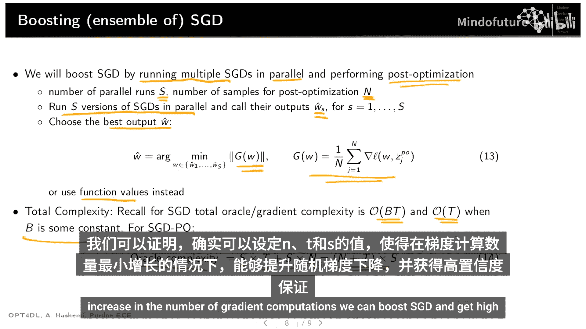

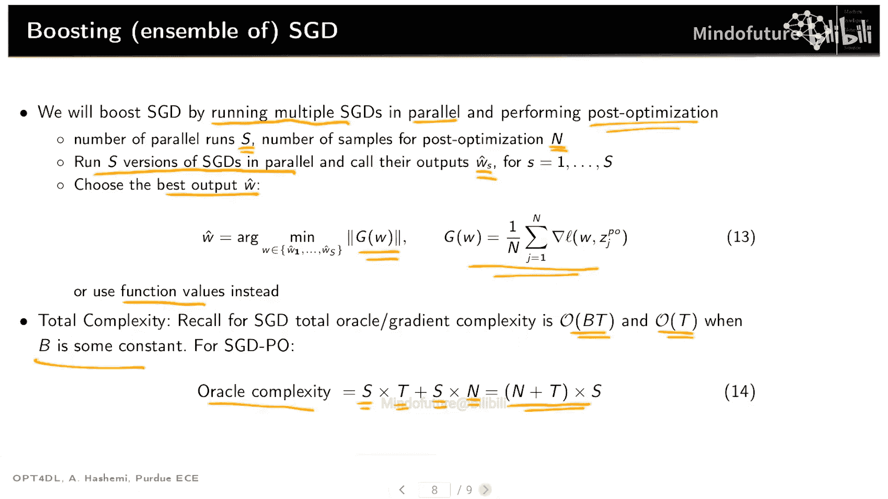

我们可以设置参数 `N`， `T`， 和 `S`，使得总复杂度仅比单次运行SGD略有增加，同时获得高置信度保证。

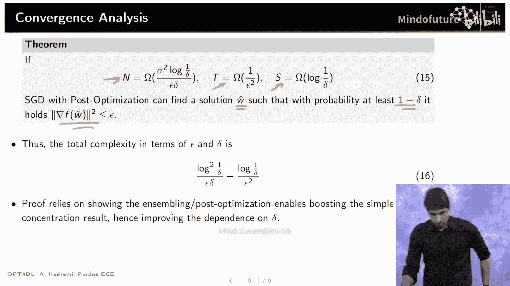

具体理论指出，通过适当选择参数，集成SGD能找到解 `w`，使得以至少 `1 - δ` 的概率，有 `||∇f(w)|| ≤ ε`。其总计算复杂度（主导项）为 `O( (1/ε²) * log(1/δ) )`。

### 对比
*   **SGD期望性能**：复杂度主导项为 `O(1/ε²)`。
*   **SGD+马尔可夫不等式**：高置信度复杂度为 `O(1/(ε²δ))`。
*   **集成SGD**：高置信度复杂度为 `O( (1/ε²) * log(1/δ) )`。

由此可见，通过集成方法，我们将对置信参数 `δ` 的依赖从 `1/δ` 显著改善为 `log(1/δ)`，而总计算量相比单次SGD运行仅增加了 `log(1/δ)` 倍，这在实际中可视为常数。这意味着，在实践中，只需并行运行少数几个SGD（例如3-4个），然后进行简单的后续选择，就能得到比单次运行方差更低、置信度更高的性能。

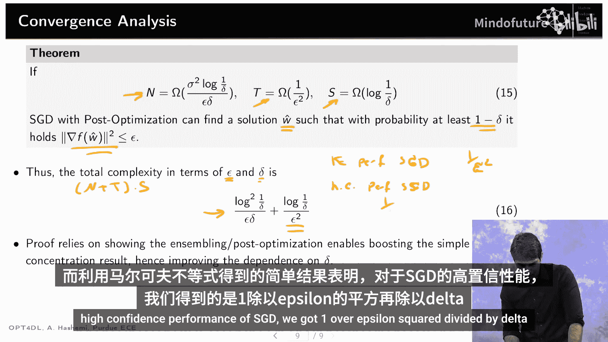

---

## 总结 📝

本节课中，我们一起学习了为随机梯度下降（SGD）建立高置信度性能保证的几种途径：

1.  **施加更强假设**：在噪声为次高斯等轻尾分布的假设下，可以利用集中不等式（如Azuma-Hoeffding不等式）和鞅差序列工具，直接证明SGD能以高概率获得与期望性能相近的界，且对置信参数 `δ` 的依赖仅为 `log(1/δ)`。
2.  **改进算法**：当噪声假设不满足时，可以通过**梯度裁剪**或**归一化**来控制更新量，进而控制噪声的影响，但需要仔细分析由此引入的偏差。
3.  **集成方法**：通过并行运行多个SGD实例并进行后续优化选择，可以“增强”SGD。这种方法仅使用基本的马尔可夫不等式，就能将高置信度保证中对 `δ` 的依赖从 `1/δ` 提升到 `log(1/δ)`，且计算开销增加很小。

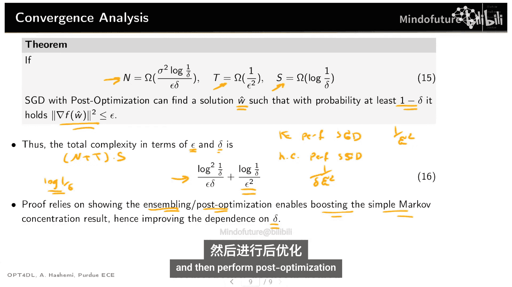

在下一讲中，我们将探讨另一种增强随机梯度下降能力的方法。