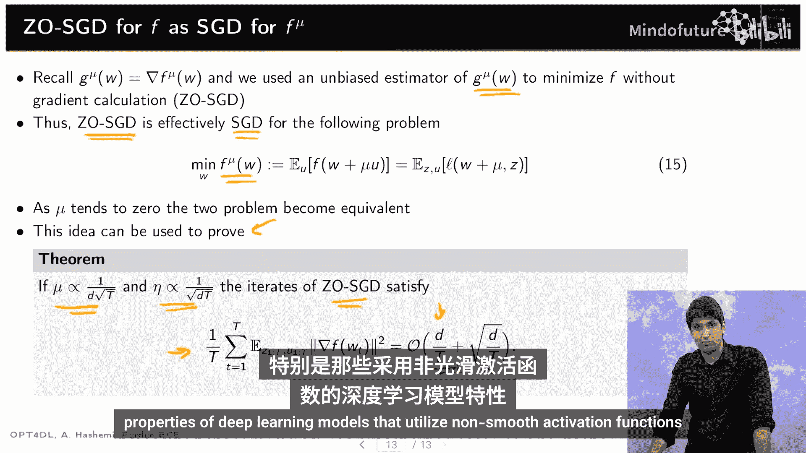

# 014：无梯度随机下降方法

## 概述
在本节课中，我们将学习如何在无法获取梯度信息的情况下，执行类似随机梯度下降的优化。我们将介绍零阶估计器的概念，它仅使用函数值来近似梯度，并探讨其背后的数学原理、实现方法及其在深度学习中的应用。

---

## 从标量函数建立直觉

上一节我们探讨了无梯度优化的目标。本节中，我们来看看如何具体实现。

首先，让我们聚焦于一个标量函数，以建立直觉。回想一下导数的定义。

导数的定义本质上是一个极限，可以写作：
`f'(w) = lim_{μ→0} [f(w + μ) - f(w)] / μ`
如果函数足够光滑，使得左导数和右导数相等，我们也可以使用其他形式的公式来计算导数。

这个极限意味着，为了计算某一点的导数，我们需要进行微小的扰动，观察函数值的变化，然后将变化量除以扰动量。当扰动量趋于0时，我们就能得到该点切线的斜率，也就是导数。

现在，假设我们不将 μ 设为趋于0，而是使用一个固定但非常小的 μ 值。考虑以下这个量：
`[f(w + μ) - f(w - μ)] / (2μ)`
当 μ 趋于0时，这个量就是函数的导数。如果 μ 不为0但很小，我们仍然期望它能很好地近似导数。

对于小的 μ，这应该是一个良好的近似。

观察这个表达式，我们只需要两次函数求值，而不需要任何梯度（在这里是导数）计算。这正是我们想要的。

因此，如果我要最小化函数 `f`，我可以不使用 `f` 的导数来执行梯度下降，而是使用这个只需要两次函数求值的近似来执行我的梯度下降步骤。

但这里有一个问题：这个近似会引入一些偏差，偏差的大小取决于 μ。直观上，μ 越小，近似越好，偏差也越小。当 μ 趋于0时，偏差消失，我们的近似收敛到函数的真实导数。

---

## 扩展到多维：引入随机性

然而，深度学习模型通常有数十亿个参数，这意味着我们的损失函数不是标量函数，其定义域是多维的。我们需要将这个思想扩展到多维空间。

为了做到这一点，我们将借助随机性的力量。我们将把之前讨论的近似看作是在一个维度上（我们讨论的是标量函数），但将其视为对随机方向的期望。

数学上，我们这样做：设 `u` 为一个随机方向。在 `R^1` 中，`u` 是位于单位球面上的向量。在 `R^1` 中，单位球面就是区间 `[-1, 1]` 的端点，即 `-1` 和 `1`。

考虑以下随机变量：
`g(u) = [f(w + μu) - f(w)] / μ * u`
这与上一张幻灯片的内容非常相似，只是我在这里引入了 `u`，并且稍微改变了分子中的表达式。因为 `u` 是随机的，所以 `g` 是 `u` 的函数，因此 `g` 也是一个随机变量。

现在，讨论这个随机变量的期望值。当我们对 `u` 取期望时（选择是均匀随机的，向左或向右的可能性相等），期望实际上非常简单。它是当 `u=1` 时对应量的一半，加上当 `u=-1` 时对应量的一半。

进行简化后，你会发现这个期望正是我们在上一张幻灯片中讨论的近似。因此，那个近似就是这个随机变量的期望值。

显然，如前所述，当 μ 很小时，这将是函数真实导数的良好近似。

那么结论是：我定义的这个新随机变量，是那个近似（它本身又是真实导数的近似）的一个无偏估计量。

---

## 构建多维零阶估计器

现在，让我们看看如何基于这个思想构建多维情况下的估计器。

我们选择一个随机方向，它位于单位球面的表面上。在多维情况下，我们仍然做同样的事情：从 `R^D` 中的单位球面均匀采样 `u`。具体来说，如果 `D=2`，单位球面看起来就像一个圆，我将从这个圆的表面上采样一个向量。

我们的估计器将与上一张幻灯片讨论的形式完全相同：
`g(u) = [f(w + μu) - f(w)] / μ * u`
特别地，它有一个随机的幅度（由 `[f(w + μu) - f(w)] / μ` 决定）和一个随机的方向 `u`。因此，它是一个随机估计器。

这就是我们将用来在没有梯度信息的情况下优化损失函数的估计器。这个估计器被称为**零阶估计器**，因为它只使用零阶信息（即函数值），而不使用一阶信息（梯度）或二阶信息（海森矩阵）。

这里有一个细节：除了使用单位球面分布，你也可以使用其他分布来采样 `u`。例如，你可以使用高斯分布。原因在于，服从正态分布的向量与其归一化版本（位于单位球面上）之间存在非常简洁的联系。具体来说，如果 `U` 是一个高斯向量，那么它的归一化版本就位于单位球面的表面上。

---

## 用于优化的零阶SGD算法

那么，我们如何将其用于优化呢？想象一下，我们正在最小化一个随机损失，例如：
`min_w F(w) = E_{z~D}[f(w; z)]`
我们将其视为最小化训练数据上的平均损失。

我们初始化迭代算法，使用某个学习率 `η`，并固定一个平滑率 `μ`（稍后我们将看到为什么称之为平滑率或平滑参数）。

以下是一个直观的算法，进行 `T` 次迭代：
1.  采样一个随机方向 `u`（从单位球面或根据高斯分布采样）。
2.  采样一个迷你批次 `B`（这部分与SGD相同）。
3.  我们的更新向量是零阶估计器的迷你批次平均形式：
    `g_t ≈ (1/|B|) Σ_{z in B} [f(w_t + μu; z) - f(w_t; z)] / μ * u`
4.  然后我们使用这个简单的、我们在课程中见过多次的一阶更新规则来更新参数：
    `w_{t+1} = w_t - η * g_t`

这被称为**零阶SGD方法**。它与SGD几乎完全相同，只是我们使用随机梯度的零阶估计来更新参数，而不是使用随机梯度本身。如前所述，零阶估计只需要访问函数值，而不需要梯度信息。因此，它可以用于解决之前提到的三个激励示例：在线优化、对抗性训练，并且最近的研究成果也在探索利用这个思想来微调大型语言模型。

这里需要指出的一点是，由于这里有很多随机操作（方向是随机的，采样是随机的），这种方法将遭受高方差的影响。我们使用的是随机估计器，因此这个随机估计器会有一些偏差，也可能有很大的方差，这是我们需要设法处理的问题。

在最简单的情况下，我们之前为了处理高方差，使用了迷你批次的想法，即我们使用 `B` 个样本而不是一个样本。我们也可以在这里使用同样的想法：为了降低方差，你可以使用一个迷你批次的随机方向，而不是一个随机方向。具体来说，你可以形成估计器，它是 `K` 个随机方向的平均值，这些随机方向同样是从单位球面或根据高斯分布选择的。

---

## 平滑参数 μ 的作用

现在，让我们谈谈之前提到的平滑项 `μ`，为什么我称它为平滑参数？

回想一下，这是我们讨论的估计器：
`g(u) = [f(w + μu) - f(w)] / μ * u`
这是我们开始时的估计器，它是真实梯度的近似。因为方向是随机的，所以它是一个随机变量。我们证明了它的期望值是：
`E_u[g(u)] = [f(w + μ) - f(w - μ)] / (2μ)`
我们称这个为 `g_μ`，它是真实梯度的近似。

现在，一个问题出现了：如果 `∇f` 是 `f` 的梯度，而我不断称 `g_μ` 为梯度的近似，那么 `g_μ` 本身是某个函数的梯度吗？如果是，是哪个函数？

事实证明，答案是肯定的。`g_μ` 实际上是某个函数的梯度，这个函数是 `F_μ`，其形式如下：
`F_μ(w) = E_u[f(w + μu)]`
这就像是你取 `f`，将参数 `w` 沿着随机方向 `u` 移动一个微小的量 `μ`，然后对你随机选择的方向 `u` 取期望。

现在，这个 `F_μ` 被称为 `f` 的**平滑版本**。当方向是根据高斯分布选择时，这种技术被称为**高斯平滑**。

为什么我们称之为平滑？因为事实证明，这个函数 `F_μ` 具有比原始函数更好的敏感性参数或性质。这意味着什么？用我们之前讨论过的术语来说，例如，假设原始函数是 Lipschitz 连续的，那么 `F_μ` 将具有更低的 Lipschitz 常数，也可能具有更低的平滑度参数。更重要的是，如果原始函数 `f` 不够平滑，`F_μ` 可以是平滑的。

事实上，这个平滑度参数通常与平滑参数 `μ` 的倒数成正比。这让你明白为什么我们称 `μ` 为平滑参数：因为它控制着 `F_μ` 的平滑度和近似程度之间的权衡。具体来说，`μ` 越大，函数 `F_μ` 就越平滑（例如，它具有更好的平滑度参数），但近似效果会更差，`F_μ` 和 `f` 之间的距离实际上会更大。另一方面，当 `μ` 很小，在极端情况下趋近于0时，`F_μ` 将趋近于原始函数 `f`，结果，敏感性参数将会增加。这就是为什么我们称 `μ` 为平滑率或平滑参数。

---

## 平滑操作的数学原理与更广泛的应用

但是，为什么这个操作有助于平滑函数呢？回想一下，我们讨论的梯度近似 `g_μ` 是另一个函数 `F_μ` 的梯度，而这个函数正是原始损失 `f` 的平滑版本。

这里的直觉是，期望本质上是一个积分，而积分往往能使函数变得更平滑、噪声更少。因为如果我给你一个函数，其导数可能不存在，但很多时候，积分（特别是对于标量函数）是存在的，并且往往比原始函数更“好”。

实际上，平滑函数 `F_μ` 正是 `f` 与 `u` 的概率密度函数的卷积。卷积是两个函数之间的运算。基本上，我们所做的是：取原始函数（它可能不像我们希望的那样平滑），将其与这个随机方向 `u`（例如高斯分布）的PDF进行卷积，然后我们将关注结果函数，我们称之为原始函数的平滑版本。

现在，我们是在无法访问梯度的情况下优化函数这个背景下讨论这个想法。但事实证明，这个想法非常强大，你也可以在其他领域使用它。例如，当你分析具有非平滑激活函数的模型时，比如 ReLU。

这里我展示了 ReLU 激活函数的图像。正如我们讨论过的，`ReLU(x) = max(0, x)`，它在 `x=0` 处是非平滑的，因为该点的导数不存在。但如果你对它进行卷积，比如说与高斯函数卷积，你会得到类似这样的东西，它也被称为 softplus ReLU 激活函数。这意味着，如果你有一些关于具有平滑激活函数的深度模型的结果，你可以将其扩展到具有非平滑激活函数（如 ReLU，我们在许多实际设置中通常使用）的深度模型。

---

## 对优化的影响与收敛性分析

回到对优化的影响。我们讨论了零阶SGD方法，我们说我们形成的估计器可以被认为是 `g_μ` 的一个无偏估计量，而 `g_μ` 本身是另一个函数（原始损失函数 `f` 的平滑版本）的梯度。

因此，我们的零阶SGD方法本质上是SGD，但是针对一个不同的问题。我们不是直接最小化需要访问真实梯度的函数 `f`，而是在使用SGD最小化该函数的平滑版本 `F_μ`。这个过程被证明不需要访问原始损失函数的真实梯度。

因此，我们现在有两个问题，这两个问题是不同的。随着平滑参数 `μ` 趋近于0，它们会变得越来越相似，因为新问题的损失函数 `F_μ` 将收敛到原始问题的损失函数 `f`。

这个想法实际上可以很容易地用来证明一个定理。你可以证明，如果平滑参数足够小（例如，它与维度 `D` 的倒数和总迭代次数 `T` 的平方根成比例），并且如果步长也足够小，那么零阶SGD方法将满足这个界限。

本质上，梯度范数的累积平均值将是有界的。这个界限取决于多个参数。我在这里关注两个重要参数：
1.  第一个是总迭代次数 `T`。界限显示，与SGD类似，我们有两项：一个高阶项（第一项）和一个主导项（第二项）。随着总迭代次数 `T` 趋于无穷大，界限变小，这意味着该方法收敛到原始最小化问题的一个平稳解。
2.  第二个关注的参数是维度 `D`。这里我们看到了一个依赖于维度的结果。维度明确地出现在界限中。事实上，维度越大，界限也越大。

事实证明，在许多情况下，对维度的依赖是不可避免的。事实上，在许多设置中，零阶方法是在这种情况下可以使用的最优算法。

---

## 总结

本节课中，我们一起学习了SGD的另一个重要修改，它帮助我们拓宽了SGD的适用性，不仅适用于我们可以访问梯度的场景，也适用于我们无法访问梯度的场景。

在此过程中，我们学习了一些有用的数学概念，这些概念实际上超越了本讲座的范畴。例如，正如我所提到的，这是一个非常有用的工具，用于分析使用非平滑激活函数的深度学习模型的深度学习特性。

这基本上是我们第一个模块的结束。我们将稍微转换方向，在第二个模块中讨论一些深度学习架构的基础知识和基本的深度学习训练策略。