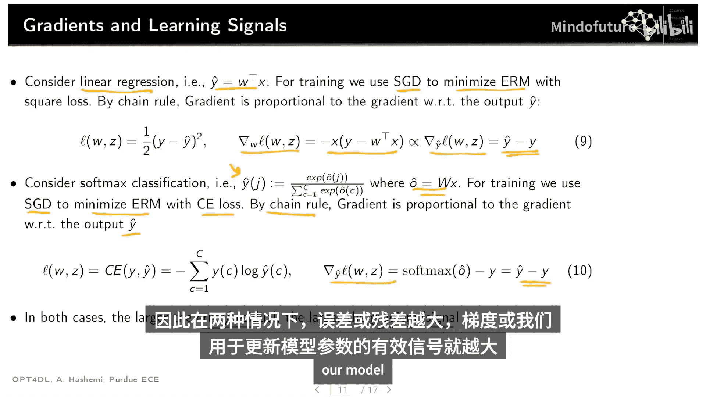

# 015：多层感知机1

在本节课中，我们将要学习深度学习架构的基础，特别是从最简单的线性模型出发，理解如何构建更复杂的神经网络。我们将从线性回归和线性分类模型开始，探讨它们与深度学习架构的联系，并理解其训练过程背后的优化原理。

## 从线性回归到简单神经网络

上一节我们介绍了深度学习优化的基本概念，本节中我们来看看最简单的模型——线性回归，并理解它如何被视为一个基础的神经网络。

线性回归模型假设特征 `X` 与标签 `y` 之间存在线性关系，其公式为：
`y = w* · X + b*`
其中 `w*` 是回归权重，`b*` 是偏置项。为了简化数学表达，我们通常通过增加一个维度将偏置项并入权重向量中，从而忽略显式的偏置项。

我们可以将线性回归模型视为一个非常简单的神经网络。它只有一个输入层和一个输出层。输入信号（特征）被权重向量处理（相乘），然后直接输出结果。这本质上是一个人工神经元的基本操作。

线性回归的训练目标是找到最优的参数 `w` 和 `b`，使得模型对数据的拟合最好。这通常通过最小化平方损失函数来实现。

## 最大似然估计视角

理解线性回归的另一种有用视角是将其视为一个最大似然估计问题。

我们假设观测数据带有独立同分布的高斯噪声。在这种情况下，最大化数据似然等价于最小化负对数似然。经过推导，负对数似然函数的形式恰好是平方损失函数。因此，线性回归的优化问题可以表述为：
`minimize (1/N) Σ (y_i - w·x_i)^2`
这正是一个经验风险最小化问题。

这个视角非常有用，因为它可以扩展到更复杂的学习任务。通过改变对数据分布的假设（例如，从高斯分布变为其他分布），我们可以为不同的任务（如分类）推导出相应的损失函数。

此外，我们还可以在目标函数中加入先验信息作为正则化项。例如，加入L2正则化项后，问题就变成了最大后验估计：
`minimize (1/N) Σ (y_i - w·x_i)^2 + λ ||w||^2`

## 扩展到分类问题：线性分类器

上一节我们讨论了回归问题，本节中我们来看看如何将线性模型的思想扩展到分类任务。

在分类问题中，我们有 `C` 个类别。一种常用的标签表示方法是 **独热编码**。每个标签 `y_i` 被编码为一个 `C` 维向量，该向量是标准基向量之一（例如，`e_1 = [1, 0, ..., 0]^T`）。

与回归类似，我们首先考虑最简单的线性模型。由于输出现在是 `C` 维向量，权重 `W` 变成一个矩阵，偏置 `b` 是一个向量。模型公式为：
`o = W · x + b`
其中 `o` 是 `C` 维输出向量。

我们同样可以将此模型视为一个简单的神经网络：一个输入层连接到一个输出层，每个输入特征与所有权重矩阵的元素相连，以生成所有输出维度的值。

## Softmax 归一化与交叉熵损失

我们希望模型的输出能够解释为输入 `x` 属于各个类别的概率。一个概率向量需要满足非负性且所有元素之和为1。

然而，线性模型的直接输出 `o` 通常不满足这些性质。因此，我们需要一个归一化步骤。最常用的方法是 **Softmax 归一化**。对于输出向量 `o`，其第 `j` 个元素的 Softmax 值为：
`ŷ_j = exp(o_j) / Σ_{k=1}^{C} exp(o_k)`
Softmax 函数确保所有输出值在 (0,1) 之间且和为1，从而可以解释为概率分布。

接下来是训练。我们需要一个损失函数。从最大似然估计的角度出发，假设标签服从以 Softmax 输出为参数的**多项分布**。最大化似然等价于最小化负对数似然。

经过推导，负对数似然函数的形式正是 **交叉熵损失**：
`Loss = - Σ_{j=1}^{C} y_j · log(ŷ_j)`
其中 `y` 是真实的独热编码标签，`ŷ` 是模型的 Softmax 输出概率。

交叉熵损失可以理解为衡量两个概率分布（真实分布 `y` 和预测分布 `ŷ`）之间的差异。它与信息论中的 **KL 散度** 密切相关。最小化交叉熵等价于最小化预测分布与真实分布之间的 KL 散度。

## 为何选择交叉熵而非平方损失

对于分类问题，虽然理论上可以使用平方损失，但交叉熵损失是更自然和优雅的选择。

首先，交叉熵损失源于最大似然估计原则，具有坚实的统计基础。其次，从优化角度看，交叉熵损失能提供更强的训练信号。

在训练初期，模型预测不准，预测值 `ŷ` 与真实值 `y` 差异很大。此时，交叉熵损失值会非常大（甚至趋于无穷），这意味着计算出的梯度幅值也很大。较大的梯度使得参数更新步伐更大，从而加速训练初期的收敛速度。

相比之下，平方损失在预测不准时给出的损失值和梯度相对较小，导致训练初期更新缓慢。

对于线性回归（平方损失）和 Softmax 分类（交叉熵损失），损失函数关于模型输出的梯度都具有相同的形式：`∇_o Loss ∝ (ŷ - y)`。即，梯度与预测误差（残差）成正比。预测误差越大，梯度信号越强，参数更新越快。

## 总结

本节课中我们一起学习了深度学习架构的起点——简单的线性模型。

*   我们从**线性回归**出发，将其解释为单层神经网络，并从**最大似然估计**的角度理解了其平方损失函数的由来。
*   接着，我们将模型扩展到**分类任务**，引入了**独热编码**和**线性分类器**。
*   为了获得有效的概率输出，我们引入了 **Softmax 归一化** 函数。
*   通过最大似然估计原则，我们为分类任务推导出了自然的 **交叉熵损失** 函数，并解释了它在信息论上与 KL 散度的关系。
*   最后，我们分析了为何交叉熵损失比平方损失更适合分类任务，关键在于它能提供更强的梯度信号以加速训练。

在下一讲中，我们将探讨为什么需要超越这些简单的线性模型，从而引出更复杂的深度学习架构。