# 016：多层感知机2

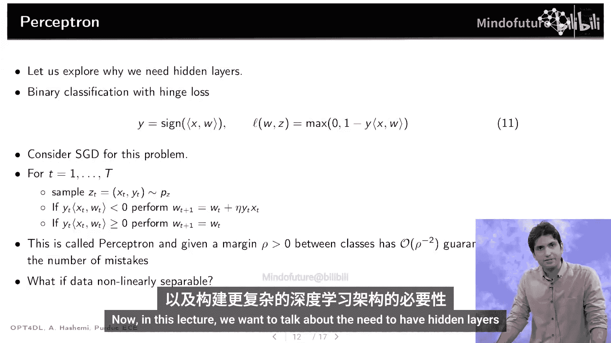

## 概述
在本节课中，我们将探讨为什么简单的线性模型（如感知机）在处理复杂数据时会失败，并介绍如何通过引入隐藏层和非线性激活函数来构建更强大的模型——多层感知机（MLP）。我们将从一个具体的非线性可分问题（异或问题）入手，逐步理解隐藏层的必要性。

---

## 从线性模型到隐藏层的需求

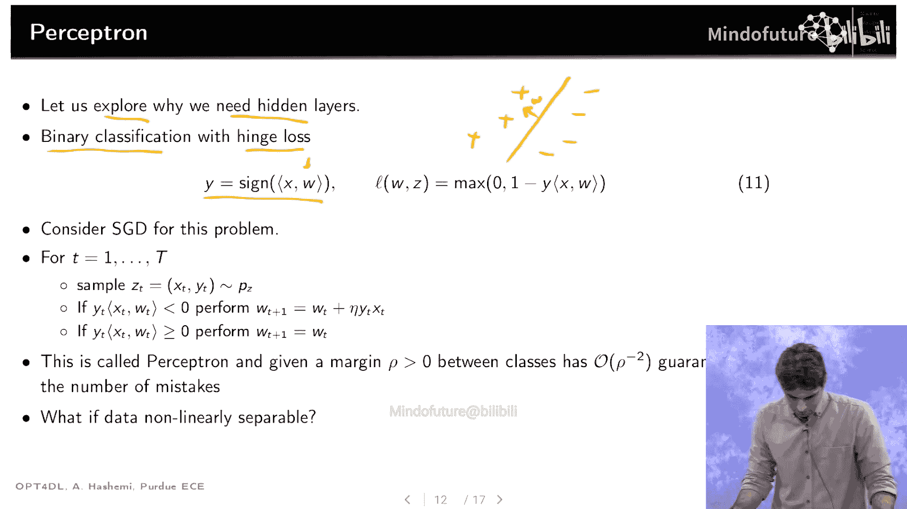

上一节我们介绍了线性回归和线性分类这两种基本的神经网络架构，它们的特点是输入层直接连接到输出层。

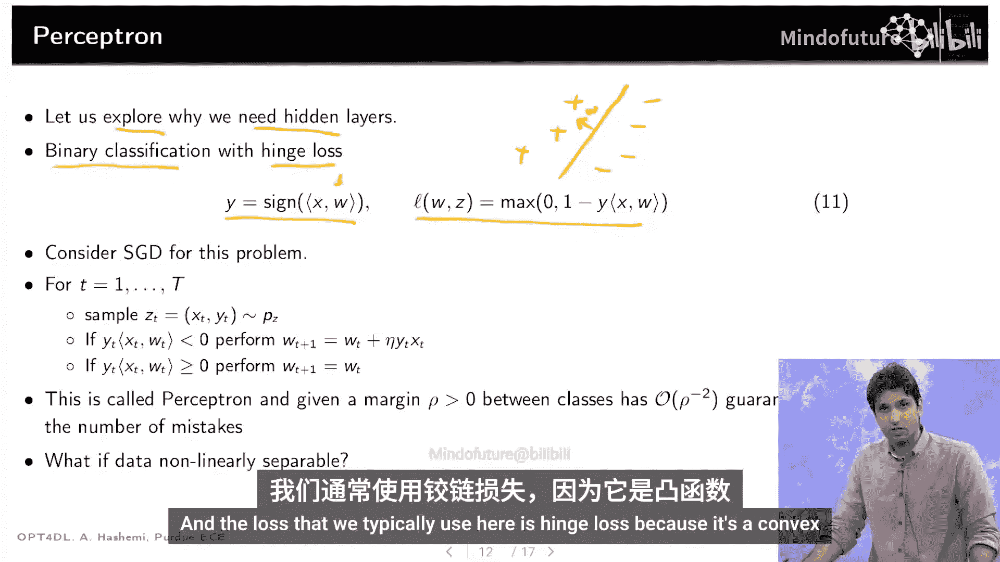

在本节中，我们来看看为什么需要更复杂的深度架构，即引入隐藏层。为此，我们将回顾之前机器学习基础讲座中提到的二元分类问题。

我们考虑使用合页损失（hinge loss）的二元分类问题。假设数据是线性可分的，存在两个类别（+ 和 -）。分类问题就简化为寻找一个分离超平面。

因此，我们假设标签 `y` 和特征 `x` 之间的关系由以下公式给出：
`y = sign(<w, x>)`
我们的目标是找到参数 `w`。如果 `x` 和 `w` 的内积为正，则数据属于正类；否则属于负类。

我们通常使用合页损失，因为它是一个凸函数，易于优化。合页损失函数定义为：
`L(w) = max(0, 1 - y * <w, x>)`

优化此损失的算法是随机梯度下降（SGD）。其更新规则如下：
`w_{t+1} = w_t - η * g_t`
其中 `g_t` 是损失函数在当前样本 `(x_t, y_t)` 上的梯度。

对于合页损失，梯度更新具体表现为：如果当前解在样本上分类正确（即 `y_t * <w_t, x_t> >= 1`），则不更新参数；如果分类错误，则按照 `w_{t+1} = w_t + η * y_t * x_t` 进行更新。这种方法被称为**感知机算法**。

当数据线性可分且两类之间存在一个非零的间隔（margin ρ）时，感知机算法能保证在有限次错误更新后收敛，错误次数与 `1/ρ^2` 成反比。

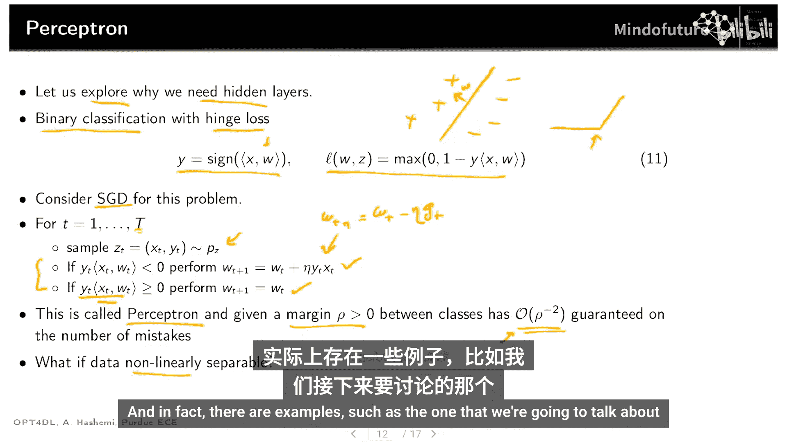

然而，问题随之而来：**如果数据不是线性可分的呢？** 答案是否定的。如果数据非线性可分，间隔 ρ 为 0，感知机算法将无法保证收敛，可能会持续犯错。

---

## 一个关键例子：异或（XOR）问题

让我们通过一个简单的例子来展示感知机的局限性。考虑一个只有两个特征 `x1` 和 `x2` 的问题，标签 `y` 由异或（XOR）运算符决定。

异或运算的真值表定义如下：
*   如果 `A` 和 `B` 都是 0，结果为 0。
*   如果 `A` 和 `B` 一个是 1 一个是 0，结果为 1。
*   如果 `A` 和 `B` 都是 1，结果为 0。

在二维平面上可视化这些数据点：
*   `(0,0)` -> 标签 0
*   `(1,1)` -> 标签 0
*   `(0,1)` -> 标签 1
*   `(1,0)` -> 标签 1

可以清楚地看到，无法用一条直线（一个线性分类器）将标签 0 和标签 1 的点完美分开。因此，感知机模型在此问题上会失败。

那么，如何解决这个问题呢？一个巧妙的想法是**以特定方式组合多个感知机**。我们可以利用布尔代数的性质将异或运算分解。

例如，异或可以表示为：`(x1 AND NOT x2) OR (NOT x1 AND x2)`。或者，采用另一种分解方式，我们定义三个中间规则：
1.  `O1 = x1 OR x2`
2.  `O2 = (NOT x1) OR (NOT x2)`
3.  最终输出 `y = O1 AND O2`

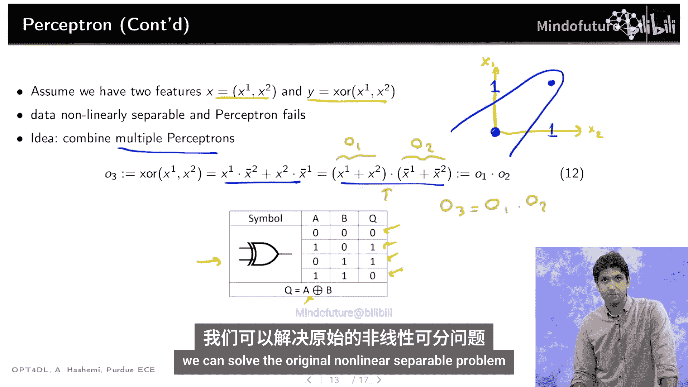

关键在于，**每一个中间规则 `O1` 和 `O2` 本身都对应一个线性可分的问题**，因此可以用单独的感知机（神经元）来学习。然后，通过逻辑“与”操作组合它们的输出，就能解决原始的非线性可分问题。

以下是每个中间规则对应的数据分布可视化，它们都是线性可分的：
*   **O1 (x1 OR x2)**：点 `(1,1)`, `(1,0)`, `(0,1)` 为 1，点 `(0,0)` 为 0。
*   **O2 (NOT x1 OR NOT x2)**：点 `(0,0)`, `(1,0)`, `(0,1)` 为 1，点 `(1,1)` 为 0。
*   **最终输出 y = O1 AND O2**：这正是我们想要的异或结果。

---

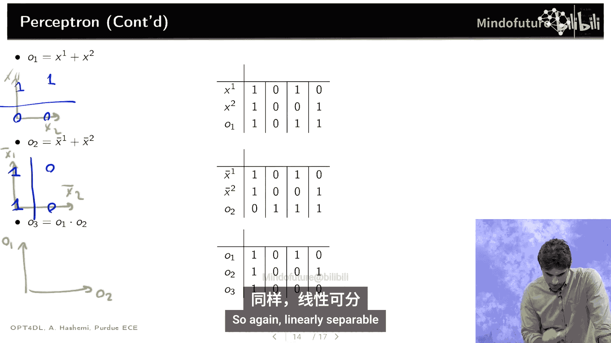

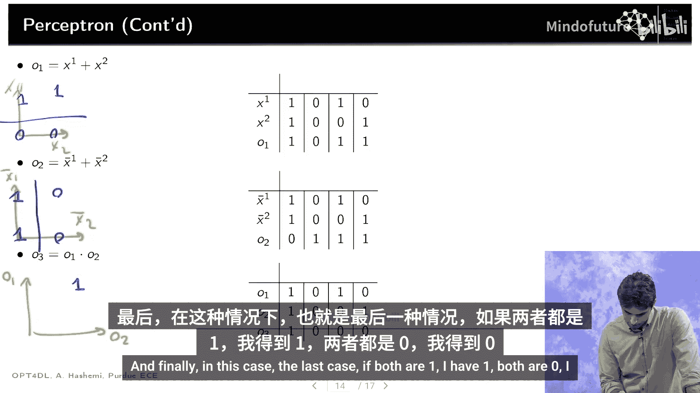

## 构建多层感知机（MLP）

如上所述，每个线性可分的规则都可以由一个具有符号（sign）激活函数的感知机（神经元）学习。为了得到最终的异或分类器，我们需要将这些神经元组合起来。

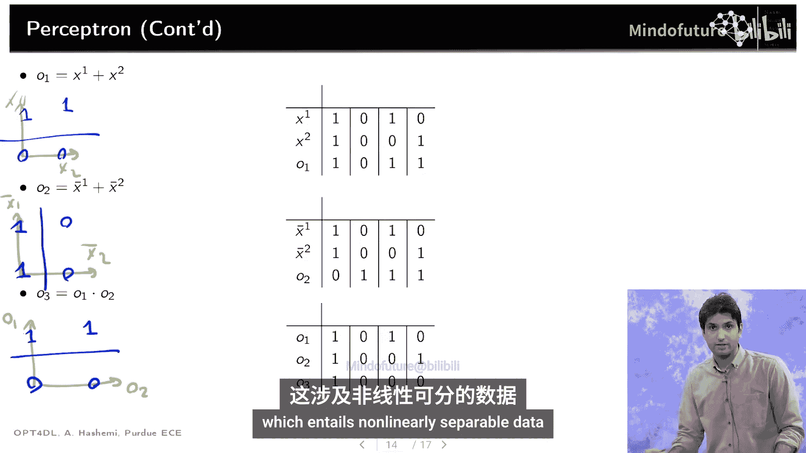

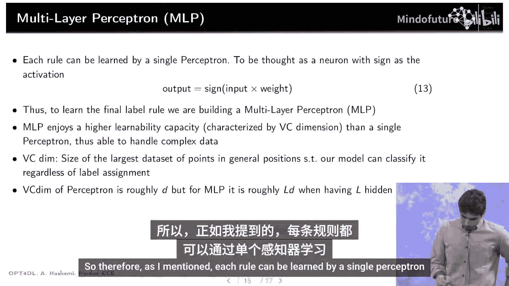

这就引出了**多层感知机**的架构：
*   **输入层**：接收原始特征 `x1`, `x2`。
*   **隐藏层**：包含学习中间规则 `O1` 和 `O2` 的神经元。这是相对于线性模型新增的部分。
*   **输出层**：包含一个神经元，它接收隐藏层的输出，并通过“与”操作（在神经网络中通常由另一个带激活函数的神经元实现）产生最终预测 `y`。

这种架构极大地增强了模型的学习能力。在统计学习理论中，这可以用 **VC 维** 来形式化地衡量。VC 维大致表示一个模型能够完美分类的最大数据集规模（在一般位置下）。
*   在二维空间中，线性模型（如感知机）的 VC 维是 3。
*   对于具有 `L` 个隐藏层的 MLP，其 VC 维大约为 `O(L * D)`，其中 `D` 是参数数量。
通过添加隐藏层，我们增加了函数类的 VC 维，从而提升了其学习复杂模式的能力。

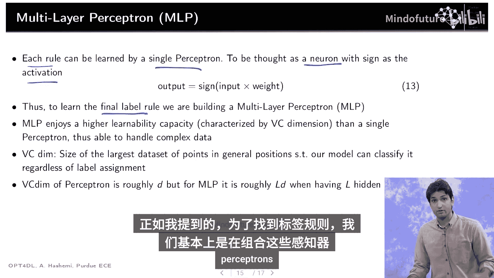

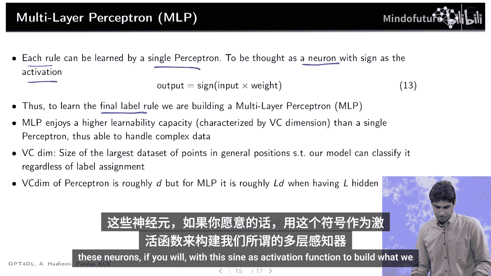

---

## 激活函数：从符号函数到现代选择

我们提到感知机类似于使用符号（sign）激活函数的神经元。然而，为了使用基于梯度的优化方法（如SGD）来训练多层网络，符号函数在零点不可导的特性带来了困难。

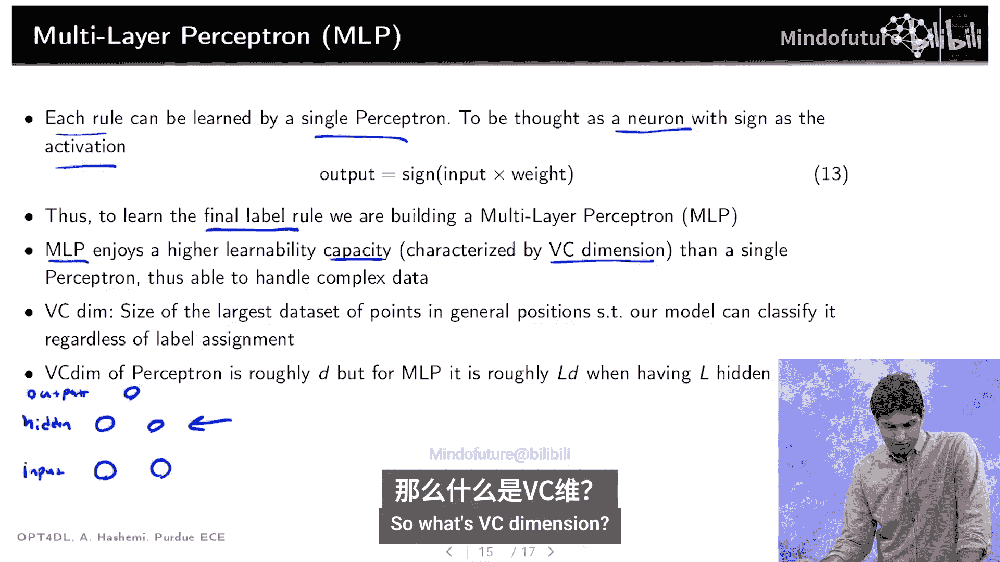

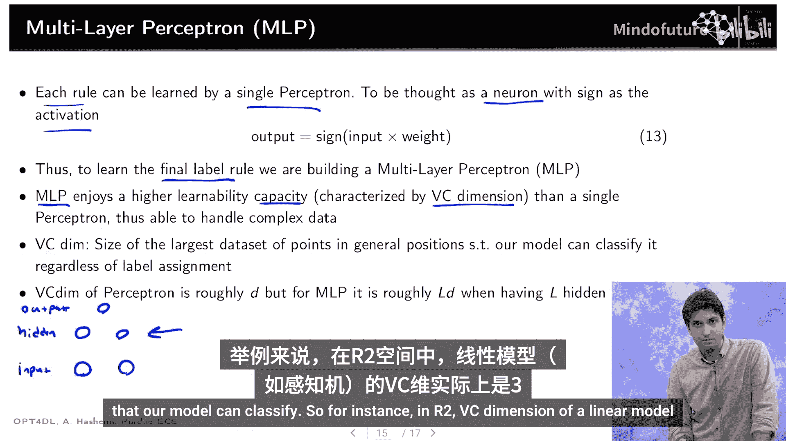

因此，研究人员提出了多种平滑的非线性函数来近似符号函数，作为神经元的激活函数。以下是三种最著名的激活函数：

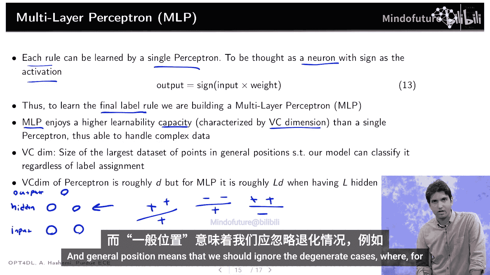

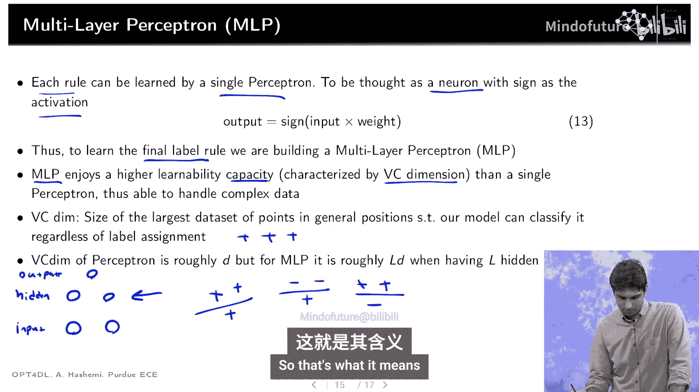

1.  **Sigmoid 函数**
    公式：`σ(x) = 1 / (1 + exp(-x))`
    它将输入压缩到 (0, 1) 区间。

2.  **Tanh 函数**
    公式：`tanh(x) = (exp(x) - exp(-x)) / (exp(x) + exp(-x))`
    它将输入压缩到 (-1, 1) 区间。

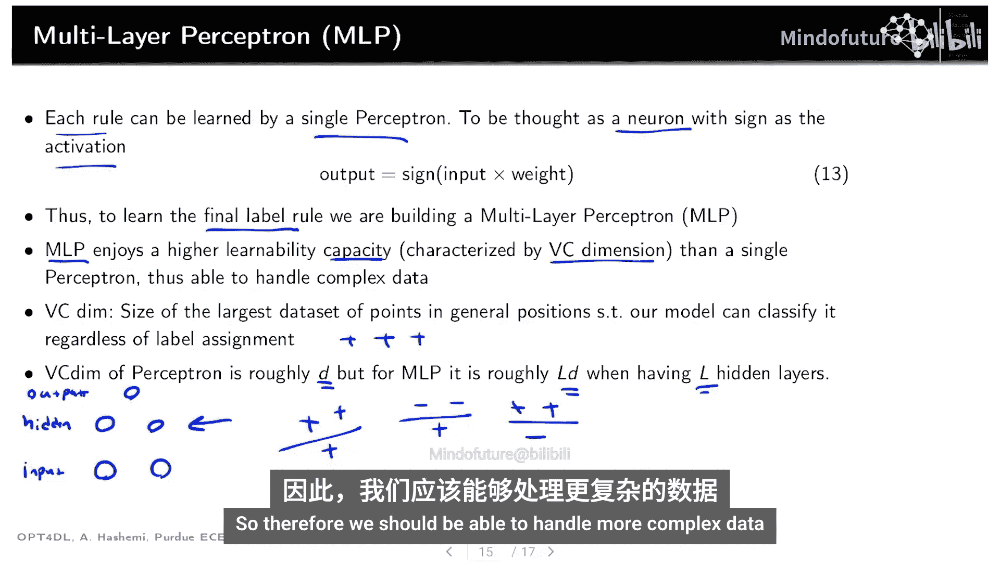

3.  **线性整流单元（ReLU）**
    公式：`ReLU(x) = max(0, x)`
    这是最常用的激活函数。

所有这些都是非线性函数。这一点至关重要。经验表明，ReLU 及其变体在计算上更高效，训练过程也更稳定，因此成为当前最流行的选择。

**注意**：激活函数是逐元素应用的。例如，对于向量输入 `x = [1, 2, -1]`，`ReLU(x) = [1, 2, 0]`。

---

## 为什么必须使用非线性激活函数？

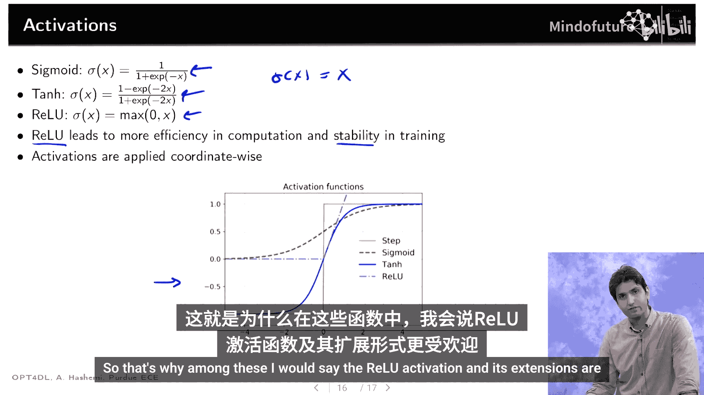

我们强调不能用线性激活函数来近似符号函数。原因在于，如果使用线性激活，即使堆叠多个隐藏层，也无法增加模型的学习能力。

考虑一个具有两个隐藏层、但使用线性激活的 MLP：
`H1 = W1 * X + b1`
`H2 = W2 * H1 + b2 = W2 * (W1 * X + b1) + b2`

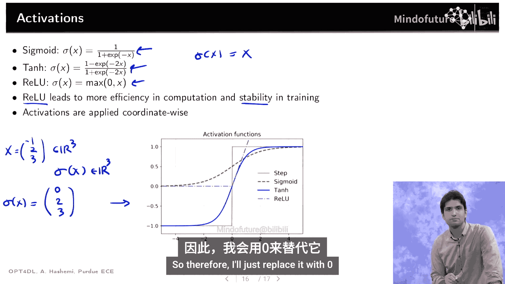

这可以简化为：
`H2 = (W2 * W1) * X + (W2 * b1 + b2)`

令 `W_total = W2 * W1`，`b_total = W2 * b1 + b2`，则：
`H2 = W_total * X + b_total`

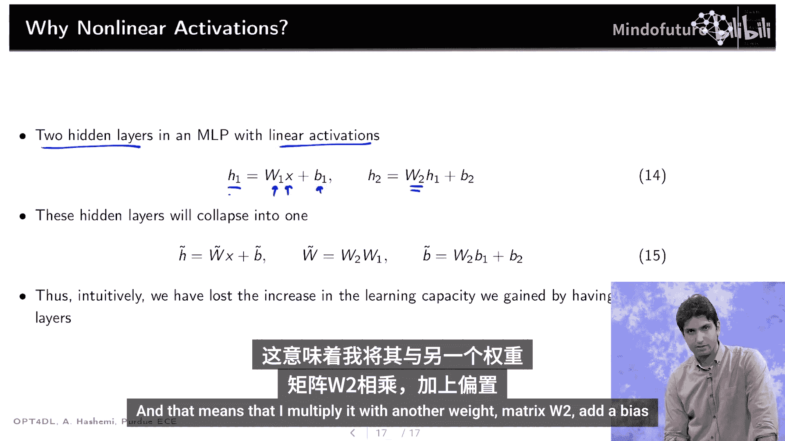

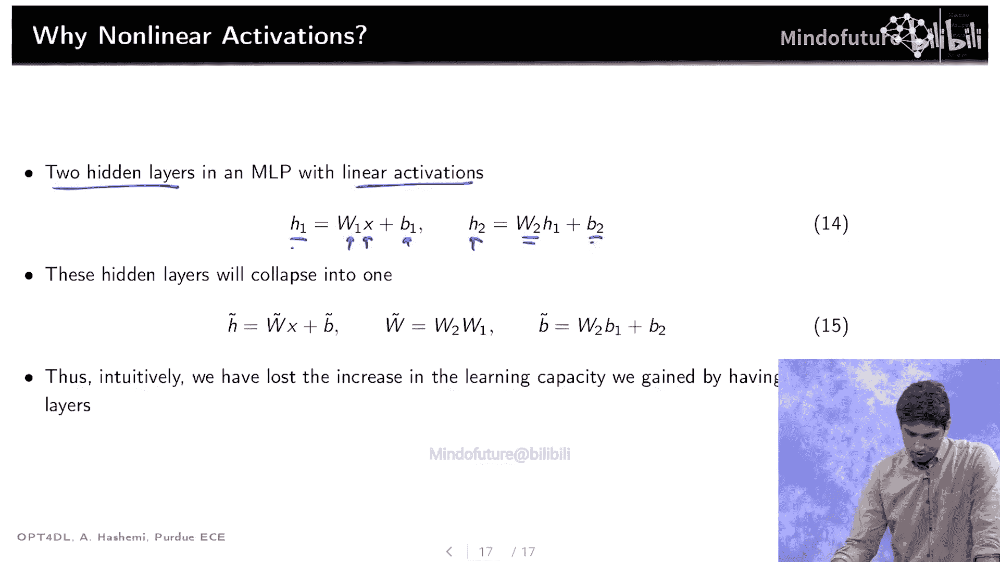

**这等价于一个没有隐藏层的单层线性模型！** 无论我们堆叠多少线性层，最终效果都等同于一层。因此，为了真正增加模型的深度和学习复杂函数的能力，**必须在隐藏层中使用非线性激活函数（如 ReLU）**。

---

## 总结

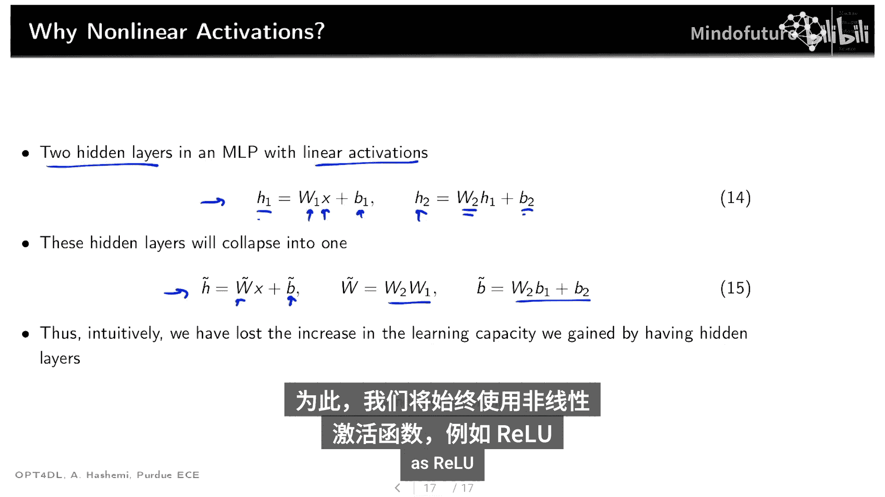

本节课中，我们一起学习了：
1.  **感知机的局限性**：它只能解决线性可分问题，在异或（XOR）这类简单非线性问题上会失败。
2.  **隐藏层的引入**：通过将多个感知机（神经元）组合成多层结构（输入层、隐藏层、输出层），可以学习中间特征，从而解决非线性问题。这提升了模型的 VC 维和学习能力。
3.  **激活函数的作用**：为了利用梯度下降进行优化，需要使用平滑的非线性激活函数（如 Sigmoid, Tanh, ReLU）替代符号函数。
4.  **非线性的必要性**：隐藏层必须使用非线性激活函数。如果使用线性激活，无论网络多深，其表达能力都等价于单层线性模型，无法获得深度带来的优势。

多层感知机是深度学习中最基础的架构之一。在接下来的课程中，我们将探讨其他专门为处理图像、序列等特定类型数据而设计的现代深度学习架构。