# 017：卷积神经网络1

在本节课中，我们将要学习卷积神经网络（CNNs）的基本概念。我们将探讨为何多层感知机在处理某些类型数据（如图像）时存在局限性，并介绍卷积操作如何利用数据的平移不变性和局部性来大幅减少参数数量，同时保持甚至提升模型性能。

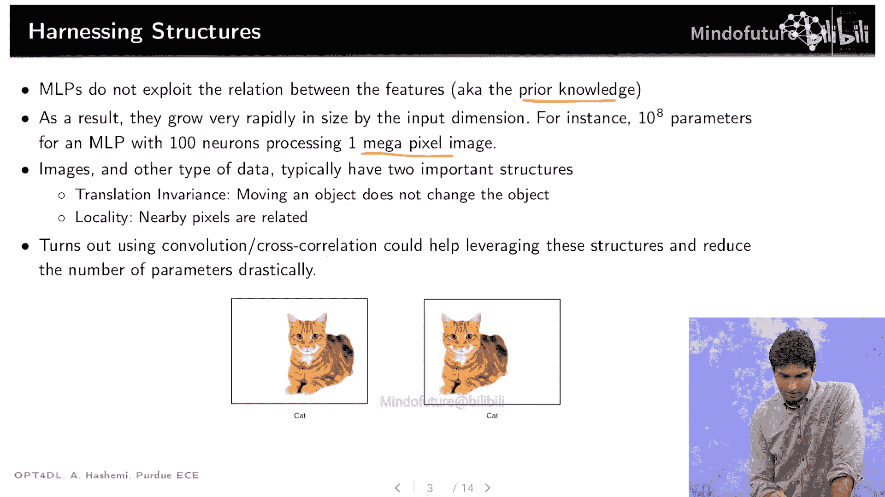

## 从多层感知机到卷积神经网络

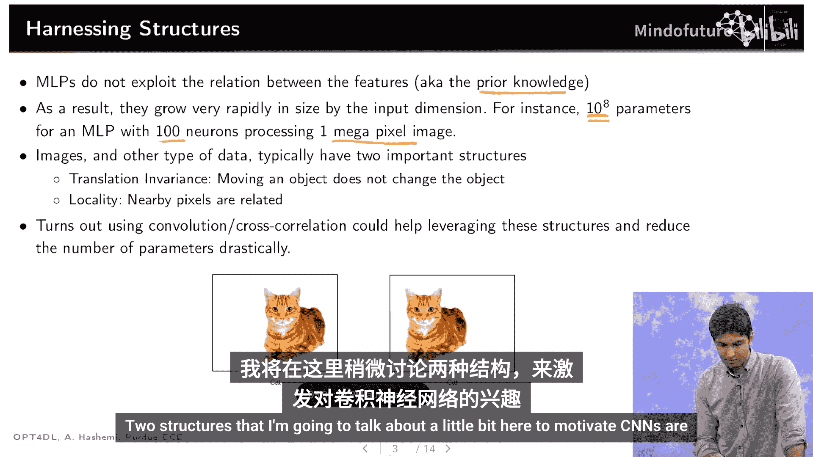

上一节我们介绍了多层感知机。然而，多层感知机在利用特征间可能存在的关系方面并不高效，特别是难以利用我们对特定数据类型（如图像）的先验知识。

例如，图像具有丰富的结构。多层感知机无法有效利用这些结构，导致即使是处理基本任务也需要非常庞大的网络。这会产生问题，因为我们通常处理的输入维度很大。例如，处理一张100万像素的图像，输入维度大约是 `10^6`。如果将其视为向量，并使用一个包含100个神经元的单隐藏层多层感知机进行处理，那么我们需要从数据中学习大约 `10^8` 个参数。这是一个非常巨大的参数量。

因此，我们的目标是找到替代方案，能够大幅减少参数数量，同时保持甚至提升学习能力，并利用数据中的结构。

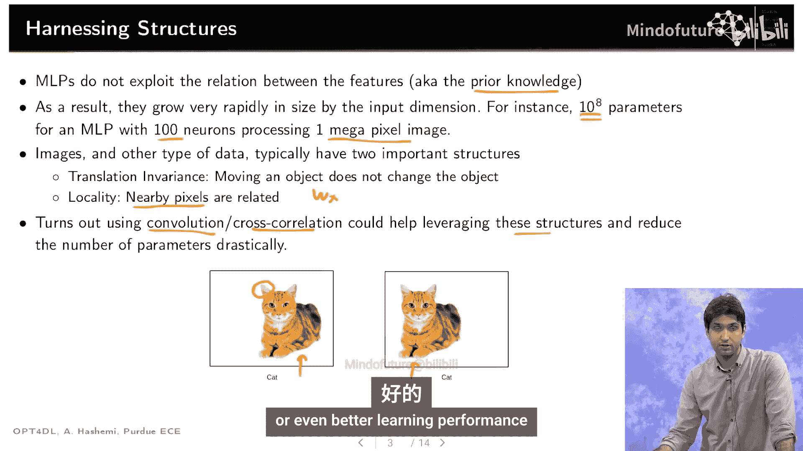

## 图像数据的结构：平移不变性与局部性

正如所提到的，图像等类型的数据具有很多结构。这里讨论两个关键结构：**平移不变性**和**局部性**。

*   **平移不变性**：意味着如果移动一个物体，该物体仍然是同一个物体，不会改变。例如，一张猫的图像在右侧，将其移动到左侧，它仍然是同一只猫的图像。因此，如果我们想学习一个模式（如边缘），当输入移动时，该模式不应改变，只是位置发生了变化。
*   **局部性**：意味着相邻的像素或特征通常是相关的。例如，图像中描述猫耳朵或眼睛的像素是局部相关的。

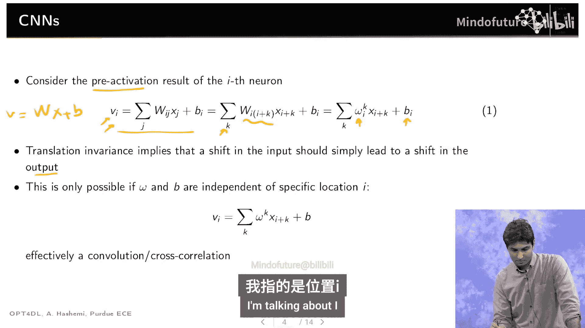

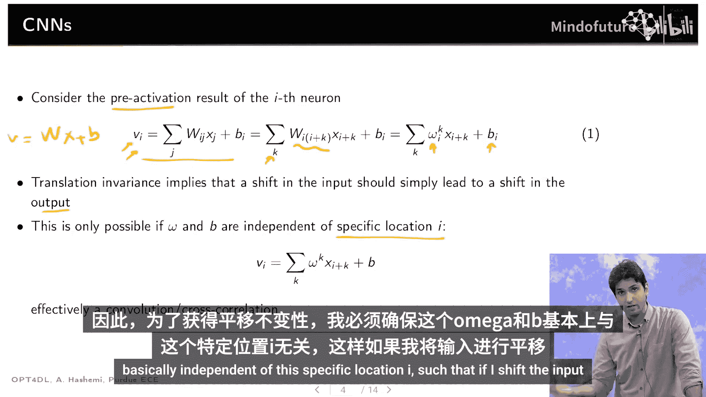

我们希望利用这些结构来减少神经网络参数的数量，并有望提高学习能力。

## 卷积操作：利用结构的解决方案

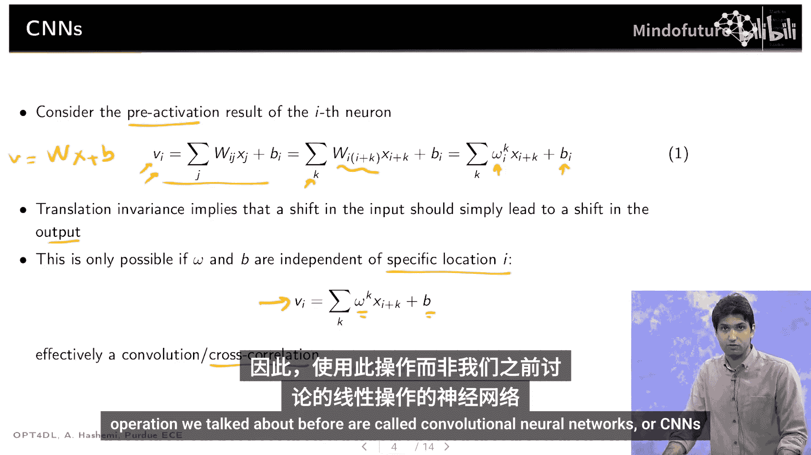

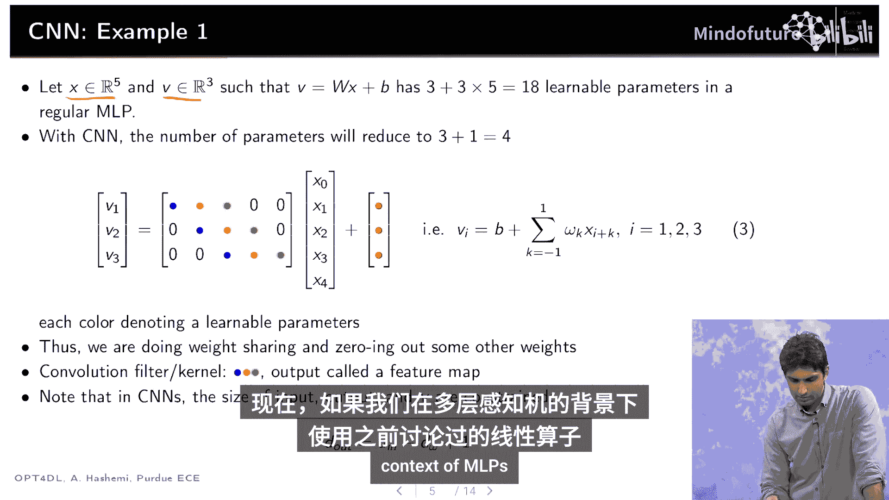

事实证明，使用**卷积**或**互相关**操作（而非之前讨论的线性乘积），可以帮助我们利用这些结构。因此，我们可以在保持甚至提升学习性能的同时，大幅减少参数数量。

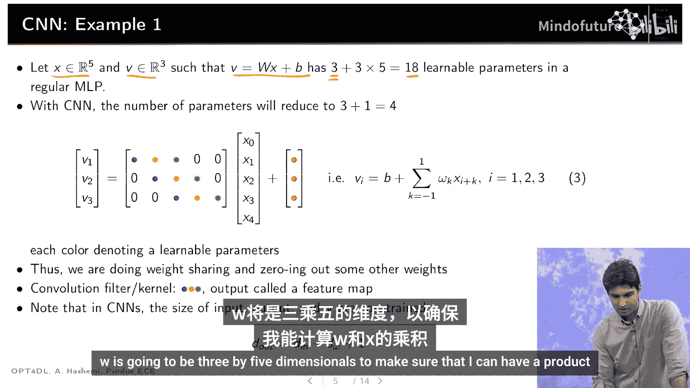

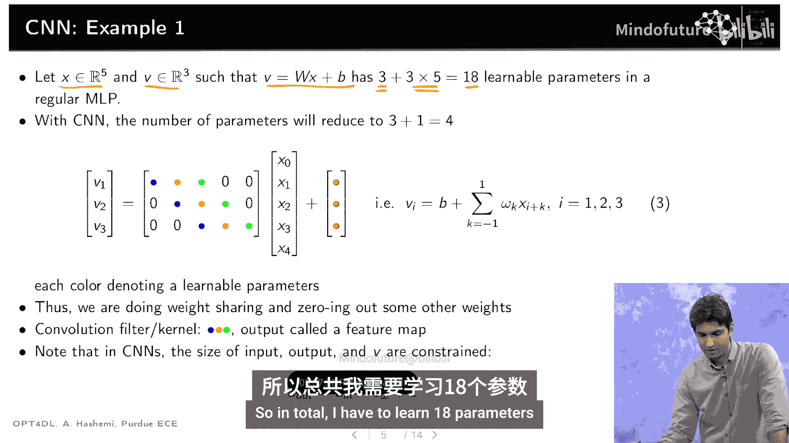

让我们看看为什么卷积或互相关是合适的解决方案。首先回顾线性操作，并观察预激活结果。暂时忽略非线性激活函数，考虑以下量（向量形式）：
`z = Wx + b`
这等价于展开形式：
`z_i = ∑_j W_{ij} x_j + b_i`

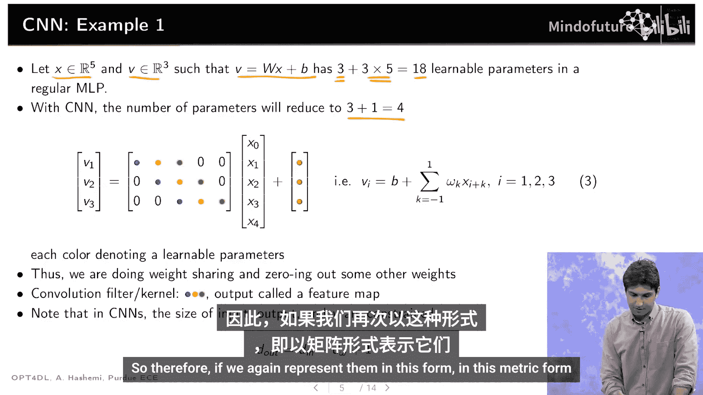

现在进行变量替换，将 `j` 改为 `i + k`。因此，对于第 `i` 个预激活输出，求和变为对 `k` 进行：
`z_i = ∑_k W_{i, i+k} x_{i+k} + b_i`
将 `W_{i, i+k}` 重命名为 `ω_{i,k}`，得到：
`z_i = ∑_k ω_{i,k} x_{i+k} + b_i`

平移不变性要求输入的平移会导致输出的相应平移。例如，如果网络的目标是检测边缘，那么当输入图像平移时，它应该仍然能够检测到边缘，只是边缘的位置发生了变化。因此，为了实现平移不变性，参数 `ω` 和 `b` 不应依赖于具体的位置 `i`。这样，输入的平移才能无损地传递到输出。

因此，我们对线性操作进行修改，使得 `ω` 和 `b` 独立于位置 `i`。可以清楚地看到，这一改变将大幅减少参数数量。

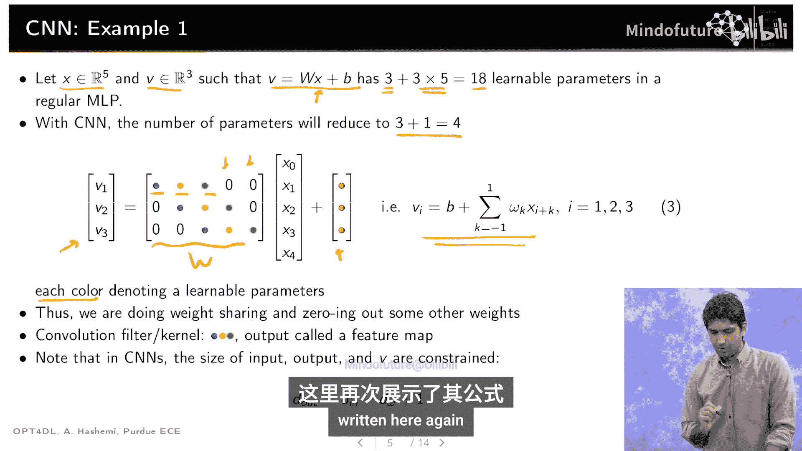

修改后的操作如下：
`z_i = b + ∑_k ω_k x_{i+k}`

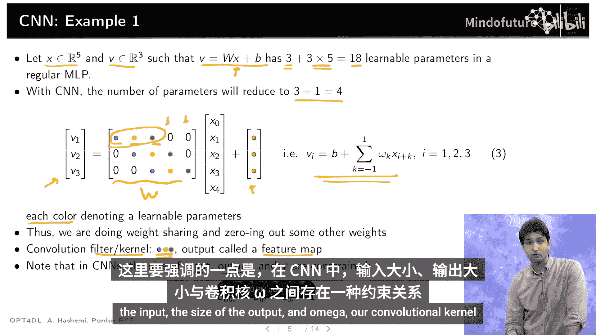

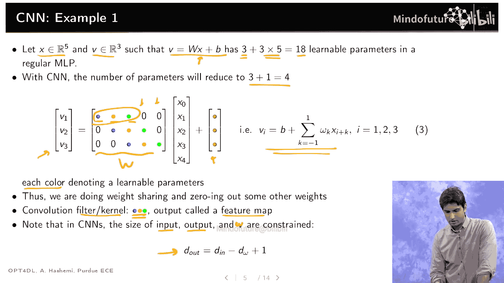

这个操作基本上被称为**互相关**。但由于历史原因，在深度学习领域通常称之为**卷积**。因此，使用此操作（而非之前的线性操作）的神经网络被称为**卷积神经网络**。

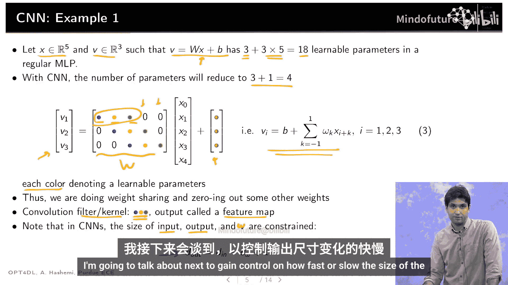

## 卷积操作示例与参数共享

让我们通过几个例子来确保理解卷积操作。

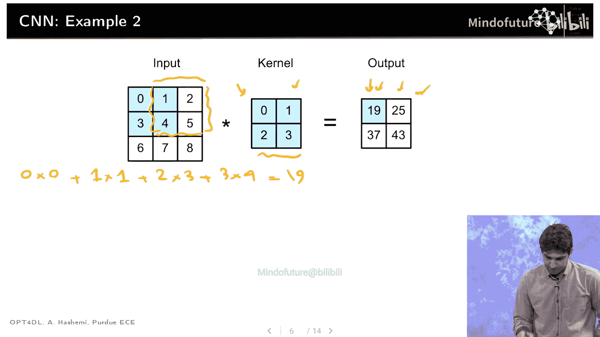

**一维示例**：
假设输入 `X` 是5维的，输出是3维的。
*   如果使用之前多层感知机中的线性操作 `z = Wx + b`，我们需要学习总共18个参数（`W` 是3x5矩阵，有15个参数；`b` 是3维向量，有3个参数）。
*   在CNN中，参数减少到只有 `3 + 1 = 4` 个。关键思想是**权重共享**。由于我们确保权重和偏置不依赖于具体位置，因此在矩阵表示中会呈现特定结构。
    *   偏置 `b`：所有输出位置的偏置参数都相同，因此只学习1个参数并在不同位置共享。
    *   权重矩阵 `W`：只学习3个参数（卷积核）。矩阵具有带状结构：第一行有三个非零参数，第二行是第一行右移一位，第三行是右移两位，其余位置为零。

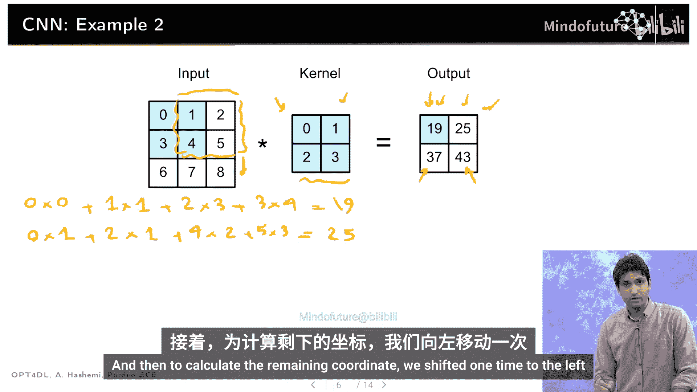

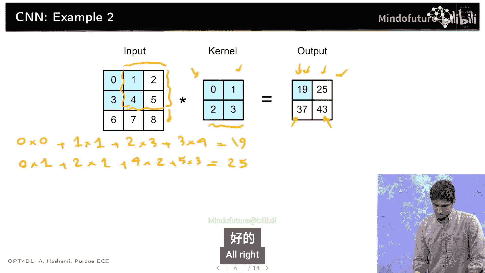

这种结构最好用互相关算子表示：
`v_i = b + ∑_k ω_k x_{i+k}`
其中，`v_i` 是第 `i` 个输出，`b` 是学习的偏置参数（与 `i` 无关），`ω` 是卷积核（或滤波器），`x` 是输入。输出有时也称为**特征图**。

一个重要点是，在CNN中，输入大小、输出大小和卷积核大小之间存在约束关系：
`输出尺寸 = 输入尺寸 - 卷积核尺寸 + 1`
这有时会限制我们的控制能力。通常，卷积核大小是固定的。这意味着我们无法自由控制输出大小。因此，我们通常会引入其他操作来获得对输入/输出尺寸变化速度的控制。

**二维示例**：
假设输入是一个矩阵，卷积核是另一个矩阵。计算输出时，将卷积核在输入上滑动，在每个位置计算对应区域的点积。
1.  计算输出第一个元素：将卷积核与输入左上角对应区域进行点积。
2.  计算同行下一个元素：将卷积核向右滑动一个位置（步长为1），再计算点积。
3.  计算下一行元素：将卷积核向下滑动一个位置，再计算点积，并继续向右滑动。

通过这种方式，可以计算出整个输出矩阵。

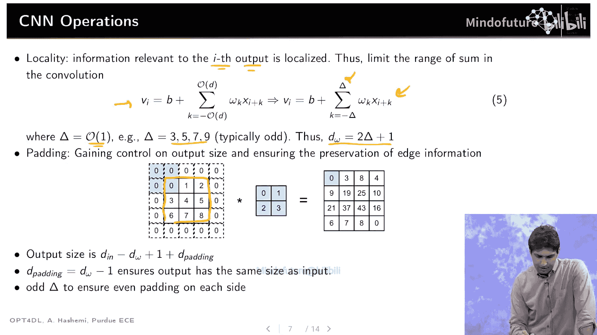

## 利用局部性：受限的感受野

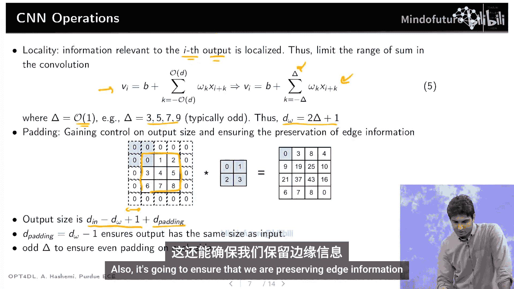

卷积操作帮助我们利用了平移不变性。数据的另一个属性是**局部性**，即与第 `i` 个输出相关的信息通常是局部化的。我们可以利用这一点进一步减少参数数量。

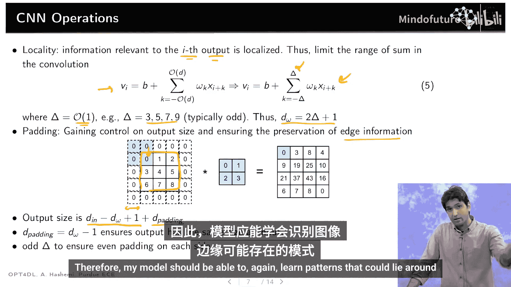

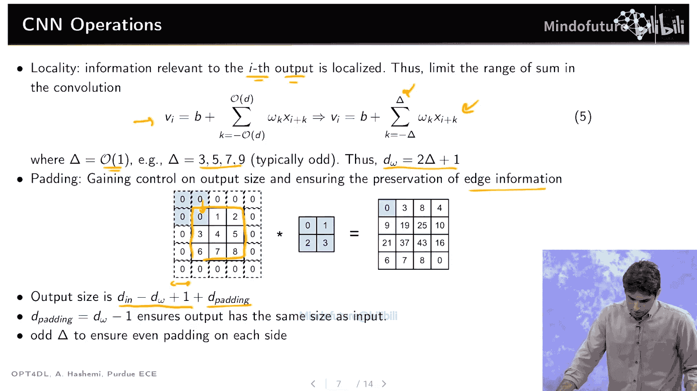

在之前的互相关算子 `z_i = b + ∑_k ω_k x_{i+k}` 中，求和范围 `k` 通常与输入维度同阶（例如对于百万像素图像，求和范围很大）。得益于数据的局部性，我们可以限制这个范围。在实践中，我们将其限制在一个常数 `Δ` 内，使得 `k` 的范围是 `-Δ` 到 `Δ`。`Δ` 不随输入大小增长，是一个常数（如3, 5, 7, 9等奇数）。此时，卷积核的大小是 `2Δ + 1`（例如 `Δ=1` 时，核大小为3）。

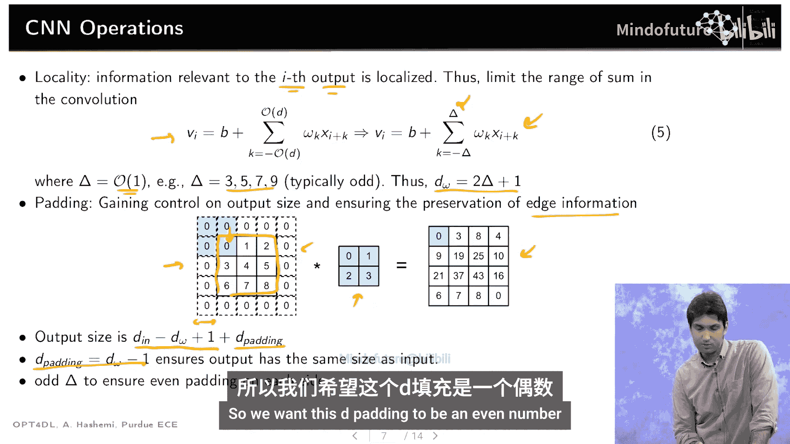

这是确保我们同时利用局部性和平移不变性的最终操作。一个缺点是，我们失去了对输出大小的部分控制，需要引入额外操作来恢复这种控制。

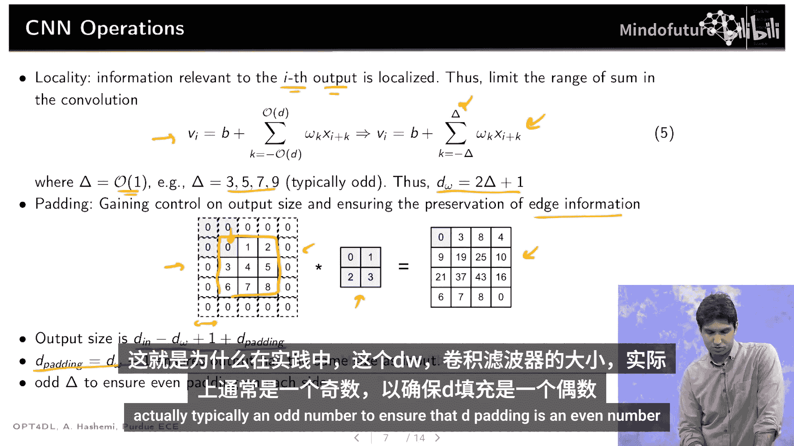

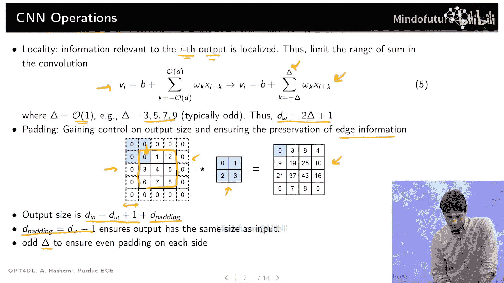

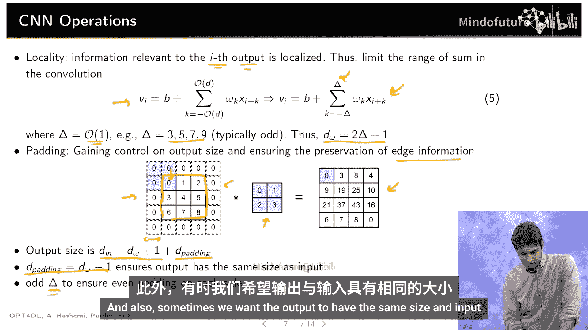

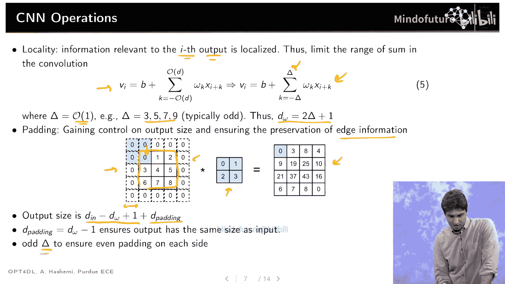

## 控制输出尺寸：填充与步幅

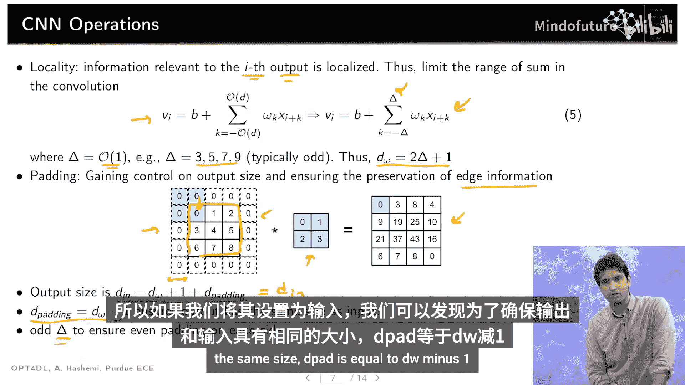

为了补充卷积操作并获得对输出尺寸的控制，我们通常引入**填充**和**步幅**操作。

**填充**：
填充操作很简单，就是在原始输入周围添加一些零值。
*   **作用**：
    1.  控制输出大小。输出尺寸公式变为：`输出尺寸 = 输入尺寸 + 2*填充数 - 卷积核尺寸 + 1`。通过调整填充数，可以控制输出尺寸。
    2.  保留边缘信息。如果不填充，图像边缘的像素只被处理一次。引入填充后，边缘区域会被处理更多次，有助于模型学习位于图像边缘的模式。
*   **对称填充**：通常希望在左右两侧和上下两侧添加相同数量的零。因此，在实践中，卷积核大小 `D_w` 通常是奇数，以确保每侧的填充数是整数且对称。如果我们希望输出尺寸与输入尺寸相同（即“相同”填充），则可以设置填充数 `D_pad = (D_w - 1) / 2`。

**步幅**：
步幅提供了更激进的输出尺寸缩减方式。其做法是，将卷积核每次滑动的距离增加为大于1个位置。
*   **操作**：之前，卷积核每次向右或向下移动1个位置。当步幅参数为 `D_s` 时，卷积核每次移动 `D_s` 个位置。
*   **效果**：结果是得到更小的输出尺寸。输出尺寸的通用公式为：
    `输出尺寸 = floor( (输入尺寸 + 2*填充数 - 卷积核尺寸) / 步幅 ) + 1`
    随着步幅 `D_s` 增大，分母增大，输出尺寸缩小。

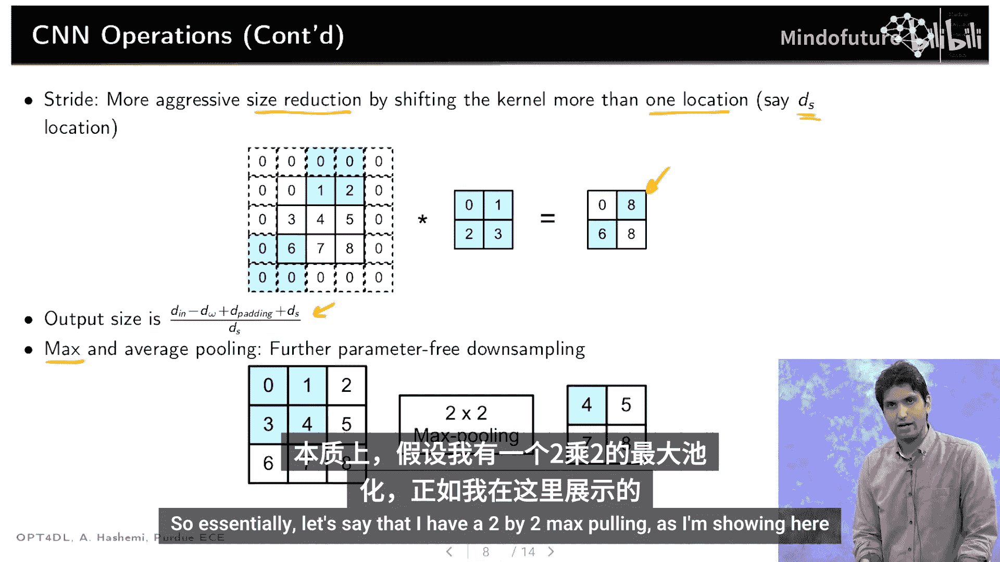

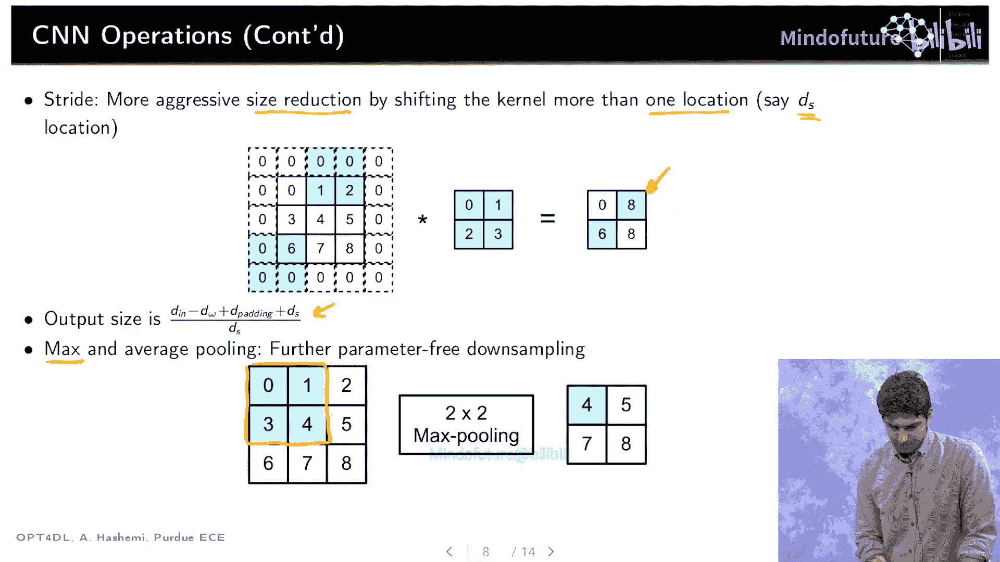

## 下采样：最大池化与平均池化

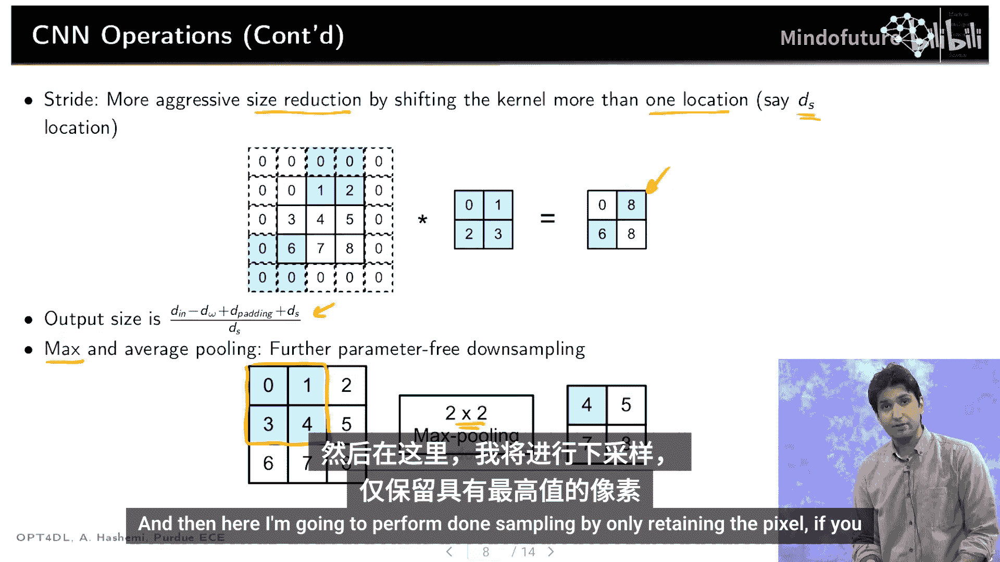

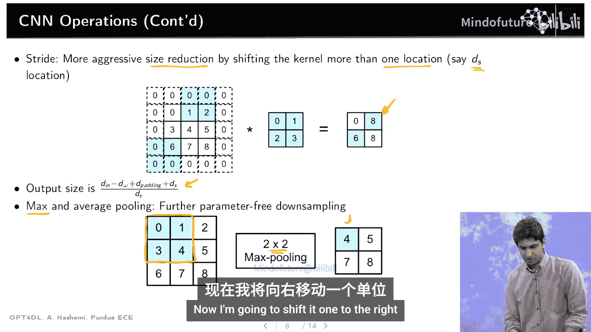

最后要讨论的一个操作是**最大池化**和**平均池化**。
*   **目的**：以一种无参数的方式进行下采样，减少处理后的数据尺寸，同时确保保留有用且有代表性的信息。
*   **最大池化操作**：
    *   例如，对于一个2x2的最大池化，我们将输入划分为不重叠的2x2区域。
    *   对于每个区域，我们只保留其中值最大的像素（或元素）作为该区域的输出。
    *   其思想是，如果将这些值视为“得分”，得分越高表示该部分输入信息越丰富。最大池化确保保留输入中最具信息量的部分。
*   **平均池化操作**：
    *   与最大池化类似，但不是取最大值，而是计算每个区域的平均值作为输出。
    *   当我们希望保留全局信息而非最显著特征时，可以使用平均池化。

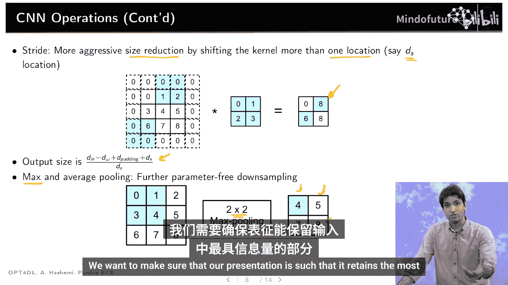

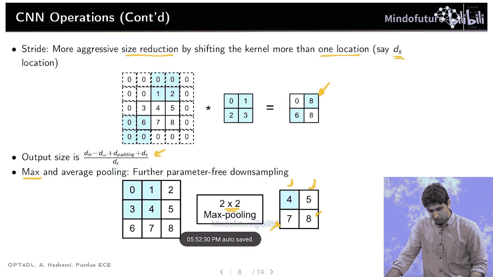

## 总结

本节课中我们一起学习了卷积神经网络的核心思想。主要要点如下：

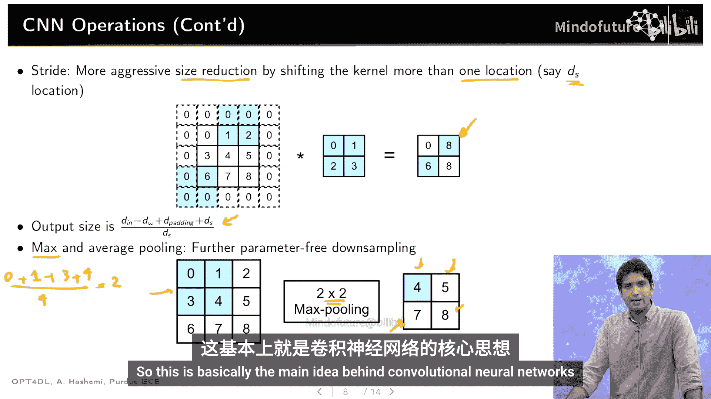

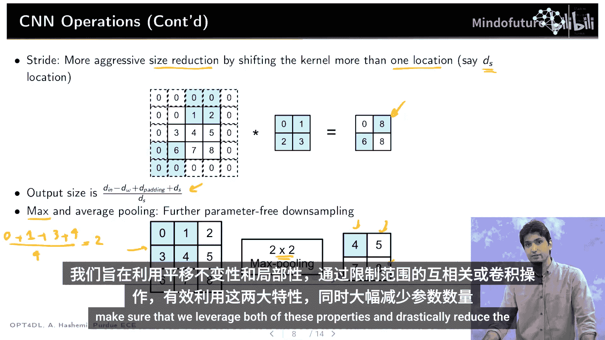

1.  **动机**：多层感知机难以有效利用图像等数据的**平移不变性**和**局部性**结构，导致参数量巨大。CNN旨在利用这些结构来减少参数。
2.  **核心操作**：使用**卷积**（互相关）操作替代全连接线性变换，通过**权重共享**（参数不依赖于位置）大幅减少参数量。公式为：`v_i = b + ∑_{k=-Δ}^{Δ} ω_k x_{i+k}`。
3.  **利用局部性**：通过限制求和范围 `k` 为一个小的常数 `Δ`（即使用小的卷积核，如3x3, 5x5），进一步利用局部性，并使参数量与输入尺寸无关。
4.  **控制尺寸**：为了控制网络中层与层之间特征图的尺寸变化，引入了：
    *   **填充**：在输入周围加零，用于控制输出尺寸和保留边缘信息。
    *   **步幅**：增加卷积核滑动步长，用于主动缩减特征图尺寸。
    *   **池化**：进行下采样。**最大池化**保留最显著特征，**平均池化**保留平均信息。

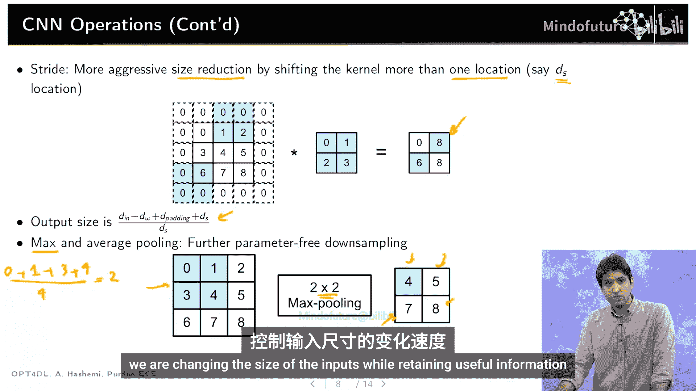

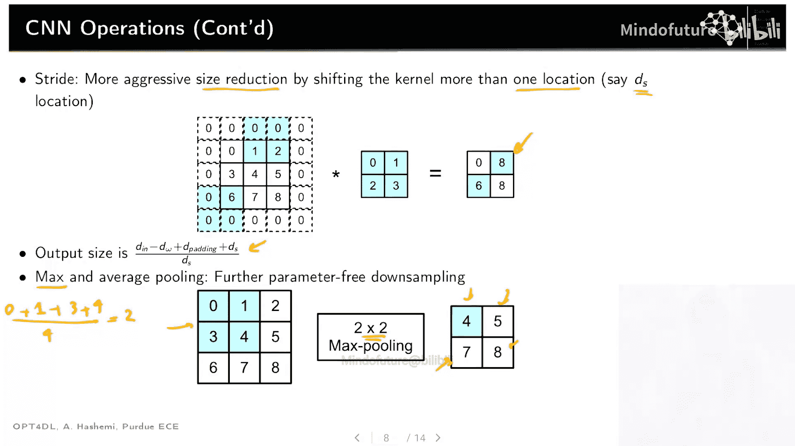

这些操作共同构成了CNN的基础，使其能够高效处理图像等高维结构化数据。在下一讲中，我们将介绍一些著名的CNN架构，并讨论另一种通常用于增强这些架构能力的修改。