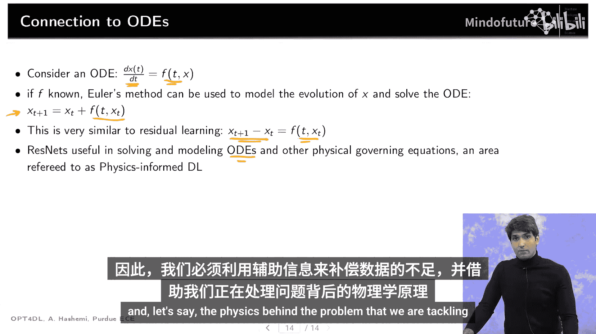

# 018：卷积神经网络2

在本节课中，我们将继续探讨卷积神经网络（CNN）的架构。我们将回顾几个经典的CNN模型，并深入理解一种关键的架构改进——残差连接（Skip Connection）。这种设计不仅影响了CNN的发展，也为其他现代神经网络架构（如Transformer）奠定了基础。

上一节我们介绍了卷积操作的基本概念及其在神经网络中的应用。本节中，我们来看看一些具体的CNN架构实例，并探讨为何需要在架构中引入新的修改。

## 经典CNN架构示例

以下是几个具有里程碑意义的CNN架构，它们展示了从简单到复杂的设计演变。

### LeNet-5

LeNet-5或许是第一个CNN模型示例，以该领域的先驱人物Yann LeCun命名。该模型用于分类MNIST数据集中的图像。MNIST是一个包含28x28像素灰度手写数字（0-9）的数据集。

该网络结构包含多个层：
*   一个卷积层。
*   一个池化层。
*   再次是一个卷积层和一个池化层。
*   最后是几个全连接层（即我们之前讨论过的多层感知机）。
*   输出层是一个包含10个神经元的层，对应10个分类类别。

输入图像的维度是28x28。

### AlexNet

AlexNet模型于2012年提出，是另一个CNN模型示例，旨在处理不同的数据——ImageNet数据集。该数据集包含RGB图像，因此输入对象本质上是三维的（通道数为3），每张图像尺寸为224x224像素，共有1000个分类类别。

AlexNet同样执行卷积和最大池化操作。其结构如下：
*   首先是卷积层，后接最大池化层。
*   重复此过程（卷积+池化）。
*   可以看到，随着网络向前传播，图像的尺寸逐渐减小。
*   最后，实现几个全连接层和输出层。

大多数这些模型都是CNN、全连接层、池化操作以及我们讨论过的步长和填充的组合。

## 模块化设计原则

设计新的架构可能很繁琐。因此，一个设计原则是采用**模块化（Blocks and Modularity）**。设计可重复使用的模块，从而构建更深层的神经网络是理想的做法。

以下是两个遵循此原则的模型示例。

### VGG-16

VGG-16模型同样是针对ImageNet数据集设计的。如图所示，它包含多个由卷积层和最大池化层组合而成的块，并且这些块被重复使用。网络首先有几个这样的块，然后是几个略有不同但仍包含卷积层（通常带有ReLU激活函数）和最大池化层的块。这些卷积层之后是几个全连接层，最终构建输出层。输出层是1000维的，因为这是一个1000类的分类问题。

### ResNet

下一个模型是ResNet（如ResNet-16, -34, -50, -101等）。同样可以看到，模型由块构成，并且在整个架构中多次重复这些块。

但是，这里引入了一些新概念。其中一个操作称为**批量归一化（Batch Normalization）**，我们将在后续课程中讨论。这里要指出的重点是，与之前所有只有从输入到输出的单一路径的架构不同，在ResNet中情况并非如此。网络中存在所谓的**跳跃连接（Skip Connections）**，这为输入从输入层流向输出层提供了多条路径。这一改变被证明具有巨大影响力，它使得构建更深、性能可能优于当时现有模型的神经网络成为可能。

## 跳跃连接的重要性

现在，让我们深入探讨一下跳跃连接的重要性。

这个想法基于我们在训练浅层神经网络和深层神经网络时观察到的一些经验现象。我们期望深层网络在训练误差和测试误差上都比浅层网络表现更好，这确实是我们的观察结果。如图所示，浅层网络和深层网络的最终性能之间存在差距。

然而，我们观察到，在训练过程的早期，浅层网络可以比深层网络取得更快的进展。这可能归因于我们通常随机初始化模型参数（这将在未来的课程中讨论）。随机初始化的一个影响是，在训练早期，当我们处理一个输入时，输入会为我们提供从数据中学习模式的有用信息。这个输入会与随机初始化的权重相乘。随着网络越来越深，我们将原始的信息信号与许多随机量相乘。直观上，随着数据被处理，我们在网络末端看到的信号会变得高度嘈杂和随机，可能与原始输入或特征没有足够的相关性。

因此，这可能意味着我们早期无法快速取得进展，因为权重是随机的，早期我们没有足够强的信号。但随着模型更新，权重逐渐远离随机值并优化以学习数据中的模式，我们期望最终输出层的信号与输入高度相关。同时，由于我们的模型很深，具有很高的学习能力，因此我们不仅能够很好地拟合数据，还能识别可泛化的模式，从而也提高测试性能。

跳跃连接（或残差连接）背后的思想是确保我们能够将信息从输入端传递到输出端，同时仍然享受神经网络的高容量。我们希望构建这样的连接，使得原始输入的信息信号有另一条路径可以到达输出端。

类似的陈述也适用于梯度。因为通常，正如我们将要讨论的，梯度是使用反向传播算法计算的。因此，我们不仅在正向传播中处理信息，也在反向传播中处理信息。在训练早期计算梯度时，我们必须在反向传播中处理一些数据。同样，我们是在用许多噪声量相乘，因此对于没有跳跃连接的深层网络，以梯度形式存在的早期学习信号将不那么具有信息量。

## 残差网络架构

ResNet架构基本上是由残差块模块化连接构建而成的。图中展示了残差连接，每个这样的连接基本上就是一个残差块。

在左侧，展示了残差块的两种版本：
1.  一种版本是直接将输入连接到块的输出，然后执行某种拼接操作。
2.  另一种版本可以选择在执行拼接之前，先对输入执行一个卷积操作。

那么，为什么叫这个名字呢？“残差”这个名字源于模型试图学习的是**残差（Residual）**，即残差块输入和输出之间的差异。这与没有任何跳跃连接的前馈神经网络不同，在前馈网络中，我们本质上是试图学习表征输入和输出之间关系的函数。其思想是，学习残差可能更简单，因为残差通常是一个小量。直观上，学习小量比学习大量更容易。因此，通过添加这种连接，我们可以提高模型的学习能力。

这里需要指出的另一个重点是，这种跳跃连接不仅用于构建残差网络，也用于其他架构，例如**Transformer**。Transformer或许是当今最著名的架构之一，基本上是所有我们可能接触过的大型语言模型的构建基础。

## 嵌套函数类与性能保证

关于残差连接为何不仅有助于加速学习，还能提高测试和训练精度，还有另一种直观解释。

其思想是，残差网络中的这种模块化导致了**嵌套的函数容量（Nested Capacity）**。随着我们不断增加网络的深度，我们保证能以某种方式扩大网络的容量，即更深的网络保证总是比更浅的网络更好。本质上，在没有跳跃连接的情况下，或者说，如果我们讨论的是一个非嵌套的函数类，随着我们增加网络深度，直观上期望容量会增加，但不能保证大类中的最佳模型一定比小类中的最佳模型性能更好。

然而，当我们添加这些跳跃连接并基于残差块构建残差网络时，我们实际上确保了拥有这种嵌套的函数类。因此，随着我们增加模型的深度，我们不仅增加了容量，还确保了更深模型的最优解将比更浅模型的最优解表现更好，如右图所示。

## 与微分方程的联系

关于残差网络，另一个巧妙之处在于它们与微分方程有着直接的联系。

考虑一个常微分方程（ODE），其形式本质上是 `dx/dt = f(x, t)`。求解这类微分方程的一个简单方法是**欧拉方法（Euler Method）**，本质上是将方程离散化，并尝试使用迭代方法找到解。

其思想是形成以下更新公式：`x_{t+1} = x_t + f(t, x_t)`。经过一些重新排列，你会注意到这个差值（`x_{t+1} - x_t`）本质上等于 `f(t, x_t)`。因此，我们看到了这里的联系：`f` 基本上就是我们的残差。在残差网络中，我们正是试图学习这个残差。因此，我们可以利用残差网络来求解和发现由微分方程描述的物理规律。

所以，残差网络已被证明在求解和建模ODE以及其他物理控制方程方面非常有用。这是一个活跃的研究领域，称为**物理信息机器学习（Physics-Informed Machine Learning）**。其思想是，当我们希望对物理数据使用数据驱动方法时，我们可以利用一些先验知识，从而在无法获得像计算机视觉或自然语言处理领域那样大规模数据集的情况下进行学习。在许多科学应用和科学发现应用中，我们无法获得海量数据，因此必须通过利用问题背后的物理知识等先验信息来弥补数据的不足。

本节课中，我们一起学习了几种经典的卷积神经网络架构，并重点探讨了残差连接（跳跃连接）的原理与重要性。我们了解到，残差连接通过提供信息的多路径传播，有效缓解了深度网络中的梯度消失/爆炸问题，加速了训练早期收敛，并因其嵌套特性保证了模型容量随深度增加而单调提升。此外，残差网络的设计思想还与微分方程数值解法有着深刻联系，为物理信息机器学习等领域提供了有力工具。下一讲，我们将转向另一种专为序列数据设计的架构——循环神经网络（RNN）。