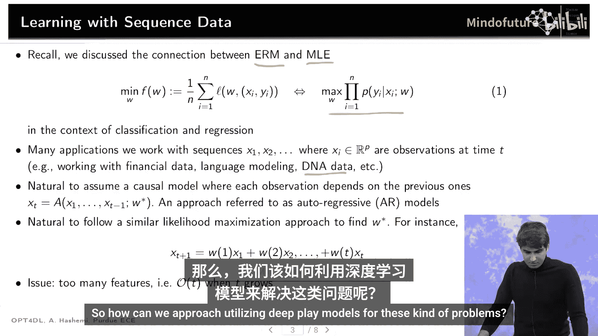
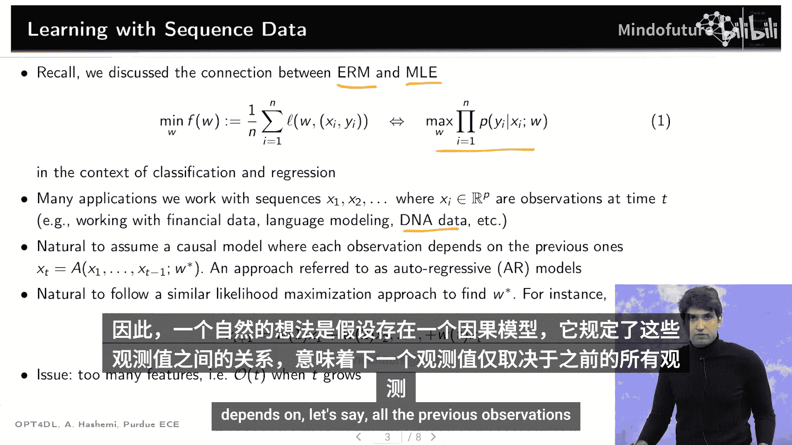
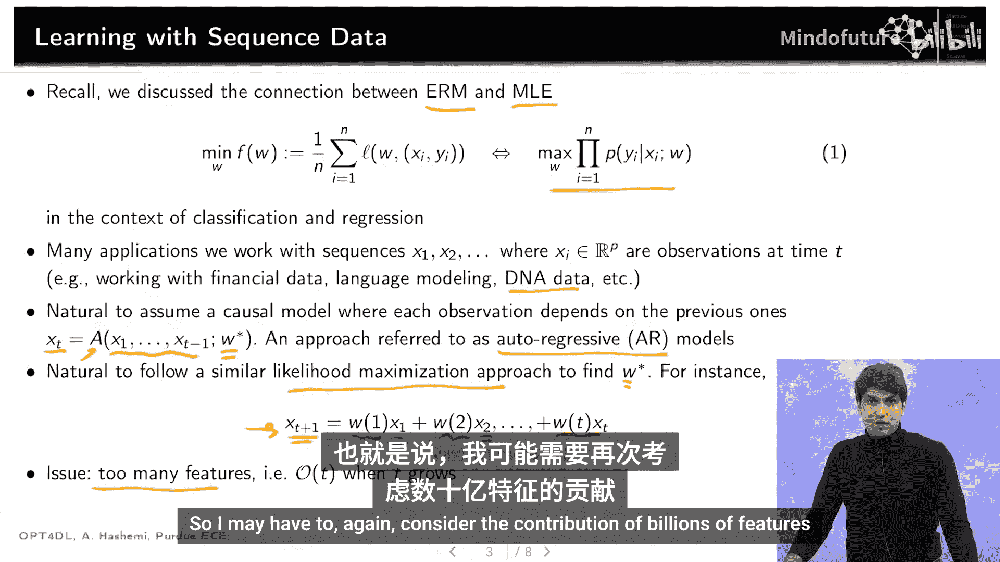
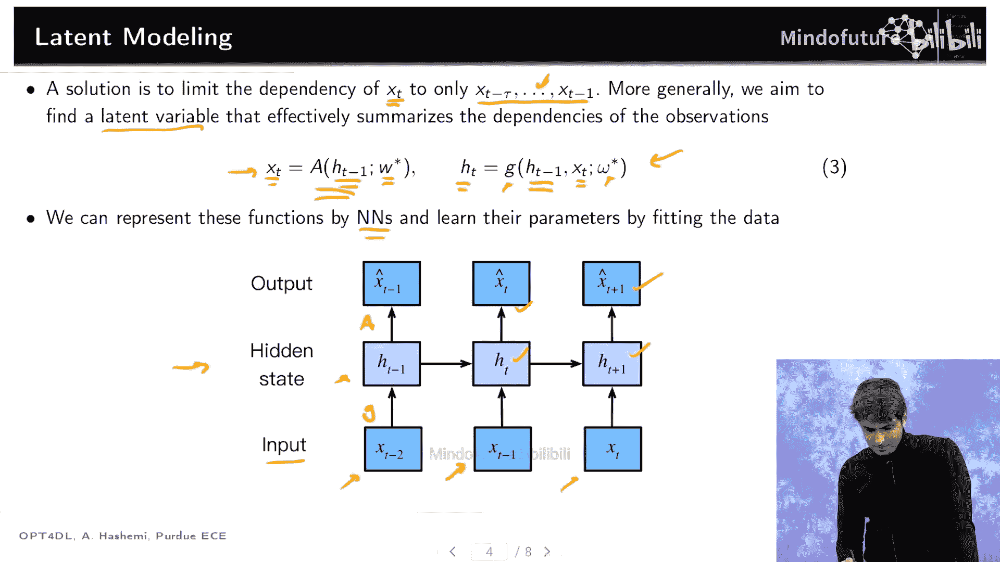
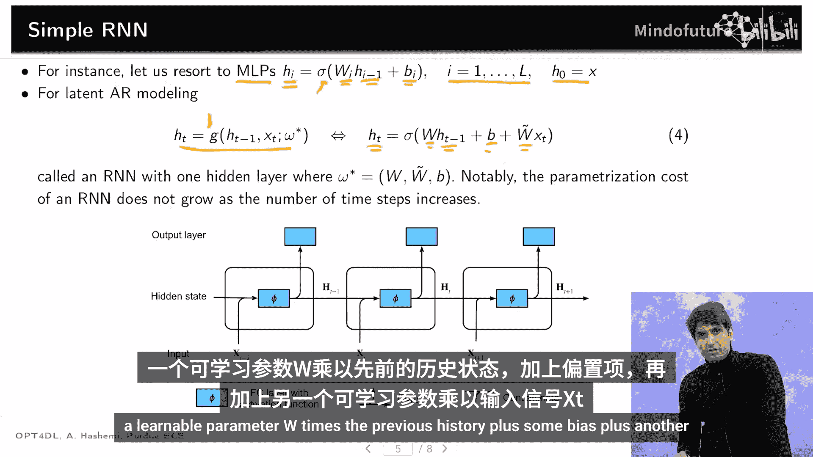
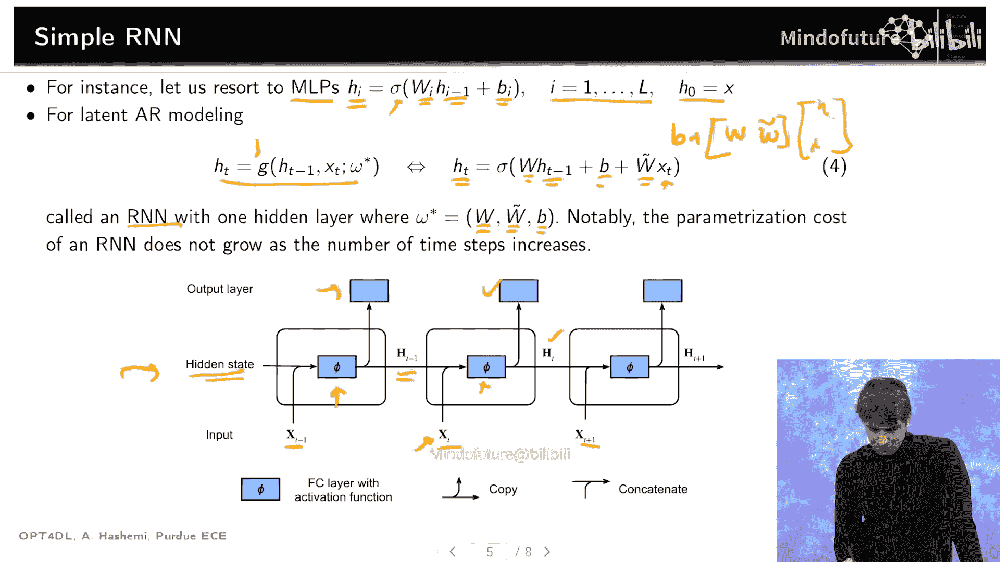
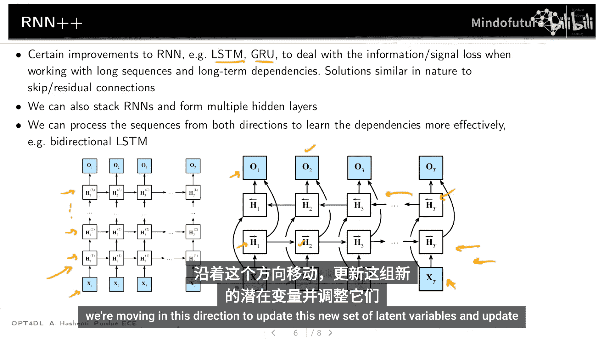
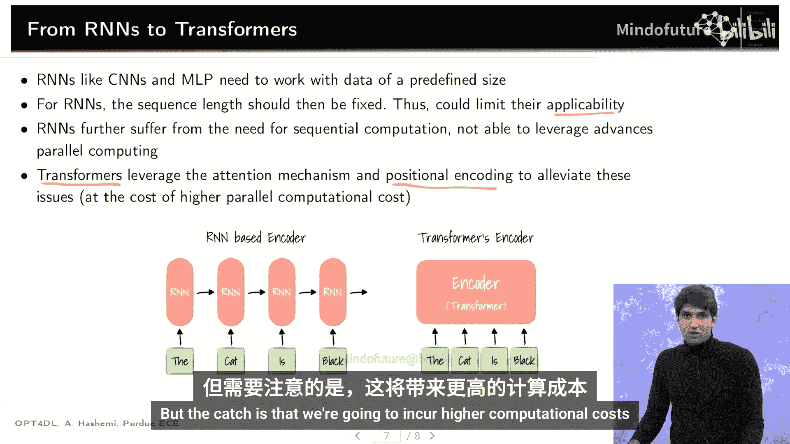
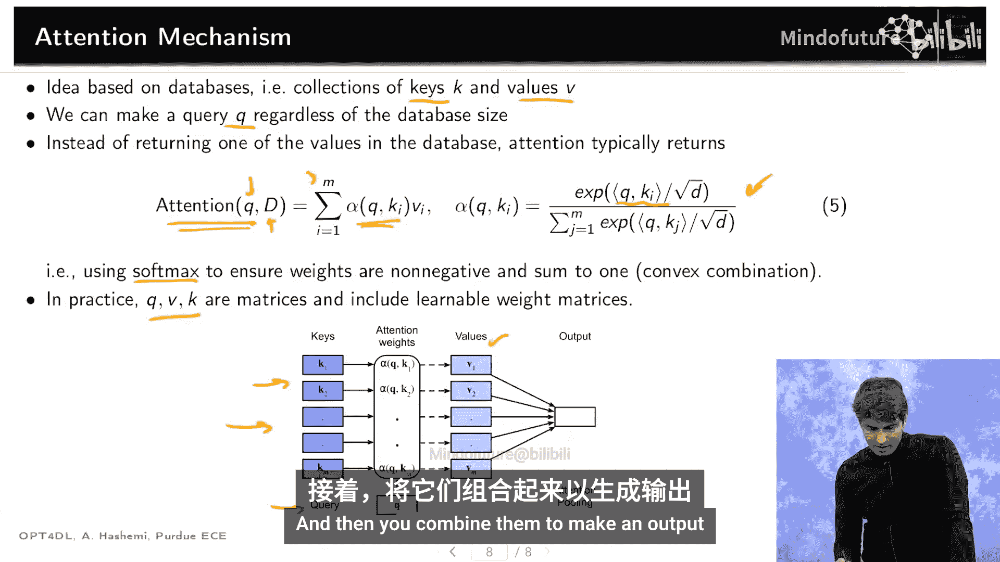

# 019：循环神经网络与注意力机制 🧠

在本节课中，我们将简要介绍另一种重要的深度学习架构——循环神经网络（RNN），并探讨其核心思想、变体以及为解决其局限性而发展出的注意力机制。

## 概述：从序列数据到自回归模型

到目前为止，我们主要讨论了经验风险最小化与最大似然估计之间的联系。在分类和回归的背景下，训练任务即寻找一个最小化训练数据平均损失的模型，这等价于最大化数据的似然性。

然而，在许多实际应用中，我们处理的是序列数据。例如，在金融数据分析、语言建模或DNA序列处理中，我们有一系列按时间顺序的观测值（X1, X2, X3...），目标是根据已有的观测序列预测下一个观测值。

## 自回归模型的基本思想

一个自然的想法是假设存在一个因果模型来刻画这些观测值之间的关系。这意味着下一个观测值 **X_T** 仅依赖于之前的所有观测值（X1 到 X_{T-1}）。更具体地说，我们可以设想 **X_T** 是之前所有观测值的一个高度非线性函数。

**公式表示：**
`X_T = f_W*(X_1, X_2, ..., X_{T-1})`

其中，函数 **f** 可以是多层感知机（MLP）等参数化模型，其参数为 **W***。如果我们有此类时间序列数据，就可以利用训练算法最小化经验风险，从而找到最优参数 **W**，进而对未来任何时刻做出良好预测。这种方法被称为**自回归模型**。

## 处理长序列的挑战：潜在变量与循环神经网络

上述方法存在一个明显问题：随着时间增长，特征数量会爆炸式增加。因为下一个观测值依赖于之前所有的观测值，对于非常长的序列，我们需要处理数十亿个权重参数。

**解决方案一：限制依赖窗口**
一个简单的解决方案是限制 **X** 的依赖范围。我们设定一个固定大小的窗口 **τ**，假设每个观测值仅依赖于过去 **τ** 个观测值。这样，需要学习的参数数量就从序列长度量级减少为一个常数 **τ**。

**解决方案二：引入潜在变量（更通用的方法）**
更通用的方法是寻找一个**潜在变量**（或称为隐藏状态 **H**），它能够有效地总结历史观测值的依赖关系。这样，只要我们知道这个潜在变量，就能做出良好的预测，而无需显式地让模型依赖所有历史观测值。

其数学表述如下：
1.  当前观测值 **X_t** 是潜在变量 **H_t** 的一个非线性函数。
    `X_t = f_W*(H_t)`
2.  潜在变量 **H_t** 本身，由前一个潜在变量 **H_{t-1}** 和当前的新观测值 **X_t** 通过另一个非线性函数更新得到。
    `H_t = g_Ω*(H_{t-1}, X_t)`

这里的 **H** 可以理解为对历史的总结。在窗口法的例子中，**H** 就是那个固定大小的观测值窗口。更新历史时，我们丢弃最旧的观测值，加入最新的观测值。

我们可以利用神经网络（如MLP）来表示这些非线性函数 **f** 和 **g**，并通过拟合数据来学习参数。

## 循环神经网络（RNN）的架构

将上述思想具体化，就得到了**循环神经网络**。一个简单的RNN单元（单隐藏层）按如下方式更新隐藏状态 **H_t**（即潜在变量）：

**公式表示：**
`H_t = σ(W_hh * H_{t-1} + W_xh * X_t + b_h)`

其中：
*   **σ** 是激活函数（如ReLU、tanh）。
*   **W_hh** 是用于乘以前一隐藏状态的权重矩阵。
*   **W_xh** 是用于乘以当前输入的权重矩阵。
*   **b_h** 是偏置项。
*   这本质上等同于一个MLP操作，其输入是前一隐藏状态 **H_{t-1}** 和当前输入 **X_t** 的拼接。

**关键优势：** 参数数量（**W_hh, W_xh, b_h**）不随时间步长增长。无论处理长度为1000还是100万的序列，需要学习的参数数量是恒定的。

信息流动过程如下：接收输入 **X_t**，将其与前一时刻的隐藏状态 **H_{t-1}** 结合，通过激活函数更新得到当前隐藏状态 **H_t**，然后基于 **H_t** 生成输出（预测）。此过程在每个时间步重复进行。

## RNN的变体与改进

简单的RNN在处理包含长期依赖关系的很长序列时，可能会遇到信息丢失或梯度消失/爆炸的问题。以下是几种重要的改进架构：

**以下是主要的RNN变体：**

*   **长短期记忆网络（LSTM）** 与**门控循环单元（GRU）**：通过引入“门”机制（如输入门、遗忘门、输出门），有选择地保留或丢弃信息，从而更好地捕捉长期依赖关系。其思想类似于CNN中的残差连接。
*   **堆叠RNN**：增加RNN的层数，即使用多个隐藏层。低层的RNN输出作为高层的RNN输入，以此构建更深的网络，增强模型表达能力。
*   **双向RNN（Bi-RNN/Bi-LSTM）**：不仅按时间正序（从左到右）处理序列，也按逆序（从右到左）处理序列。然后将两个方向得到的隐藏状态组合起来，使模型能同时利用过去和未来的上下文信息。

## RNN的局限性与Transformer的兴起

尽管RNN及其变体非常强大，但它们存在两个主要限制：

1.  **固定长度输入**：类似于CNN需要固定尺寸的图像，标准RNN通常要求输入序列具有预定义的长度，这限制了其灵活性。
2.  **顺序计算**：RNN必须按时间步顺序处理数据，无法充分利用现代GPU硬件的并行计算能力，导致训练和推理速度较慢。

为了克服这些限制，**Transformer** 架构被提出，它主要基于两个核心机制：

**以下是Transformer的两个核心机制：**

*   **注意力机制**：允许模型在处理序列时直接关注到任何位置的信息，而不必像RNN那样逐步传递。
*   **位置编码**：由于Transformer并行处理所有输入，它需要通过额外添加的位置编码来告知模型每个元素在序列中的顺序信息。

利用这两个机制，Transformer既能处理可变长度序列，又能进行高度并行化的计算，但其代价是更高的计算复杂度。

## 注意力机制简介

我们可以将注意力机制直观地理解为一个数据库查询系统。

*   **数据库**包含许多**键（Key）**-**值（Value）**对。
*   当你提出一个**查询（Query）**时，数据库并非只返回一个精确匹配的值，而是返回所有值的加权和。
*   权重由查询 **Q** 与每个键 **K** 的相关性决定：相关性越高，该键对应的值在输出中所占权重越大。

**公式表示（缩放点积注意力）：**
`Attention(Q, K, V) = softmax( (Q * K^T) / sqrt(d_k) ) * V`

其中：
*   **softmax** 函数确保所有权重非负且和为1，形成一个凸组合。
*   **Q * K^T** 计算查询与每个键的点积（相关性）。
*   **sqrt(d_k)** 是一个缩放因子，用于稳定梯度。
*   最终输出是所有值 **V** 的加权和。

在实践中，**Q（查询）、K（键）、V（值）** 通常是通过对输入进行线性变换得到的矩阵，并且这些变换的权重是可学习的参数。

## 总结

本节课我们一起学习了深度学习中用于处理序列数据的核心架构。我们从**自回归模型**的基本概念出发，探讨了直接建模长序列的挑战，进而引入了通过**潜在变量**（隐藏状态）来总结历史信息的思路，这直接引出了**循环神经网络（RNN）** 的标准结构。我们还了解了RNN的几种重要变体，如**LSTM**、**GRU**和**双向RNN**，它们旨在更好地处理长期依赖关系。最后，我们分析了RNN在并行处理和可变长度输入方面的局限性，并由此介绍了革命性的**Transformer**架构及其核心——**注意力机制**，该机制通过模拟“查询-键-值”的数据库操作，实现了对序列数据的并行化处理和全局依赖建模。在下一讲中，我们将探讨用于训练这些深度学习架构的具体学习技巧。