# 020：自动微分

## 概述
在本节课中，我们将学习深度学习训练中的一个核心方法——自动微分。我们将探讨其背后的两个关键思想：反向传播和计算图，并理解它们如何帮助我们高效地计算梯度，从而优化神经网络模型。

## 反向传播
上一节我们介绍了初始化和归一化等训练技巧。本节中，我们来看看另一种至关重要的方法：自动微分。其核心思想是，我们使用随机梯度下降及其变体来训练深度学习模型，而所有这些方法都需要计算导数或梯度。由于梯度计算是重复性的，自动化这一过程将非常有益。现代深度学习框架（如PyTorch和TensorFlow）通过自动微分实现了这一点。

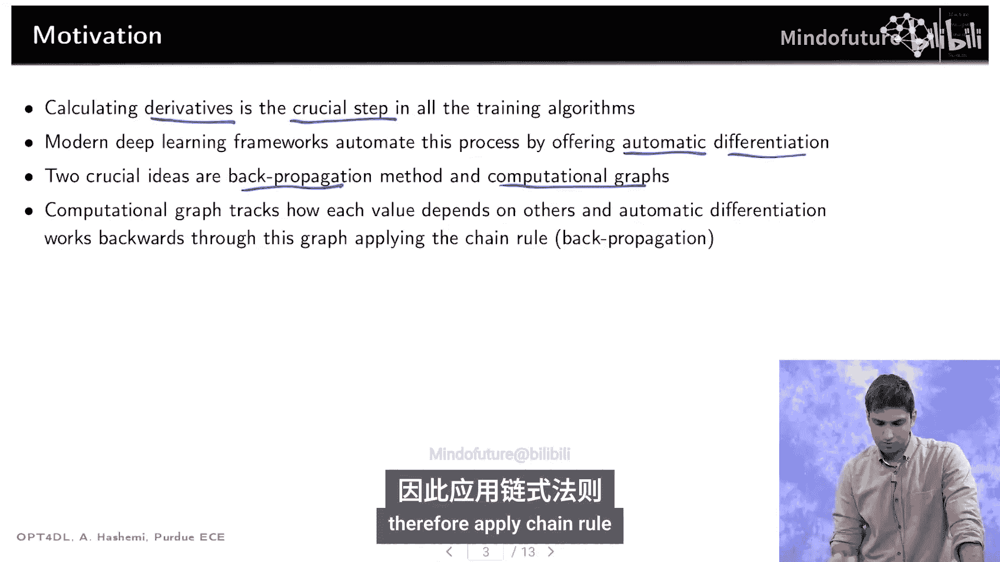

自动微分主要依赖于两个关键思想：反向传播方法和计算图。反向传播的本质是识别模型中的结构，并应用链式法则高效地计算损失函数相对于每一层权重的偏导数。计算图则帮助我们在应用反向传播时，可视化不同变量之间的依赖关系，并利用该图通过链式法则计算梯度。

首先，我们讨论反向传播。我们将通过一个简单的应用来理解它，聚焦于前馈多层感知机模型。

考虑一个典型的回归任务，使用平方损失函数。损失函数形式如下：

**L = (1/2) * ||y - v_L||^2**

其中，`y` 是真实标签向量，`v_L` 是模型的预测输出。

我们有一个具有 `L` 层的MLP。为简化，假设偏置项为零。相关参数是每一层的权重矩阵 `W_1` 到 `W_L`。在优化时，我们使用随机梯度下降更新参数：

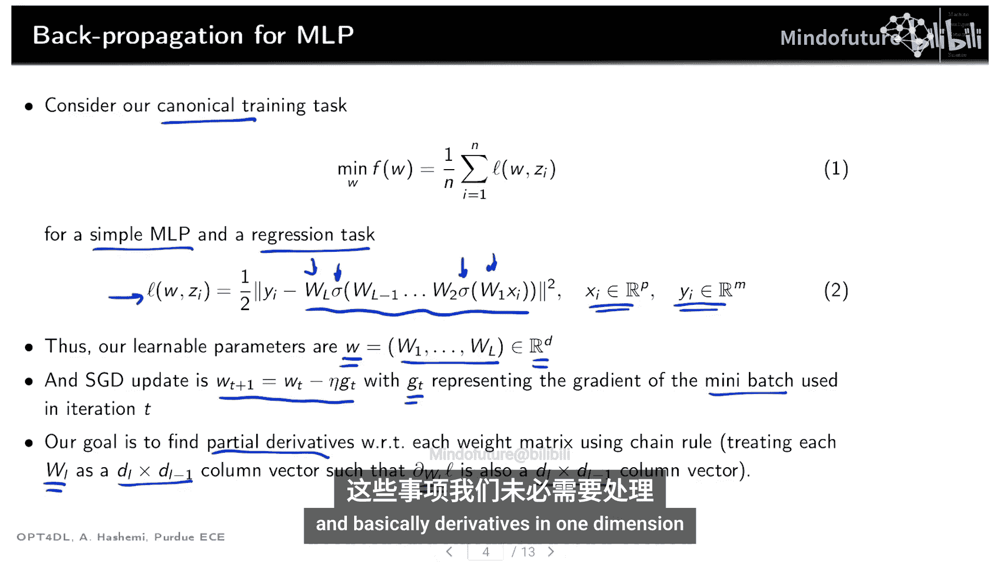

**W_{t+1} = W_t - η * g_t**

其中 `g_t` 是小批量样本损失的梯度。为了更新每一层的权重矩阵 `W_l`，我们需要计算损失 `L` 相对于每个 `W_l` 的偏导数。我们将通过应用链式法则并利用模型结构来高效地完成此计算。

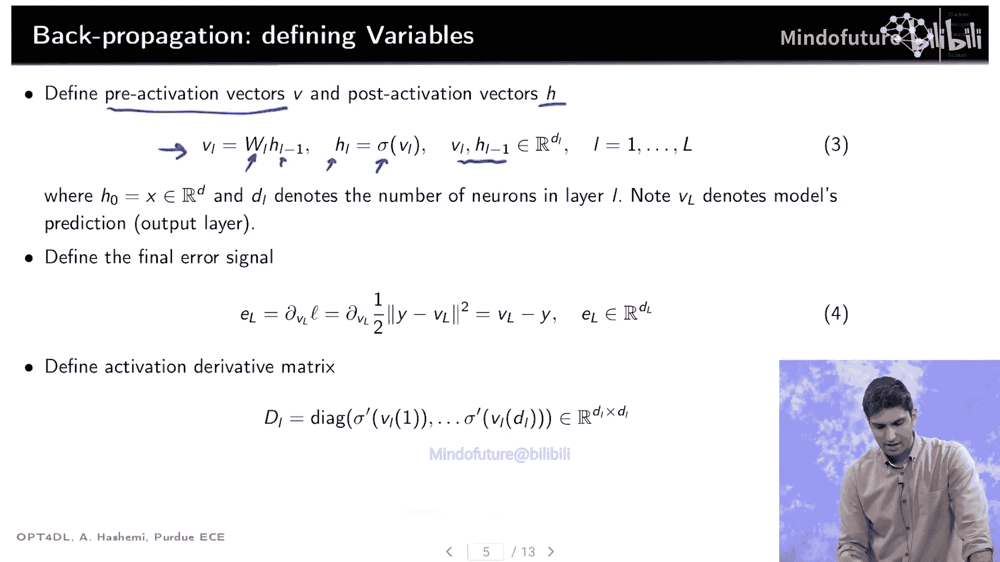

为了便于推导，我们定义几个关键变量。首先定义第 `l` 层的预激活向量 `v_l` 和激活后向量 `h_l`：

**v_l = W_l * h_{l-1}**
**h_l = σ(v_l)**

其中 `σ` 是激活函数（如ReLU）。`h_0` 是输入 `x`，`v_L` 是模型的最终输出预测 `ŷ`。

接着，定义最终误差信号 `e_L`，即损失相对于最后一层预激活 `v_L` 的梯度：

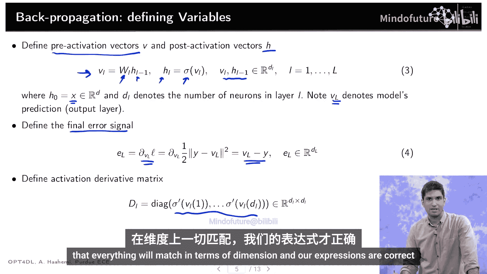

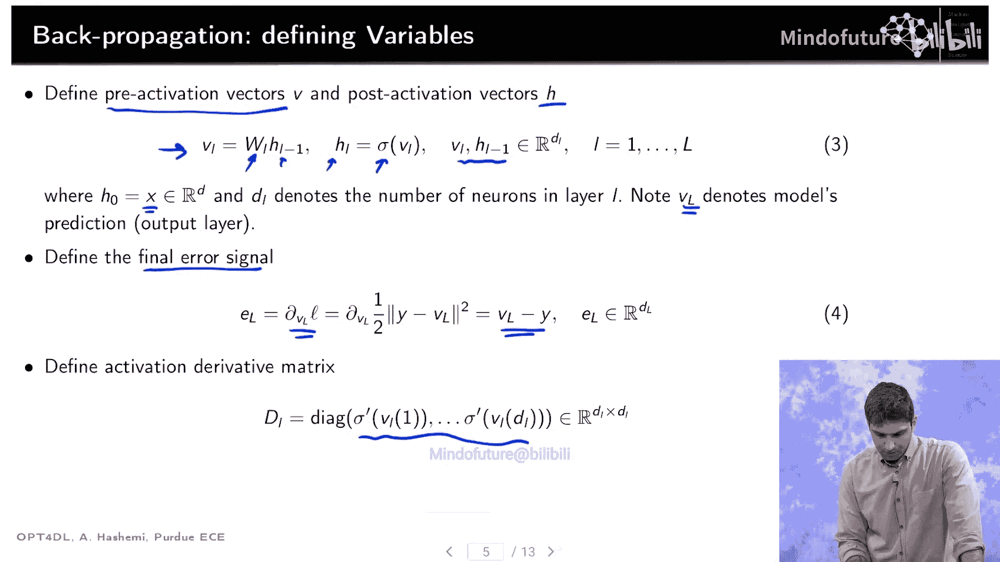

**e_L = ∂L/∂v_L = v_L - y**

当预测完全正确时，误差信号为零，梯度为零，参数不更新；当存在误差时，误差信号较大，梯度也较大，参数更新幅度更大。

最后，定义激活导数矩阵 `D_l`。由于激活函数逐元素应用于向量，其导数构成一个对角矩阵：

**D_l = diag(σ'(v_l))**

现在，让我们看看损失相对于最后一层权重 `W_L` 的偏导数形式。应用链式法则：

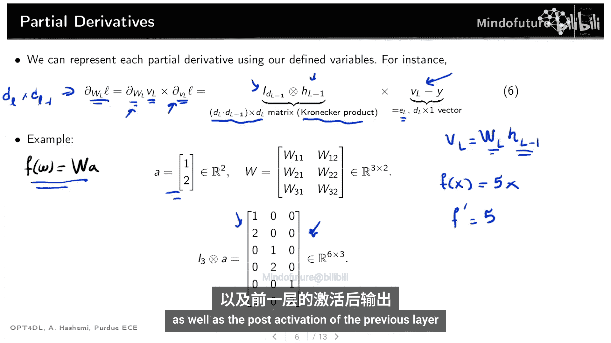

**∂L/∂W_L = (∂v_L/∂W_L) * (∂L/∂v_L)**

其中，`∂L/∂v_L` 就是最终误差信号 `e_L`。`∂v_L/∂W_L` 是线性变换 `v_L = W_L * h_{L-1}` 的导数。为了确保维度匹配，我们需要引入克罗内克积等操作。但重要的是，这一项仅依赖于前一层的激活后输出 `h_{L-1}`。

因此，我们看到一个结构：最后一层权重的偏导数依赖于最终误差信号 `e_L` 和前一层的激活后输出 `h_{L-1}`。

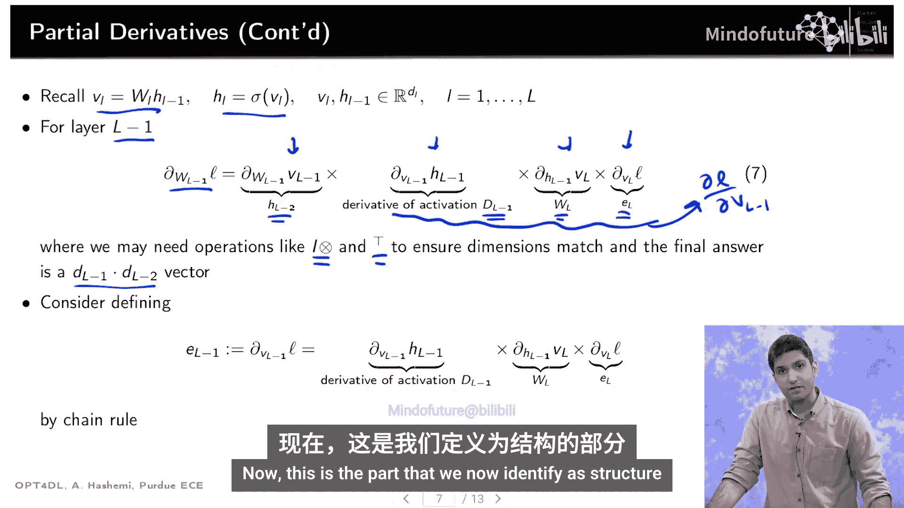

我们希望为所有层而不仅仅是最后一层识别类似的结构。以第 `L-1` 层为例，其偏导数计算涉及更长的链式法则：

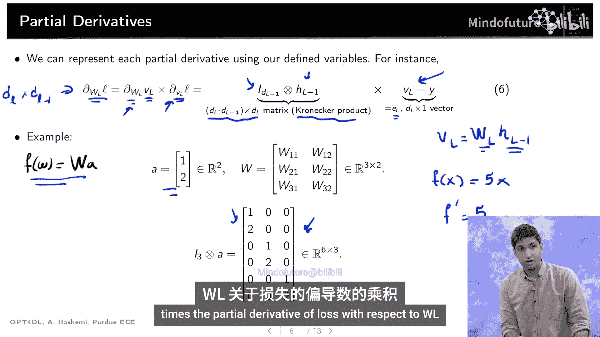

**∂L/∂W_{L-1} = (∂v_{L-1}/∂W_{L-1}) * (∂h_{L-1}/∂v_{L-1}) * (∂v_L/∂h_{L-1}) * (∂L/∂v_L)**

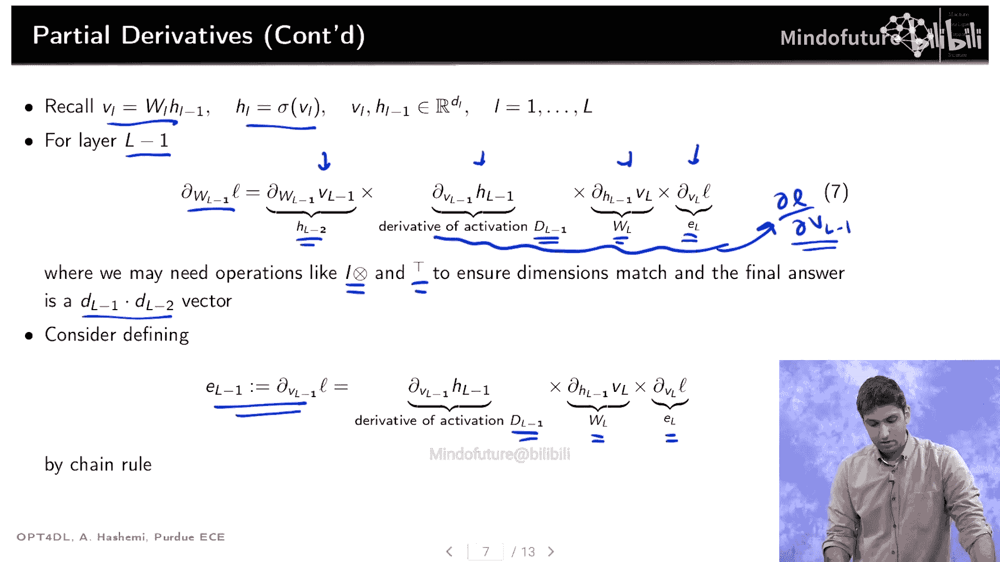

经过推导和简化（忽略具体的转置等操作以关注结构），可以发现：

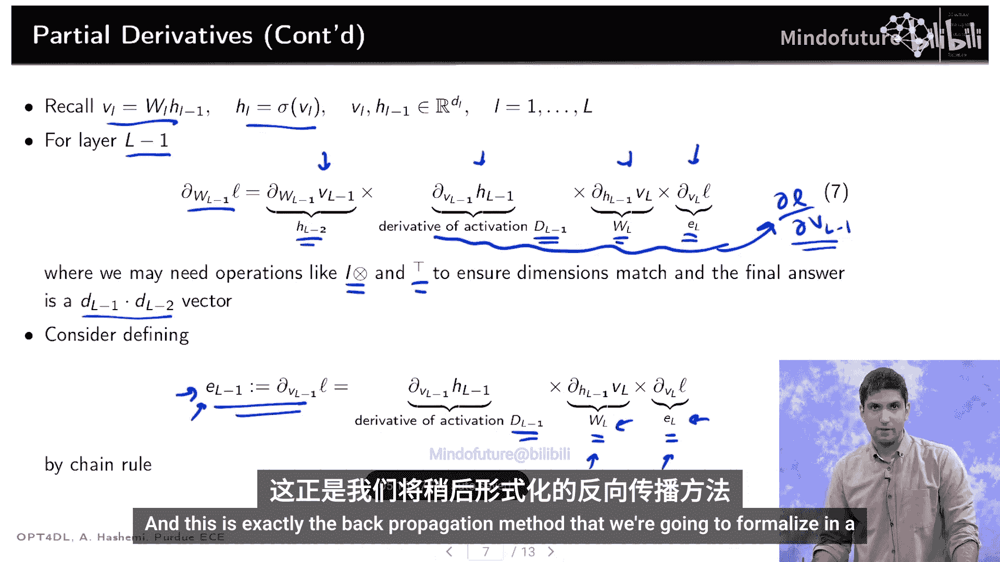

**∂L/∂W_{L-1} = (∂v_{L-1}/∂W_{L-1}) * e_{L-1}\]

这里，我们定义了第 `L-1` 层的误差信号 `e_{L-1}`，它与下一层（第 `L` 层）的权重 `W_L` 和误差信号 `e_L` 有关：

**e_{L-1} = D_{L-1} * W_L^T * e_L**

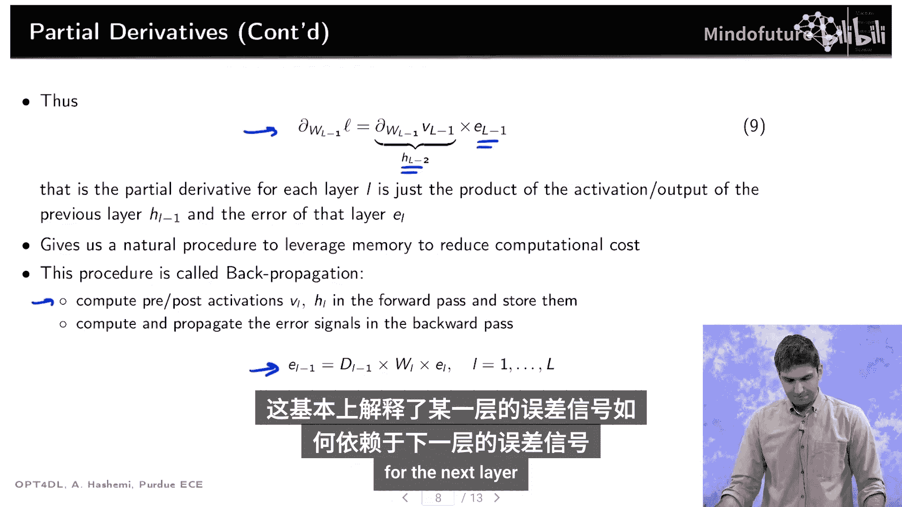

这个关系揭示了关键点：要计算第 `l` 层的误差信号 `e_l`，我们需要知道下一层 `l+1` 的误差信号 `e_{l+1}` 和权重 `W_{l+1}`。这为我们提供了一个反向遍历网络的计算过程。

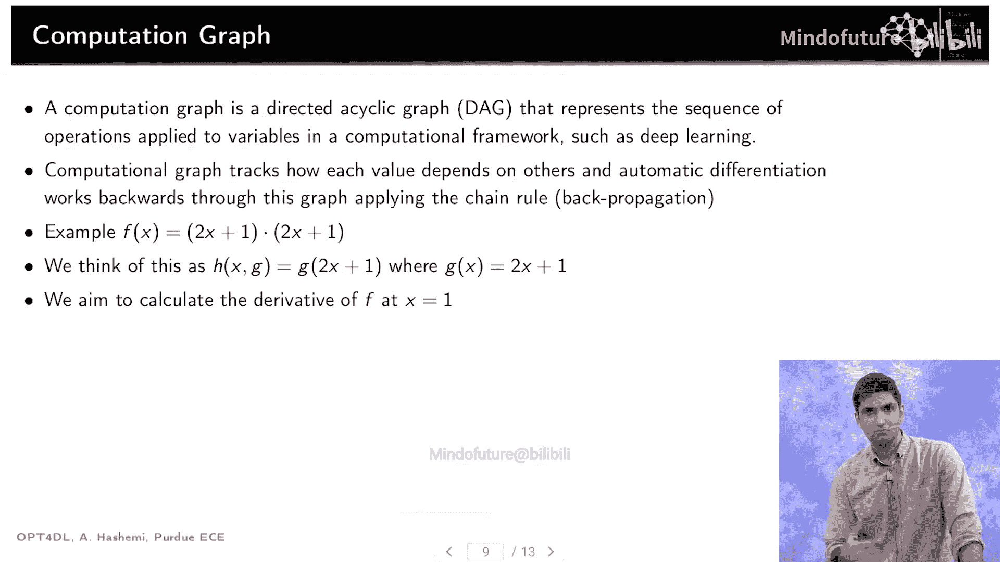

基于以上观察，我们得到了反向传播算法。该算法利用内存存储中间结果以减少计算开销。

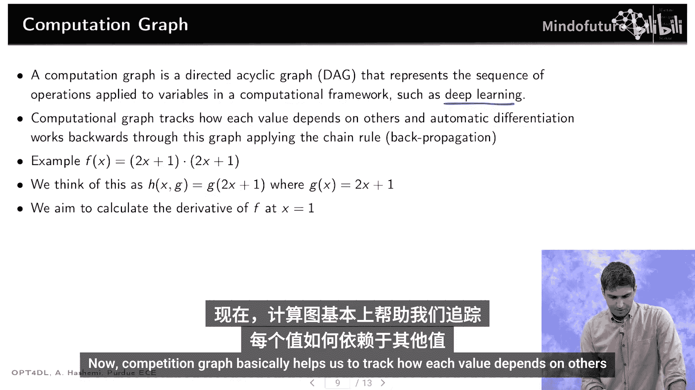

以下是算法步骤：

1.  **前向传播**：从输入到输出遍历网络，计算并存储每一层的预激活 `v_l` 和激活后 `h_l`。
2.  **反向传播**：
    *   计算最后一层的误差信号：**e_L = ∂L/∂v_L**。
    *   从 `l = L-1` 到 `l = 1` 反向遍历：
        *   利用公式 **e_l = D_l * W_{l+1}^T * e_{l+1}** 计算当前层的误差信号。
        *   计算损失对当前层权重的梯度：**∂L/∂W_l = h_{l-1} * e_l^T**（具体形式可能随维度调整，但核心是 `h_{l-1}` 和 `e_l` 的函数）。

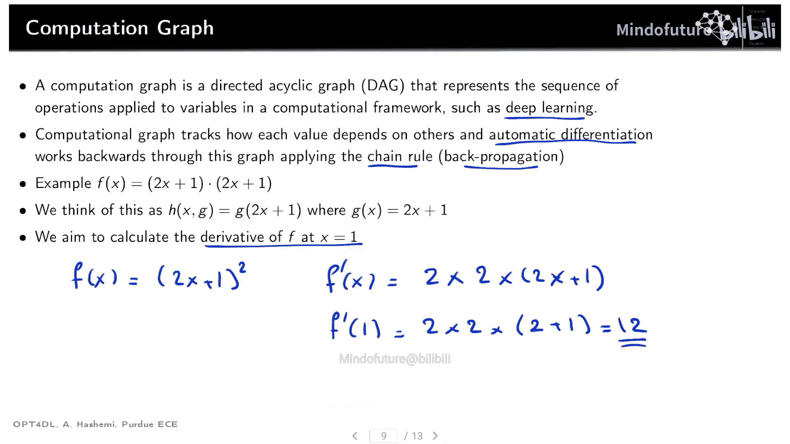

通过这种方式，我们可以高效地计算出损失函数相对于所有权重参数的梯度。

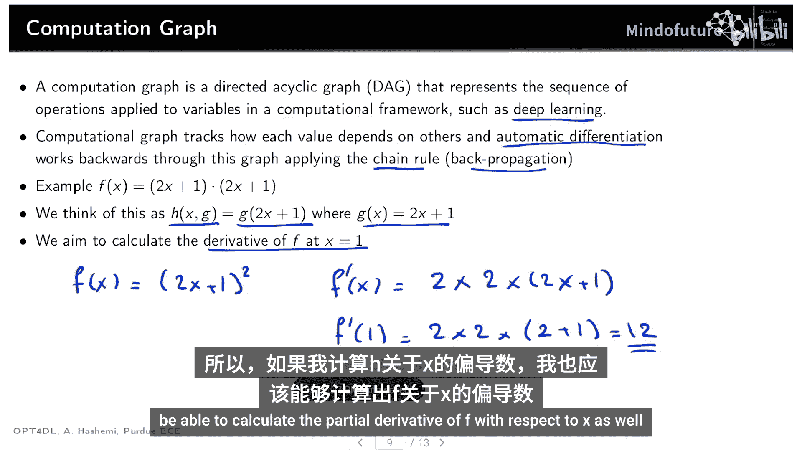

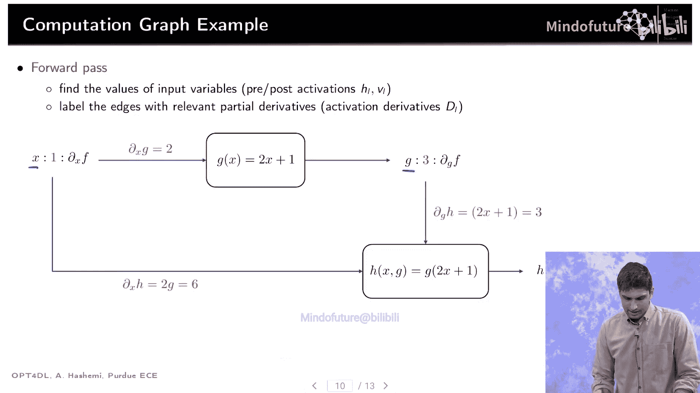

## 计算图
上一节我们介绍了反向传播的核心思想。本节中，我们来看看在实践中指导这些计算的一个强大工具：计算图。

计算图是一种有向无环图，用于表示应用于变量的一系列操作。在深度学习中，操作包括矩阵乘法、加法、激活函数等，变量包括输入、权重、预激活值、激活值等。计算图帮助我们追踪每个值如何依赖于其他值，例如一个预激活值如何依赖于另一个，或者一个误差信号如何依赖于另一个。

在自动微分的背景下，我们通过遍历这个图来执行计算：沿前向方向计算中间变量（前向传播），沿反向方向应用链式法则传播误差（反向传播）。

为了理解这个概念，我们来看一个非常简单的例子。假设有函数 **f(x) = (2x + 1) * (2x + 1)**，目标是计算在 `x=1` 处的导数 `f'(1)`。

我们可以将其分解为两个变量的函数来构建计算图：
*   令 **g = 2x + 1**
*   则 **h = f(x) = g * (2x + 1)**。注意，这里 `h` 同时依赖于 `g` 和原始的 `x`。

对应的计算图有三个节点（变量 `x`, `g`, `h`）和三条边（依赖关系）：
1.  `x` -> `g`：操作是 `g = 2x + 1`
2.  `x` -> `h`：操作是 `h` 中与 `x` 直接相乘的部分
3.  `g` -> `h`：操作是 `h = g * (2x + 1)` 中的乘法

现在执行计算：

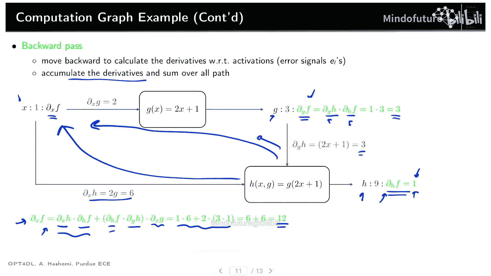

**前向传播**：
1.  给定输入 `x = 1`。
2.  计算 `g = 2*1 + 1 = 3`。
3.  计算 `h = g * (2*1 + 1) = 3 * 3 = 9`。
4.  同时，在边上标注局部偏导数（在已知输入值的情况下）：
    *   边 `x->g`：`∂g/∂x = 2`
    *   边 `g->h`：`∂h/∂g = (2x+1) = 3` (将 `x=1` 代入)
    *   边 `x->h`：`∂h/∂x = 2g = 6` (将 `g=3` 代入)

**反向传播**（计算 `∂f/∂x`，其中 `f = h`）：
1.  从输出 `h` 开始，`∂f/∂h = 1`。
2.  计算 `∂f/∂g`：根据链式法则和路径 `h <- g`，`∂f/∂g = (∂h/∂g) * (∂f/∂h) = 3 * 1 = 3`。
3.  计算 `∂f/∂x`：有两条路径从 `f` (即 `h`) 到 `x`。
    *   路径1 (`h <- x`)：贡献为 `(∂h/∂x) * (∂f/∂h) = 6 * 1 = 6`
    *   路径2 (`h <- g <- x`)：贡献为 `(∂h/∂g) * (∂g/∂x) * (∂f/∂h) = 3 * 2 * 1 = 6`
4.  根据多元链式法则，总梯度是各路径贡献之和：`∂f/∂x = 6 + 6 = 12`。

结果与直接求导 `f'(x)=4*(2x+1)`, `f'(1)=12` 一致。

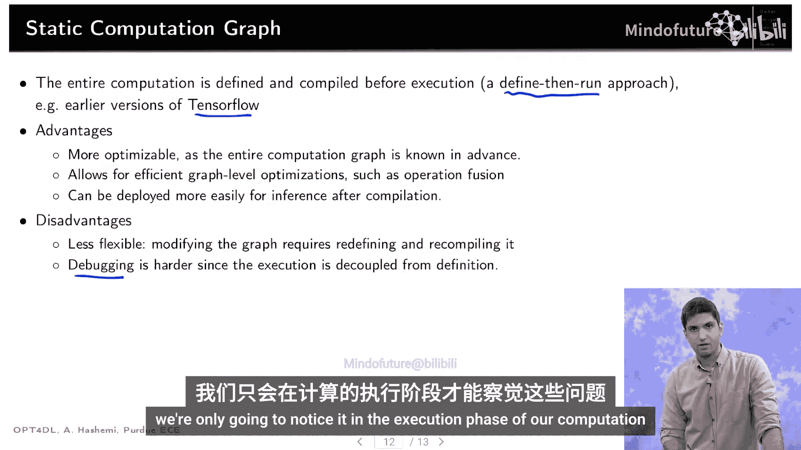

这个例子展示的是**静态计算图**：我们在执行任何计算之前就定义了完整的图结构。早期版本的TensorFlow采用这种方式（“定义并运行”）。其优点是图形预先已知，可以进行大量优化，执行效率高。缺点是缺乏灵活性，且调试困难，因为错误只在执行时才会显现。

因此，现代深度学习框架（如TensorFlow 2.0和PyTorch）多采用**动态计算图**。在动态图中，图结构是在代码执行过程中动态构建的（“边定义边运行”）。这使得模型构建更加灵活直观，调试也更容易，特别适用于结构可能变化的模型（如循环神经网络）或强化学习等场景。其缺点是由于存在运行时构建图的开销，可能无法进行与静态图同等程度的优化，速度可能稍慢。

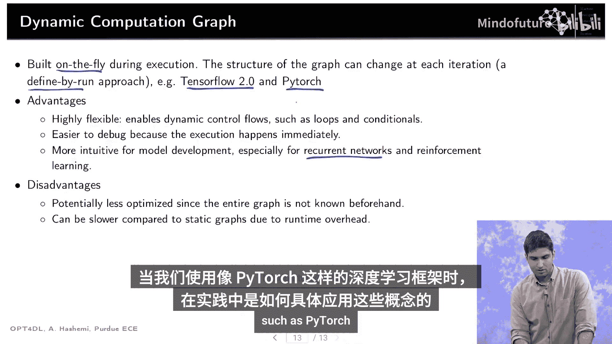

## 总结
本节课中，我们一起学习了自动微分，这是深度学习训练的核心。我们深入探讨了其两大支柱：反向传播和计算图。反向传播通过前向计算激活值、反向传播误差信号的方式，高效地计算了神经网络中所有的权重梯度。计算图则为这些计算提供了一个清晰的框架和可视化方法，它分为静态和动态两种类型，各有优劣，现代框架如PyTorch主要使用动态图来平衡灵活性与性能。理解这些概念是有效使用深度学习框架进行模型开发和优化的基础。