# 021：反向传播在PyTorch中的实例解析 🧠

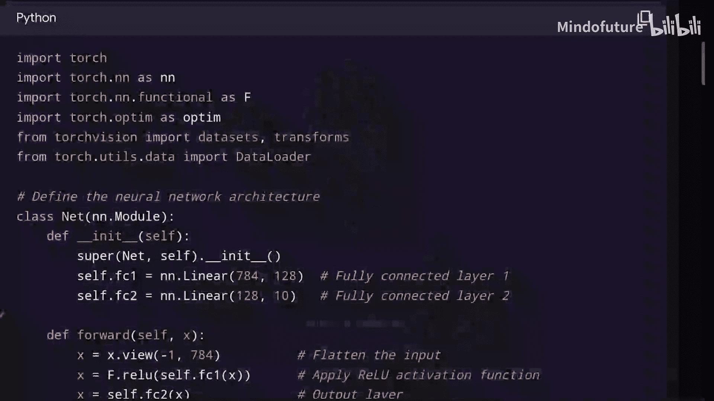

在本节课中，我们将通过一个简单的实例，学习如何在PyTorch中利用反向传播算法来训练一个多层感知机。我们将使用MNIST数据集，并构建一个包含两个全连接层的神经网络。通过这个例子，你将看到现代深度学习框架如何高效地处理梯度计算和参数更新，而无需我们手动实现复杂的细节。

## 导入必要的库 📦

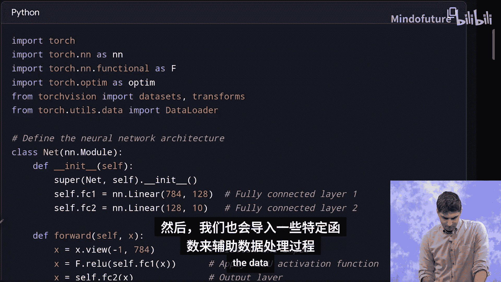

首先，我们需要导入构建和训练神经网络所需的核心库。这些库提供了定义网络结构、应用优化算法以及处理数据的工具。

以下是导入语句：
*   `torch.nn`：用于定义神经网络层和模型。
*   `torch.optim`：提供了各种优化算法，如SGD、Adam等。
*   `torchvision`：包含常用的数据集、模型架构和图像转换工具，方便我们加载和处理MNIST数据。

## 定义神经网络模型 🏗️

上一节我们导入了必要的工具，本节中我们来看看如何构建一个简单的多层感知机模型。我们的目标是构建一个具有两个全连接层的神经网络。

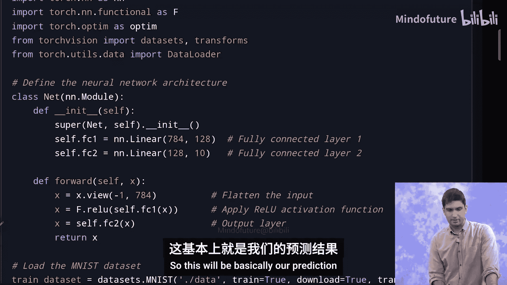

以下是模型定义的关键部分：
*   **第一层（`nn.Linear(784, 128)`）**：这是一个全连接层，输入维度为784，输出维度为128。784对应于MNIST数据集中28x28像素的图像展平后的向量大小。
*   **激活函数（`nn.ReLU()`）**：在第一个全连接层后应用ReLU非线性激活函数，为模型引入非线性能力。
*   **第二层（`nn.Linear(128, 10)`）**：这是第二个全连接层，输入维度为128，输出维度为10。10对应于MNIST数据集的10个分类类别（数字0-9）。
*   **前向传播（`forward`方法）**：定义了数据通过网络的计算路径。输入`x`首先通过第一层和ReLU激活函数，然后将结果传递给第二层以产生最终输出。

## 准备数据集 📊

定义好模型结构后，我们需要准备用于训练和测试的数据。我们将使用PyTorch提供的MNIST数据集。

以下是数据加载和处理的步骤：
*   **加载数据集**：使用`torchvision.datasets.MNIST`分别加载训练集和测试集。训练集用于模型参数更新，测试集用于评估模型性能。
*   **创建数据加载器（`DataLoader`）**：数据加载器将数据集分成小批量（batch），便于迭代训练。
    *   **训练加载器**：设置批量大小（`batch_size`）为64，并启用随机打乱（`shuffle=True`）。这模拟了随机梯度下降（SGD）中每个epoch后打乱数据的做法，有助于降低方差，优化训练过程。
    *   **测试加载器**：批量大小设置为1000，用于高效地进行模型评估，无需在评估时计算梯度。

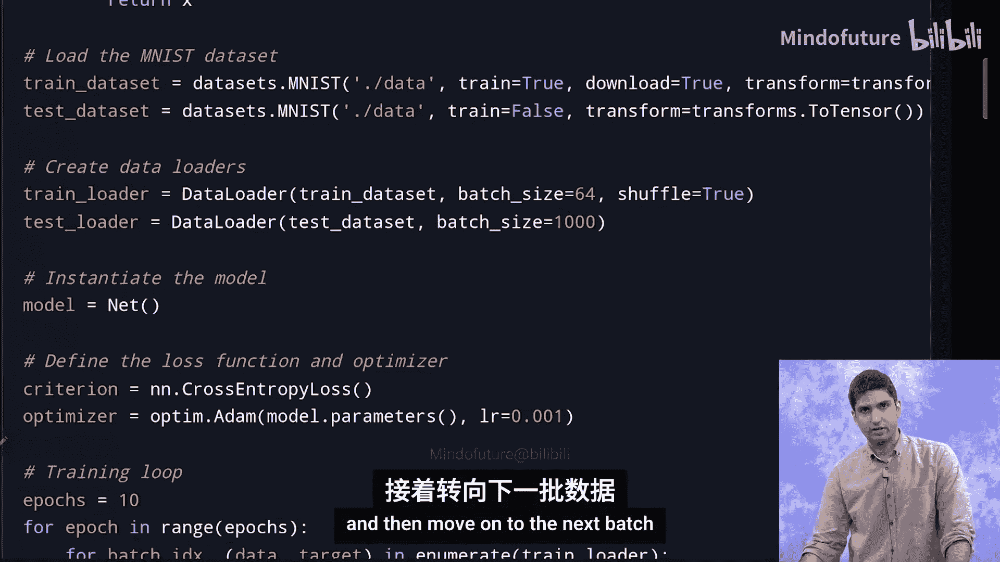

## 设置损失函数与优化器 ⚙️

有了模型和数据，接下来我们需要定义如何衡量模型的误差（损失函数）以及如何根据误差更新模型参数（优化器）。

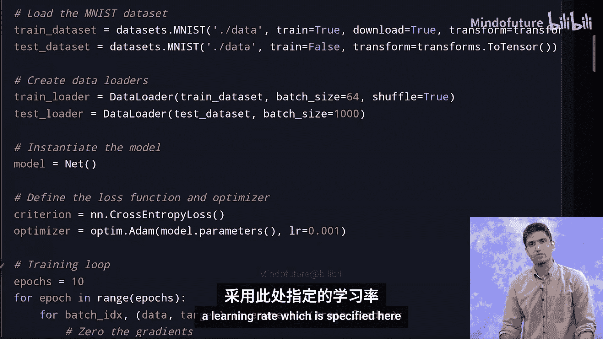

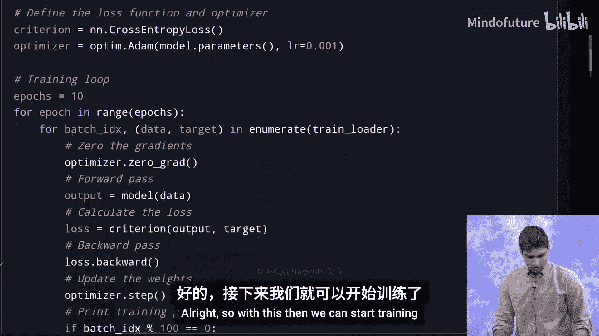

以下是相关配置：
*   **损失函数（`nn.CrossEntropyLoss()`）**：对于多分类问题，交叉熵损失是标准的选择。它衡量模型预测的概率分布与真实标签之间的差异。
*   **优化器（`optim.Adam`）**：我们选择Adam优化器，它是一种自适应学习率的优化算法，可以看作是随机梯度下降（SGD）的增强版。这里我们为其设置学习率参数（`lr=0.001`）。

## 训练循环 🔄

核心的训练过程发生在一个循环中。我们将遍历数据集多个轮次（epoch），在每个轮次中按批次处理数据，计算梯度并更新参数。

以下是训练循环中的关键步骤：
1.  **梯度清零（`optimizer.zero_grad()`）**：在每次反向传播前，必须将模型参数的梯度重置为零，因为PyTorch会累积梯度。
2.  **前向传播（`outputs = model(images)`）**：将输入数据（图像）传入模型，得到预测输出。
3.  **计算损失（`loss = criterion(outputs, labels)`）**：使用损失函数计算预测输出与真实标签之间的误差。
4.  **反向传播（`loss.backward()`）**：这是关键步骤。该调用会自动计算损失相对于所有模型参数的梯度（即反向传播算法），并将梯度存储在各个参数的`.grad`属性中。
5.  **参数更新（`optimizer.step()`）**：优化器根据计算出的梯度（存储在`.grad`中）和其自身的算法（如Adam）来更新模型的参数。

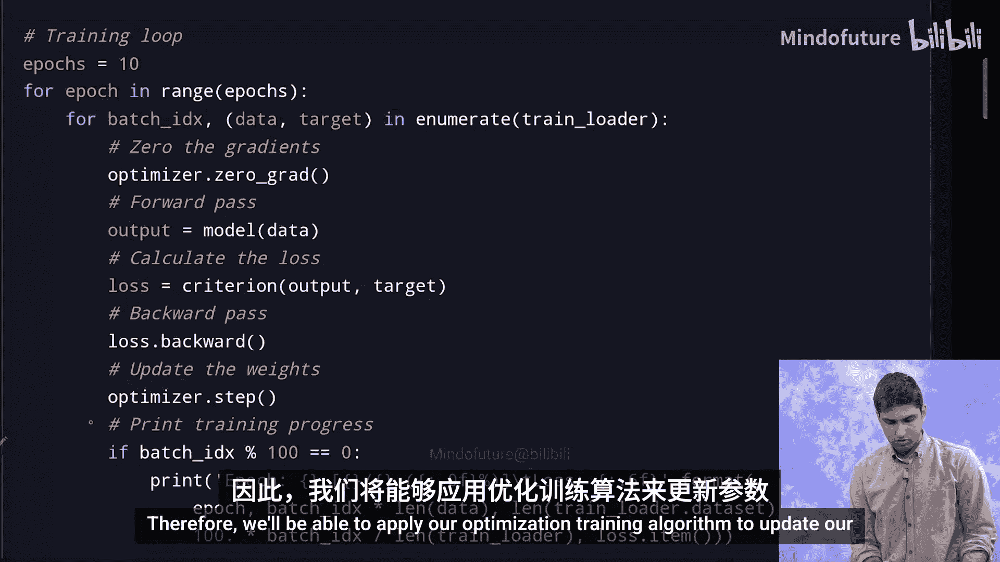

## 模型评估 📈

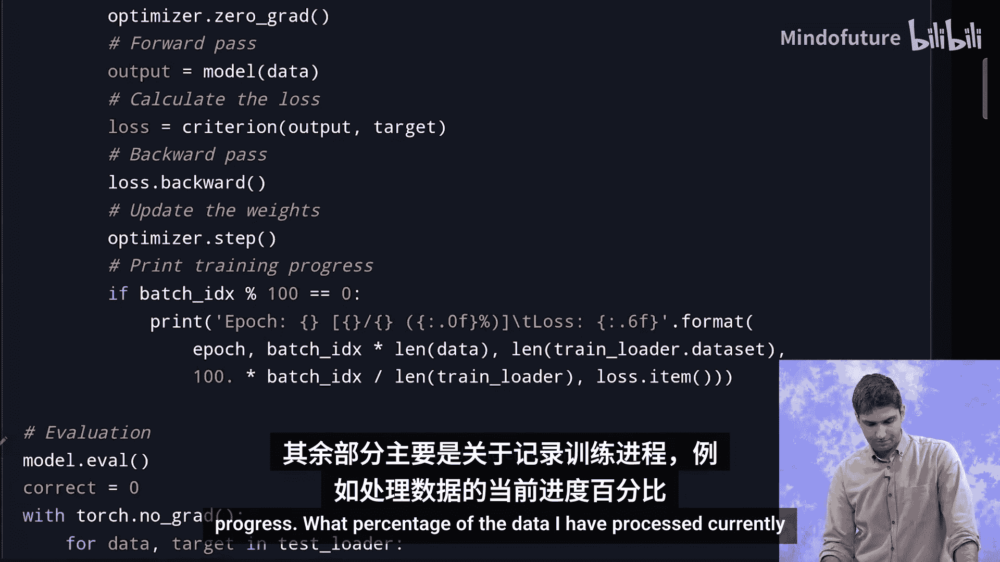

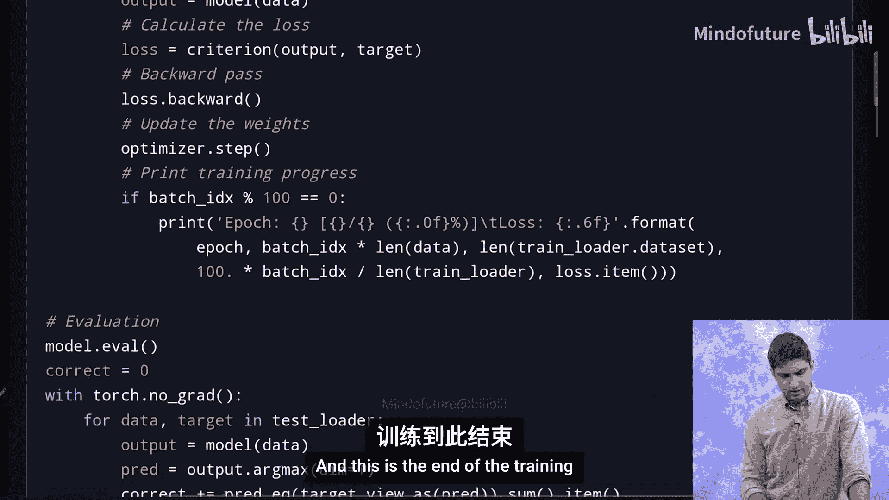

训练完成后，我们需要在独立的测试集上评估模型的性能，以了解其泛化能力。

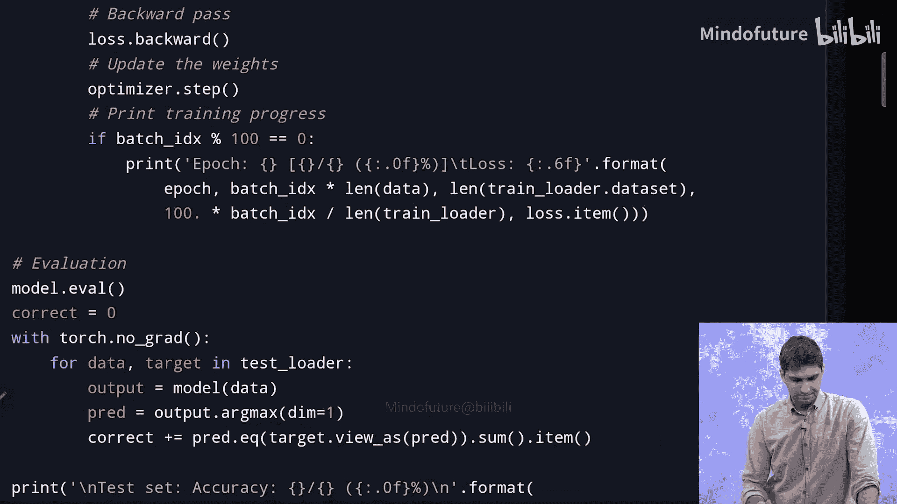

以下是评估流程：
*   **切换模式（`model.eval()`）**：将模型设置为评估模式。这会禁用如Dropout等特定于训练层的功能，并确保在评估过程中不计算和存储梯度，以节省内存和计算资源。
*   **前向传播与预测**：遍历测试数据加载器，将测试图像输入模型得到预测。使用`torch.max`函数获取预测概率最高的类别作为最终预测结果。
*   **计算准确率**：将模型的预测与真实标签进行比较，统计预测正确的样本数量，从而计算出模型在测试集上的准确率。

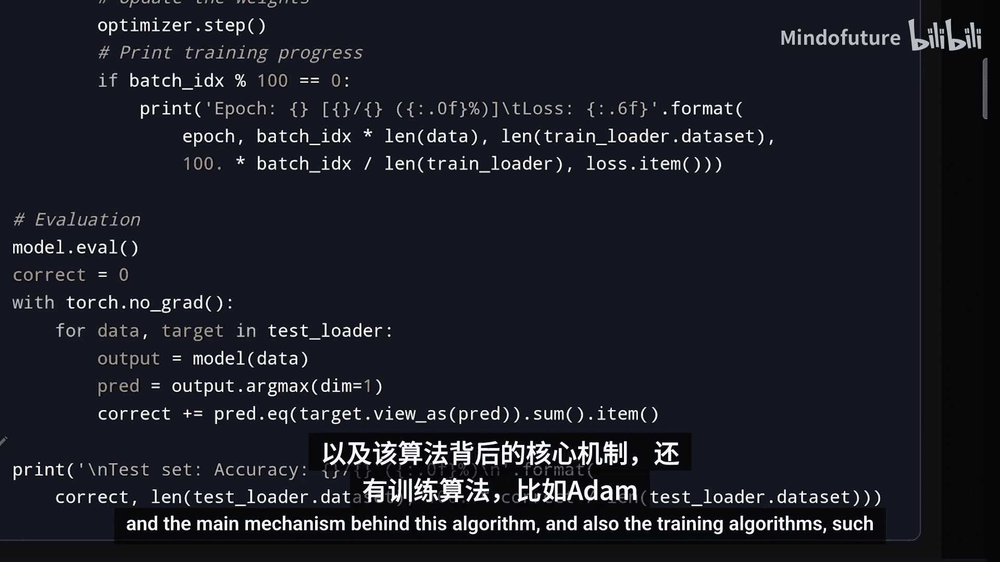

## 总结 ✨

本节课中我们一起学习了如何在PyTorch中实现一个完整的神经网络训练流程。我们构建了一个简单的两层感知机模型，使用MNIST数据集进行训练。通过定义损失函数和优化器，并在训练循环中执行前向传播、损失计算、反向传播和参数更新，我们高效地完成了模型的训练。最后，我们在测试集上评估了模型的性能。这个实例清晰地展示了反向传播算法如何被集成在深度学习框架中，使得我们能够专注于模型设计，而将复杂的梯度计算交给框架自动处理。在接下来的课程中，我们将探讨更多在大规模训练神经网络时至关重要的训练技巧和启发式方法。