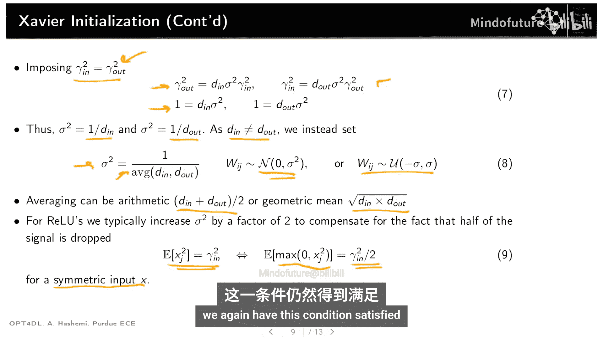

# 022：参数初始化与归一化1


## 概述
在本节课中，我们将要学习深度神经网络训练中的两项关键技术：**参数初始化**与**归一化**。我们将首先探讨为什么初始化至关重要，并分析不当初始化可能导致的梯度消失、梯度爆炸以及模型容量受限等问题。接着，我们将深入讲解一种经典的初始化方法——He初始化，并推导其背后的数学原理。


## 为什么初始化很重要
上一节我们介绍了不同的模型架构。本节中，我们来看看如何有效地训练这些架构。深度神经网络结构复杂，其对应的损失函数也高度非凸，存在许多局部最优解。因此，优化算法的起点——即参数的初始值——至关重要。不同的初始点可能导致找到不同质量的解，进而影响模型的最终性能和泛化能力。


此外，初始化在训练初期对梯度信息的影响也很大。梯度是指导参数更新的学习信号。如果梯度信息有效，训练过程会更高效；反之，训练可能变得缓慢或不稳定。

因此，我们的目标是找到能够促进更好训练过程的初始化技术。


## 多层感知机中的潜在问题
为了理解初始化技术如何缓解问题，让我们以多层感知机为例，分析两个潜在问题。

多层感知机可以用以下公式表示：
```
h^(l) = σ(W^(l) * h^(l-1) + b^(l))
```
其中，`h^(l)` 是第 `l` 层的激活值，`W^(l)` 和 `b^(l)` 是该层的可学习参数（权重和偏置），`σ` 是非线性激活函数（如ReLU或Sigmoid）。输入为 `x`，最终输出为预测值。


我们的学习信号是损失函数 `L` 关于参数 `W^(j)` 的梯度。通过链式法则，这个梯度可以分解为一系列矩阵的乘积。对于网络较浅的层，这个乘积包含的项数更多。

由于梯度是多个矩阵的乘积，其数值可能变得非常大或非常小，这取决于这些矩阵的特征值。由此可能引发两个主要问题：


以下是两种梯度问题：
1.  **梯度爆炸**：当乘积非常大时，梯度值会变得巨大，导致参数更新步长过大，可能越过最优解，引起训练不稳定。
2.  **梯度消失**：当乘积非常小时，梯度值会变得极小，导致参数几乎不更新，训练停滞不前。这在非常深的网络和RNN中尤为常见。


梯度爆炸的常见解决方法是**梯度裁剪**。梯度消失的解决方法包括使用LSTM架构或在网络中引入**残差连接**。

## 激活函数选择的影响
除了矩阵乘积，激活函数的选择也至关重要，因为其导数隐含在上述梯度计算的矩阵中。

例如，Sigmoid函数更容易导致梯度消失问题。观察Sigmoid函数及其梯度图可以发现，对于绝对值较大的输入，其梯度值接近于0。如果在训练中权重使激活值落入这些区域，梯度就会变得非常小，从而引发梯度消失。


## 对称性问题与随机初始化的必要性
除了梯度问题，还存在一个**对称性**问题，它可能限制模型的学习能力。我们引入非线性和深度是为了增加模型容量。然而，糟糕的初始化可能使我们无法享受这种高容量。


考虑一个简单的例子：假设某一层有两个神经元，且初始化时所有权重相同，所有偏置也相同。可以证明，在初始化时，这两个神经元的输出相同，并且它们的梯度也相同。

这意味着，如果使用基于梯度的更新方法，这两个神经元在整个训练过程中将保持完全相同的状态。尽管我们有两个神经元，期望获得更高的学习能力，但实际上它们只相当于一个神经元，从而降低了模型容量。


这个问题可以通过引入**随机初始化**来轻松避免。在深度学习的优化中，我们大量使用随机性，例如在随机梯度下降算法本身中引入噪声，以及在参数初始化时使用随机噪声。这有助于打破对称性，并缓解梯度消失和爆炸问题。

## He初始化方法
一种著名的初始化技术是**He初始化**。其主要思想是：初始化权重时，应确保信号强度在网络的前向传播和反向传播过程中不会发生剧烈变化，从而避免梯度消失或爆炸。

为了推导，我们假设激活函数处于其线性区域（例如，在初始化时，对于Sigmoid、ReLU或Tanh，可以近似为线性函数），并且为了简化，假设偏置为0。

考虑一个特定层，输入维度为 `d_in`，输出维度为 `d_out`。我们有两个条件：
1.  **前向信息传播条件**：输出信号的强度（用其二阶矩/方差衡量）应与输入信号的强度相同。
2.  **反向信息传播条件**：当梯度反向传播通过该层时，信号的强度也应保持不变。


我们进一步假设：输入 `x` 的每个分量的强度（方差）为 `γ_in²`；权重矩阵 `W` 的每个元素是独立的零均值随机变量，方差为 `σ²`。

通过数学推导，上述两个条件要求 `σ²` 满足：
```
1 = d_in * σ²  且  1 = d_out * σ²
```
这意味着 `σ²` 应同时是 `1/d_in` 和 `1/d_out`。在实际中，`d_in` 和 `d_out` 通常不相等。因此，我们折衷地设置 `σ²` 为两者平均值的倒数：
```
σ² = 2 / (d_in + d_out)   # 算术平均
或
σ² = 1 / sqrt(d_in * d_out) # 几何平均
```
然后，我们可以从均值为0、方差为 `σ²` 的高斯分布或均匀分布中采样来初始化权重。

一个常见的修正是针对ReLU激活函数。由于ReLU会“关闭”一半的神经元（输出为0），这会使信号方差减半。因此，为了补偿，我们将方差增大一倍：
```
σ² = 2 * (2 / (d_in + d_out)) = 4 / (d_in + d_out)
```
这就是实践中常用的He初始化方法。



## 总结
本节课中，我们一起学习了深度神经网络训练中参数初始化的核心思想。我们首先理解了不当初始化可能导致梯度消失、梯度爆炸和模型容量受限等问题。接着，我们深入分析了He初始化方法的原理，它通过精心设置初始化权重的方差，旨在保持信号在前向和反向传播中的强度稳定，从而为高效训练奠定基础。在下一讲中，我们将继续探讨另一种用于处理这些问题的实用技术。