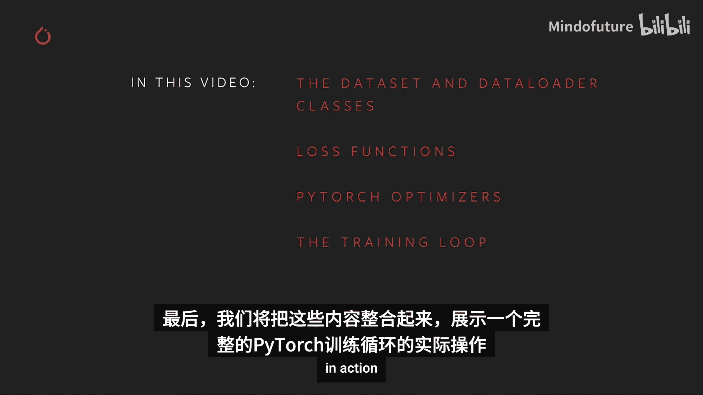
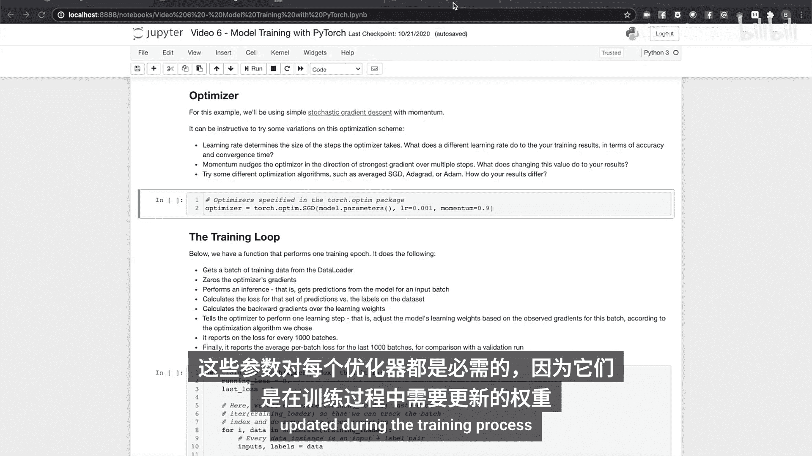
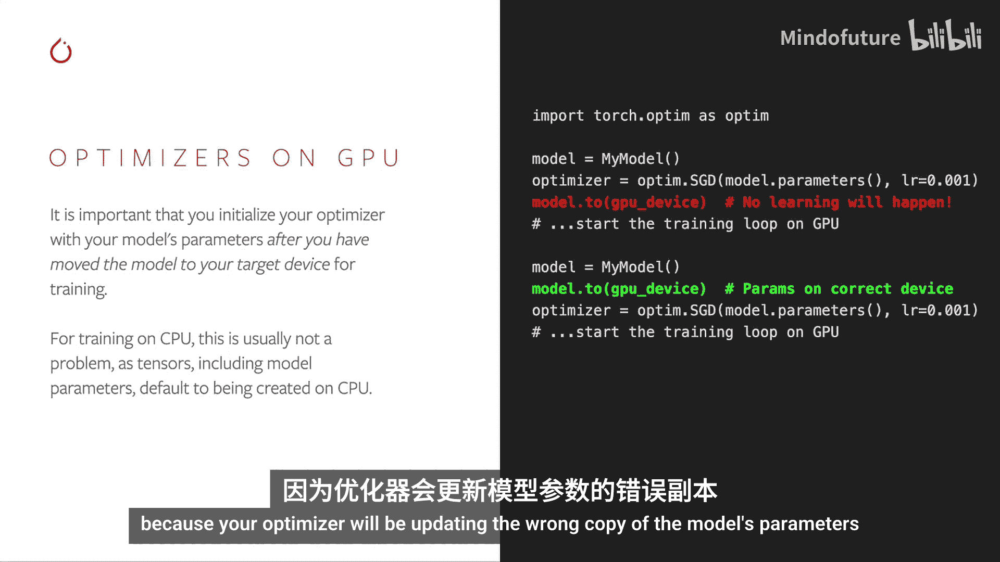
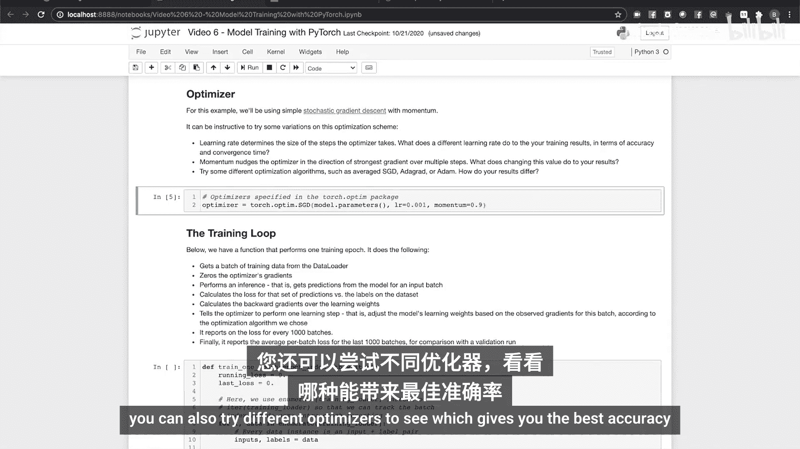
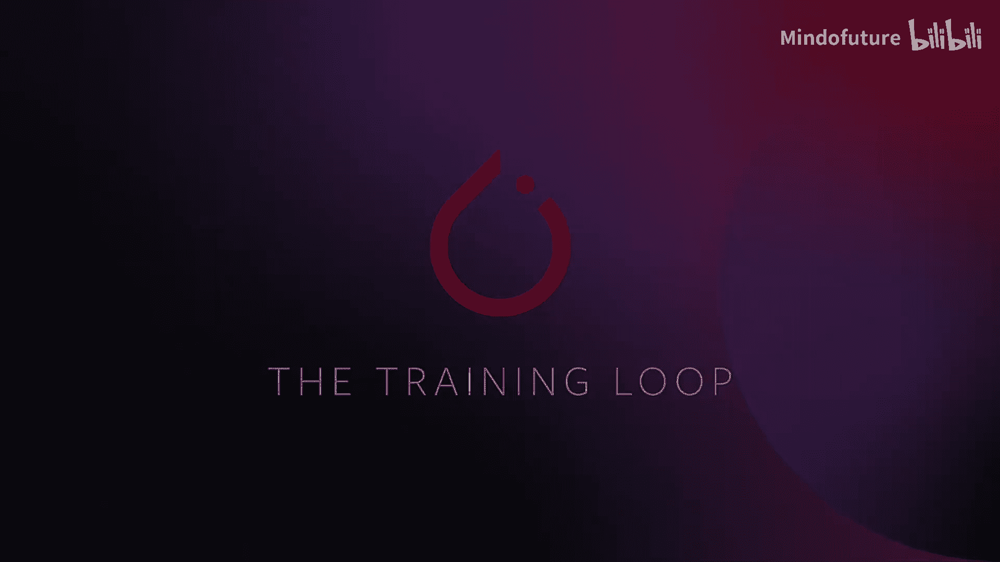
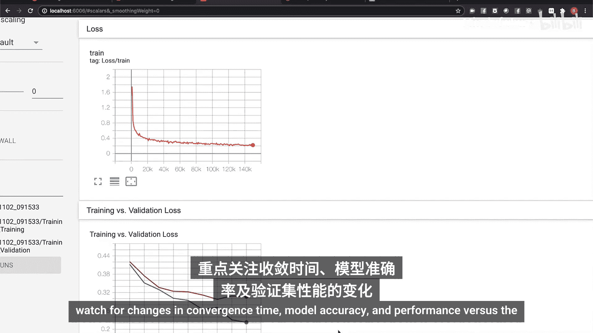
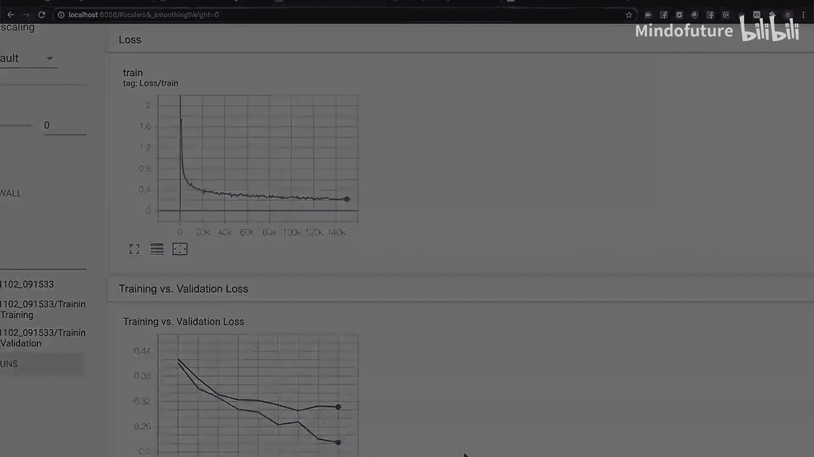
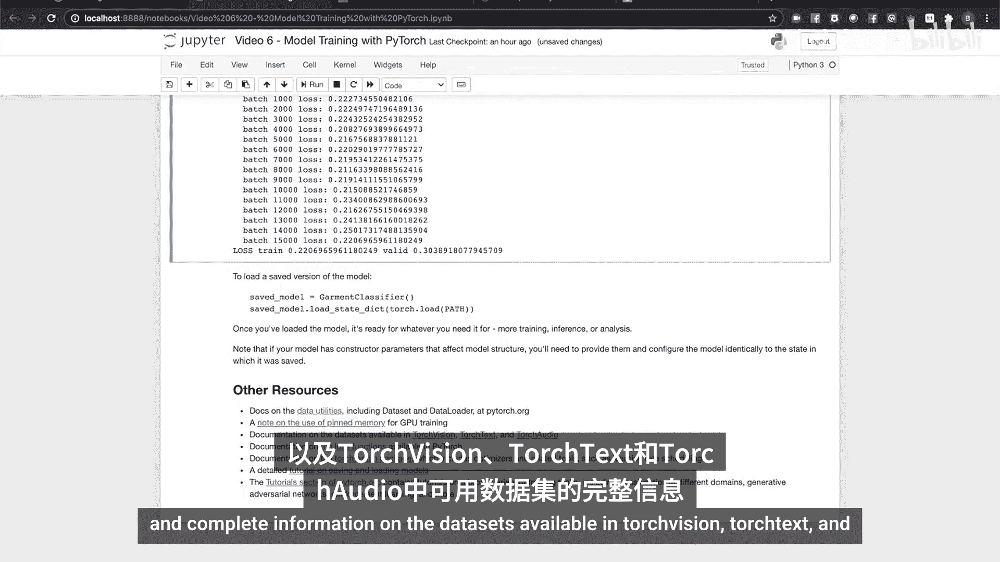

# Pytorch初学者教程 ｜ Pytorch Beginner Series p06 P06_Training_with_PyTorch -BV1U2YAzWE5R_p6-

Welcome back to the Pytorrch training video series。

 This video is about the fundamentals of model training in Pytorrch。In past videos。

 we've discussed building models with the neural network layers and functions of the torchdot and N module。

The mechanics of automated gradient computation， which is central to gradient based model training。

And using tensor board to visualize training progress and other activities。In this video。

 we'll be adding some new tools to your inventory。We'll get familiar with the data set and data loader abstractions and how they ease the process of feeding data to your model during a training loop。

We'll discuss specific loss functions and when to use them。We'll look at pi torch optimizers。

 which implement algorithms to adjust model weights based on the outcome of a loss function。

And finally， we'll pull all of these together and see a full pie torch training loop in action。

Efficient data handling in Pytorrch is achieved via two main classes， the data set and data loader。

The data set is responsible for accessing and processing single instances of your data from your data。

There are a number of data sets available in the Pytorch domain APIs。

 and you can make your own data sets using provided subclass or by subclassing the data set parent class yourself。

The data loader pulls instances of data from the data set。

 either automatically or with a sampler that you define。

Collects them in batches and returns them for consumption by your training loop。

The data loader works with all kinds of data sets， regardless of the type of data they contain。

The Pytorrch domain APIs， torch vision， Torch text and torch audio give access to a collection of open labeled data sets that you may find useful for your own training purposes。

Torch fission contains a broad array of data sets labeled for classification。

 object detection and object segmentation。It also contains the convenience classes。

 image folder and data set folder， which allow you to easily create a data set from images or other data accessible on your file system。

 See the documentation for more details on these classes。

Torch text offers data sets labeled for a variety of classification， translation and analysis tasks。

Torch audio gives access to data sets labeled for transcription and music genre detection。

Most of the time， you'll know the size of your data set and be able to access arbitrary single instances of it。

In this case， it's easy to create a data set， just subclass torch U data data set and override two methods。

Len to return the number of items near data set and get item to access data instances by key。

If the key is a sequential integer index， your data set subclass will work with the default data letter configuration。

If you have some other sort of key， such as a string or file path。

 you'll need to set up your data loader with a custom sampler class to access instances of your data set。

 See the documentation for more details in this advanced technique。

If you don't know the size of your data set at run time， for example。

 if you are using real time streaming data as an input。

You'll want to subclass torch Ut's data iterable data set。To do this。

 you need to override the inner method of the iterable data parent class。

Be aware that you will have to do a little extra work to cover the case where multiple workers are asking for data instances from your iterable data set。

The documentation has example code that demonstrates this。When you make your own data set。

 you will often want to split it into subsets for training。

 validation and final testing of your model。The torch u data random split function allows you to do that。

When creating a data loader， the only required constructor argument is a data set。

The most common optional arguments you'll set on a data loader are batch size。

 shuffle and numb workers。Btch size sets the number of instances in a training batch。

Determining your optimal batch size is a topic beyond the scope of this video。

You'll commonly see this be a multiple of 4 or 16， but the optimal size for your training task will depend on your processor architecture。

 available memory and its effect on training convergence。

Shuffling will randomize the order of instances via index permutation。

 Set this to true for training so that your model's training will not be dependent on the order of your data or the configuration of specific batches。

 This flag can be left to as default of false for validation， model testing and inverts。

Numb workers sets the number of parallel threads， pulling data instances。

 The ideal number of workers is something you may determine empirically。

 It will depend on details of your local machine and access time for individual data instances。

Other data order configuration arguments that you'll see for more advanced cases include a custom sampler class for those cases when your data set is indexed by something other than sequential integers。

And timeap， which will be especially important for iterable data sets backed by real time data streams。

And as always， see the documentation for more details。

If you will need to transfer your data batches to GPU during training。

 it is recommended to use pinned memory buffers to do so。

This means that the memory buffers underlying your tensors are in page locked memory。

 which makes for faster host to GPU data transfer。Notes on this important best practice are linked from the interactive notebook accompanying this video。

The data loader class makes it easy to do this automatically by setting its pin memory to true when you create the data loader。

For this video， we'll be using the fashion Emunist data set， which contains image tiles of garments。

 each labeled with one of 10 classes， shirts， jackets， shoes， et cetera。

The code in this cell will create data set objects for separate training and validation data splits and download the images and labels。

 if necessary。Next， it will create appropriately configured data loaders Now that we don't bother shuffling our validation split。

Well also define the class labels we'll be training against and report the data set sizes。

Note that it may take a few minutes to download the data set， depending on your network connection。

 but you only have to do that once。We'll follow the practice of visualizing the output of our data loader to make sure it's what we expect。

 And sure enough， here are our pictures and labels。 So let's move on。Our model， for this example。

 is a variant of the Linenette 5 image classifier， which should look familiar if you've watched previous videos in this series。

 It contains convolutional layers to extract and compose features from the images and a set of fully connected layers to perform the classification。

Pytorch includes a broad array of commonly used loss functions suitable for a variety of tasks。

 These include functions like mean squared error loss， for regression tasks。

Callback labbller divergence for comparisons of continuous probability distributions。

 binary cross entropy for binary classification and cross entropy loss for multi class classification tasks。

 All loss functions compare the output of your model to some label or expected set of values。

For our classification task in this video we'll use cross entropy loss。

Will call its constructor with no arguments， but this particular loss function can be configured to rescale individual class weights。

 ignorere certain classes when computing loss and more。 See the docs for details。

In the cell shown here， we'll create our loss function。

 createate some Uot's values for outputs and expected values and run the loss function against them。

Note， the loss function will return a single value for the whole batch。

Pytorch optimizers perform the task of updating learning weights based on the backward gradients of the loss function。

For more information on backward gradienting computation。

 see the relevant video earlier in this series。Pytort provides a variety of optimization algorithms。

 including stochastic gradient descent， Agrad， Adam， LBFGS and others。

 as well as tools for further refinements such as learning weight scheduling。

The full breadth of optimization algorithms is beyond the scope of this video。

 but we'll discuss a few features that are common to most pietorrch optimizers。

The first commonality is that all optimizers must be initialized with the model parameters。

 This is best done by calling the parameters method on the model object， as shown here。

These are required for every optimizer because these are the weights that get updated during the training process。

This brings up an important point when using Pytorch optimizers。

 Make sure that your model parameters are stored on the right device。

 If you're doing your training on the GPU， you must move your model parameters to GPU memory before initializing your optimizer。

If you don't do this， you won't see your loss decreasing over time because your optimizer will be updating the wrong copy of the model's parameters。

Most gradient based optimizers will have some combination of the following parameters。

A learning rate that determines the size of the steps your optimizer takes。A momentum value。

 which causes the optimizer to take slightly larger steps in the direction of strongest improvement over the last few time steps。

A weight decay value can be provided to encourage weight regularization， and avoid overfitting。

Other parameters are usually coefficients or weights， specific to an algorithm。For our example。

 we're going to use simple stochastic gradient descent with learning weight and momentum value specified。

Note that the optimal values for these arguments called hyperpara are difficult to know a priori and are often found through grid search or similar methods。

Hyperparameter optimization is a topic we'll cover in a later video。

If you're working through the interactive note accompanying this video。

 take the time to try different values of the specified parameters to see their effect on the training process。

 You can also try different optimizers to see which gives you the best accuracy or fastest convergence。

Now， we have all the pieces we need， a model， a data set wrapped in a data loader。

 a loss function and an optimizer。 We're ready to train。Along the way。

 we're going to visualize our training progress with Tensor board。

 Here is a function to perform training one epoch。 That is one complete pass over the training data。

In this function。Enumerate ver batches of data provided by the training data loader。

Btches are of the size we specified when initializing the data loader， in our case，4。For each batch。

 we break out the input tensors in the labels。Next， we zero the learning gradients。

We tell the model to provide a set of predictions for the input batch。We compute the loss。

 That is the difference between the predictions and expected values and compute the backward gradients of the loss function over the learning weights with the backward call。

We tell the optimizer to take a step， adjusting the learning weights based on the gradients we just computed。

Finally， we tally the running loss。Every thousand batches， we log the average loss per batch。

 We also report this value to tensor board for graphing。

The average loss for the last thousand batches is returned from this function for validation purposes。

Next， we'll loop over a number of ethics。For each epoch， we will。Set the model to training mode。

 That is with computation tracking turned on so we can compute backward radiance。

Will'll train one epoch and record the average loss per batch that it reports。

We set the model to inference mode。That is， with computation tracking turned off since we don't need it for the validation steps below。

We do inferences and compute losses for the validation data set and compute the average loss per batch。

We report the average losses for both training and validation。

 both printing it directly and logging it to Tensor board。Finally。

 if this validation loss is the best we've seen for the model， we save the models state to a file。

So let's run this and watch a single epoch。We'll start tensor board。And see what it reports。

And as we would want it to， the loss is decreasing monotonically。Let's watch a few more epics。

It looks like the training and validation losses are diverging。

And we see that reflected in the graph。Let's continue making a nice round 10 epochs。

It looks from the printed stats that the training losses settled just above 0。2。

 but the training and validation losses are still divergent。And that's borne out visually as well。

 So it looks like our model has converged on its best possible accuracy。

 at least with these hyper parametersa， but we appear to be overfitting to the training data。

 This may be a sign that our model is over specifiedified with respect to the complexity of the data set or that the data set is not large enough to infer the general function our model is trying to simulate。

In any case， tracking stats， performinging consistent validation and tracking the output visually allowed us to identify an issue to investigate。

 We've also saved our best performing models parameters to a file for further examination。

It's worth taking some time to experiment the changes in the model and the optimizer parameters to see how the training results change for a relatively simple case like this。

Watch for changes in convergence time， model accuracy and performance versus the validation set。

Model training and the optimization of the training process are deep topics。

 and the documentation at Pytorch dot org contains a wealth of helpful information from model training with piytorrch。

The tutorial section of Pytorrch。 org has information on a breadth of training topics。

 including training techniques such as transfer learning and fine tuning for leveraging existing trained networks。

 training generative adversarial networks， reinforcement learning and Torchdot distributed Pytorrchches framework for distributed training for when the scale of your data set or your model necessitates training on a cluster computers。

The Pytorrch documentation includes full details of the tools we covered in this video and more。

Full details of the training optimizers and associated tools such as the learning scheduler。

Full details of the available loss functions， information on the data set and data loader classes。

 including guidance on making custom data set classes。

 documentation of Tordot distributed and the distributed R PCC framework。

And complete information on the data sets available in torch Vi， Torch text and torch audio。

