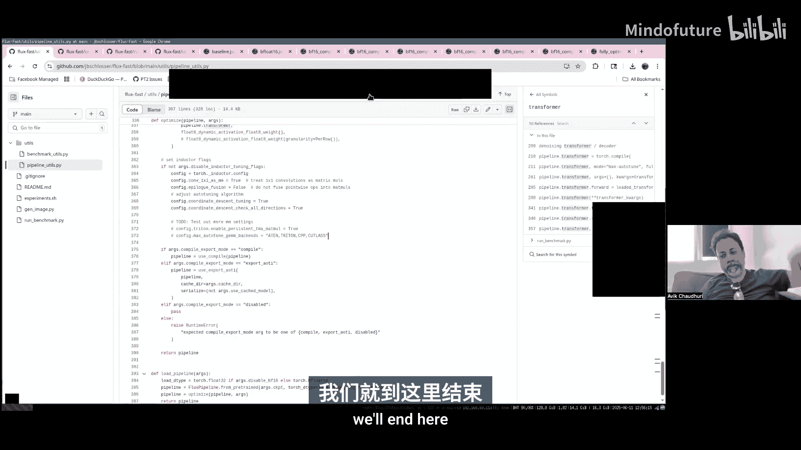

# 【Pytorch】编译器技术 ｜ Pytorch Compiler p01 P01_Making_Flux_Run_Fast-PyTorch_Compiler_Series -BV1RztQzREs8_p1-

All right， hi everybody， today we have Joel Fser who's going to talk about how Torch compile can achieve state of art performance for flux image generation。

 so take it away Joel。はい。Everyone， yep， as you mentioned。

 I'm going to step through a series of optimizations on the flux model and just demonstrate some really good state of the art results we've seen and show kind of within traces like what's going on as we apply these techniques。

So I'll do a quick summary of the optimizations that we're going to look at。

 and then I'll dig in deeper on each of these， how to apply them in code。

 and then I'll look at the traces。So just quickly， B float 16。Obviously， applying torch compile。

 doing some projection fusion。Using channel's last memory format， flash attention to be 30。

Some dynamic float aitization， some inductor tuning within compile。

 and then finally this export AoTI and Cgraphs combo for the final fully optimized version。

Note that all these optimizations are lossless， if there might be some minor numerical differences with compile。

 but in general this is lossless， the only exception here is float quantization of course。

So quick like demonstration of what this looks like。

 the baseline model with a cat playing with the ball of yarn prompt looks like this and then。

The fully optimized version is not too much different。

 you can see a little bit less detail in the F this is with quantization and if you want again。

 like the exact same output you can disable quantization and still get。Rapidly improved results。

 but without any loss in quality。Cool， so then。Quly， I'm going to。Introduce like what I'm using here。

 So this is all pure pi torch native techniques also relying on torch AO。

 We're going to use the diffusers library for the flux model。

And then F attentionten three is a separate library is currently required。

 eventually this will be provided through PyTch。And we're working on that now。Okay。

8 is releasing soon。 So， so we'll have these fixes in in that， right。Um， it may be bumped to 2。9。

 but we'll see when I can address so yeah。Okay， so starting out I'll just show how to use the diffusers library to get the flux model working and I'll show the baseline trace so it's very simple to run this I just import flux pipeline from diffusers load this pretraining checkpoint from Blackforest Labs and we're using the Schnell variant here which is the fastest one it's lower in quality than dev or the newly released context。

but it's the fastest and a lot of these optimizations also apply to those other variants。

 so eventually this will be updated to show results for those as well but anyway so here's here's where we take the prompt to run it through the pipeline and we get an image out very simple and then I will pull up the trace here。

So can you see this okay yeah？Okay， great a few things I want to point out in this trace top is CPU bottom track is GPU。

You can see the components of the flux model， which briefly are prompt encoding where we take a text prompt。

 run it through clip and T5 pretrain models to get embedding in the multimodal embedding space。

Then we take those， we run it through a series of denoising steps here we're doing four denoising steps and this is transformer based so of course a lot of matrix multiplications happening under there。

And then finally， on the far right side， there's a decoding step to convert back into output image space。

And then this post processing step is simply bringing all that stuff from the GP back to CPU。

 converting to a pillow image and outputting that to disk， so simple there。As you can see。

 the most of this。Work required is in the denoing， so that's the transformer based parts。And again。

 that's the dominant like GPU usage here。 If you zoom in a little bit。

 you can see hopefully that the GPU has pretty good utilization right now。

 There's not a lot of gaps in terms of。啊。Whether we're like using the GPU or not it seems to be pretty packedful。

 which is good， so this means that the use of kgraphs will provide us like a huge speed up and we're going to be focused on optimizing the matrix multiplications and doing fusions to reduce the actual like kernel runtime on the GPU。

嗯。Okay， so let's see do it is there anything else I want to point out here。

 I think I'll point out also you can see all these individual kuda launches here。

 this is because we're not using kgraphs in the baseline model。

But again the CPU is kind of ahead of the GP， which is what we want。

 we see a bunch of launches and we can see that the CPU can continue with one exception here。

 there is a sync point this nonzero call during the first step and I don't want to get into too much detail on this。

 but I have an upstream fixed to diffusers to get rid of this sync point yeah。

 so that any any like minor time difference that causes this GPU gap here。

 which is more pronounced in the compiled traces as we'll see that will be fixed upstream in the newest diffusers。

Okay， let's see。 So I think I did like an overview of what this trace looks like We can kind of zoom in on what these mapmals look like you can see the pretty expensive and you see the float 32 here。

 so I'll quickly go into the next step of running this in BF 16 there's never any reason really to run it in floatat 32 I think most people will run this model with BF 16 and it's very easy to get that with the diffusers。

Goode here， so you just load in before 6。嗯。Very quickly， you can see。If we zoom in on these。Now。

 let's see， maybe。Yeah you can see some。Looking for B F 16 here and there's some B F 16 with a flash attention kernel yeah。

 so this takes it down from about seven and a half seconds in the baseline to now we're running in one second。

2 1。2 seconds。Much faster we get these individual kudto launches here。

 but that will go away as we apply compile so that's that's all I want to say about that then we'll move into compile so。

The most compute intensive portions， as we pointed out are the denoing transformer and then the decoder is second here。

 so we will manually apply tor compile here to the transformer component。

And we want to use the max autoitude mode to really。Make sure we tune those gems。

In convolution layers， and we don't want to make sure there's no graph breaks here for best performance。

 So we apply that to the transformer as well as to the variational autoender decoder。

DidDid you have to do anything to make photograph graph equals to true go through？

Luckily the diffusers library has an extensive like set of tests that operate with torch compile to ensure there's no graph breaks so out of the box this already worked which is nice yeah and again if if。

Is found that that's not the case for some model in diffusers。

 I think they're very happy to accept upstream PRs to fix that that'。Okay。

 so we'll do a little bit of warm up here to trigger a compilation and then run the model here。

And the trace for this is here。So now you can see that the denoing steps all are launched withinccgraphs。

And。This。Along with the。Max Autotune mode is providing us with decent amount of speedups now we're at 766 milliseconds down from 1。

2。So the here's just some output of what this kind of looks like here as it does the auto tuning。

 you can see。The max autotune mode is identifying these matte moles of different shapes and then trying out different kernels to see what performs best for those shapes on this hardware。

Which I should mention is an H100。96 K GPU。 How long does this sort tuning take？This al can take。😊。

A little while， I would say in the order of like you know。

 30 seconds to two minutes somewhere in there for this model。

 but it's cached so you only have to run it you know the first time yeah。And then it yeah。

 I will store all these results out and。Use that for the next time。呃。

I guess one interesting thing about the mammals here is that we're generating a bunch of triton templates with different block size hyperparameters and picking the one that performs the best for these。

So with this process in play， we've achieved some good speedups and I think if we had seen worse GPU utilization。

 then the kgraphs have helped as well。And then。The final thing I want to point out here is。

The sync point here actually matters a little bit。You can see the there it is the device that has sync for the non zero call。

Oh sorry， I won't， yeah， there we go。This matters now because we have to load。The cache。

 the torch dynamo cache lookup from torch compile， so having the CPU weight here for the result of the nonzeical is not ideal because now we're incurring the cost of this cash lookup and that's what this GPU utilization gap。

It comeses from。So again， this will be fixed upstream。Okay。

 so let's see is there anything else to talk about for this。

 I think it's all fairly straightforward we got ourccgraphs。

 the CPU is mostly ahead of the GPU which is good and we're getting very good speedups from both the fusions and the MaL and convolution tuning that's happening with max Autoitude Mo。

Okay， so let's move on to。The next set of optimizations， which is。Duringing。

Combined attention projection for the attention components so rather than doing individual projections for query key and value。

 we combine this into one large matol which generally performs better diffusers provides like a nice way to do this just using fuse QKV projections。

So that's that's the way to apply here interestingly we don't actually see speedups for this that are outside of like noise so if you look at the results in the graph the compile bar here and then theKP projection bar about the same is because compile can actually identify this automatically and perform those fusions so there's no need to do the separate diffusers based thing if compile comes into play。

So that's all I want to say about that one。I'll move on to。Channels last memory format。

 So the idea here is to set the output of the variational auto encodecor to use the channel's last memory format。

嗯。The idea here is that rather than representing images in the form of。

NCHW batch size by channels by height by width， we'll do batch size by height by width by channels。

 putting the channels at the very end and improving like locality。

There are also some more optimized kernels for operating on channels Ls。

So in practice what this looks like in the trace。So question。

 is this something that torch compile also audits for or seems not？

There is an option to do that based on some comment from Elias if you turn on inductor freezing or you freeze the weights。

 it's able to。Flip the memory format automatically to what's optimal。

But that's not on by default right now。Yeah， so let's see what this looks like after here。

One thing I should probably talk about in the post processing step。

 the final component is converting to the pill image， so I have this annotated here pill conversion。

 you can see it's taking 20 milliseconds。嗯。Then after we apply channels last。

 that component shrinks down to 7。 So some like。13 millisecond savings out of the total of 742 it's not nothing it's nothing。

 And the reason for this is because the having the output in channels last format makes the pillow conversion much more optimal because pillow represents stuff in the channels last format if it doesn't see it coming in that way it'll convert it and that conversion is not free So that's where we get most of our savings from channels last year。

Okay， so then。Now we're down to。Yeah， we shaped a little bit here。 looks like， you know。

13 milliseconds between compile and channels last now for some bigger optimization。

 So flash attention V3。We'll apply next and this is known to give very good speedups on H 100s。嗯。

Part of this is because it now has flow support。And。

This this gives very good gains so this isn't quite available yet in core as we mentioned earlier。

 so I implement a custom attention processor luckily diffusers provides this interface to do so fairly easily。

And then I use the flash attention interface kind of directly， if it's interesting to you。

 I can step through what this looks like， I don't know what you think。I see。 Yeah。 so， so it's。

 it's cool。 So you can， you can basically swap out the potential processor。That's right Okay。

 yeah and this is pretty straightforward so I had to。Here I'm importing the flash tension interface。

 this is flash tension V3， the beta， and then I'm calling the function manually。

 and I'm calling it with kind of an unsscaleed flowate conversion。

On the inputs and this provides very good speedups as we'll see。

This is wrapped in a torch library custom opp， which allows it to integrateerate with。Torch compile。

 And then as part of that， we have to register a fake implementation。

 So we have this quick meta function here that returns a metatensor in the correct shape as the output。

Which is fairly easy to get。Then。I call this。Op from inside this attention processor so this intention processor I just shamelessly copy pasted from the old version and then I swapped out one call here。

 which is right here where I'm using my custom op on the query key and value。

And the transposes are necessary to match SDPA， which used to be here。

 so this used to call SDPA now calls flash Engine3 directly。嗯。Yeah。

 so that's what's going on there and then we set attention processor with that custom attention processor。

Run compile as before。And we can take a look at the trace here。Here we go。

So now we're down to 633 milliseconds the previous iterations around 720 in this we still have this small gap here。

 it's okay。 we'll zoom in， we can see。Usage of the cutless flash attention 3 kernel。

 which if you compare to previous is it's much faster。 it's operating on。

Somewhere in here it should be obvious that it's operating on F date。Let's see。嗯。

I have to find the right one， it's kind of hard to do but。Somewhere in here。嗯。Anyway。

 oh here here we go you can see float E4M3 so this is the float data type。

 so we're taking advantage of that very fast flush tension three for attention。Okay。

 I think it's all I wanted to say there。Next。Will， look into some loss optimization or loss optimizations。

 So from torcheo， we're going to bring in。Dynamic float a quantization。

And we'll apply that using the quants underscore API from Torgeo， which will in place。

 modify the transformer and will。Perform dynamic。Conversion to flow date for the weights of the linear projection layers within that model。

 as well as the output activations throughout。And this gives us a nice speedup as well。

So if you look at the chart here， we go from， you know 0。624 in this bar down to 5。6。

 So that's a pretty substantial benefit here。 you only applied to the transformer。That's right。

 so the reason for that is because the variational audit encoder is mostly comprised of convolution layers and so in practice there's not much speed up from applying it there。

 you could， but I didn't see much difference outside of noise。嗯一。So let's see。

So that got us to give half a set， half a second。 Yeah， yeah。So we can zoom in and we can see where。

I won't try to find it， but in here you can see the flood date happening。And then。Yeah。

 as we as we optimize this this gap becomes a little more substantial here so how much was that gap just sort yeah。

 we can measure it here I think its on the order of 17 milliseconds or so。16。6。Yeah。

 so that's like substantial that'll go away。But yeah， we're getting pretty good here。

 we're down to 520 in the tray and yeah， nearing half a second。All very easy to apply optimizations。

啊。Yeah， I mean you could potentially play around with this in other areas。

 but this is definitely the most computationally heavy， so applying oneition here。Finally。

 we can mess around a little bit with how inductor does it's tuning so in practice like this gives us a little bit and I think there's these options are changing pretty frequently I think the next thing I want to play around with that's not quite available yet is。

Additional like mapmo related tuning settings bring in cut list based templates and stuff that。

 but in what i'm using here is i'm。Treating one by one convolutions as matmals to get those like highly optimized kernels。

I'm changing the auto tuing algorithm for X Autoudoon。To check。Like a broader grid search here。

And thenm in practice， I found that turning off epilogue fusion gave better results。

 and I really should dig into that， but it's an option here。

That's what's going on there and that gives us a little bit of squeeze out a little bit here which。

Interesting going down from flow to here， sort of squeeze out another 。01。 So that's yeah。

 that's a little surprising like， you know， it is like great。

AAre there any kind of high level theories on why that might happen？

Even if they you haven't confirmed that they true。Yeah， that's， that's honestly a great question。

 It's one of the biggest gaps in， in my understanding for this for this work that should probably be dug into。

 I don't have any like real theories here at the moment。 And， you know。

 you could argue that this is noise， but I think 0。01 seconds is like。And pretty reproducible。

 so it's maybe just outside of that， okay。Could it be that？So when when we are doing auto tuning。

 we are we are doing it。In general， like is it like when we are picking the best out of multiple options？

Yeah呃。Do we take into account epipi fusion in general Oh yeah， that's a good question。

 I don't I'm not aware that we do。So I wonder if that could be pulling into this。 Yeah。

 so that that's kind of making it。Make us sub suboptimal overall。Yeah。

 I think that that's a reasonable theory。This definitelyie needs to be dug in too。O。Okay。So。

Yeah that's what that's what I've done there to kind of tune inductor a little bit。

 The biggest step here， I think is this final one， which is applying export and the OTI So as of now we've applied compile with all these optimizations and we incur that initial compilation time even with the cache it's still somewhat substantial so we want to you know ahead of time compile serialize this and make this。

Loadable， and that's what export and A OtiI here provide。 So this is a little more involved。

 but I'll step through this on what this looks like。And this does。

When combined with manual kgraph usage， it does bring this down slightly more here。

 as you can see in the fully optimized trace that gap is gone here and the torch dynamicna cache flow。

Gapps are gone as well， so this gets us down to just under a half second in the trace。

so let me step through what this looks like。Okay。啊。

Here I have my well let me start with the bottom here， so same as before。

 and then I have this use export AotTI call which with a cash directory。

So I'll show you what this looks like。Involves。Let's see the important part is this call here so this is the export call we're running on the transformformer we pass it a set of representative arguments here and this is in practice what I've seen the transformer accepts I create example tensors on the correct device of representative shapes for each of these inputs and then pass that along to export。

And then this gives us an exported program out we can then pass that into AoTI so this is currently private I think being figured out how this is going to be exposed。

 but the idea here is you know we take this unoptimized exported program and then do ahead of time compilation and serialize all those kernels and such into a binary at a high level what does so you mentioned a bunch of torch compile oriented optimization so are we doing this on top of。

Whatever we did before or is this going to basically recreate the results of of the Torch compile Yeah this year will' apply all the the torch compile based optimizations this step here Okay so everything as we did before。

But， but it didn't。 Yeah， your inductor configs are fewer。Oh， I'm sorry。 Theduct configs should be。

Still same same so you've already done some settings and then you're like done we've done some settings and then when we get to this point we'll do the ahead of time population yeah。

So yeah， that's what it looks like here， apply AtiI。He's Max out tune in the Cafig。

And serializes out。I guess the serialization is maybe not shown here but。啊。

Oh yeah it is yeah the ASI compile package will output to this decoder package path so that actually writes out a binary。

That we can download load later。And that's what we'll do here， so we'll load the package here。

And this front single thread I call is。Important and kind of interesting so what i'm about to talk about after this is manual application of Cgraphs so when you use export Neti yeah and you load the model you do not get kgraph support out of the box you have to kind of apply that yourself do the record and replay stuff。

And that actually does interact badly with AoTI if you don't pass this run single threaded call。

So there is some threading machinery that conflicts with cutgraph usage and you avoid that by。

Passing this flag here， so this is important。Okay。Then we will， let's see。

 do the warm up and we'll apply the kgraph layer， which I will talk about now。Also。

 the same thing for the。Variational autoder decoder。 But the kgraph thing is is interesting here。

 So again， we without this， you kind of I've seen like a 5% performance decrease versus the torch compile。

 and I wanted to like reduce that gap here。 So I just manually record and replay the cutgraphs over this to get rid of that gap。

So this wrapper here automatically handles doing kgraph record replay does the magic。

I guess the key aspects here are here where we create a new kgraph and then where we call the function。

With the given arguments。Into that cuttograph and record it there， and then we do some caching。So。

This。Undersco graphs here， we'll cache this for this set of input arguments。

 it'll cache the recorded graph and then next time we call this we can just pull it out of the cache and Im sorry pull it out of the cache and call that kgraph。

Now kgraphs require the inputs and outputs to be in fixed memory locations。

 so in order to actually use this properly， so we want to make sure that in the kgraph that we've recorded with those fixed input and output locations。

 any new inputs that we're trying to run through the kgraph are copied into those locations so that's what's going on here。

You can see。We're copying the new inputs into this like sort of fixed memory location that we then use in the cutgraph when we do the replay and on the output。

 the same sort of thing we want to clone these so we don't get like overriding from running the cutgraph multiple times。

I see。 So how gel this， this code looks completely generic。

 Is this something that we should provide as an API， especially if。

If it's more of a design thing that that you have to do that single thread thing like。

 and then then you have to do kgraphs manually。Yeah， either either we access situation， which maybe。

 maybe it's by design or or we have an API that that just Yeah， I think yeah that's a good point。

 I think a good argument can be made that we should provide this generic API。For sure。

No there's there is some like overhead here with the initial recording and potentially you might want to structure that differently。

 I don't know， but I think。As far as applying this raper directly to a function and having it handle record replay for you is pretty nice。

 so yeah I think you could argue that we should provide this。Okay， if there's let's see。

 no other questions there， I think that covers。Export AI and the manual cutgraph layer。 and then。

 you know， the final trace again， just under。For just under half second。

 and then you can see the actual Cgraph launch calls here so that we know that our recording and replaying actually did work。

Yeah， and then I guess generally reduced overhead from not making the cash look ups for compile。

So yeah， I think that is pretty much it。 Very cool。 Yeah。

 so this so the savings between compile and A OTI are exactly the the time you saved by avoiding cash cups。

😊，Yeah， I think that's about right， yeah's okay。Yeah。Yeah， this is， this is really， really nice。

 It is kind of fun watching。😊，Like the progression of things like every little optimization。

Feels like yeah， it was necessary for a different purpose。 So it feels like， okay， I combine。Well。

 they're not， they're kind of like orthogonal except for maybe one or two of those at the beginning Yeah that's right。

So another question I have is。Sort of like this is a recipe like I think some parts of it were maybe specific to this model。

But mostly it felt like a recipe for speeding up transformer based things like how how much of it was driven by you looking at the profile。

versusersus something that is again， maybe a little generate。

 maybe because if if people do not know about all of these things individually。

 just must try something。Is it possible to kind of create a optimization pipeline that that would apply these things？

Yeah， I'd say so。 I think like you said， this is kind of just you've run through the recipe and apply all these things as needed。

 And if there'， if it's a transformer based model， you know。

 you will benefit a lot from what we know are components of the transformer。

 which is like minimals and tension and all that and improving that。 So yeah， I think this。

 to some extent， is fairly generic。 As long as you pass this， this sort of thing。

A model that involves a transformer， which in this case。

 the model specific part is that it it's called transformer underneath the pipeline。

 but otherwise all this stuff could be done kind of generically。

You can ask the user to pass in what the transform it was and focus on optimizing that part yeah exactly yeah so I think yeah。

 I think providing this as a generic recipe for a transform based models would be really useful。

And then， you know， we can。There's maybe some empirical playing around with some of these inductor flags that might come into play。

 especially as new like settings come out and we're playing with those but。You know。

 that could be dependent on the input shapes or whatever。 And that that's kind of model dependent。

 But otherwise， I think yaall are， this is very generic This this last line of Max or tune jump backs。

You only have that to add cuts to the mix。 I it。 That's right。 Yes。

 so currently colors is is not on by default default Lazas just recorded another video with me。

 the other day。Okay， which ordered these will come out eventually， but yeah。

 he was talking about their cutrs back。Great， yeah。

 my understanding is he just landed a decent amount of that support and it's in fairly early stages。

 but I want to try it out here as well。Alright， nice。 Yeah， thanks， Jo。 It was pretty nice。😊，Sure。

 sure thing okay， we end here， bye bye。

姐。