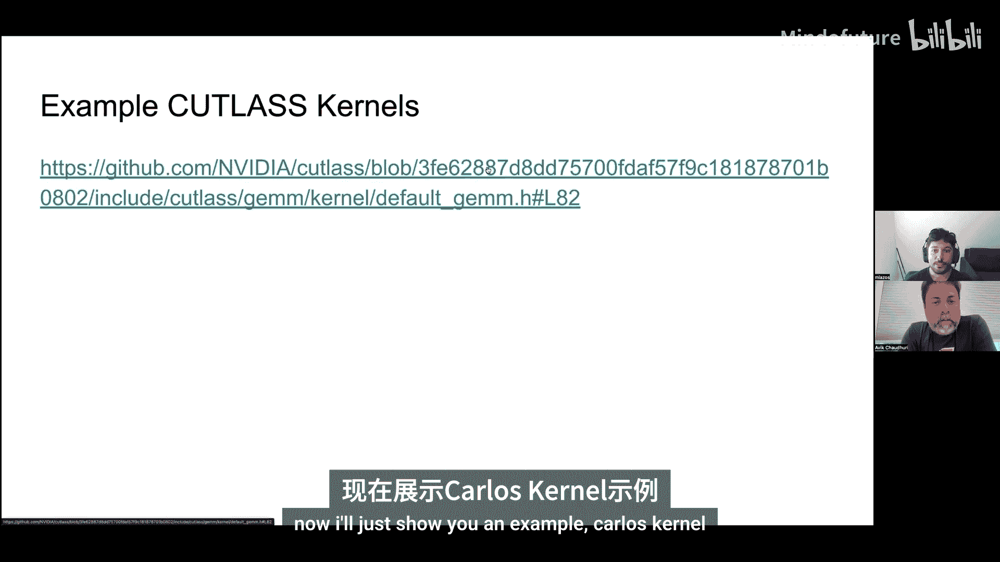
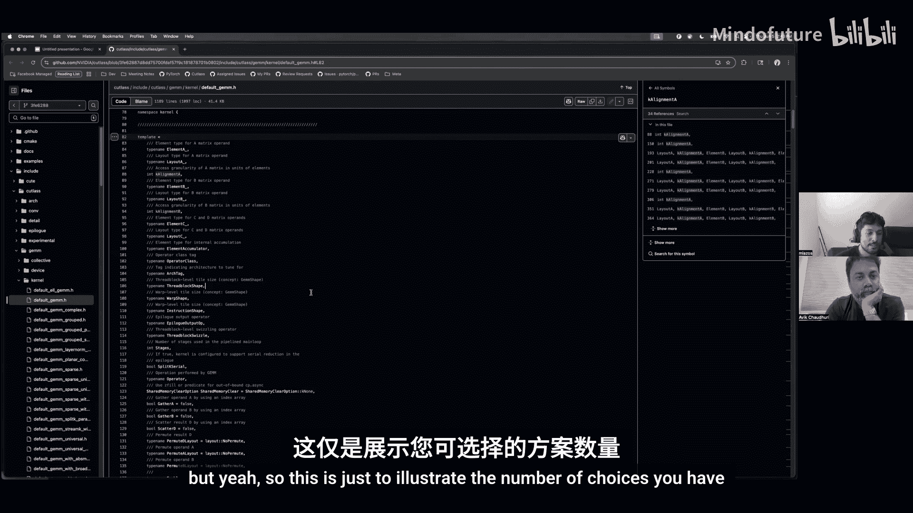
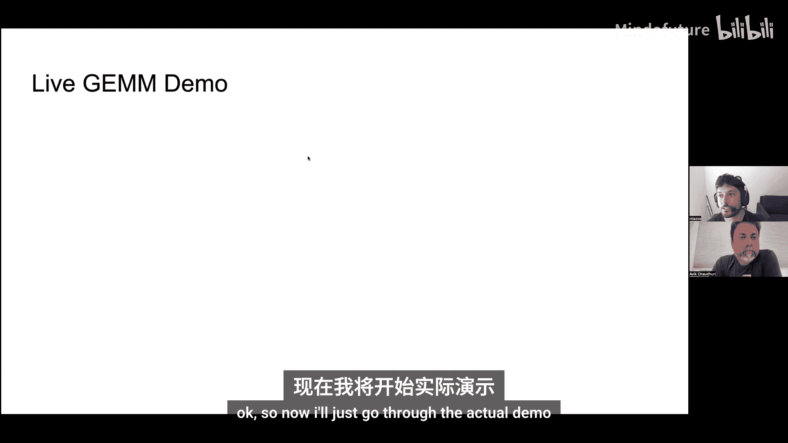
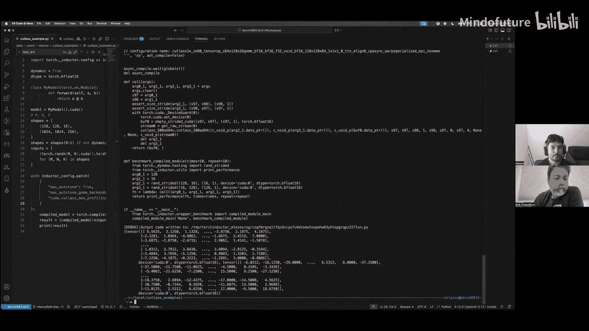
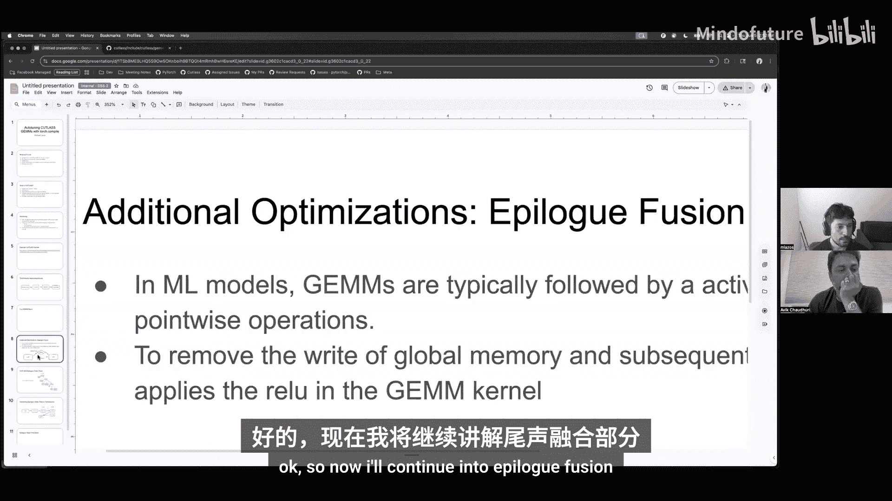
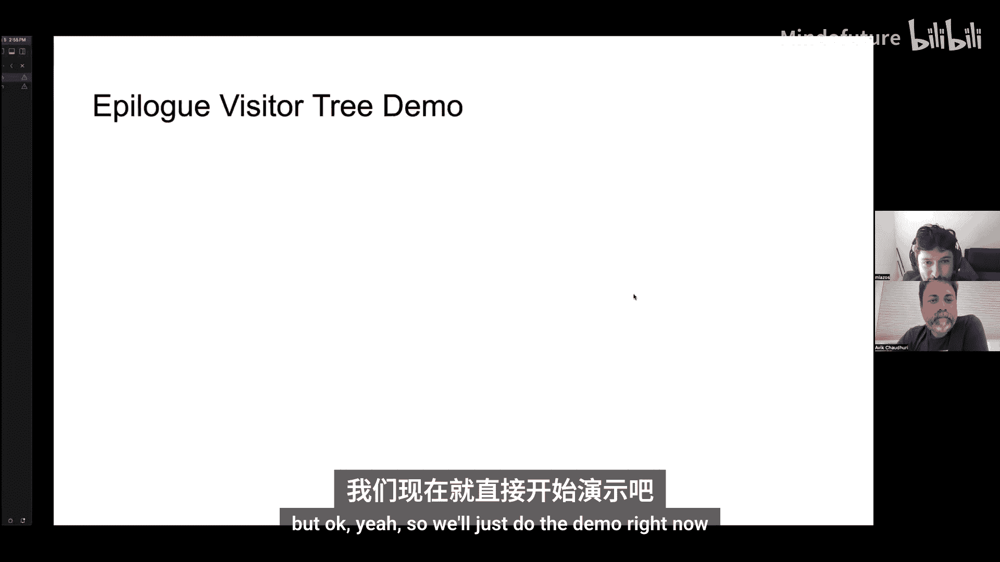
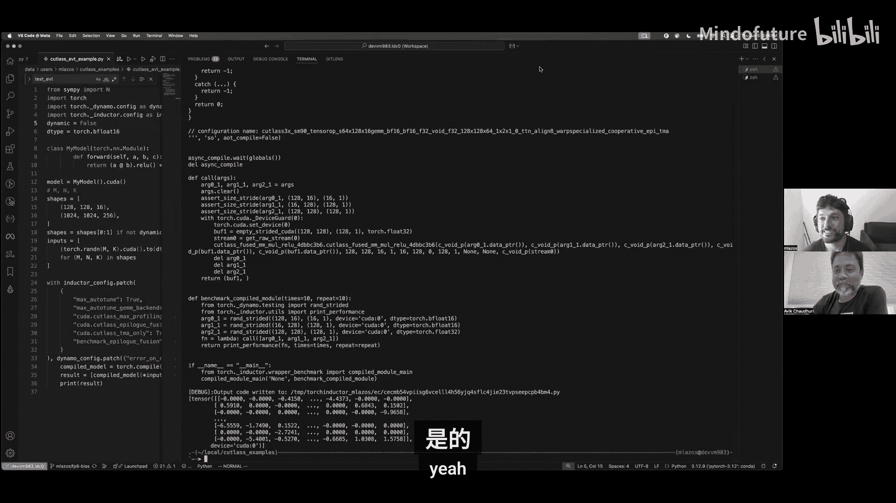

# 【Pytorch】编译器技术 ｜ Pytorch Compiler p02 P02_CUTLASS_backend_for_Inductor-PyTorch_Compiler_Series -BV1RztQzREs8_p2-

All right today we have Michael Laos from the Doch compile team and he's going to talk about inductors cutless backend and auto tuning and creating fast kernels and so on take it away Michael Oh thanks V。

Yeah， so today we'll cover these different topics in the talk first I'll talk about what Cula is and why we're using it。

😊，Then I'll talk about Sch and's process for auto tuning different cutless gems。

 and then we'll do a walk through code demo of optimizing a cutless gem。

And then I'll talk about how we can use epilolog Fusion to further customize the gems to your specific workload and we'll do an epilo fus demo。

So first off， like what cutlas is So Culas is a heteroer only kuda C++ library。

 it's heavily templated So the the different gems are kind of or the different choices you can have for gems are template parameters that are known at compile time。

 And so this kind of allows for flexible types that take into account all the different choices when you're building your different kernel and you can kind of compose them together。

😊，It's also fully open source， this is like as opposed to Kublas， which is closed source。

 so you can see exactly what's happening and even know make PRs if your exact use case isn't being met。

And so these primitives are really perform， a lot of them can approach roofline on really large gems and the main draw of cutlas though is enabling auto tuning as a first class use case and for some problem shapes like cuttlas kernels can outperform Kublos and this is basically because it's making specific choices for your problem size and workload。

And then as I mentioned before， it also provides customization through epilog fusion。

 So if ops occur after the Mam， like a pointwise op like an ad or a relu。

 it will basically take that op and fusion into the Mam to get even better performance。

 And so KubB doesn't support that at all So typically you just have just the Mamo with Kublos。😊。

So now'll just briefly talk about what auto tuning is。

 so GPU architectures over the years have become extremely complex with the rise of deep learning and AI use cases and as the hardware doesn't just naturally get better every year with transistors getting smaller。

 there are a lot more choices that are built into GPUs to optimize different gem kernels。

And so some of these choices here are like tile size。

 so that would be like the sub matrix that you're going to multiply when you're doing a mapm。

And you can basically pick different tile sizes to align with like the cache size of the Pacific GPU using and that can get you better performance and then another another kind of choice you can make or it called Warp specialization this is a feature introduced by Nvi which kind of allows finer grain control over groups of threads on the GPU so before all of the threads on the in a specific warp which is a group of 32 threads would have to。

😊，Perform all all the same steps so they'd have to all be doing compute or I'll be doing a memory read and now different warps can kind of cooperatively solve a task in the kernel like one can be loading memory while another's doing compute and then similarly another feature kind of that allows finer grain control of memory and compute is asynchronous memory transfers So new N video GPs like Ho and Blackwell this feature called Tor memory Acccelerator basically allows。

😊，Memory to be read while the compute units are being used。

 so this can improve performance on some workloads too。And there's also way more choices。

 these are kind of just a small sample that just to give you the taste of what's possible。

And now like what inductor does when we're auto tuning is we kind of go at the simplest algorithm is to just try them all and ideally you don't see that because it actually kind of takes forever because there's so many choices that you'll just be compiling forever so we do have some heuristics to kind of narrow the the more performant。

😊，Colonnal choices。Upfront， but ideally you want to just a compile time down so you can try more and more。

Yeah。Now I'll just show you an example， Cols Colonel。

This kind of just illustrates the number of choices。 So this is from the cutlas repo itself。

 This is like the default gem implementation， and。You can see all of these template parameters like these are the element D types。

 different alignments， you can see the element accumulator you can accumulate in F 32 or B float 16 you can pick the tile size like I was talking about like thread block shape and warp shape。

 those are basically different tile size configurations。😊。

And you can also pick the number of stages which kind of pipelines the computation so you can be storing some data while some compute units are working and basic I would say what what does it even mean to kind of explore the whole source space in this case right is is it like you know some of these are Boolean choices but some of these are like integers or other things so so is there。

😊，Is there some notion of a jump between choices Yeah。

 I'd say that the generate script that cuts provides。

 They have basically an API that lets you get the choices。 you can specify ranges for these things。

 But for stages， for example， that's an int。 but you're not gonna have， you know。

 some crazy number of stages。 There's like a limit architecturally to how many you'll have。

 So there's kind of known good ranges。 And induct plus there's known good defaults on the cuts side and induct also we can tune that ourselves。

 but what about tile sizes are they like all powers of two or something yeah。

 they're all powers of two。 but we can pad and do different tricks to get it to work。😊，But yeah。

 and then depending on know， the number of dimensions and strides in in the input。

 if you want a batch or not， we can apply different tile sizes there。But yeah。

 so this is kind of just to illustrate the number of choices you have。

Back here。So。This is。This is just an outline of the auto tuning process and we' kind of talked about it a little bit。

 We generate all the choices and then inductor will basically precompile all of them in separate processes and then we benchmark them on dummy data and then we cache the results so you only basically do this once for your model and it will automatically apply the auto tuning on all the different mapmals and cache the kernels that it generates for future use and so the other nice thing is if you're on a different model and you run this the shapes will also be cached already as well So if you have similar shapes in another model you won't need to like recompile them again we'll still do the benchmarking phase but the compilation phase can take a while。

😊，I see。 So so different models can share the same kind of results， so to speak。 Yeah。

 and and a typical。Another typical approach here is to have like some sort of remote cache and which I think we'll eventually try and do where you can have this you。

 aggregated bank of all these different shapes and known good kernels for those shapes。

And and obviously， the benchmarking is happening on the same machine on which you are going to run or some or are some assumptions。

 Yeah， today it happens on the machine。 you're ready。 Yeah， so we do try to。

 there's not really anything else happening when we're benchmarking。

 So it's try it's good to isolate it， but I guess you can't guarantee that。

 but at least then compile like nothing else is happening when we're when we're benchmarking。

I just went pretty far。Okay， so now I'll just go through the actual demo。

啊。So oh yeah。 so this is the first example I have。 So here we at the top here how you set these two parameters dynamic equals true and the de type just Pfold 16 dynamic true will basically just run multiple shapes and what happens is on the second compile will notice that torch compile will notice that some shapes have changed and then compile of dynamic shapes and generate a kernel that will be agnostic to the shape and I'll show you how the cuts kernel handles that。

 It's a little it's similar to other kernels， how they handle dynamic shapes。

 but it's kind of hard coded to what。😊，The the standard for cutts kernel is showing you different strides and things。

And so if you don't enable dynamic shapes in this script。

 basically we'll just run with one shape and we can actually try both and I'll show the output And so here I'm just setting up the inputs and then this is basically the setting up the inductor configuration to use the cutss backend and limiting the number of choices to two just so we can run in a reasonable time for the demo but if we go look at the config。

😊，We can see that the other backends available are A10， Triton and CPP。

 and Carl isn't on by default today， but we're planning on enabling that eventually。😊，And so。U。Yeah。

 in this example， we just sent it to cutts so we know that we're using the cuts kernel and we can see the output code。

And now I'll just run this and I pre cache this， so it'll actually run pretty quick。

I only I'll clear my terminal first。So here's the output we get and I set up when I ran this。

 I set torch logs to output code to just print the kernel we generated。And so。

There's a bunch of just includes at the top， which are different cutless dependencies。

 but generally like the cutless kernel will consist of two things to the。

First just setting up the appropriate like kernel type， what we kind of saw before。

 we're setting up all the template types with the correct compile time parameters and then we'll have like a launcher that launches it with the actual data and sets up the arguments and so。

😊，This first section here is。Basically setting up what I talked about the different types that。

Will represent the mammal and so here there's two pieces this is kind of the Mamel itself here and that's the main loop and you can see that by the suffix main loop here and so main loop in cuts parlance is just you know the nested loops doing performing the mammal and then there's also an epilogue and so every cutsop will have an epilogue even if it doesn't really do anything in this case it'll just be the identity because the epiloggue tells the purpose of writing the result to global memory。

😊，And so here you can kind of see oh sorry is is this is this where the below fusion stuff will Yeah。

 when we do when we do the epilogue demo， this will be more complicated yeah and。And which is。

 but this kind of just shows like the composability of it in that you just swap out the upload for something else and compile the same thing。

And so。Here's the actual launcher code。Here， and this is where we kind of set up the arguments and。

It's kind of crazy。 I mean there's so many nested nested brackets and everything。

 but this is basically corresponding to the different template parameters。

 the types or the information they need to run at runtime and so。😊。

So what I wanted to point out before is here is basically the the inputs and the outputs。

 X and W or the input Y is the output。 And then here are the different size arguments。

 And so typically in like a train kernel， you might see like S 9 representing different symbols or something。

 But in this case， we kind of named them。To match the naming conventions of of a typical callless kernel。

And so these are basically used。In the logic code， all we do is set up the arguments and then。

Check the arguments are valid for the kernel and then run them down here。And so。

This section is the arguments for the epilogue， and this will get larger when we have a more complicated epilogue。

 And these are just the arguments for the main loop and。

This just shows the different strides for Porter A and pointer B， which correspond to X and W。

And then pointer C is typically the bias， but in this case we don't have a bias。

 so it's set to null pointer and then pointer D is the output。

 And so this is showing the strides and the data type of the output。But yeah。

 so now we can just run it。 Well actually we already ran it。 That's the result right there。

 So I think this is all， all I have for the demo unless you have other other questions about it。

 Okay， I mean， so at a high level question。 So so you mentioned that this is not on by default。

 So when would you use a cutless kernel versus a triton generate kernel。😊。

Basically if you think that it could be performant for your backend so you can just it's not on by default。

 but you can just add it to the cuts or the max auditune backends there and just run it The main concern today I think is compile time at least this is my opinion。

 but I plan to I plan to improve the compile time over the next couple months with Cutlas4 okay。

Okay， so now I'll continue into E fusion。

So。So an MLl models typically you'll have a gem followed by an activation and some pointwise operations。

 And so what usually happens is that result of the gem is written back to global memory。

 And that's kind of shown here after we do the。Matt Moble write the result。Back to global memory。

And then we write it back or then we read it back in the Raylu kernel to perform the Raylu so with fusion。

 we're basically just taking this Raylu and putting it directly into the main loop of the Mammal。

And this basically eliminates the Read&r， which will give you better performance。

The way epilogues are implemented in cutlas is to。Basically allow a lot of different allow flexible like AST of FF logs like an abstract and text tree and so the idea here is that you can kind of have any tree of operations and represent them using this tree visitor type in C++。

And so the way this works here is in this example is we're just multiplying A and B and then multiplying by alpha and adding the bias times another scalar and then taking the relu and this is kind of what the tree representation would look like。

And we'll actually look at like what the C++ code will look like in the next couple slides。

And so the idea here is we just do this here。 So here， is it just a value that is the epilogue or。

Al right， are we talking about like a whole chain of kernels that are going to be fused。 Oh。

 it could be a whole sequence of operations。 Yeah， arranged in a tree。 Yeah。

 so this one is more complicated than just the the raylu in the last one and the last slide， yeah。

Yeah， I thought it wouldn't be as interesting with just a single raylude here。But yeah。

 so we can just we'll talk about how we do it in Torch induct。

The SL plus code writing that by hand can be very tricky because you ended up generating a tree of basically template types with different weather arguments to each other and so the way we opted to do this an inductor was you took your model。

 we generate inductor I from it and then there's actually a Python tracer。

Provided by the cutless team and so you can basically express your epilogue as a sequence of like Python operations so you can just do like a times B like plus C。

And we generate the Python code for that because that's way simpler to generate than the C plus plus we inductor can already do that and。

😊，We。Give that Python code to the cuts tracer and that generates the epilolog visitor tree C+ plus。

 and then we combine that with the gem kernel that we're already generating and we compile that into a shared object。

 and that's the final kernel that we use。And I'll show all of this in the demo portion too I can show how we can take the Python expression and compile it。

But okay， yeah， so we'll just do the demo right now。😊。

嗯。So， for this。Let's have it open。This script is actually just a。

 a small script that I wrote to just。Take the， take EVT Python code， and。Generate the C plus plus。

 So you can at least see what we're doing。 Oh， so， so you are。

 you are wrecking the trace function that that is provided by that。 Yeah。

 I won'm calling into what into their thing。 Yeah， I guess it isn't， it isn't that small。

 but it's I guess it's like 100 lines。 that's not too bad。 but basically。

 here's kind of a complicated epilogue that we want to compile。

 and you can see it's just Python code。 And then when I run this。😊，I'll just。First。

It basically will just generate the C++ code and。This each of these are different constructs in the Epilogue Visitor tree API so here first is an oxload and that just means we're going to load a value from Google memory so in this case we have the accumulator that we're loading which is just the result of the MaL and we have E which is just another tensor out there so we need to use an oxload to load that into shared memory。

😊，U。And then the accumulator is just the accumulator fetch instruction， and then we have the compute。

 which is just the raillu。And so we take the relu of the accumulator and。

We can store the result of that because we see that we return Z0 here。

 And that's what an a store does is just stores the result and then。

EVT 0 just gets the result of combining E VT 0 compute， which is the。

Which is the Relu and commands it the Z0 and。Its easier。Oh， that's just doing the。

 that's doing the Relu。Think EBT competes 0。Oh oh， that's the result of the of the。Yeah， of the。

 of the re of the accumulator and then。Here is kind of where the meat of it is happening。

 So there's more。 in this case， like， we're not actually just a tree。 We're actually a da。

 And so this， this topological visitor gets generated when。There。

 you can't represent it in just a tree。 so it shows。That we take these two。

These two compute nodes and。Use it it takes。Basically one and0 here。 is this make sense。 Oh， yeah。

 this makes sense。 Okay， so0 and  one are basically compute 1 its arguments are E and E VT0。

 and then compute twos arguments are E VT 0 and compute 1。And so。

The result of this entire thing is just the result of this computation。

 which is representing the result of D here， which takes。

Which is just this expression Comp one and Comp two are just two additions。Yeah。

And you can see those are defined here。But yeah， so this is how we generate from the the Python code to the the C++ and then。

😊，I'll go through an actual example of generating this with basically a full intent example of the epilogue。

But。Oh。Here this。 And then。And then while it's running。

 I'll just kind of go through what we're doing in this。 This is very similar to what we。Did before。

 except now we added just this relu and a multiply after it。 So this will get translated into an EVT。

And today， the E VT is a little more experimental。 I actually have some PR's out to kind of productionize it more。

 So we still need to， we need to enable these different configs to use it。 So here we， it's。

 it's not on by my default。 So we enable。😊，Calls epilo fusion。

 and then epilo fusion is only enabled when the Tensor memory acceleration feature is available and that's kind of what I talked about earlier。

 it's like an asynchronous memory transfer。😊，And so this will filter all of the choices to only include choices that use TMA。

And then this is today， we basically benchmark all of the cuts kernels and pick the fastest and then fuse with it。

There's a feature that we can that we use with Triton today， where。

When you actually defer the benchmarking of the choices to when we're doing fusion and pick try the different choices with the fusion and pick the best the best choice that's the best choice to fuse with because it's technically possible that the best choice unfuseed might not be the best choice un fused but that we don't support that feature yet with cut so we disable that。

And else just to be clear then here， the audit tuning will happen on the original kernel。

 and then we'll just add the below after。 Yes， exactly。 Yeah。

 we'll just fuse onto the the past list kernel。And the other setup is kind of the same we have this dynamic and non dynamic version。

Yep。And so we ran it。 and this is the result we get。We'll see that the gem is kind of the same。

 which makes sense as we discussed we're just picking the best kernel there。

 but the epilogue now will be different because we instead of just here before it would say linear combination and now we have EDT compute one and this is our tree over here which represents the Relu and the multiply。

And so here you can see we have the compute one is the multiply and compute zero is the relu and we just performed those ops。

And then。Down here， we can also see that the。The arguments got more complicated as well。

So here we're just providing the information for the Aux load。

 we're telling it that we want to load AG 41 and we give the strides of that argument as well。Um。

And the interesting part here is now that we use dynamic shapes。

We pass the shape values in to the different shape arguments。Up here。

And we also include this actually isn't included when we're just doing a regular mapmo。

 We have to include any。Any shapes that are part of the epilogue the like if we're doing an oxux load。

 we need to be able to provide that shape to the the epilogue as well。

 but actually it's not used here， so I'm going need to。Double check that， but I think。嗯。Yeah。

 I might actually be agnostic the shape， so I might be able to eliminate the shape arguments for the epilogue but。

have to double check that， but either way， we do end up adding adding the shape arguments there in case they're needed in any of the ops in the epilogue。

 we could probably do finer grain filtering to remove those。

Only use the shape arguments that are used。But yeah， so if。

I'll just run once with dynamic equals false to just show how。When we run this with themics false。

 we're just gonna have hard coded shape values here，128，1216。 Okay， yeah， that was the one。Yeah， so。

I that's that's all I have to present today so okay that's pretty cool Yeah。

 so so what's before we end like what's what's next for this project？😊，So yeah。

 the next things are to improve compile time because we。

 I think that's the biggest blocker to putting this on by default。

 And also when I was talking about the。😊，The benchmark fusion。

 it's also possible that the compile time might be too slow to make that tenable like during every fusion。

 I don't know if we'll be able to compile every every choice with every fusion so where Cutless4 provides a new DSL that that might be able to basically circumvent the C++ compiler and not have to compile C++ and just compile the DSL instead。

So in in terms of compile time is the bottleing mostly like like we're compiling a lot of C++ that is that what it is。

 Yeah yeah， it's just the C++ compiler， yeah okay。And dynamic shapes helps with that a little bit because you don't need to basically compile a new kernel for every new shape。

 but yeah。Interesting， but in general， dynamicly shape kernels will be slower than static shapes。

 right？It depends on the the shape， but yeah， that for cutlas。For Cols。

 it's actually pretty close because。I mean， even in the。In the static shape regime。

 we're still passing， we're just passing the static shapes to the same argument。

 So I actually don't think there's really any。Like the only drawback you'll get is you're not tuning for that shape。

 so there might be better choices for that， but I think the kernel。

 like there won't be there won't necessarily be a slowdown， I guess is yeah。All right。

 this was pretty cool。Oh yeah， thanks for having me yeah， see yeah。

で。