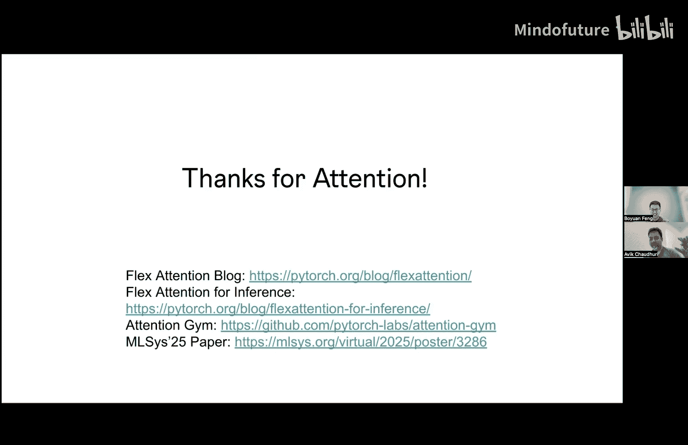

# 【Pytorch】编译器技术 ｜ Pytorch Compiler p03 P03_FlexAttention-PyTorch_Compiler_Series -BV1RztQzREs8_p3-

All right， hi everybody。So you might have heard of Fl attention。

 which is a pretty popular thing that came out of the Pych team recently， and today Boyan。

 who's one of the authors of Flex attentionten is going to introduce us to this。你几多位。Okay， cool。

 Yeah。 thanks for introduction。 I'm boy。 I'm working on some performance in pattern compiler。

 especially flex attention。 so let's start now。Okay， so so we all know attention is very important。

 right。😊，And so so basic attention， we take the cur K value with compute it much more between Q and K。

 Then we have the soft Max and finally multiply with V。 this is the attention。

 attention is very important。 It it accounts for a significant portion of latency for transformer。

 That's why we have the flash attention。 flash attention iss the most important optimization for for attention。

 So basically， you know， it fill everything together into a single kernel。

 And we can see on the right hand side comparing the latency of pattern implementation versus flash attention。

 We can see flash flash attention is much faster。😊，Okay， so。

So people want to have different attention variants for many reasons。

 Let's say people start with the causal mask， which means， oh。

 a cur token can only attend to the past key key token。 So， you know， it's like， oh with a sentence。

 we can， we rely on the password to inform the next word。After that。

 people also have the slid window mask， which means， oh， I don't need to refer to so long contacts。

 some recent contacts might be sufficient。And we also have document mask， which is。

 we have multiple documents at the same time， and we only attend to the token within the same。

 same document。So in this way， we can see there are many different attention variants。

Although people may want to say， oh， I want to include the relative position of two token into the attention。

 or the Alibabas may， you know， multiply this relative distance with some other trainable or some other bias。

 right， so basically we have。al of different attention。

But it's very hard to hunting all attention variant。

 many times when machine learning researcher proposed something new。

They may not have the expertise to manual the kernel。 So they probably okay。

 say find some GPU expert and ask them to spend one or two weeks to write a good kernel。

 Then they use this kernel to try。 And sometimes the this new virus doesn't work。

 So the J expert like with two weeks of work， right， So it's very hard to do that。

 That's why we want flex attention。So busy for flex attention。

 we have an extra score mode to allow the modifying the Somax results to C。

 O use this attention in a very different way。And what is a score modification。Basically。

 it takes the score， which is original， like the score matrix。 Then we say for the batch dimension。

 head dimension， cur index， K index。 How do we want to modify this score。

 So it's actually very flexible。Cool， so what can we implement with score mode。

Let's see the relative position。 We can just say score plus the Q index minus the Q index。

 which is a relatively distance， right， we've added with the score mode and say， oh， no。

 we have the relative position information。😊，The good thing is we don't need to materialize the relative position bias as a full tensor。

 right， so we can avoid the quadratic memory usage and achieve a better performance。😊。

You can see comparing with the scale do product attention S DPA in pay。

 the flex attention can actually have a much better performance because of that reason。Another。

 also for， let's say for the Alibaba is we can see。 oh。

 I have a Alibaba with the ship which is a ten of9 heights。 Then I have the score。 I just plus this。

😊，Bs， then multiply by the relative distance， right， So in this way。

 you say with only two lengths of code， we can influence the Alibaba bias very easily。😊。

So yeah let me ask question So so it seems to me that okay so there are there are two two things that are interesting here。

 So one is you start with a handwritten flash attention kernel right and then you talked about many variants of it so one of the things you're trying to address is that people should not be needing to write their hand tune kernels for all of these variants and and then more variants are going to come in the future and so on but the other。

Arguably like equally interesting observation that you're making is that by modifying one part of the attention like mechanism。

It's it's sort of like sufficiently general like general not only to model many different variants。

But。Even more interesting is that you actually， I mean。

 got some performance improvements over over like some bad ways of doing doing the same equivalent thing is that fair？

😊，Yeah， yeah， yeah。 That's true。咁。Yeah， because we I mean， in many cases。

 the attention variance is just element modification。 So with attention。 We just， you know。

 modify it in the register。 We don't need to materialize the huge tensor of the modification。

 That's why it is faster。😊，Yeah。Yeah， okay， cool。 So another example is a soft caping。

 which is a technique introduced in Jama 2 and group 1 that prevents los from growing too large。

 right， so we can also implement in， let's say， full lines of code。😊，niceice。

 so now come back to our cultural mask example。 how to implement it。 We can just say， oh。

 the Q index greater equal to Q index。 In this case， we use the score。 Otherwise。

 we must it off as the minus minus infinity。 this is this is correct for the result。 but。😊，I mean。

 it's not so fast。Why， because， okay， for the upper triangular。

 we know it's like minus infinity anyway。 So why should we still compute it。

 We can just skip it and make it faster。😊，That's why we want another thing called mask mode。😊。

What is mass mode， Ma mode just takes the B H Q index and Q index and get a bulling。 say， oh。

 whether I want this position or not。 So the the difference here from the score mode is it does not take score the score anymore because we only see a true or false。

 say keep it or not。Once we have the mass mode， we can automatically compute block mask for exploiting the sparsity。

😊，Like， okay， so， okay， so how do we implement causal mask。Sa。

 we just return Q index greater or equal to QV index。 That's it。And we can use it for。

 we can put it into the create block mask， which is the API from flex attention to create the block mask。

 And later， when we call flex attention， we have the cur K value tensor and additionally provide this block mask。

😊，So in this case， you you do not have you do not implement the the other like the score mode function。

 Yeah， so for this causal mask example， we don't need the score mode because for every element it's the same value。

 right， Yeah yeah， but if you wanted to combine causal masking with some other。 Yes。

 we kind that you could then then you could Yeah， okay cool Yeah。

 I just additionally provide the score mode。Nice， so how about the performance。This is a comparison。

 We can see if we implement with score mode。 that's the performance。 That's the latency。

 And if we use mass mode， it's much faster because many computation can be skid。😊，A few more example。

 like we can use it to implement the sliding window attention。

 So we have the let's say this window mask is just take the difference between Q index and Q index compare it with the sliding window。

 See， oh， if it's too far away， we don't use it。 Also。

 you see we can compose the causal mask with window mask just with some， you know。

 element and operation。So this is some performance for the sliding window mask。

 We have the causal F A2 and SD DPA plus the mask。 And finally， the flex attention。

 usually we have a pretty good performance。Another example is the document mask。

 USA say we have the document I D for every query and K index。

 Then we use a single line of code to implement the document mask。We actually have more examples。So。

 okay， sounds good。 Then how does it work。Mm。This is a detailed example of the block mask here。

 we have the we say we have the score mode， which is a relative position。 We also have the mask mode。

 which is a sliding window mask。 We can implement whatever score mode or mask mode。😊，And remember。

 we have the Q and K Q multiply K gives us some score matrix。Here we the we have two types of block。

1 is a four block。 Another one is a partial block。4 block means all the data within this block will be used。

And partial block means， oh， on the boundary， you know， some， some elements in this block are used。

 some are not because we are using the sliding window， right？ So basically we have a。

 we have a line here and another line here。 So， so beyond this line， we don't need。

 and within this line we wanted。 That's why we have the partial block and four block。And for the。

 you say for the full block， we can， we can record oh。

 what's the block index we want to use for this row。 For example， in the first row， there is nothing。

 So we put nothing here。 And for the second row， we only use the first block。

 That's why we have zero。 And for the third， third row， we have 0 and1 and so on。 Similarlyly。

 we have the same data for the partial block。In this way。

 we can encode the sparsity of the of the mask mode and use it during run time。Okay， cool。

 A little bit more detail。 Like， how did we do the compilation。😊，So basically。

 we have defined the causal mask and relative position score mode。

 which said we use total compile to trace this to function and do the lowering to generate some tracking code。

 this mask and score。😊，At the same time， we have build a very efficient attention template。

 and we leave two space to just fit in this generated max mode and score mode threatened code and modify the score matrix at the wrong time。

 In this way， we can generate a very efficient code。😊。

So quick question so so you showed a document mask example right where where the functions were relying on something outside which was the document ID I think right so what happens in that scenario when you trace through it well where is document ID toward oh okay so that one is a captured tensor it will be captured within the let's say the mask mask graph I see I see。

Okay， so here we have an example for the template。 attention template Actually our flex attention is can support different types of backend like there are some CPU backend built by the inter folks。

 and we we can also support like could back or the contrast template。

 So as long as oh people build this template we can run the flex attention on different language or or other things。

Okay， sounds good。 So we have the forward and backward and inference。

 So this covers many different use cases for attention。😊。

I want to talk little bit more about inference because inference is different from forward。Why。

 because for the inference， there is a unique attention pattern。

 like a very short query sentence will attends to a super super long key value cache。

 The the context， the K cache lens could be 128 k or even longer。

 so why do we have query sequence lens as one， because during inference。

 we will inference token one by one， right， So every time we have a a single query we attend to all the past data。

 then we can we we we we just predict one。 That's why it's like one token。😊。

So then what's the issue here， Because there is only a single cur token。

 we can no longer do the parallel along the cur side， right， Also the key cache。

 the key lens is super， super long。 So there are some potential， some parallelism opportunity。Yeah。

 that's why we have seen the flash decoding。 Here we have an example。

 Its basically placed along the K KV dimension。😊，And。Yeah， so you say we split into five splits。

 and for every space， we do the computation in parallel and accumulate it into， let's say。

 five different output。 And finally， we have a single reduction step to get the single output。

 right in this way， we can use the parallel on along the K lens dimension。😊。

So how does this compare with like I was recently hearing some kind of VLM talks and they mentioned like batchged inference。

 but they also mentioned a bunch of like pipelinelining optimizations that feel similar is is there overlap between these these optimizations？

Oh I I think there are many different types of the parallel like the you know the context parallel pipeline parallel and they they are they are working at different level。

 This one is more like a kernel for the for the you know one single decoding step of the attention up okay。

There could be model level， I you know， different kinds of parallel。Okay。

 so here you're talking about just like when when we're generating the kernel what kind of optimization yeah exactly。

 so flex attention is at the kernel level， it does not handle the model sense。Yeah。

 so that's the flash decoding。 We have the flex decoding using the same optimization。

 but we still allow the apply the score mode for the flexibility。Yeah。

 so a little bit on the benchmark。 we can see， we compare with the F A KV。

 which is the flash decoding。 We can see flex attention and and flash decoding there have similar performance。

 Also， we have the scale do product attention， which is much slower compared with the like the flex attention。

We also interpreted to the G fast for some model level benchmark。 We try it on the Lama 3。1。

8 B and 70 B。 we can see a significant amount of speed up over various length。So， okay。

 so after that， I want to talk about page attention because page attention is very important for our inference。

 It's done first done by the V IM team。So during the inference， we have the K cache， right。

 we have multiple request requests， ABC， then， and we do a inference for every request。

 Some requests has a long， long sentence， some have a shorter sentence， etc cea。

 but usually naively we will allocate the logical K cash as a regular tensor。

 So we will with lots of memory if the sentence is short。That's why we can have a better K cache。

 which is a single， like a one dimensional tensor in some sense and compact everything。

 so we don't have the wasted memory。😊，This is good， right。

 in order to manage the mapping from the logical K cache to the physical K cache。

 we want a page table to say oh for this request A and the first block。

 Where should I find it on the physical Ki cache。So this this is page attention。

 which is very useful for saving memory and for larger batch size。😊，We want。

 we want flex attention work with page attention。So the first thing we want is the block mass conversion。

Remember for the KiV cash。 Remember for flex attention， we have the box mask to say， oh， what's a。

What's the block index we should use for every row or batch index， right。

We also want a counterparty with physical TV cash。Then we can just apply it as a indirect indexing and make it work with flex attention。

That's why we call we have the first thing called block mass conversion。

 I want to give you an example。 So basically you see for this attention， we have the request A。

 we only have the value for the block 1，2，4 and for 0 and3， it will be must off。 so we don't need it。

😊，That's why we have the KV index， which is part of the block mask for this request。 A， we have 1，2。

4。 we will use it and 04。 We don't use it sorry，0，3。 We don't use it。

Because we have the page table for the mapping from logical KV cache to physical KV cache。

We can do a mapping of this K index to something for the logic for the physical K cache for as this converted K index。

 After that， we use this converted KV index for the flex attention。Right。

 so this is another sort of primitive that that you provide in the library so that if you wanted to convert the blockmarks。

 you could buy by your implement yeah exactly exactly people can just call this convert logical block mask to do this transformation they don't need to care about the details。

Yeah， so this is the first step for the block Mat conversion。After that。

 we also need to use the mask mode conversion。So remember， we have the mask mode。

 We take the batch index height and cur K to say， oh， whether I want to keep this。Block or not right？

 so after we do the conversion， we are doing some computation on the converted space。

 It's not the original space。😊，So we also want some conversion for the mass mode。

That's why we have this。 So basically， we take the we。

 we basically take the original mask mode and return a converted mass mode。

 And for the converted mask mode， we will take the same batch index head cur index。

 but we are taking the physical K index。 After that。

 we do some index computation to get the original logical K index。 And finally。

 we call the mask mode on this logical K index。 right， this automated conversion， make sure oh。

 the result is still correct。 Also， user does not need to worry about oh。

 how can I handle this complexity here。😊，Similarly， we also have the sc conversion to convert the。

 you know， the， the， the sc。Okay， cool。 So a little bit on the benchmark side。

 this is a result of flex attention and flex attention with page attention。

 comparing with flash attention V2。So we can see flex attention with page attention is similar performance as a flex attention and similar as flash attention。

 which means there are not so much latency overhead。

 we actually only observe like less than 5% latency over this different sequence lens。

 also I have a small serving example showing that， oh。

 we can have a 76 times higher batch size with this page attention technique。 So。

 so which means that like if if you， if you're not expecting kind of a lot of memory overhead。

 then you would use flex attention。 But if youre sort of like constraint for memory。Or。

 or or you want to support like larger batch sizes and so on。

 So then then you would use the page extension variant。 but， but then you would not pay too much。Yes。

 yes。 So I think in a real world serving example， the different requests have super。

 super different sequence， right， So that's why we want the page attention and flex attention together。

Okay， so we have seen some early adoptions and fortunately。

 get some feedback like Michael show in the show or using flex attention。Also。

 Andrew car using flex attention for reproducing the Lama 27 B overnight。

And we have the nanoGPT training speed run， using flex attention。

 then the some guy the other Zer integrated flex attention to h phase。

And we have seen it for this bulk diffusion training。

Like the N flex attention and some yeah the flash in people also are inspired by flex attention to build some super super super super cooline。

 So， yeah， so we fortunate have some early adoptions。 So if you are interested， definitely try it。

Yes， that's all for my talk。 Thanks for attention。 We have some online blog for flex attention。

 flex attention for inference。 We have many examples in the attention jam。 Also recently。

 we have a M 25 paper to discuss some technical details。😊，Yeah， thanks。

Cool very nice talk and so yeah， so what's next for this project like do you do you do you think that you're done with Le attention in some sense？

The the primitives are general enough that that you can capture future variants or， or are you。

Are you working on other such kind of abstractions in other areas that are sort of inspired by the flex attention kind of success？

Yeah， so I would say flex attention is pretty flexible now。

 And one major thing to do is the performance。 we can include more like new GPU features into flex attention to make it even faster。

 that's one major thing。 Another thing is to support more use cases。 So you know， like。😊。

We may find some new optimization or opportunities as more and more people use it。ok。Cool， all right。

 thanks again， Boyne， this lovely talk。

Yeah， thank you。 All right，拜e。