# 【Pytorch】编译器技术 ｜ Pytorch Compiler p04 P04_Inside_torch.compile_Guards-How_They_Work__What_They_Cost___Ways_to_Optimiz -BV1RztQzREs8_p4-

All right so today we have anim from the Torch compile team and he's going to talk about guards guards are an important concept in Torch compile basically there are some encoding of all the conditions that are encountered while tracing through a particular path in the program and theyre pretty core concept in the Torch compiler so so yeah so an is going to talk about how guards work you know what they cost and how to optimize them and how they are used for correctness。

Right yep thank you Aic yeah so as Aviq said we are going to talk about guards today。😊。

And this is a concept because torch compile is a Jt compiler。

 so in this video we will basically try to build a mental model or programminging model of how guards work。

How do they sort of integrate into this toch compile system。

 what are the ramifications of these carss， like what is a runtime cost or a compile time cost。

 and then there are some we will discuss some escape hatches to reduce or mitigate these overheads。

There's also this blog that I just published， so you can also go through this blog。

 what I'm going to discuss is going to be present in this blog。Okay， so。

 so let's let's start with something very simple and let's try to build。

And then understanding of what's going on like why do Gars matter or where do they come from and yeah let's let's take a very simple example something like this and I'm going to just run run the ch with you to just see what's going on so I already have this file。

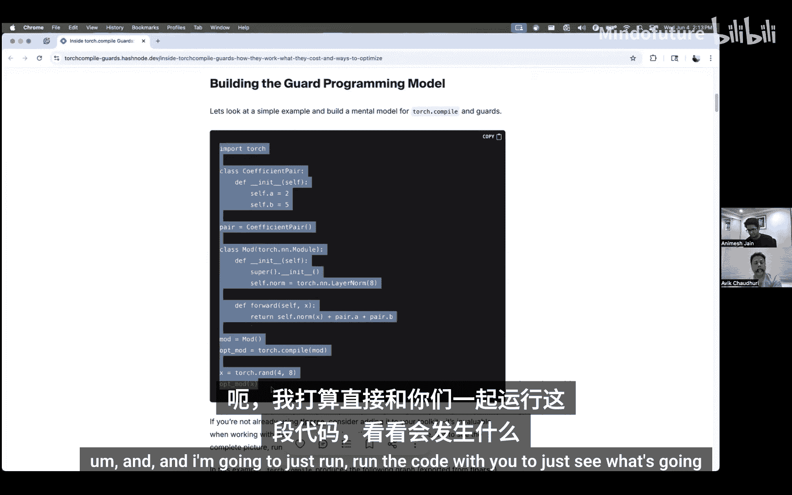

And here， so I'm going to just run this again with you。And what's going on in this。

 we just have a model that。

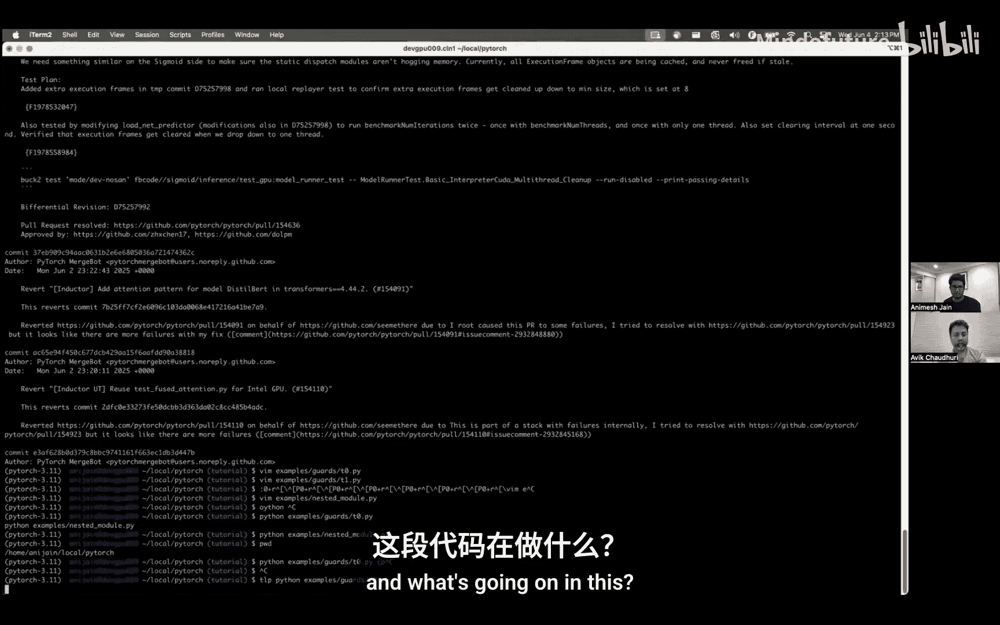

Has a layer norms， sub moduleule， and then we have a global payer object。

 which just have to integer AV。And we're just trying to compile this， nothing fancy going on。

 we have a tensor of size for weight and we are trying to lose it。😊。

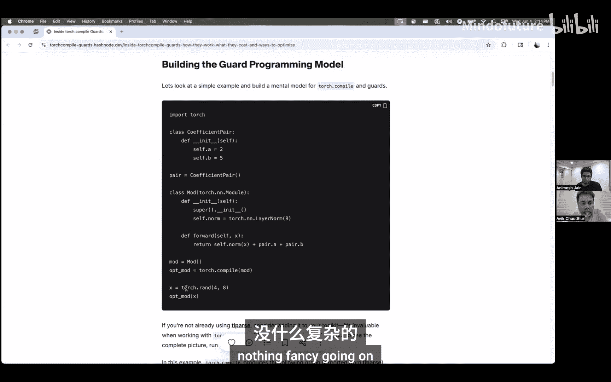

In this talk I'm going I'm going to use steelL parts you might not have heard about it。

 but if you have not please use steelL parts when you are working with Torch compileile it's really really cool and I does not show for all of these examples I'm just going to go and show how。

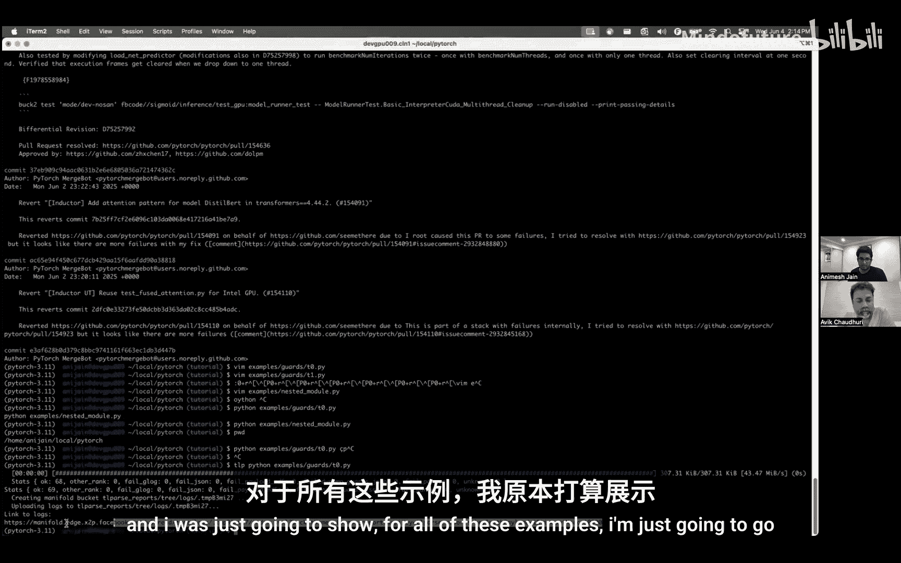

TL pass reports look like so this is what TL pass looks like and what I'm interested right now is in this class。

So when we ran torch compile on that example it basically extracted this graph where we have a layer norm that we saw and we have an add operation that we saw and the add operation were two constants to and file it so pretty straightforward and if if you think about sort of like if it's to4 build build a programming model it looks something like there's a user function which maps to a compile graph so this is definitely incomplete but we can start with this model this sort of mental model in our mind so definitely this picture is incomplete right and the main thing that happens is that when we compile when torch torch compile dig compiler so it is invoked the first time you see you call the you call the compiler so it's actually invoked on this line and not on this line so when it's invoked on this line this means。

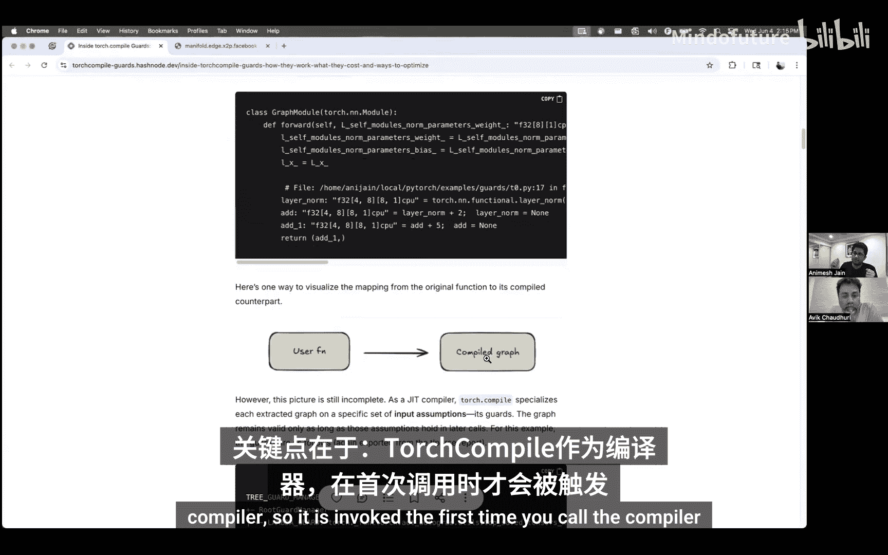

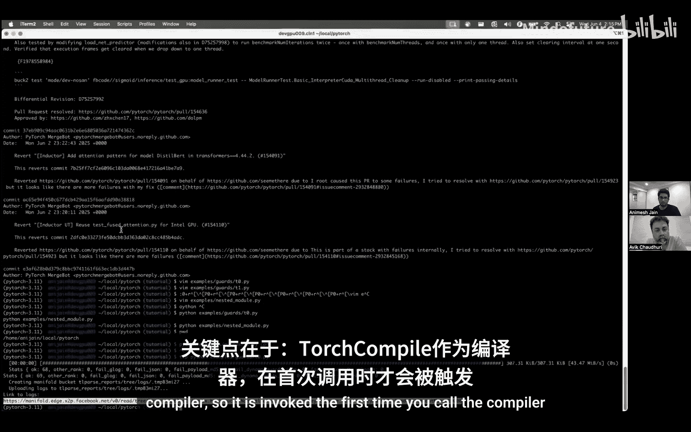

Specializing the graph on the input X and whatever is。

Present in this Omod at this point of time so I mean so you are kind of executing the model as as and when you hit these user functions at that point you would like just entire and compile that exactly so the point is just incomp and then therefore the compilation is specialized for the conditions that are seen at one time at that compilation and and this is where guards come in so like basically whenever you have this compiled graph theres some specializations baked in and and the idea is that all like when tosh compiled where this graph it made some assumptions about the inputs and this graph is valid only and only if all of these assumptions are still valid so let's look at the tailpa report again and let's look at guard there so we also have the guards some。

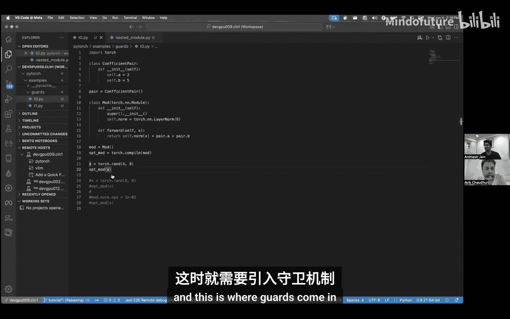

Here， let me just search cards。And we have guardstrs。And if you see these are all the cards here。

 I know this is a lot to take in at this point of time。

 but let's let we will circle back to it later， but we can check few things， for example。

 we can check there。There's a tensor match in here on inputex and this is saying that the tensor must be of size for comma 8 and stride8 comma1 so so the graph that is extracted by what by torch compile must is valid only and only if the tensor。

Is of this size and of this stride Similarlyly， if you look at the equals match here。

 it is saying that the global pair that we saw， it had two attributes A and B and A B are2 and A is2 and Bs5 and you can actually see it from the graph as well in the graph you see we added two and5 and therefore if you change these these attributes。

 if you change， for example， if you if you change this value to three here then this graph is no longer very so so yeah so in a previous video it talked about like sort of like program model for export。

 which is kind of similar。 So I guess。😊。

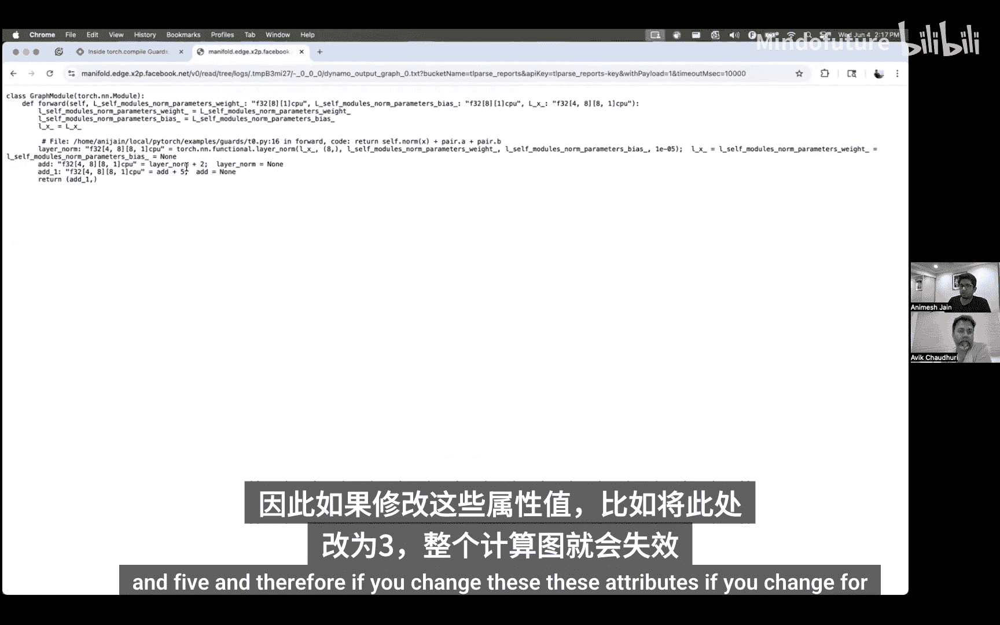

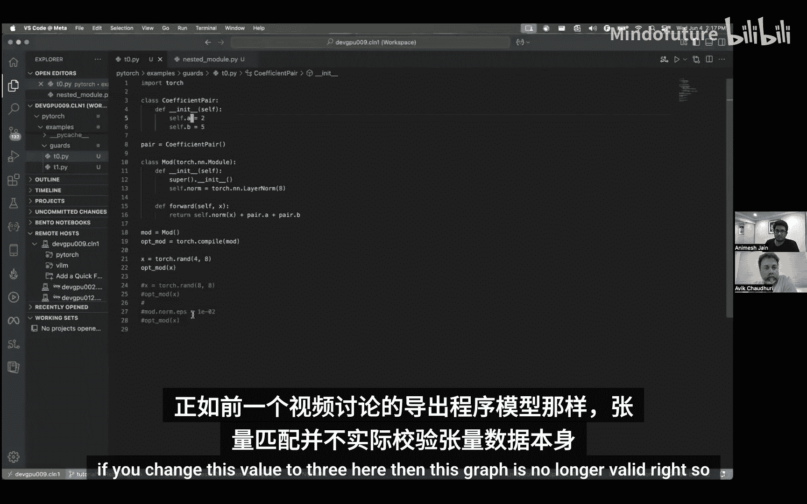

One of the bits is that tensor match is not actually matching on the like the data of the tensor right so that that would be kind of stupid in some sense you want to generalize every time you're creating a graph so but for this compil to be valid you have to specialize on the shapes at least for now right so so that's that's basically what what you're saying and constants are specialize and so on yes exactly。

Yeah so so yes so there are some guards so this picture that the mental model that we are building is is incomplete so let's try to refine this and it looks something like this one basically for each compile graph。

😊，We have some cards and in total， this sort of makes a compile unit。And if any and basically。

This compile graph is valid only and only when all these cards are succeed or inval to true。

So let's let's do something's see we've already discussed there' a sensorsor match and as amic mentioned we card on the shape not on the values so let's say let let's let's take this shape which is different and then compile it again so I'm going to do this here as well so let's just do this and let me fire it off again。

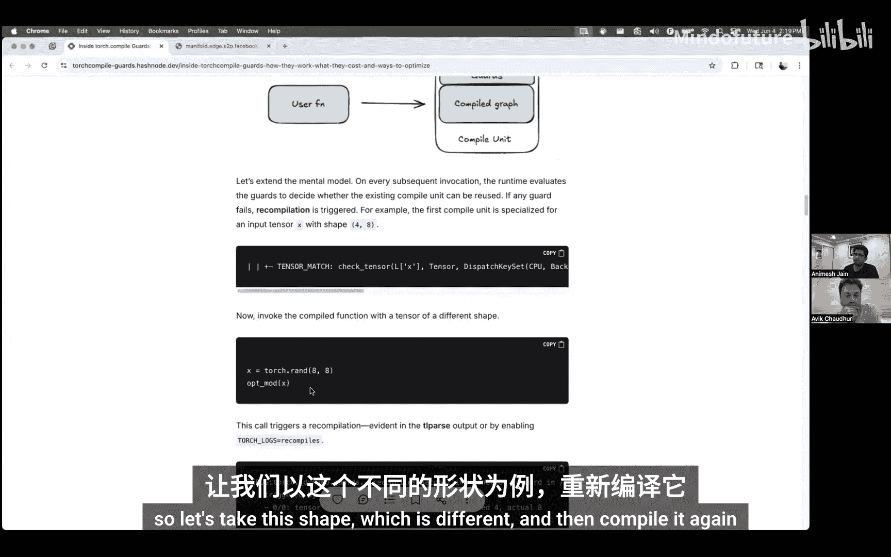

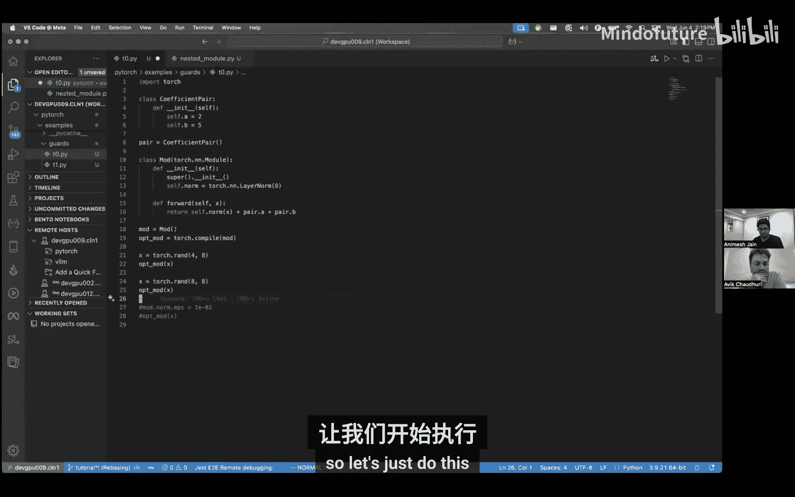

And yeah so we do expect the recompilation here because because we have obviously this this guard that we had is no longer going to be valid。

 so let's quickly check。

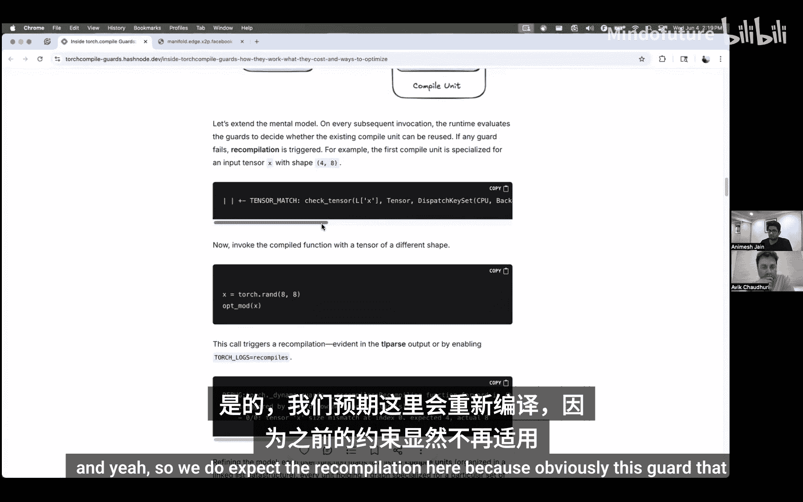

The tail bars。

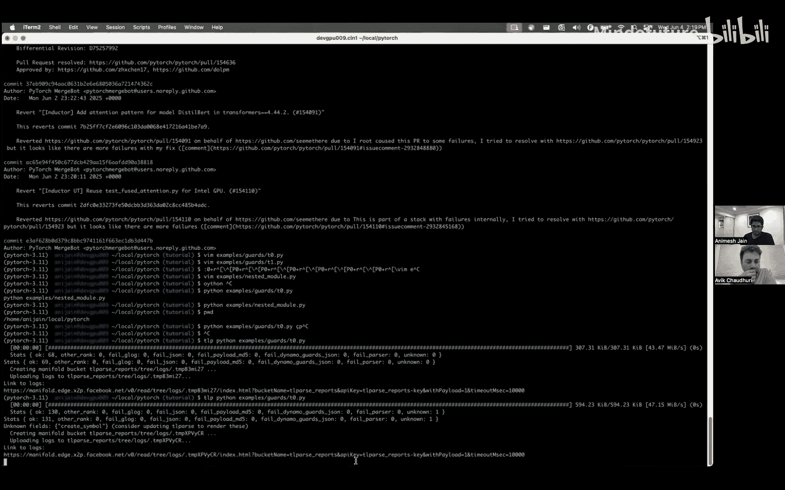

Okay。And here we can see one more compilation so if you look at the previous one。

 there was only one compilation but here there are two compilations。

 you can also look at the recompiled reason and the recompiled reason is what you would x x the tensor x size has changed it works at index0 was four because and now it is。

So yeah， so it works。So if we now continue building on the programming model or the sort of mental model that we had。

 this is still incomplete because each function is not just one compile unit。

 but actually it's a link it's a list of these compile units where at onetime we basically walk this list of compile units for each compile unit we check that guard and if the guard pass we can dispatch that compile graph。

And maybe in like a knife question here， but why， why a list not a set is it like these are these guards not guaranteed to be disjoined？

They so so this this is more of a more of a implementation question so they could like you you could design guards in a manner where all the guards common guards are done first and then you basically learn the differentiating guards in that case a structure could be different here we tried very simple structure where we go through linked list like basically you have to start on some。

First。A compile unit check all its cardss and then we will go over like how can we make it fast if' if it fails and then and then we basically do it one by one。

 So this is just an implementation detail at this point of time。

 but yeah you could have said you could have different infrastructure I but but in the worst case。

 you will compute multiple guards before you hit hit a particular multiple sets of guards before you hit on a graph where the guards are true Yes exactly so so in case of multiple multiple compils for user function。

 the worst case could be pretty bad where suppose you have eight of these compile units。

 all first7 fail and even and then then the eight one passes So so you're running all the guards possible yeah。

So。😊，So yeah so this is a good mental model to have like basically a user function is mapped to a list of compile units linked list is an implementation detail and we will sort of come back to it later on one thing is we don't want to keep on recompiling so there are some pathological cases where we might keep on recompiling and we don't want that endless loop so there is a config called recompile limit which by default is set to a and the idea is that if To compile keeps on recompiling a function eight times it says oh this function is not compilable friendly and therefore let's just give up on this function and giving up here means that we will fall back to eager when you call this function again we will see if for the first eight for the first eight entries any of the cards pass if cards pass we will dispatch a compile graph but if it doesn't it will just fall back to。

We won't attempt a new decomilation。要看。So hopefully with this。

 we have an appreciation of what cars are and how they fit into the system now I alludrated this before。

😊。

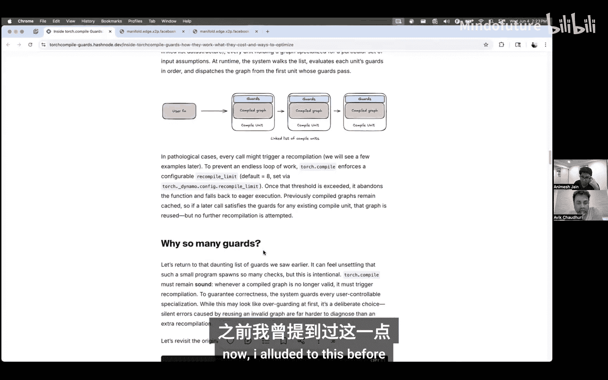

If we look at the guards。There are so， so many。 and this could be quite unsettling because our our。

Program was actually quite small。 program was this。And。

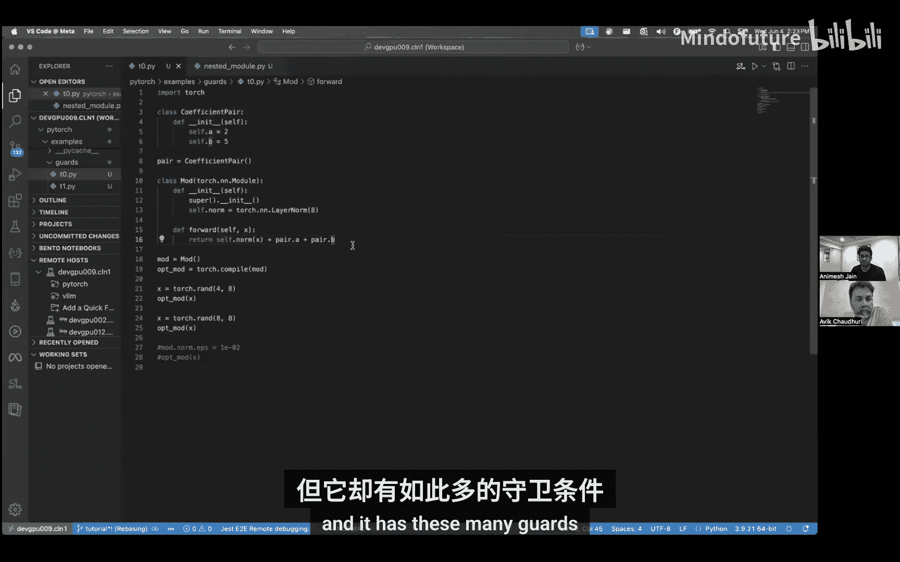

It has these many cards。So why， why so many guards and。And I think I think the reason is that。

We want torch compile to be sound and what what we mean by that is that if a user can change。

Some part of the model。And because of which the previously compile graph is no longer valid。

 we must do a recompilation and therefore torch compiled by default guards on every user control control level specialization so let's take an example so in this case like your quote was this where you have a layer norm sub moduleule and you could just do this。

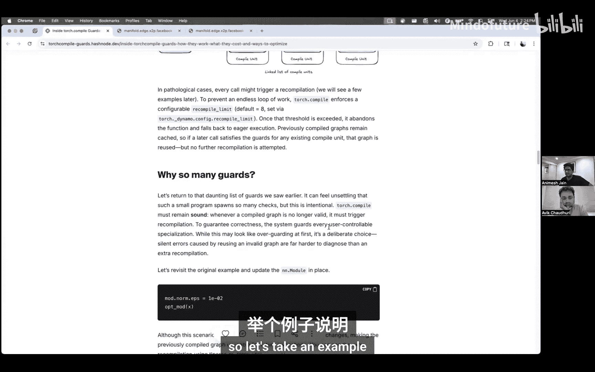

It is possible， though it's rare it is possible you could do this and if you do this。

 the graph that we had in the beginning is no longer valid。😊，So。

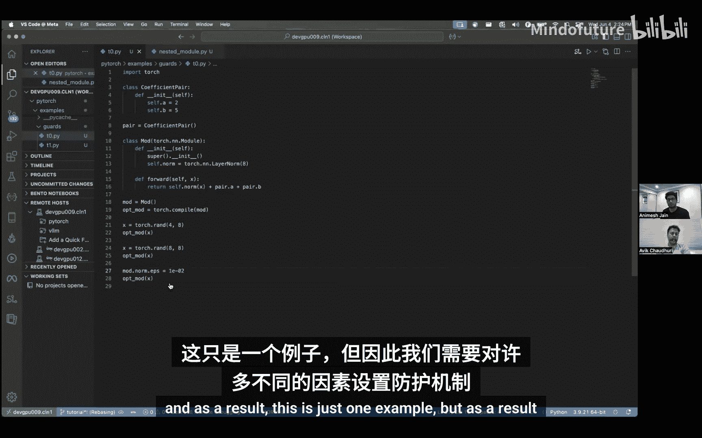

And as a result like this is just one example， but as a result we basically guard on so many different things and all of these things could be changed by the user and it may seem overguardding at first but to be really。

 really sound you have to guard on all those things and so this is basically a soundness overhead cr off where we have deliberately chosen chosen soundness and because of this it could have some performance overhead and we will later go on on how to mitigate these performance overheads like if you feel this is overguardding there are ways to remove these guards and reduce so in this particular example。

😊，Maybe I missed it， but is the graph depending on the EPS yes。Yes， because this。

Goes in the in the in this。 Oh， I see。 I see。 yeah， yeah yeah， okay。So I see yeah。

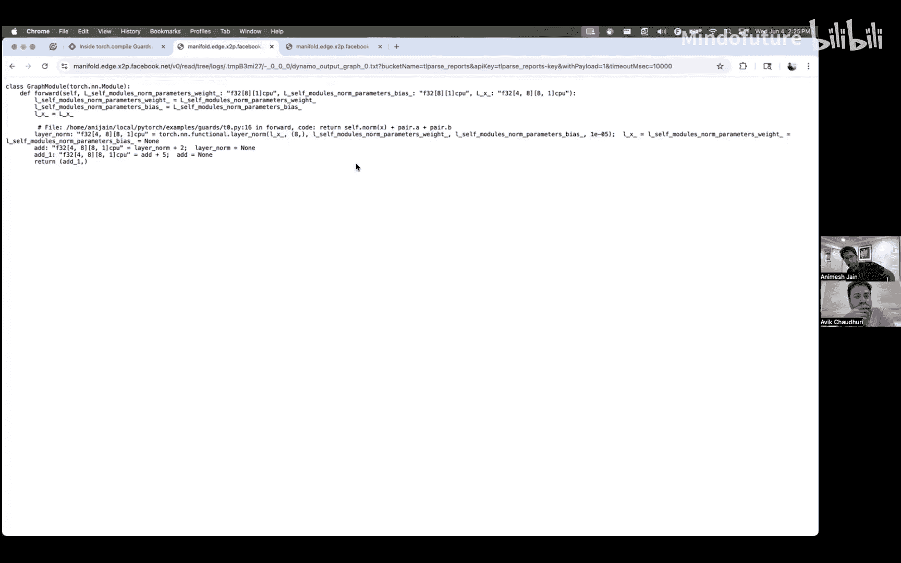

So we can quickly run this as well and just see that the new thing has the。

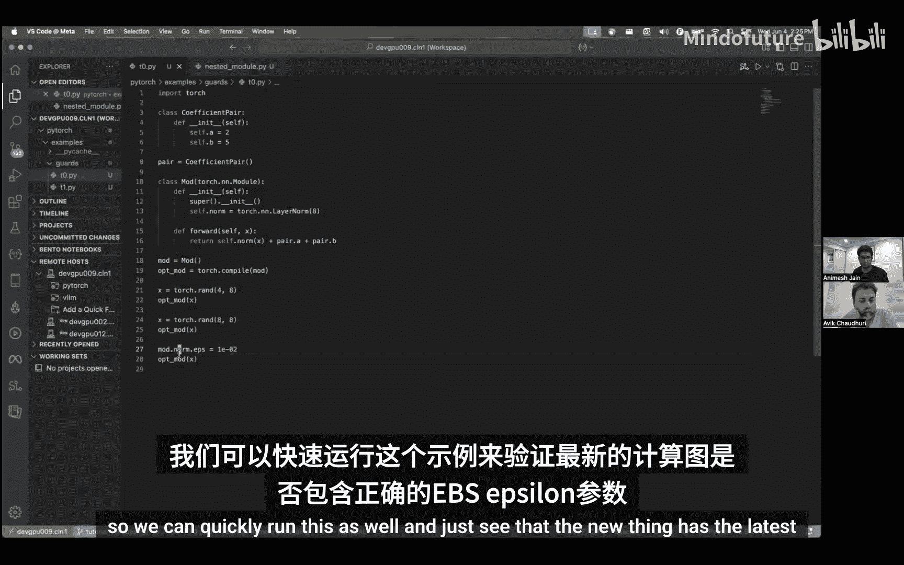

The latest graph has the right EPS epsalon。

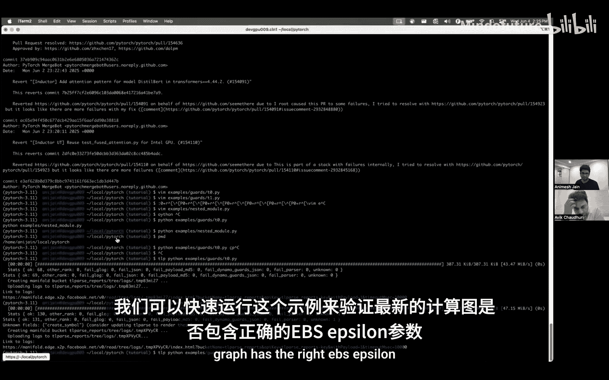

Yeah。I think the point is Mari so we'll just move the section any questions on it？No， no。

 that's fine。So okay， so let's think about what is the impact of having guards in the system。

So this compile time cost， which is like every time there is a recompilation you trigger this whole rorch compile pipeline and torch compile is known to have high compile times recompilation is just making it more worse thiss runtime cost as alluded before you are running these cards in addition you are running guards on multiple compile units this can be very visible this typically this is fast but it could be visible where。

😊，You have models with very short inference times and guard over had becomes visible compared to the total influence cost。

So so this can happen even if the system kind of stabilizes， right？Yes。

 because because dot compiled by default doesnt know， doesn't know when the system is stable。

You could you could run something million times and then you could do something like this。Yeah。

 so so by default， yeah， it is just， it doesn't know what when it is still。

And by stable here means that we expect no more recompilations， right that's what Im mean yeah。Okay。

 so I think just quickly， let's test。Just let's double check the the Tl parts here。

 we expect three compilations， so 0，1，0。2 and let's not worry about this one for now and then we can look at the dynamo graph this is 0。

01 different from1 he minus1。O。Okay， so so so yeah we discussed about compile time cost and run time cost。

 so let's let's go into the compile time cost。😊，And the idea is that guards cause recompilations。

And how can we avoid those decompilations so a very common very very common thing is that your inputtensor is shape changes so in in the example that I showed earlier we saw that the first compilation was assuming that it inserted a guard where it assume static shape that we will only do it can only support for binary way if you know that oh you have maybe like batch size which is going keep on changing you can you can prevent this sort of first decompilation sort of like the second compilation you can just tell instructed torch compile guard system that oh I'm expecting this batch size to change from here on so already you use symbolic size in sort of a static size forest dimension and this could be done with something called mark dynamic there is a very good documentation here so I'm not gonna go into the details but you can use this torch compile mark。

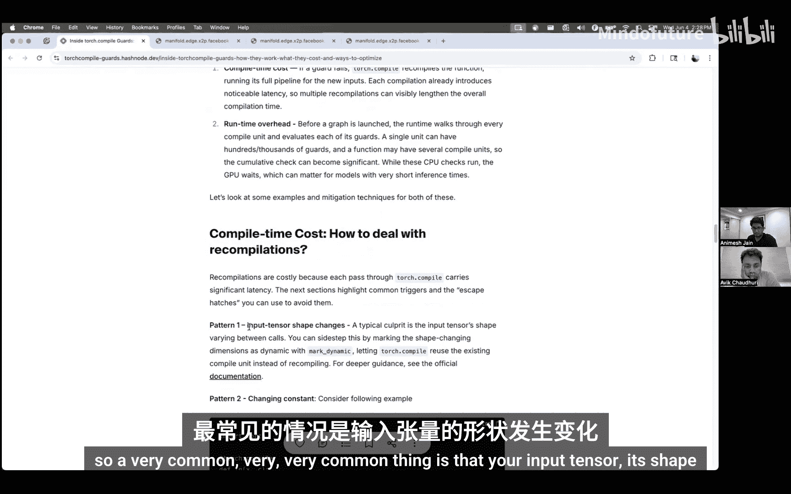

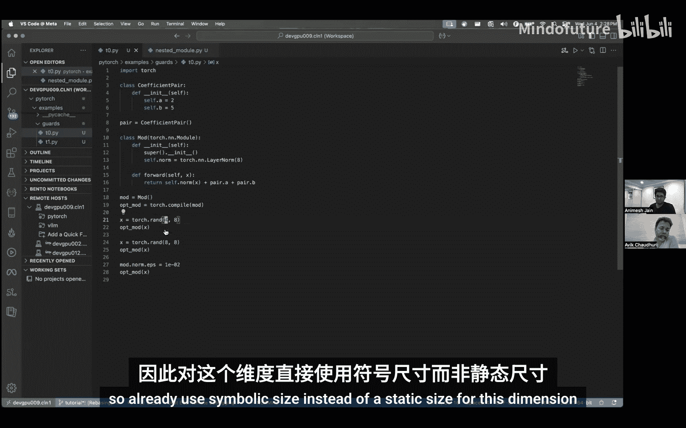

To to instruct Toch compile file to do the right thing I have seen users using dynamic equals true dynamic equals true words。

 but dynamic equals true means you can make the whole model dynamic like you are just saying create dimension treat every in teacher as dynamic which could bring a lot more damism into the model than required you want your model to be。

Almost to be mostly static and maybe like a slice of it dynamic because if it's static it's going to give you better performance so this mod dynamic allows you to make only a slice of your model dynamic if you may while rest other thing is static。

😊，Yeah， so this is similar to other like prone language compilers where the more you can know about types。

 for example， like you know， if you have enterrithmetic then you can specialize if you have like generic code。

 then then it always goes through slower parts and so on so okay so just to clarify so mark dynamics gives you control over specific dimension So you don't even have to make your whole shape dynamic if you want the dimensions is changing that you can get so you can say mark dynamics for example。

 in this case， you want your you want your just best size to be be to be math dynamics so you can do torch compile market dynamic。

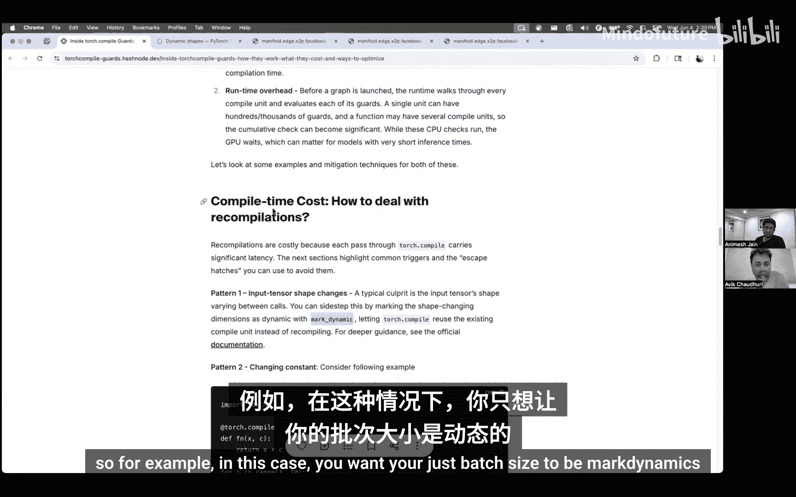

X0。 So this means only zero at three dimension， which is the bad size here。

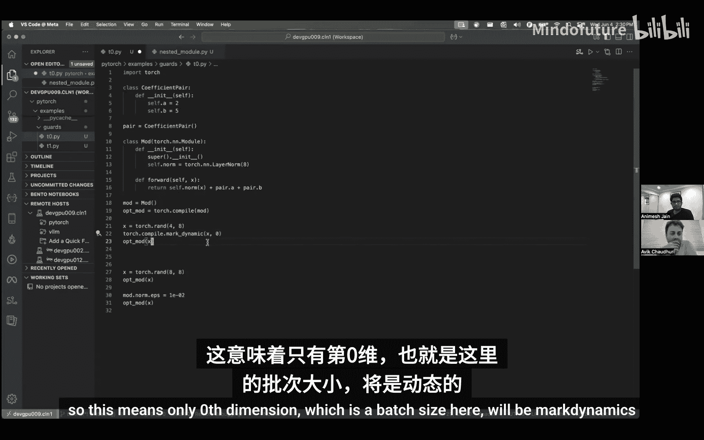

Okay， then the second pattern that we have seen which causes recompilation is a constant that keeps on changing so for example here you are compiling a function which with a constant C but that C is a float which keeps on changing and this will cause a recompilation because by default torch compile guards on the exact value of these constants and one easy way to avoid this recompilation is to wrap this。

Const into a tensor， so you can do something like this。And this will just cause call。

One compile because we don't count on the values of tensor。

 we just card on the shape of the tensor and therefore this will avoid compilation so if you can change your model to do this that's awesome and that will give you like that will remove recompilations from your model。

The third pattern that we have seen is NN module in attribute change it's kind of similar to the previous one just that now it's an attribute of the of the model so for for example you have this con which is a attribute of the N module and then you keep on changing so this could be maybe like something like a count where you are counting the number of times you you have all inference for something like that one easy way is to convert this into a tensor like a previous one or if you are like if it's involved in the computation like this you may want to make it a cement a symbolic integer so that like a town portion does not assume the constant value it assumes a integer which keeps on changing and to do that you can use this config。

Allow unspecialization in teacher often teacher on an N modules。

 which will convert this C into a so in this case it'll automatically consider constants to be ss by default it by default torch compile considers it to be static so population but with this with this it will make it a s。

So yeah， I mean so the program model here is like consistent So basically anytime you can hide things inside tensors they will not be specialized there are some default rules of like we specialize in constants or whatever so you can you can use the tensor trick to hide or or or I mean symbolic answeror also like that I guess like they're not specialized so yeah。

Yeah。And then then there's a fourth one， which is really not really a workaround。

 but as mentioned earlier， we have a limit， we have a threshold how many times we compile a function and then give up on it this limit is aid by default。

 but it is possible that you know that you have tried all of these above sort of workaround and then you know oh you have a genuine reason that you should have more compilations。

😊，And in that case， if you want to benefit from those compilations。

 you can just increase the recompile unit use this sparingly like if you if you have a like open issues and Pyto to see if we can。

Not recompile this much， but in some cases it could be a valid reason to recompile this much。

So just curious where the number eight came from， obviously it's just like heuristic。

 but is it like relate to。Okay， in other words。If if a function has many arguments。

 wouldn't you assume that。There could be many more recompilations than a function with fewer arguments。

And in that sense， shouldn't the limit be sort of like。Salable， according to that。

it is possible it is possible so like going back to the programming model what we have here is a function which can be mapped like for each function we have this recompile limit number of cache entries and keep the designs in and like。

In reality you just don't compile one function you have basically multiple functions each function mapping to many of these compile units so to be simple we have chosen the recompile limit for all the functions to be same right what we are proposing is can we have some sort of configurable or like a function which is supposed to be more supposed to have more recompilations can have a higher compilation limit recompile limit while the other function kind are smaller I think do that is it's an implementation choice to keep things simple we have and there is no like rotating cache or something like that right where you can basically evict the first few when when you see like new and you can still keep like eight things in in in your cache but。

You just just evict the old ones and and then keep adding new ones or something。

 So we don't evict anything。 We evict only and only when。

A compile unit is invalid compile unit can be invalid for example， you you for example， in this case。

 suppose you delete the module itself like you call delete mode。

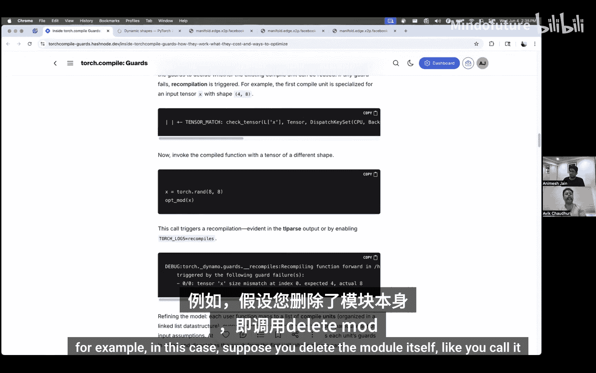

So in this case， like all the compileers are kind of invalid because in the cardss we will have like sort of weak differences to these module and then we will do eion。

 but we don't do eviction for valid entries。😊。

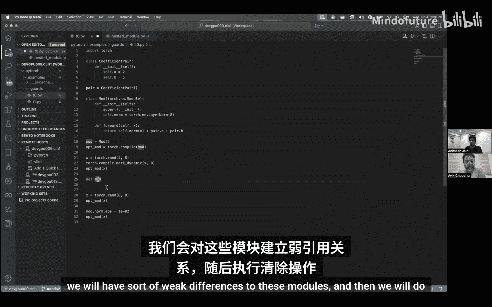

Yeah so I think I think and another question like why a so so we earlier like maybe like one and a half years ago this recompile limit was 64 and what was happening was that in many cases this would call a really large compile time relu compation time because you'll just recomp like what we have seen is if we have recompile four times it's more we are going to recompile to the limit。

😊，And something bad has happened so so to be to have a good user experience we wanted to be eight in fact we wanted to be want I want it to be four but we then we found four is not good so。

😊，So it is to have a good default， but this is reconfiable。

Okay so we discussed the the compile time cost the other aspect of guards is guard overhead right and and and just just to remind why guard overhead first was why so many guards right like we have a large number of guards and these and we have these guards because we we make a deliberate choice to be safe always even though it can have high guard overhead and the other reason is is。

Sorry， I'm moving a lot。And the other reason is this linked list of compile units where we are walking through this linked list and we are executing many。

 many cars together。So so let's let's look at some examples and see what is this guard overhead and how can you reduce this card overhead and if you ever have profiled a Pytch program you can you know about Pyto profiler so you can just use Pytch profiler and。

And yeah like the guard overhead is present under the event called Tosh animal cash looker。

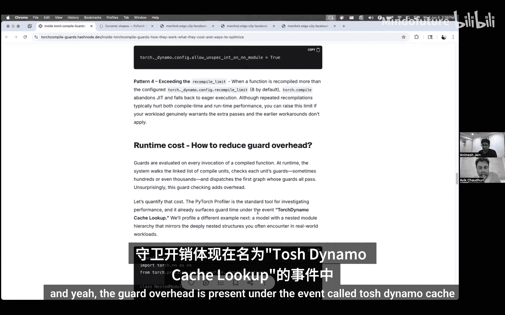

I'm going to。I'm going to run this function while we discuss other things so that we can see what's going on。

So。

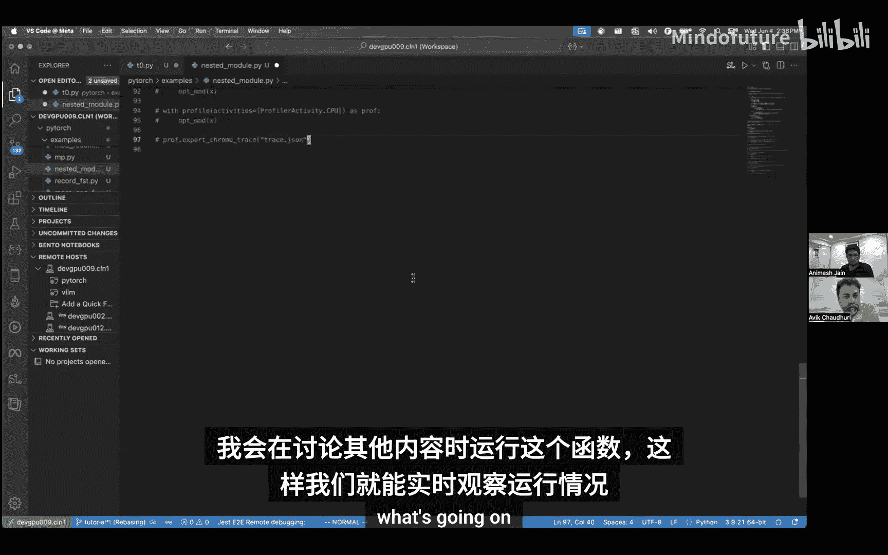

Yeahep。

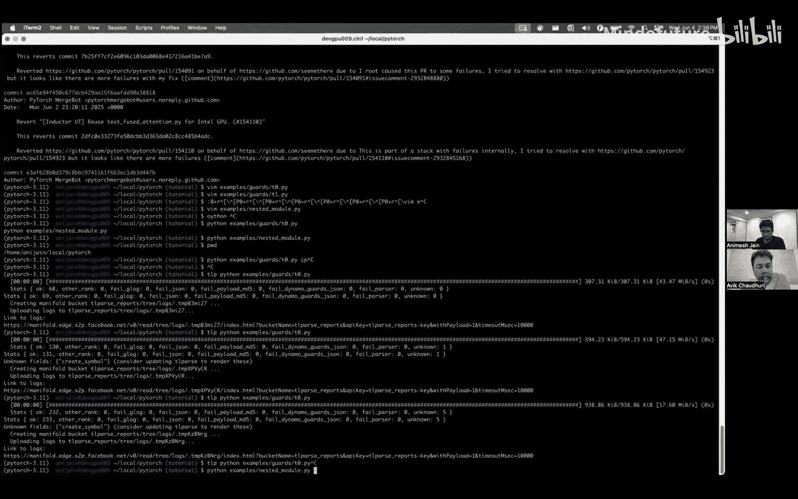

So yeah so here let's go through a different function and the reason I chose a different function is somewhat more realistic not very realistic but somewhat more realistic it's a nested module where we have a couple of linear layers and then it itself has a nested modules as some module so the reason it's just that when you write when you create when you create a model it is basically a deeply nested。

😊，SomeMo structure， so I want to have guards that sort of represent or mimic this kind structure。嗯。

And yeah like and then you can run this and then you can just do profile like this。

And when you do profile like this， you can you get this traced or file。

 you can open inro tracing and it'll look something like this like you will see this box torch Dynamo cache lookup let's see if that is finished okay now if you give me a second I will。

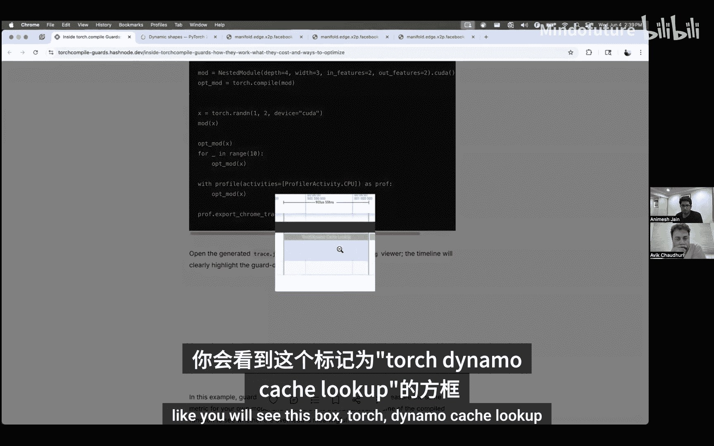

嗯。

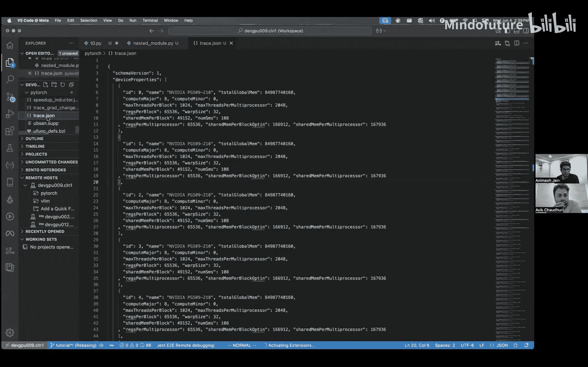

Let's open control trace。And I'm going to use feter UI because I like it more and then let's bring that in。

downloadロs。Okay， so if we go there， we see this thing。And if I zoom in， this is the cash looker。

And then this is other part， which is a compiled function。

 which is like the event for the whole of the inductor code。

 the sort of the backend of torch compiled and I'm going to go about other things maybe some other video but let's focus on the Toch terminal cash looker and in this case we see 945 microseconds roughly around a millisecond is spent in God。

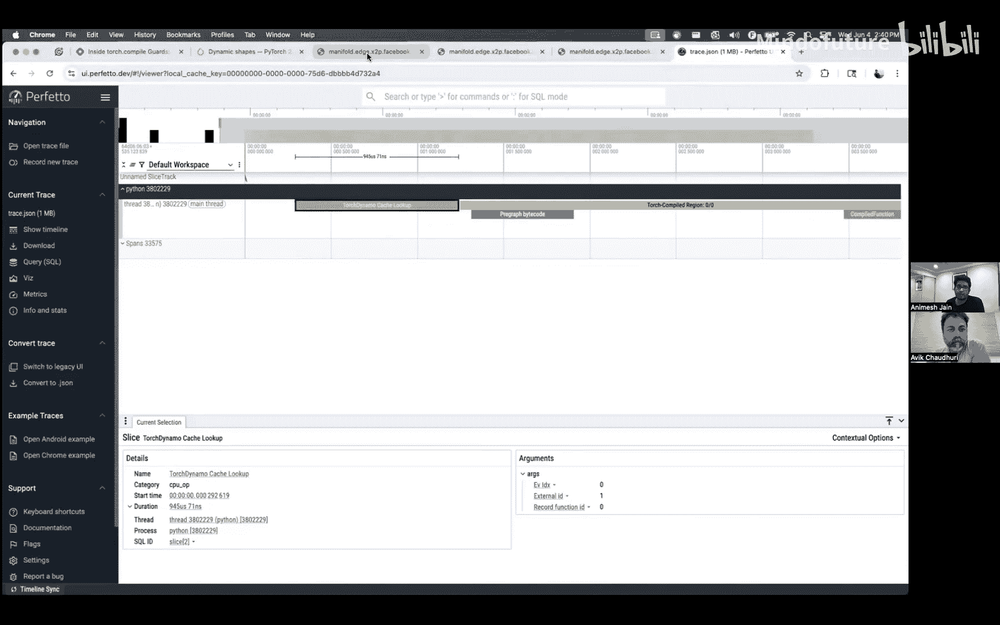

This could be， this could be considered high。

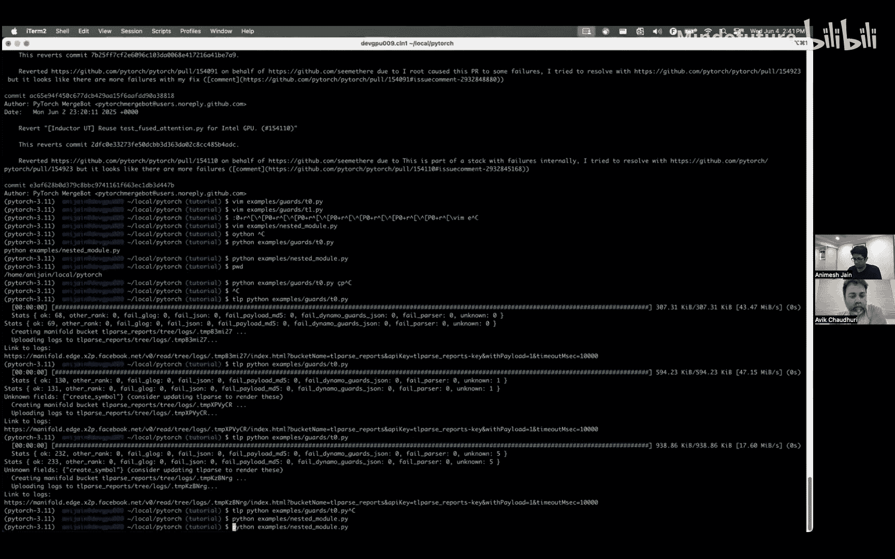

If like like in this model， maybe it's okay because we have large。Execution time， but for your model。

 maybe maybe you maybe this is very fast and there。The Tosh animal of cash cup is visible， so yeah。

So yeah so we have so the question is can we reduce these cards and today we provide two escape hatches to reduce this card overhead one is called skip guard evil unsafe stands and the other thing is called Gar filterter API the Gar fitter API is what in progress it's not present in 2。

7 delay and even I think like some aspects of it might not be1 in nightly so so please wait for like a couple of weeks for。

😊，Onlyly use this card filter APIN， but this skip guard Valafe is presenting 2。7。

1 and then can use that。So let's try to see what's going on with these different escape patches。

So I think as Avic alluded to earlier。😊，When when your environment is stable。

 we don't need so many guard and when I mean stable I mean you have run your model some number of times or maybe like let's call it warmer like you have warmed up your model with enough representative inputs that you have seen all the compilations and from there on you do not expect any other compilation。

You do not expect anybody to change your model in place。So in that case。

 if you have say four compilations， if you have like four compile units you need。

Handful of guards to differentiate between these four compile units you don't all the guards and then this is basically what SG e well andafe does it finds out those those differentiating guards and then drops everything else so this is automatic okay so yeah because for a while I was like worried okay do you need to understand what which cards drop and not but's automatically analyze the cards okay yes yes and it's really easy to use can can you can use a stands and maybe what a stands is is a topic for another but but to use it it's really easy you can you can tell compiler to set the stands and you are saying that okay just use skip carddi unsafe and when it does that you can see almost all the guards are dropped because there's only one compile unit in here and and we treat the tensor guards as like important。

So we don't drop them so the only what is running here is a tensor card or nothing else and if you see this is 27 microseconds which is like zero compared to 900 microseconds that we had here。

😊，SoSo this is really cool this is automatic you might wonder why it's unsafe it's unsafe because suppose after warm up you do this and suppose in this line basicallyibly change you do more dot layer norm dot Eps equals1 e minus5 is going to be silently using the wrong ground if you drop one of the common guards that was always true but you don't know in the future whether it could have been false and then that would have triggered any compilation yes yes。

😊，So this is like one of those cases where torch compile by default is guarding on everything because it wants to be safe。

 but for practical use cases， in many cases you' going to change your module later on。

 so this is handy to reduce card overhead。Ex yeah the other one is Gar filterter API and this is where you have to understand Gars a little bit what is the what is the benefit of Gar filter API over over over S Carvalsafe is basically it's more like in pro systems so like in pro systems you might have control over the code that compiles but not at the end time。

So for example， in the case of SG even unsafe， you have to warm up your model。

 then you have to set the stance， which means that you need to have some control over where to put these lines where to warm up and those kind of things and and you might say no I don't have control over the runtime but I can do I have more control over the compulation part so this is when card filter API comes in when you're compiling you can tell the torch compile card system oh is skip these cards and the idea is very simple like when you're compiling you provide this hook in the card filter string like keyword options and card filter key you provide a hook function this hook function takes in all the cards。

And it tells。It basically returns a Booleion list where if it's true， we keep the guard， if it falls。

 we skip the guard so it's kind of very simple。The kinds of cardss that we have is that like a public API that is part of this thing like if if somebody is going to implement a hook I like this function right it seems like a user user level function Yes it is not it's something which is left right now for users to figure out themselves that's a good point we should we should make this make at least the cards types more user facing what we are going do is gonna ship several ready made filters that makes sense to for example。

 have only tensor cardss or like reject all cards on globals then then your hook is basically some kind of boolean function on these filter or something Yes yes so what we think is that if you provide this collection of ready made filters that should suffice but but。

For users who want more control they can write their own interentials as well so so in this quick time check so the meeting is going to end in three minutes or so okay should be quick yeah I don't need at time so so yeah so here i'm going go over just two of these so so you have something called in built n module in built and modules like and linear not linear norm these are like in built and modules and it's very unlikely you' are going to do something like linear norm E so if you think you in built and modules are are not going to change you can use this。

Hook and if you use this hook we reduced from 900 milliseconds so 3，70 milliseconds。

 you can also say oh， I'm not going to change any of the N modules like if you have your own userified NM module and suppose。

😊。

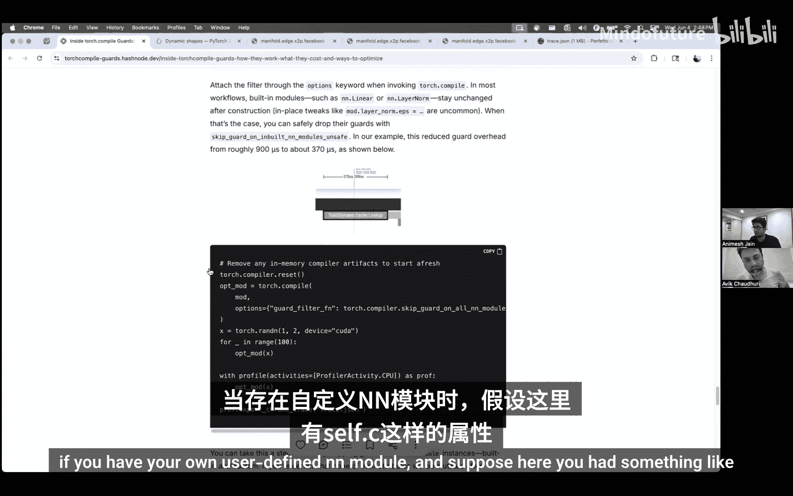

Here， like you had something like self。t C。And you never want you know that you would never change mod do C。

 you could also skip all the cards on user defined modules and this is a second one so if you do that in this example you have actually eliminated almost all the cards and therefore you the card overhead goes to single。

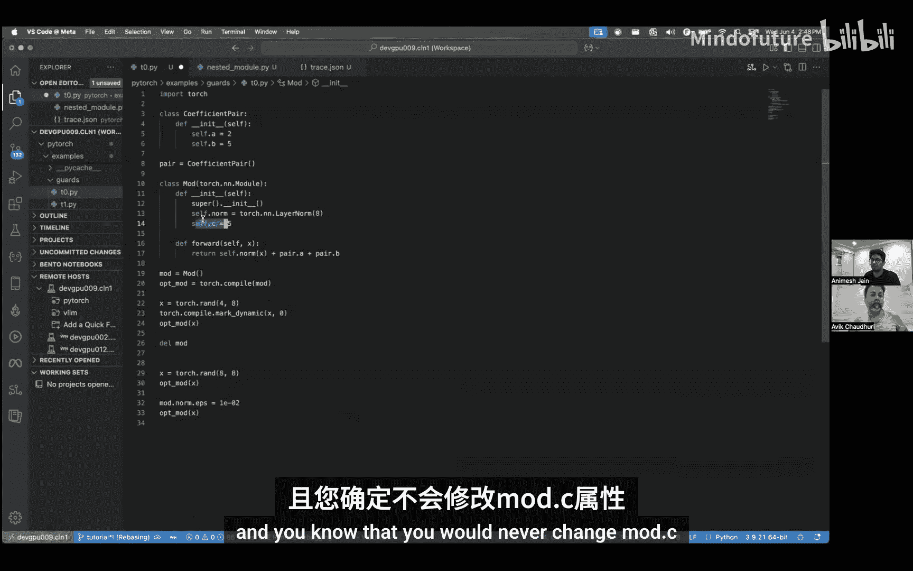

Yeah， then there is some details on how guards are implemented and the sort of the engineering principles behind。

Like how to make them fast， but that's not important。

 maybe that's for readers who are interested in learning more engineering details yeah。Cool。

 so so among these is one of the things that you're thinking of in in like under the hood。

 like actually what we were talking about where you kind of。

Convert a list of guards into sort of like a tree of guards or is that like yeah so first thing is like what's the guard structure it's a tree structure and then and then how do we make guards fast we basically move everything to see。

And we basically use the Pthon APIpis and the other important thing is fail fast on decompilation so for example if you have many many compile units you want and if you suppose you're going to take the third compile unit you want the first and second compile unit to fail fast so what we do is the Gars that fail we move them early the in the guard structure so that the next time the offending guards fail fail first and the other optimization is basically you can also move around these compile units and we use most recently used strategy to keep the compile unit first hoping that yeah this is more of an empirical choice and that we are seen to work regularly。

All right， so yeah， we're out of time meeting and end any time。Let's thank Anishish。Thank you。咩拜拜。

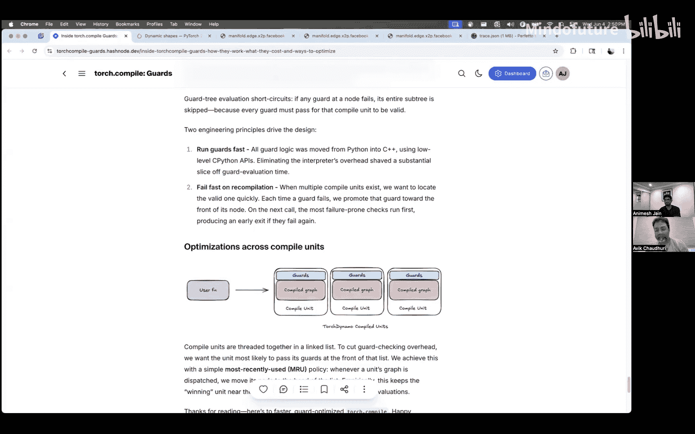